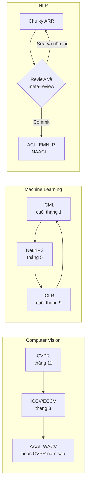

# Bản đồ các hội nghị A\*

!!! abstract "Mục tiêu của bài"
    Sau bài này, người học có thể:

    - giải thích "hội nghị A\*" nghĩa là gì, các thước đo thường dùng để xếp hạng (CORE, Google Scholar Metrics) và giới hạn của chúng;
    - hiểu vì sao trong khoa học máy tính, đặc biệt là trí tuệ nhân tạo, hội nghị chứ không phải tạp chí là kênh công bố chính;
    - nhận diện các hội nghị hàng đầu của ba cộng đồng Computer Vision, NLP, Machine Learning và các hội nghị lân cận;
    - đọc lịch năm điển hình của các hội nghị và hình dung vòng nộp lại tự nhiên giữa chúng;
    - lập luận để chọn cộng đồng phù hợp cho một công trình cụ thể.

Trước khi viết một chữ nào, người viết cần biết paper sẽ được gửi tới đâu. Câu hỏi này quan trọng hơn vẻ ngoài của nó: nơi nộp quyết định ai là reviewer, họ kỳ vọng loại bằng chứng gì, paper được phép dài bao nhiêu, và khi nào phải hoàn thành. Hai paper có cùng nội dung kỹ thuật nhưng được định vị cho hai cộng đồng khác nhau có thể nhận những bản review rất khác nhau.

Bài này vẽ một bản đồ tổng thể. Chúng ta bắt đầu với chính khái niệm "A\*", vốn được nhắc đến rất nhiều nhưng ít khi được giải thích rõ. Tiếp theo là câu hỏi vì sao ngành khoa học máy tính lại đi ngược với phần lớn các ngành khoa học khác khi coi hội nghị là nơi công bố chính. Sau đó, bản đồ được lấp đầy bằng các hội nghị của ba cộng đồng chính và các hội nghị lân cận, đặt trên một lịch năm điển hình. Bài kết thúc bằng một câu hỏi thực hành: với một công trình cụ thể, nên chọn cộng đồng nào.

## "A\*" nghĩa là gì

### Bảng xếp hạng CORE

Ký hiệu "A\*" xuất phát từ bảng xếp hạng hội nghị của CORE (Computing Research and Education Association of Australasia), một hiệp hội các khoa máy tính ở Úc và New Zealand. CORE duy trì một cổng tra cứu xếp hạng các hội nghị khoa học máy tính theo các hạng A\*, A, B, C, trong đó A\* dành cho những hội nghị được coi là hàng đầu, "flagship" của một lĩnh vực. Bảng xếp hạng được cập nhật định kỳ vài năm một lần, dựa trên ý kiến cộng đồng và các chỉ số trích dẫn.

Dù có nguồn gốc ở Úc, bảng CORE được nhiều trường đại học, quỹ tài trợ và hội đồng đánh giá ở châu Á, trong đó có Việt Nam, sử dụng làm căn cứ để đánh giá công bố khoa học. Đây chính là lý do cụm từ "paper A\*" trở nên phổ biến: nó thường gắn với các quyết định cụ thể như xét tốt nghiệp tiến sĩ, xét học hàm, khen thưởng hay tuyển dụng. Phần lớn các hội nghị được nhắc tới trong giáo trình này, như CVPR, ICCV, NeurIPS, ICML, ACL, EMNLP, AAAI, IJCAI hay KDD, nằm ở hạng A\* trong các phiên bản CORE gần đây. Một số hội nghị khác có lúc được xếp hạng A tùy phiên bản, và hạng của một hội nghị có thể thay đổi giữa các lần cập nhật. Vì vậy, khi kết quả xếp hạng ảnh hưởng tới một quyết định cụ thể, người học cần tra cứu trực tiếp trên cổng CORE với đúng phiên bản mà cơ quan đánh giá áp dụng.

### Google Scholar Metrics và h5-index

Thước đo thứ hai thường được nhắc tới là Google Scholar Metrics, đặc biệt là chỉ số h5-index. Một ấn phẩm có h5-index bằng *h* nếu trong năm năm trọn vẹn gần nhất, có *h* bài của ấn phẩm đó được trích dẫn ít nhất *h* lần mỗi bài. Chỉ số này đo mức độ ảnh hưởng trích dẫn của cả một hội nghị hay tạp chí, không đo chất lượng của từng bài cụ thể.

Google Scholar Metrics cho thấy một thực tế đáng chú ý: trong những năm gần đây, CVPR thường nằm trong nhóm vài ấn phẩm có h5-index cao nhất trong *mọi* lĩnh vực khoa học, cạnh những tạp chí như Nature và Science, và các hội nghị như NeurIPS, ICLR cũng xuất hiện trong nhóm dẫn đầu. Google Scholar còn có các bảng xếp hạng theo tiểu lĩnh vực, ví dụ "Computer Vision & Pattern Recognition", "Computational Linguistics" hay "Artificial Intelligence", rất hữu ích khi muốn biết những nơi công bố có ảnh hưởng nhất trong một mảng hẹp.

### Thước đo chỉ là thước đo

Cả CORE và h5-index đều là thước đo ở mức *nơi công bố*, không phải ở mức *bài báo*. Một paper tầm thường vẫn có thể được chấp nhận ở một hội nghị A\*, và một paper ở workshop hay ở một hội nghị hạng thấp hơn vẫn có thể trở nên rất có ảnh hưởng. Trong nội bộ cộng đồng nghiên cứu, người ta đánh giá nhau chủ yếu qua chính các công trình chứ không qua nhãn hạng. Tuy vậy, đối với người làm nghiên cứu ở những môi trường dùng nhãn A\* làm tiêu chí chính thức, việc hiểu rõ bảng xếp hạng là cần thiết. Thái độ hợp lý là dùng xếp hạng để chọn nơi nộp, nhưng không để nó thay thế cho câu hỏi quan trọng hơn: cộng đồng nào sẽ thực sự đọc và xây dựng tiếp trên công trình này.

## Vì sao khoa học máy tính công bố chủ yếu ở hội nghị

Ở phần lớn các ngành khoa học tự nhiên và y sinh, tạp chí là nơi công bố chính; hội nghị chủ yếu là nơi trình bày tóm tắt, và một "conference abstract" thường không được tính như một công bố đầy đủ. Khoa học máy tính, và đặc biệt là trí tuệ nhân tạo, đi theo con đường ngược lại. Các hội nghị hàng đầu nhận *bài đầy đủ*, được bình duyệt (peer review) nghiêm ngặt, được xuất bản trong kỷ yếu (proceedings) có tính lưu trữ, và có uy tín ngang hoặc cao hơn phần lớn tạp chí trong ngành.

Lý do sâu xa nằm ở tốc độ phát triển của lĩnh vực. Một chu kỳ review hội nghị thường kéo dài khoảng ba đến bốn tháng từ deadline tới quyết định, trong khi quy trình tạp chí với nhiều vòng sửa chữa có thể kéo dài nhiều tháng tới hơn một năm. Trong một lĩnh vực mà phương pháp tốt nhất có thể thay đổi sau vài tháng, độ trễ đó là không chấp nhận được. Deadline cố định của hội nghị cũng tạo ra một nhịp làm việc chung cho cả cộng đồng, và bản thân hội nghị là nơi các nhóm nghiên cứu gặp gỡ, trao đổi, tuyển người.

Mô hình này kéo theo một số hệ quả mà người viết cần nắm. Thứ nhất, văn hóa làm việc xoay quanh deadline: phần lớn kế hoạch nghiên cứu được tính ngược từ một ngày nộp cụ thể. Thứ hai, review hội nghị về cơ bản là một lần quyết định: paper được chấp nhận hoặc bị từ chối, không có vòng "major revision" như ở tạp chí, nên paper phải gần như hoàn chỉnh ngay từ lúc nộp; ACL Rolling Review của cộng đồng NLP là một ngoại lệ đáng chú ý, sẽ được trình bày ở bài về hệ sinh thái NLP. Thứ ba, giới hạn số trang rất chặt, buộc người viết phải chọn lọc. Thứ tư, văn hóa đăng preprint lên arXiv rất phổ biến, vì nhóm tác giả muốn xác lập quyền ưu tiên cho ý tưởng trước khi quá trình review kết thúc.

Tạp chí vẫn có vai trò quan trọng trong ngành. Mỗi cộng đồng có những tạp chí uy tín riêng: IEEE TPAMI và IJCV cho Computer Vision; TACL và Computational Linguistics cho NLP; JMLR và TMLR cho Machine Learning. Tạp chí thường là nơi công bố các phiên bản mở rộng của paper hội nghị, các công trình dài cần nhiều trang hơn, hoặc các bài tổng quan. Bài [AAAI / IJCAI / KDD / Journal](../06-cong-dong/khac.md) ở Chương 6 trình bày chi tiết hơn về con đường tạp chí.

## Ba cộng đồng chính

Trí tuệ nhân tạo hiện đại có ba cộng đồng công bố lớn, mỗi cộng đồng có hội nghị đỉnh, hệ thống review và văn hóa riêng. Phần này giới thiệu ngắn gọn từng cộng đồng; ba bài tiếp theo của chương sẽ đi vào chi tiết.

### Computer Vision: CVPR, ICCV, ECCV

Cộng đồng thị giác máy tính có ba hội nghị đỉnh. CVPR diễn ra hằng năm vào khoảng tháng 6 và là hội nghị lớn nhất, với hơn mười nghìn submission mỗi năm gần đây. ICCV và ECCV luân phiên nhau: ICCV diễn ra vào các năm lẻ, ECCV vào các năm chẵn, cả hai đều vào khoảng tháng 9 hoặc tháng 10. Nhờ sự luân phiên này, mỗi năm cộng đồng CV có hai cơ hội nộp bài ở cấp cao nhất. Văn hóa CV đặc biệt coi trọng kết quả trên các benchmark chuẩn, bằng chứng hình ảnh và các thí nghiệm ablation. Chi tiết được trình bày trong bài [Computer Vision: CVPR, ICCV, ECCV](he-sinh-thai-cv.md).

### NLP: ACL, EMNLP, NAACL và các hội nghị anh em

Cộng đồng xử lý ngôn ngữ tự nhiên được tổ chức quanh hiệp hội ACL (Association for Computational Linguistics). Hội nghị chính của hiệp hội là ACL, diễn ra hằng năm vào khoảng mùa hè; EMNLP diễn ra vào cuối năm và có uy tín tương đương; NAACL, EACL và AACL là các hội nghị của các chi hội khu vực. Điểm đặc biệt của NLP là hệ thống review tập trung ACL Rolling Review (ARR), trong đó paper được review trong các chu kỳ chung rồi mới được "commit" tới một hội nghị cụ thể. Văn hóa NLP coi trọng sự cẩn thận trong đánh giá, phân tích lỗi, đánh giá bởi con người, tính đa ngôn ngữ và đạo đức dữ liệu. Chi tiết được trình bày trong bài [NLP: ACL, EMNLP, NAACL](he-sinh-thai-nlp.md).

### Machine Learning: NeurIPS, ICML, ICLR

Cộng đồng học máy có ba hội nghị trụ cột. NeurIPS diễn ra vào tháng 12, ICML vào tháng 7, ICLR vào khoảng tháng 4 hoặc tháng 5, và cả ba đều dùng nền tảng OpenReview với cơ chế thảo luận nhiều vòng giữa tác giả và reviewer. Đây là nơi công bố của các phương pháp học tổng quát, các kết quả lý thuyết và ngày càng nhiều công trình về mô hình nền tảng (foundation model). Văn hóa ML coi trọng tính tổng quát, phân tích hoặc lý thuyết, thí nghiệm có kiểm soát và độ tin cậy thống kê. Chi tiết được trình bày trong bài [ML/DL: NeurIPS, ICML, ICLR](he-sinh-thai-ml.md).

Bảng dưới đây tổng hợp lại ba cộng đồng theo những chiều mà người viết quan tâm nhất.

| | Computer Vision | NLP | Machine Learning |
|---|---|---|---|
| Hội nghị đỉnh | CVPR, ICCV, ECCV | ACL, EMNLP, NAACL (và EACL, AACL) | NeurIPS, ICML, ICLR |
| Cơ chế review | OpenReview, rebuttal ngắn, thảo luận kín giữa reviewer và AC | ACL Rolling Review, author response, meta-review, commit | OpenReview, thảo luận nhiều vòng tác giả và reviewer |
| Bằng chứng được kỳ vọng | Benchmark chuẩn, hình ảnh định tính, ablation | Đánh giá cẩn thận, phân tích lỗi, human evaluation | Tính tổng quát, phân tích hoặc lý thuyết, error bars |
| Mục đặc thù | Supplementary, video | Limitations bắt buộc, Responsible NLP checklist | Appendix dài, Paper Checklist (NeurIPS) |
| Tạp chí uy tín | TPAMI, IJCV | TACL, Computational Linguistics | JMLR, TMLR |

## Các hội nghị lân cận

Ngoài ba cộng đồng chính, có một số hội nghị khác mà người làm AI thường cân nhắc, hoặc vì phạm vi rộng hơn, hoặc vì tập trung vào một nhánh hẹp hơn, hoặc vì lịch của chúng lấp vào những khoảng trống trong năm.

AAAI và IJCAI là hai hội nghị trí tuệ nhân tạo tổng quát có lịch sử lâu đời, nhận paper từ mọi nhánh của AI, từ học máy, thị giác, ngôn ngữ tới lập kế hoạch, suy luận và hệ đa tác tử. Vì reviewer đến từ nhiều nhánh khác nhau, paper gửi tới đây cần được viết dễ tiếp cận hơn với người ngoài chuyên ngành hẹp. KDD là hội nghị hàng đầu về khai phá dữ liệu, phù hợp với các công trình về dữ liệu quy mô lớn, hệ khuyến nghị, đồ thị và các ứng dụng có tác động thực tế; KDD trong những năm gần đây có hai đợt nộp mỗi năm. ACM Multimedia (ACM MM) tập trung vào đa phương tiện, nơi giao thoa giữa hình ảnh, video, âm thanh và ngôn ngữ.

Trong cộng đồng CV, WACV và BMVC là hai hội nghị được tôn trọng, thường được dùng làm nơi nộp cho những công trình vững chắc nhưng có phạm vi hẹp hơn, hoặc làm điểm dừng sau một lần bị từ chối ở hội nghị đỉnh; WACV có hai vòng nộp mỗi năm. Trong cộng đồng NLP, COLING là hội nghị lâu đời không thuộc hiệp hội ACL nhưng có vị trí quan trọng. Trong cộng đồng ML, AISTATS (giao thoa giữa thống kê và học máy), UAI (suy luận trong điều kiện bất định, mô hình xác suất) và COLT (lý thuyết học) là những hội nghị chuyên sâu được đánh giá rất cao trong các nhánh tương ứng.

Cộng đồng xử lý tiếng nói (speech) có hai hội nghị lớn: Interspeech của ISCA, thường có deadline vào khoảng cuối tháng 2 hoặc tháng 3 và diễn ra vào khoảng tháng 8 đến tháng 10, và ICASSP của IEEE, thường có deadline vào khoảng tháng 9 và diễn ra vào khoảng tháng 4 năm sau. Cả hai đều có paper ngắn, điển hình bốn trang nội dung cộng thêm trang cho tài liệu tham khảo, nên đòi hỏi một lối viết rất cô đọng; riêng Interspeech 2026 có thêm track long paper tám trang. Hai hội nghị này không nằm trong nhóm A\* của CORE, nhưng là nơi công bố hàng đầu của cộng đồng speech. Case study [ViP-VL](../05-case-studies/vip-vl.md) phân tích cách một paper Interspeech bốn trang được dựng lên.

| Hội nghị | Phạm vi | Khi nào nên cân nhắc |
|---|---|---|
| AAAI, IJCAI | AI tổng quát | Công trình có thể hấp dẫn người đọc ngoài một cộng đồng hẹp; lịch nộp phù hợp |
| KDD | Khai phá dữ liệu, ứng dụng dữ liệu lớn | Đóng góp gắn với dữ liệu thực, đồ thị, hệ khuyến nghị, tác động ứng dụng |
| ACM MM | Đa phương tiện | Công trình kết hợp nhiều phương thức như hình ảnh, âm thanh, văn bản |
| WACV, BMVC | Thị giác máy tính | Công trình CV vững nhưng phạm vi hẹp, hoặc cần một nơi nộp lại phù hợp lịch |
| COLING | Ngôn ngữ học tính toán | Công trình NLP, đặc biệt các chủ đề ngôn ngữ học và đa ngôn ngữ |
| AISTATS, UAI, COLT | Thống kê, mô hình xác suất, lý thuyết học | Đóng góp chủ yếu về phương pháp thống kê hoặc lý thuyết |
| Interspeech, ICASSP | Xử lý tiếng nói (và tín hiệu, với ICASSP) | Công trình về nhận dạng, tổng hợp, hiểu tiếng nói; paper ngắn, thường bốn trang nội dung |

Hạng CORE của các hội nghị lân cận khá khác nhau: có hội nghị ở hạng A\*, có hội nghị ở hạng A hoặc thấp hơn. Khi hạng A\* là một yêu cầu chính thức, người học cần tra cứu trước khi chọn nơi nộp. Bài [AAAI / IJCAI / KDD / Journal](../06-cong-dong/khac.md) ở Chương 6 bàn kỹ hơn về cách viết cho các hội nghị này.

## Lịch năm điển hình

Sau khi đã biết các hội nghị là gì, câu hỏi thực tế tiếp theo là chúng nằm ở đâu trên lịch. Lịch của các hội nghị lớn khá ổn định từ năm này sang năm khác, tới mức nhiều nhóm nghiên cứu lập kế hoạch cả năm dựa trên nó. Bảng dưới đây ghi tháng deadline và tháng diễn ra điển hình. Một vài hội nghị có thêm hạn đăng ký abstract khoảng một tuần trước hạn nộp bài đầy đủ, và có những năm deadline xê dịch vài tuần so với bảng.

| Hội nghị | Deadline điển hình | Diễn ra điển hình | Ghi chú |
|---|---|---|---|
| CVPR | Tháng 11 (năm trước) | Tháng 6 | Hằng năm |
| ICCV | Đầu tháng 3 | Tháng 10 | Chỉ các năm lẻ |
| ECCV | Đầu tháng 3 | Tháng 9 hoặc 10 | Chỉ các năm chẵn |
| NeurIPS | Tháng 5 | Tháng 12 | Hạn abstract khoảng một tuần trước hạn bài đầy đủ |
| ICML | Cuối tháng 1 | Tháng 7 | |
| ICLR | Cuối tháng 9 hoặc đầu tháng 10 (năm trước) | Tháng 4 hoặc 5 | Review công khai trên OpenReview |
| ACL | Qua chu kỳ ARR khoảng tháng 2 | Tháng 7 hoặc 8 | Nộp vào ARR, sau đó commit |
| EMNLP | Qua chu kỳ ARR khoảng tháng 5 hoặc 6 | Tháng 11 hoặc 12 | Nộp vào ARR, sau đó commit |
| NAACL, EACL | Qua chu kỳ ARR khoảng tháng 10 (năm trước) | Nửa đầu năm | Không nhất thiết tổ chức mọi năm |
| AAAI | Tháng 8 (năm trước) | Tháng 2 (có năm cuối tháng 1) | |
| IJCAI | Tháng 1 | Tháng 8 | |

Có hai cách đọc bảng này. Cách thứ nhất là đọc theo hàng: từ deadline tới quyết định thường mất khoảng ba đến bốn tháng, và từ quyết định tới lúc hội nghị diễn ra thêm khoảng hai đến bốn tháng nữa, dành cho camera-ready và tổ chức. Cách thứ hai là đọc theo cột thời gian: hầu như tháng nào trong năm cũng có một deadline quan trọng, nên một công trình hiếm khi phải chờ quá vài tháng để có cơ hội nộp. Riêng với các hội nghị NLP, khái niệm "deadline" cần được hiểu theo cơ chế ARR: paper được nộp vào một chu kỳ ARR, và hội nghị chỉ là nơi nhận paper ở bước commit sau đó. Bài về hệ sinh thái NLP giải thích cơ chế này chi tiết.

!!! warning "Mọi con số trong bảng là điển hình"
    Deadline, thời điểm diễn ra, và thậm chí việc một hội nghị có được tổ chức trong năm hay không đều có thể thay đổi. Trước khi lập kế hoạch, cần kiểm tra Call for Papers chính thức của năm đó, đặc biệt là múi giờ của deadline (thường là AoE, Anywhere on Earth) và các mốc phụ như hạn đăng ký abstract hay hạn nộp supplementary.

## Vòng nộp lại tự nhiên trong năm

Hệ quả quan trọng nhất của lịch năm là sự tồn tại của các "vòng nộp lại" tự nhiên. Vì kết quả của một hội nghị thường được công bố ngay trước deadline của một hội nghị khác, một paper bị từ chối có thể được sửa theo review và nộp lại sau vài tuần. Hiểu các vòng này giúp người viết bình tĩnh hơn khi bị từ chối, và giúp lập kế hoạch có sẵn phương án dự phòng.

Với một paper thị giác máy tính, vòng điển hình bắt đầu ở CVPR vào tháng 11. Kết quả CVPR thường có vào khoảng cuối tháng 2, vừa kịp để sửa và nộp ICCV hoặc ECCV vào đầu tháng 3. Kết quả ICCV hoặc ECCV có vào khoảng cuối tháng 6 hoặc đầu tháng 7; nếu tiếp tục bị từ chối, nhóm tác giả có thể chuyển sang AAAI vào tháng 8, WACV, hoặc quay lại CVPR năm sau.

Với một paper học máy, vòng điển hình đi qua ba hội nghị trụ cột. Paper nộp ICML cuối tháng 1 nhận kết quả vào khoảng đầu tháng 5, vừa kịp cho NeurIPS giữa tháng 5. Kết quả NeurIPS thường có vào khoảng cuối tháng 9, chỉ vài ngày trước deadline ICLR, nên quyết định nộp tiếp ICLR thường phải được đưa ra rất nhanh; các lựa chọn khác vào thời điểm này là AISTATS hay CVPR. Kết quả ICLR có vào khoảng cuối tháng 1, sát với deadline ICML, và vòng lặp lại tiếp tục.

Với một paper NLP, vòng nộp lại được tích hợp ngay trong ARR. Sau khi nhận review và meta-review, nhóm tác giả có thể commit tới hội nghị gần nhất, hoặc sửa paper và nộp lại vào chu kỳ ARR kế tiếp kèm một bản giải trình thay đổi. Vì các chu kỳ ARR diễn ra đều đặn trong năm, paper NLP ít phụ thuộc vào lịch của từng hội nghị hơn.

Có một nguyên tắc không được vi phạm trong mọi vòng nộp lại: chính sách cấm nộp trùng (dual submission). Một paper không được đồng thời nằm trong quá trình review ở hai nơi có thời gian review chồng lấn nhau. Muốn nộp sang hội nghị mới trước khi hội nghị cũ có kết quả, nhóm tác giả phải rút bài khỏi hội nghị cũ trước. Cũng cần lưu ý rằng ở ICLR, submission và review thường được công khai, và theo chính sách những năm gần đây, cả paper bị rút cũng có thể vẫn hiển thị công khai. Bài [Khi bị reject](../04-nop-va-sau-nop/reject.md) trình bày cách khai thác bộ review cũ để chuẩn bị cho lần nộp kế tiếp.

## Chọn cộng đồng cho một công trình

Với một số công trình, câu hỏi chọn cộng đồng có câu trả lời hiển nhiên: một phương pháp phân đoạn ảnh y tế đánh giá trên các benchmark thị giác sẽ đi CV, một nghiên cứu về hiện tượng ngôn ngữ trong mô hình ngôn ngữ sẽ đi NLP. Nhưng ngày càng nhiều công trình nằm ở vùng giao thoa, và khi đó lựa chọn cần được lập luận cẩn thận.

Câu hỏi trung tâm là: *đóng góp chính của công trình thuộc về đâu*. Nếu đóng góp chính là một phương pháp tốt hơn cho một bài toán thị giác, được chứng minh bằng kết quả trên các benchmark thị giác, thì cộng đồng CV là người đọc tự nhiên. Nếu đóng góp chính là hiểu biết mới về ngôn ngữ, về cách mô hình xử lý ngôn ngữ, hoặc một tài nguyên dữ liệu ngôn ngữ, thì NLP là nơi phù hợp. Nếu đóng góp chính là một nguyên lý, một thuật toán hay một kết quả lý thuyết có thể áp dụng cho nhiều miền dữ liệu, thì ML là nơi phù hợp. Có ba câu hỏi phụ giúp trả lời câu hỏi trung tâm. Phần lớn tài liệu trong Related Work được công bố ở đâu? Loại bằng chứng mà công trình đang có, như bảng benchmark, phân tích lỗi hay định lý, khớp với kỳ vọng của cộng đồng nào? Và những người có khả năng xây dựng tiếp trên công trình này thường đọc hội nghị nào?

Hãy xét một ví dụ cụ thể: một công trình về mô hình vision-language. Cùng một hệ thống có thể được định vị theo ba cách. Nếu paper nhấn mạnh một kiến trúc mới giúp cải thiện khả năng định vị đối tượng trong ảnh theo mô tả ngôn ngữ (visual grounding), đánh giá trên các benchmark thị giác và có nhiều hình minh họa, thì nó là một paper CV. Nếu paper nhấn mạnh việc phân tích mô hình xử lý các hiện tượng ngôn ngữ như phủ định, lượng từ hay mô tả đa ngôn ngữ, kèm phân tích lỗi chi tiết, thì nó là một paper NLP. Nếu paper nhấn mạnh một hàm mục tiêu huấn luyện tổng quát cho học tương phản đa phương thức, kèm phân tích vì sao nó hoạt động và thí nghiệm trên nhiều cặp phương thức, thì nó là một paper ML. Nội dung kỹ thuật có thể trùng nhau đáng kể, nhưng câu chuyện, thí nghiệm được đưa lên trước và cách viết Introduction sẽ khác nhau. Bài [Chuyển một paper giữa các cộng đồng](../06-cong-dong/chuyen-doi.md) ở Chương 6 phân tích cách thực hiện việc định vị lại này.

| Dấu hiệu | Nghiêng về CV | Nghiêng về NLP | Nghiêng về ML |
|---|---|---|---|
| Đóng góp chính | Phương pháp cho bài toán thị giác | Hiểu biết về ngôn ngữ, tài nguyên ngôn ngữ, đánh giá mô hình ngôn ngữ | Nguyên lý, thuật toán hoặc lý thuyết tổng quát |
| Bằng chứng mạnh nhất | Bảng benchmark, kết quả định tính bằng hình | Đánh giá cẩn thận, phân tích lỗi, human evaluation | Định lý, phân tích, thí nghiệm có kiểm soát trên nhiều miền |
| Related Work chủ yếu đến từ | CVPR, ICCV, ECCV | ACL, EMNLP, NAACL, TACL | NeurIPS, ICML, ICLR |
| Người dùng tiếp kết quả | Nhà nghiên cứu và kỹ sư thị giác | Nhà nghiên cứu ngôn ngữ, người xây dựng hệ thống ngôn ngữ | Nhà nghiên cứu phương pháp ở nhiều miền |

Cuối cùng, lịch cũng là một yếu tố hợp lý, miễn là nó không lấn át các yếu tố trên. Chọn một hội nghị chỉ vì deadline gần nhất, trong khi cộng đồng của nó không phải là người đọc tự nhiên của công trình, thường dẫn tới những bản review kiểu "this paper would be better suited for another venue". Ngược lại, khi hai cộng đồng đều phù hợp ngang nhau, việc chọn nơi có deadline khớp với tiến độ thực tế là một quyết định hoàn toàn chính đáng.

## Tóm tắt

"A\*" là hạng cao nhất trong bảng xếp hạng hội nghị của CORE, được nhiều cơ quan đánh giá ở châu Á sử dụng; Google Scholar Metrics với chỉ số h5-index là một thước đo bổ sung về mức độ ảnh hưởng. Cả hai đều đo nơi công bố chứ không đo từng bài báo. Khoa học máy tính công bố chủ yếu ở hội nghị vì tốc độ phát triển của lĩnh vực, kéo theo văn hóa deadline, review một lần và giới hạn trang chặt chẽ. Ba cộng đồng chính là Computer Vision, NLP và Machine Learning, mỗi cộng đồng có hội nghị đỉnh, cơ chế review và kỳ vọng về bằng chứng riêng, bên cạnh nhiều hội nghị lân cận. Lịch năm của các hội nghị khá ổn định và tạo ra những vòng nộp lại tự nhiên. Khi chọn nơi nộp, câu hỏi quyết định là đóng góp chính của công trình thuộc về cộng đồng nào.

## Bài tập

1. Tra cứu trên cổng CORE hạng hiện hành của năm hội nghị mà nhóm đang cân nhắc nộp, ghi lại phiên bản bảng xếp hạng và đối chiếu với quy định mà cơ quan đánh giá đang áp dụng.
2. Lập lịch mười hai tháng tới cho dự án nghiên cứu hiện tại: chọn một hội nghị mục tiêu chính và hai phương án dự phòng, ghi rõ deadline và ngày có kết quả dự kiến của từng nơi, rồi kiểm tra xem các mốc có vi phạm chính sách nộp trùng hay không.
3. Liệt kê khoảng hai mươi tài liệu tham khảo quan trọng nhất của dự án và thống kê chúng được công bố ở hội nghị hoặc tạp chí nào. Kết quả thống kê gợi ý cộng đồng nào là người đọc tự nhiên của công trình?
4. Viết ba đoạn văn ngắn, mỗi đoạn khoảng năm câu, định vị cùng một công trình cho ba cộng đồng CV, NLP và ML. Đoạn nào viết tự nhiên nhất, và đoạn nào đòi hỏi những bằng chứng mà dự án hiện chưa có?
