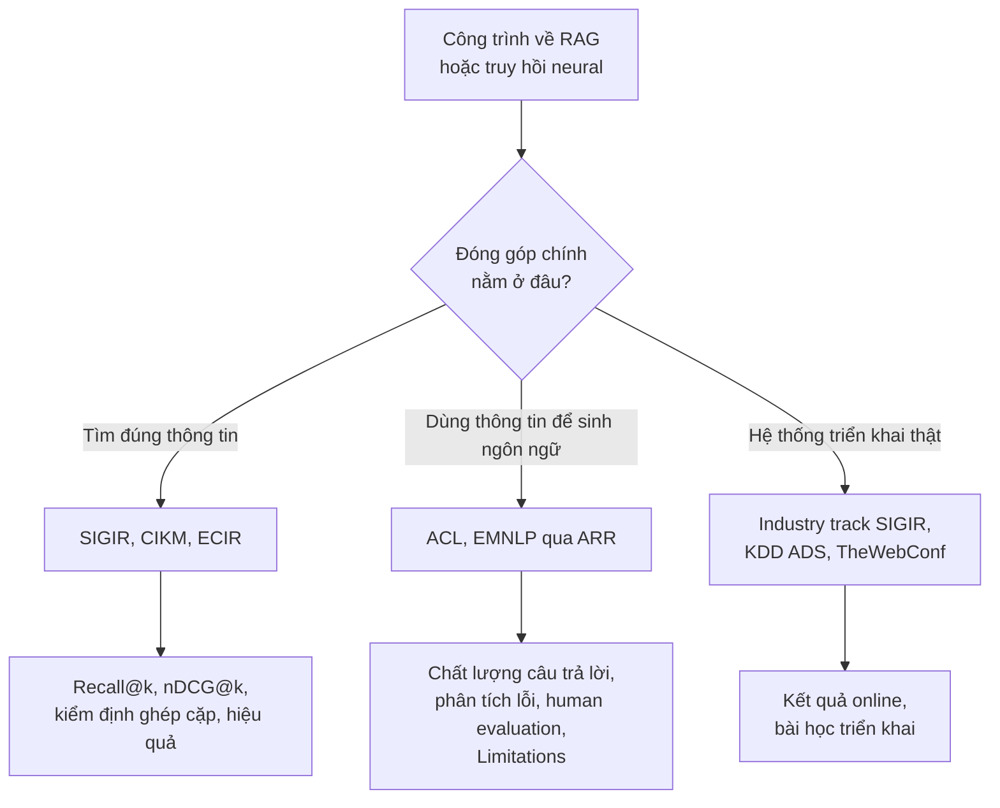

# Hệ sinh thái IR & Data Mining: SIGIR, KDD, TheWebConf

!!! abstract "Mục tiêu của bài"
    Sau bài này, người học có thể:

    - phân biệt ba hội nghị đỉnh SIGIR, KDD và TheWebConf về phạm vi, lịch, các track và định dạng điển hình;
    - nhận diện các hội nghị lân cận CIKM, WSDM, RecSys, ECIR và vai trò của chúng trong vòng nộp bài;
    - dùng đúng template ACM `acmart` (định dạng `sigconf`) và tuân thủ quy tắc double-blind;
    - nắm các kỳ vọng văn hóa của reviewer IR và data mining: metric xếp hạng, benchmark chuẩn, kiểm định ý nghĩa thống kê có hiệu chỉnh nhiều so sánh, baseline mạnh và reproducibility, đánh giá offline và online;
    - lập luận để chọn giữa SIGIR và ACL/EMNLP cho một công trình về retrieval-augmented generation.

Truy hồi thông tin (information retrieval, IR) là lĩnh vực nghiên cứu cách tìm ra thông tin liên quan trong những tập dữ liệu khổng lồ: máy tìm kiếm, hệ khuyến nghị (recommender system), hỏi đáp trên kho tài liệu. Khai phá dữ liệu (data mining) nghiên cứu cách rút ra tri thức và mẫu hình từ dữ liệu lớn: đồ thị, chuỗi thời gian, hành vi người dùng, phát hiện bất thường. Cộng đồng web nằm ở giao điểm của hai lĩnh vực trên, với các bài toán gắn với dữ liệu và hệ thống trên web. Ba cộng đồng này chồng lấn rất nhiều: cùng một nhóm nghiên cứu thường công bố ở cả SIGIR, KDD và TheWebConf, cả ba đều gắn với ACM, dùng chung một template, và chia sẻ một văn hóa coi trọng dữ liệu thật, quy mô lớn và đánh giá chặt chẽ.

Có hai lý do để giáo trình dành một bài cho hệ sinh thái này. Thứ nhất, từ khi mô hình ngôn ngữ lớn trở nên phổ biến, truy hồi đã trở thành một thành phần cốt lõi của nhiều hệ thống NLP thông qua retrieval-augmented generation (RAG), và hệ khuyến nghị là một trong những ứng dụng học máy phổ biến nhất trong công nghiệp. Nhiều người học làm NLP hay ML sẽ sớm có một công trình nằm ở ranh giới với IR. Thứ hai, cả ba hội nghị đỉnh được bàn ở đây đều thường được biết đến ở nhóm A\*, nên chúng là lựa chọn hấp dẫn khi nhãn A\* là yêu cầu chính thức. Tuy nhiên, cộng đồng IR có những kỳ vọng rất riêng: một paper viết theo phong cách NLP, không có kiểm định thống kê và không dùng metric xếp hạng chuẩn, sẽ bị reviewer SIGIR đánh giá thấp dù kết quả tốt. Bài này lần lượt trình bày ba hội nghị đỉnh, các hội nghị lân cận, template và quy tắc ẩn danh, hạng CORE, văn hóa của cộng đồng, và cuối cùng là cách chọn nơi nộp cho các công trình giao thoa với NLP.

## SIGIR

### Hội nghị đầu đàn của truy hồi thông tin

SIGIR (International ACM SIGIR Conference on Research and Development in Information Retrieval) là hội nghị đầu đàn của nhóm quan tâm đặc biệt về truy hồi thông tin của ACM; năm 2026 là lần tổ chức thứ 49. Deadline của track full paper thường vào khoảng giữa đến cuối tháng 1, với một hạn đăng ký abstract bắt buộc khoảng một tuần trước đó, và hội nghị diễn ra vào tháng 7. Các track khác thường có deadline muộn hơn vài tuần: chẳng hạn ở SIGIR 2026, hạn nộp short paper là ngày 12 tháng 2. Review là double-blind (SIGIR dùng chữ "double-anonymous").

Điểm làm SIGIR khác các hội nghị CV, NLP và ML là **số lượng và sự đa dạng của các track**. Kỷ yếu SIGIR 2026 có các mục full paper, short paper, perspective paper, resource paper, reproducibility paper, industry paper, demo, và một track dành cho các môi trường ít tài nguyên (low-resource environments), bên cạnh doctoral colloquium, tutorial và workshop. Mỗi track có tiêu chí đánh giá riêng, và chọn đúng track quan trọng không kém viết đúng nội dung.

### Các track và giới hạn trang điển hình

**Full paper** là track chính, dành cho các đóng góp nghiên cứu đầy đủ: lý thuyết, mô hình, thuật toán, phương pháp đánh giá, phân tích và ứng dụng. Theo Call for Papers của SIGIR 2025 và SIGIR 2026, full paper có tối đa chín trang, tính cả hình, bảng, chứng minh, appendix và lời cảm ơn, chỉ trừ tài liệu tham khảo; bản camera-ready được thêm một trang. Điều cần chú ý là appendix *nằm trong* chín trang, khác hẳn thói quen appendix dài không giới hạn ở NeurIPS hay ICLR.

**Short paper** có khoảng bốn trang nội dung cộng tài liệu tham khảo; Call for Papers của SIGIR 2025 cảnh báo rằng hình, bảng, chứng minh hay appendix đặt sau trang thứ tư có thể dẫn tới desk reject. Cũng như short paper ở ACL, đây không phải là một full paper bị cắt ngắn, mà là nơi cho một đóng góp nhỏ và tập trung: một kết quả thực nghiệm đáng chú ý, một phân tích, một ý tưởng ở giai đoạn sớm có bằng chứng ban đầu.

**Resource paper** dành cho các đóng góp về hạ tầng nghiên cứu: test collection, bộ dữ liệu, công cụ phần mềm, benchmark. **Reproducibility paper** dành cho việc tái tạo các kết quả đã công bố, kiểm tra xem chúng có đứng vững trên dữ liệu khác, thiết lập khác hay với cách cài đặt khác hay không. Hai loại paper này từng chung một track ở SIGIR 2025 và được tách thành hai track riêng ở SIGIR 2026; theo Call for Papers năm 2026, resource paper có tối đa sáu trang và reproducibility paper có tối đa chín trang, cả hai đều chưa tính tài liệu tham khảo, và paper ngắn hơn được hoan nghênh nếu độ dài tương xứng với đóng góp. Sự tồn tại của một track reproducibility chính thức ở hội nghị đỉnh nói lên nhiều điều về văn hóa của cộng đồng IR: kiểm chứng lại kết quả của người khác được coi là một đóng góp khoa học có giá trị, chứ không phải công việc hạng hai.

**Perspective paper** dành cho các bài lập luận: một quan điểm về hướng đi của lĩnh vực, một phê bình có cơ sở về cách đánh giá hiện hành, một khung khái niệm mới. Theo Call for Papers của SIGIR 2025, perspective paper được coi như full paper, xuất hiện trong kỷ yếu chính, và không bắt buộc phải có kết quả thực nghiệm vượt baseline mạnh nhất. Đây là một kênh hiếm thấy ở các hội nghị đỉnh khác, phù hợp với những nhóm có một luận điểm sắc bén nhưng không dựa trên một phương pháp mới. Cuối cùng, **industry track** (ở SIGIR mang tên SIRIP) dành cho kinh nghiệm triển khai trong công nghiệp, với định dạng ngắn hơn nhiều.

Một thay đổi đáng chú ý của SIGIR 2026 là việc nới lỏng quy định về preprint và ẩn danh, theo hướng mà nhiều hội nghị lớn khác đã áp dụng: bản nộp vẫn phải ẩn danh, nhưng các hạn chế liên quan tới việc đăng preprint được nới lỏng so với những năm trước. Hệ thống nộp bài cũng có thể thay đổi giữa các năm (SIGIR 2025 chẳng hạn dùng EasyChair). Mọi chi tiết về track, giới hạn trang và chính sách preprint đều cần được đọc lại trong Call for Papers của đúng năm nộp.

## KDD

KDD (ACM SIGKDD Conference on Knowledge Discovery and Data Mining) là hội nghị đầu đàn của khai phá dữ liệu, diễn ra vào khoảng tháng 8 hằng năm. Đặc điểm nổi bật nhất về lịch là **hai đợt nộp mỗi năm**. Với KDD 2026, đợt thứ nhất có hạn nộp vào tháng 8 năm 2025, còn đợt thứ hai có hạn abstract ngày 1 tháng 2 và hạn paper ngày 8 tháng 2 năm 2026; cả hai đợt cùng hướng tới một hội nghị. Bài được nộp qua OpenReview, và Call for Papers của KDD 2026 giới hạn mỗi tác giả tối đa bảy submission trong mỗi đợt.

Cơ chế hai đợt có một hệ quả chiến lược tương tự ACL Rolling Review. Theo Call for Papers của KDD 2026, một paper nhận quyết định "Resubmit" ở đợt thứ nhất có thể nộp một phiên bản đã sửa vào đợt thứ hai. Nhóm tác giả vì thế có thể nộp sớm ở đợt đầu, nhận review, và nếu paper chưa đủ sức thuyết phục, sửa theo review để nộp lại trong cùng một năm hội nghị.

KDD có hai track chính với khẩu vị khác hẳn nhau. **Research track** coi trọng tính mới và độ chặt chẽ như các hội nghị đỉnh khác, nhưng đặc biệt nhấn mạnh khả năng mở rộng quy mô: độ phức tạp tính toán, thời gian chạy và bộ nhớ trên dữ liệu lớn, hiệu quả trên dữ liệu thật. **Applied Data Science (ADS) track** coi trọng triển khai thực tế: hệ thống đã chạy trong môi trường thật chưa, tác động được đo bằng chỉ số nào, thường qua thử nghiệm A/B, và bài học rút ra từ triển khai là gì. Đợt thứ hai của KDD 2026 còn mở thêm một **track Datasets and Benchmarks**, và mỗi paper chỉ được nộp vào một track. Giới hạn trang và quy định về appendix của KDD thay đổi theo năm và theo track, nên cần được đọc trực tiếp trong Call for Papers. Bài [AAAI / IJCAI / KDD / Journal](../06-cong-dong/khac.md) ở Chương 6 trình bày kỹ hơn cách viết cho từng track của KDD.

## TheWebConf

TheWebConf (The ACM Web Conference), trước đây mang tên WWW (International World Wide Web Conference), là hội nghị hàng đầu về các bài toán gắn với web: tìm kiếm, hệ khuyến nghị, mạng xã hội, khai phá dữ liệu web, ngữ nghĩa và tri thức trên web, bảo mật và quyền riêng tư, kinh tế học của các nền tảng số. Deadline thường vào khoảng đầu đến giữa tháng 10, và hội nghị diễn ra vào khoảng tháng 4 hoặc tháng 5 năm sau. Với TheWebConf 2026, hạn abstract là ngày 30 tháng 9 và hạn paper là ngày 7 tháng 10 năm 2025, hội nghị diễn ra tại Dubai vào giữa tháng 4 năm 2026; với TheWebConf 2027, hạn paper là ngày 25 tháng 10 năm 2026 và hội nghị dự kiến diễn ra tại Dublin vào tháng 5 năm 2027. Quy trình có một giai đoạn rebuttal ngắn, ở năm 2026 vào khoảng cuối tháng 11.

Điểm cấu trúc quan trọng nhất của TheWebConf là các research track được tổ chức **theo chủ đề**, mỗi track có ban chủ tọa và nhóm reviewer riêng. Việc chọn track vì vậy đóng vai trò giống chọn subject area ở CVPR: chọn sai track có thể khiến paper được đọc bởi những người không đúng chuyên môn. Bên cạnh research track còn có short paper, industry track và các track đặc biệt như Web4Good. Về định dạng, theo Call for Papers năm 2026 và 2027, paper research track có tám trang nội dung chính, và tổng độ dài kể cả tài liệu tham khảo và appendix không quá mười hai trang.

Reviewer TheWebConf thường hỏi một câu mà reviewer SIGIR hay KDD ít khi đặt ra trực tiếp: công trình này liên quan gì tới web. Một paper về hệ khuyến nghị nói chung có thể phù hợp với TheWebConf, nhưng mối liên hệ với dữ liệu hoặc hệ thống web cần được làm rõ ngay từ Introduction. Reviewer cũng nhạy với các vấn đề đạo đức của dữ liệu người dùng: nguồn dữ liệu, sự đồng ý, ẩn danh hóa, và những tác động xã hội có thể có.

| | SIGIR | KDD | TheWebConf |
|---|---|---|---|
| Phạm vi | Truy hồi thông tin, tìm kiếm, khuyến nghị, đánh giá | Khai phá dữ liệu, học trên dữ liệu lớn, ứng dụng | Bài toán gắn với web, từ tìm kiếm tới mạng xã hội và bảo mật |
| Deadline điển hình | Giữa đến cuối tháng 1 (full paper); các track khác muộn hơn | Hai đợt: khoảng tháng 8 (năm trước) và tháng 2 | Đầu đến giữa tháng 10 (năm trước) |
| Diễn ra điển hình | Tháng 7 | Tháng 8 | Tháng 4 hoặc 5 |
| Các track tiêu biểu | Full, short, resource, reproducibility, perspective, industry, demo | Research, Applied Data Science, Datasets and Benchmarks (từ 2026) | Các research track theo chủ đề, short, industry |
| Giới hạn trang điển hình | Full: 9 trang tính cả appendix, không tính tài liệu tham khảo; short: khoảng 4 trang | Thay đổi theo năm và track | 8 trang nội dung, tổng tối đa 12 trang |
| Khẩu vị đặc trưng | Metric xếp hạng, kiểm định thống kê, reproducibility | Khả năng mở rộng, dữ liệu thật, triển khai | Mối liên hệ với web, quy mô, đạo đức dữ liệu |

!!! warning "Các con số là điển hình, không phải quy định"
    Deadline, số trang, danh sách track và chính sách preprint của cả ba hội nghị đều thay đổi gần như mỗi năm; chỉ riêng giai đoạn 2025–2026, SIGIR đã tách track resource khỏi reproducibility, KDD đã thêm một track mới, và chính sách preprint của SIGIR đã được nới lỏng. Trước khi lập kế hoạch, cần đọc Call for Papers của đúng năm và đúng track định nộp.

## Các hội nghị lân cận

Sau khi đã nắm ba hội nghị đỉnh, câu hỏi tiếp theo là những nơi công bố nào nằm quanh chúng. Cộng đồng IR và data mining có một vòng các hội nghị lân cận dày đặc, phần lớn cũng thuộc ACM và dùng cùng template, nên việc nộp lại giữa chúng tương đối thuận tiện.

**CIKM** (ACM International Conference on Information and Knowledge Management) có phạm vi rộng, bao trùm IR, quản lý tri thức và cơ sở dữ liệu, thường có deadline vào khoảng tháng 5 và diễn ra vào khoảng tháng 10 hoặc tháng 11. Với lịch này, CIKM là nơi nộp lại tự nhiên cho các paper không thành công ở SIGIR. **WSDM** (ACM International Conference on Web Search and Data Mining) nhỏ và chọn lọc, tập trung vào tìm kiếm web và khai phá dữ liệu, thường có deadline vào khoảng tháng 8 và diễn ra vào khoảng tháng 2 hoặc tháng 3. **RecSys** (ACM Conference on Recommender Systems) là hội nghị chuyên biệt của hệ khuyến nghị, thường có deadline vào khoảng tháng 4 và diễn ra vào khoảng tháng 9 hoặc tháng 10, và cũng có track reproducibility riêng. **ECIR** (European Conference on Information Retrieval) là hội nghị IR lớn của châu Âu, thường có deadline vào khoảng tháng 10 và diễn ra vào mùa xuân; khác với các hội nghị trên, ECIR dùng định dạng Springer LNCS một cột, nên chuyển một paper từ SIGIR sang ECIR đòi hỏi bố trí lại hình và bảng, tương tự chuyển giữa CVPR và ECCV như đã bàn ở bài [Computer Vision: CVPR, ICCV, ECCV](he-sinh-thai-cv.md).

Ngoài ra còn có một số hội nghị nhỏ hơn do ACM SIGIR bảo trợ, mỗi hội nghị phục vụ một nhánh: CHIIR cho tương tác giữa con người và hệ thống truy hồi, với nhiều nghiên cứu người dùng; ICTIR cho lý thuyết của IR; SIGIR-AP cho khu vực châu Á – Thái Bình Dương. Ở phía data mining, ICDM của IEEE và SDM của SIAM là hai hội nghị lâu đời bên cạnh KDD.

| Hội nghị | Trọng tâm | Thời điểm điển hình | Khi nào nên cân nhắc |
|---|---|---|---|
| CIKM | IR, quản lý tri thức, cơ sở dữ liệu | Deadline khoảng tháng 5, diễn ra tháng 10 hoặc 11 | Nộp lại sau SIGIR; công trình rộng hơn IR thuần túy |
| WSDM | Tìm kiếm web, khai phá dữ liệu | Deadline khoảng tháng 8, diễn ra tháng 2 hoặc 3 | Công trình chọn lọc về web search hoặc data mining |
| RecSys | Hệ khuyến nghị | Deadline khoảng tháng 4, diễn ra tháng 9 hoặc 10 | Công trình chuyên sâu về khuyến nghị, kể cả reproducibility |
| ECIR | IR (châu Âu), định dạng LNCS | Deadline khoảng tháng 10, diễn ra mùa xuân | Công trình IR cần một vòng nộp vào mùa thu |
| CHIIR, ICTIR, SIGIR-AP | Tương tác người dùng; lý thuyết IR; khu vực | Thay đổi | Nghiên cứu người dùng; đóng góp lý thuyết; cộng đồng khu vực |

## Template acmart và quy tắc ẩn danh

SIGIR, KDD, TheWebConf, cùng CIKM, WSDM và RecSys đều dùng template LaTeX chung của ACM là `acmart`, với định dạng hội nghị hai cột `sigconf`. Ở bản nộp, template được bật chế độ ẩn danh để xóa tên tác giả và cơ quan. Call for Papers của SIGIR 2026 chỉ định dòng khai báo sau:

```latex
\documentclass[sigconf,natbib=true,anonymous=true]{acmart}
```

Template `acmart` có vài đặc điểm mà người quen template CVPR hay ACL cần biết. Nó yêu cầu khai báo **CCS Concepts** (các khái niệm theo hệ phân loại của ACM) và **keywords**, sinh tự động một khối "ACM Reference Format" ở trang đầu, và ở bản camera-ready có thêm khối thông tin bản quyền theo quyết định của tác giả. Các khối này chiếm chỗ ở trang đầu, nên khi ước lượng độ dài cần tính tới chúng; một số Call for Papers cho phép tắt khối ACM Reference Format ở bản nộp, nhưng cần kiểm tra trước khi làm. Khi giới hạn trang "không tính tài liệu tham khảo", danh sách tài liệu tham khảo được phép bắt đầu ở trang cuối của phần nội dung và kéo dài sang các trang sau, còn mọi nội dung khác, kể cả appendix ở SIGIR, phải nằm trong giới hạn.

Về ẩn danh, research track của cả ba hội nghị đều review double-blind (một số track khác, như industry, có thể có quy định riêng): bản nộp không được chứa tên tác giả, cơ quan, lời cảm ơn lộ danh tính, hay đường dẫn tới kho mã nguồn có tên thật. Mã nguồn có thể được chia sẻ qua các dịch vụ kho ẩn danh, như Call for Papers của SIGIR 2026 gợi ý. Cũng như ở mọi cộng đồng, các thủ thuật để nhồi nội dung, như thu nhỏ lề, giảm cỡ chữ hay chèn khoảng trắng âm, có thể dẫn tới desk reject; ban chương trình SIGIR 2024 chẳng hạn đã từ chối không qua review những bài không tuân thủ định dạng và giới hạn trang. Bài [LaTeX & Overleaf](../03-ky-thuat/latex.md) hướng dẫn cách làm việc với template và quản lý độ dài một cách an toàn.

## Hạng CORE

Theo cổng ICORE, TheWebConf (dưới tên WWW) được xếp hạng A\* trong phiên bản CORE2023 và cả các phiên bản trước đó; SIGIR được xếp A\* trong CORE2023 và trong đợt xếp hạng ICORE2026; KDD được ghi hạng A\* trong đợt ICORE2026. ECIR được xếp hạng A trong CORE2023. Hạng của CIKM, WSDM và RecSys cần tra cứu trên cổng ICORE. Như bài [Bản đồ các hội nghị A\*](ban-do-hoi-nghi.md) đã nhấn mạnh, hạng của một hội nghị có thể thay đổi giữa các đợt cập nhật, và các cơ quan đánh giá không nhất thiết dùng cùng một phiên bản, nên khi nhãn hạng ảnh hưởng tới một quyết định cụ thể, cần tra cứu trực tiếp với đúng phiên bản được áp dụng.

## Văn hóa của cộng đồng IR và Data Mining

Nếu chỉ được chọn một đặc điểm để mô tả văn hóa IR, đó là sự **cẩn trọng về phương pháp đánh giá**. Cộng đồng này đã dành nhiều thập kỷ để xây dựng các bộ dữ liệu đánh giá, các metric và các quy trình kiểm định, và reviewer IR đọc mục thí nghiệm với một danh sách câu hỏi rất cụ thể. Năm đặc điểm dưới đây giải thích những câu hỏi đó.

### Metric xếp hạng

Đầu ra của một hệ thống truy hồi không phải là một nhãn mà là một *danh sách có thứ tự*, và metric phải phản ánh việc tài liệu liên quan nằm ở vị trí nào trong danh sách. **Recall@k** đo tỉ lệ tài liệu liên quan xuất hiện trong k kết quả đầu; metric này quan trọng cho giai đoạn truy hồi thô (first-stage retrieval), nơi mục tiêu là không bỏ sót, chẳng hạn khi chọn ứng viên cho bước xếp hạng lại hoặc khi lấy ngữ cảnh cho RAG. **MRR** (mean reciprocal rank) lấy nghịch đảo vị trí của tài liệu liên quan đầu tiên rồi tính trung bình trên các truy vấn; nó phù hợp khi mỗi truy vấn chỉ có một hoặc rất ít câu trả lời đúng. **nDCG@k** (normalized discounted cumulative gain) cho phép mức liên quan có nhiều bậc, giảm trọng số theo vị trí, rồi chuẩn hóa theo thứ hạng lý tưởng; đây là metric chính của nhiều benchmark hiện đại. Ngoài ra còn có MAP và các metric riêng của hệ khuyến nghị như hit rate.

Reviewer IR không chỉ hỏi metric nào được dùng mà còn hỏi vì sao. Metric phải khớp với bài toán và với claim: một paper nói phương pháp giúp truy hồi đầy đủ hơn cho RAG nên báo cáo Recall@k với k phù hợp với số đoạn văn thực sự đưa vào mô hình sinh, chứ không chỉ nDCG@10. Giá trị k, công cụ tính metric và cách xử lý các trường hợp đặc biệt cũng cần được nêu rõ; dùng các công cụ chuẩn như `trec_eval` hay `ir_measures` giúp tránh sai khác do cài đặt. Trong hệ khuyến nghị, một vấn đề được thảo luận nhiều là đánh giá trên tập ứng viên lấy mẫu (sampled metrics): một paper KDD 2020 của Krichene và Rendle đã chỉ ra rằng cách đánh giá này có thể làm sai lệch thứ hạng giữa các phương pháp, và từ đó reviewer thường hỏi vì sao paper không đánh giá trên toàn bộ tập sản phẩm.

### Benchmark và truyền thống Cranfield–TREC

Phần lớn nghiên cứu IR thực nghiệm đi theo mô hình Cranfield: một bộ dữ liệu đánh giá cố định (test collection) gồm kho tài liệu, tập truy vấn và các đánh giá mức liên quan (relevance judgment) do con người thực hiện. TREC (Text REtrieval Conference), do NIST tổ chức từ đầu những năm 1990, là nơi xây dựng phần lớn các test collection kinh điển, mỗi năm qua nhiều "track" theo chủ đề. Trong kỷ nguyên neural, ba benchmark được nhắc tới nhiều nhất là MS MARCO (truy hồi đoạn văn và tài liệu quy mô lớn, với rất ít tài liệu được đánh giá cho mỗi truy vấn, nên thường dùng MRR@10), các track TREC Deep Learning (cùng kho MS MARCO nhưng có đánh giá dày hơn, thường dùng nDCG@10), và BEIR (khoảng mười tám bộ dữ liệu khác nhau để đánh giá khả năng tổng quát không cần huấn luyện trên miền đích, thường dùng nDCG@10). Với RAG, các bộ hỏi đáp như Natural Questions hay HotpotQA thường được dùng.

Một hệ quả tinh tế của mô hình Cranfield là các test collection cũ chỉ có đánh giá cho những tài liệu mà các hệ thống thời đó tìm ra. Một hệ thống neural mới có thể đưa lên top những tài liệu *chưa từng được đánh giá*, và metric sẽ coi chúng là không liên quan dù thực tế chúng có thể liên quan. Reviewer IR cẩn thận có thể hỏi về tỉ lệ tài liệu đã được đánh giá trong top k; một paper báo cáo sẵn con số này cho thấy nhóm tác giả hiểu sâu phương pháp đánh giá.

### Kiểm định ý nghĩa thống kê

Đây là điểm khác biệt rõ nhất giữa IR và các cộng đồng khác. Trong một paper SIGIR, gần như mọi bảng kết quả chính đều kèm ký hiệu đánh dấu những cải thiện có ý nghĩa thống kê, và câu hỏi "are the improvements statistically significant?" là một trong những nhận xét phổ biến nhất của reviewer. Cách làm điển hình dựa trên điểm của từng truy vấn: vì phương pháp đề xuất và baseline được đánh giá trên *cùng* một tập truy vấn, các phép kiểm định ghép cặp (paired test) như paired t-test, Wilcoxon signed-rank test hay permutation test được dùng để so sánh hai danh sách điểm.

Khi paper so sánh với nhiều baseline trên nhiều metric và nhiều bộ dữ liệu, số phép kiểm định tăng nhanh, và cần hiệu chỉnh cho nhiều so sánh (multiple comparisons). Lý do rất đơn giản: với năm baseline, ba metric và mức ý nghĩa 0,05, có mười lăm phép kiểm định; nếu các phép kiểm định độc lập và thực tế không có khác biệt nào, xác suất có ít nhất một kết quả "có ý nghĩa" do ngẫu nhiên đã là $1 - 0{,}95^{15} \approx 0{,}54$. Các phương pháp hiệu chỉnh phổ biến là Bonferroni (chia mức ý nghĩa cho số phép kiểm định) và Holm–Bonferroni (ít bảo thủ hơn). Chú thích dưới bảng kết quả của một paper IR thường có dạng:

<div class="good" markdown>

*"† and ‡ denote statistically significant improvements over the strongest baseline at p < 0.05 and p < 0.01, respectively (two-tailed paired t-test with Holm–Bonferroni correction across all compared systems)."*

</div>

Một câu như vậy nói đủ bốn điều reviewer cần biết: so với baseline nào, ở mức ý nghĩa nào, bằng phép kiểm định nào, và có hiệu chỉnh hay không. So với các cộng đồng khác, đây là một chuẩn mực chặt hơn: reviewer ML thường kỳ vọng error bars qua nhiều seed, reviewer NLP ngày càng quen với bootstrap, còn reviewer IR kỳ vọng kiểm định ghép cặp theo truy vấn như một mặc định.

!!! tip "Lưu điểm của từng truy vấn ngay từ đầu"
    Kiểm định ghép cặp cần điểm của từng truy vấn, không chỉ điểm trung bình. Nếu pipeline thí nghiệm chỉ ghi lại con số trung bình, việc bổ sung kiểm định trước deadline sẽ buộc phải chạy lại mọi thứ. Lưu sẵn file kết quả xếp hạng (run file) và điểm theo từng truy vấn cho mọi cấu hình là một thói quen rẻ và tiết kiệm rất nhiều thời gian.

### Baseline mạnh và reproducibility

Cộng đồng IR có một ký ức tập thể về những cải thiện không có thật. Một paper CIKM 2009 của Armstrong và cộng sự đã chỉ ra rằng nhiều công trình truy hồi ad-hoc trong khoảng một thập kỷ báo cáo cải thiện so với những baseline yếu, nên các cải thiện ấy không cộng dồn thành tiến bộ thực sự so với những hệ thống mạnh đã có từ trước. Một paper RecSys 2019 của Ferrari Dacrema và cộng sự cho thấy hiện tượng tương tự ở hệ khuyến nghị: nhiều phương pháp neural được công bố không vượt được các phương pháp đơn giản đã được tinh chỉnh cẩn thận. Hai công trình này giải thích vì sao reviewer IR và RecSys đặc biệt khắt khe với baseline: BM25 phải được tinh chỉnh tham số, các baseline neural phải là những phương pháp gần đây và mạnh, và mọi baseline phải được chạy trong cùng điều kiện.

Cũng từ đó, reproducibility trở thành một giá trị trung tâm: SIGIR, ECIR và RecSys đều có track reproducibility, các bộ công cụ mở như Anserini, Pyserini hay PyTerrier được dùng rộng rãi để chạy baseline chuẩn, và việc công bố mã nguồn cùng run file được đánh giá cao. Bài [Thiết kế thí nghiệm](../01-truoc-khi-viet/thi-nghiem.md) trình bày cách chọn và tinh chỉnh baseline sao cho so sánh công bằng.

### Đánh giá offline và online

Đánh giá trên test collection được gọi là **offline evaluation**: rẻ, lặp lại được, nhưng chỉ là một xấp xỉ của trải nghiệm người dùng thật. **Online evaluation** đo trực tiếp hành vi người dùng trong hệ thống đang chạy, qua thử nghiệm A/B, interleaving (trộn kết quả của hai hệ thống trong cùng một danh sách và xem người dùng nhấp vào đâu), hoặc các chỉ số như tỉ lệ nhấp và thời gian dừng lại. Giữa hai thái cực là đánh giá phản thực tế (counterfactual, off-policy evaluation) dựa trên log tương tác có sẵn, và các nghiên cứu người dùng có kiểm soát.

Mỗi track và mỗi hội nghị kỳ vọng một tỉ lệ khác nhau giữa hai loại bằng chứng. Track research của SIGIR chấp nhận đánh giá offline thuần túy nếu được làm cẩn thận. Track ADS của KDD và industry track của SIGIR hay TheWebConf thường kỳ vọng có kết quả online, vì giá trị của chúng nằm ở triển khai thật. Nhóm nghiên cứu học thuật thường không có hệ thống thật để thử nghiệm A/B; khi đó, điều quan trọng là thừa nhận khoảng cách giữa kết quả offline và tác động thực tế, thay vì ngầm coi chúng là một. Những năm gần đây, việc dùng mô hình ngôn ngữ lớn để sinh đánh giá mức liên quan thay cho con người cũng là một chủ đề tranh luận sôi nổi; paper dùng cách này nên kiểm chứng mức đồng thuận với đánh giá của con người trên một tập con.

### Hiệu quả và quy mô

Một hệ thống tìm kiếm trả lời hàng triệu truy vấn mỗi ngày, và một hệ khuyến nghị phải chọn từ hàng triệu sản phẩm trong vài chục mili giây. Vì vậy, reviewer IR và data mining coi hiệu quả là một chiều đánh giá ngang hàng với độ chính xác: độ trễ mỗi truy vấn, thông lượng, kích thước chỉ mục (index), chi phí huấn luyện và cập nhật. Một phương pháp xếp hạng lại chính xác hơn nhưng chậm gấp mười lần cần được đặt trên một đường biên đánh đổi giữa hiệu quả và chất lượng, chứ không chỉ một con số. Ở KDD, khẩu vị này còn mạnh hơn: paper research track thường được kỳ vọng phân tích độ phức tạp và có thí nghiệm khả năng mở rộng, cho thấy thời gian chạy tăng thế nào khi kích thước dữ liệu tăng.

## Giao thoa với NLP: RAG, và chọn giữa SIGIR và ACL/EMNLP

Ranh giới giữa IR và NLP chưa bao giờ mờ như hiện nay. Hai công trình nền tảng của truy hồi neural minh họa điều này: Dense Passage Retrieval (DPR) được công bố tại EMNLP 2020, còn ColBERT được công bố tại SIGIR 2020. Cả hai đều đề xuất một cách biểu diễn truy vấn và tài liệu bằng mô hình ngôn ngữ tiền huấn luyện, nhưng một bên được định vị như một đóng góp cho hỏi đáp miền mở, bên kia như một đóng góp cho xếp hạng hiệu quả. Với RAG, sự giao thoa còn sâu hơn: một hệ thống gồm bộ truy hồi và mô hình sinh, và đóng góp của paper có thể nằm ở bất kỳ phần nào.

Câu hỏi trung tâm, giống như ở bài [Bản đồ các hội nghị A\*](ban-do-hoi-nghi.md), là *đóng góp chính thuộc về đâu*. Nếu đóng góp nằm ở việc tìm đúng thông tin, như một bộ truy hồi tốt hơn, một cách xếp hạng lại, một cấu trúc chỉ mục hiệu quả, hay một phương pháp đánh giá chất lượng truy hồi, thì SIGIR là người đọc tự nhiên. Nếu đóng góp nằm ở việc dùng thông tin để sinh ngôn ngữ, như độ trung thực của câu trả lời với tài liệu nguồn, khả năng suy luận trên nhiều đoạn văn, hay hành vi của mô hình ngôn ngữ trước ngữ cảnh nhiễu, thì ACL hay EMNLP là nơi phù hợp hơn.

Lựa chọn này kéo theo những bằng chứng khác nhau. Một paper RAG nộp SIGIR cần báo cáo chất lượng truy hồi bằng Recall@k và nDCG@k trên các test collection chuẩn, kèm kiểm định ghép cặp có hiệu chỉnh, và thường cả chi phí truy hồi. Cùng hệ thống đó nộp qua ARR cần báo cáo chất lượng câu trả lời cuối cùng, phân tích lỗi, thường có đánh giá bởi con người về độ trung thực, cùng mục Limitations và Responsible NLP checklist bắt buộc, như bài [NLP: ACL, EMNLP, NAACL](he-sinh-thai-nlp.md) đã trình bày. Lịch cũng là một yếu tố: SIGIR có deadline vào tháng 1, trong khi ARR có các chu kỳ đều đặn trong năm.



| Dấu hiệu | Nghiêng về SIGIR | Nghiêng về ACL/EMNLP |
|---|---|---|
| Đóng góp chính | Bộ truy hồi, xếp hạng lại, chỉ mục, đánh giá truy hồi | Sinh câu trả lời, độ trung thực, suy luận, hành vi mô hình ngôn ngữ |
| Metric chính | Recall@k, nDCG@k, MRR | Độ chính xác câu trả lời, các chỉ số trung thực, human evaluation |
| Bằng chứng thống kê kỳ vọng | Kiểm định ghép cặp theo truy vấn, có hiệu chỉnh | Độ biến thiên qua nhiều lần chạy, bootstrap |
| Mục bắt buộc đặc thù | Tùy Call for Papers từng năm; mã nguồn và run file được đánh giá cao | Limitations bắt buộc, Responsible NLP checklist |
| Related Work chủ yếu đến từ | SIGIR, CIKM, ECIR, TREC | ACL, EMNLP, NAACL, TACL |

Khi một công trình phù hợp ngang nhau với cả hai cộng đồng, chính danh sách tài liệu tham khảo thường là chỉ dấu tốt nhất: nếu phần lớn công trình được so sánh đến từ SIGIR và TREC, reviewer SIGIR sẽ là người hiểu đóng góp rõ nhất. Bài [Chuyển một paper giữa các cộng đồng](../06-cong-dong/chuyen-doi.md) phân tích cách viết lại câu chuyện và thí nghiệm khi định vị lại một paper.

## Tóm tắt

SIGIR, KDD và TheWebConf là ba hội nghị đỉnh của truy hồi thông tin, khai phá dữ liệu và các bài toán web, cùng gắn với ACM, cùng dùng template `acmart` định dạng `sigconf`, và review double-blind ở các research track. SIGIR có deadline full paper vào khoảng giữa đến cuối tháng 1, diễn ra vào tháng 7, và có nhiều track với tiêu chí riêng: full paper chín trang tính cả appendix, short paper khoảng bốn trang, cùng các track resource, reproducibility, perspective và industry. KDD có hai đợt nộp mỗi năm, với research track coi trọng khả năng mở rộng và Applied Data Science track coi trọng triển khai thật. TheWebConf có deadline vào khoảng tháng 10, các research track theo chủ đề và đòi hỏi mối liên hệ rõ ràng với web. Quanh chúng là CIKM, WSDM, RecSys, ECIR và các hội nghị chuyên đề nhỏ hơn. Văn hóa của cộng đồng xoay quanh sự cẩn trọng trong đánh giá: metric xếp hạng phù hợp với claim, benchmark chuẩn theo truyền thống Cranfield–TREC, kiểm định ghép cặp có hiệu chỉnh nhiều so sánh, baseline mạnh và reproducibility, phân biệt rõ đánh giá offline với online, và coi hiệu quả là một chiều đánh giá. Với các công trình về RAG, lựa chọn giữa SIGIR và ACL/EMNLP phụ thuộc vào việc đóng góp chính nằm ở khâu tìm thông tin hay khâu dùng thông tin để sinh ngôn ngữ.

## Bài tập

1. Tìm Call for Papers mới nhất của SIGIR, KDD và TheWebConf. Với mỗi hội nghị, ghi lại deadline, các track, giới hạn trang, chính sách preprint và hệ thống nộp bài. Track nào phù hợp nhất với dự án hiện tại, và vì sao không phải các track còn lại?
2. Lấy bảng kết quả chính của dự án và bổ sung kiểm định ý nghĩa thống kê theo chuẩn IR: tính điểm theo từng truy vấn hoặc từng người dùng, chạy paired t-test hoặc permutation test so với từng baseline, áp dụng hiệu chỉnh Holm–Bonferroni, rồi viết chú thích bảng theo mẫu trong bài. Có cải thiện nào mất ý nghĩa sau khi hiệu chỉnh không?
3. Rà soát danh sách baseline của dự án: baseline đơn giản nhất (như BM25 hoặc một phương pháp khuyến nghị dựa trên độ phổ biến) đã được tinh chỉnh tham số chưa, và các baseline neural có phải là những phương pháp mạnh và gần đây nhất không? Liệt kê những gì cần chạy thêm để một reviewer RecSys hay SIGIR không thể nói "the baselines are weak".
4. Nếu dự án có một thành phần truy hồi, viết hai phiên bản của đoạn đóng góp trong Introduction: một cho SIGIR, nhấn mạnh chất lượng và hiệu quả truy hồi, và một cho EMNLP, nhấn mạnh chất lượng câu trả lời sinh ra. Với mỗi phiên bản, liệt kê các thí nghiệm và metric cần có, và đánh dấu những gì dự án hiện còn thiếu.
