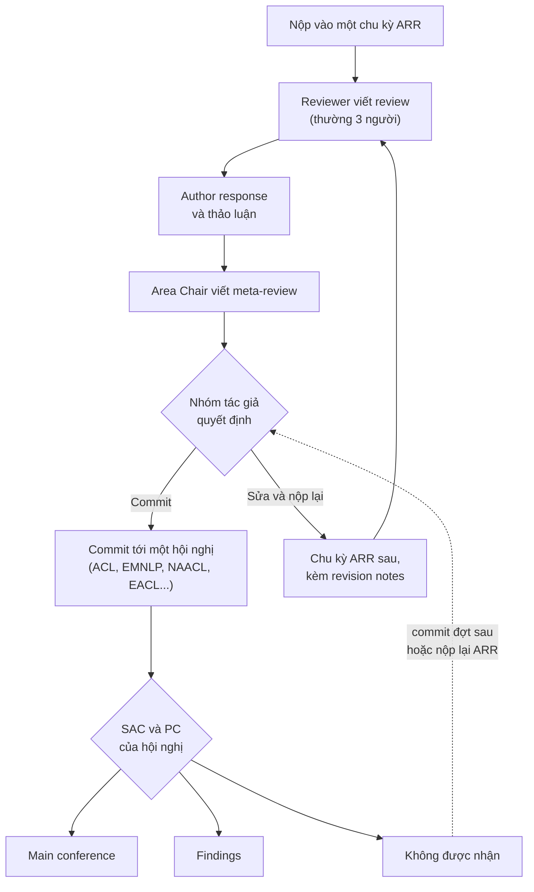

# Hệ sinh thái NLP: ACL, EMNLP, NAACL

!!! abstract "Mục tiêu của bài"
    Sau bài này, người học có thể:

    - nhận diện các hội nghị và tạp chí chính của cộng đồng NLP, gồm gia đình hội nghị của ACL, COLING, TACL và Computational Linguistics;
    - giải thích cơ chế ACL Rolling Review (ARR): nộp vào chu kỳ, nhận review và meta-review, commit tới hội nghị, hoặc sửa và nộp lại;
    - hiểu Findings là gì và nó khác hội nghị chính ra sao;
    - nắm các quy định định dạng đặc thù: long paper, short paper, mục Limitations bắt buộc, Responsible NLP checklist;
    - đọc hiểu các trường của form review ARR và những kỳ vọng văn hóa của reviewer NLP.

Cộng đồng xử lý ngôn ngữ tự nhiên có một đặc điểm khiến nó khác hẳn hai cộng đồng còn lại: phần lớn các hội nghị lớn không tự tổ chức review riêng mà dùng chung một hệ thống review tập trung, ACL Rolling Review. Với người quen nộp CVPR hay NeurIPS, cơ chế này có thể gây bối rối lúc đầu: paper được nộp vào một "chu kỳ" chứ không phải vào một hội nghị, nhận review trước khi biết sẽ đi hội nghị nào, và có thể được nhận vào một tuyển tập tên là Findings thay vì hội nghị chính.

Bài này giải thích hệ sinh thái NLP theo trình tự mà một nhóm tác giả sẽ gặp. Chúng ta bắt đầu với các hội nghị và tạp chí, đi vào chi tiết cơ chế ARR và khái niệm Findings, rồi tới các quy định định dạng và form review. Phần cuối bàn về văn hóa của cộng đồng, nơi NLP khác biệt rõ nhất so với CV và ML.

## Gia đình hội nghị của ACL

ACL (Association for Computational Linguistics) là hiệp hội nghề nghiệp trung tâm của cộng đồng NLP, và tên của nó cũng là tên hội nghị chính của hiệp hội. Hội nghị ACL diễn ra hằng năm, thường vào khoảng tháng 7 hoặc tháng 8, và được coi là hội nghị hàng đầu của lĩnh vực. EMNLP (Empirical Methods in Natural Language Processing) diễn ra hằng năm vào khoảng tháng 11 hoặc tháng 12; ban đầu là hội nghị của nhóm quan tâm đặc biệt SIGDAT với trọng tâm là phương pháp thực nghiệm, ngày nay EMNLP có quy mô và uy tín tương đương ACL.

Bên cạnh hai hội nghị lớn nhất là các hội nghị của các chi hội khu vực: NAACL (chi hội Bắc Mỹ), EACL (chi hội châu Âu) và AACL (chi hội châu Á – Thái Bình Dương, thường tổ chức cùng IJCNLP). Các hội nghị chi hội không nhất thiết diễn ra mọi năm; lịch của chúng được điều chỉnh để tránh trùng với ACL và EMNLP, đặc biệt khi ACL được tổ chức ở cùng khu vực. NAACL có vị trí rất cao trong cộng đồng: chẳng hạn paper BERT, được phân tích ở bài [BERT (NAACL 2019)](../05-case-studies/bert.md), được công bố tại NAACL.

Ngoài gia đình ACL, COLING (International Conference on Computational Linguistics) là một hội nghị lâu đời, do một ủy ban quốc tế riêng tổ chức chứ không thuộc ACL, và thường không đi qua ARR. COLING có phạm vi rộng về ngôn ngữ học tính toán và đặc biệt cởi mở với các chủ đề đa ngôn ngữ. Hạng CORE của các hội nghị NLP không đồng đều: ACL và EMNLP thường ở hạng A\*, trong khi một số hội nghị khác có lúc ở hạng A tùy phiên bản; người học cần tra cứu khi nhãn hạng là yêu cầu chính thức.

| Hội nghị | Tổ chức | Thời điểm điển hình | Ghi chú |
|---|---|---|---|
| ACL | ACL | Tháng 7 hoặc 8 | Hội nghị chính của hiệp hội, hằng năm |
| EMNLP | ACL (SIGDAT) | Tháng 11 hoặc 12 | Hằng năm, uy tín tương đương ACL |
| NAACL | Chi hội Bắc Mỹ | Nửa đầu năm | Không nhất thiết mọi năm |
| EACL | Chi hội châu Âu | Nửa đầu năm | Không nhất thiết mọi năm |
| AACL | Chi hội châu Á – Thái Bình Dương | Thay đổi | Thường tổ chức cùng IJCNLP |
| COLING | Ủy ban quốc tế ICCL | Thay đổi | Không thuộc ACL, quy trình nộp riêng |

## Tạp chí: TACL và Computational Linguistics

NLP có hai tạp chí đặc biệt quan trọng, cả hai đều gắn với hiệp hội ACL và đều truy cập mở. TACL (Transactions of the Association for Computational Linguistics) nhận bài theo hình thức cuốn chiếu hằng tháng, với độ dài tương đương một paper hội nghị dài và quy trình review nhanh hơn nhiều so với tạp chí truyền thống. Điểm hấp dẫn nhất của TACL là paper được chấp nhận có thể được trình bày tại một trong các hội nghị của ACL, như ACL, EMNLP hay NAACL; nhờ vậy, nhóm tác giả vừa có một công bố tạp chí vừa có cơ hội trình bày trước cộng đồng hội nghị. Computational Linguistics là tạp chí lâu đời nhất của lĩnh vực, nhận các bài dài hơn, các nghiên cứu sâu và các bài tổng quan; trong những năm gần đây, paper của tạp chí này cũng có cơ hội được trình bày tại hội nghị ACL.

TACL đáng được cân nhắc khi công trình cần nhiều không gian hơn tám trang để trình bày, khi nhóm tác giả muốn có một quy trình review với khả năng sửa chữa theo yêu cầu (TACL có thể trả lời "revise and resubmit"), hoặc khi deadline hội nghị không phù hợp với tiến độ.

## ACL Rolling Review

### Vì sao cần một hệ thống review tập trung

Trước khi có ARR, mỗi hội nghị NLP tự tổ chức review. Một paper bị từ chối ở ACL rồi nộp sang EMNLP sẽ được review lại từ đầu bởi một nhóm reviewer khác, và nhóm này không biết gì về những nhận xét trước đó. Điều này lãng phí công sức của cộng đồng và khiến tác giả không có cách nào chứng minh rằng họ đã sửa những điểm yếu từng bị chỉ ra. ACL Rolling Review ra đời để tách rời việc *review* khỏi việc *chọn paper cho hội nghị*: review được thực hiện trong các chu kỳ chung, còn hội nghị chỉ đưa ra quyết định dựa trên các bộ review đã có.

### Quy trình một vòng ARR

Quy trình ARR có thể được mô tả qua bốn bước. Ở bước thứ nhất, nhóm tác giả nộp paper vào một chu kỳ ARR. Mỗi năm có vài chu kỳ, những năm gần đây thường cách nhau khoảng hai đến ba tháng, và mỗi chu kỳ có deadline riêng; mỗi hội nghị công bố trước những chu kỳ nào được dùng cho hạn commit của hội nghị đó. Ở bước thứ hai, paper được phân cho một Area Chair và thường ba reviewer; sau vài tuần, nhóm tác giả nhận được các bản review và có một khoảng thời gian để viết author response, tức là phản hồi các nhận xét. Ở bước thứ ba, Area Chair đọc review, phản hồi của tác giả và thảo luận của reviewer, rồi viết meta-review tổng hợp đánh giá kèm một mức đánh giá tổng thể.

Bước thứ tư là bước quyết định, và đây là nơi ARR khác hẳn các hệ thống khác. Khi đã có đầy đủ review và meta-review, nhóm tác giả tự chọn một trong hai hướng. Hướng thứ nhất là *commit* paper tới một hội nghị có hạn commit sau đó, như ACL, EMNLP, NAACL hay EACL, bằng cách gửi đường dẫn tới submission ARR và có thể kèm một ghi chú ngắn gửi Senior Area Chair. Các Senior Area Chair và Program Chair của hội nghị sẽ dựa trên review và meta-review để quyết định paper vào hội nghị chính (main conference), vào Findings, hoặc không được nhận. Hướng thứ hai là *sửa và nộp lại* vào một chu kỳ ARR sau, kèm một bản revision notes giải thích những gì đã thay đổi để đáp lại review cũ. Khi nộp lại, nhóm tác giả thường có thể đề nghị giữ lại reviewer và Area Chair cũ, để họ đánh giá mức độ cải thiện, hoặc đề nghị đổi người kèm lý do chính đáng, chẳng hạn khi một review trước đó rõ ràng thiếu chuyên môn.

Cơ chế này có một hệ quả chiến lược: quyết định commit hay nộp lại được đưa ra *sau khi* đã đọc review. Một paper có meta-review tích cực nên được commit ngay tới hội nghị gần nhất. Một paper có review chỉ ra những điểm yếu có thể sửa được, như thiếu một baseline hay thiếu phân tích lỗi, thường có lợi hơn nếu được sửa và nộp lại vào chu kỳ sau, vì bản revision notes cho phép nhóm tác giả chứng minh sự cải thiện. Theo quy định những năm gần đây, một paper không được hội nghị nhận ở bước commit vẫn có thể dùng lại bộ review đó để commit tới một hội nghị ở đợt sau, nhưng chi tiết này cần được kiểm tra trong hướng dẫn của ARR tại thời điểm nộp.

### Findings

Findings là một tuyển tập đi kèm các hội nghị lớn của ACL, xuất hiện từ khoảng năm 2020, với tên gọi như Findings of ACL hay Findings of EMNLP. Findings dành cho những paper được đánh giá là vững chắc về mặt khoa học nhưng không được chọn vào hội nghị chính, thường vì giới hạn số lượng hoặc vì mức độ hấp dẫn được đánh giá chưa đủ cao. Paper Findings được bình duyệt đầy đủ, được xuất bản trong ACL Anthology và có tính lưu trữ như paper hội nghị chính. Hình thức trình bày của paper Findings thay đổi theo năm, có thể tại workshop, trực tuyến, hoặc tại các phiên poster của hội nghị chính.

Về giá trị đánh giá, Findings nằm ở một vùng xám. Trong cộng đồng NLP, Findings được tôn trọng như một công bố có bình duyệt nghiêm túc, nhưng rõ ràng xếp sau hội nghị chính. Với các hội đồng đánh giá dùng nhãn A\*, cách tính paper Findings khác nhau giữa các cơ quan, nên người học cần tìm hiểu quy định cụ thể trước khi quyết định. Nhóm tác giả thường có quyền từ chối một kết quả Findings để sửa và nộp lại, nhưng cần cân nhắc giữa một công bố chắc chắn hôm nay và cơ hội không chắc chắn vào hội nghị chính trong vài tháng tới.

## Định dạng và những phần bắt buộc

Hội nghị NLP nhận hai loại paper chính. *Long paper* có tối đa tám trang nội dung, dành cho các công trình đầy đủ với đóng góp đáng kể. *Short paper* có tối đa bốn trang, dành cho những đóng góp nhỏ và tập trung: một thí nghiệm có kết quả đáng chú ý, một phân tích, một kết quả âm tính có giá trị, hay một tài nguyên nhỏ. Một sai lầm thường gặp là coi short paper như một long paper bị cắt ngắn; reviewer sẽ nhận ra ngay một paper bốn trang cố nhồi nội dung của tám trang. Khi paper được chấp nhận, bản camera-ready thường được thêm một trang để đáp lại các góp ý của reviewer. Danh sách tài liệu tham khảo không bị giới hạn, và appendix được phép, nhưng reviewer không bắt buộc phải đọc appendix. Template chính thức của ACL là một template LaTeX hai cột.

Điểm khác biệt quan trọng nhất về hình thức là mục **Limitations bắt buộc**. Mọi paper nộp qua ARR phải có một mục Limitations, đặt sau phần kết luận và không tính vào giới hạn trang; paper thiếu mục này có thể bị desk reject. Mục này không phải là nơi để liệt kê qua loa vài câu khiêm tốn, mà là nơi nhóm tác giả trung thực chỉ ra phạm vi áp dụng của kết quả: phương pháp chỉ được thử trên tiếng Anh, chỉ trên một kích thước mô hình, hay chỉ trên một loại văn bản. Một mục Limitations tốt thường giúp paper hơn là hại paper, vì nó cho reviewer thấy nhóm tác giả hiểu rõ công trình của chính họ. Mục Ethics Statement là tùy chọn và cũng không tính vào giới hạn trang. Bài [Conclusion, Limitations, Appendix](../02-viet-tung-phan/conclusion-supp.md) hướng dẫn cách viết các mục này.

Bên cạnh đó, nhóm tác giả phải hoàn thành **Responsible NLP Research checklist** khi nộp. Checklist gồm các câu hỏi về giới hạn và rủi ro của công trình, về các tài nguyên được sử dụng hoặc tạo ra (nguồn, giấy phép, mục đích sử dụng, thông tin cá nhân trong dữ liệu), về chi tiết thí nghiệm tính toán (số tham số, ngân sách tính toán, siêu tham số), về nghiên cứu có sự tham gia của con người (hướng dẫn cho người gán nhãn, cách tuyển và trả công, phê duyệt đạo đức), và về việc sử dụng công cụ AI hỗ trợ. Mỗi câu trả lời "có" thường phải chỉ rõ mục nào trong paper chứa thông tin tương ứng, nên checklist nên được điền trong lúc viết chứ không phải vào phút cuối.

## Form review của ARR

Form review của ARR có cấu trúc khác với form của các hội nghị CV và ML ở chỗ nó tách bạch các chiều đánh giá. Các trường thường gặp gồm phần tóm tắt paper (Paper Summary), tóm tắt điểm mạnh (Summary of Strengths), tóm tắt điểm yếu (Summary of Weaknesses), góp ý và lỗi nhỏ (Comments, Suggestions and Typos), cùng một số trường điểm số. Các trường điểm quan trọng nhất là Soundness, Excitement, Overall Assessment và Confidence, mỗi trường trên một thang khoảng từ 1 đến 5. Ngoài ra còn có các trường về khả năng tái tạo (reproducibility), về dữ liệu và phần mềm được công bố, và về các lo ngại đạo đức. Tên và thang của các trường thay đổi theo từng chu kỳ (riêng năm 2025, hướng dẫn cho reviewer và Area Chair của ARR đã được cập nhật nhiều lần), vì vậy chỉ nên coi đây là các trường thường gặp và cần đọc form của đúng chu kỳ nộp.

Hai trường Soundness và Excitement thể hiện rõ triết lý của ARR. *Soundness* trả lời câu hỏi: các claim của paper có được hỗ trợ đầy đủ bởi bằng chứng không. *Excitement* trả lời câu hỏi: paper có thú vị, có tác động, có khiến người đọc muốn thấy nó tại hội nghị không. Hai chiều này độc lập với nhau. Một paper có thể rất vững chắc nhưng chỉ ở mức thú vị vừa phải, và đây chính là hồ sơ điển hình của một paper Findings. Ngược lại, một paper có ý tưởng hấp dẫn nhưng bằng chứng yếu sẽ bị điểm Soundness kéo xuống, và hội nghị hiếm khi nhận một paper có Soundness thấp. Trường *Overall Assessment* tổng hợp hai chiều trên thành một khuyến nghị, với các mức thường tương ứng với những nhận định như "xứng đáng ở hội nghị chính", "phù hợp với Findings" hay "cần sửa và nộp lại". *Confidence* thể hiện mức độ chắc chắn của chính reviewer.

Đối với người viết, cấu trúc này gợi ý một chiến lược rõ ràng. Soundness phụ thuộc chủ yếu vào thiết kế thí nghiệm và cách trình bày bằng chứng, những thứ nhóm tác giả kiểm soát được. Excitement phụ thuộc vào cách đặt vấn đề và cách kể câu chuyện trong Introduction, những thứ cũng có thể được cải thiện đáng kể bằng kỹ năng viết. Bài [Viết cho ACL / EMNLP / NAACL](../06-cong-dong/nlp.md) ở Chương 6 trình bày chi tiết cách viết để tối ưu cả hai chiều.

## Chính sách ẩn danh và preprint

Review ở ARR là double-blind: paper phải được ẩn danh hoàn toàn, không chứa tên tác giả, cơ quan, hay các đường dẫn lộ danh tính. Trong nhiều năm, ACL còn có một chính sách gọi là *anonymity period*, cấm đăng hoặc cập nhật preprint lên arXiv trong khoảng một tháng trước deadline cho tới khi có quyết định. Đầu năm 2024, ACL đã bãi bỏ anonymity period, áp dụng từ chu kỳ ARR tháng 2 năm 2024: nhóm tác giả có thể đăng và thảo luận preprint không ẩn danh vào bất kỳ lúc nào, miễn là bản nộp vẫn được ẩn danh trong suốt quá trình review. Các chi tiết đi kèm, chẳng hạn cách ARR ưu tiên reviewer chưa biết danh tính tác giả, vẫn có thể được điều chỉnh, nên cần kiểm tra lại chính sách hiện hành của ARR trước khi đăng preprint.

## Quy mô và tỉ lệ chấp nhận

Từ khi các mô hình ngôn ngữ lớn bùng nổ, số lượng paper NLP tăng rất nhanh; mỗi chu kỳ ARR lớn nhận hàng nghìn submission (theo số liệu ACL công bố, riêng chu kỳ tháng 5 năm 2026 đã nhận hơn mười bảy nghìn), và các hội nghị lớn như ACL hay EMNLP nhận commit từ hàng nghìn paper. Tỉ lệ chấp nhận vào hội nghị chính những năm gần đây thường vào khoảng 20–25%, cộng thêm một tỉ lệ đáng kể nữa vào Findings. Các con số này dao động theo năm và theo cách tính, nên chỉ nên dùng để hình dung mức độ cạnh tranh.

Giống như các cộng đồng khác, ARR đặt ra nghĩa vụ review đối với tác giả, và nghĩa vụ này ngày càng chặt. Ban đầu, mỗi submission chỉ cần có ít nhất một tác giả đủ điều kiện đăng ký làm reviewer; ở các chu kỳ năm 2025 và 2026, quy định đã mở rộng tới việc tác giả phải đăng ký làm reviewer hoặc Area Chair, paper có thể bị desk reject nếu tác giả bỏ lỡ hạn đăng ký, và reviewer vô trách nhiệm có thể bị hạn chế quyền nộp ở chu kỳ sau. Từ chu kỳ tháng 10 năm 2026, ACL bắt đầu áp dụng một chính sách review bền vững (sustainable reviewing policy), trong đó số submission được giới hạn theo năng lực review hiện có và mỗi tác giả bị giới hạn số bài được nộp trong một chu kỳ. Vì chính sách này còn mới và đang được hoàn thiện, quy định cụ thể, ví dụ ai được coi là đủ điều kiện, mức giới hạn và hậu quả nếu không hoàn thành nghĩa vụ, cần được đọc trong hướng dẫn của đúng chu kỳ nộp.

## Văn hóa của cộng đồng NLP

Nếu reviewer CV thường mở bảng kết quả chính trước tiên, thì reviewer NLP thường đặt câu hỏi về *cách đánh giá* trước tiên: đánh giá trên dữ liệu nào, bằng chỉ số nào, chỉ số ấy có đo đúng điều paper muốn khẳng định không. Năm yếu tố dưới đây phản ánh văn hóa này.

### Đánh giá cẩn thận hơn là chỉ thắng benchmark

Cộng đồng NLP có một lịch sử dài về việc phát hiện ra rằng các mô hình đạt điểm cao trên benchmark nhờ khai thác các tín hiệu bề mặt chứ không thực sự giải quyết được bài toán. Vì vậy, reviewer NLP hoài nghi với những cải thiện nhỏ trên một benchmark duy nhất, và đánh giá cao những paper kiểm tra kỹ xem cải thiện có thực chất hay không: thử trên nhiều tập dữ liệu, trên dữ liệu ngoài phân phối, trên các tập đối chứng (contrast set), và báo cáo độ biến thiên giữa các lần chạy. Với các công trình dùng mô hình ngôn ngữ lớn, các câu hỏi về nhiễm dữ liệu (data contamination), về độ nhạy với cách viết prompt, và về khả năng tái tạo khi mô hình là một API đóng cũng ngày càng phổ biến. Paper [CheckList (ACL 2020)](../05-case-studies/checklist-acl2020.md) là một ví dụ tiêu biểu về một đóng góp xoay quanh chính phương pháp đánh giá.

### Phân tích lỗi

Một paper NLP tốt thường có một mục phân tích lỗi (error analysis): xem xét các trường hợp mô hình làm sai, phân loại chúng, và rút ra những hiểu biết về điểm mạnh và điểm yếu của phương pháp. Phân tích lỗi biến một con số trong bảng thành một hiểu biết, và thường là nơi các reviewer tìm thấy giá trị khoa học của paper. Câu nhận xét "the paper lacks an error analysis" xuất hiện thường xuyên trong review NLP.

### Human evaluation

Với các bài toán sinh văn bản như tóm tắt, dịch máy hay hội thoại, các chỉ số tự động thường không phản ánh đầy đủ chất lượng. Reviewer NLP vì thế thường kỳ vọng đánh giá bởi con người (human evaluation), và kỳ vọng nó được thiết kế cẩn thận: người đánh giá là ai, được hướng dẫn thế nào, mức độ đồng thuận giữa họ ra sao, được trả công thế nào. Một human evaluation sơ sài, ví dụ chỉ có tác giả tự chấm vài chục ví dụ, có thể gây hại hơn là không có.

### Đa ngôn ngữ và ngôn ngữ ít tài nguyên

Cộng đồng NLP ngày càng nhạy cảm với việc phần lớn nghiên cứu chỉ tập trung vào tiếng Anh. Một nguyên tắc thường được nhắc tới, đôi khi gọi là "Bender rule", yêu cầu paper luôn nêu rõ ngôn ngữ đang được nghiên cứu, kể cả khi đó là tiếng Anh, thay vì ngầm coi tiếng Anh là "ngôn ngữ" nói chung. Các công trình về ngôn ngữ ít tài nguyên (low-resource), trong đó có tiếng Việt và nhiều ngôn ngữ khác ở châu Á, được cộng đồng đánh giá cao nếu chúng mang lại tài nguyên mới, phương pháp mới, hoặc hiểu biết về việc các kỹ thuật hiện có hoạt động thế nào ngoài tiếng Anh. Đây là một lợi thế tự nhiên cho các nhóm nghiên cứu làm việc với những ngôn ngữ này.

### Đạo đức dữ liệu và trách nhiệm

Dữ liệu ngôn ngữ thường chứa thông tin cá nhân, nội dung độc hại và các định kiến xã hội. Cộng đồng NLP vì thế kỳ vọng nhóm tác giả mô tả rõ nguồn gốc dữ liệu, giấy phép sử dụng, cách xử lý thông tin cá nhân, và những rủi ro khi công bố mô hình hay dữ liệu. Responsible NLP checklist và mục Limitations bắt buộc là hiện thân chính thức của kỳ vọng này, nhưng reviewer thường đọc cả phần mô tả dữ liệu trong paper với cùng một con mắt.

!!! note "Khác biệt cần nhớ khi chuyển từ CV hoặc ML sang NLP"
    Một paper chuyển từ cộng đồng khác sang NLP cần được bổ sung ít nhất ba thứ: mục Limitations thực chất, phân tích lỗi có hệ thống, và mô tả dữ liệu đầy đủ theo Responsible NLP checklist. Ngoài ra, cần nêu rõ ngôn ngữ được nghiên cứu và thảo luận khả năng áp dụng sang các ngôn ngữ khác.

## ACL Anthology: kho học liệu miễn phí

ACL Anthology (aclanthology.org) lưu trữ miễn phí toàn bộ paper của các hội nghị ACL, EMNLP, NAACL, EACL, AACL, của COLING, của các tạp chí TACL và Computational Linguistics, cùng hàng trăm workshop qua nhiều thập kỷ. Mỗi paper có trang riêng với file PDF, trích dẫn BibTeX chuẩn, và thường kèm đường dẫn tới mã nguồn, video trình bày và slide.

Với người học, ACL Anthology có hai công dụng. Công dụng thứ nhất là học cách viết: tương tự như với CVF Open Access ở cộng đồng CV, người học nên chọn các paper đoạt giải hoặc được trình bày oral trong vài năm gần đây và phân tích cấu trúc của chúng, đặc biệt là cách viết mục Limitations và phân tích lỗi. Công dụng thứ hai là trích dẫn: khi một paper đã được công bố ở hội nghị, nên trích dẫn phiên bản trong Anthology thay vì phiên bản arXiv, vì reviewer NLP thường để ý chi tiết này như một dấu hiệu của sự cẩn thận.

## Tóm tắt

Cộng đồng NLP xoay quanh hiệp hội ACL với các hội nghị ACL, EMNLP, NAACL, EACL, AACL, bên cạnh COLING và hai tạp chí TACL và Computational Linguistics. Phần lớn hội nghị dùng ACL Rolling Review: paper được nộp vào một chu kỳ, nhận review và meta-review, rồi nhóm tác giả chọn commit tới một hội nghị hoặc sửa và nộp lại vào chu kỳ sau kèm revision notes. Khi commit, paper có thể vào hội nghị chính, vào Findings, hoặc không được nhận. Paper dài có tám trang, paper ngắn có bốn trang, mục Limitations là bắt buộc và Responsible NLP checklist phải được hoàn thành. Form review tách bạch Soundness và Excitement, phản ánh văn hóa của một cộng đồng coi trọng đánh giá cẩn thận, phân tích lỗi, human evaluation, tính đa ngôn ngữ và đạo đức dữ liệu.

## Bài tập

1. Tìm lịch các chu kỳ ARR trong mười hai tháng tới và các hạn commit của những hội nghị NLP diễn ra trong khoảng thời gian đó. Với dự án hiện tại, xác định chu kỳ nộp phù hợp nhất và hội nghị dự kiến commit.
2. Viết bản nháp mục Limitations cho dự án hiện tại, gồm ít nhất ba giới hạn thực chất về phạm vi dữ liệu, ngôn ngữ hoặc điều kiện thí nghiệm. Với mỗi giới hạn, giải thích vì sao nó không làm mất giá trị của các claim chính.
3. Đọc toàn bộ Responsible NLP Research checklist của chu kỳ gần nhất và đánh dấu những câu hỏi mà dự án hiện chưa có câu trả lời. Lập kế hoạch bổ sung thông tin cho từng câu.
4. Tự chấm paper đang viết theo hai trường Soundness và Excitement trên thang 1 đến 5, rồi viết hai đoạn ngắn: một đoạn giải thích điều gì kéo điểm Soundness xuống, một đoạn giải thích điều gì có thể nâng điểm Excitement lên.
