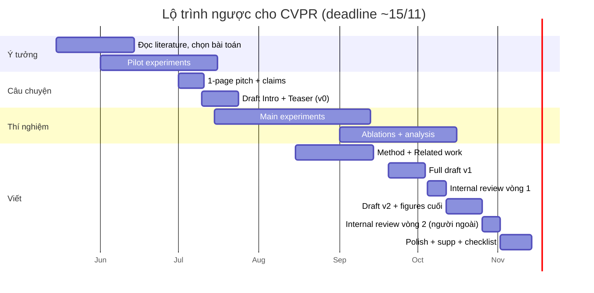

# Lộ trình 6 tháng cho paper đầu tay

Người viết lần đầu thường **đánh giá thấp thời gian viết** (nghĩ 1–2 tuần là đủ) và **bắt đầu viết quá muộn**. Thực tế với paper đầu tay, phần *viết + làm hình + sửa* chiếm 6–8 tuần dàn trải, chồng lấn với thí nghiệm.

## Lập kế hoạch ngược từ deadline (ví dụ: CVPR, deadline giữa tháng 11)

## Các mốc kiểm tra (milestones) — đừng bỏ qua

| Thời điểm (trước deadline) | Phải có | Nếu chưa có |
|---|---|---|
| **T − 5 tháng** | Bài toán + 3–5 paper gần nhất đã đọc kỹ | Còn kịp, nhưng gấp |
| **T − 4 tháng** | Pilot cho thấy ý tưởng *có tín hiệu* trên 1 dataset nhỏ | Cân nhắc đổi ý tưởng hoặc nhắm deadline sau |
| **T − 3,5 tháng** | **One-page pitch**: problem, insight, claims, thí nghiệm dự kiến | Viết ngay — đây là bước bị bỏ qua nhiều nhất |
| **T − 3 tháng** | Draft Intro v0 + phác thảo Figure 1 | Viết ngay |
| **T − 6 tuần** | Kết quả chính trên **tất cả** benchmark đã chạy xong | Thu hẹp scope, bỏ bớt benchmark phụ |
| **T − 4 tuần** | Full draft v1 (có thể còn số tạm) | Báo động đỏ |
| **T − 3 tuần** | Gửi cho 1–2 người **không trong nhóm** đọc | — |
| **T − 1 tuần** | Không thêm thí nghiệm mới. Chỉ sửa chữ, hình, supp | — |
| **T − 2 ngày** | Bản PDF hoàn chỉnh đã upload lên hệ thống (bản nháp) | Upload ngay, có thể ghi đè sau |

!!! danger "Quy tắc 48 giờ"
    **Luôn upload một bản PDF hợp lệ ít nhất 48 giờ trước deadline**, rồi ghi đè dần. OpenReview/CMT thường quá tải vào giờ cuối; deadline là **AoE (Anywhere on Earth, UTC−12)** — tức khoảng **19:00 ngày hôm sau** theo giờ Việt Nam. Hãy tự quy đổi và ghi rõ vào lịch.

## Phân bổ thời gian viết (cho một paper 8 trang)

Một ước lượng thực tế cho người mới (tổng ~120–200 giờ làm việc thuần cho phần viết):

| Phần | % thời gian | Ghi chú |
|---|---|---|
| Câu chuyện + outline | 10% | Rẻ nhất nhưng đòn bẩy lớn nhất |
| Introduction | 15% | Sẽ viết lại 5–10 lần |
| Figure 1 + Figure method | 15% | Làm sớm, sửa nhiều vòng |
| Method | 15% | |
| Experiments (chữ + bảng) | 15% | |
| Related work | 5% | |
| Abstract + Title + Conclusion | 5% | Viết cuối, sửa nhiều |
| Supplementary | 10% | |
| Sửa theo internal review, polish | 10% | |

## Làm việc với co-author & advisor

Vì trước đây có người viết hộ, giờ bạn là **first author thực sự** — nghĩa là bạn *điều phối*:

- **Thống nhất sớm** thứ tự tác giả, ai làm phần nào, deadline nội bộ.
- **Một nguồn sự thật duy nhất:** một project Overleaf, một Google Sheet ghi kết quả thí nghiệm (kèm commit hash, config), một file `TODO`.
- **Xin feedback đúng lúc, đúng mức:**
    - Advisor bận: gửi **one-page pitch** và **Intro + Figure 1** sớm — đó là nơi họ đóng góp nhiều nhất. Đừng gửi full draft lần đầu vào 3 ngày trước deadline.
    - Khi xin feedback, nói rõ *loại* feedback cần: "Câu chuyện có thuyết phục không?" khác với "Sửa giúp tiếng Anh".
- **Dùng comment có cấu trúc** trong Overleaf: `\todo{}` (gói `todonotes`) hoặc macro riêng cho từng người, ví dụ `\dung{...}`, `\advisor{...}` với màu khác nhau (xem [LaTeX](../03-ky-thuat/latex.md)).
