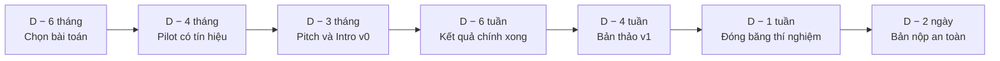

# Lộ trình thực hiện một paper

!!! abstract "Mục tiêu của bài"
    Sau bài này, người học có thể:

    - lập một kế hoạch tính ngược từ một deadline D bất kỳ, với các giai đoạn từ D − 6 tháng tới D − 2 ngày;
    - dùng bảng mốc kiểm tra để quyết định tiếp tục, thu hẹp phạm vi hay chuyển sang deadline sau;
    - điều chỉnh lộ trình chung cho các loại deadline khác nhau của ba cộng đồng;
    - phân bổ thời gian viết hợp lý, áp dụng quy tắc 48 giờ và quy đổi đúng giờ AoE;
    - tổ chức làm việc hiệu quả với đồng tác giả và người hướng dẫn.

Người viết paper lần đầu thường mắc hai sai lầm về thời gian. Sai lầm thứ nhất là đánh giá thấp thời gian viết, cho rằng một hai tuần là đủ để "viết lại những gì đã làm". Sai lầm thứ hai là bắt đầu viết quá muộn, chỉ khi mọi thí nghiệm đã xong. Trên thực tế, với một paper đầu tay, phần viết, làm hình và sửa chữa thường chiếm sáu đến tám tuần, dàn trải và chồng lấn với giai đoạn thí nghiệm. Khi hai sai lầm này cộng lại, kết quả quen thuộc là một paper được viết dồn trong mười ngày cuối, đọc như một bản báo cáo, với những thí nghiệm còn thiếu được phát hiện khi đã quá muộn để chạy.

Bài này xây dựng một lộ trình tổng quát, tính ngược từ một deadline D bất kỳ, áp dụng được cho cả hội nghị CV, chu kỳ ARR của NLP lẫn hội nghị ML. Mốc sáu tháng là khoảng thời gian điển hình cho một paper hội nghị đầy đủ, bắt đầu từ lúc bài toán đã được xác định ở mức sơ bộ. Những dự án ngắn hơn có thể nén các giai đoạn lại, nhưng thứ tự của chúng gần như không đổi.

Cần phân biệt lộ trình ở đây với hai bài liên quan ở Chương 1. Bài này là *lịch*: nó trả lời câu hỏi việc gì phải xong vào lúc nào để kịp một deadline, và nhìn dự án chủ yếu từ phía viết và nộp. Bài [Lập kế hoạch nghiên cứu](../01-truoc-khi-viet/ke-hoach.md) là *nội dung* của kế hoạch: đi từ các contribution dự kiến tới claim, giả thuyết và ma trận thí nghiệm, sắp thứ tự công việc để giảm rủi ro, làm premortem, đặt cổng quyết định, ước lượng ngân sách compute và dữ liệu, và chuẩn bị kế hoạch B. Bài [Vận hành thực nghiệm](../01-truoc-khi-viet/thuc-thi.md) mô tả nhịp làm việc hằng tuần bên trong các giai đoạn dài nhất của lịch này. Cách dùng hợp lý là lập kế hoạch nghiên cứu trước, rồi đặt nó lên lịch tính ngược của bài này để biết kế hoạch có khả thi với deadline đã chọn hay không.

## Vì sao lập kế hoạch ngược từ deadline

Trong một dự án nghiên cứu, deadline là thứ duy nhất cố định; mọi thứ còn lại đều bất định, từ việc ý tưởng có hoạt động không tới việc một thí nghiệm mất bao lâu. Lập kế hoạch tiến, theo kiểu "làm xong phần này rồi tính tiếp", thường dẫn tới việc phát hiện ở thời điểm hai tuần trước deadline rằng các thí nghiệm chính chưa xong và chưa có chữ nào được viết. Lập kế hoạch ngược giải quyết vấn đề này bằng cách chỉ ra *thời điểm muộn nhất* mà mỗi việc phải hoàn thành để các việc sau còn kịp.

Giá trị lớn nhất của kế hoạch ngược không nằm ở các ngày cụ thể mà ở các **mốc kiểm tra**. Mỗi mốc là một điểm ra quyết định: nếu đã đạt, tiếp tục theo kế hoạch; nếu chưa đạt, kế hoạch đã nói sẵn phải làm gì, như thu hẹp phạm vi, bỏ bớt một benchmark phụ, hay chuyển sang deadline sau. Nhờ vậy, nhóm tác giả đưa ra các quyết định khó khi còn đủ bình tĩnh, thay vì phản ứng trong hoảng loạn ở tuần cuối. Kế hoạch ngược cũng là công cụ giao tiếp: nó giúp thống nhất với đồng tác giả ai làm gì vào lúc nào, và giúp đặt trước tài nguyên tính toán cho những giai đoạn cần nhiều GPU nhất.



## Các giai đoạn tính ngược từ deadline D

### Từ D − 6 tháng tới D − 4 tháng: chọn bài toán và chạy pilot

Giai đoạn đầu tiên dành cho việc xác định chính xác bài toán và kiểm tra xem ý tưởng có tín hiệu hay không. Việc cần làm trước hết là đọc kỹ năm đến mười paper gần nhất với bài toán, không chỉ để biết họ làm gì mà còn để biết họ đánh giá trên dữ liệu nào, bằng chỉ số nào, và còn để ngỏ những vấn đề gì. Song song, nhóm tác giả nên tái tạo được baseline mạnh nhất. Việc này thường bị coi nhẹ nhưng lại cực kỳ quan trọng: nó xây dựng hạ tầng cho mọi thí nghiệm sau, và nó phát hiện sớm những trường hợp con số được báo cáo trong paper gốc không thể đạt được với thiết lập công bố.

Đến khoảng D − 4 tháng, cần có kết quả pilot: một thí nghiệm nhỏ, trên một tập dữ liệu nhỏ hoặc một thiết lập đơn giản, cho thấy ý tưởng có tín hiệu. Tín hiệu không cần phải là kết quả vượt trội; nó chỉ cần đủ để tin rằng hướng đi có triển vọng. Nếu đến mốc này pilot vẫn không có tín hiệu, đó là lúc nghiêm túc cân nhắc điều chỉnh ý tưởng hoặc nhắm tới một deadline xa hơn. Các bài [Thẩm định ý tưởng](../01-truoc-khi-viet/y-tuong.md), [Đọc và lập bản đồ tài liệu](../01-truoc-khi-viet/literature.md) và [Thiết kế thí nghiệm](../01-truoc-khi-viet/thi-nghiem.md) hướng dẫn chi tiết các việc của giai đoạn này; bài [Lập kế hoạch nghiên cứu](../01-truoc-khi-viet/ke-hoach.md) cho biết cách biến kết quả pilot thành một kế hoạch có cổng quyết định rõ ràng.

### Từ D − 4 tháng tới D − 3 tháng: câu chuyện và bản nháp đầu tiên

Khi pilot đã có tín hiệu, việc quan trọng nhất là viết ra câu chuyện của paper, trước khi lao vào các thí nghiệm quy mô lớn. Sản phẩm của giai đoạn này là một bản **one-page pitch**: một trang mô tả vấn đề, khoảng trống trong các công trình hiện có, insight then chốt, phương pháp ở mức khái quát, ba đến bốn claim có thể kiểm chứng, và danh sách thí nghiệm dự kiến cho mỗi claim. Đi kèm là một bảng claim và bằng chứng, nơi mỗi claim được ghép với thí nghiệm sẽ chứng minh nó.

Đến khoảng D − 3 tháng, cần có bản nháp đầu tiên của Introduction và một phác thảo Figure 1, dù còn thô. Đây là bước bị bỏ qua nhiều nhất, và cũng là bước có đòn bẩy lớn nhất: viết Introduction buộc nhóm tác giả phải trả lời vì sao bài toán quan trọng và điều gì thực sự mới, còn phác thảo Figure 1 buộc phải xác định thông điệp chính có thể truyền tải bằng hình. Bản pitch và Introduction v0 cũng là những thứ nên được gửi cho người hướng dẫn sớm nhất, khi việc điều chỉnh hướng đi còn rẻ. Bài [Xây "câu chuyện" của paper](../01-truoc-khi-viet/cau-chuyen.md) cung cấp khung chi tiết cho bản pitch.

### Từ D − 3 tháng tới D − 6 tuần: thí nghiệm chính và viết song song

Đây là giai đoạn dài nhất và tốn tài nguyên nhất. Các thí nghiệm chính trên toàn bộ benchmark được chạy, tiếp theo là ablation và các phân tích. Nguyên tắc ưu tiên là đi theo bảng claim và bằng chứng: thí nghiệm hỗ trợ claim quan trọng nhất được chạy trước, thí nghiệm cho các claim phụ chạy sau. Khi tài nguyên tính toán hạn chế, chính bảng này cho biết thí nghiệm nào có thể cắt mà không làm sụp đổ lập luận. Cách tổ chức công việc hằng tuần trong giai đoạn này, gồm hạ tầng config, seed và tracking, các sanity check trước khi scale-up, quản lý nhiều run song song và review tiến độ định kỳ, được trình bày trong bài [Vận hành thực nghiệm](../01-truoc-khi-viet/thuc-thi.md).

Viết không dừng lại trong giai đoạn này. Phần Method và Related Work có thể được viết song song với thí nghiệm, vì chúng ít phụ thuộc vào kết quả cuối cùng. Bản nháp các hình và bảng nên được tạo ngay khi có kết quả đầu tiên, bằng script tự động sinh từ dữ liệu thí nghiệm, để khi số liệu thay đổi thì hình và bảng được cập nhật mà không phải làm lại thủ công; bài Vận hành thực nghiệm mô tả đường đi từ log thí nghiệm tới hình và bảng theo cách này. Đến D − 6 tuần, kết quả chính trên tất cả benchmark dự kiến cần được chạy xong.

### Từ D − 6 tuần tới D − 1 tuần: bản thảo đầy đủ và review nội bộ

Đến khoảng D − 4 tuần, cần có bản thảo đầy đủ đầu tiên, gọi là v1, trong đó mọi phần đều đã có mặt, dù một số con số có thể còn tạm. Bản v1 được đồng tác giả đọc trong vòng review nội bộ thứ nhất, với trọng tâm là câu chuyện và cấu trúc hơn là câu chữ. Đến khoảng D − 3 tuần, bản thảo nên được gửi cho một hoặc hai người *không* thuộc nhóm tác giả, vì chỉ người ngoài mới phát hiện được những chỗ mà nhóm tác giả đã quá quen tới mức không còn thấy là khó hiểu.

Giai đoạn này cũng là lúc hoàn thiện những phần thường bị để tới phút chót: supplementary hoặc appendix, các mục bắt buộc như Limitations ở ARR, NeurIPS Paper Checklist hay Responsible NLP checklist, và mục mô tả chi tiết tái tạo. Các mục này cần thông tin từ thí nghiệm, nên chúng chỉ có thể hoàn thành khi thí nghiệm đã gần xong, nhưng chúng mất nhiều thời gian hơn dự kiến. Bài [Quy trình viết & tự review](../03-ky-thuat/quy-trinh-viet.md) mô tả cách tổ chức các vòng review nội bộ hiệu quả.

### Tuần cuối: đóng băng thí nghiệm và hoàn thiện

Từ D − 1 tuần, nguyên tắc quan trọng nhất là **không thêm thí nghiệm mới**. Mỗi thí nghiệm mới ở giai đoạn này đều kéo theo việc sửa bảng, sửa chữ, sửa hình, và thường phá vỡ sự nhất quán của bản thảo đúng vào lúc không còn thời gian kiểm tra lại. Thời gian của tuần cuối dành cho việc sửa văn bản, hoàn thiện hình, kiểm tra định dạng, kiểm tra ẩn danh, rà soát tài liệu tham khảo và hoàn thiện supplementary.

Cần lưu ý rằng nhiều hội nghị có hạn đăng ký paper hoặc abstract vào khoảng D − 1 tuần. Hạn này thực chất là một deadline nhỏ: title, abstract, danh sách tác giả và subject area phải được chốt trước đó, và ở nhiều hội nghị danh sách tác giả không thể thay đổi sau mốc này. Mọi đồng tác giả cũng cần có hồ sơ trên hệ thống nộp bài, thường là OpenReview, với thông tin cơ quan và xung đột lợi ích đầy đủ.

### D − 2 ngày: bản nộp an toàn

Đến D − 2 ngày, một bản PDF hoàn chỉnh và hợp lệ phải được tải lên hệ thống. Bản này có thể chưa phải bản cuối cùng, nhưng nó phải là một bản có thể được review nếu vì bất kỳ lý do gì không thể tải lên bản sau. Mọi chỉnh sửa trong hai ngày cuối chỉ là ghi đè lên bản an toàn này. Lý do của quy tắc này được trình bày ở phần về quy tắc 48 giờ bên dưới.

## Bảng mốc kiểm tra

Bảng dưới đây tổng hợp các mốc kiểm tra của lộ trình. Cột thứ ba quan trọng không kém cột thứ hai: nó nói trước điều cần làm nếu mốc không đạt, để quyết định được đưa ra theo kế hoạch chứ không theo cảm xúc.

| Thời điểm | Cần có | Nếu chưa có |
|---|---|---|
| D − 6 tháng | Bài toán được xác định; danh sách các paper gần nhất | Còn kịp, nhưng cần tập trung đọc tài liệu ngay |
| D − 5 tháng | Baseline mạnh nhất đã được tái tạo | Ưu tiên tái tạo baseline trước mọi việc khác |
| D − 4 tháng | Pilot có tín hiệu trên một thiết lập nhỏ | Cân nhắc điều chỉnh ý tưởng hoặc nhắm deadline sau |
| D − 3,5 tháng | One-page pitch và bảng claim với bằng chứng | Viết ngay; đây là bước thường bị bỏ qua nhất |
| D − 3 tháng | Introduction v0 và phác thảo Figure 1; đã gửi người hướng dẫn | Viết ngay, trước khi chạy thí nghiệm quy mô lớn |
| D − 6 tuần | Kết quả chính trên mọi benchmark dự kiến | Thu hẹp phạm vi, bỏ bớt benchmark hoặc claim phụ |
| D − 4 tuần | Bản thảo v1 đầy đủ, có thể còn số tạm | Báo động: cân nhắc nghiêm túc chuyển sang deadline sau |
| D − 3 tuần | Bản thảo đã gửi một hai người ngoài nhóm đọc | Gửi ngay, kể cả khi chưa hoàn hảo |
| D − 1 tuần | Đăng ký paper hoặc abstract; dừng thí nghiệm mới | Không thêm thí nghiệm; chỉ sửa chữ, hình, supplementary |
| D − 2 ngày | Bản PDF hoàn chỉnh, hợp lệ đã được tải lên | Tải lên ngay, sau đó ghi đè dần |

Khi đọc bảng này, cần nhớ rằng bỏ lỡ một mốc không phải là thảm họa, miễn là nó được xử lý đúng. Có ba phản ứng hợp lý. Phản ứng thứ nhất là *thu hẹp phạm vi*: bỏ một benchmark phụ, bỏ một claim thứ yếu, và dồn nguồn lực cho claim chính. Phản ứng thứ hai là *chuyển deadline*: một paper chưa sẵn sàng cho CVPR tháng 11 có thể nhắm ICCV hoặc ECCV tháng 3; một paper chưa sẵn sàng cho chu kỳ ARR này có thể nộp chu kỳ sau. Phản ứng thứ ba là *đổi hình thức*: một ý tưởng chưa đủ chín cho hội nghị chính có thể trở thành một workshop paper non-archival để nhận phản hồi sớm. Phản ứng tồi nhất là giữ nguyên kế hoạch ban đầu và hy vọng mọi thứ sẽ kịp. Các mốc kiểm tra ở đây là phiên bản tính theo lịch của những *cổng quyết định* trong bài [Lập kế hoạch nghiên cứu](../01-truoc-khi-viet/ke-hoach.md): tiêu chí đi tiếp hay dừng nên được viết ra từ khi lập kế hoạch, trước khi biết kết quả, để quyết định không bị kéo theo hy vọng hay chi phí chìm.

!!! warning "Cái giá của việc nộp một paper chưa sẵn sàng"
    Nộp một paper chưa sẵn sàng không phải là "thử vận may không mất gì". Nó tiêu tốn sức lực của nhóm trong giai đoạn rebuttal, có thể để lại dấu vết công khai (ví dụ ở ICLR), và thường tạo ra những bản review tiêu cực khiến chính nhóm tác giả mất tự tin vào ý tưởng. Với nhiều hội nghị, tác giả còn có nghĩa vụ review đi kèm mỗi submission.

## Áp dụng cho ba loại deadline

Lộ trình trên là khung chung; mỗi loại deadline có những điều chỉnh riêng. Với **một hội nghị CV có deadline tháng 11** như CVPR, mốc D − 6 tháng rơi vào khoảng tháng 5, pilot diễn ra trong mùa hè, và các thí nghiệm chính chiếm tháng 8 và tháng 9; bản thảo v1 cần có vào khoảng giữa tháng 10. Hạn đăng ký paper thường đến khoảng một tuần trước deadline, và supplementary với video minh họa có thể có hạn riêng, nên cần dự trù thời gian dựng video. Phương án dự phòng tự nhiên là ICCV hoặc ECCV vào tháng 3: kết quả CVPR thường có vào cuối tháng 2, chỉ để lại khoảng một tuần, nên nếu dự kiến nộp ECCV, nên chuẩn bị sẵn từ trước một phiên bản theo template LNCS.

Với **một chu kỳ ARR của NLP**, D là deadline của chu kỳ, nhưng mục tiêu thực sự là hội nghị mà paper sẽ được commit tới sau khi có review. Vì các chu kỳ những năm gần đây cách nhau khoảng hai đến ba tháng, bỏ lỡ một chu kỳ chỉ làm chậm vài tháng chứ không phải cả năm, và điều này thay đổi cách tính toán: nộp một bản hoàn thiện vào chu kỳ sau thường tốt hơn nộp một bản vội vàng vào chu kỳ này. Cần xác định trước chu kỳ nào dẫn tới hội nghị nào, và đặc biệt dự trù thời gian cho những việc đặc thù của NLP: mục Limitations, Responsible NLP checklist, và human evaluation, vốn có thể mất nhiều tuần để thiết kế, tuyển người đánh giá và thu kết quả.

Với **NeurIPS có deadline tháng 5**, mốc D − 6 tháng rơi vào khoảng tháng 11 hoặc tháng 12, trùng với giai đoạn nhiều nhóm đang bận với CVPR, ICLR và kỳ nghỉ cuối năm, nên cần chủ động giữ thời gian cho dự án. Hạn đăng ký abstract thường đến khoảng một tuần trước hạn bài đầy đủ. NeurIPS Paper Checklist và appendix chứa chứng minh hoặc chi tiết thí nghiệm cần được chuẩn bị song song, không thể để tới tuần cuối. Ngoài ra, giai đoạn thảo luận với reviewer rơi vào khoảng cuối tháng 7 và tháng 8, nên cần giữ sẵn tài nguyên tính toán cho các thí nghiệm bổ sung; và nếu paper là bản nộp lại sau khi bị ICML từ chối vào đầu tháng 5, thời gian sửa chỉ còn khoảng hai tuần, nên việc sửa cần tập trung vào những điểm yếu lớn nhất mà review đã chỉ ra.

## Phân bổ thời gian viết

Với một paper hội nghị khoảng tám đến chín trang, một ước lượng thực tế cho người viết lần đầu là khoảng 120 đến 200 giờ làm việc thuần cho phần viết, bao gồm cả làm hình và sửa chữa, dàn trải trong sáu đến tám tuần. Con số này thường gây ngạc nhiên, nhưng nó phản ánh một thực tế: phần lớn thời gian không dành cho việc viết lần đầu mà cho việc viết lại. Introduction của một paper tốt thường được viết lại năm tới mười lần; Figure 1 thường qua nhiều phiên bản trước khi truyền tải được đúng thông điệp.

Bảng dưới đây gợi ý cách phân bổ thời gian giữa các phần. Điểm đáng chú ý là các phần ngắn nhất về số trang, như câu chuyện, Introduction và Figure 1, lại chiếm tỉ lệ thời gian lớn nhất, vì chúng quyết định phần lớn ấn tượng của reviewer.

| Phần | Tỉ lệ thời gian | Ghi chú |
|---|---|---|
| Câu chuyện và dàn ý | Khoảng 10% | Rẻ nhất nhưng có đòn bẩy lớn nhất |
| Introduction | Khoảng 15% | Sẽ được viết lại nhiều lần |
| Figure 1 và hình phương pháp | Khoảng 15% | Làm sớm, sửa qua nhiều vòng |
| Method | Khoảng 15% | Ký hiệu nhất quán, đủ chi tiết để tái tạo |
| Experiments (chữ và bảng) | Khoảng 15% | Mỗi bảng gắn với một claim |
| Related Work | Khoảng 5% | Định vị, không liệt kê |
| Abstract, Title, Conclusion | Khoảng 5% | Viết sau cùng, sửa nhiều |
| Supplementary, appendix, checklist, Limitations | Khoảng 10% | Thường bị đánh giá thấp |
| Sửa theo review nội bộ và hoàn thiện | Khoảng 10% | Không được cắt bỏ khi thiếu thời gian |

Tỉ lệ này thay đổi theo cộng đồng. Paper CV thường cần nhiều thời gian hơn cho hình ảnh, kết quả định tính và video trong supplementary. Paper NLP cần thêm thời gian cho mục Limitations, phân tích lỗi, mô tả dữ liệu và Responsible NLP checklist. Paper ML có thành phần lý thuyết cần thời gian đáng kể cho việc viết chứng minh chặt chẽ trong appendix, và cho NeurIPS Paper Checklist nếu nộp NeurIPS.

## Quy tắc 48 giờ và giờ AoE

Phần lớn các hội nghị A\* đặt deadline theo múi giờ **AoE** (Anywhere on Earth), tức UTC−12. Đây là múi giờ "muộn nhất" trên Trái Đất: deadline 23:59 AoE ngày D nghĩa là thời điểm cuối cùng mà ở bất kỳ nơi nào trên thế giới vẫn còn là ngày D. Quy đổi sang giờ Việt Nam (UTC+7), 23:59 AoE ngày D tương ứng với 11:59 UTC ngày D + 1, tức khoảng **18:59 ngày hôm sau** theo giờ Việt Nam. Chẳng hạn, một deadline ghi "14 November, 23:59 AoE" thực chất kết thúc vào khoảng 18:59 ngày 15 tháng 11 theo giờ Hà Nội. Khoảng thời gian "dư" gần một ngày này là một cái bẫy: không nên lên kế hoạch dựa vào nó. Cần lưu ý thêm rằng không phải mốc nào cũng dùng AoE; một số hội nghị ghi hạn đăng ký hoặc hạn supplementary theo múi giờ khác, nên mỗi mốc phải được quy đổi riêng và ghi rõ vào lịch chung của nhóm.

Quy tắc 48 giờ yêu cầu một bản PDF hoàn chỉnh và hợp lệ phải được tải lên ít nhất 48 giờ trước deadline, rồi được ghi đè dần bằng các phiên bản tốt hơn. Lý do của quy tắc này đến từ những sự cố rất thường gặp vào giờ cuối. Hệ thống nộp bài như OpenReview thường quá tải trong vài giờ trước deadline, khi hàng nghìn nhóm cùng tải lên. Form nộp bài có nhiều trường phải điền mà người mới không lường trước: xung đột lợi ích, subject area, các câu hỏi của checklist, hồ sơ của từng đồng tác giả. File PDF có thể gặp lỗi kỹ thuật như font không được nhúng, dung lượng vượt giới hạn, hay số trang vượt quá do một hình bị đẩy sang trang sau trong lần biên dịch cuối. Và những sự cố ngoài kỹ thuật như mất điện, mất mạng hay ốm đau luôn có thể xảy ra.

!!! danger "Quy tắc 48 giờ"
    Luôn tải lên một bản PDF hợp lệ ít nhất 48 giờ trước deadline, sau đó ghi đè dần. Trước thời điểm đó, cần hoàn tất: hồ sơ hệ thống nộp bài của mọi đồng tác giả, khai báo xung đột lợi ích, đăng ký abstract (nếu có), chọn subject area, kiểm tra ẩn danh, và điền đầy đủ các checklist bắt buộc. Một paper xuất sắc bị lỡ deadline vì lỗi tải lên là một mất mát hoàn toàn có thể tránh được.

## Làm việc với đồng tác giả và người hướng dẫn

Tác giả chính (first author) không chỉ là người viết nhiều nhất mà còn là người điều phối toàn bộ dự án: theo dõi tiến độ, phân công công việc, tổng hợp góp ý và đảm bảo các mốc được giữ. Kỹ năng điều phối này hiếm khi được dạy, nhưng nó quyết định một phần đáng kể chất lượng của paper, nhất là khi nhóm có nhiều đồng tác giả ở nhiều nơi.

### Thống nhất sớm vai trò và thứ tự tác giả

Thứ tự tác giả, phạm vi đóng góp của mỗi người và các deadline nội bộ nên được thống nhất ngay từ đầu, tốt nhất là bằng văn bản, chẳng hạn trong file kế hoạch chung của dự án; bài Lập kế hoạch nghiên cứu ở Chương 1 có mục riêng về vai trò trong nhóm và thỏa thuận tác giả. Việc này có vẻ hình thức, nhưng nó tránh được những bất đồng khó xử ở giai đoạn cuối, khi áp lực thời gian khiến mọi mâu thuẫn trở nên gay gắt hơn. Nếu vai trò thay đổi trong quá trình làm, ví dụ một đồng tác giả đảm nhận thêm một phần thí nghiệm lớn, thì thứ tự tác giả cũng nên được trao đổi lại một cách công khai.

### Một nguồn sự thật duy nhất

Mọi thông tin của dự án nên có đúng một nơi lưu trữ chính thức. Bản thảo nằm trong một project Overleaf duy nhất hoặc một repository LaTeX duy nhất; kết quả thí nghiệm nằm trong một bảng tính chung, mỗi dòng ghi rõ cấu hình, commit hash của mã nguồn và đường dẫn tới log; danh sách việc cần làm nằm trong một file TODO hoặc một công cụ quản lý công việc chung. Khi có nhiều phiên bản của cùng một con số ở nhiều nơi, gần như chắc chắn sẽ có lúc paper chứa một con số sai, và lỗi loại này rất khó phát hiện trong tuần cuối.

### Xin góp ý đúng lúc và đúng loại

Người hướng dẫn thường rất bận, và thời gian của họ cần được dùng vào nơi có giá trị nhất. Nơi đó là câu chuyện và cách định vị của paper, tức là bản one-page pitch, Introduction và Figure 1, chứ không phải câu chữ của phần Experiments. Vì vậy, những tài liệu này nên được gửi sớm, từ khoảng D − 3 tháng. Gửi bản thảo đầy đủ lần đầu tiên cho người hướng dẫn ba ngày trước deadline gần như chắc chắn dẫn tới một trong hai kết cục: góp ý không kịp được áp dụng, hoặc góp ý đòi thay đổi lớn mà không còn thời gian để làm.

Khi xin góp ý, cần nói rõ *loại* góp ý đang cần. Câu hỏi "câu chuyện có thuyết phục không?" khác hẳn câu hỏi "sửa giúp tiếng Anh", và một người đọc không được hướng dẫn thường sẽ sửa câu chữ trong khi vấn đề thực sự nằm ở cấu trúc. Một lời nhờ tốt nêu rõ phần cần đọc, câu hỏi cần trả lời và thời hạn, ví dụ:

> *"Could you take a look at the introduction and Figure 1 by Friday? At this stage we are mainly looking for feedback on whether the story and the claimed contributions are convincing, not on the wording."*

### Comment có cấu trúc trong LaTeX

Trong lúc nhiều người cùng sửa một bản thảo, góp ý nên được đặt ngay trong file LaTeX bằng các macro riêng cho từng người, mỗi người một màu. Cách làm này giúp biết ngay ai nói gì, dễ lọc các góp ý chưa xử lý, và có thể tắt toàn bộ bằng một thay đổi duy nhất trước khi nộp. Đoạn mã dưới đây là một cấu hình đơn giản dùng gói `todonotes`.

```latex
% Trong preamble hoặc trong macros.tex
\usepackage[dvipsnames]{xcolor}
\usepackage{todonotes}   % đổi thành \usepackage[disable]{todonotes} để tắt mọi comment

% Mỗi người một macro, một màu
\newcommand{\authorA}[1]{\todo[inline,color=SkyBlue!40]{\textbf{Author A:} #1}}
\newcommand{\authorB}[1]{\todo[inline,color=YellowGreen!40]{\textbf{Author B:} #1}}
\newcommand{\advisor}[1]{\todo[inline,color=Salmon!40]{\textbf{Advisor:} #1}}

% Ví dụ sử dụng trong văn bản
% Our method reduces memory consumption substantially.
% \authorA{Add the exact number from Table 3.}
% \advisor{Is ``substantially'' justified? Consider reporting peak memory.}
```

Trước khi nộp, cần kiểm tra lại rằng mọi comment đã được tắt và không còn sót lại trong file PDF, cũng như trong mã nguồn LaTeX nếu hội nghị yêu cầu nộp mã nguồn ở bước camera-ready hoặc nếu bản thảo được đăng lên arXiv, vì arXiv công khai cả mã nguồn. Bài [LaTeX & Overleaf](../03-ky-thuat/latex.md) trình bày chi tiết cách tổ chức project và các công cụ kiểm tra tự động.

## Tóm tắt

Lập kế hoạch ngược từ deadline D giúp xác định thời điểm muộn nhất của mỗi việc và, quan trọng hơn, tạo ra các mốc kiểm tra để ra quyết định đúng lúc. Lộ trình điển hình đi qua sáu giai đoạn: chọn bài toán và pilot, dựng câu chuyện và bản nháp Introduction, chạy thí nghiệm chính và viết song song, hoàn thiện bản thảo đầy đủ và review nội bộ, đóng băng thí nghiệm ở tuần cuối, và tải lên bản nộp an toàn trước 48 giờ. Khi bỏ lỡ một mốc, các phản ứng hợp lý là thu hẹp phạm vi, chuyển deadline hoặc đổi hình thức, chứ không phải giữ nguyên kế hoạch và hy vọng. Phần viết của một paper đầu tay cần khoảng 120 đến 200 giờ, phần lớn dành cho việc viết lại các phần quan trọng nhất. Deadline AoE tương ứng với khoảng 19 giờ ngày hôm sau theo giờ Việt Nam, và làm việc tốt với đồng tác giả đòi hỏi vai trò rõ ràng, một nguồn sự thật duy nhất và việc xin góp ý đúng lúc, đúng loại.

## Bài tập

1. Chọn một deadline cụ thể cho dự án hiện tại và lập bảng mốc kiểm tra với ngày tháng thực tế cho từng mốc. Đánh dấu vị trí của ngày hôm nay trên bảng, và với mỗi mốc đã qua, ghi rõ đã đạt hay chưa.
2. Với mỗi mốc trong tương lai, viết trước phương án dự phòng cụ thể nếu mốc đó không đạt: benchmark nào sẽ bị bỏ, claim nào sẽ bị thu hẹp, hoặc deadline nào sẽ là mục tiêu thay thế.
3. Quy đổi tất cả các mốc của hội nghị mục tiêu, gồm hạn đăng ký, hạn bài đầy đủ và hạn supplementary, sang giờ Việt Nam. Ghi vào lịch chung của nhóm kèm nhắc nhở ở D − 7 ngày và D − 2 ngày, và liệt kê các trường của form nộp bài cần chuẩn bị trước.
4. Thiết lập project LaTeX của dự án với các macro comment cho từng thành viên và bảng tính kết quả thí nghiệm chung. Thống nhất bằng văn bản với các đồng tác giả về vai trò, thứ tự tác giả và các deadline nội bộ.
