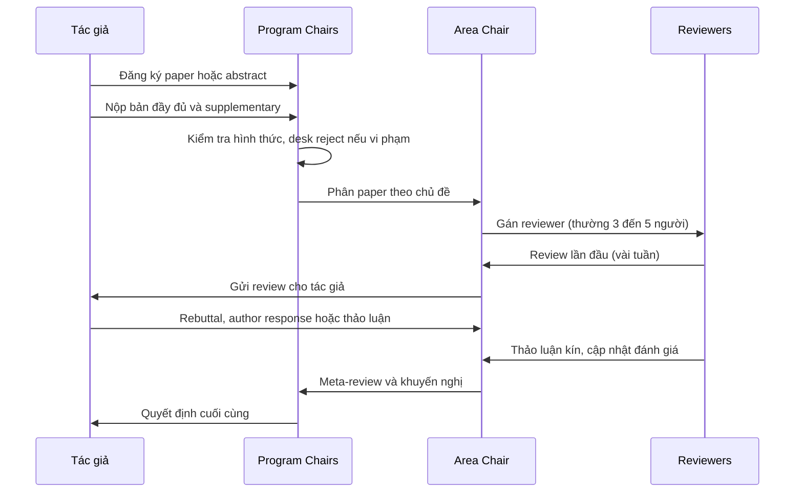

# Paper được đánh giá thế nào

!!! abstract "Mục tiêu của bài"
    Sau bài này, người học có thể:

    - mô tả vai trò của reviewer, Area Chair, Senior Area Chair và Program Chair trong quá trình review;
    - trình bày vòng đời của một submission từ lúc nộp tới lúc có quyết định, và các mốc thời gian điển hình;
    - hình dung cách một reviewer điển hình thực sự đọc paper, và rút ra hệ quả cho cách viết;
    - so sánh ba cơ chế phản hồi: rebuttal của CV, thảo luận trên OpenReview của ML, và author response trong ARR của NLP;
    - nhận diện các lý do reject phổ biến, hiểu tính ngẫu nhiên của review và nghĩa vụ review của tác giả.

Mọi lời khuyên về cách viết trong giáo trình này đều có thể được truy ngược về một câu hỏi: paper sẽ được đọc bởi ai, trong hoàn cảnh nào, và để đưa ra quyết định gì. Hiểu quy trình review vì thế giống như hiểu tâm lý người đọc trước khi viết cho họ. Một người viết hiểu rằng reviewer thường chỉ có một hai giờ cho mỗi paper sẽ đặt thông điệp chính lên trang đầu; một người viết hiểu rằng Area Chair cần lý lẽ để bảo vệ paper trước các AC khác sẽ cung cấp cho họ một câu chuyện ngắn gọn, dễ nhắc lại.

Bài này đi từ cấu trúc tới con người. Chúng ta bắt đầu với các vai trò trong hệ thống review và vòng đời một submission, rồi dừng lại khá lâu ở phần quan trọng nhất: cách một reviewer thực sự đọc paper. Sau đó là form review, so sánh ba cơ chế phản hồi của ba cộng đồng, các lý do reject phổ biến kèm chương có thể giúp tránh chúng, và cuối cùng là hai thực tế thường bị bỏ qua: tính ngẫu nhiên của review và nghĩa vụ review của chính tác giả.

## Những người tham gia quá trình review

Quá trình review ở các hội nghị A\* được tổ chức theo nhiều tầng. Ở tầng dưới cùng là **reviewer**, những nhà nghiên cứu trong cộng đồng được phân công đọc và đánh giá từng paper. Mỗi paper thường có ba đến năm reviewer. Reviewer viết bản đánh giá, cho điểm, tham gia thảo luận và cập nhật đánh giá sau khi đọc phản hồi của tác giả. Với quy mô hàng chục nghìn submission, phần lớn reviewer là nghiên cứu sinh năm cuối, postdoc và nhà nghiên cứu trẻ, bên cạnh một số nhà nghiên cứu cấp cao.

Ở tầng tiếp theo là **Area Chair (AC)**, thường là những nhà nghiên cứu có kinh nghiệm, mỗi người phụ trách một nhóm paper trong một mảng. AC chọn hoặc xác nhận reviewer, theo dõi chất lượng review, điều phối thảo luận, đọc phản hồi của tác giả, và viết meta-review kèm khuyến nghị chấp nhận hay từ chối. AC là người quyết định trên thực tế đối với phần lớn paper: một review tiêu cực nhưng lập luận yếu có thể bị AC bỏ qua, và một review tích cực nhưng hời hợt cũng vậy. Ở nhiều hội nghị có thêm tầng **Senior Area Chair (SAC)**, giám sát một nhóm AC, xử lý các trường hợp bất đồng và đảm bảo sự nhất quán giữa các mảng. Trên cùng là **Program Chair (PC)**, những người chịu trách nhiệm toàn bộ chương trình khoa học, thiết lập chính sách, xử lý desk reject và đưa ra quyết định cuối cùng dựa trên khuyến nghị của các tầng dưới.

Cấu trúc này có những biến thể theo cộng đồng. Ở các hội nghị CV, AC thường làm việc theo nhóm nhỏ, ví dụ nhóm ba AC cùng xem xét một tập paper để đưa ra khuyến nghị chung, trước khi PC chốt quyết định. Ở các hội nghị ML, chuỗi reviewer, AC, SAC, PC được tổ chức khá đầy đủ trên OpenReview. Ở ARR của NLP, AC thuộc về chu kỳ ARR và viết meta-review, còn SAC và PC thuộc về hội nghị mà paper được commit tới, và chính họ đưa ra quyết định main, Findings hay không nhận. Ngoài ra, các hội nghị lớn đều có **ethics reviewer**, những người được mời xem xét riêng các paper bị gắn cờ về vấn đề đạo đức.

| Vai trò | Nhiệm vụ chính | Điều người viết cần nhớ |
|---|---|---|
| Reviewer | Đọc, đánh giá, cho điểm, thảo luận | Có chuyên môn nhưng ít thời gian; ấn tượng đầu tiên rất bền |
| Area Chair | Điều phối, đọc phản hồi, viết meta-review, khuyến nghị | Cần một lý lẽ rõ ràng để bảo vệ paper |
| Senior Area Chair | Giám sát nhóm AC, xử lý bất đồng | Xem xét các paper ở vùng ranh giới |
| Program Chair | Chính sách, desk reject, quyết định cuối | Áp dụng quy định hình thức rất nghiêm |

## Vòng đời một submission

Dù chi tiết khác nhau giữa các cộng đồng, vòng đời của một submission ở hội nghị A\* đi qua những giai đoạn tương tự nhau. Sơ đồ dưới đây mô tả mô hình chung.

Giai đoạn đầu tiên là **đăng ký và nộp bài**. Nhiều hội nghị yêu cầu đăng ký title, abstract, danh sách tác giả và chủ đề khoảng một tuần trước deadline, để bắt đầu sớm quá trình phân công. Ngay sau deadline, PC và các trợ lý tiến hành **kiểm tra hình thức**: paper vượt giới hạn trang, sai template, lộ danh tính tác giả, thiếu các mục bắt buộc như Limitations ở ARR hay Paper Checklist ở NeurIPS đều có thể bị desk reject, tức là bị loại mà không qua review. Đây là cách thất bại đáng tiếc nhất vì hoàn toàn có thể tránh được.

Tiếp theo là giai đoạn **phân công**. Hệ thống tính điểm tương đồng giữa nội dung paper và hồ sơ công bố của reviewer, kết hợp với lựa chọn chủ đề của tác giả và, ở nhiều hội nghị, với việc reviewer tự đăng ký những paper muốn đọc (bidding). Đây là lý do việc chọn đúng subject area hay primary area khi nộp có ảnh hưởng trực tiếp tới việc ai sẽ đọc paper. Sau đó, reviewer có vài tuần để viết **review lần đầu**. Review được gửi tới tác giả, mở ra giai đoạn **phản hồi**, được tổ chức rất khác nhau giữa ba cộng đồng như sẽ thấy ở phần sau. Cuối cùng là **thảo luận kín** giữa reviewer và AC, **meta-review**, và **quyết định** của PC.

Bảng dưới đây ghi các mốc thời gian điển hình tính từ deadline D. Mốc chính xác thay đổi theo hội nghị và theo năm; chẳng hạn ở ICLR review lần đầu thường đến sớm hơn và giai đoạn thảo luận kéo dài hơn so với các hội nghị khác.

| Giai đoạn | Thời điểm điển hình |
|---|---|
| Đăng ký paper hoặc abstract | Khoảng D − 1 tuần |
| Deadline bài đầy đủ | D |
| Hạn supplementary (nếu tách riêng) | Từ D tới khoảng D + 1 tuần |
| Kiểm tra hình thức, bidding, phân công | Khoảng D + 1 tới D + 3 tuần |
| Review lần đầu được gửi tới tác giả | Khoảng D + 1 tới D + 2,5 tháng, tùy hội nghị |
| Giai đoạn phản hồi của tác giả | Khoảng một tới vài tuần sau khi nhận review |
| Thảo luận kín, meta-review | Vài tuần sau giai đoạn phản hồi |
| Quyết định cuối cùng | Khoảng D + 3 tới D + 4 tháng |
| Camera-ready | Vài tuần sau quyết định |

## Reviewer thực sự đọc paper như thế nào

Để hiểu cách reviewer đọc paper, hãy hình dung một reviewer điển hình. Đó là một nghiên cứu sinh năm thứ tư hoặc một postdoc, có chuyên môn tốt trong một mảng hẹp, và vừa được phân công năm hoặc sáu paper cần review trong khoảng bốn tuần. Bốn tuần đó không trống: người này cũng có deadline riêng, có thí nghiệm đang chạy, có bài giảng hoặc công việc dự án. Việc review vì thế được dồn vào vài buổi tối hoặc một hai ngày cuối tuần, mỗi paper được dành khoảng một đến ba giờ. Người này không có ác ý với paper nào; họ chỉ có ít thời gian và muốn đưa ra một đánh giá công bằng trong khoảng thời gian đó.

Khi mở một paper, reviewer này hiếm khi đọc tuần tự từ đầu đến cuối như đọc một cuốn sách. Hành vi điển hình diễn ra theo một trình tự khá ổn định. Đầu tiên, họ đọc title và abstract, và trong vài phút đã hình thành một ấn tượng ban đầu về việc paper giải quyết vấn đề gì và đóng góp có vẻ lớn tới đâu. Ấn tượng này thường rất bền: những gì đọc sau đó có xu hướng được diễn giải để xác nhận ấn tượng ban đầu. Tiếp theo, họ nhìn Figure 1 và hình minh họa phương pháp, rồi đọc Introduction, đặc biệt là đoạn liệt kê đóng góp, để xác định chính xác paper khẳng định điều gì. Sau đó, phần lớn reviewer nhảy thẳng tới bảng kết quả chính để kiểm tra các khẳng định đó có được hỗ trợ không: so sánh với những phương pháp nào, trên dữ liệu nào, mức cải thiện ra sao. Chỉ khi đã có một hình dung tổng thể, họ mới quay lại đọc kỹ phần phương pháp, lúc này với mục đích tìm lỗ hổng, điểm không rõ hoặc giả định đáng ngờ, rồi xem ablation và các phân tích để đánh giá các thành phần có thực sự cần thiết không. Cuối cùng, họ viết review, thường bắt đầu bằng việc tóm tắt paper theo cách hiểu của chính họ.

Trình tự trên thay đổi đôi chút theo cộng đồng. Reviewer CV thường dành nhiều sự chú ý cho Figure 1, các hình kết quả định tính và bảng benchmark. Reviewer NLP thường đặc biệt chú ý tới thiết lập đánh giá: dữ liệu nào, chỉ số nào, có phân tích lỗi không, có mục Limitations thực chất không. Reviewer ML thường dừng lâu ở các phát biểu lý thuyết và giả định của chúng, ở các thí nghiệm kiểm chứng tính tổng quát, và ở error bars.

Từ hình dung này, có thể rút ra bốn hệ quả trực tiếp cho người viết. Thứ nhất, title, abstract, Figure 1, đoạn đóng góp và bảng kết quả chính quyết định phần lớn ấn tượng của reviewer, nên chúng xứng đáng được đầu tư nhiều thời gian hơn hẳn so với tỉ lệ số trang mà chúng chiếm. Thứ hai, phần Summary trong review là một tấm gương: nếu reviewer tóm tắt sai đóng góp của paper, thì đó gần như luôn là lỗi của cách viết chứ không phải của reviewer. Thứ ba, những câu hỏi mà một reviewer thông minh nhưng vội vàng chắc chắn sẽ đặt ra, như vì sao không so sánh với một phương pháp nào đó, vì sao chọn siêu tham số này, nên được trả lời sẵn trong paper hoặc trong appendix. Thứ tư, paper cũng cần được viết cho AC: AC phải giải thích với các AC khác vì sao paper xứng đáng được nhận, và một câu chuyện có thể tóm tắt trong một câu sẽ giúp AC làm việc đó dễ hơn nhiều.

Phần trên mô tả cách reviewer đọc nhìn *từ phía người viết*, để rút ra hệ quả cho bản thảo. Mặt còn lại của kỹ năng này là chính người viết tập đọc như một reviewer: đánh giá novelty và đóng góp của một paper, đối chiếu từng claim với bằng chứng, nhận diện điểm yếu thực chất thay vì dựa vào những heuristic phản biện lười, và viết thành một bản review có lập luận. Kỹ năng đó được giảng và thực hành trong bài [Đọc paper như một reviewer](../01-truoc-khi-viet/doc-nhu-reviewer.md) ở Chương 1, và nên được rèn từ trước khi viết, vì người đọc tài liệu bằng con mắt reviewer sẽ sớm thấy khoảng trống và điểm yếu của chính ý tưởng đang theo đuổi.

!!! success "Phép thử của tấm gương"
    Trước khi nộp, hãy nhờ một đồng nghiệp không tham gia dự án đọc paper trong khoảng thời gian giới hạn, rồi viết ra ba câu: paper giải quyết vấn đề gì, đóng góp chính là gì, và bằng chứng mạnh nhất là gì. Nếu ba câu đó khác với điều nhóm tác giả muốn truyền tải, thì reviewer thật nhiều khả năng cũng sẽ hiểu sai theo cùng cách. Bài [Quy trình viết & tự review](../03-ky-thuat/quy-trinh-viet.md) trình bày cách tổ chức các vòng đọc thử như vậy.

## Form review và tiêu chí đánh giá

Form review thay đổi theo hội nghị và theo năm, nhưng có một cấu trúc chung. Phần đầu thường là **tóm tắt** paper theo cách hiểu của reviewer. Tiếp theo là **điểm mạnh** và **điểm yếu**, nơi reviewer trình bày lập luận chính. Sau đó là các **câu hỏi** gửi tác giả, những điểm mà nếu được làm rõ có thể thay đổi đánh giá. Nhiều form có thêm mục về **giới hạn** và **tác động xã hội**, về **vấn đề đạo đức**, và về **khả năng tái tạo**. Cuối cùng là các trường điểm số: một **điểm tổng thể** trên một thang có nhiều mức từ từ chối tới chấp nhận mạnh, và một điểm **confidence** thể hiện mức độ chắc chắn của reviewer. Một số hội nghị ML có thêm các điểm thành phần, chẳng hạn về soundness, presentation và contribution, còn ARR của NLP tách riêng Soundness và Excitement như đã trình bày ở bài [NLP: ACL, EMNLP, NAACL](he-sinh-thai-nlp.md). Sau giai đoạn phản hồi, reviewer thường được yêu cầu cập nhật điểm và giải thích lý do.

Đằng sau các trường của form là một bộ tiêu chí khá thống nhất giữa các cộng đồng. Hướng dẫn reviewer của các hội nghị lớn, dù diễn đạt khác nhau, đều xoay quanh những câu hỏi sau.

| Tiêu chí | Câu hỏi reviewer tự đặt ra |
|---|---|
| Novelty, originality | Điều gì là mới: ý tưởng, cách đặt vấn đề, kết quả, hay chỉ là kết hợp hiển nhiên của hai phương pháp có sẵn? |
| Significance, impact | Cộng đồng có quan tâm không? Người khác có dùng hoặc xây dựng tiếp trên kết quả này không? |
| Technical soundness | Phương pháp có đúng không? Các claim có được bằng chứng hỗ trợ đầy đủ không? |
| Experimental validation | Dữ liệu và chỉ số có phù hợp không? Baseline có mạnh và công bằng không? Ablation và phân tích có đủ không? |
| Clarity | Có đọc hiểu được không? Người khác có thể hiện thực lại không? |
| Reproducibility | Có đủ chi tiết về dữ liệu, siêu tham số, tài nguyên tính toán, mã nguồn không? |

!!! quote "Một tinh thần chung trong hướng dẫn reviewer"
    Hướng dẫn reviewer của nhiều hội nghị lớn, ở cả CV và ML, nhiều năm liền nhấn mạnh rằng không nên từ chối một paper chỉ vì nó không đạt state-of-the-art, nếu paper mang lại một ý tưởng hoặc hiểu biết mới; và rằng một ý tưởng đơn giản nhưng hiệu quả là một ưu điểm chứ không phải một nhược điểm. Trên thực tế, reviewer vẫn rất nhạy với bảng kết quả, nên khi paper không thắng tuyệt đối, nhóm tác giả cần chủ động giải thích giá trị của công trình nằm ở đâu.

## Ba cơ chế phản hồi: CV, ML và NLP

Giai đoạn phản hồi review là nơi ba cộng đồng khác nhau rõ nhất. Hiểu cơ chế của nơi nộp quyết định cách nhóm tác giả chuẩn bị, từ việc dự trù tài nguyên tính toán tới việc viết phản hồi.

### Computer Vision: rebuttal một trang và thảo luận kín

Ở CVPR, ICCV và ECCV, phản hồi được tổ chức dưới dạng **rebuttal**: một file PDF thường giới hạn trong một trang theo template của hội nghị, nộp trong khoảng một tuần sau khi nhận review. Đây là cơ hội *duy nhất* để tác giả trao đổi với reviewer; sau đó, reviewer và AC thảo luận kín, tác giả không thấy và không tham gia. Giới hạn một trang buộc nhóm tác giả phải chọn lọc rất kỹ: trả lời những điểm có khả năng thay đổi quyết định trước, nhóm các câu hỏi giống nhau của nhiều reviewer lại, và dùng bảng nhỏ để trình bày kết quả bổ sung. Hướng dẫn của các hội nghị CV thường hạn chế việc đưa vào rebuttal những thí nghiệm mới quy mô lớn không được reviewer yêu cầu, vì vậy cần đọc kỹ quy định của năm đó.

### Machine Learning: thảo luận nhiều vòng trên OpenReview

Ở NeurIPS, ICML và ICLR, phản hồi là một **cuộc thảo luận** trên OpenReview kéo dài từ một tới vài tuần. Tác giả đăng phản hồi dạng văn bản cho từng review, thường trong một giới hạn ký tự, có thể kèm một phản hồi chung cho mọi reviewer; reviewer có thể hỏi tiếp và tác giả trả lời tiếp. Ở ICLR, toàn bộ cuộc thảo luận là công khai và tác giả được cập nhật file PDF trong lúc thảo luận; ở NeurIPS và ICML, thảo luận là kín và việc sửa paper bị giới hạn hơn. Cơ chế nhiều vòng cho phép giải quyết các hiểu nhầm một cách triệt để, nhưng cũng đòi hỏi nhóm tác giả duy trì sự sẵn sàng trong suốt giai đoạn đó, bao gồm cả tài nguyên tính toán để chạy các thí nghiệm bổ sung mà reviewer yêu cầu.

### NLP: author response, meta-review và commit trong ARR

Trong ACL Rolling Review, tác giả viết **author response** dạng văn bản trên OpenReview sau khi nhận review, và reviewer có thể cập nhật đánh giá. AC sau đó viết **meta-review** với một mức đánh giá tổng thể. Khác biệt căn bản là quyết định cuối cùng không nằm trong chu kỳ ARR mà ở bước **commit**: nhóm tác giả đọc review và meta-review, rồi tự quyết định commit tới một hội nghị hay sửa và nộp lại vào chu kỳ sau kèm revision notes. Như vậy, phản hồi trong ARR có hai kênh: author response trong chu kỳ hiện tại, và bản revision notes cho chu kỳ kế tiếp nếu cần.

| | Computer Vision | Machine Learning | NLP (ARR) |
|---|---|---|---|
| Hình thức phản hồi | Rebuttal PDF, thường một trang | Văn bản trên OpenReview cho từng review | Author response dạng văn bản trên OpenReview |
| Số lượt trao đổi | Một lần | Nhiều lượt trong một tới vài tuần | Một giai đoạn phản hồi; có thể nộp lại chu kỳ sau |
| Mức công khai | Kín | NeurIPS, ICML kín; ICLR công khai | Kín |
| Sửa paper trong lúc review | Không | ICLR cho phép; các hội nghị khác hạn chế | Không; sửa và nộp lại kèm revision notes |
| Nơi ra quyết định | AC khuyến nghị, PC chốt | AC, SAC khuyến nghị, PC chốt | SAC và PC của hội nghị ở bước commit |

Bài [Rebuttal & thảo luận](../04-nop-va-sau-nop/rebuttal.md) ở Chương 4 trình bày chi tiết kỹ năng viết phản hồi cho cả ba cơ chế.

## Những lý do reject phổ biến

Mặc dù mỗi paper bị từ chối vì những lý do riêng, các bản review tiêu cực có xu hướng lặp lại một số mẫu nhận xét quen thuộc. Biết trước các mẫu này cho phép nhóm tác giả kiểm tra paper từ góc nhìn của reviewer trước khi nộp. Bảng dưới đây liệt kê các lý do thường gặp nhất, câu nhận xét điển hình mà chúng xuất hiện trong review, và các bài trong giáo trình giúp phòng tránh.

| Lý do | Câu nhận xét điển hình | Bài giúp phòng tránh |
|---|---|---|
| Đóng góp không đủ mới | *"The method is a straightforward combination of X and Y."* | [Thẩm định ý tưởng](../01-truoc-khi-viet/y-tuong.md), [Câu chuyện](../01-truoc-khi-viet/cau-chuyen.md), [Introduction](../02-viet-tung-phan/introduction.md) |
| Thiếu so sánh với công trình liên quan | *"The authors did not compare with recent work such as..."* | [Đọc tài liệu](../01-truoc-khi-viet/literature.md), [Related Work](../02-viet-tung-phan/related-work.md) |
| Baseline yếu hoặc không công bằng | *"Baselines are not tuned and use a weaker backbone."* | [Thiết kế thí nghiệm](../01-truoc-khi-viet/thi-nghiem.md) |
| Thiếu ablation | *"It is unclear which component contributes to the gain."* | [Experiments](../02-viet-tung-phan/experiments.md) |
| Claim không được hỗ trợ | *"The paper claims X but only shows Y."* | [Câu chuyện](../01-truoc-khi-viet/cau-chuyen.md), [Experiments](../02-viet-tung-phan/experiments.md) |
| Cải thiện nhỏ, thiếu ý nghĩa thống kê | *"The improvement is within the variance across seeds."* | [Thiết kế thí nghiệm](../01-truoc-khi-viet/thi-nghiem.md), [Experiments](../02-viet-tung-phan/experiments.md) |
| Động cơ không rõ | *"Why is this problem important?"* | [Introduction](../02-viet-tung-phan/introduction.md) |
| Trình bày khó hiểu | *"Section 3 is hard to follow and the notation is inconsistent."* | [Method](../02-viet-tung-phan/method.md), [Tiếng Anh học thuật](../03-ky-thuat/van-phong.md) |
| Thiếu tính tổng quát (thường gặp ở ML) | *"It is unclear whether the insight holds beyond this task."* | [Viết cho NeurIPS / ICML / ICLR](../06-cong-dong/ml.md) |
| Đánh giá hạn hẹp, thiếu phân tích lỗi (thường gặp ở NLP) | *"Evaluation is limited to a single English dataset and lacks error analysis."* | [Viết cho ACL / EMNLP / NAACL](../06-cong-dong/nlp.md) |
| Desk reject | Không có review: sai định dạng, lộ danh tính, thiếu mục bắt buộc | [Chuẩn bị nộp bài](../04-nop-va-sau-nop/submission.md) |

Có hai điều đáng chú ý khi đọc bảng này. Điều thứ nhất là phần lớn các lý do nằm ở giai đoạn *trước khi viết*: đóng góp không đủ mới, baseline yếu, thiếu ablation hay claim không được hỗ trợ đều là vấn đề của thiết kế nghiên cứu và câu chuyện, không phải của câu chữ. Đây là lý do [Chương 1: Nghiên cứu trước khi viết](../01-truoc-khi-viet/index.md) được đặt trước Chương 2. Điều thứ hai là nhiều lý do thực chất là vấn đề *trình bày*: một paper có đóng góp mới nhưng không nói rõ điều gì là mới sẽ nhận về nhận xét "limited novelty" không khác gì một paper thực sự thiếu tính mới. Kỹ năng viết, vì vậy, không chỉ làm paper dễ đọc hơn mà còn quyết định việc đóng góp có được nhìn thấy hay không.

## Tính ngẫu nhiên của review

Một thực tế mà người viết cần chấp nhận là review có yếu tố ngẫu nhiên đáng kể. Bằng chứng rõ nhất đến từ hai thí nghiệm do chính NeurIPS thực hiện. Năm 2014, NeurIPS chia khoảng một phần mười số submission cho hai hội đồng review độc lập, mỗi hội đồng tự đưa ra quyết định mà không biết về hội đồng kia. Kết quả cho thấy hai hội đồng bất đồng ở khoảng một phần tư số paper được đánh giá kép, và nếu chỉ xét những paper được một hội đồng chấp nhận, thì một phần rất lớn trong số đó lại bị hội đồng kia từ chối. Năm 2021, NeurIPS lặp lại thí nghiệm với quy mô lớn hơn và thu được mức độ bất đồng tương tự, cho thấy tình trạng này không được cải thiện đáng kể dù quy trình review đã thay đổi nhiều.

Kết quả này cần được diễn giải cẩn thận. Nó không có nghĩa là review hoàn toàn ngẫu nhiên: các paper rất mạnh và rất yếu thường được hai hội đồng đánh giá giống nhau. Sự bất đồng tập trung ở vùng ranh giới, nơi có rất nhiều paper có chất lượng gần nhau, và quyết định ở vùng này phụ thuộc nhiều vào việc paper rơi vào tay reviewer nào. Có ba hệ quả thực tế. Thứ nhất, một lần reject không có nghĩa là paper tồi, và một lần accept cũng không có nghĩa là paper xuất sắc. Thứ hai, chiến lược tốt nhất là đưa paper ra khỏi vùng ranh giới bằng cách làm cho đóng góp rõ ràng tới mức khó hiểu sai, và bằng chứng đủ mạnh tới mức khó bác bỏ. Thứ ba, tính ngẫu nhiên không phải là lý do để phớt lờ review: ngay cả một review có vẻ không công bằng cũng thường chứa tín hiệu về chỗ paper bị hiểu sai, và tín hiệu đó có giá trị cho lần nộp sau. Bài [Khi bị reject](../04-nop-va-sau-nop/reject.md) hướng dẫn cách đọc review để tách tín hiệu khỏi nhiễu.

## Nghĩa vụ review của tác giả

Số lượng submission tăng nhanh hơn nhiều so với số reviewer có kinh nghiệm, và các hội nghị lớn đã phản ứng bằng cách đặt ra nghĩa vụ review đối với tác giả. Những năm gần đây, nhiều hội nghị ở cả ba cộng đồng, trong đó có CVPR, NeurIPS, ICLR và ARR, yêu cầu mỗi submission phải có ít nhất một tác giả, hoặc mọi tác giả đáp ứng một số điều kiện về kinh nghiệm, đăng ký làm reviewer. Một số hội nghị còn quy định rằng reviewer không hoàn thành nghĩa vụ, nộp review quá muộn hoặc viết review kém chất lượng có thể khiến các paper mà họ đứng tên bị ảnh hưởng, thậm chí bị desk reject. Các quy định này thay đổi nhanh giữa các năm, nên cần đọc kỹ trong Call for Papers.

Với người mới, nghĩa vụ này nên được nhìn như một cơ hội hơn là một gánh nặng. Không có cách nào hiểu reviewer rõ hơn là trực tiếp làm reviewer: đọc năm hay sáu paper trong thời gian giới hạn, cảm nhận trực tiếp paper nào dễ đánh giá và paper nào gây bối rối, và đọc review của các reviewer khác cho cùng một paper. Rất nhiều nhà nghiên cứu cho biết lần review đầu tiên đã thay đổi cách họ viết paper nhiều hơn bất kỳ lời khuyên nào. Người chưa từng review nên tập viết vài bản review cho các paper đã công bố trong mảng đang nghiên cứu trước khi nhận lời mời thật, theo quy trình trong bài [Đọc paper như một reviewer](../01-truoc-khi-viet/doc-nhu-reviewer.md), rồi đối chiếu với review công khai trên OpenReview nếu có.

## Tóm tắt

Quá trình review ở hội nghị A\* được tổ chức theo nhiều tầng: reviewer đánh giá, Area Chair điều phối và khuyến nghị, Senior Area Chair giám sát, Program Chair ra quyết định cuối cùng. Một submission đi qua các giai đoạn đăng ký, kiểm tra hình thức, phân công, review, phản hồi, thảo luận và quyết định, kéo dài khoảng ba đến bốn tháng. Reviewer điển hình có chuyên môn nhưng ít thời gian, hình thành ấn tượng từ title, abstract, Figure 1, đoạn đóng góp và bảng kết quả chính, nên những phần này cần được đầu tư đặc biệt. Ba cộng đồng có ba cơ chế phản hồi khác nhau: rebuttal một trang ở CV, thảo luận nhiều vòng trên OpenReview ở ML, author response và commit trong ARR ở NLP. Review có yếu tố ngẫu nhiên đáng kể ở vùng ranh giới, nên mục tiêu của người viết là đưa paper ra khỏi vùng đó; và việc tự làm reviewer là cách tốt nhất để hiểu người đọc.

## Bài tập

1. Chọn hội nghị mục tiêu của dự án hiện tại, tìm form review và hướng dẫn reviewer của năm gần nhất. Liệt kê các trường điểm số và các câu hỏi chính, rồi tự đánh giá bản thảo hiện có theo đúng form đó.
2. Đọc bản thảo hiện tại theo trình tự của một reviewer vội vàng: title, abstract, Figure 1, đoạn đóng góp, bảng kết quả chính, trong không quá mười lăm phút. Viết ra phần Summary mà một reviewer như vậy sẽ viết, và so sánh với điều nhóm tác giả muốn truyền tải.
3. Dùng bảng các lý do reject phổ biến, viết cho mỗi lý do một câu trả lời: paper hiện tại đã phòng tránh lý do đó chưa, bằng mục nào, hình nào hay bảng nào. Những dòng chưa có câu trả lời là danh sách việc cần làm trước deadline.
4. Đọc review công khai của ba paper trên OpenReview ở một hội nghị ML, trong đó có ít nhất một paper bị từ chối. So sánh các lý do được nêu với bảng trong bài, và ghi lại những lý do không có trong bảng.
