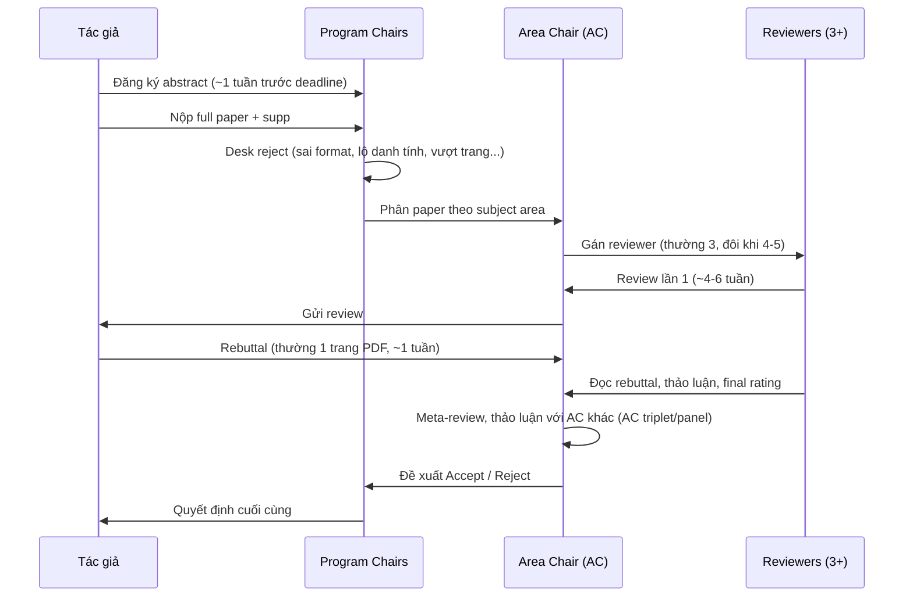

# Paper của bạn được đánh giá thế nào?

Hiểu quy trình review là "tâm lý học" của việc viết paper. Mọi lời khuyên ở các chương sau đều xuất phát từ đây.

## Vòng đời một submission (mô hình CVPR/ICCV/ECCV)

### Mốc thời gian điển hình (CVPR)

| Mốc | Thời gian |
|---|---|
| Abstract registration | ~1 tuần trước deadline |
| Paper deadline | đầu–giữa tháng 11 |
| Supplementary deadline | thường cùng hoặc ~1 tuần sau paper deadline |
| Review ra | cuối tháng 1 |
| Rebuttal | cuối tháng 1 – đầu tháng 2 (~1 tuần) |
| Quyết định | cuối tháng 2 |
| Camera-ready | khoảng tháng 3–4 |
| Hội nghị | tháng 6 |

## Ai là người đọc paper của bạn?

**Reviewer** là các nhà nghiên cứu trong cộng đồng — từ nghiên cứu sinh năm 3 đến giáo sư. Với số submission > 10.000, phần lớn reviewer là **PhD student và postdoc**. Từ khoảng 2024–2025, nhiều hội nghị CV còn **bắt buộc tác giả đủ điều kiện phải tham gia review**, và có thể desk-reject paper của reviewer vô trách nhiệm.

Hệ quả:

- Reviewer **có chuyên môn** nhưng **không có thời gian**. Một reviewer nhận ~5–8 paper, thường đọc mỗi paper 1–3 giờ.
- Họ **không** đọc paper của bạn từ đầu đến cuối như đọc tiểu thuyết. Hành vi điển hình:
    1. Đọc Title + Abstract → hình thành **ấn tượng đầu tiên** (thường khá bền).
    2. Nhìn **Figure 1 (teaser)** và **Figure phương pháp**.
    3. Đọc Introduction, đặc biệt **đoạn contributions**.
    4. Nhảy sang **bảng kết quả chính** — "có thắng SOTA không? so với những ai?"
    5. Đọc Method để tìm lỗ hổng / điểm không rõ.
    6. Xem ablation — "các thành phần có thật sự cần thiết?"
    7. Viết review.
- **Area Chair (AC)** là người quyết định thực sự. AC đọc review + rebuttal + (thường là) lướt paper, rồi viết meta-review. Một review "Weak Reject" có lập luận yếu có thể bị AC bỏ qua; một review "Accept" hời hợt cũng vậy.

## Form review trông như thế nào?

Các trường thường gặp (tên cụ thể đổi theo năm):

1. **Summary** — reviewer tóm tắt paper. *Nếu reviewer tóm tắt sai, nghĩa là bạn viết chưa rõ.*
2. **Strengths**
3. **Weaknesses**
4. **Questions / Justification of rating**
5. **Preliminary rating** — thang điểm kiểu: Reject / Weak Reject / Borderline / Weak Accept / Accept (số mức và nhãn thay đổi theo năm).
6. **Confidence** — reviewer tự đánh giá mức độ chắc chắn.
7. Mục riêng về **ethics / limitations / reproducibility**.
8. **Final rating + justification** sau rebuttal.

### Reviewer được hướng dẫn chấm theo tiêu chí gì?

Hướng dẫn reviewer của CVPR/ICCV/ECCV qua các năm xoay quanh các câu hỏi:

| Tiêu chí | Câu hỏi reviewer tự hỏi |
|---|---|
| **Novelty / Originality** | Có gì mới? Mới ở ý tưởng, ở cách hiểu vấn đề, ở kết quả, hay chỉ là "A + B"? |
| **Significance / Impact** | Cộng đồng có quan tâm không? Người khác có dùng/xây tiếp trên nó không? |
| **Technical soundness** | Phương pháp có đúng không? Claim có được thí nghiệm hỗ trợ không? |
| **Experimental validation** | Benchmark chuẩn? Baseline mạnh & công bằng? Ablation đủ? |
| **Clarity** | Có đọc hiểu và tái hiện được không? |
| **Reproducibility** | Có đủ chi tiết hyperparameter, dữ liệu, code? |

!!! quote "Tinh thần quan trọng trong hướng dẫn reviewer CV"
    Hướng dẫn reviewer của CVPR nhiều năm liền nhấn mạnh: **không reject chỉ vì paper không đạt SOTA** nếu nó mang lại ý tưởng/hiểu biết mới; và đánh giá cao những paper có **ý tưởng đơn giản nhưng hiệu quả**. Tuy vậy, trên thực tế reviewer vẫn rất nhạy với bảng kết quả — vì vậy bạn cần *chủ động* giải thích giá trị của mình nếu không thắng tuyệt đối.

## Top lý do bị reject (và chương nào giúp bạn tránh)

| Lý do | Biểu hiện trong review | Phòng tránh |
|---|---|---|
| **Limited novelty** | "The method is a straightforward combination of X and Y." | [Ý tưởng](../01-truoc-khi-viet/y-tuong.md), [Câu chuyện](../01-truoc-khi-viet/cau-chuyen.md), [Intro](../02-viet-tung-phan/introduction.md) |
| **Missing comparisons** | "The authors did not compare with [recent work]." | [Literature](../01-truoc-khi-viet/literature.md), [Experiments](../02-viet-tung-phan/experiments.md) |
| **Unfair / weak baselines** | "Baselines are not tuned / use different backbones." | [Thiết kế thí nghiệm](../01-truoc-khi-viet/thi-nghiem.md) |
| **Insufficient ablation** | "It is unclear which component contributes." | [Experiments](../02-viet-tung-phan/experiments.md) |
| **Claims not supported** | "The paper claims X but only shows Y." | [Câu chuyện](../01-truoc-khi-viet/cau-chuyen.md) |
| **Unclear writing** | "Section 3 is hard to follow; notation inconsistent." | [Method](../02-viet-tung-phan/method.md), [Văn phong](../03-ky-thuat/van-phong.md) |
| **Marginal improvement** | "+0.3 mAP is within noise." | [Experiments](../02-viet-tung-phan/experiments.md) |
| **Motivation không rõ** | "Why is this problem important?" | [Intro](../02-viet-tung-phan/introduction.md) |
| **Desk reject** | Không có review | [Submission checklist](../04-nop-va-sau-nop/submission.md) |

## Bài học then chốt

!!! success "5 điều cần khắc cốt"
    1. **Ấn tượng 5 phút đầu quyết định 70%.** Đầu tư gấp đôi thời gian cho Title, Abstract, Figure 1, đoạn contributions, Table 1.
    2. **Đoán trước câu hỏi của reviewer** và trả lời sẵn trong paper (hoặc supp).
    3. **Reviewer tóm tắt sai = lỗi của bạn.** Viết sao cho phần Summary của review trùng với cái bạn muốn họ nghĩ.
    4. **Viết cho AC nữa**: AC cần lý lẽ để bảo vệ paper trong phòng họp. Hãy cho họ "câu chuyện một dòng" rõ ràng.
    5. **Review có yếu tố ngẫu nhiên.** Thí nghiệm NeurIPS 2014 và 2021 cho thấy hai hội đồng độc lập bất đồng đáng kể về các paper được accept. Reject không có nghĩa là paper tồi.
