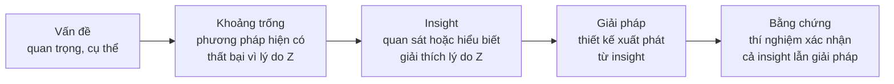

# Xây "câu chuyện" của paper

!!! abstract "Mục tiêu của bài"
    Sau bài này, người học có thể:

    - Mô tả câu chuyện của một paper như một lập luận gồm năm mắt xích, và giải thích vì sao reviewer cần nhắc lại được nó.
    - Phân biệt insight với phương pháp, và nhận diện insight trong các paper kinh điển của ba cộng đồng.
    - Viết một bản pitch một trang để kiểm tra độ chín của dự án trước khi viết paper.
    - Viết claim cụ thể, kiểm chứng được, và chọn câu chuyện mạnh nhất từ cùng một bộ kết quả.
    - Điều chỉnh câu chuyện một cách trung thực khi kết quả không như mong đợi.

Hai bài trước đã đưa dự án đi qua phần việc nặng nhất của nghiên cứu. Bài [Thiết kế thí nghiệm](thi-nghiem.md) biến các claim dự kiến thành những thí nghiệm có tiêu chí ủng hộ và bác bỏ rõ ràng; bài [Vận hành thực nghiệm](thuc-thi.md) biến các thí nghiệm ấy thành những con số đáng tin, truy được tới từng lần chạy. Khi bảng kết quả bắt đầu đầy dần, một câu hỏi mới xuất hiện: toàn bộ bằng chứng này rốt cuộc nói lên điều gì, và nên được kể theo trình tự nào để người đọc chấp nhận? Đó là câu hỏi của bài cuối cùng trong Chương 1. Câu chuyện không đợi tới khi mọi thí nghiệm xong mới được nghĩ tới, vì phác thảo của nó đã có từ lúc [lập kế hoạch nghiên cứu](ke-hoach.md). Nhưng chính khi kết quả thật bắt đầu về, câu chuyện phải được viết rõ ra và đối chiếu với bằng chứng: chỗ nào chưa khớp sẽ chỉ ra thí nghiệm còn thiếu hoặc claim cần thu hẹp.

Một paper không phải là bản báo cáo liệt kê những gì nhóm tác giả đã làm. Nó là một **lập luận**: từ một vấn đề đáng quan tâm, qua những bằng chứng được sắp xếp có chủ đích, tới một kết luận mà người đọc chấp nhận. "Câu chuyện" của paper chính là bộ khung của lập luận đó. Khi câu chuyện rõ ràng, mọi phần của paper đều có chỗ đứng: tiêu đề nêu kết luận, abstract tóm tắt lập luận, Introduction dẫn dắt từ vấn đề tới insight, Figure 1 minh họa điểm then chốt, và phần thí nghiệm lần lượt chứng minh từng claim. Khi câu chuyện mơ hồ, paper trở thành một chuỗi các mục rời rạc mà người đọc phải tự ghép nối, và thường ghép sai.

Có một lý do rất thực tế khiến câu chuyện quan trọng. Mỗi reviewer thường phải đọc nhiều paper trong một thời gian ngắn, rồi tham gia thảo luận với các reviewer khác và với AC (*area chair*, người điều phối và đưa ra khuyến nghị cuối cùng). Trong thảo luận đó, reviewer phải tóm tắt paper trong một hai câu. Nếu một paper có câu chuyện một dòng rõ ràng, chẳng hạn "paper này chỉ ra rằng X là nguyên nhân chính của lỗi Y và sửa nó bằng Z", reviewer ủng hộ có thể bảo vệ nó dễ dàng. Nếu không, ngay cả một reviewer có thiện cảm cũng khó thuyết phục người khác.

Xây dựng câu chuyện là kỹ năng khó nhất và quan trọng nhất trong việc viết paper, và nó cần được rèn luyện có chủ đích. Bài này trình bày cấu trúc năm mắt xích của câu chuyện, đi sâu vào mắt xích hay bị thiếu nhất là insight, giới thiệu bản pitch một trang như một công cụ kiểm tra, rồi bàn về cách viết claim, cách chọn câu chuyện từ cùng một bộ kết quả, và cách giữ trung thực khi mọi việc không diễn ra như kế hoạch.

## Năm mắt xích của một câu chuyện

Câu chuyện của hầu hết paper A\* có thể được mô tả bằng năm mắt xích nối tiếp nhau: Vấn đề, Khoảng trống, Insight, Giải pháp và Bằng chứng. Sơ đồ dưới đây minh họa trình tự đó.



**Vấn đề** là điều mà người đọc cần quan tâm, được nêu đủ cụ thể để có thể đo lường. "Cải thiện hiểu ngôn ngữ" là quá rộng; "mô hình hiện tại không phân biệt được câu khẳng định và câu phủ định trong suy luận ngôn ngữ tự nhiên" là một vấn đề cụ thể. **Khoảng trống** giải thích vì sao các phương pháp hiện có chưa giải quyết được vấn đề, và cần nêu một *lý do* cụ thể. Một lỗi rất thường gặp là nêu khoảng trống dưới dạng "chưa ai làm X". Điều đó chỉ là một khoảng trống nếu đi kèm lập luận rằng X là cần thiết; trong nhiều trường hợp, chưa ai làm X đơn giản vì X không cần thiết.

**Insight** là quan sát hoặc hiểu biết giải thích được lý do của khoảng trống và gợi ý hướng giải quyết. Đây là mắt xích nối "vấn đề" với "giải pháp", khiến giải pháp trở nên tự nhiên thay vì ngẫu nhiên. **Giải pháp** là thiết kế cụ thể, và trong một câu chuyện tốt, mỗi thành phần chính của giải pháp đều truy được về insight. **Bằng chứng** là các thí nghiệm, và chúng cần xác nhận *cả hai* điều: giải pháp hoạt động tốt, và insight là đúng. Nhiều paper chỉ làm điều thứ nhất; một thí nghiệm phân tích xác nhận insight thường là thứ nâng paper từ mức "chấp nhận được" lên mức "đáng nhớ".

## Insight: mắt xích hay bị thiếu nhất

Insight khác với phương pháp ở chỗ nó là một *hiểu biết về bài toán*, không phải một *cách làm*. Một phép thử đơn giản là: có thể phát biểu insight mà không cần nhắc tới tên phương pháp đề xuất hay không? Nếu câu duy nhất có thể nói là "phương pháp của nhóm dùng module A", thì paper chưa có insight. Nếu có thể nói "lỗi của các phương pháp hiện có chủ yếu đến từ hiện tượng B, vì lý do C", thì đó là insight, và module A trở thành hệ quả tự nhiên của nó. Bốn ví dụ dưới đây, từ cả ba cộng đồng, cho thấy insight vận hành thế nào trong các paper kinh điển.

### ResNet: vấn đề là tối ưu hóa, không phải overfitting

Trước ResNet, người ta đã biết rằng mạng sâu hơn thường tốt hơn, nhưng việc tăng độ sâu lại gặp một hiện tượng khó hiểu: khi độ sâu vượt quá một mức nào đó, độ chính xác bão hòa rồi giảm nhanh. Quan sát then chốt của paper là hiện tượng này, được gọi là *degradation*, thể hiện ở cả **training error**, không chỉ test error. Nghĩa là mạng sâu hơn không học tốt hơn ngay cả trên dữ liệu huấn luyện, nên nguyên nhân không thể là overfitting. Paper còn đưa ra một lập luận xây dựng: một mạng sâu luôn có thể sao chép mạng nông hơn bằng cách cho các lớp thêm vào là ánh xạ đồng nhất, nên về lý thuyết nó không thể tệ hơn; việc nó tệ hơn trong thực tế cho thấy bộ tối ưu gặp khó khăn khi xấp xỉ ánh xạ đồng nhất bằng nhiều lớp phi tuyến. Từ insight đó, giải pháp trở nên hiển nhiên: thay vì buộc các lớp học trực tiếp ánh xạ mong muốn, cho chúng học phần dư so với ánh xạ đồng nhất, vì đẩy phần dư về không dễ hơn nhiều. Xem phân tích đầy đủ ở case study [ResNet](../05-case-studies/resnet.md).

### MAE: ảnh dư thừa hơn ngôn ngữ rất nhiều

Masked modeling đã thành công vang dội ở NLP với BERT, nhưng các nỗ lực đưa nó sang thị giác trước đó chưa đạt kết quả tương xứng. Insight của MAE là ảnh và ngôn ngữ khác nhau về mật độ thông tin: ngôn ngữ là tín hiệu do con người tạo ra, có mật độ ngữ nghĩa cao, trong khi ảnh là tín hiệu tự nhiên có độ dư thừa không gian rất lớn. Một mảnh ảnh bị che thường có thể được khôi phục từ các mảnh lân cận mà không cần hiểu biết cấp cao nào. Vì vậy, nếu chỉ che một tỉ lệ nhỏ như ở BERT, bài toán quá dễ. Giải pháp là che một tỉ lệ rất cao, khoảng 75% các mảnh, để buộc mô hình học biểu diễn có ý nghĩa. Insight này còn dẫn tới một lợi ích thứ hai: vì phần lớn mảnh bị che, encoder chỉ cần xử lý các mảnh còn thấy được, còn một decoder nhẹ đảm nhận việc tái tạo, giúp quá trình pre-training nhanh hơn nhiều lần. Xem thêm ở case study [MAE & Latent Diffusion](../05-case-studies/mae-ldm.md).

### BERT: cần biểu diễn hai chiều sâu

Khi BERT ra đời, hai cách tiếp cận pre-training nổi bật nhất có chung một giới hạn. GPT dùng mô hình ngôn ngữ một chiều từ trái sang phải, nên biểu diễn của mỗi từ chỉ dựa trên ngữ cảnh bên trái. ELMo kết hợp hai mô hình một chiều được huấn luyện độc lập, một từ trái sang phải và một từ phải sang trái, rồi nối biểu diễn của chúng; đây chỉ là sự kết hợp hai chiều ở mức nông. Insight của BERT là nhiều tác vụ hiểu ngôn ngữ cần biểu diễn **hai chiều sâu**, trong đó mọi lớp của mô hình đều đồng thời dựa trên cả ngữ cảnh trái và phải. Trở ngại là một mô hình ngôn ngữ thông thường không thể huấn luyện hai chiều, vì khi đó mỗi từ có thể gián tiếp "nhìn thấy chính nó". Giải pháp là thay đổi mục tiêu huấn luyện: che ngẫu nhiên một phần từ và yêu cầu mô hình dự đoán chúng (masked language modeling), kết hợp với một tác vụ dự đoán câu tiếp theo để học quan hệ giữa các câu. Xem case study [BERT](../05-case-studies/bert.md).

### Adam: kết hợp hai ưu điểm và sửa một độ lệch tinh tế

Adam là ví dụ cho thấy một paper kết hợp các ý tưởng có sẵn vẫn có thể có insight rõ ràng. Paper chỉ ra rằng hai phương pháp tối ưu thích nghi đương thời có những ưu điểm bổ sung cho nhau: AdaGrad hoạt động tốt với gradient thưa, còn RMSProp hoạt động tốt trong thiết lập trực tuyến và không dừng (*non-stationary*). Adam kết hợp hai ưu điểm này bằng cách duy trì trung bình trượt hàm mũ của cả moment bậc một và moment bậc hai của gradient. Phần insight tinh tế nằm ở **bias correction**: vì các trung bình trượt được khởi tạo bằng không, chúng bị lệch về phía không, đặc biệt ở những bước đầu và khi hệ số suy giảm gần bằng một. Adam hiệu chỉnh độ lệch này một cách tường minh. Chính phân tích về độ lệch, chứ không chỉ việc ghép hai ý tưởng, khiến Adam là một đóng góp có lý do thay vì một sự kết hợp tùy ý. Xem case study [Adam](../05-case-studies/adam.md).

### Tổng hợp

| Paper | Khoảng trống | Insight | Giải pháp xuất phát từ insight |
|---|---|---|---|
| ResNet (CV) | Mạng sâu hơn lại tệ hơn | Degradation thể hiện ở cả training error, nên đây là vấn đề tối ưu hóa | Học phần dư qua kết nối tắt |
| MAE (CV) | Masked modeling chưa hiệu quả với ảnh | Ảnh có độ dư thừa không gian cao, che ít thì bài toán quá dễ | Che khoảng 75% mảnh; encoder chỉ xử lý mảnh thấy được |
| BERT (NLP) | GPT một chiều; ELMo chỉ nối nông hai chiều | Cần biểu diễn hai chiều sâu, nhưng mô hình ngôn ngữ chuẩn không cho phép | Masked language modeling (kèm dự đoán câu tiếp theo) |
| Adam (ML) | AdaGrad và RMSProp mỗi phương pháp chỉ mạnh ở một kiểu bài toán | Hai ưu điểm có thể kết hợp qua ước lượng moment; ước lượng khởi tạo bằng không bị lệch | Trung bình trượt của hai moment kèm bias correction |

## Bản pitch một trang

Khi đã hiểu cấu trúc của một câu chuyện, cách tốt nhất để kiểm tra câu chuyện của dự án là viết nó ra trong **một trang**. Giới hạn một trang buộc người viết phải chọn lọc: không có chỗ cho chi tiết kỹ thuật, chỉ có chỗ cho lập luận. Bản pitch nên được viết trước khi bắt đầu viết paper, gửi cho người hướng dẫn và các đồng tác giả, và được cập nhật mỗi khi có kết quả mới. Nó khác bản đề cương ở bài [Lập kế hoạch nghiên cứu](ke-hoach.md) ở chỗ được viết khi đã có kết quả và đặt trọng tâm vào lập luận thay vì vào kế hoạch; tuy vậy, các mục về claim, thí nghiệm và rủi ro có thể kế thừa trực tiếp từ đề cương đó. Nó có thể được viết bằng tiếng Việt, nhưng câu tóm tắt một dòng nên được viết bằng tiếng Anh vì đó sẽ là hạt nhân của abstract.

```markdown
# Tiêu đề tạm thời:

## (1) Câu tóm tắt một dòng
"We show that ___, and propose ___, which ___."

## (2) Vấn đề và tầm quan trọng (2–3 câu)

## (3) Các phương pháp hiện có làm gì và thất bại ở đâu
(2–3 câu, kèm một ví dụ cụ thể về thất bại)

## (4) Insight then chốt (1–2 câu, không nhắc tên phương pháp đề xuất)

## (5) Phương pháp (3–4 câu, chưa cần chi tiết)

## (6) Các claim (3–4 ý, mỗi claim kiểm chứng được)

## (7) Thí nghiệm chứng minh từng claim
(mỗi claim ở mục 6 phải có ít nhất một thí nghiệm ở đây)

## (8) Phác thảo Figure 1 (mô tả hoặc vẽ tay)

## (9) Rủi ro lớn nhất và câu hỏi đáng ngại nhất từ reviewer

## (10) Hội nghị mục tiêu và kiểu đóng góp chủ đạo
```

Câu tóm tắt một dòng ở mục (1) là phần khó viết nhất và cũng có giá trị nhất. Cấu trúc "We show that… and propose… which…" buộc câu chuyện phải có cả insight (phần "show that") lẫn giải pháp (phần "propose") và kết quả (phần "which"). Dưới đây là ba ví dụ giả định, mỗi ví dụ từ một cộng đồng:

```text
CV:  We show that most errors of monocular 3D detectors come from depth
     estimation on distant objects, and propose a distance-aware depth
     refinement module, which improves accuracy on objects beyond 40 m by
     6 points.

NLP: We show that gains of retrieval-augmented models on multilingual QA
     vanish for languages poorly covered by the retriever, and propose
     cross-lingual query expansion, which closes most of this gap on 12
     low-resource languages.

ML:  We show that instability of adaptive optimizers at large batch sizes
     stems from stale second-moment estimates, and propose a variance-aware
     correction, which allows stable training with 4x larger learning rates.
```

Bản pitch còn là một công cụ chẩn đoán. Nếu không viết được mục (4), dự án chưa có insight, và nên dừng lại suy nghĩ thêm trước khi đầu tư vào viết. Nếu một claim ở mục (6) không có thí nghiệm tương ứng ở mục (7), đó chính là việc cần làm tiếp theo. Nếu không thể hình dung Figure 1 ở mục (8), câu chuyện có lẽ vẫn còn quá mơ hồ để truyền đạt bằng hình ảnh. Và nếu câu hỏi ở mục (9) chưa có câu trả lời, đó là thí nghiệm cần ưu tiên trước deadline. Để mục (9) không bị viết qua loa, nên đọc chính bản pitch với con mắt của một reviewer khó tính đọc paper của người lạ, theo cách ở bài [Đọc paper như một reviewer](doc-nhu-reviewer.md). Bản pitch hoàn chỉnh sẽ là nguyên liệu trực tiếp cho [Title](../02-viet-tung-phan/title.md), [Abstract](../02-viet-tung-phan/abstract.md) và [Introduction](../02-viet-tung-phan/introduction.md).

## Claims: viết sao cho kiểm chứng được

Mỗi claim trong paper là một lời hứa với người đọc, và reviewer sẽ kiểm tra từng lời hứa đó. Một claim mơ hồ như *"our method is robust"* không hứa hẹn điều gì cụ thể, nên không thể được kiểm chứng; tệ hơn, nó thường bị reviewer coi là dấu hiệu của *overclaiming* (khẳng định vượt quá bằng chứng). Một claim tốt nêu rõ ba điều: đo bằng gì, trong phạm vi nào, và so với cái gì. Khi đó, claim vừa dễ được tin hơn, vừa định hướng trực tiếp cho thí nghiệm cần chạy. Bảng dưới đây so sánh các cách viết (số liệu minh họa).

| Mơ hồ | Cụ thể, kiểm chứng được |
|---|---|
| "Our method is robust." | "Our method degrades by only 2.1 AP under heavy occlusion, versus 7.8 AP for the strongest baseline." |
| "We propose a novel framework." | "We propose X, the first method that does Y without requiring Z." *(chỉ dùng "first" khi đã tìm kiếm kỹ và chắc chắn)* |
| "Extensive experiments demonstrate effectiveness." | "On COCO, LVIS and ADE20K, X improves the state of the art by 1.8, 2.4 and 1.1 points, respectively." |
| "Our approach generalizes across languages." | "Trained only on English, our model retains 92% of its English accuracy on average across 12 languages from 6 language families." |
| "Our optimizer is more stable." | "Across 5 seeds and learning rates spanning two orders of magnitude, our optimizer converges in all 40 runs, while Adam diverges in 11." |

Hai lưu ý giúp tránh các lỗi phổ biến. Thứ nhất, những từ như *first*, *always*, *significantly* mang hàm ý mạnh; *significantly* trong văn phong khoa học thường được hiểu là có ý nghĩa thống kê, nên chỉ dùng khi đã kiểm định. Thứ hai, phạm vi của claim phải khớp với phạm vi của thí nghiệm: nếu chỉ thử trên ba dataset tiếng Anh, claim không nên nói về "ngôn ngữ tự nhiên" nói chung.

## Cùng kết quả, hai câu chuyện

Một điều mà người viết mới thường ngạc nhiên là cùng một bộ kết quả có thể được kể thành những câu chuyện có giá trị rất khác nhau. Khác biệt không nằm ở việc tô vẽ, mà ở việc tác giả có đầu tư vào việc *hiểu* kết quả thu được hay không. Hai ví dụ giả định dưới đây minh họa điều đó.

Ví dụ thứ nhất đến từ Computer Vision. Giả sử nhóm tác giả thêm một module hiệu chỉnh độ sâu vào một detector 3D từ ảnh đơn và tăng 2 điểm mAP.

<div class="bad" markdown>
**Câu chuyện yếu.** *"We propose DepthX, a depth refinement module that improves mAP by 2 points."*

Reviewer chỉ thấy một module và một con số, và gần như chắc chắn sẽ nhận xét là *incremental*.
</div>

<div class="good" markdown>
**Câu chuyện mạnh.** Paper phân tích lỗi của các detector 3D từ ảnh đơn và phát hiện rằng hơn 60% lỗi đến từ ước lượng độ sâu ở các vật thể xa, trong khi các phương pháp hiện có tập trung cải thiện phân loại. Dựa trên quan sát này, paper đề xuất một module hiệu chỉnh độ sâu theo khoảng cách. Phương pháp cải thiện 2 điểm tổng thể và 6 điểm ở các vật thể cách xa hơn 40 mét.

Câu chuyện có chẩn đoán, có insight, và bằng chứng cho thấy cải thiện tập trung đúng ở nơi insight dự đoán.
</div>

Ví dụ thứ hai đến từ NLP. Giả sử nhóm thêm một bước tự kiểm chứng vào một mô hình hỏi đáp và tăng 1,5 điểm F1. Câu chuyện yếu sẽ là "thêm bước kiểm chứng giúp tăng F1". Câu chuyện mạnh sẽ bắt đầu từ một phân tích lỗi thủ công cho thấy phần lớn lỗi là những câu trả lời không được tài liệu truy xuất hỗ trợ, rồi cho thấy bước kiểm chứng làm giảm mạnh đúng loại lỗi này, trong khi các loại lỗi khác gần như không đổi.

Câu chuyện mạnh trong cả hai ví dụ đòi hỏi thêm hai thứ: **một thí nghiệm phân tích** (phân loại nguồn lỗi) và **một đánh giá chia nhỏ** (kết quả trên đúng nhóm dữ liệu mà insight nhắm tới). Chi phí của hai thí nghiệm này thường nhỏ so với toàn bộ dự án, nhưng chúng biến paper từ "incremental" thành "insightful". Câu hỏi mà mỗi nhóm tác giả nên tự đặt ra là: thí nghiệm nào sẽ biến quan sát của nhóm thành bằng chứng?

## Khi kết quả không như mong đợi

Nghiên cứu hiếm khi đi đúng theo kế hoạch ban đầu. Khi kết quả khác với kỳ vọng, phản ứng tự nhiên là thất vọng, nhưng nhiều paper tốt ra đời chính từ những tình huống này, với điều kiện câu chuyện được điều chỉnh một cách trung thực theo bằng chứng.

Trường hợp thường gặp nhất là **mức cải thiện tổng thể nhỏ**. Trước khi kết luận, nên tìm xem phương pháp thắng ở đâu: một tập con khó, một chế độ ít dữ liệu, một miền dữ liệu đặc thù hoặc một khía cạnh hiệu quả tính toán. Có thể câu chuyện thật sự nằm ở đó, và paper nên được định hướng lại quanh thiết lập này, đồng thời vẫn báo cáo trung thực kết quả tổng thể. Trường hợp thứ hai là **không vượt SOTA nhưng nhanh hơn hoặc rẻ hơn đáng kể**. Khi đó câu chuyện là về sự đánh đổi, và Figure 1 nên là biểu đồ chất lượng theo chi phí cho thấy phương pháp nằm trên đường biên tốt nhất.

Trường hợp thứ ba là **một phát hiện phụ bất ngờ**. Đôi khi, trong quá trình làm, nhóm phát hiện ra điều đáng giá hơn phương pháp chính, chẳng hạn rằng một baseline đơn giản được tune kỹ mạnh hơn mọi phương pháp phức tạp, hay một benchmark phổ biến có lỗi gán nhãn có hệ thống. Không nên ngại đổi câu chuyện sang hướng phân tích; như đã thấy ở bài [Thẩm định ý tưởng](y-tuong.md), paper phân tích là một kiểu đóng góp được cộng đồng đánh giá cao. Trường hợp cuối cùng là **kết quả âm tính**, khi giả thuyết hoàn toàn không đúng. Nếu giả thuyết đó là điều mà cộng đồng tin tưởng rộng rãi, việc bác bỏ nó một cách chặt chẽ là một đóng góp. Ngoài main conference, có những nơi công bố phù hợp với kiểu kết quả này, như workshop *Insights from Negative Results in NLP*, hoặc tạp chí TMLR với tiêu chí chú trọng tính đúng đắn của claim và mức độ được quan tâm hơn là mức độ nổi bật.

Mục này chỉ điểm qua những trường hợp phổ biến nhất. Chương 7, [Những tình huống trớ trêu trong nghiên cứu](../07-tinh-huong-kho/index.md), phân tích chi tiết ba mươi lăm tình huống như vậy, từ ý tưởng mới mà thua baseline, ý tưởng đơn giản mà nghe thiếu novelty, tới bằng chứng mâu thuẫn với câu chuyện, kèm chẩn đoán, các lối ra và câu mẫu cho từng tình huống.

## Trung thực

Mọi kỹ thuật trong bài này đều nhằm *trình bày* bằng chứng có thật theo cách rõ ràng và thuyết phục nhất. Ranh giới giữa trình bày tốt và che giấu cần được giữ tuyệt đối.

!!! warning "Câu chuyện không được che giấu bằng chứng bất lợi"
    Không chọn seed tốt nhất mà không nói rõ; không chọn ảnh hoặc ví dụ định tính không đại diện mà không nêu cách chọn; không bỏ ra khỏi paper những dataset nơi phương pháp thua; không tune trên tập test. Reviewer có kinh nghiệm thường phát hiện ra những điều này, và hậu quả đối với uy tín lâu dài của nhóm tác giả nặng nề hơn nhiều so với một lần bị reject.

Một vấn đề tinh tế hơn là việc điều chỉnh câu chuyện sau khi có kết quả. Điều chỉnh là bình thường và cần thiết, như mục trước đã trình bày. Điều không được làm là trình bày một giả thuyết hình thành *sau khi* thấy kết quả như thể nó đã được đặt ra từ trước, một thực hành thường được gọi là *HARKing* (*hypothesizing after the results are known*). Khi một phân tích mang tính khám phá, paper nên nói rõ như vậy; nếu có điều kiện, phát hiện từ phân tích khám phá nên được kiểm chứng lại trên một dataset hoặc thiết lập độc lập. Bài [Ranh giới trung thực](../07-tinh-huong-kho/ranh-gioi-trung-thuc.md) ở Chương 7 phân tích kỹ ranh giới giữa đổi khung hợp lệ và HARKing.

Trung thực cũng thể hiện qua việc thừa nhận giới hạn. Các hội nghị thuộc hệ ACL yêu cầu một mục Limitations riêng, còn NeurIPS Paper Checklist hỏi trực tiếp về giới hạn của công trình; cả hai phản ánh một kỳ vọng chung của cộng đồng rằng tác giả là người hiểu rõ nhất những gì paper chưa làm được. Một mục Limitations thẳng thắn và cụ thể không làm yếu paper; ngược lại, nó cho reviewer thấy nhóm tác giả đáng tin cậy (xem [Conclusion, Limitations, Appendix](../02-viet-tung-phan/conclusion-supp.md)).

## Tóm tắt

Câu chuyện của paper là một lập luận năm mắt xích, gồm vấn đề, khoảng trống, insight, giải pháp và bằng chứng, đủ rõ để reviewer nhắc lại được trong một hai câu khi thảo luận với AC. Insight là mắt xích quan trọng và hay bị thiếu nhất; nó là hiểu biết về bài toán chứ không phải cách làm, như các ví dụ ResNet, MAE, BERT và Adam cho thấy. Bản pitch một trang với câu tóm tắt "We show that… and propose…" là công cụ để kiểm tra độ chín của dự án và chỉ ra việc cần làm tiếp. Claim cần cụ thể về thước đo, phạm vi và đối tượng so sánh; cùng một bộ kết quả có thể trở thành câu chuyện mạnh hơn nhiều nhờ một thí nghiệm phân tích và một đánh giá chia nhỏ. Khi kết quả không như mong đợi, câu chuyện có thể và nên được điều chỉnh, nhưng luôn theo bằng chứng và với sự trung thực tuyệt đối. Với câu chuyện đã rõ, dự án sẵn sàng bước sang [Chương 2](../02-viet-tung-phan/index.md), nơi câu chuyện được viết thành từng phần của paper.

## Bài tập

1. Viết bản pitch một trang cho dự án hiện tại theo mẫu trong bài, gửi cho người hướng dẫn hoặc một đồng nghiệp, và ghi lại những câu hỏi họ đặt ra. Mỗi câu hỏi là một chỗ câu chuyện còn chưa rõ.
2. Chọn một paper A\* gần với dự án và tách câu chuyện của nó thành năm mắt xích. Viết lại insight của paper trong một câu mà không nhắc tới tên phương pháp đề xuất.
3. Lấy ba claim mà dự án đang định đưa ra và viết lại mỗi claim theo dạng kiểm chứng được, nêu rõ thước đo, phạm vi và đối tượng so sánh. Kiểm tra xem mỗi claim đã có thí nghiệm tương ứng hay chưa.
4. Với kết quả hiện có của dự án, viết hai phiên bản câu chuyện, một yếu và một mạnh, theo mẫu trong bài. Liệt kê những thí nghiệm phân tích còn thiếu để phiên bản mạnh được bằng chứng ủng hộ đầy đủ.
