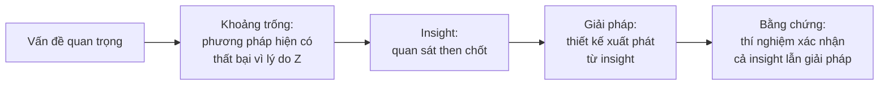

# Xây "câu chuyện" của paper

Đây là kỹ năng mà người viết hộ trước đây đã làm thay bạn — và là kỹ năng **quan trọng nhất** cần học. Một paper A\* có một **câu chuyện một dòng** mà reviewer có thể nhắc lại với AC.

## Câu chuyện = Vấn đề → Khoảng trống → Insight → Giải pháp → Bằng chứng



**Insight** là mắt xích hay bị thiếu nhất. Nó là lý do khiến giải pháp của bạn *không phải ngẫu nhiên*. Ví dụ:

- **ResNet:** *Quan sát* — mạng sâu hơn lại có **training error** cao hơn (không phải overfitting) ⇒ vấn đề là tối ưu hóa ⇒ *giải pháp* — học phần dư (residual) dễ hơn học ánh xạ trực tiếp.
- **MAE:** *Quan sát* — ảnh có độ dư thừa không gian cao hơn ngôn ngữ nhiều ⇒ mask ít thì bài toán quá dễ ⇒ *giải pháp* — mask tỉ lệ rất cao (75%) + encoder chỉ xử lý patch thấy được (vừa khó vừa nhanh).

## Bài tập: One-page pitch

Trước khi viết paper, viết **một trang** (tiếng Việt cũng được) theo khung sau, gửi advisor:

```markdown
# Working title:
## 1. Một câu (elevator pitch):
   "Chúng tôi chỉ ra rằng ___, và đề xuất ___, giúp ___."
## 2. Vấn đề & tại sao quan trọng (2-3 câu):
## 3. Các phương pháp hiện tại làm gì & thất bại ở đâu (2-3 câu + 1 ví dụ cụ thể):
## 4. Insight then chốt (1-2 câu):
## 5. Phương pháp (3-4 câu, không chi tiết):
## 6. Claims (3-4 gạch đầu dòng, mỗi claim kiểm chứng được):
## 7. Thí nghiệm chứng minh từng claim:
## 8. Figure 1 sẽ trông thế nào (phác tay):
## 9. Rủi ro lớn nhất / câu hỏi reviewer đáng sợ nhất:
```

Nếu bạn **không viết được mục 4** — dừng lại và suy nghĩ thêm. Nếu **mục 6 có claim không có thí nghiệm ở mục 7** — đó là việc cần làm tiếp.

## Claims: viết sao cho kiểm chứng được

| ❌ Mơ hồ | ✅ Cụ thể, kiểm chứng được |
|---|---|
| "Our method is robust." | "Our method degrades by only 2.1 AP under heavy occlusion, versus 7.8 AP for the strongest baseline." |
| "We propose a novel framework." | "We propose X, the first method that does Y without requiring Z." *(chỉ nói "first" khi chắc chắn)* |
| "Extensive experiments demonstrate effectiveness." | "On COCO, LVIS and ADE20K, X improves the state of the art by +1.8, +2.4 and +1.1 points, respectively." |

## Cùng kết quả, hai câu chuyện

Giả sử bạn thêm một module hiệu chỉnh độ sâu vào một detector 3D và tăng 2 điểm:

- **Câu chuyện yếu:** "Chúng tôi đề xuất module DepthRefine, cải thiện 2 điểm mAP."
- **Câu chuyện mạnh:** "Chúng tôi phân tích lỗi của các detector 3D từ ảnh đơn và phát hiện **>60% lỗi đến từ ước lượng độ sâu ở vật thể xa**, trong khi các phương pháp hiện tại tập trung cải thiện phân loại. Dựa trên quan sát này, chúng tôi đề xuất … Phương pháp cải thiện 2 điểm tổng thể và **6 điểm ở vật thể > 40m**."

Câu chuyện mạnh cần thêm **một thí nghiệm phân tích** (error breakdown) và **một đánh giá chia nhỏ** — nhưng nó biến paper từ "incremental" thành "insightful". Đây là việc bạn phải tự hỏi: *thí nghiệm nào biến quan sát của tôi thành bằng chứng?*

## Khi kết quả không như mong đợi

- **Thắng ít:** Tìm *chỗ* phương pháp thắng nhiều (một tập con, một thiết lập khó, ít dữ liệu, hiệu quả tính toán) — có thể câu chuyện thật sự nằm ở đó.
- **Không thắng SOTA nhưng nhanh hơn 5×:** Câu chuyện là về **trade-off**, Figure 1 nên là biểu đồ accuracy–speed.
- **Phát hiện bất ngờ:** Đôi khi phát hiện phụ (ví dụ "baseline đơn giản được tune kỹ lại mạnh hơn mọi phương pháp phức tạp") đáng giá hơn phương pháp chính. Đừng ngại đổi câu chuyện.

!!! warning "Trung thực"
    Câu chuyện là *cách trình bày* bằng chứng có thật — không phải che giấu bằng chứng bất lợi. Không cherry-pick seed, không chọn ảnh qualitative không đại diện mà không nói rõ, không giấu dataset nơi phương pháp thua. Reviewer có kinh nghiệm phát hiện điều này, và hậu quả với uy tín lâu dài hơn nhiều so với một lần reject.
