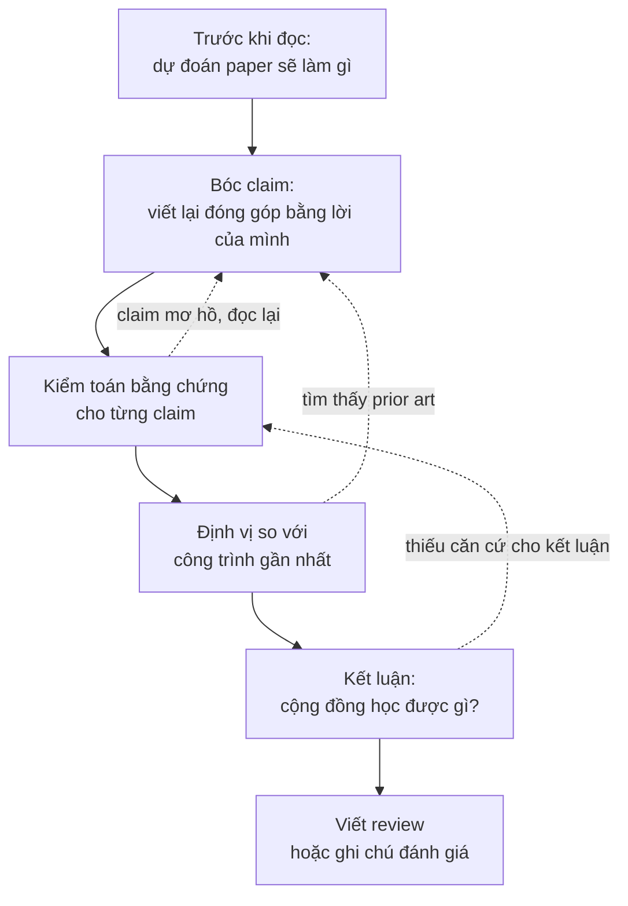
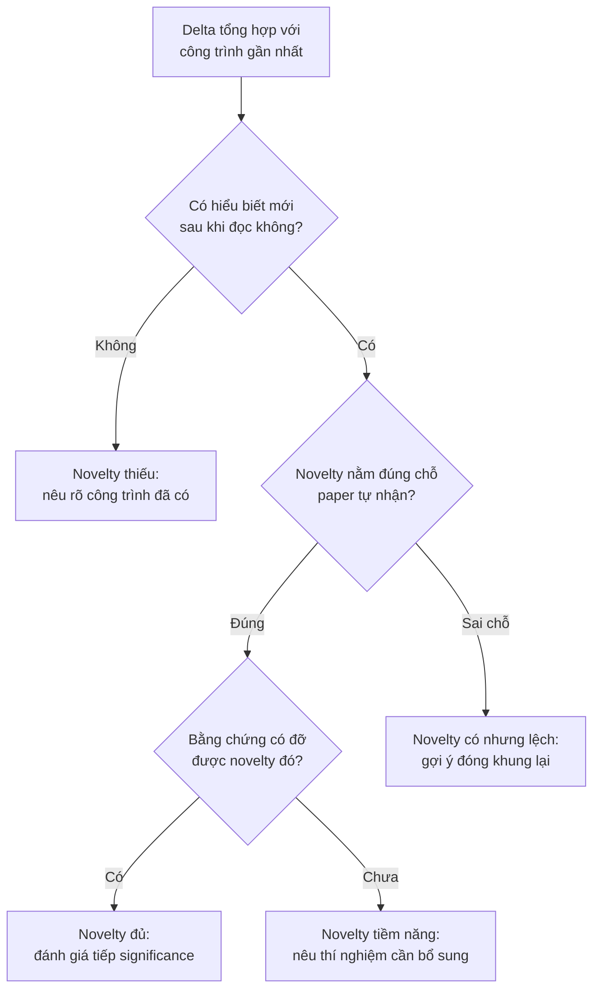

# Đọc paper như một reviewer

!!! abstract "Mục tiêu của bài"
    Sau bài này, người học có thể:

    - Phân biệt tư thế đọc để học với tư thế đọc để đánh giá, và chủ động chuyển giữa hai tư thế khi cần.
    - Áp dụng một quy trình đọc phản biện gồm dự đoán, bóc claim, kiểm toán bằng chứng, định vị và kết luận, xây trên nền phương pháp đọc ba lượt.
    - Viết lại danh sách đóng góp của một paper bằng lời của người đọc, phân loại kiểu đóng góp, và lập bảng claim, bằng chứng, mức độ thuyết phục.
    - Ước lượng novelty của một paper so với các công trình gần nhất: chỉ ra novelty nằm ở đâu, có nằm đúng chỗ paper tự nhận không, và phân biệt "đã có người làm" với "đã có người nghĩ tới".
    - Nhận diện cờ đỏ trong bằng chứng, giả định ngầm của phương pháp, và những heuristic phản biện lười cần tránh.
    - Viết một bản review có cấu trúc, với weakness cụ thể, có căn cứ và gợi ý được hướng sửa, kèm điểm số và độ tự tin được hiệu chỉnh.

Bài [Đọc và lập bản đồ tài liệu](literature.md) trả lời câu hỏi đọc gì và đọc sâu tới đâu. Phương pháp ba lượt giúp phân bổ thời gian giữa hàng trăm paper, đọc như người viết giúp học cách trình bày, còn bảng literature và bản đồ định vị biến những gì đã đọc thành nguyên liệu cho paper của nhóm. Trong tất cả những hoạt động đó, người đọc về cơ bản *tin* paper: paper là một nguồn kiến thức để tiếp thu. Bài này đổi tư thế. Câu hỏi trung tâm không còn là "paper dạy được điều gì" mà là "paper có đứng vững không": đóng góp thực sự là gì, mới tới đâu so với những gì đã có, các khẳng định có được bằng chứng đỡ hay không, và điểm yếu nằm ở đâu.

Kỹ năng đọc để đánh giá phục vụ ba việc khác nhau trong đời sống nghiên cứu. Việc thứ nhất là tự đánh giá: trước khi một reviewer thật đọc bản thảo của nhóm, chính nhóm phải đọc được nó bằng con mắt lạnh lùng ấy, và trước khi dành nhiều tháng cho một ý tưởng, nhóm phải ước lượng được nó mới tới đâu so với công trình gần nhất. Việc thứ hai là tìm khoảng trống: mỗi claim chưa được chứng minh, mỗi giả định ngầm, mỗi thiết lập mà phương pháp chưa được thử trong paper của người khác đều là một ứng viên cho đề tài mới, và bài tiếp theo, [Tìm khoảng trống và nguồn ý tưởng](tim-khoang-trong.md), sẽ biến những phát hiện đó thành một quy trình có hệ thống. Việc thứ ba là làm reviewer thật. Như bài [Paper được đánh giá thế nào](../00-tong-quan/review-process.md) đã trình bày, nhiều hội nghị những năm gần đây yêu cầu tác giả tham gia review, nên người học sớm muộn cũng sẽ phải viết những bản review mà người khác dựa vào để quyết định số phận một công trình. Andrej Karpathy có một hình ảnh dễ nhớ cho lợi ích của việc review: người chỉ đọc paper tốt giống như một bộ phân loại chỉ được huấn luyện bằng ví dụ dương; muốn biết paper tốt khác paper tồi ở đâu thì phải đọc cả paper tồi, và review là cách tự nhiên nhất để làm điều đó (Karpathy, *A Survival Guide to a PhD*, 2016).

Bài đi theo trình tự của một lần đọc phản biện. Sau khi phân biệt hai tư thế đọc, chúng ta dựng một quy trình năm bước, rồi đi sâu vào từng bước: bóc tách contribution, đánh giá novelty (mục dài nhất, vì đây là chỗ người mới khó tự tin nhất), kiểm toán bằng chứng, tìm giả định ngầm, và đọc hình, bảng. Tiếp theo là những heuristic phản biện lười mà một reviewer có trách nhiệm cần tránh, cũng là những nhận xét mà người viết nên phòng ngừa ngay trong paper. Phần cuối chuyển từ đọc sang viết: cấu trúc một bản review, cách viết weakness, một bản review mẫu đầy đủ, cách hiệu chỉnh điểm số, các nguyên tắc bảo mật, và một bài tập luyện "gu" phản biện bằng review công khai trên OpenReview.

## Đọc để học và đọc để đánh giá

Hai tư thế đọc khác nhau ở câu hỏi mà người đọc mang theo. Người đọc để học hỏi "làm thế nào": phương pháp vận hành ra sao, có kỹ thuật nào mang về dùng được, tác giả viết Introduction thế nào. Người đọc ở tư thế này có xu hướng chấp nhận claim của paper như một điểm xuất phát, vì mục tiêu là hiểu và tiếp thu. Người đọc để đánh giá hỏi những câu khác hẳn: điều paper khẳng định có đúng không, có mới không, có quan trọng không, và bằng chứng có đủ để một người hoài nghi nhưng công tâm phải chấp nhận không. Tư thế này đòi hỏi tạm treo niềm tin. Mỗi câu khẳng định trong abstract được đọc như một giả thuyết cần kiểm tra, không phải một sự thật đã được xác lập.

Đằng sau mọi câu hỏi của reviewer là hai câu hỏi lớn. Câu thứ nhất: *cộng đồng học được gì từ paper này mà trước đó chưa biết?* Câu trả lời có thể là một phương pháp tốt hơn, một hiểu biết về vì sao một phương pháp hoạt động, một bằng chứng rằng một niềm tin phổ biến là sai, một dataset mở ra một hướng đánh giá mới. Nếu câu trả lời là "không có gì ngoài một con số cao hơn một chút trên một benchmark", paper gặp vấn đề, dù được viết đẹp đến đâu. Câu thứ hai: *có nên đưa paper này vào chương trình của hội nghị không?* Câu hỏi này không đồng nhất với câu thứ nhất. Một paper có thể mang lại hiểu biết mới nhưng bằng chứng còn quá mỏng để cộng đồng tin vào hiểu biết đó; ngược lại, một paper có bằng chứng rất chặt nhưng chỉ xác nhận điều ai cũng đã biết. Reviewer giỏi giữ cả hai câu hỏi trong đầu và cân chúng với nhau.

Cần nói rõ ngay từ đầu rằng đọc để đánh giá không có nghĩa là đọc để tìm cách reject. Một reviewer đi tìm lý do từ chối sẽ luôn tìm thấy, vì không paper nào hoàn hảo. Thái độ đúng gần với thái độ của một đồng nghiệp nghiêm khắc: hiểu paper theo cách tốt nhất mà văn bản cho phép, rồi mới hỏi phiên bản tốt nhất ấy có đứng vững không. Trong tranh luận, cách làm này đôi khi được gọi là "steelman", đối lập với "strawman": thay vì bác bỏ một phiên bản yếu của lập luận, người phản biện dựng phiên bản mạnh nhất rồi mới phê bình. Một reviewer làm được điều này viết ra những nhận xét mà tác giả khó cãi, vì chúng nhắm đúng vào chỗ yếu thật chứ không vào một cách hiểu sai.

Để thấy sự khác biệt cụ thể, hãy hình dung hai bản ghi chép về cùng một paper NLP giả định, đề xuất một cách chọn ví dụ minh họa (*demonstration*) cho in-context learning. Bản ghi của người đọc để học viết rằng phương pháp chọn ví dụ theo độ tương đồng ngữ nghĩa rồi sắp xếp chúng theo độ khó tăng dần, rằng có thể thử ý tưởng sắp xếp cho dự án của nhóm, và rằng Figure 2 trình bày pipeline rất rõ. Bản ghi của người đọc để đánh giá viết rằng claim chính là "sắp xếp theo độ khó cải thiện độ chính xác", nhưng ablation trong Table 3 thay đổi đồng thời cả tiêu chí chọn lẫn thứ tự, nên chưa tách được hiệu ứng của thứ tự; rằng chỉ có một mô hình 7B và ba dataset phân loại, trong khi abstract nói về "LLMs" nói chung; rằng không có độ lệch chuẩn qua các lần lấy mẫu ví dụ, trong khi in-context learning nổi tiếng nhạy với lựa chọn ví dụ; và rằng cần kiểm tra xem tiêu chí "từ dễ đến khó" đã xuất hiện trong các nghiên cứu về curriculum cho prompting chưa. Cả hai bản ghi đều có giá trị, nhưng chỉ bản thứ hai giúp quyết định paper có đứng vững không.

| Khía cạnh | Đọc để học | Đọc để đánh giá |
|---|---|---|
| Câu hỏi chính | Làm thế nào? Mang về dùng được gì? | Có đúng không? Có mới không? Có quan trọng không? |
| Thái độ với claim | Chấp nhận để hiểu | Coi là giả thuyết cần kiểm tra |
| Phần đọc kỹ nhất | Method, chi tiết cài đặt | Claim, bảng kết quả, ablation, so sánh với công trình gần nhất |
| Sản phẩm | Ghi chú kỹ thuật, ý tưởng mang về | Bảng claim và bằng chứng, danh sách điểm yếu, kết luận có lý lẽ |
| Rủi ro nếu chỉ dùng tư thế này | Tin vào claim chưa được chứng minh | Hoài nghi tới mức không học được gì, hoặc thành người phản biện khắt khe vô cớ |

Hai tư thế không loại trừ nhau. Trong thực tế, một nhà nghiên cứu có kinh nghiệm chuyển qua lại giữa chúng nhiều lần trong một lần đọc: đọc để hiểu một đoạn Method, rồi dừng lại hỏi đoạn đó có thực sự cần thiết không. Điều người mới cần luyện là khả năng *chủ động* bật tư thế đánh giá, thay vì để nó chỉ xuất hiện khi có điều gì đó quá hiển nhiên là sai.

## Quy trình đọc phản biện

Phương pháp ba lượt trong bài [Đọc và lập bản đồ tài liệu](literature.md) vẫn là khung thời gian phù hợp cho việc đọc phản biện. Điều thay đổi là *câu hỏi* mà mỗi lượt phải trả lời. Năm chữ C của lượt thứ nhất (*Category*, *Context*, *Correctness*, *Contributions*, *Clarity*) đã chứa sẵn mầm mống của một đánh giá; quy trình dưới đây biến chúng thành năm bước có sản phẩm cụ thể, để kết quả của việc đọc không chỉ là một ấn tượng mà là một lập luận có thể viết thành review.



**Bước 1: trước khi đọc, dự đoán.** Chỉ với title và abstract, người đọc viết ra vài dòng: paper có lẽ sẽ làm gì, công trình gần nhất có lẽ là gì, thí nghiệm nào sẽ thuyết phục được người đọc, và điều gì đáng lo nhất. Bước này mất năm phút nhưng mang lại hai lợi ích lớn. Lợi ích thứ nhất là nó tạo ra một mốc để đo "tính bất ngờ". Câu hỏi "một chuyên gia có đoán trước được kết quả không?", sẽ được bàn ở mục về novelty, chỉ trả lời trung thực được nếu người đọc đã ghi lại dự đoán *trước* khi biết kết quả; sau khi đọc xong, mọi kết quả đều có vẻ đã đoán được. Lợi ích thứ hai là nó chống lại hiệu ứng mỏ neo của chính paper. Bài [Paper được đánh giá thế nào](../00-tong-quan/review-process.md) đã nói rằng ấn tượng đầu tiên của reviewer rất bền; khi chưa có dự đoán riêng, người đọc dễ tiếp nhận nguyên vẹn cách đóng khung của tác giả, kể cả những chỗ đóng khung khéo léo che đi điểm yếu.

**Bước 2: bóc claim.** Trong lượt đọc thứ nhất và đầu lượt thứ hai, người đọc liệt kê mọi khẳng định mà paper đưa ra, từ abstract, Introduction, đoạn đóng góp và phần kết luận, rồi viết lại chúng bằng lời của mình. Mục tiêu là tách bạch claim chính khỏi claim phụ, và claim tường minh khỏi claim ngầm. Mục [Bóc tách contribution](#boc-tach-contribution) ngay sau đây trình bày kỹ bước này.

**Bước 3: kiểm toán bằng chứng.** Với mỗi claim, người đọc tìm bằng chứng tương ứng trong paper và đánh giá mức độ thuyết phục: baseline có mạnh không, ablation có cô lập được đóng góp không, thống kê có đủ không, thiết lập có công bằng không. Đây là phần chiếm nhiều thời gian nhất của lượt thứ hai, và thường là nơi mà lượt thứ ba, nếu có, tập trung vào: tự suy lại một phương trình, mở code xem một chi tiết cài đặt, hoặc kiểm tra một con số trong bảng có khớp với paper gốc của baseline không.

**Bước 4: định vị.** Người đọc so sánh paper với các công trình gần nhất, cả những công trình được paper trích dẫn lẫn những công trình mà người đọc tự tìm ra, để xác định khác biệt thực sự (*delta*) là gì và khác biệt đó có quan trọng không. Bước này cần kiến thức về lĩnh vực và một cuộc tìm kiếm có giới hạn thời gian.

**Bước 5: kết luận.** Cuối cùng, người đọc trả lời hai câu hỏi lớn ở mục trước bằng một đoạn văn ngắn: cộng đồng học được gì, và bằng chứng có đủ để tin vào điều đó không. Nếu không viết được đoạn văn này, việc đọc chưa xong. Thường thì nguyên nhân là bước 3 chưa đủ sâu, và sơ đồ trên có một mũi tên quay lại đúng vì lý do đó.

Thứ tự năm bước không cứng nhắc. Trong lúc kiểm toán bằng chứng, người đọc thường phát hiện một claim được diễn đạt mơ hồ đến mức không biết bằng chứng nào là phù hợp, và phải quay lại bước 2. Trong lúc định vị, một công trình cũ được tìm thấy có thể làm thay đổi hẳn cách hiểu đóng góp. Điều quan trọng là mỗi bước để lại một sản phẩm viết, để khi quay lại, người đọc sửa sản phẩm đó thay vì bắt đầu lại từ trí nhớ.

Về thời gian, một reviewer điển hình có khoảng một đến ba giờ cho mỗi paper. Với một paper dài ở hội nghị A\*, một cách phân bổ hợp lý (gợi ý, cần điều chỉnh theo paper) là khoảng mười lăm phút cho dự đoán và lượt thứ nhất, khoảng một giờ cho bóc claim và kiểm toán bằng chứng, khoảng ba mươi phút cho định vị và tìm prior art, và khoảng ba mươi phút để viết review. Người mới nên chấp nhận mất gấp đôi thời gian này ở vài lần đầu; tốc độ đến từ việc lặp lại quy trình, không đến từ việc bỏ bước.

Một phiếu đọc phản biện đơn giản giúp giữ kỷ luật cho năm bước. Phiếu dưới đây có thể dùng cho cả paper của người khác lẫn bản thảo của chính nhóm.

```markdown
PHIẾU ĐỌC PHẢN BIỆN

Paper: <tên, venue, năm>          Ngày đọc: <...>       Thời gian dự kiến: <...>

[Bước 1] Dự đoán trước khi đọc (chỉ từ title và abstract)
- Paper có lẽ sẽ làm gì:
- Công trình gần nhất mà người đọc biết:
- Kết quả mà người đọc dự đoán (ghi cả mức độ chắc chắn):
- Thí nghiệm nào sẽ thuyết phục người đọc:
- Điều đáng lo nhất:

[Bước 2] Claim (viết lại bằng lời của người đọc)
- Đóng góp cốt lõi trong một câu:
- Claim chính / claim phụ / claim ngầm:

[Bước 3] Kiểm toán bằng chứng  -> dùng bảng claim – bằng chứng – mức độ thuyết phục

[Bước 4] Định vị
- Ba công trình gần nhất và delta với từng công trình:
- Novelty nằm ở đâu? Có đúng chỗ paper tự nhận không?

[Bước 5] Kết luận
- Cộng đồng học được gì:
- Bằng chứng có đủ để tin không:
- Dự đoán ở bước 1 đúng hay sai, và điều đó nói gì về tính bất ngờ của paper:
- Đánh giá tổng thể và độ tự tin:
```

Dòng cuối của bước 5 là dòng đáng giá nhất về lâu dài. Sau vài chục lần ghi, người đọc có một hồ sơ về chính khả năng dự đoán của mình: những loại kết quả nào thường bất ngờ, những loại nào thường đúng như dự đoán. Đó là một phần của thứ mà các nhà nghiên cứu gọi là "gu" (*taste*), và mục luyện tập trên OpenReview ở cuối bài sẽ quay lại điểm này.

## Bóc tách contribution

Bước đầu tiên của mọi đánh giá là biết chính xác đang đánh giá cái gì. Điều này nghe hiển nhiên, nhưng rất nhiều review tồi bắt nguồn từ việc reviewer đánh giá một paper khác với paper được nộp: hoặc vì hiểu sai đóng góp, hoặc vì chấp nhận nguyên văn danh sách đóng góp của tác giả mà không tự hỏi danh sách đó có phản ánh đúng nội dung không.

### Viết lại danh sách đóng góp bằng lời của mình

Đoạn liệt kê đóng góp ở cuối Introduction là nơi tác giả nói paper mang lại gì, nhưng đó là phiên bản của người bán hàng. Danh sách thường dài hơn thực chất: một paper có một ý tưởng chính thường tách nó thành ba bốn gạch đầu dòng, thêm "extensive experiments" như một đóng góp, và đôi khi biến một chi tiết cài đặt thành một "module mới". Việc của người đọc phản biện là viết lại danh sách đó bằng lời của chính mình, sau khi đã đọc xong lượt thứ hai, rồi so sánh hai phiên bản.

Bản viết lại tốt có ba đặc điểm. Thứ nhất, nó gộp những gì thực chất là một: nếu "đóng góp 1" là một loss mới và "đóng góp 2" là kết quả tốt nhờ loss đó, thì chỉ có một đóng góp. Thứ hai, nó tách những gì bị gộp: một paper có thể vừa đề xuất một dataset vừa đề xuất một phương pháp, và hai thứ đó cần được đánh giá bằng hai tiêu chí khác nhau. Thứ ba, nó có một câu duy nhất nêu *đóng góp cốt lõi*. Karpathy khuyên người viết xác định một đóng góp cốt lõi duy nhất, vì các đóng góp không cộng dồn: một đóng góp phụ yếu làm loãng paper chứ không làm nó mạnh hơn. Theo cách nói của ông, một paper tốt "sells a single thing that was not obvious or present before", tức bán một điều duy nhất trước đó chưa hiển nhiên hoặc chưa có (Karpathy, *A Survival Guide to a PhD*, 2016). Lời khuyên viết đó đồng thời là một phép thử đọc: nếu sau lượt thứ hai, người đọc không viết được câu đóng góp cốt lõi, thì hoặc paper chưa rõ, hoặc người đọc chưa hiểu, và cả hai đều phải được giải quyết trước khi đánh giá.

Một dạng câu hữu ích cho câu đóng góp cốt lõi là đặt nó đối diện với điều mà các công trình trước giả định: "Các công trình trước giả định X; paper này cho thấy Y". Khóa học CS197 của Michael Bernstein ở Stanford gọi đây là một "bit flip": gọi tên một giả định, thường ngầm định, của công trình trước, rồi lật nó (Bernstein, Stanford CS197 *Computer Science Research*). Viết được câu bit flip cho một paper giúp người đọc nhìn thấy ngay phần nào là mới và phần nào là kế thừa. Bài [Tìm khoảng trống và nguồn ý tưởng](tim-khoang-trong.md) dùng cùng công cụ này theo chiều ngược lại, để sinh ý tưởng.

### Phân loại kiểu đóng góp

Sau khi có danh sách đã viết lại, người đọc gắn cho mỗi đóng góp một kiểu: phương pháp, cách đặt bài toán, dataset và benchmark, phương pháp luận đánh giá, phân tích và hiểu biết, paradigm, hiệu quả tính toán, hay ứng dụng có insight. Bài [Thẩm định ý tưởng](y-tuong.md) trình bày đầy đủ các kiểu này cùng ví dụ từ ba cộng đồng; ở đây chỉ cần nhớ lý do việc phân loại quan trọng với reviewer. Mỗi kiểu đóng góp đòi hỏi một loại bằng chứng khác nhau, và một trong những lỗi đánh giá phổ biến nhất là dùng thước đo của kiểu này cho kiểu khác. Một paper dataset bị chê vì "phương pháp baseline không mới" là bị đánh giá sai thước đo; một paper phân tích bị chê vì "không đạt SOTA" cũng vậy. Ngược lại, một paper tự nhận là phân tích nhưng chỉ khẳng định lại điều đã biết thì phải bị đánh giá theo tiêu chuẩn của paper phân tích, tức tiêu chuẩn về hiểu biết mới, và sẽ thất bại theo tiêu chuẩn đó.

Việc phân loại cũng làm lộ ra một hiện tượng thú vị: kiểu đóng góp mà tác giả tự nhận đôi khi khác với kiểu đóng góp thực sự. Một paper trình bày mình như một phương pháp mới, nhưng phần có giá trị nhất lại là một phát hiện trong phần phân tích. Mục về novelty sẽ quay lại hiện tượng này, vì nó ảnh hưởng trực tiếp tới kết luận.

### Bảng claim, bằng chứng, mức độ thuyết phục

Công cụ trung tâm của đọc phản biện là một bảng ba cột chính: mỗi claim, bằng chứng tương ứng trong paper, và mức độ thuyết phục của bằng chứng đó. Bảng này cũng xuất hiện dưới dạng khác ở phía người viết, trong bài [Quy trình viết & tự review](../03-ky-thuat/quy-trinh-viet.md) và bài [Thiết kế thí nghiệm](thi-nghiem.md); điều đó không phải ngẫu nhiên, vì người viết và reviewer nhìn vào cùng một cấu trúc từ hai phía.

Claim trong paper có nhiều loại, và mỗi loại cần một kiểu bằng chứng riêng. Claim về **hiệu năng** ("tốt hơn SOTA trên benchmark B") cần so sánh công bằng với baseline mạnh. Claim về **cơ chế** ("cải thiện đến từ việc mô hình chú ý tới vùng biên") cần ablation và phân tích trực tiếp cơ chế, không chỉ con số cuối. Claim về **tính tổng quát** ("hoạt động với nhiều kiến trúc", "cho mọi ngôn ngữ") cần bằng chứng trên nhiều thiết lập thực sự khác nhau. Claim về **hiệu quả tính toán** cần đo trên phần cứng thực. Claim **lý thuyết** cần chứng minh đúng và giả định hợp lý. Và claim **"đầu tiên"** ("the first to…") cần một cuộc tìm kiếm mà reviewer có thể kiểm tra được, vì đây là loại claim dễ sai nhất.

Cần chú ý đặc biệt tới **claim ngầm**: những khẳng định không được nói thành câu nhưng được hàm ý qua title, abstract hoặc cách đặt tên. Một paper có title "… for Vision-Language Models" mà chỉ thử trên một mô hình đã hàm ý một claim về tính tổng quát. Một phương pháp được gọi là "robust" hàm ý một claim về độ bền trước những thay đổi mà paper có thể chưa hề thử. Reviewer có kinh nghiệm đọc title và abstract như một bản hợp đồng: mọi điều được hứa ở đó phải được giao ở phần thí nghiệm.

Mức độ thuyết phục được ghi theo bốn mức. **Mạnh**: bằng chứng trực tiếp, so sánh công bằng, có thống kê, khó có cách giải thích khác. **Một phần**: bằng chứng đúng hướng nhưng có lỗ hổng cụ thể, chẳng hạn thiếu seed hoặc chỉ một dataset. **Yếu**: bằng chứng gián tiếp hoặc có thể giải thích bằng yếu tố khác, như một ablation thay đổi nhiều thứ cùng lúc. **Không có**: claim được đưa ra mà không có bằng chứng nào trong paper. Template dưới đây có thể chép thẳng vào ghi chú đọc.

```markdown
BẢNG CLAIM – BẰNG CHỨNG – MỨC ĐỘ THUYẾT PHỤC

Paper: <...>
Đóng góp cốt lõi (một câu, lời của người đọc): <...>
Kiểu đóng góp chủ đạo: <phương pháp / bài toán / dataset / đánh giá / phân tích / ...>

| # | Claim (diễn giải) | Loại | Nơi xuất hiện | Bằng chứng | Mức | Lỗ hổng / câu hỏi cho tác giả |
|---|---|---|---|---|---|---|
| C1 | ... | hiệu năng | Abstract, Sec. 1 | Table 2 | Mạnh / Một phần / Yếu / Không có | ... |
| C2 | ... | cơ chế | Sec. 3.2 | Table 4 (ablation) | ... | ... |
| C3 | ... | tổng quát | Title (ngầm) | Table 5 | ... | ... |

Claim nào nếu sai thì paper không còn đứng được?  -> <C...>
Claim đó có mức "Mạnh" chưa?                    -> <có / chưa, vì ...>
```

Hai dòng cuối của template là phần quan trọng nhất. Không phải mọi claim đều có trọng lượng như nhau. Một paper có năm claim, trong đó bốn claim phụ được chứng minh yếu nhưng claim cốt lõi được chứng minh mạnh, có thể vẫn là một paper tốt cần sửa vài chỗ. Một paper có claim cốt lõi chỉ được chứng minh một phần thì dù các claim phụ vững đến đâu cũng đang có vấn đề nghiêm trọng.

Dưới đây là một bảng đã điền cho một paper Computer Vision giả định, đề xuất một hàm loss chưng cất (*distillation*) "nhạy theo tỉ lệ" (*scale-aware*) cho các detector thời gian thực.

| # | Claim (diễn giải) | Loại | Bằng chứng | Mức | Lỗ hổng |
|---|---|---|---|---|---|
| C1 | Tăng AP so với các detector thời gian thực mạnh nhất trên COCO | hiệu năng | Table 2, một lần chạy | Một phần | Số của hai baseline chép từ paper gốc, huấn luyện với lịch ngắn hơn; không có độ lệch chuẩn |
| C2 | Cải thiện đến từ loss nhạy theo tỉ lệ | cơ chế | Table 4 | Yếu | Dòng "không có loss mới" cũng dùng teacher khác; hai yếu tố bị thay đổi cùng lúc |
| C3 | Tổng quát qua nhiều backbone | tổng quát | Table 5 | Một phần | Hai backbone cùng một họ kiến trúc |
| C4 | Không tăng chi phí suy luận | hiệu quả | Sec. 4.3 | Mạnh | Loss chỉ dùng lúc huấn luyện; điều này đúng theo thiết kế |
| C5 | Là phương pháp đầu tiên đưa thông tin tỉ lệ vào chưng cất cho detection | "đầu tiên" | Không có | Không có | Cần tìm kiếm; claim nên bỏ hoặc thu hẹp |

Đọc bảng này, người đọc thấy ngay câu hỏi quyết định của review: C2 là claim cốt lõi, vì nếu cải thiện đến từ teacher mạnh hơn chứ không phải từ loss mới, paper không còn đóng góp gì. Một ablation thay đổi đúng một yếu tố, giữ nguyên teacher, sẽ giải quyết dứt điểm câu hỏi đó. Đây chính là loại weakness cụ thể, có căn cứ và có hướng sửa mà phần cuối bài sẽ dạy cách viết.

## Đánh giá novelty

Trong mọi tiêu chí của form review, novelty là tiêu chí khó đánh giá nhất và cũng là nơi review dễ sai nhất. Lý do thứ nhất là novelty không phải một thuộc tính nhìn thấy được trong paper như một con số trong bảng; nó là một *quan hệ* giữa paper và toàn bộ những gì cộng đồng đã biết, nên đánh giá nó đòi hỏi kiến thức về lĩnh vực mà người mới chưa có nhiều. Lý do thứ hai là có những thiên kiến tâm lý mạnh khiến cả người có kinh nghiệm cũng đánh giá sai. Nhận xét *"limited novelty"* là một trong những lý do reject phổ biến nhất, nhưng cũng là một trong những nhận xét bị tác giả phàn nàn nhiều nhất là thiếu căn cứ. Mục này vì vậy được viết dài nhất trong bài: trước hết làm rõ novelty là gì và không phải là gì, rồi trình bày một quy trình phân tích delta, sáu vị trí mà novelty có thể nằm, ba câu hỏi kiểm tra, cách tìm prior art nhanh, và cuối cùng là ba ví dụ phân tích có ba kết luận khác nhau.

### Novelty là gì, và không phải là gì

Một định nghĩa làm việc hữu ích là: **novelty là lượng hiểu biết mới mà cộng đồng nhận được từ paper, đánh giá tại thời điểm trước khi paper xuất hiện.** Định nghĩa này có hai vế, và mỗi vế loại bỏ một kiểu nhầm lẫn phổ biến.

Vế thứ nhất, "hiểu biết mới mà cộng đồng nhận được", loại bỏ sự nhầm lẫn giữa novelty và độ phức tạp. Trong bài blog *Novelty in Science: A guide for reviewers* (2022), Michael J. Black, nhà nghiên cứu Computer Vision ở Viện Max Planck về Hệ thống Thông minh, cho rằng reviewer thường lẫn lộn novelty với độ phức tạp, độ khó và tính kỹ thuật của một ý tưởng. Theo Black, một kiểu review tồi điển hình là chê một ý tưởng "rất đơn giản, chỉ thay đổi một số hạng trong hàm loss", trong khi việc thay đổi đúng một thứ trong một mạng có sẵn thường là khoa học tốt hơn việc dựng lên một mạng mới phức tạp hơn. Black cũng không đi tới cực đoan ngược lại. Ông viết rằng "a simple idea can be important. But it can also be trivial": một ý tưởng đơn giản có thể quan trọng, nhưng cũng có thể tầm thường. Sự đơn giản không phải bằng chứng của novelty, nó chỉ không phải bằng chứng của việc *thiếu* novelty. Câu hỏi vẫn là cộng đồng học được gì.

Vế thứ hai, "tại thời điểm trước khi paper xuất hiện", nhắm vào **thiên kiến nhìn lại** (*hindsight bias*): khi đã biết một ý tưởng, con người có xu hướng đánh giá quá cao khả năng bản thân đã có thể nghĩ ra nó. Black diễn đạt điểm này bằng một câu ngắn: novelty "must be evaluated before the idea existed", tức phải được đánh giá như thể ý tưởng chưa tồn tại. Một ý tưởng dễ giải thích và trông hiển nhiên sau khi đã đọc không vì thế mà kém sáng tạo. Thiên kiến này đặc biệt nguy hiểm khi reviewer đọc một paper được viết tốt, vì paper viết tốt chính là paper làm cho ý tưởng trông hiển nhiên. Bước dự đoán trước khi đọc trong quy trình ở trên là công cụ chống thiên kiến này: nếu dự đoán ghi lại cho thấy người đọc đã không nghĩ tới hướng đi của paper, thì câu "điều này hiển nhiên" trong review sẽ khó đứng vững.

Black còn nhấn mạnh rằng novelty không chỉ là novelty kỹ thuật. Một dataset làm được điều mà chưa dataset nào làm được là mới; một cách dùng mới cho một phương pháp cũ là mới nếu chưa ai nghĩ tới việc dùng nó như vậy; việc thay một thuật toán phức tạp bằng một thuật toán đơn giản mà vẫn đạt kết quả tương đương mang lại hiểu biết về điều gì thực sự quan trọng. Trước khi chê một paper thiếu novelty kỹ thuật, reviewer nên hỏi novelty thật có nằm ở chỗ khác không (Black, *Novelty in Science*, 2022). Bài [Khi novelty và hiệu quả lệch pha](../07-tinh-huong-kho/novelty-va-hieu-qua.md) ở Chương 7 phân tích kỹ cùng vấn đề này từ phía tác giả, với các ví dụ ResNet, ViT, ConvNeXt và *Understanding deep learning requires rethinking generalization*; ở đây chúng ta đứng ở phía reviewer.

Hướng dẫn reviewer chính thức của các hội nghị lớn cũng đi theo cùng tinh thần, dù diễn đạt khác nhau và thay đổi theo từng năm. Hướng dẫn reviewer của NeurIPS 2026 nói rằng originality không nhất thiết đòi hỏi một phương pháp hoàn toàn mới và có thể mang nhiều hình thức tùy theo mục tiêu của paper. Hướng dẫn này hỏi reviewer liệu paper có đưa ra một sự kết hợp mới các kỹ thuật có sẵn với lý lẽ được trình bày rõ ràng hay không, và lưu ý rằng những ý tưởng mới mà dễ áp dụng trong thực tế có thể đặc biệt có giá trị. Hướng dẫn reviewer của ICLR 2025, khi hỏi về ý nghĩa của đóng góp, ghi chú rằng điều đó không nhất thiết đòi hỏi kết quả state-of-the-art. Hướng dẫn của ACL Rolling Review từ năm 2021 có hẳn một danh sách các heuristic phản biện lười, trong đó "kết quả không mới" mà không kèm trích dẫn và "phương pháp quá đơn giản" đều được nêu tên; danh sách này được phân tích kỹ ở mục về heuristic lười bên dưới. Ở Computer Vision, hướng dẫn reviewer của CVPR qua nhiều năm nhắc rằng quyết định chấp nhận không nên chỉ dựa vào hiệu năng thô của phương pháp. Vì các văn bản này được viết lại hằng năm, người đọc cần mở đúng phiên bản của hội nghị và năm đang review trước khi trích dẫn chúng.

!!! info "Novelty không phải là độ phức tạp, cũng không phải là sự bất ngờ đơn thuần"
    Ba thứ thường bị nhầm với novelty là độ phức tạp ("phương pháp có nhiều thành phần"), độ khó ("chứng minh dài", "cài đặt khó") và sự bất ngờ đơn thuần ("kết quả lạ"). Một kết quả bất ngờ nhưng không được giải thích có thể chỉ là một lỗi chưa được phát hiện. Câu hỏi đúng luôn quay về một điểm: sau khi đọc paper, cộng đồng biết thêm điều gì đáng tin cậy mà trước đó chưa biết?

### Phân tích delta với ba công trình gần nhất

Novelty là một quan hệ, nên cách đánh giá nó một cách có kỷ luật là đặt paper cạnh những công trình gần nhất và đo khoảng cách. Gọi khoảng cách đó là **delta**. Quy trình dưới đây đủ gọn để làm trong khoảng nửa giờ cho mỗi paper.

Bước đầu tiên là chọn ba công trình gần nhất. Nguồn thứ nhất là chính paper: phần Related Work và bảng so sánh thường cho biết tác giả coi công trình nào là gần nhất. Nguồn thứ hai là kiến thức và cuộc tìm kiếm của người đọc, vì công trình gần nhất thật sự đôi khi không được trích dẫn, hoặc được trích dẫn ở một dòng khiêm tốn trong Related Work thay vì ở bảng so sánh chính. Con số ba không có gì thiêng liêng; nó đủ nhỏ để làm kỹ và đủ lớn để thấy paper từ nhiều phía. Thường thì ba công trình ấy đến từ ba hướng khác nhau: một công trình cùng bài toán với phương pháp khác, một công trình cùng ý tưởng kỹ thuật nhưng ở bài toán khác, và một công trình mới nhất trên cùng benchmark.

Bước thứ hai là điền một bảng delta cho từng công trình. Mỗi dòng trả lời năm câu hỏi: hai công trình *giống nhau* ở đâu, paper nói chúng *khác nhau* ở đâu, khác biệt đó *có thật* không (đọc kỹ công trình kia, không chỉ đọc cách paper mô tả nó), khác biệt đó *có được chứng minh bằng thí nghiệm* không, và khác biệt đó *có quan trọng* không, tức có làm thay đổi kết quả, phạm vi áp dụng hoặc hiểu biết không.

```markdown
PHÂN TÍCH DELTA

Paper đang đánh giá: <...>
Câu đóng góp cốt lõi: <...>

| Công trình gần | Giống ở đâu | Khác ở đâu (theo paper) | Khác biệt có thật? | Có thí nghiệm đối chứng? | Khác biệt có quan trọng? |
|---|---|---|---|---|---|
| W1 (cùng bài toán) | ... | ... | ... | ... | ... |
| W2 (cùng kỹ thuật, bài toán khác) | ... | ... | ... | ... | ... |
| W3 (mới nhất cùng benchmark) | ... | ... | ... | ... | ... |

Delta tổng hợp: <một câu: paper làm được gì mà W1–W3 gộp lại chưa làm được>
Delta thuộc loại nào: thiết lập / phương pháp / bằng chứng / hiểu biết
```

Dòng "delta tổng hợp" là chỗ mà nhiều paper lộ ra vấn đề. Một paper có thể khác W1 ở một điểm, khác W2 ở một điểm khác, nhưng nếu ghép W1 và W2 lại thì ra gần đúng paper, delta tổng hợp chỉ còn là việc ghép. Đó là dạng "A + B" mà bài [Thẩm định ý tưởng](y-tuong.md) đã cảnh báo người viết. Với reviewer, phát hiện này chưa phải là kết luận: như hướng dẫn NeurIPS nói, một sự kết hợp có thể có giá trị nếu lý do của nó được trình bày rõ, chẳng hạn khi paper chỉ ra vì sao kết hợp ngây thơ thất bại và làm thế nào để nó thành công. Nhưng phát hiện này chuyển gánh nặng chứng minh: paper phải cho thấy sự kết hợp mang lại điều gì mà từng thành phần riêng lẻ không mang lại.

Các loại delta cũng có trọng lượng khác nhau. **Delta về thiết lập** (cùng phương pháp, bài toán hoặc dữ liệu mới) có giá trị khi thiết lập mới đặt ra một thách thức thật mà phương pháp cũ không tự giải được. **Delta về phương pháp** có giá trị khi thay đổi được chứng minh là nguyên nhân của cải thiện. **Delta về bằng chứng** (cùng claim, nhưng bằng chứng chặt hơn hẳn, chẳng hạn một đánh giá công bằng lật lại kết luận cũ) thường bị đánh giá thấp nhưng có thể rất có giá trị. **Delta về hiểu biết** (giải thích vì sao một điều đã biết lại xảy ra) là loại khó đạt nhất và thường được nhớ lâu nhất.

### Novelty nằm ở đâu: sáu vị trí

Sau khi có delta, câu hỏi tiếp theo là novelty của paper nằm ở vị trí nào. Có thể phân biệt sáu vị trí, mỗi vị trí có một câu hỏi kiểm tra riêng.

**Novelty ở bài toán.** Paper đặt ra một câu hỏi mà trước đó chưa ai đặt, hoặc định nghĩa lại một bài toán cũ theo cách mở ra hướng mới. Panoptic Segmentation hợp nhất hai bài toán phân đoạn thành một, kèm metric riêng; NeRF đặt việc tổng hợp góc nhìn thành bài toán học một hàm liên tục của cảnh. Câu hỏi kiểm tra: cách đặt bài toán mới có *đúng đắn và có ích* không, tức có cho phép làm điều mà cách cũ không làm được không, hay chỉ là đổi tên?

**Novelty ở phương pháp.** Paper đề xuất một cách làm mới cho một bài toán đã rõ. Câu hỏi kiểm tra: thay đổi nào là mới, và ablation có cho thấy chính thay đổi đó tạo ra cải thiện không?

**Novelty ở phát hiện.** Paper cho thấy một điều trước đó chưa được biết về hành vi của mô hình, dữ liệu hay phương pháp. *Understanding deep learning requires rethinking generalization* (ICLR 2017) không có phương pháp mới; novelty nằm ở phát hiện rằng mạng sâu khớp được cả nhãn ngẫu nhiên. Câu hỏi kiểm tra: phát hiện có được kiểm soát chặt, có loại trừ được các giải thích khác, và có đúng ngoài một thiết lập không?

**Novelty ở đánh giá.** Paper đề xuất một cách đo mới, hoặc một đánh giá công bằng làm thay đổi bức tranh. CheckList (ACL 2020) đưa kiểm thử hành vi vào NLP; *A Metric Learning Reality Check* (ECCV 2020) cho thấy nhiều cải tiến được báo cáo trong metric learning nhỏ hơn nhiều khi được so sánh trong cùng thiết lập. Câu hỏi kiểm tra: cách đánh giá mới có phát hiện được điều mà cách cũ bỏ sót không, và có đủ đơn giản để người khác dùng lại không?

**Novelty ở tài nguyên.** Paper đóng góp một dataset, benchmark, mô hình hay công cụ mà cộng đồng chưa có. Câu hỏi kiểm tra: tài nguyên này làm được gì mà các tài nguyên hiện có không làm được, và chất lượng của nó có được kiểm chứng không?

**Novelty ở lý thuyết.** Paper chứng minh một kết quả mới: một đảm bảo hội tụ dưới giả định yếu hơn, một cận chặt hơn, một sự tương đương giữa hai phương pháp. Câu hỏi kiểm tra: giả định có hợp lý với thực tế không, kết quả có thông tin (*informative*) không hay chỉ đúng một cách trống rỗng, và kỹ thuật chứng minh có mới không hay chỉ áp dụng trực tiếp một kỹ thuật đã biết?

Một paper có thể có novelty ở nhiều vị trí, nhưng việc gọi đúng vị trí chính quan trọng vì nó quyết định thước đo. Bảng dưới đây tóm tắt sáu vị trí cùng câu hỏi kiểm tra và dấu hiệu cho thấy novelty ở vị trí đó còn mỏng.

| Vị trí | Câu hỏi kiểm tra | Dấu hiệu novelty mỏng |
|---|---|---|
| Bài toán | Cách đặt mới có cho phép làm điều cách cũ không làm được không? | Bài toán mới chỉ là bài toán cũ đổi tên hoặc thêm một ràng buộc không ai cần |
| Phương pháp | Chính thay đổi mới có tạo ra cải thiện không? | Ablation không cô lập được thay đổi; cải thiện biến mất khi tune baseline |
| Phát hiện | Phát hiện có kiểm soát chặt, tổng quát, và trước đó chưa biết? | Chỉ khẳng định lại điều cộng đồng đã ngầm biết, hoặc chỉ đúng ở một thiết lập |
| Đánh giá | Cách đo mới có làm lộ điều cách cũ bỏ sót? | Metric mới tương quan gần như hoàn toàn với metric cũ |
| Tài nguyên | Tài nguyên làm được gì mà tài nguyên hiện có không làm được? | Quy mô lớn hơn nhưng không mở ra câu hỏi mới; chất lượng nhãn không được kiểm chứng |
| Lý thuyết | Giả định có hợp lý, kết quả có thông tin, kỹ thuật có mới? | Giả định không bao giờ thỏa trong thực tế; chứng minh là áp dụng trực tiếp kết quả đã biết |

### Ba câu hỏi kiểm tra

Phân tích delta và sáu vị trí cho một bức tranh có cấu trúc. Ba câu hỏi dưới đây giúp chuyển bức tranh đó thành một phán đoán.

**Câu hỏi thứ nhất: một chuyên gia có đoán trước được kết quả không?** Nếu một người am hiểu lĩnh vực, khi chỉ được nghe mô tả thí nghiệm, sẽ đoán đúng kết quả với độ chắc chắn cao, thì paper mang lại ít thông tin mới, dù thí nghiệm có được làm cẩn thận đến đâu. Ngược lại, nếu các chuyên gia sẽ đoán sai, hoặc chia rẽ trong dự đoán, thì kết quả có giá trị thông tin cao. Câu hỏi này cần được dùng thận trọng vì hai lý do. Thứ nhất, nó chỉ trả lời được trung thực *trước khi* biết kết quả, nên bước dự đoán trong quy trình là điều kiện tiên quyết. Thứ hai, "đoán được" không đồng nghĩa với "đã được biết". Hướng dẫn của ACL Rolling Review nêu đúng điểm này khi giải thích vì sao nhận xét "kết quả không bất ngờ" là một heuristic lười: nhiều phát hiện trông hiển nhiên khi nhìn lại, nhưng điều đó không có nghĩa là cộng đồng đã biết chúng và có thể dùng chúng làm nền móng cho các công trình sau (Rogers & Augenstein, *How to review for ACL Rolling Review*, 2021). Một kết quả mà mọi người đều đoán nhưng chưa ai kiểm chứng một cách nghiêm túc vẫn có giá trị, chỉ là giá trị đó nằm ở bằng chứng chứ không ở ý tưởng, và paper cần được đánh giá theo đúng tiêu chí đó.

**Câu hỏi thứ hai: ai sẽ thay đổi cách làm sau khi đọc paper?** Đây là cách cụ thể hóa tiêu chí significance. Thay vì hỏi chung chung "paper có quan trọng không", người đọc hình dung một người cụ thể: một kỹ sư huấn luyện detector, một nhà nghiên cứu xây benchmark đa ngôn ngữ, một người viết thư viện tối ưu. Sau khi đọc paper, người đó có làm khác đi không? Họ có thêm một bước vào pipeline, bỏ một thành phần không cần thiết, đổi cách đánh giá, hay tránh một sai lầm? Nếu không hình dung được ai, paper có thể đúng và mới nhưng không quan trọng. Nếu hình dung được một nhóm người cụ thể và một thay đổi cụ thể, đó là lý lẽ mạnh nhất để bảo vệ paper trước AC. Câu hỏi này cũng giúp tránh một lỗi ngược: chê một paper vì "chủ đề hẹp" trong khi với một cộng đồng con, paper có thể làm thay đổi hoàn toàn cách làm việc.

**Câu hỏi thứ ba: novelty có nằm đúng chỗ paper tự nhận không?** Đây là câu hỏi mà người mới ít khi đặt ra, nhưng thường dẫn tới những nhận xét có giá trị nhất. Có ba trường hợp. Trong trường hợp thứ nhất, novelty nằm đúng chỗ paper nhận, và đánh giá đi theo hướng bình thường. Trong trường hợp thứ hai, paper nhận novelty ở phương pháp nhưng phương pháp gần như trùng với một công trình đã có, trong khi một phát hiện, một dataset hoặc một phân tích trong paper mới là phần thực sự mới. Reviewer lúc này có thể giúp tác giả rất nhiều bằng cách chỉ ra điều đó, thay vì chỉ kết luận "thiếu novelty". Trong trường hợp thứ ba, paper nhận novelty ở một chỗ mà bằng chứng không đỡ được, chẳng hạn nhận là hiểu biết về cơ chế nhưng không có thí nghiệm nào đo trực tiếp cơ chế. Ba trường hợp này dẫn tới ba loại review rất khác nhau, như các ví dụ ở cuối mục sẽ cho thấy.



### Tìm prior art nhanh khi review

Câu hỏi "đã có ai làm điều này chưa" đòi hỏi tìm kiếm, nhưng reviewer không có vài tuần như người đang thẩm định ý tưởng của chính mình. Quy trình tìm kiếm ba tầng trong bài [Thẩm định ý tưởng](y-tuong.md), gồm từ khóa, trích dẫn và con người, vẫn là khung đúng; phiên bản dành cho reviewer chỉ cần gọn hơn và có giới hạn thời gian, chẳng hạn hai mươi đến ba mươi phút.

Điểm xuất phát hiệu quả nhất là chính danh sách tài liệu tham khảo của paper. Công trình gần nhất mà paper trích dẫn là hạt giống tốt: đi tiến theo "Cited by" của nó trong khoảng một hai năm gần nhất thường làm lộ ra những công trình làm cùng hướng. Tiếp theo là tìm theo từ khóa với vài cách diễn đạt khác nhau của ý tưởng, kể cả thuật ngữ mà cộng đồng lân cận có thể dùng, vì cùng một ý tưởng thường mang những tên rất khác nhau ở Computer Vision, NLP, thống kê hay xử lý tín hiệu. OpenReview đáng được tra riêng, vì ở đó còn lưu những bài nộp ICLR đã bị reject hoặc rút, vốn không xuất hiện trong các proceedings. Cuối cùng, kiến thức của chính reviewer về những công trình cũ hơn, nhất là trước thời kỳ học sâu, thường là thứ mà công cụ tìm kiếm khó thay thế.

Hai giới hạn cần được tôn trọng trong lúc tìm kiếm. Thứ nhất là bảo mật: tìm kiếm bằng từ khóa do reviewer tự đặt là bình thường, nhưng dán nội dung paper đang review vào một công cụ trực tuyến, kể cả công cụ tìm kiếm dựa trên LLM, là vi phạm nghĩa vụ bảo mật (xem mục về bảo mật ở phần sau). Thứ hai là ẩn danh: nhiều hội nghị yêu cầu reviewer không chủ động tìm cách xác định danh tính tác giả, nên việc tìm kiếm nên nhắm vào ý tưởng chứ không nhắm vào việc tìm bản preprint của chính paper. Chi tiết của quy định này khác nhau giữa các hội nghị và cần được đọc trong hướng dẫn reviewer của năm đó.

### "Đã có người làm" và "đã có người nghĩ tới"

Khi tìm thấy một công trình có vẻ giống paper, reviewer cần xác định chính xác mức độ trùng lặp trước khi viết bất cứ điều gì. Có một khoảng cách lớn giữa việc một ý tưởng *đã được ai đó nghĩ tới* và việc nó *đã được ai đó làm*. Một câu trong phần Future Work của một paper khác, một đoạn trong bài blog, một gợi ý trong slide bài giảng đều cho thấy ý tưởng đã được nghĩ tới; chúng không lấy đi novelty của việc biến ý tưởng thành hiện thực, chứng minh nó hoạt động và giải thích vì sao. Ngược lại, một paper đã cài đặt cùng ý tưởng, trong cùng thiết lập, với bằng chứng tương đương, thì đúng là đã làm, và novelty của paper mới về ý tưởng đó gần như không còn.

Giữa hai cực là nhiều mức trung gian, và kết luận của reviewer phụ thuộc vào mức nào. Bảng dưới đây gợi ý cách phân biệt.

| Mức độ trùng lặp | Ví dụ | Hệ quả cho đánh giá novelty |
|---|---|---|
| Được nhắc tới như một khả năng | Một câu trong Future Work, một đoạn blog | Novelty của việc thực hiện và chứng minh vẫn còn nguyên; paper nên trích dẫn |
| Được đề xuất nhưng không kiểm chứng | Một ý tưởng trong position paper, không có thí nghiệm | Novelty nằm ở bằng chứng và ở các điều chỉnh cần thiết để ý tưởng hoạt động |
| Được làm trong thiết lập khác | Cùng kỹ thuật ở lĩnh vực khác hoặc quy mô khác | Novelty phụ thuộc vào việc chuyển sang thiết lập mới có đòi hỏi gì không tầm thường |
| Được làm trong cùng thiết lập, bằng chứng yếu hơn | Cùng ý tưởng, ít dataset, không ablation | Novelty nằm ở bằng chứng chặt hơn; paper phải tự định vị như vậy |
| Được làm trong cùng thiết lập, bằng chứng tương đương | Gần như trùng khớp | Novelty về ý tưởng không còn; chỉ còn những phần khác biệt thật |

Dù ở mức nào, có một nguyên tắc không có ngoại lệ: **nhận xét "đã có người làm" phải kèm trích dẫn cụ thể.** Hướng dẫn ARR nêu điều này một cách thẳng thắn khi xếp "kết quả không mới" vào danh sách heuristic lười, với lời giải thích rằng những khẳng định rộng như vậy cần được chứng minh bằng tài liệu tham khảo (Rogers & Augenstein, 2021). Một reviewer viết "this idea is well known" mà không dẫn được nguồn đang đòi tác giả chứng minh một điều phủ định, điều mà tác giả không thể làm. Nếu reviewer tin rằng ý tưởng đã có nhưng không nhớ nguồn, cách viết trung thực là nói rõ mức độ chắc chắn của mình và hỏi tác giả, thay vì khẳng định.

### Concurrent work

Một trường hợp đặc biệt của "đã có người làm" là khi công trình trùng lặp xuất hiện rất gần thời điểm nộp bài. Hai nhóm độc lập đi tới cùng một ý tưởng gần như cùng lúc là chuyện thường gặp trong một lĩnh vực phát triển nhanh, và các hội nghị đều có quy định để bảo vệ tác giả trong tình huống này. Hướng dẫn ARR những năm 2021–2022, chẳng hạn, nêu rằng theo chính sách của ACL, tác giả không bắt buộc so sánh với công trình đồng thời, được hiểu là công trình công bố trong vòng ba tháng trước thời điểm nộp hoặc nộp lại, và xếp yêu cầu so sánh với những công trình như vậy vào danh sách heuristic lười (Rogers & Augenstein, 2021). Các hội nghị CV và ML có quy định riêng, với khoảng thời gian và cách định nghĩa "công bố" khác nhau, và các quy định này thay đổi theo năm; reviewer cần đọc đúng phiên bản trong hướng dẫn của hội nghị mình đang review.

Với reviewer, quy định này có hai hệ quả thực tế. Thứ nhất, không được hạ điểm novelty chỉ vì một preprint xuất hiện vài tuần trước deadline có ý tưởng tương tự. Thứ hai, reviewer vẫn có thể, và nên, đề nghị tác giả *thảo luận* công trình đó trong bản sửa, vì điều đó giúp người đọc. Cách xử lý từ phía tác giả, gồm cách viết câu "Concurrent with our work…", đã được trình bày trong bài [Thẩm định ý tưởng](y-tuong.md).

### Ví dụ: phân tích novelty cho ba paper giả định

Ba ví dụ dưới đây (đều là ví dụ giả định) áp dụng toàn bộ quy trình trên cho ba paper ở ba cộng đồng, và đi tới ba kết luận khác nhau. Mục đích là cho thấy cùng một bộ công cụ có thể dẫn tới "novelty đủ", "novelty có nhưng lệch chỗ" và "novelty không đủ", tùy vào điều mà phân tích tìm ra.

**Ví dụ thứ nhất, Computer Vision: phương pháp đơn giản, novelty nằm ở chẩn đoán.** Paper khảo sát các mô hình ước lượng độ sâu từ một ảnh (*monocular depth estimation*) và tập trung vào một kiểu thất bại quen thuộc: độ sâu dự đoán sai nghiêm trọng trên gương, kính và bề mặt phản chiếu. Paper chẩn đoán rằng nguyên nhân không nằm ở kiến trúc mà ở nhãn huấn luyện: cảm biến độ sâu dùng để tạo nhãn trả về giá trị sai có hệ thống trên các bề mặt này, nên mô hình học đúng cái sai của nhãn. Lời giải là một bộ phát hiện vùng phản chiếu nhẹ để loại các vùng đó khỏi loss khi huấn luyện, cộng với một tập đánh giá mới gồm vài nghìn ảnh có nhãn độ sâu được đo lại thủ công trên vùng phản chiếu. Kết quả: lỗi trên vùng phản chiếu giảm rất mạnh ở ba kiến trúc khác nhau, lỗi trên phần còn lại của ảnh gần như không đổi.

Ba công trình gần nhất là một kiến trúc chuyên biệt cho vật thể trong suốt, một họ phương pháp loss bền vững với nhãn nhiễu dùng cho độ sâu, và một dataset phân đoạn gương. Delta với W1: W1 thêm một nhánh mạng chuyên biệt và giả định vấn đề nằm ở năng lực biểu diễn; paper cho thấy chỉ sửa nhãn đã vượt W1, nên giả định của W1 sai. Delta với W2: loss bền vững xử lý nhiễu ngẫu nhiên, còn lỗi ở đây là lỗi có hệ thống, và paper có thí nghiệm cho thấy loss bền vững không xóa được nó. Delta với W3: W3 chỉ phân đoạn, không đề cập tới nhãn độ sâu. Novelty nằm ở *phát hiện* (nguyên nhân là nhãn chứ không phải kiến trúc) và ở *tài nguyên* (tập đánh giá), trong khi phương pháp thì đơn giản. Ba câu hỏi kiểm tra cho kết quả rõ: một chuyên gia có lẽ sẽ đoán cần kiến trúc chuyên biệt, như W1 đã làm; những người xây dataset độ sâu và huấn luyện mô hình độ sâu sẽ thay đổi cách làm; và paper tự nhận novelty ở chẩn đoán và tập đánh giá, đúng chỗ. **Kết luận: novelty đủ.** Một reviewer chê "phương pháp chỉ là che loss" đang mắc đúng lỗi mà Black mô tả. Điểm yếu thật cần nêu nằm ở chỗ khác: bộ phát hiện vùng phản chiếu được huấn luyện trên dataset nào, và lỗi của nó ảnh hưởng thế nào tới kết quả cuối.

**Ví dụ thứ hai, NLP: novelty có thật nhưng nằm sai chỗ.** Paper đề xuất một phương pháp hỏi đáp xuyên ngôn ngữ cho các ngôn ngữ ít tài nguyên: dịch câu hỏi sang tiếng Anh, truy xuất tài liệu tiếng Anh, sinh câu trả lời bằng một mô hình ngôn ngữ lớn, rồi lấy câu trả lời phổ biến nhất qua nhiều lần dịch khác nhau. Paper trình bày pipeline này như đóng góp chính. Đồng thời, để đánh giá, nhóm tác giả xây một bộ câu hỏi gồm mười hai ngôn ngữ ít tài nguyên, do người bản ngữ viết trực tiếp chứ không dịch từ tiếng Anh, và phát hiện rằng trên bộ dữ liệu này, cách tiếp cận "dịch rồi xử lý bằng tiếng Anh" vượt các mô hình đa ngôn ngữ xử lý trực tiếp ở chín trên mười hai ngôn ngữ, ngược với kết luận của nhiều đánh giá trước đó dùng câu hỏi dịch từ tiếng Anh.

Phân tích delta cho thấy phương pháp gần như là ghép ba thành phần đã biết: kiểu tiếp cận dịch câu hỏi sang tiếng Anh trước khi xử lý (*translate-test*) đã có từ lâu, truy xuất cho hỏi đáp mở cũng vậy, và việc lấy câu trả lời phổ biến nhất qua nhiều lần sinh là một kỹ thuật quen thuộc. Delta tổng hợp về phương pháp rất nhỏ. Nhưng delta về *đánh giá* và *phát hiện* thì lớn: một bộ câu hỏi bản ngữ cho mười hai ngôn ngữ là tài nguyên chưa có, và việc kết luận đảo ngược khi câu hỏi được viết bởi người bản ngữ là một phát hiện mà một chuyên gia khó đoán trước, với hệ quả trực tiếp cho cách cộng đồng đánh giá mô hình đa ngôn ngữ. Câu hỏi thứ ba trả lời "không": novelty có thật, nhưng không nằm ở chỗ paper tự nhận. **Kết luận: novelty có nhưng lệch chỗ.** Review nên nói thẳng rằng đóng góp phương pháp là hạn chế, đồng thời chỉ ra rằng tài nguyên và phát hiện về hiệu ứng của câu hỏi dịch là phần có giá trị nhất, đề nghị tác giả đóng khung lại paper quanh phần đó, và nêu những phân tích cần thêm để phát hiện đứng vững: phân tích vì sao câu hỏi dịch làm lệch kết quả, kiểm soát độ khó giữa hai loại câu hỏi, và kiểm tra trên nhiều mô hình. Đây là loại review có thể giúp một paper borderline trở thành một paper tốt ở lần nộp sau. Bản review mẫu đầy đủ ở phần cuối bài được viết cho chính paper này.

**Ví dụ thứ ba, Machine Learning: novelty không đủ vì đã có người làm.** Paper đề xuất một quy tắc cắt gradient (*gradient clipping*) thích nghi, trong đó ngưỡng cắt cho mỗi lớp được đặt tỉ lệ với chuẩn của trọng số lớp đó, kèm thí nghiệm cho thấy quy tắc này giúp huấn luyện ổn định hơn với batch lớn trên một số tác vụ, và một cận hội tụ trong thiết lập lồi trơn. Paper khẳng định đây là quy tắc cắt gradient đầu tiên dựa trên tỉ lệ giữa gradient và trọng số.

Tìm kiếm theo trích dẫn từ các paper về huấn luyện với batch lớn mà chính paper trích dẫn dẫn tới một công trình ở cộng đồng thị giác, công bố hai năm trước, đề xuất cắt gradient theo từng đơn vị dựa trên đúng tỉ lệ giữa chuẩn gradient và chuẩn trọng số, được kiểm chứng trên ImageNet với nhiều kiến trúc và kèm ablation chi tiết. Công trình này dùng một tên gọi khác và không xuất hiện trong Related Work của paper. Đây không phải trường hợp "đã có người nghĩ tới" mà là "đã có người làm", trong cùng loại thiết lập và với bằng chứng ít nhất là tương đương. Phần còn lại là cận hội tụ, nhưng cận này được suy ra trực tiếp từ một kết quả đã biết cho cắt gradient với ngưỡng cố định, và giả định lồi trơn khiến nó ít nói lên điều gì về các thí nghiệm học sâu trong paper. **Kết luận: novelty không đủ cho claim chính.** Review cần trích dẫn chính xác công trình đã có, mô tả cụ thể mức độ trùng lặp, và tránh giọng buộc tội: rất có thể nhóm tác giả không biết công trình kia vì khác tên gọi và khác cộng đồng. Review cũng có thể gợi ý một hướng có ích: nếu paper chuyển thành một phân tích về *vì sao* quy tắc này hoạt động, với các thí nghiệm có kiểm soát trên nhiều loại tác vụ mà công trình cũ chưa thử, đó có thể là một đóng góp khác, cần được đánh giá lại từ đầu.

Ba ví dụ có chung một điểm đáng chú ý: trong cả ba, kết luận về novelty không đến từ cảm giác "mới" hay "cũ" khi đọc, mà từ một phân tích có thể viết ra, kiểm tra và tranh luận được. Đó là điều phân biệt một nhận xét về novelty có giá trị với một heuristic lười.

