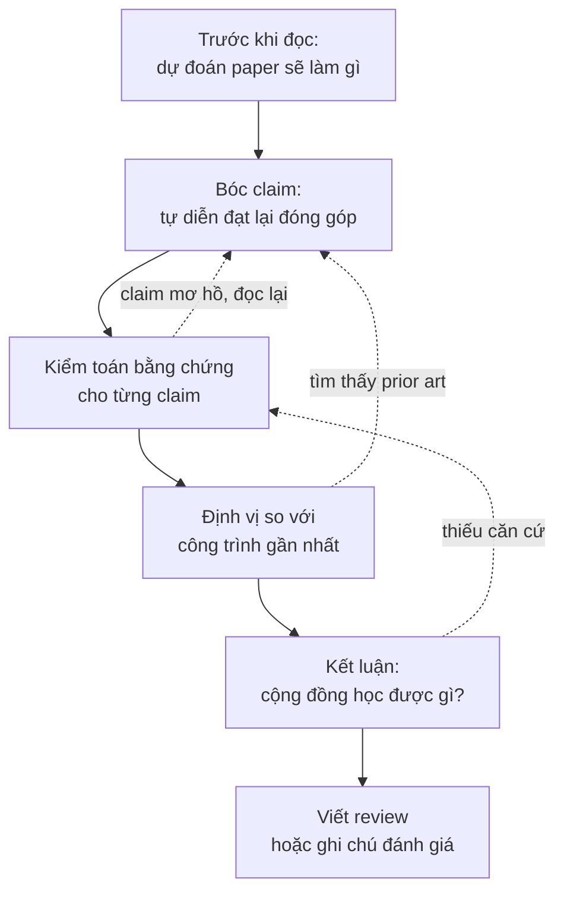
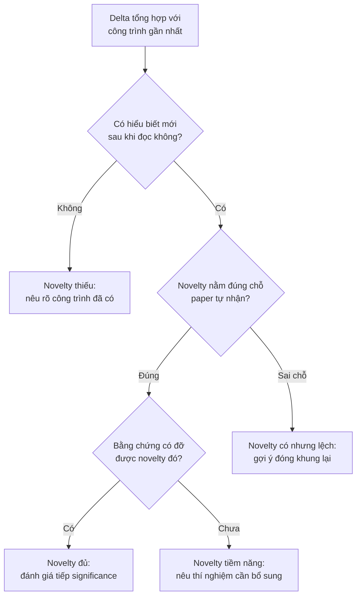

# Đọc paper như một reviewer

!!! abstract "Mục tiêu của bài"
    Sau bài này, người học có thể:

    - Phân biệt tư thế đọc để học với tư thế đọc để đánh giá, và chủ động chuyển giữa hai tư thế khi cần.
    - Áp dụng một quy trình đọc phản biện gồm dự đoán, bóc claim, kiểm toán bằng chứng, định vị và kết luận, xây trên nền phương pháp đọc ba lượt.
    - Tự diễn đạt lại danh sách đóng góp của một paper, phân loại kiểu đóng góp, và lập bảng claim, bằng chứng, mức độ thuyết phục.
    - Ước lượng novelty của một paper so với các công trình gần nhất: chỉ ra novelty nằm ở đâu, có nằm đúng chỗ paper tự nhận không, và phân biệt "đã có người làm" với "đã có người nghĩ tới".
    - Nhận diện cờ đỏ trong bằng chứng, giả định ngầm của phương pháp, và những heuristic phản biện lười cần tránh.
    - Viết một bản review có cấu trúc, với weakness cụ thể, có căn cứ và gợi ý được hướng sửa, kèm điểm số và độ tự tin được hiệu chỉnh.

Bài [Đọc và lập bản đồ tài liệu](literature.md) trả lời câu hỏi đọc gì và đọc sâu tới đâu: phương pháp ba lượt giúp phân bổ thời gian, đọc như người viết giúp học cách trình bày, còn bảng literature và bản đồ định vị biến những gì đã đọc thành nguyên liệu cho paper. Trong các hoạt động đó, người đọc về cơ bản *tin* paper. Bài này đổi tư thế. Câu hỏi trung tâm không còn là "paper dạy được điều gì" mà là "paper có đứng vững không": đóng góp thực sự là gì, mới tới đâu so với những gì đã có, các khẳng định có được bằng chứng đỡ hay không, và điểm yếu nằm ở đâu.

Kỹ năng này phục vụ ba việc. Việc thứ nhất là tự đánh giá: đọc bản thảo của nhóm bằng con mắt lạnh lùng của reviewer trước khi nộp, và ước lượng một ý tưởng mới tới đâu trước khi dành nhiều tháng cho nó. Việc thứ hai là tìm khoảng trống: mỗi claim chưa được chứng minh, mỗi giả định ngầm trong paper của người khác là một ứng viên cho đề tài mới, và bài tiếp theo, [Tìm khoảng trống và nguồn ý tưởng](tim-khoang-trong.md), biến những phát hiện đó thành một quy trình có hệ thống. Việc thứ ba là làm reviewer thật, một nghĩa vụ mà nhiều hội nghị những năm gần đây đặt ra cho tác giả, như bài [Paper được đánh giá thế nào](../00-tong-quan/review-process.md) đã trình bày. Andrej Karpathy có một hình ảnh dễ nhớ cho lợi ích của việc review: người chỉ đọc paper tốt giống một bộ phân loại chỉ được huấn luyện bằng ví dụ dương; muốn biết paper tốt khác paper tồi ở đâu thì phải đọc cả paper tồi (Karpathy, *A Survival Guide to a PhD*, 2016).

Bài đi theo trình tự của một lần đọc phản biện, với mục đánh giá novelty dài nhất vì đây là chỗ người mới khó tự tin nhất. Sau các heuristic phản biện lười, phần cuối chuyển từ đọc sang viết: cấu trúc một bản review, một bản review mẫu, hiệu chỉnh điểm số, bảo mật, và cách luyện "gu" phản biện bằng review công khai trên OpenReview.

## Đọc để học và đọc để đánh giá

Hai tư thế đọc khác nhau ở câu hỏi mà người đọc mang theo. Người đọc để học hỏi "làm thế nào": phương pháp vận hành ra sao, kỹ thuật nào mang về dùng được. Người đọc để đánh giá hỏi điều paper khẳng định có đúng không, có mới không, có quan trọng không, và bằng chứng có đủ để một người hoài nghi nhưng công tâm phải chấp nhận không. Tư thế thứ hai đòi hỏi tạm treo niềm tin: mỗi câu khẳng định trong abstract được đọc như một giả thuyết cần kiểm tra.

Đằng sau mọi câu hỏi của reviewer là hai câu hỏi lớn. Câu thứ nhất: *cộng đồng học được gì từ paper này mà trước đó chưa biết?* Đó có thể là một phương pháp tốt hơn, một hiểu biết về vì sao một phương pháp hoạt động, một bằng chứng rằng một niềm tin phổ biến là sai, hay một dataset mở ra hướng đánh giá mới. Tài liệu hướng dẫn reviewer của Program Chairs CVPR và ICCV diễn đạt cùng ý khi gợi ý rằng phần Strengths nên trả lời câu hỏi một người quan tâm tới chủ đề học được gì từ paper (*How to Write Good Reviews for CVPR*, tài liệu năm 2019, được dùng lại ở các năm sau). Câu thứ hai: *có nên đưa paper vào chương trình của hội nghị không?* Hai câu không đồng nhất. Một paper có thể mang hiểu biết mới nhưng bằng chứng quá mỏng để cộng đồng tin vào nó; một paper khác có bằng chứng rất chặt nhưng chỉ xác nhận điều ai cũng biết.

Đọc để đánh giá không có nghĩa là đọc để tìm cách reject. Reviewer đi tìm lý do từ chối sẽ luôn tìm thấy, vì không paper nào hoàn hảo. Thái độ đúng gần với một đồng nghiệp nghiêm khắc: hiểu paper theo cách tốt nhất mà văn bản cho phép (trong tranh luận, cách làm này đôi khi được gọi là "steelman", đối lập với "strawman"), rồi mới hỏi phiên bản tốt nhất ấy có đứng vững không. Nhận xét nhắm vào điểm yếu thật của phiên bản mạnh nhất là nhận xét mà tác giả khó cãi.

Để thấy khác biệt cụ thể, hãy hình dung hai bản ghi chép về một paper NLP giả định đề xuất cách chọn và sắp xếp ví dụ minh họa (*demonstration*) cho in-context learning. Bản ghi để học ghi lại cách chọn và sắp xếp ví dụ để thử cho dự án của nhóm. Bản ghi để đánh giá viết rằng claim chính là "sắp xếp theo độ khó cải thiện độ chính xác", nhưng ablation thay đổi đồng thời tiêu chí chọn lẫn thứ tự nên chưa tách được hiệu ứng của thứ tự; rằng chỉ có một mô hình và ba dataset phân loại trong khi abstract nói về "LLMs" nói chung; và rằng không có độ lệch chuẩn qua các lần lấy mẫu ví dụ, trong khi in-context learning nổi tiếng nhạy với lựa chọn ví dụ. Chỉ bản ghi thứ hai giúp quyết định paper có đứng vững không.

| Khía cạnh | Đọc để học | Đọc để đánh giá |
|---|---|---|
| Câu hỏi chính | Làm thế nào? Mang về dùng được gì? | Có đúng không? Có mới không? Có quan trọng không? |
| Thái độ với claim | Chấp nhận để hiểu | Coi là giả thuyết cần kiểm tra |
| Phần đọc kỹ nhất | Method, chi tiết cài đặt | Claim, bảng kết quả, ablation, công trình gần nhất |
| Sản phẩm | Ghi chú kỹ thuật, ý tưởng mang về | Bảng claim và bằng chứng, danh sách điểm yếu, kết luận có lý lẽ |
| Rủi ro nếu chỉ dùng tư thế này | Tin vào claim chưa được chứng minh | Hoài nghi tới mức không học được gì, hoặc khắt khe vô cớ |

Hai tư thế không loại trừ nhau; điều người mới cần luyện là khả năng *chủ động* bật tư thế đánh giá, thay vì để nó chỉ xuất hiện khi có điều gì quá hiển nhiên là sai.

## Quy trình đọc phản biện

Phương pháp ba lượt của Keshav vẫn là khung thời gian phù hợp cho đọc phản biện. Năm chữ C của lượt thứ nhất (*Category*, *Context*, *Correctness*, *Contributions*, *Clarity*) đã chứa sẵn mầm mống của một đánh giá, và lượt thứ ba, khi người đọc gần như tái hiện lại paper với cùng giả định như tác giả, chính là kiểu đọc làm lộ ra giả định ngầm và điểm yếu (Keshav, *How to Read a Paper*, 2007). Quy trình dưới đây biến các lượt đó thành năm bước có sản phẩm cụ thể, để kết quả của việc đọc là một lập luận có thể viết thành review chứ không chỉ là một ấn tượng.



**Bước 1: dự đoán trước khi đọc.** Chỉ từ title và abstract, người đọc viết vài dòng: paper có lẽ sẽ làm gì, công trình gần nhất có lẽ là gì, kết quả nào được dự đoán, thí nghiệm nào sẽ thuyết phục, điều gì đáng lo nhất. Năm phút này mang lại hai lợi ích. Nó tạo một mốc để đo tính bất ngờ: câu hỏi "chuyên gia có đoán trước được kết quả không?" ở mục novelty chỉ trả lời trung thực được nếu dự đoán được ghi lại *trước khi* biết kết quả. Nó cũng chống lại hiệu ứng mỏ neo của cách đóng khung mà tác giả chọn. Hướng dẫn reviewer hiện hành của ACL Rolling Review đi theo cùng tinh thần khi khuyên đọc ít nhất hai lần, và trong lần lướt đầu tiên thì nắm câu hỏi nghiên cứu mà chưa nhìn vào kết quả, để tránh thiên kiến nhìn lại và thiên kiến xác nhận (ARR Reviewer Guidelines, cập nhật 2025).

**Bước 2: bóc claim.** Người đọc liệt kê mọi khẳng định từ abstract, Introduction, đoạn đóng góp và kết luận, rồi tự diễn đạt lại chúng, tách claim chính khỏi claim phụ và claim tường minh khỏi claim ngầm. Mục tiếp theo trình bày kỹ bước này.

**Bước 3: kiểm toán bằng chứng.** Với mỗi claim, người đọc tìm bằng chứng tương ứng và đánh giá mức độ thuyết phục. Đây là phần tốn thời gian nhất của lượt thứ hai, và là nơi lượt thứ ba, nếu có, tập trung vào: suy lại một phương trình, mở code xem một chi tiết, đối chiếu một con số với paper gốc của baseline.

**Bước 4: định vị.** Người đọc so paper với các công trình gần nhất, cả những công trình được trích dẫn lẫn những công trình tự tìm ra, để xác định khác biệt thực sự và tầm quan trọng của nó.

**Bước 5: kết luận.** Người đọc trả lời hai câu hỏi lớn bằng một đoạn văn ngắn. Nếu không viết được đoạn này, việc đọc chưa xong, và thường là vì bước 3 chưa đủ sâu.

Thứ tự năm bước không cứng nhắc, như các mũi tên quay lại trong sơ đồ cho thấy. Điều quan trọng là mỗi bước để lại một sản phẩm viết. Jason Eisner khuyên viết trong lúc đọc, vì ghi chép giữ sự tập trung và buộc người đọc thực sự tương tác với paper (Eisner, *How to Read a Technical Paper*, 2009). Về thời gian, tài liệu hướng dẫn reviewer của CVPR và ICCV nói rằng reviewer có kinh nghiệm thường mất hai đến bốn giờ cho mỗi paper, còn người mới nên dự trù ít nhất bốn giờ và đọc hai lần. Phiếu dưới đây giữ kỷ luật cho năm bước, dùng được cho cả paper của người khác lẫn bản thảo của nhóm.

```markdown
PHIẾU ĐỌC PHẢN BIỆN

Paper: <tên, venue, năm>          Ngày đọc: <...>       Thời gian dự kiến: <...>

[Bước 1] Dự đoán (chỉ từ title và abstract)
- Paper có lẽ sẽ làm gì / công trình gần nhất đã biết:
- Kết quả dự đoán (kèm mức độ chắc chắn):
- Thí nghiệm nào sẽ thuyết phục / điều đáng lo nhất:

[Bước 2] Claim (diễn đạt lại bằng lời của người đọc)
- Đóng góp cốt lõi trong một câu:
- Claim chính / claim phụ / claim ngầm:

[Bước 3] Kiểm toán bằng chứng  -> bảng claim – bằng chứng – mức độ thuyết phục

[Bước 4] Định vị
- Ba công trình gần nhất và delta với từng công trình:
- Novelty nằm ở đâu? Có đúng chỗ paper tự nhận không?

[Bước 5] Kết luận
- Cộng đồng học được gì / bằng chứng có đủ để tin không:
- Dự đoán ở bước 1 đúng hay sai, và điều đó nói gì về tính bất ngờ:
- Đánh giá tổng thể và độ tự tin:
```

Dòng áp chót của bước 5 có giá trị nhất về lâu dài: sau vài chục lần ghi, người đọc có một hồ sơ về chính khả năng dự đoán của bản thân, một phần của thứ mà các nhà nghiên cứu gọi là "gu" (*taste*).

## Bóc tách contribution

Bước đầu tiên của mọi đánh giá là biết chính xác đang đánh giá cái gì. Nhiều review tồi đánh giá một paper khác với paper được nộp, vì hiểu sai đóng góp hoặc chấp nhận nguyên văn danh sách đóng góp của tác giả.

### Tự diễn đạt lại danh sách đóng góp

Đoạn liệt kê đóng góp cuối Introduction là phiên bản của người bán hàng. Danh sách thường dài hơn thực chất: một ý tưởng chính bị tách thành ba bốn gạch đầu dòng, "extensive experiments" được tính là một đóng góp, một chi tiết cài đặt trở thành "module mới". Việc của người đọc phản biện là tự diễn đạt lại danh sách sau lượt đọc thứ hai, rồi so sánh hai phiên bản.

Bản diễn đạt lại tốt gộp những gì thực chất là một (một loss mới và "kết quả tốt nhờ loss đó" là một đóng góp), tách những gì bị gộp (một dataset và một phương pháp cần hai tiêu chí đánh giá khác nhau), và có một câu duy nhất nêu *đóng góp cốt lõi*. Karpathy khuyên người viết xác định một đóng góp cốt lõi duy nhất, vì các đóng góp không cộng dồn và một đóng góp phụ yếu chỉ làm loãng paper; theo cách nói của ông, một paper tốt "sells a single thing that was not obvious or present before", tức bán một điều duy nhất trước đó chưa hiển nhiên hoặc chưa có (Karpathy, 2016). Lời khuyên viết đó đồng thời là một phép thử đọc: nếu sau lượt thứ hai không viết được câu đóng góp cốt lõi, thì hoặc paper chưa rõ, hoặc người đọc chưa hiểu.

Một dạng câu hữu ích là đặt đóng góp đối diện với điều công trình trước giả định: "Các công trình trước giả định X; paper này cho thấy Y". Khóa học CS197 của Michael Bernstein ở Stanford gọi đây là một "bit flip": gọi tên một giả định, thường ngầm định, của công trình trước, rồi lật nó (Bernstein, Stanford CS197 *Computer Science Research*). Câu bit flip cho thấy ngay phần nào là mới và phần nào là kế thừa; bài [Tìm khoảng trống và nguồn ý tưởng](tim-khoang-trong.md) dùng cùng công cụ này theo chiều ngược lại để sinh ý tưởng.

### Phân loại kiểu đóng góp

Mỗi đóng góp đã diễn đạt lại được gắn một kiểu: phương pháp, cách đặt bài toán, dataset và benchmark, phương pháp luận đánh giá, phân tích, paradigm, hiệu quả tính toán, hay ứng dụng có insight. Bài [Thẩm định ý tưởng](y-tuong.md) trình bày đầy đủ các kiểu này cùng ví dụ từ ba cộng đồng. Với reviewer, việc phân loại quan trọng vì mỗi kiểu đòi hỏi một loại bằng chứng khác, và một lỗi đánh giá phổ biến là dùng thước đo của kiểu này cho kiểu khác: chê một paper dataset vì "phương pháp baseline không mới", hay chê một paper phân tích vì "không đạt SOTA". Việc phân loại cũng làm lộ ra một hiện tượng sẽ được bàn ở mục novelty: kiểu đóng góp mà tác giả tự nhận đôi khi khác kiểu đóng góp thực sự.

### Bảng claim, bằng chứng, mức độ thuyết phục

Công cụ trung tâm của đọc phản biện là một bảng ghi mỗi claim, bằng chứng tương ứng và mức độ thuyết phục của bằng chứng đó. Bảng này xuất hiện ở phía người viết trong bài [Thiết kế thí nghiệm](thi-nghiem.md) và bài [Quy trình viết & tự review](../03-ky-thuat/quy-trinh-viet.md), vì người viết và reviewer nhìn cùng một cấu trúc từ hai phía.

Claim có nhiều loại, mỗi loại cần một kiểu bằng chứng: claim về **hiệu năng** cần so sánh công bằng với baseline mạnh; claim về **cơ chế** cần ablation và phép đo trực tiếp cơ chế; claim về **tính tổng quát** cần nhiều thiết lập thực sự khác nhau; claim về **hiệu quả tính toán** cần đo trên phần cứng thực; claim **lý thuyết** cần chứng minh đúng và giả định hợp lý. Claim **"đầu tiên"** cần một cuộc tìm kiếm kiểm tra được, vì đây là loại claim dễ sai nhất; case study [PhoBERT](../05-case-studies/phobert.md) phân tích cách một claim "first" được giữ bởi những định ngữ chính xác. Cần đặc biệt chú ý tới **claim ngầm**, được hàm ý qua title hay cách đặt tên: title "… for Vision-Language Models" mà chỉ thử trên một mô hình đã hàm ý một claim về tính tổng quát; chữ "robust" hàm ý độ bền trước những thay đổi mà paper có thể chưa thử. Reviewer có kinh nghiệm đọc title và abstract như một bản hợp đồng: điều gì được hứa ở đó phải được giao ở phần thí nghiệm.

Mức độ thuyết phục được ghi theo bốn mức. **Mạnh**: bằng chứng trực tiếp, so sánh công bằng, có thống kê, khó giải thích cách khác. **Một phần**: đúng hướng nhưng có lỗ hổng cụ thể, như thiếu seed hoặc chỉ một dataset. **Yếu**: gián tiếp hoặc có thể giải thích bằng yếu tố khác. **Không có**: claim không có bằng chứng nào trong paper.

```markdown
BẢNG CLAIM – BẰNG CHỨNG – MỨC ĐỘ THUYẾT PHỤC

Paper: <...>
Đóng góp cốt lõi (một câu, lời của người đọc): <...>
Kiểu đóng góp chủ đạo: <phương pháp / bài toán / dataset / đánh giá / phân tích / ...>

| # | Claim (diễn giải) | Loại | Nơi xuất hiện | Bằng chứng | Mức | Lỗ hổng / câu hỏi cho tác giả |
|---|---|---|---|---|---|---|
| C1 | ... | hiệu năng | Abstract, Sec. 1 | Table 2 | Mạnh / Một phần / Yếu / Không có | ... |
| C2 | ... | cơ chế | Sec. 3.2 | Table 4 (ablation) | ... | ... |
| C3 | ... | tổng quát | Title (ngầm) | Table 5 | ... | ... |

Claim nào nếu sai thì paper không còn đứng được?  -> <C...>
Claim đó có mức "Mạnh" chưa?                    -> <có / chưa, vì ...>
```

Hai dòng cuối là phần quan trọng nhất, vì không phải mọi claim đều nặng như nhau. Một paper có bốn claim phụ yếu nhưng claim cốt lõi mạnh có thể là paper tốt cần sửa vài chỗ; một paper có claim cốt lõi chỉ được chứng minh một phần thì đang có vấn đề nghiêm trọng, dù các claim phụ vững đến đâu. Dưới đây là bảng đã điền cho một paper Computer Vision giả định, đề xuất một loss chưng cất (*distillation*) "nhạy theo tỉ lệ" cho các detector thời gian thực.

| # | Claim (diễn giải) | Loại | Bằng chứng | Mức | Lỗ hổng |
|---|---|---|---|---|---|
| C1 | Tăng AP so với các detector thời gian thực mạnh nhất trên COCO | hiệu năng | Table 2, một lần chạy | Một phần | Số của hai baseline chép từ paper gốc, huấn luyện với lịch ngắn hơn; không có độ lệch chuẩn |
| C2 | Cải thiện đến từ loss nhạy theo tỉ lệ | cơ chế | Table 4 | Yếu | Dòng "không có loss mới" cũng dùng teacher khác; hai yếu tố bị thay đổi cùng lúc |
| C3 | Tổng quát qua nhiều backbone | tổng quát | Table 5 | Một phần | Hai backbone cùng một họ kiến trúc |
| C4 | Không tăng chi phí suy luận | hiệu quả | Sec. 4.3 | Mạnh | Loss chỉ dùng lúc huấn luyện, đúng theo thiết kế |
| C5 | Đầu tiên đưa thông tin tỉ lệ vào chưng cất cho detection | "đầu tiên" | Không có | Không có | Cần tìm kiếm; nên bỏ hoặc thu hẹp |

Bảng cho thấy ngay câu hỏi quyết định: C2 là claim cốt lõi, vì nếu cải thiện đến từ teacher mạnh hơn chứ không phải loss mới, paper không còn đóng góp gì. Một ablation thay đổi đúng một yếu tố, giữ nguyên teacher, sẽ giải quyết dứt điểm câu hỏi đó. Đây chính là loại weakness cụ thể, có căn cứ và có hướng sửa mà phần cuối bài dạy cách viết.

## Đánh giá novelty

Trong mọi tiêu chí của form review, novelty khó đánh giá nhất và cũng là nơi review dễ sai nhất. Novelty không nhìn thấy được trong paper như một con số; nó là một *quan hệ* giữa paper và toàn bộ những gì cộng đồng đã biết, nên đánh giá nó đòi hỏi kiến thức lĩnh vực, và còn bị chi phối bởi những thiên kiến tâm lý mà cả người có kinh nghiệm cũng mắc. Mục này làm rõ novelty là gì, rồi trình bày phân tích delta, sáu vị trí của novelty, ba câu hỏi kiểm tra, cách tìm prior art, và ba ví dụ có ba kết luận khác nhau.

### Novelty là gì, và không phải là gì

Một định nghĩa làm việc hữu ích: **novelty là lượng hiểu biết mới mà cộng đồng nhận được từ paper, đánh giá tại thời điểm trước khi paper xuất hiện.** Mỗi vế của định nghĩa loại bỏ một kiểu nhầm lẫn.

Vế thứ nhất loại bỏ sự nhầm lẫn giữa novelty và độ phức tạp. Trong *Novelty in Science: A guide for reviewers* (2022), Michael J. Black, nhà nghiên cứu Computer Vision ở Viện Max Planck về Hệ thống Thông minh, cho rằng reviewer thường lẫn novelty với độ phức tạp, độ khó và tính kỹ thuật. Kiểu review tồi điển hình mà ông mô tả là chê một ý tưởng vì nó "chỉ thay đổi một số hạng trong hàm loss", trong khi thay đổi đúng một thứ trong một mạng có sẵn thường là khoa học tốt hơn dựng một mạng mới phức tạp hơn. Black cũng không đi tới cực đoan ngược lại: "a simple idea can be important. But it can also be trivial", tức một ý tưởng đơn giản có thể quan trọng nhưng cũng có thể tầm thường. Sự đơn giản không phải bằng chứng của novelty; nó chỉ không phải bằng chứng của việc *thiếu* novelty.

Vế thứ hai nhắm vào **thiên kiến nhìn lại** (*hindsight bias*): khi đã biết một ý tưởng, con người đánh giá quá cao khả năng bản thân đã có thể nghĩ ra nó. Theo Black, novelty "must be evaluated before the idea existed", tức phải được đánh giá như thể ý tưởng chưa tồn tại. Thiên kiến này đặc biệt mạnh với paper được viết tốt, vì paper viết tốt chính là paper làm cho ý tưởng trông hiển nhiên. Black còn nhấn mạnh rằng novelty không chỉ là novelty kỹ thuật: một dataset làm được điều chưa dataset nào làm, một cách dùng mới cho phương pháp cũ, hay việc thay một thuật toán phức tạp bằng một thuật toán đơn giản đều có thể là mới (Black, *Novelty in Science*, 2022). Bài [Khi novelty và hiệu quả lệch pha](../07-tinh-huong-kho/novelty-va-hieu-qua.md) ở Chương 7 phân tích cùng vấn đề từ phía tác giả, với các ví dụ ResNet, ViT và ConvNeXt; ở đây chúng ta đứng ở phía reviewer.

Hướng dẫn reviewer chính thức của các hội nghị đi theo cùng tinh thần, dù diễn đạt khác nhau theo năm. Hướng dẫn NeurIPS năm 2023, ở mục originality, hỏi liệu paper có phải một sự kết hợp mới các kỹ thuật đã biết hay không và chú thích ngay rằng điều đó có thể có giá trị; bản năm 2026 nói thêm rằng originality không nhất thiết đòi hỏi một phương pháp hoàn toàn mới, và những hiểu biết mới từ việc đánh giá các phương pháp có sẵn cũng có giá trị ngang như vậy. Hướng dẫn ICLR những năm gần đây, khi hỏi về ý nghĩa của đóng góp, ghi rõ rằng điều đó không nhất thiết đòi hỏi kết quả state-of-the-art. Hướng dẫn CVPR qua nhiều năm nói rằng việc không vượt state-of-the-art trên một benchmark có sẵn tự nó không phải lý do reject. Hướng dẫn ARR có cả một danh sách heuristic phản biện lười, được phân tích ở mục riêng bên dưới. Vì các văn bản này được viết lại hằng năm, reviewer cần mở đúng phiên bản của hội nghị và năm đang review.

!!! info "Novelty không phải là độ phức tạp, cũng không phải sự bất ngờ đơn thuần"
    Ba thứ thường bị nhầm với novelty là độ phức tạp ("phương pháp có nhiều thành phần"), độ khó ("chứng minh dài", "cài đặt khó") và sự bất ngờ đơn thuần ("kết quả lạ"). Một kết quả bất ngờ mà không được giải thích có thể chỉ là một lỗi chưa được phát hiện. Câu hỏi đúng luôn quay về một điểm: sau khi đọc paper, cộng đồng biết thêm điều gì đáng tin cậy mà trước đó chưa biết?

### Phân tích delta với ba công trình gần nhất

Vì novelty là một quan hệ, cách đánh giá có kỷ luật là đặt paper cạnh những công trình gần nhất và đo khoảng cách, tức **delta**. Bước đầu tiên là chọn ba công trình gần nhất, từ Related Work của paper và từ cuộc tìm kiếm của người đọc, vì công trình gần nhất thật sự đôi khi không được trích dẫn. Ba công trình ấy thường đến từ ba hướng: một công trình cùng bài toán với phương pháp khác, một công trình cùng ý tưởng kỹ thuật ở bài toán khác, và công trình mới nhất trên cùng benchmark. Bài [Related Work](../02-viet-tung-phan/related-work.md) mô tả cách người viết định vị paper so với các nhóm công trình; reviewer kiểm tra lại sự định vị đó.

Bước thứ hai là điền bảng delta. Mỗi dòng trả lời năm câu hỏi: giống nhau ở đâu, paper nói khác nhau ở đâu, khác biệt đó có thật không (đọc công trình kia, không chỉ đọc cách paper mô tả nó), có thí nghiệm đối chứng không, và khác biệt có quan trọng không.

```markdown
PHÂN TÍCH DELTA

Paper đang đánh giá: <...>          Câu đóng góp cốt lõi: <...>

| Công trình gần | Giống ở đâu | Khác ở đâu (theo paper) | Khác biệt có thật? | Có thí nghiệm đối chứng? | Có quan trọng? |
|---|---|---|---|---|---|
| W1 (cùng bài toán) | ... | ... | ... | ... | ... |
| W2 (cùng kỹ thuật, bài toán khác) | ... | ... | ... | ... | ... |
| W3 (mới nhất cùng benchmark) | ... | ... | ... | ... | ... |

Delta tổng hợp: <một câu: paper làm được gì mà W1–W3 gộp lại chưa làm được>
Loại delta: thiết lập / phương pháp / bằng chứng / hiểu biết
```

Dòng "delta tổng hợp" là chỗ nhiều paper lộ vấn đề. Paper có thể khác W1 ở một điểm, khác W2 ở một điểm, nhưng ghép W1 với W2 thì ra gần đúng paper; đó là dạng "A + B" mà bài [Thẩm định ý tưởng](y-tuong.md) đã cảnh báo người viết. Với reviewer, phát hiện này chưa phải kết luận, vì như hướng dẫn NeurIPS nói, một sự kết hợp có thể có giá trị. Nhưng nó chuyển gánh nặng chứng minh: paper phải cho thấy sự kết hợp mang lại điều mà từng thành phần riêng lẻ không mang lại, chẳng hạn chỉ ra vì sao kết hợp ngây thơ thất bại. Các loại delta cũng nặng nhẹ khác nhau: delta về **thiết lập** có giá trị khi thiết lập mới đặt ra thách thức thật; delta về **phương pháp** khi thay đổi được chứng minh là nguyên nhân của cải thiện; delta về **bằng chứng**, như một đánh giá công bằng lật lại kết luận cũ, hay bị đánh giá thấp dù có thể rất có giá trị; còn delta về **hiểu biết** khó đạt nhất và thường được nhớ lâu nhất.

### Novelty nằm ở đâu: sáu vị trí

Sau khi có delta, câu hỏi tiếp theo là novelty nằm ở vị trí nào. Có thể phân biệt sáu vị trí: bài toán (như Panoptic Segmentation), phương pháp (như ResNet), phát hiện (như *Understanding deep learning requires rethinking generalization*, không có phương pháp mới), đánh giá (như CheckList), tài nguyên (dataset, benchmark, công cụ) và lý thuyết. Một paper có thể mới ở nhiều vị trí, nhưng gọi đúng vị trí chính quan trọng vì nó quyết định thước đo. Bảng dưới đây ghi câu hỏi kiểm tra cho từng vị trí và dấu hiệu cho thấy novelty ở đó còn mỏng.

| Vị trí | Câu hỏi kiểm tra | Dấu hiệu novelty mỏng |
|---|---|---|
| Bài toán | Cách đặt mới có cho phép làm điều cách cũ không làm được? | Bài toán cũ đổi tên, hoặc thêm một ràng buộc không ai cần |
| Phương pháp | Chính thay đổi mới có tạo ra cải thiện? | Ablation không cô lập được thay đổi; cải thiện biến mất khi tune baseline |
| Phát hiện | Có kiểm soát chặt, tổng quát, và trước đó chưa biết? | Khẳng định lại điều cộng đồng đã ngầm biết, hoặc chỉ đúng ở một thiết lập |
| Đánh giá | Cách đo mới có làm lộ điều cách cũ bỏ sót? | Metric mới tương quan gần như hoàn toàn với metric cũ |
| Tài nguyên | Làm được gì mà tài nguyên hiện có không làm được? | Lớn hơn nhưng không mở ra câu hỏi mới; chất lượng nhãn không được kiểm chứng |
| Lý thuyết | Giả định hợp lý, kết quả có thông tin, kỹ thuật chứng minh mới? | Giả định không bao giờ thỏa trong thực tế; áp dụng trực tiếp kết quả đã biết |

### Ba câu hỏi kiểm tra

Phân tích delta và sáu vị trí cho một bức tranh có cấu trúc. Ba câu hỏi dưới đây chuyển bức tranh đó thành phán đoán.

**Một chuyên gia có đoán trước được kết quả không?** Nếu một người am hiểu lĩnh vực, chỉ nghe mô tả thí nghiệm, sẽ đoán đúng kết quả với độ chắc chắn cao, paper mang ít thông tin mới. Nếu các chuyên gia sẽ đoán sai hoặc chia rẽ, kết quả có giá trị thông tin cao. Câu hỏi này cần dùng thận trọng: nó chỉ trả lời trung thực được trước khi biết kết quả, và "đoán được" không đồng nghĩa với "đã được biết": hướng dẫn ARR giải thích rằng nhiều phát hiện trông hiển nhiên khi nhìn lại, nhưng điều đó không có nghĩa là cộng đồng đã biết chúng và dùng được chúng làm nền móng (ARR Reviewer Guidelines). Một kết quả mà mọi người đều đoán nhưng chưa ai kiểm chứng nghiêm túc vẫn có giá trị; giá trị đó nằm ở bằng chứng chứ không ở ý tưởng.

**Ai sẽ thay đổi cách làm sau khi đọc paper?** Đây là cách cụ thể hóa tiêu chí significance: người đọc hình dung một người cụ thể, như một kỹ sư huấn luyện detector hay một nhà nghiên cứu xây benchmark đa ngôn ngữ, và hỏi người đó có làm khác đi không, chẳng hạn thêm một bước vào pipeline, bỏ một thành phần thừa, hay đổi cách đánh giá. Nếu không hình dung được ai, paper có thể đúng và mới nhưng không quan trọng. Câu hỏi này cũng giúp tránh lỗi ngược lại: chê "chủ đề hẹp" trong khi với một cộng đồng con, paper có thể thay đổi hẳn cách làm việc.

**Novelty có nằm đúng chỗ paper tự nhận không?** Người mới ít khi đặt câu hỏi này, nhưng nó thường dẫn tới những nhận xét có giá trị nhất. Có ba trường hợp. Novelty nằm đúng chỗ, và đánh giá đi tiếp bình thường. Paper nhận novelty ở phương pháp nhưng phương pháp gần trùng một công trình đã có, trong khi một phát hiện hay một dataset trong paper mới là phần thực sự mới; reviewer giúp tác giả nhiều nhất bằng cách chỉ ra điều đó thay vì chỉ kết luận "thiếu novelty". Hoặc paper nhận novelty ở một chỗ mà bằng chứng không đỡ được, như nhận là hiểu biết về cơ chế nhưng không có thí nghiệm nào đo trực tiếp cơ chế. Sơ đồ dưới đây tóm tắt các nhánh.



### Tìm prior art nhanh khi review

Câu hỏi "đã có ai làm điều này chưa" đòi hỏi tìm kiếm, nhưng reviewer không có vài tuần như khi thẩm định ý tưởng của nhóm. Quy trình ba tầng từ khóa, trích dẫn và con người trong bài [Thẩm định ý tưởng](y-tuong.md) vẫn là khung đúng; phiên bản cho reviewer chỉ cần gọn hơn và có giới hạn thời gian, chẳng hạn hai mươi đến ba mươi phút. Điểm xuất phát hiệu quả nhất là đi tiến theo "Cited by" của công trình gần nhất mà paper trích dẫn, rồi thử vài cách diễn đạt khác của ý tưởng, kể cả thuật ngữ của cộng đồng lân cận, vì cùng một ý tưởng thường mang những tên rất khác nhau ở CV, NLP, thống kê hay xử lý tín hiệu. OpenReview đáng được tra riêng vì còn lưu những bài nộp ICLR đã bị reject hoặc rút. Hướng dẫn ARR gợi ý một trình tự đáng cân nhắc: chỉ kiểm tra related work sau khi đã có bản nháp review, để đánh giá không bị một công trình tìm thấy giữa chừng chi phối từ đầu.

Hai giới hạn cần được tôn trọng. Về bảo mật, tìm bằng từ khóa do reviewer tự đặt là bình thường, nhưng dán nội dung paper đang review vào một công cụ trực tuyến, kể cả công cụ tìm kiếm dựa trên LLM, là vi phạm (xem mục về bảo mật ở phần sau). Về ẩn danh, cả hướng dẫn ARR lẫn tài liệu hướng dẫn reviewer của CVPR đều khuyên không tìm bản preprint của chính paper để xác định tác giả; việc tìm kiếm nên nhắm vào ý tưởng chứ không nhắm vào danh tính.

### "Đã có người làm" và "đã có người nghĩ tới"

Khi tìm thấy một công trình có vẻ giống paper, reviewer cần xác định chính xác mức độ trùng lặp trước khi viết gì. Một câu trong Future Work của paper khác, một đoạn blog, một gợi ý trong slide bài giảng cho thấy ý tưởng *đã được nghĩ tới*; chúng không lấy đi novelty của việc biến ý tưởng thành hiện thực, chứng minh nó hoạt động và giải thích vì sao. Một paper đã cài đặt cùng ý tưởng, trong cùng thiết lập, với bằng chứng tương đương, thì đúng là *đã làm*. Giữa hai cực là nhiều mức trung gian.

| Mức độ trùng lặp | Ví dụ | Hệ quả cho đánh giá novelty |
|---|---|---|
| Được nhắc tới như một khả năng | Một câu trong Future Work, một đoạn blog | Novelty của việc thực hiện và chứng minh vẫn còn; paper nên trích dẫn |
| Được đề xuất nhưng không kiểm chứng | Position paper không có thí nghiệm | Novelty nằm ở bằng chứng và các điều chỉnh để ý tưởng hoạt động |
| Được làm trong thiết lập khác | Cùng kỹ thuật ở lĩnh vực hoặc quy mô khác | Phụ thuộc vào việc chuyển thiết lập có đòi hỏi gì không tầm thường |
| Được làm trong cùng thiết lập, bằng chứng yếu hơn | Cùng ý tưởng, ít dataset, không ablation | Novelty nằm ở bằng chứng chặt hơn; paper phải tự định vị như vậy |
| Được làm trong cùng thiết lập, bằng chứng tương đương | Gần như trùng khớp | Novelty về ý tưởng không còn; chỉ còn phần khác biệt thật |

Dù ở mức nào, có một nguyên tắc không có ngoại lệ: **nhận xét "đã có người làm" phải kèm trích dẫn cụ thể.** Tài liệu hướng dẫn reviewer của CVPR và ICCV viết thẳng: "It is not OK to simply say “this has been done before”: you need to give specific references!", tức không được chỉ nói "đã có người làm" mà phải đưa tài liệu cụ thể. Hướng dẫn ARR cũng xếp "kết quả không mới" mà không kèm tài liệu vào danh sách heuristic lười. Nếu tin rằng ý tưởng đã có nhưng không nhớ nguồn, cách viết trung thực là nói rõ mức độ chắc chắn và hỏi tác giả, thay vì khẳng định.

### Concurrent work

Một trường hợp đặc biệt là khi công trình trùng lặp xuất hiện rất gần thời điểm nộp bài, chuyện thường gặp trong một lĩnh vực phát triển nhanh. Hướng dẫn ARR hiện hành nói rằng việc thiếu một tài liệu tham khảo chỉ là vấn đề nếu công trình đó đã được công bố chính thức, không chỉ đăng trên arXiv, từ ba tháng trở lên trước deadline. Hướng dẫn CVPR nhiều năm nói rằng không nên reject chỉ vì paper không trích dẫn hoặc không so sánh với công trình chỉ đăng trên arXiv. Chi tiết khác nhau giữa các hội nghị và thay đổi theo năm. Với reviewer, hệ quả thực tế là không hạ điểm novelty chỉ vì một preprint xuất hiện vài tuần trước deadline, nhưng vẫn có thể đề nghị tác giả *thảo luận* công trình đó trong bản sửa. Cách xử lý từ phía tác giả nằm ở bài [Thẩm định ý tưởng](y-tuong.md).

### Ví dụ: phân tích novelty cho ba paper giả định

Ba ví dụ dưới đây đều là ví dụ giả định, áp dụng toàn bộ quy trình trên cho ba cộng đồng và đi tới ba kết luận khác nhau.

**Computer Vision: phương pháp đơn giản, novelty nằm ở chẩn đoán.** Paper khảo sát các mô hình ước lượng độ sâu từ một ảnh và tập trung vào một kiểu thất bại quen thuộc: dự đoán sai nghiêm trọng trên gương, kính và bề mặt phản chiếu. Paper chẩn đoán rằng nguyên nhân không nằm ở kiến trúc mà ở nhãn: cảm biến dùng để tạo nhãn trả về độ sâu sai có hệ thống trên các bề mặt này, nên mô hình học đúng cái sai của nhãn. Lời giải là một bộ phát hiện vùng phản chiếu nhẹ để loại các vùng đó khỏi loss, cộng một tập đánh giá mới có nhãn được đo lại thủ công trên vùng phản chiếu. Lỗi trên vùng phản chiếu giảm mạnh ở ba kiến trúc khác nhau, lỗi ở phần còn lại gần như không đổi. Ba công trình gần nhất là một kiến trúc chuyên biệt cho vật thể trong suốt (W1), một họ loss bền vững với nhãn nhiễu (W2) và một dataset phân đoạn gương (W3). Chỉ sửa nhãn đã vượt W1, tức giả định của W1 rằng vấn đề nằm ở năng lực biểu diễn là sai; một thí nghiệm cho thấy loss của W2 không xóa được lỗi có hệ thống; W3 không đề cập nhãn độ sâu. Novelty nằm ở *phát hiện* và *tài nguyên*. Một chuyên gia có lẽ sẽ đoán cần kiến trúc chuyên biệt, như W1 đã làm; người xây dataset độ sâu sẽ thay đổi cách làm; và paper tự nhận novelty đúng chỗ. **Kết luận: novelty đủ.** Reviewer chê "phương pháp chỉ là che loss" đang mắc đúng lỗi mà Black mô tả. Điểm yếu thật nằm ở chỗ khác: bộ phát hiện vùng phản chiếu được huấn luyện trên dữ liệu nào, và lỗi của nó ảnh hưởng thế nào tới kết quả cuối.

**NLP: novelty có thật nhưng nằm sai chỗ.** Paper đề xuất một pipeline hỏi đáp xuyên ngôn ngữ cho ngôn ngữ ít tài nguyên: dịch câu hỏi sang tiếng Anh, truy xuất tài liệu tiếng Anh, sinh câu trả lời bằng một LLM, rồi chọn câu trả lời phổ biến nhất qua nhiều bản dịch. Paper trình bày pipeline như đóng góp chính. Đồng thời, nhóm tác giả xây một bộ câu hỏi cho mười hai ngôn ngữ do người bản ngữ viết trực tiếp, và phát hiện rằng trên bộ này, cách "dịch rồi xử lý bằng tiếng Anh" vượt các mô hình đa ngôn ngữ xử lý trực tiếp ở chín trên mười hai ngôn ngữ, ngược với kết luận của các đánh giá trước dùng câu hỏi dịch từ tiếng Anh. Phân tích delta cho thấy phương pháp gần như ghép ba thành phần đã biết: dịch câu hỏi trước khi xử lý (*translate-test*), truy xuất cho hỏi đáp mở, và chọn câu trả lời phổ biến nhất qua nhiều lần sinh. Nhưng delta về *đánh giá* và *phát hiện* lớn: bộ câu hỏi bản ngữ là tài nguyên chưa có, và kết luận đảo ngược là điều chuyên gia khó đoán trước, có hệ quả trực tiếp cho cách đánh giá mô hình đa ngôn ngữ. **Kết luận: novelty có nhưng lệch chỗ.** Review nên nói thẳng rằng đóng góp phương pháp hạn chế, chỉ ra rằng tài nguyên và phát hiện mới là phần có giá trị nhất, đề nghị đóng khung lại paper quanh phần đó, và nêu các phân tích cần thêm để phát hiện đứng vững. Bản review mẫu ở cuối bài được viết cho chính paper này.

**Machine Learning: novelty không đủ vì đã có người làm.** Paper đề xuất cắt gradient (*gradient clipping*) thích nghi, với ngưỡng mỗi lớp tỉ lệ với chuẩn trọng số của lớp đó, kèm thí nghiệm với batch lớn và một cận hội tụ trong thiết lập lồi trơn, và khẳng định đây là quy tắc đầu tiên dựa trên tỉ lệ giữa gradient và trọng số. Đi theo trích dẫn từ các paper về huấn luyện batch lớn mà chính paper trích dẫn, reviewer tìm thấy một công trình ở cộng đồng thị giác, công bố hai năm trước, cắt gradient theo từng đơn vị dựa trên đúng tỉ lệ đó, kiểm chứng trên nhiều kiến trúc kèm ablation, nhưng dùng tên gọi khác và không có trong Related Work. Đây là "đã có người làm". Phần còn lại là cận hội tụ, nhưng cận này suy ra trực tiếp từ một kết quả đã biết cho ngưỡng cố định, và giả định lồi trơn khiến nó ít nói lên điều gì về các thí nghiệm học sâu. **Kết luận: novelty không đủ cho claim chính.** Review cần trích dẫn chính xác công trình đã có, mô tả cụ thể mức trùng lặp, và tránh giọng buộc tội, vì rất có thể nhóm tác giả không biết công trình kia do khác tên gọi và khác cộng đồng; review cũng có thể gợi ý chuyển paper thành một phân tích về *vì sao* quy tắc này hoạt động.

Trong cả ba ví dụ, kết luận về novelty không đến từ cảm giác "mới" hay "cũ" khi đọc, mà từ một phân tích có thể viết ra, kiểm tra và tranh luận được. Đó là điều phân biệt một nhận xét về novelty có giá trị với một heuristic lười.

## Kiểm toán bằng chứng

Bảng claim và bằng chứng cho biết mỗi claim dựa vào đâu; bước kiểm toán hỏi chỗ dựa đó có chắc không. Một câu hỏi xuyên suốt: **có cách giải thích nào khác cho con số này không?** Lipton và Steinhardt, trong *Troubling Trends in Machine Learning Scholarship* (2018), cho rằng paper phục vụ người đọc tốt nhất khi các thí nghiệm xem xét và loại trừ những giả thuyết thay thế, và chỉ ra một xu hướng đáng lo: tác giả đề xuất nhiều thay đổi mà không có ablation phù hợp, làm mờ nguồn gốc thật của cải thiện. Tài liệu hướng dẫn reviewer của CVPR và ICCV bổ sung một ý quan trọng: mức bằng chứng cần có phụ thuộc vào kiểu paper. Một ý tưởng có tiềm năng thay đổi lĩnh vực có thể chỉ cần một proof-of-concept; một ý tưởng hợp lý cho một bài toán đã ổn định cần kết quả trên benchmark; còn một ý tưởng kỳ lạ, quá phức tạp, khó tin hoặc có vẻ incremental thì cần kết quả phi thường và được soi kỹ. Các mục dưới đây là những nhóm giải thích thay thế cần loại trừ; phía người viết của cùng các vấn đề nằm ở bài [Thiết kế thí nghiệm](thi-nghiem.md) và bài [Experiments](../02-viet-tung-phan/experiments.md).

**Baseline có mạnh và được tune công bằng không.** Giải thích thay thế phổ biến nhất cho một cải thiện là baseline yếu. Reviewer kiểm tra baseline có phải những phương pháp mạnh nhất trên đúng thiết lập, có cùng backbone, dữ liệu, lịch huấn luyện, và có được tune với công sức tương đương không. *Deep Learning Tuning Playbook* gọi những hyperparameter như learning rate là hyperparameter "nuisance", phải được tối ưu riêng cho từng phương pháp thì so sánh mới công bằng, vì giá trị tối ưu phụ thuộc vào chính phương pháp (Godbole et al., 2023). Lipton và Steinhardt dẫn ví dụ Melis và cộng sự cho thấy các LSTM thông thường được tune kỹ đạt ngang những cải tiến kiến trúc từng được công bố. Dấu hiệu cần chú ý: số baseline chép từ paper cũ với thiết lập khác, baseline thấp hơn con số trong chính paper gốc của nó, hoặc chỉ phương pháp đề xuất có mô tả cách tune.

**Ablation có cô lập được đóng góp không.** Ablation tốt thay đổi đúng một yếu tố. Reviewer kiểm tra dòng "bỏ thành phần X" có thực sự chỉ bỏ X không, hay đồng thời thay đổi số tham số, compute, thời gian huấn luyện hoặc một thành phần khác, như ví dụ chưng cất ở trên. Cũng cần hỏi ablation đi theo chiều nào: "phương pháp đầy đủ bỏ X" và "baseline thêm X" trả lời hai câu hỏi khác nhau.

**Bằng chứng có đo đúng điều claim nói không.** Đây là câu hỏi về *validity* của dataset và metric: một claim về "khả năng suy luận" chỉ được đỡ bằng vài benchmark hỏi đáp, hay một claim được chấm hoàn toàn bằng một LLM khác mà không kiểm tra độ đồng thuận với người chấm. Hướng dẫn ARR hiện hành có các mã để gắn cờ đúng những vấn đề này, với ví dụ rằng vài benchmark QA không đồng nghĩa với "reasoning". Case study [Adam](../05-case-studies/adam.md) cho một ví dụ kinh điển: abstract nêu tính chất "ít cần tinh chỉnh", nhưng ở phần thực nghiệm, learning rate và momentum của mọi optimizer, kể cả Adam, đều được dò trên một lưới dày. Cách làm đó công bằng cho phép so sánh, nhưng không trực tiếp kiểm chứng claim "ít cần tinh chỉnh". Bài học là không chỉ hỏi "có bằng chứng không" mà hỏi "bằng chứng có đo đúng điều claim nói không". Ở mức dataset, benchmark có thể chứa dấu vết của quá trình tạo dữ liệu mà mô hình khai thác được, như *Annotation Artifacts in Natural Language Inference Data* (Gururangan et al., NAACL 2018) đã cho thấy.

**Thống kê: seed và khoảng tin cậy.** Một con số từ một lần chạy không cho biết cải thiện có vượt dao động ngẫu nhiên không. *Deep Reinforcement Learning that Matters* (Henderson et al., AAAI 2018) cho thấy chỉ riêng seed và chi tiết cài đặt đã đủ tạo khác biệt lớn giữa các kết quả được báo cáo. *Deep Reinforcement Learning at the Edge of the Statistical Precipice* (Agarwal et al., NeurIPS 2021) chỉ ra rằng với ít lần chạy, kết luận từ ước lượng điểm có thể khác hẳn kết luận từ một phân tích thống kê kỹ hơn, và đề xuất báo cáo khoảng tin cậy. Một dạng tinh vi hơn mà hướng dẫn ARR gọi tên là báo cáo kết quả tốt nhất trong một số lần thử không được công bố, kể cả thử nhiều prompt rồi chỉ báo cáo prompt tốt nhất. Phía tác giả của các vấn đề này nằm ở bài [Khi con số không đẹp](../07-tinh-huong-kho/con-so-khong-dep.md).

**Ngân sách tính toán có công bằng không.** Một phương pháp được tune với hai trăm cấu hình so với baseline chạy cấu hình mặc định là phép so sánh ngân sách, không phải so sánh phương pháp. *Show Your Work* (Dodge et al., EMNLP 2019) đề xuất báo cáo hiệu năng kỳ vọng tốt nhất trên tập validation như một hàm của ngân sách tìm kiếm hyperparameter, vì thứ hạng giữa hai phương pháp có thể đảo ngược tùy ngân sách. Cùng logic áp dụng cho kích thước mô hình và lượng dữ liệu pre-training (xem Tình huống 17 trong bài [Khi con số không đẹp](../07-tinh-huong-kho/con-so-khong-dep.md)).

**Dấu hiệu cherry-picking.** Chọn lọc có nhiều dạng: chỉ báo cáo dataset mà phương pháp thắng, chỉ dùng metric có lợi, chọn ví dụ định tính đẹp nhất, báo cáo seed tốt nhất. Dấu hiệu thường là sự không nhất quán: một benchmark chuẩn vắng mặt không lý do, metric chính thay đổi giữa các bảng, appendix mâu thuẫn với câu chữ ở phần chính, hình định tính không có ví dụ thất bại nào. Bài [Ranh giới trung thực](../07-tinh-huong-kho/ranh-gioi-trung-thuc.md) phân tích ranh giới giữa trình bày có chọn lọc hợp lệ và bóp méo bằng chứng.

**Rò rỉ test.** Rò rỉ (*leakage*) xảy ra khi thông tin từ tập test lọt vào huấn luyện hoặc lựa chọn mô hình: chọn hyperparameter hay checkpoint trên tập test, dữ liệu trùng lặp giữa train và test, hoặc dữ liệu test đã nằm trong dữ liệu pre-training của một mô hình lớn. Kapoor và Narayanan khảo sát các lĩnh vực khoa học dùng ML, tìm thấy lỗi rò rỉ ảnh hưởng tới 329 paper ở 17 lĩnh vực, và đề xuất một phân loại tám kiểu rò rỉ (*Leakage and the Reproducibility Crisis in ML-based Science*, 2022). Reviewer thường không chứng minh được rò rỉ chỉ bằng việc đọc, nhưng có thể hỏi những câu buộc tác giả trả lời rõ: tập nào dùng để chọn hyperparameter, có kiểm tra trùng lặp không, benchmark có khả năng đã bị lộ vào dữ liệu pre-training không.

**Phạm vi tổng quát hóa.** Cuối cùng, reviewer so phạm vi của claim với phạm vi của bằng chứng: "language models" so với một mô hình 7B, "low-resource languages" so với ba ngôn ngữ cùng chữ viết. Khoảng cách này phải được thu hẹp bằng thêm bằng chứng hoặc bằng cách sửa claim. Case study [PhoBERT](../05-case-studies/phobert.md) cho thấy một câu kết luận về mô hình chuyên biệt cho ngôn ngữ *nói chung* được đỡ bởi bằng chứng từ một ngôn ngữ, và chỉ cần thêm hai chữ "for Vietnamese" là claim khớp với bằng chứng. Lĩnh vực chuyên sâu thường có thêm checklist riêng, như bốn câu hỏi "giải phẫu theo góc nhìn bảo mật" ở [Chương 9](../09-ai-security/index.md).

### Bảng cờ đỏ

| Cờ đỏ | Vì sao đáng lo | Câu hỏi nên đặt |
|---|---|---|
| Số của baseline chép từ paper khác | Thiết lập có thể khác | Baseline có được chạy lại trong cùng thiết lập không? |
| Baseline thấp hơn số trong paper gốc của nó | Có thể cài đặt hoặc tune kém | Vì sao chênh lệch; kết quả ra sao nếu dùng số gốc? |
| Chỉ phương pháp đề xuất có mô tả cách tune | Ngân sách tune không cân bằng | Baseline được tune với ngân sách bao nhiêu? |
| Một lần chạy, không có độ lệch chuẩn | Không biết cải thiện có vượt dao động | Kết quả qua nhiều seed, kèm độ lệch chuẩn hoặc khoảng tin cậy? |
| Ablation thay đổi nhiều yếu tố cùng lúc | Không cô lập được đóng góp | Kết quả khi chỉ thay đổi đúng một yếu tố? |
| Mô hình lớn hơn hoặc dữ liệu nhiều hơn baseline | Cải thiện có thể đến từ quy mô | So sánh ở cùng tham số, dữ liệu, compute? |
| Thiếu benchmark chuẩn, hoặc metric chính đổi giữa các bảng | Có thể là chọn lọc | Kết quả trên benchmark đó, theo cùng một metric? |
| Không rõ tập nào dùng để chọn hyperparameter | Nguy cơ rò rỉ test | Quy trình chọn mô hình cụ thể là gì? |
| Chỉ có ví dụ định tính thành công | Ví dụ có thể được chọn lọc | Ví dụ được chọn thế nào; có ví dụ thất bại không? |
| Title hoặc abstract rộng hơn phạm vi thí nghiệm | Claim vượt bằng chứng | Có thể thu hẹp claim hoặc bổ sung thiết lập không? |
| Chỉ chấm bằng một LLM làm giám khảo | Metric chưa được kiểm chứng | Độ đồng thuận với người chấm trên một mẫu là bao nhiêu? |

!!! note "Cờ đỏ là câu hỏi, không phải phán quyết"
    Một cờ đỏ cho biết chỗ cần nhìn kỹ, không cho biết paper sai. Số chép từ paper gốc là thực hành bình thường khi thiết lập giống hệt và được nói rõ; một lần chạy có thể chấp nhận được với thí nghiệm cực kỳ tốn kém nếu tác giả thừa nhận giới hạn đó. Việc của reviewer là biến mỗi cờ đỏ thành một câu hỏi cụ thể cho tác giả rồi đánh giá câu trả lời, không phải đếm số cờ.

## Giả định ngầm và giới hạn

Mọi phương pháp đứng trên một số giả định, và nguy hiểm nhất là những giả định không được nói ra. Cách có hệ thống để tìm chúng là tự hỏi *điều gì phải đúng thì phương pháp này mới chạy?* rồi liệt kê ra giấy. Với một phương pháp tái tạo 3D, đó có thể là camera pose đã biết, cảnh tĩnh, ánh sáng không đổi. Với một phương pháp NLP, đó có thể là ranh giới từ rõ ràng, văn bản chuẩn mực, hay quyền truy cập vào xác suất đầu ra của mô hình. Với một phương pháp ML, đó có thể là dữ liệu độc lập cùng phân phối, nhãn sạch, hay batch đủ lớn để ước lượng thống kê. Danh sách thường dài hơn nhiều so với những gì paper thừa nhận.

Bước tiếp theo là lần lượt làm sai từng giả định trong đầu và hỏi thiết lập nào làm phương pháp gãy: quy mô thay đổi mười lần, dữ liệu từ phân phối khác, một đối thủ chủ động khai thác điểm yếu. Kịch bản gãy chỉ trở thành weakness khi nó nằm *trong* phạm vi paper tuyên bố, hoặc là thiết lập thực tế chính của bài toán mà paper không nhắc tới; phương pháp thiết kế cho cảnh tĩnh không có lỗi khi thất bại với cảnh động. Một lăng kính hữu ích đến từ *The Bitter Lesson* (Sutton, 2019): phương pháp dựa vào tri thức xây dựng thủ công thường giúp ích trong ngắn hạn nhưng chững lại khi tính toán tăng, còn phương pháp tổng quát tận dụng được tính toán thường thắng về lâu dài. Sutton không nói tri thức miền vô dụng, nhưng câu hỏi "cải thiện này có còn khi mô hình lớn hơn mười lần không?" là chính đáng với những paper mà lợi thế đến từ một thiết kế thủ công tinh vi.

Mục Limitations cần được đọc với cùng tinh thần. Limitations thật thì cụ thể, gắn với kết quả trong paper, nói rõ phương pháp không làm được gì; Limitations nghi thức gồm những câu chung chung như "our method may not generalize to all settings". Bài [Conclusion, Limitations, Appendix](../02-viet-tung-phan/conclusion-supp.md) trình bày cách viết mục này từ phía tác giả. Reviewer so mục Limitations với danh sách giả định đã tự lập: nếu điểm yếu lớn nhất không xuất hiện ở đó, tác giả hoặc chưa thấy nó hoặc đang tránh nó. Ngược lại, reviewer không nên dùng chính những giới hạn mà tác giả trung thực thừa nhận làm lý do hạ điểm. Hướng dẫn checklist của NeurIPS nói rằng reviewer được hướng dẫn không trừng phạt sự trung thực về giới hạn, và hướng dẫn ARR hiện hành nêu rõ limitations không phải là weaknesses.

## Đọc hình và bảng như reviewer

Hình và bảng là nơi bằng chứng dễ bị trình bày lệch nhất. Hai câu hỏi xuyên suốt: hình này hứa gì, và các con số có được so sánh trong cùng điều kiện không.

**Figure 1 hứa gì, và paper có giữ lời hứa không.** Figure 1 thường là lời hứa mạnh nhất của paper: một kết quả định tính ấn tượng, một biểu đồ đặt phương pháp trên đường biên Pareto. Reviewer ghi lại lời hứa rồi đi tìm thí nghiệm giữ lời hứa. Nếu Figure 1 cho thấy phương pháp hoạt động trên ảnh "in the wild" nhưng mọi bảng định lượng đều trên một benchmark trong phòng thí nghiệm, lời hứa chưa được giữ; nếu biểu đồ đánh đổi dùng FLOPs mà không có phép đo thời gian chạy thực, lời hứa về hiệu quả mới được giữ một nửa.

**Cách bôi đậm, độ lệch chuẩn, và tính đồng nhất của thiết lập.** Quy ước thông thường là bôi đậm kết quả tốt nhất giữa các phương pháp so sánh được. Cần kiểm tra số được bôi đậm có thực sự tốt nhất không, khác biệt với số thứ hai có vượt độ lệch chuẩn không, và các dòng trong một cột có thực sự cùng thiết lập không. Bảng thường gộp số chạy lại với số chép từ paper gốc hay số dùng backbone khác, chỉ được đánh dấu bằng ký hiệu nhỏ trong caption, nên reviewer đọc caption trước khi đọc số. Ô trống ("—") của một baseline ở đúng dataset mà phương pháp đề xuất thắng nhiều nhất là điều đáng hỏi. Error bar có thể là độ lệch chuẩn, sai số chuẩn hoặc khoảng tin cậy, ba thứ có độ rộng rất khác nhau; hình không nói rõ error bar là gì thì không cho phép kết luận hai đường cong khác nhau thật. Trục tung không bắt đầu từ 0 có thể phóng đại khác biệt nhỏ.

Cuối cùng, hãy truy ngược mọi con số trong abstract và Introduction về đúng một ô trong bảng. Case study [EDWARD-NMT](../05-case-studies/edward-nmt.md) cho một ví dụ thật: khoảng cải thiện nêu trong Introduction khác với khoảng ở phần kết quả, và một con số khó truy về ô nào trong các bảng chính. Một con số không tìm lại được làm giảm độ tin cậy của cả paper, dù sai lệch có thể nhỏ.

## Những heuristic phản biện lười cần tránh

Khi phải đánh giá nhiều paper trong thời gian ngắn, con người dựa vào những quy tắc kinh nghiệm đơn giản dễ dẫn tới đánh giá thiếu công bằng. Anna Rogers và Isabelle Augenstein phân tích hiện tượng này trong *What Can We Do to Improve Peer Review in NLP?* (Findings of EMNLP 2020), cho rằng reviewer và AC phải làm một nhiệm vụ được định nghĩa kém, buộc họ so sánh những loại paper rất khác nhau, và vì thế dựa vào heuristic. Hai tác giả viết phiên bản đầu tiên của hướng dẫn reviewer ACL Rolling Review năm 2021, kèm danh sách các heuristic "lười" (*lazy thinking*), mỗi heuristic có lời giải thích vì sao nó có vấn đề; danh sách được mở rộng qua các lần cập nhật và phiên bản tháng 10 năm 2025 có mười bảy mục. Hiện tượng này không hiếm: theo báo cáo của ACL 2023 được trích trong nghiên cứu LazyReview, việc dùng các heuristic này chiếm khoảng 24,3% các vấn đề mà tác giả phản ánh về review (Purkayastha et al., ACL 2025).

Bảng dưới đây chọn những heuristic thường gặp, diễn giải lý do mà hướng dẫn ARR đưa ra, và gợi ý phiên bản có căn cứ. Hướng dẫn ARR không cấm những nhận xét này; nó nói chúng *có thể* chỉ ra vấn đề thật nhưng không tự động là weakness. Ranh giới nằm ở căn cứ.

| Heuristic lười | Vì sao lười (theo tinh thần hướng dẫn ARR) | Phiên bản có căn cứ |
|---|---|---|
| "Kết quả không bất ngờ" | Nhiều phát hiện trông hiển nhiên khi nhìn lại, nhưng cộng đồng chưa chắc đã biết và dùng được chúng | Nêu công trình đã chứng minh điều đó, hoặc vì sao bằng chứng mới không thêm thông tin |
| "Không mới" | Khẳng định rộng như vậy phải kèm tài liệu tham khảo | Nêu công trình cụ thể và mức độ trùng lặp |
| "Không vượt SOTA" | Theo ARR, kết quả SOTA không cần cũng không đủ cho một đóng góp khoa học | Chỉ ra vì sao với kiểu đóng góp này, hiệu năng là tiêu chí chính và paper chưa đạt |
| "Kết quả âm tính" | Thiên lệch chỉ công bố kết quả dương góp phần vào thổi phồng | Đánh giá độ chặt của bằng chứng cho kết quả âm tính |
| "Phương pháp quá đơn giản" | Mục tiêu là giải bài toán, không phải giải theo cách phức tạp | Chỉ ra cải thiện không đáng kể, hoặc phương pháp đã là thực hành chuẩn, kèm nguồn |
| "Chủ đề quá hẹp" | Một paper có thể đóng góp lớn cho một lĩnh vực con | Đánh giá tác động với cộng đồng con đó |
| "Chỉ thử trên một ngôn ngữ không phải tiếng Anh" | Nghiên cứu chỉ trên tiếng Anh cũng có cùng giới hạn | Chỉ nêu khi claim rõ ràng rộng hơn ngôn ngữ được thử |
| "Lỗi ngôn ngữ" | Miễn văn bản đủ rõ, nội dung khoa học quan trọng hơn văn phong | Chỉ ra đoạn cụ thể mà lỗi cản trở việc hiểu |
| "Thiếu so sánh với công trình X" | Chỉ là vấn đề khi X được công bố chính thức đủ lâu trước deadline | Kiểm tra ngày và hình thức công bố của X |
| "Có thể làm thêm thí nghiệm X" | Paper chỉ cần đủ bằng chứng cho claim mà nó đưa ra | Là weakness khi claim phụ thuộc vào X; còn lại đưa vào phần gợi ý |
| "Lẽ ra nên làm X thay vì Y" | Tức là "reviewer sẽ viết một paper khác" | Là weakness khi lựa chọn Y làm hỏng việc trả lời câu hỏi nghiên cứu |

Mọi heuristic trong bảng có chung cấu trúc: chúng thay một lập luận về *paper này* bằng một quy tắc chung về *loại paper này*. Cách sửa cũng chung: quay về câu hỏi paper khẳng định gì, bằng chứng nào đỡ nó, và nhận xét của reviewer chạm tới điều đó ở đâu. Các cộng đồng khác đi cùng hướng: hướng dẫn CVPR nhiều năm nói không vượt SOTA tự nó không phải lý do reject, còn hướng dẫn ICLR năm 2022 khuyên không reject một paper chỉ vì reviewer thấy nó không thú vị.

Với người viết, danh sách này là bản đồ những nhận xét mà paper sẽ nhận nếu không phòng ngừa: paper có phương pháp đơn giản nên tự hỏi "liệu cách đơn giản hơn có đủ không" và trả lời bằng thí nghiệm; paper không vượt SOTA nên nói rõ đóng góp nằm ở chiều nào khác; paper về một ngôn ngữ không phải tiếng Anh nên giữ claim đúng phạm vi; paper gần công trình trước nên trích dẫn niềm tin hoặc thực hành mà nó thay đổi. Bài [Khi novelty và hiệu quả lệch pha](../07-tinh-huong-kho/novelty-va-hieu-qua.md) trình bày cách viết các đoạn phòng ngừa này; khi đã nhận một review lười, bài [Rebuttal & thảo luận](../04-nop-va-sau-nop/rebuttal.md) cho biết cách trả lời bằng dữ kiện.

## Từ đọc tới viết review

Ghi chú từ năm bước đọc là nguyên liệu; bản review là sản phẩm cho hai người đọc khác nhau. Tác giả cần biết cụ thể paper yếu ở đâu và sửa thế nào. Area Chair phải ra khuyến nghị từ nhiều review và cần thấy lập luận đằng sau con số; tài liệu hướng dẫn của CVPR và ICCV nhấn mạnh rằng AC cần sự hướng dẫn có lý lẽ rõ ràng, và đưa ví dụ về một review chỉ liệt kê điểm yếu, không có tóm tắt, điểm mạnh hay lý giải, khiến AC không dùng được.

### Cấu trúc một bản review

Phần lớn form review có bảy thành phần. **Summary** tóm tắt paper bằng lời của reviewer, trung lập, không đánh giá; một summary sai là dấu hiệu sớm nhất của một review có vấn đề. **Strengths** cụ thể như weakness, vì "well written" hay "extensive experiments" không giúp AC bảo vệ paper. **Weaknesses** là phần quan trọng nhất, được đánh số để tác giả trả lời từng điểm, như hướng dẫn ARR khuyến khích, và xếp theo mức độ nghiêm trọng. **Questions** là những điểm mà câu trả lời có thể thay đổi đánh giá. **Limitations** đánh giá việc paper thừa nhận giới hạn và tác động xã hội. **Rating** là điểm tổng thể, và **Confidence** là mức độ chắc chắn của reviewer về chính đánh giá đó. Hướng dẫn NeurIPS năm 2025 gợi ý coi strengths và weaknesses là những lý do có thể khiến reviewer chấp nhận hoặc từ chối paper; cách nghĩ này giúp tách weakness thật khỏi những gợi ý không ảnh hưởng tới quyết định, đúng tinh thần của ARR khi xếp thí nghiệm "nice-to-have" vào phần gợi ý.

### Viết weakness cụ thể, có căn cứ, gợi ý được hướng sửa

Một weakness tốt có bốn thành phần: *điều gì* (bảng, mục, phương trình nào), *vì sao quan trọng* (gắn với claim nào), *căn cứ* (trích dẫn, con số, lập luận), và *điều gì sẽ giải quyết được nó* (một thí nghiệm, một phân tích, một cách sửa claim). Thành phần thứ tư hay bị quên, nhưng nó biến phán xét thành góp ý và giúp AC biết vấn đề là chí mạng hay sửa được. Hướng dẫn ARR minh họa bằng những cặp ngắn: thay vì "the contribution is not novel", hãy nêu công trình rất giống đã được công bố trước deadline từ ba tháng trở lên; thay vì "missing recent baselines", hãy nêu cụ thể cần so với những phương pháp nào. Các hội nghị cũng thử nghiệm công cụ để nâng tính cụ thể: tại ICLR 2025, trong một thử nghiệm ngẫu nhiên có đối chứng, khoảng một nửa số review nhận phản hồi tự động, chẳng hạn gắn cờ nhận xét mơ hồ, và khoảng 27% reviewer nhận phản hồi đã cập nhật review (Thakkar et al., 2025). Các cặp dưới đây là ví dụ giả định.

<div class="bad" markdown>
*"The novelty is limited."*

Không căn cứ, không nói so với công trình nào, không có hướng sửa: đúng heuristic "không mới" mà hướng dẫn ARR nêu tên.
</div>

<div class="good" markdown>
*"The core idea, clipping each layer's gradient relative to its parameter norm, closely follows [X], which proposed unit-wise clipping based on the same ratio and evaluated it with several architectures. The submission does not cite [X]. The remaining contribution appears to be the bound in Sec. 4, which follows directly from the fixed-threshold analysis in [Y]. Could the authors clarify what is new relative to [X] and [Y]?"*

Nêu công trình cụ thể, mô tả mức trùng lặp, đánh giá phần đóng góp còn lại, và để ngỏ cho tác giả giải thích.
</div>

<div class="bad" markdown>
*"The experiments are not convincing. More baselines are needed."*
</div>

<div class="good" markdown>
*"Table 2 uses baseline numbers reported in the original papers, which were trained with a 12-epoch schedule, whereas the proposed method uses 36 epochs. Since longer schedules are known to improve AP on COCO, the 1.8 AP gain may partly reflect training length. Re-running the two strongest baselines with the same 36-epoch schedule would resolve this."*
</div>

<div class="bad" markdown>
*"Results are not significant."*
</div>

<div class="good" markdown>
*"The ablation differences in Table 4 range from 0.2 to 0.4 points, but each entry is a single run. The appendix reports a seed standard deviation of about 0.3, so these differences may not be meaningful. Means and standard deviations over at least three seeds, or a paired bootstrap test, would support the claim that each component is necessary."*
</div>

Mỗi câu "tốt" dài hơn, nhưng mỗi chữ thêm vào đều mang thông tin mà tác giả hành động được; câu "tốt" cũng mô tả paper chứ không mô tả tác giả, và dùng câu hỏi khi reviewer không chắc. Hướng dẫn ARR tóm tắt tinh thần này trong một lời khuyên ngắn: hãy viết bản review mà chính reviewer muốn nhận được.

### Một bản review mẫu đầy đủ

Bản review dưới đây được viết cho paper NLP giả định ở ví dụ thứ hai của mục novelty, theo cấu trúc gần với form của ARR. Các con số đều là ví dụ giả định.

```markdown
Paper Summary
The paper proposes a pipeline for cross-lingual question answering in
low-resource languages: questions are machine-translated into English,
English documents are retrieved, an LLM generates an answer, and the final
answer is chosen by majority vote over several translations. The authors also
build a benchmark of questions written directly by native speakers in 12
low-resource languages, and report that the translate-then-answer pipeline
outperforms multilingual models that process the questions directly in 9 of
the 12 languages, in contrast to earlier evaluations that used questions
translated from English.

Summary of Strengths
S1. The native-speaker benchmark is a valuable resource. It avoids translation
    artifacts, and the annotation protocol (Sec. 3), with double annotation and
    reported agreement, is described clearly.
S2. The finding that conclusions reverse between translated and natively
    written questions is surprising and potentially important for how the
    community evaluates multilingual models.

Summary of Weaknesses
W1. The methodological contribution is limited. Translate-test, retrieval-
    augmented QA and majority voting are each well established, and the paper
    does not show that combining them requires more than chaining existing
    components. Table 5 shows that each component helps, not why the
    combination is non-trivial.
W2. The most interesting result (S2) is under-analyzed. The reversal could come
    from translation artifacts in earlier benchmarks, from differences in
    question difficulty or topic, or from the specific models used. A
    controlled comparison, e.g. the same questions in a native and a translated
    version, would make the finding much stronger.
W3. All results are single runs with one LLM. Since answers are sampled,
    variance across runs should be reported, and the main finding should be
    checked with at least one other model family.
W4. The abstract claims the pipeline is "effective for low-resource languages",
    but it underperforms in 3 of 12 languages, all with non-Latin scripts.
    This should be discussed and the claim scoped accordingly.

Comments, Suggestions and Typos
- The paper would be stronger if framed around the benchmark and the
  evaluation finding, with the pipeline presented as a strong baseline.
- Table 3: please mark which entries are re-run and which are copied.

Questions for the Authors
Q1. How were topics balanced between the native benchmark and the translated
    benchmarks used in prior work?
Q2. Does the reversal hold when the multilingual baselines are given the same
    retrieval component?

Confidence: 4. I know multilingual QA well and checked the main experiments
    carefully; I did not verify the annotation statistics.
Soundness: 3. The benchmark construction is sound; the main finding needs the
    controls in W2 and W3.
Excitement: 3.5. The resource and the evaluation finding are exciting; the
    method is not.
Overall assessment: borderline for the main conference in its current form.
    I would raise my score if W2 and W3 are addressed in the response.

Limitations and Societal Impact
The limitations section discusses translation quality but not the reliance on
a commercial translation system, which may not be available or affordable for
all communities that speak these languages.
```

Summary trung lập và đủ cụ thể để tác giả thấy reviewer hiểu đúng paper. Strengths nêu cả phần paper không coi là đóng góp chính. W1 nói thẳng về novelty của phương pháp nhưng có lập luận; W2 biến phát hiện thú vị nhất thành một yêu cầu cụ thể; W3 và W4 hỏi về thống kê và phạm vi claim. Đề xuất đóng khung lại được tách khỏi weakness, và câu cuối cho biết chính xác điều gì có thể thay đổi điểm số.

### Hiệu chỉnh điểm số

Điểm số chỉ có ý nghĩa khi khớp với văn bản: một review nêu hai weakness nhỏ rồi cho điểm reject buộc AC phải đoán. Ba nguyên tắc giúp hiệu chỉnh. Thứ nhất, phân loại weakness trước khi chấm: *chí mạng* khi claim cốt lõi không đứng được; *lớn nhưng sửa được* khi một thí nghiệm hay phân tích trong giai đoạn phản hồi hoặc bản camera-ready giải quyết được; *nhỏ* khi không ảnh hưởng quyết định. Hướng dẫn CVPR nói lỗi nhỏ, dễ sửa không nên là lý do reject. Điểm nên phản ánh weakness nghiêm trọng nhất, không phải số lượng weakness. Thứ hai, bám vào định nghĩa bằng lời của từng mức điểm trong form của năm đó, và tránh dồn mọi paper về điểm giữa cho an toàn, vì điểm giữa không cho AC thông tin gì. Tài liệu hướng dẫn của CVPR và ICCV nhắc rằng mỗi paper yếu hoặc trung bình được nhận làm hội nghị yếu đi một chút, dù không bằng việc reject một paper tốt; sự cân nhắc hai chiều đó là cốt lõi của hiệu chỉnh. Thứ ba, trung thực về độ tự tin: confidence thấp là thông tin giúp AC biết nên dựa vào review nào, không phải điểm yếu của reviewer. Sau giai đoạn phản hồi, reviewer đọc câu trả lời của tác giả, cập nhật điểm nếu weakness đã được giải quyết, và ghi rõ lý do; hướng dẫn ARR yêu cầu ít nhất một câu "Update:" thừa nhận phản hồi.

### Bảo mật và đạo đức

Paper đang review là tài liệu mật chứa ý tưởng chưa công bố của người khác. Nguyên tắc cơ bản là **không đưa nội dung paper đang review vào LLM hay dịch vụ trực tuyến bên ngoài**, không chia sẻ paper khi quy định của hội nghị không cho phép, và không dùng ý tưởng trong paper cho nghiên cứu riêng trước khi paper được công bố. Quy định cụ thể khác nhau giữa các hội nghị. Hướng dẫn ARR hiện hành, chẳng hạn, yêu cầu reviewer tự viết nội dung và lập luận của review, không dùng công cụ sinh để tạo bản nháp đầu, và không tải paper hay chính bản review lên công cụ sinh không bảo đảm quyền riêng tư; ICML 2026 cho reviewer chọn giữa chính sách không dùng LLM và chính sách cho phép dùng có giới hạn. Lý do và các quy định khác nằm ở bài [Dùng AI hỗ trợ (đúng luật)](../03-ky-thuat/ai-tools.md) và bài [Nguyên tắc, chính sách và rủi ro khi làm việc với AI](../08-ai-cong-su/nguyen-tac.md); chính sách thay đổi nhanh, nên cần đọc quy định của đúng hội nghị, đúng năm.

!!! warning "Phần khó nhất của review là phần LLM làm kém nhất"
    Ngoài vấn đề bảo mật, còn một lý do để không giao việc review cho LLM. Một nghiên cứu quy mô lớn so sánh nhận xét do GPT-4 sinh ra với nhận xét của reviewer thật cho thấy các điểm LLM nêu trùng với reviewer thật ở mức tương đương hai reviewer trùng nhau, nhưng LLM ít bình luận về novelty hơn con người rất nhiều và gặp khó khi phê bình sâu thiết kế phương pháp (Liang et al., NEJM AI, 2024). Phán đoán về việc paper mới tới đâu là lý do reviewer được mời. Các hội nghị cũng đã thực thi nghiêm: theo blog của ICML 2026, hội nghị phát hiện khoảng 795 review vi phạm chính sách không dùng LLM mà chính reviewer đã chọn, gỡ bỏ các review đó, và desk reject các bài nộp liên quan của những reviewer có nghĩa vụ review đi kèm bài nộp.

Đạo đức review còn gồm khai báo xung đột lợi ích, không tìm danh tính tác giả, không đề nghị trích dẫn công trình của chính reviewer, và giữ giọng chuyên nghiệp; tài liệu hướng dẫn của CVPR và ICCV khuyên gọi "the authors" thay vì "you". Câu "the authors fail to understand" không làm review mạnh hơn câu "the paper does not address".

## Luyện tập với review công khai trên OpenReview

Thứ người mới thiếu nhất để thành reviewer giỏi là phản hồi: khi tự đánh giá một paper, người đọc không biết đánh giá đó đúng hay sai. Chris Olah, khi viết về cách luyện "gu" nghiên cứu, nhận xét rằng kiểm tra một ý tưởng có tốt hay không rất tốn kém, nên mỗi năm người làm nghiên cứu chỉ nhận được ít phản hồi; các bài tập ông đề xuất là cách lấy phản hồi rẻ hơn, nhiễu hơn nhưng nhiều hơn (Olah, *Research Taste Exercises*, 2021). Review công khai trên OpenReview cho phép làm đúng điều đó với kỹ năng phản biện.

Quy trình gồm bốn bước. Chọn một paper đã có review công khai, chẳng hạn một bài nộp ICLR gần đây ở lĩnh vực gần dự án, lý tưởng là paper ở vùng ranh giới. *Không đọc review*, đọc paper theo năm bước và viết một bản review đầy đủ với điểm và độ tự tin, trong giới hạn thời gian của một reviewer thật. Đọc các review thật, phản hồi của tác giả và meta-review. Ghi lại phần so sánh theo mẫu dưới đây.

```markdown
NHẬT KÝ HIỆU CHỈNH PHẢN BIỆN

Paper: <...>      Quyết định thật: <accept / reject>      Điểm của người học: <...>

- Weakness người học nêu và reviewer thật cũng nêu:
- Weakness reviewer thật nêu nhưng người học bỏ sót (vì sao?):
- Weakness người học nêu nhưng không reviewer nào nêu (đúng, hay quá khắt khe?):
- Đánh giá novelty của người học so với meta-review:
- Phản hồi của tác giả có làm thay đổi kết luận không? Vì sao?
- Bài học cho lần đọc sau:
```

Sau năm đến mười paper, nhật ký cho thấy những mẫu lặp lại: hay bỏ sót vấn đề thống kê, quá dễ dãi với novelty, hay ngược lại hay chê "thiếu mới". Review thật cũng có nhiễu, như thí nghiệm của NeurIPS nhắc trong bài [Paper được đánh giá thế nào](../00-tong-quan/review-process.md) đã cho thấy, nên meta-review không phải đáp án tuyệt đối; điều đáng so là *lập luận* chứ không chỉ điểm số. Vì các paper này đã công khai, việc luyện tập không vi phạm bảo mật. Case study [EDWARD-NMT](../05-case-studies/edward-nmt.md) có một mục đóng vai reviewer ARR cho một paper thật, dùng được làm bài khởi động.

## Khác biệt giữa các cộng đồng

Quy trình đọc phản biện giống nhau ở ba cộng đồng, nhưng form review và điều được nhấn mạnh thì khác. Các mô tả dưới đây phản ánh hướng dẫn của những năm gần đây và cần được đối chiếu với phiên bản của đúng hội nghị, đúng năm.

### Computer Vision

Hướng dẫn reviewer của CVPR nhiều năm nhấn mạnh rằng không vượt SOTA tự nó không phải lý do reject, rằng nhận xét thiếu novelty phải nêu công trình cụ thể, và rằng không trích dẫn hoặc không vượt công trình chỉ đăng trên arXiv không phải lý do reject. Trên thực tế, reviewer CV đặc biệt chú ý tới so sánh trên benchmark chuẩn và kết quả định tính. Vì rebuttal thường chỉ có một trang PDF và một lần, câu hỏi trong review CV nên được chọn sao cho tác giả trả lời gọn được.

### NLP

Form của ACL Rolling Review tách **Soundness**, phải được lý giải bằng chính văn bản review, khỏi **Excitement**, được nói rõ là chủ quan, và một **Overall assessment** tổng hợp; với Findings, tiêu chí chính là soundness và khả năng tái lập. Danh sách heuristic lười và các mã cho những vấn đề thường gặp trong paper NLP làm thành một checklist tiện dụng khi đọc. Mục Limitations là bắt buộc, nên đọc nó một cách phản biện là việc thường ngày của reviewer NLP.

### Machine Learning

NeurIPS yêu cầu reviewer xem xét bốn chiều Quality, Clarity, Significance và Originality, cùng các trường Questions, Limitations, Overall và Confidence. ICLR xoay quanh bốn câu hỏi: paper giải quyết câu hỏi cụ thể nào, cách tiếp cận có được định vị tốt trong tài liệu không, paper có đỡ được các claim không, và ý nghĩa của đóng góp là gì. Reviewer ML thường dừng lâu ở giả định của các định lý, error bar và bằng chứng về tính tổng quát; ở ICLR, review được công khai, nên một review hời hợt cũng lưu lại trước mắt cộng đồng.

| | Computer Vision | NLP (ARR) | Machine Learning |
|---|---|---|---|
| Trục điểm chính | Điểm tổng thể kèm lý giải | Soundness, Excitement, Overall | Các chiều chất lượng, rõ ràng, ý nghĩa, tính mới; Overall |
| Điều hay được nhấn mạnh | So sánh trên benchmark, kết quả định tính | Thiết lập đánh giá, phạm vi claim, Limitations | Giả định, tính tổng quát, thống kê |
| Công cụ hướng dẫn đặc thù | Quy định về công trình chỉ trên arXiv; tài liệu hướng dẫn viết review | Danh sách heuristic lười, mã vấn đề | Paper checklist (NeurIPS), bốn câu hỏi (ICLR) |

## Tóm tắt

Đọc như một reviewer là đọc để đánh giá: tạm treo niềm tin vào paper và hỏi cộng đồng học được gì, bằng chứng có đủ để tin không. Quy trình năm bước, gồm dự đoán, bóc claim, kiểm toán bằng chứng, định vị và kết luận, biến ấn tượng thành một lập luận viết ra được, với bảng claim, bằng chứng, mức độ thuyết phục làm trung tâm. Novelty là lượng hiểu biết mới đánh giá tại thời điểm trước khi paper xuất hiện, không phải độ phức tạp; nó được đo bằng phân tích delta với các công trình gần nhất, bằng việc xác định novelty nằm ở vị trí nào, và bằng ba câu hỏi về khả năng dự đoán, người sẽ thay đổi cách làm, và vị trí thật của novelty. Nhận xét "đã có người làm" luôn phải kèm trích dẫn. Kiểm toán bằng chứng là loại trừ các giải thích thay thế: baseline yếu, ablation lẫn yếu tố, metric không đo đúng claim, thống kê thiếu, ngân sách lệch, chọn lọc, rò rỉ và claim vượt phạm vi. Một review tốt tránh heuristic lười, có weakness cụ thể, có căn cứ, có hướng sửa, có điểm số khớp với văn bản, và tuyệt đối giữ bảo mật cho paper.

Những điểm yếu, giả định ngầm và claim chưa được chứng minh tìm ra khi đọc phản biện không chỉ là nguyên liệu cho review; chúng là nguồn ý tưởng phong phú nhất cho chính nghiên cứu của người học. Bài tiếp theo, [Tìm khoảng trống và nguồn ý tưởng](tim-khoang-trong.md), biến những phát hiện đó thành các phương pháp tìm khoảng trống có hệ thống.

## Bài tập

1. Chọn một paper gần đây, gần với dự án hiện tại. Trước khi đọc, điền phần dự đoán của phiếu đọc phản biện chỉ từ title và abstract. Sau khi đọc, điền toàn bộ phiếu và ghi lại dự đoán nào đúng, dự đoán nào sai.
2. Với cùng paper đó, lập bảng claim, bằng chứng, mức độ thuyết phục. Xác định claim cốt lõi và viết một đoạn giải thích bằng chứng cho claim đó mạnh tới đâu.
3. Thực hiện phân tích delta với ba công trình gần nhất, trong đó ít nhất một công trình người học tự tìm ra chứ không lấy từ Related Work của paper. Kết luận novelty thuộc nhánh nào trong sơ đồ quyết định của bài, và có nằm đúng chỗ paper tự nhận không.
4. Áp dụng bảng cờ đỏ cho bản thảo hoặc kế hoạch thí nghiệm của dự án. Với mỗi cờ đỏ tìm thấy, ghi câu hỏi mà reviewer sẽ đặt và cách nhóm sẽ trả lời trước ngay trong paper.
5. Chọn một bài nộp ICLR có review công khai. Viết một bản review đầy đủ theo cấu trúc trong bài trước khi đọc review thật, rồi điền nhật ký hiệu chỉnh phản biện. Lặp lại với ít nhất ba paper và tổng kết các mẫu lặp lại trong cách đánh giá của bản thân.

## Tài liệu tham khảo của bài

Phần lớn các bài viết và bài giảng dưới đây được chú giải kỹ hơn, cùng với những lời khuyên liên quan khác, ở trang [Lời khuyên từ các nhà nghiên cứu hàng đầu](../phu-luc/loi-khuyen.md).

**Đọc và viết review**

- S. Keshav. *How to Read a Paper*. ACM SIGCOMM Computer Communication Review 37(3), 2007. Bài viết ngắn.
- Jason Eisner. *How to Read a Technical Paper*. 2009. Bài viết trên web. https://www.cs.jhu.edu/~jason/advice/how-to-read-a-paper.html
- Andrej Karpathy. *A Survival Guide to a PhD*. 2016. Blog. https://karpathy.github.io/2016/09/07/phd/
- Michael J. Black. *Novelty in Science: A guide for reviewers*. 2022. Blog. https://medium.com/@black_51980/novelty-in-science-8f1fd1a0a143
- Michael Bernstein. Stanford CS197 *Computer Science Research*. Khóa học. https://web.stanford.edu/class/cs197/
- Chris Olah. *Research Taste Exercises*. 2021. Ghi chú trên blog. https://colah.github.io/notes/taste/
- Richard S. Sutton. *The Bitter Lesson*. 2019. Tiểu luận. http://www.incompleteideas.net/IncIdeas/BitterLesson.html

**Hướng dẫn reviewer** (thay đổi hằng năm; cần kiểm tra phiên bản mới nhất)

- NeurIPS Reviewer Guidelines, các phiên bản 2023–2026. https://neurips.cc/Conferences/2026/ReviewerGuidelines
- ICLR Reviewer Guide, các phiên bản 2020–2027. https://iclr.cc/Conferences/2026/ReviewerGuide
- ACL Rolling Review. Reviewer Guidelines (bản cập nhật tháng 10/2025) và Review Form. https://aclrollingreview.org/reviewerguidelines ; https://aclrollingreview.org/reviewform
- CVPR Reviewer Guidelines, các phiên bản 2015–2025. https://cvpr.thecvf.com/Conferences/2025/ReviewerGuidelines
- Program Chairs CVPR/ICCV. *How to Write Good Reviews for CVPR*. Slide hướng dẫn reviewer, dựa trên tài liệu năm 2019, được dùng lại ở các năm sau. Bản lưu: https://kshah33.github.io/files/CVPRReviewerTutorial.pdf
- NeurIPS Paper Checklist Guidelines. Trang hướng dẫn checklist cho tác giả, các năm gần đây.
- Anna Rogers, Isabelle Augenstein. *What Can We Do to Improve Peer Review in NLP?* Findings of EMNLP 2020. https://aclanthology.org/2020.findings-emnlp.112/
- Sukannya Purkayastha, Zhuang Li, Anne Lauscher, Lizhen Qu, Iryna Gurevych. *LazyReview: A Dataset for Uncovering Lazy Thinking in NLP Peer Reviews*. ACL 2025. arXiv:2504.11042.

**Kiểm toán bằng chứng**

- Zachary C. Lipton, Jacob Steinhardt. *Troubling Trends in Machine Learning Scholarship*. 2018. Position paper. https://arxiv.org/abs/1807.03341
- Varun Godbole, George E. Dahl, Justin Gilmer, Christopher J. Shallue, Zachary Nado. *Deep Learning Tuning Playbook*. 2023. Tài liệu trên GitHub. https://github.com/google-research/tuning_playbook
- Peter Henderson et al. *Deep Reinforcement Learning that Matters*. AAAI 2018. arXiv:1709.06560.
- Rishabh Agarwal et al. *Deep Reinforcement Learning at the Edge of the Statistical Precipice*. NeurIPS 2021. arXiv:2108.13264.
- Jesse Dodge, Suchin Gururangan, Dallas Card, Roy Schwartz, Noah A. Smith. *Show Your Work: Improved Reporting of Experimental Results*. EMNLP 2019. arXiv:1909.03004.
- Sayash Kapoor, Arvind Narayanan. *Leakage and the Reproducibility Crisis in ML-based Science*. 2022. arXiv:2207.07048.
- Suchin Gururangan et al. *Annotation Artifacts in Natural Language Inference Data*. NAACL 2018.

**AI và review**

- Weixin Liang et al. *Can Large Language Models Provide Useful Feedback on Research Papers? A Large-Scale Empirical Analysis*. NEJM AI, 2024. arXiv:2310.01783.
- Nitya Thakkar et al. *Can LLM feedback enhance review quality? A randomized study of 20K reviews at ICLR 2025*. 2025. arXiv:2504.09737. ICLR blog: https://blog.iclr.cc/2025/04/15/leveraging-llm-feedback-to-enhance-review-quality/
- ICML 2026. *On Violations of LLM Review Policies*. ICML blog, 2026. https://blog.icml.cc/2026/03/18/on-violations-of-llm-review-policies/
