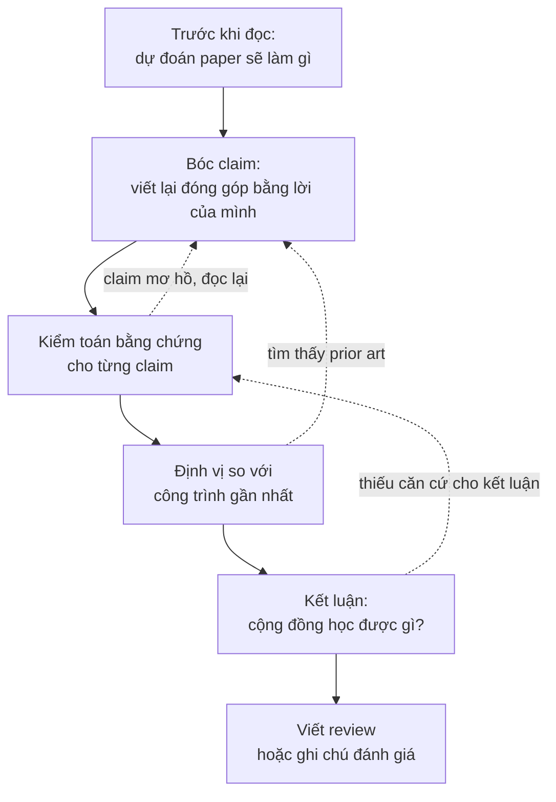

# Đọc paper như một reviewer

!!! abstract "Mục tiêu của bài"
    Sau bài này, người học có thể:

    - Phân biệt tư thế đọc để học với tư thế đọc để đánh giá, và chủ động chuyển giữa hai tư thế khi cần.
    - Áp dụng một quy trình đọc phản biện gồm dự đoán, bóc claim, kiểm toán bằng chứng, định vị và kết luận, xây trên nền phương pháp đọc ba lượt.
    - Viết lại danh sách đóng góp của một paper bằng lời của người đọc, phân loại kiểu đóng góp, và lập bảng claim, bằng chứng, mức độ thuyết phục.
    - Ước lượng novelty của một paper so với các công trình gần nhất: chỉ ra novelty nằm ở đâu, có nằm đúng chỗ paper tự nhận không, và phân biệt "đã có người làm" với "đã có người nghĩ tới".
    - Nhận diện cờ đỏ trong bằng chứng, giả định ngầm của phương pháp, và những heuristic phản biện lười cần tránh.
    - Viết một bản review có cấu trúc, với weakness cụ thể, có căn cứ và gợi ý được hướng sửa, kèm điểm số và độ tự tin được hiệu chỉnh.

Bài [Đọc và lập bản đồ tài liệu](literature.md) trả lời câu hỏi đọc gì và đọc sâu tới đâu. Phương pháp ba lượt giúp phân bổ thời gian giữa hàng trăm paper, đọc như người viết giúp học cách trình bày, còn bảng literature và bản đồ định vị biến những gì đã đọc thành nguyên liệu cho paper của nhóm. Trong tất cả những hoạt động đó, người đọc về cơ bản *tin* paper: paper là một nguồn kiến thức để tiếp thu. Bài này đổi tư thế. Câu hỏi trung tâm không còn là "paper dạy được điều gì" mà là "paper có đứng vững không": đóng góp thực sự là gì, mới tới đâu so với những gì đã có, các khẳng định có được bằng chứng đỡ hay không, và điểm yếu nằm ở đâu.

Kỹ năng đọc để đánh giá phục vụ ba việc khác nhau trong đời sống nghiên cứu. Việc thứ nhất là tự đánh giá: trước khi một reviewer thật đọc bản thảo của nhóm, chính nhóm phải đọc được nó bằng con mắt lạnh lùng ấy, và trước khi dành nhiều tháng cho một ý tưởng, nhóm phải ước lượng được nó mới tới đâu so với công trình gần nhất. Việc thứ hai là tìm khoảng trống: mỗi claim chưa được chứng minh, mỗi giả định ngầm, mỗi thiết lập mà phương pháp chưa được thử trong paper của người khác đều là một ứng viên cho đề tài mới, và bài tiếp theo, [Tìm khoảng trống và nguồn ý tưởng](tim-khoang-trong.md), sẽ biến những phát hiện đó thành một quy trình có hệ thống. Việc thứ ba là làm reviewer thật. Như bài [Paper được đánh giá thế nào](../00-tong-quan/review-process.md) đã trình bày, nhiều hội nghị những năm gần đây yêu cầu tác giả tham gia review, nên người học sớm muộn cũng sẽ phải viết những bản review mà người khác dựa vào để quyết định số phận một công trình. Andrej Karpathy có một hình ảnh dễ nhớ cho lợi ích của việc review: người chỉ đọc paper tốt giống như một bộ phân loại chỉ được huấn luyện bằng ví dụ dương; muốn biết paper tốt khác paper tồi ở đâu thì phải đọc cả paper tồi, và review là cách tự nhiên nhất để làm điều đó (Karpathy, *A Survival Guide to a PhD*, 2016).

Bài đi theo trình tự của một lần đọc phản biện. Sau khi phân biệt hai tư thế đọc, chúng ta dựng một quy trình năm bước, rồi đi sâu vào từng bước: bóc tách contribution, đánh giá novelty (mục dài nhất, vì đây là chỗ người mới khó tự tin nhất), kiểm toán bằng chứng, tìm giả định ngầm, và đọc hình, bảng. Tiếp theo là những heuristic phản biện lười mà một reviewer có trách nhiệm cần tránh, cũng là những nhận xét mà người viết nên phòng ngừa ngay trong paper. Phần cuối chuyển từ đọc sang viết: cấu trúc một bản review, cách viết weakness, một bản review mẫu đầy đủ, cách hiệu chỉnh điểm số, các nguyên tắc bảo mật, và một bài tập luyện "gu" phản biện bằng review công khai trên OpenReview.

## Đọc để học và đọc để đánh giá

Hai tư thế đọc khác nhau ở câu hỏi mà người đọc mang theo. Người đọc để học hỏi "làm thế nào": phương pháp vận hành ra sao, có kỹ thuật nào mang về dùng được, tác giả viết Introduction thế nào. Người đọc ở tư thế này có xu hướng chấp nhận claim của paper như một điểm xuất phát, vì mục tiêu là hiểu và tiếp thu. Người đọc để đánh giá hỏi những câu khác hẳn: điều paper khẳng định có đúng không, có mới không, có quan trọng không, và bằng chứng có đủ để một người hoài nghi nhưng công tâm phải chấp nhận không. Tư thế này đòi hỏi tạm treo niềm tin. Mỗi câu khẳng định trong abstract được đọc như một giả thuyết cần kiểm tra, không phải một sự thật đã được xác lập.

Đằng sau mọi câu hỏi của reviewer là hai câu hỏi lớn. Câu thứ nhất: *cộng đồng học được gì từ paper này mà trước đó chưa biết?* Câu trả lời có thể là một phương pháp tốt hơn, một hiểu biết về vì sao một phương pháp hoạt động, một bằng chứng rằng một niềm tin phổ biến là sai, một dataset mở ra một hướng đánh giá mới. Nếu câu trả lời là "không có gì ngoài một con số cao hơn một chút trên một benchmark", paper gặp vấn đề, dù được viết đẹp đến đâu. Câu thứ hai: *có nên đưa paper này vào chương trình của hội nghị không?* Câu hỏi này không đồng nhất với câu thứ nhất. Một paper có thể mang lại hiểu biết mới nhưng bằng chứng còn quá mỏng để cộng đồng tin vào hiểu biết đó; ngược lại, một paper có bằng chứng rất chặt nhưng chỉ xác nhận điều ai cũng đã biết. Reviewer giỏi giữ cả hai câu hỏi trong đầu và cân chúng với nhau.

Cần nói rõ ngay từ đầu rằng đọc để đánh giá không có nghĩa là đọc để tìm cách reject. Một reviewer đi tìm lý do từ chối sẽ luôn tìm thấy, vì không paper nào hoàn hảo. Thái độ đúng gần với thái độ của một đồng nghiệp nghiêm khắc: hiểu paper theo cách tốt nhất mà văn bản cho phép, rồi mới hỏi phiên bản tốt nhất ấy có đứng vững không. Trong tranh luận, cách làm này đôi khi được gọi là "steelman", đối lập với "strawman": thay vì bác bỏ một phiên bản yếu của lập luận, người phản biện dựng phiên bản mạnh nhất rồi mới phê bình. Một reviewer làm được điều này viết ra những nhận xét mà tác giả khó cãi, vì chúng nhắm đúng vào chỗ yếu thật chứ không vào một cách hiểu sai.

Để thấy sự khác biệt cụ thể, hãy hình dung hai bản ghi chép về cùng một paper NLP giả định, đề xuất một cách chọn ví dụ minh họa (*demonstration*) cho in-context learning. Bản ghi của người đọc để học viết rằng phương pháp chọn ví dụ theo độ tương đồng ngữ nghĩa rồi sắp xếp chúng theo độ khó tăng dần, rằng có thể thử ý tưởng sắp xếp cho dự án của nhóm, và rằng Figure 2 trình bày pipeline rất rõ. Bản ghi của người đọc để đánh giá viết rằng claim chính là "sắp xếp theo độ khó cải thiện độ chính xác", nhưng ablation trong Table 3 thay đổi đồng thời cả tiêu chí chọn lẫn thứ tự, nên chưa tách được hiệu ứng của thứ tự; rằng chỉ có một mô hình 7B và ba dataset phân loại, trong khi abstract nói về "LLMs" nói chung; rằng không có độ lệch chuẩn qua các lần lấy mẫu ví dụ, trong khi in-context learning nổi tiếng nhạy với lựa chọn ví dụ; và rằng cần kiểm tra xem tiêu chí "từ dễ đến khó" đã xuất hiện trong các nghiên cứu về curriculum cho prompting chưa. Cả hai bản ghi đều có giá trị, nhưng chỉ bản thứ hai giúp quyết định paper có đứng vững không.

| Khía cạnh | Đọc để học | Đọc để đánh giá |
|---|---|---|
| Câu hỏi chính | Làm thế nào? Mang về dùng được gì? | Có đúng không? Có mới không? Có quan trọng không? |
| Thái độ với claim | Chấp nhận để hiểu | Coi là giả thuyết cần kiểm tra |
| Phần đọc kỹ nhất | Method, chi tiết cài đặt | Claim, bảng kết quả, ablation, so sánh với công trình gần nhất |
| Sản phẩm | Ghi chú kỹ thuật, ý tưởng mang về | Bảng claim và bằng chứng, danh sách điểm yếu, kết luận có lý lẽ |
| Rủi ro nếu chỉ dùng tư thế này | Tin vào claim chưa được chứng minh | Hoài nghi tới mức không học được gì, hoặc thành người phản biện khắt khe vô cớ |

Hai tư thế không loại trừ nhau. Trong thực tế, một nhà nghiên cứu có kinh nghiệm chuyển qua lại giữa chúng nhiều lần trong một lần đọc: đọc để hiểu một đoạn Method, rồi dừng lại hỏi đoạn đó có thực sự cần thiết không. Điều người mới cần luyện là khả năng *chủ động* bật tư thế đánh giá, thay vì để nó chỉ xuất hiện khi có điều gì đó quá hiển nhiên là sai.

## Quy trình đọc phản biện

Phương pháp ba lượt trong bài [Đọc và lập bản đồ tài liệu](literature.md) vẫn là khung thời gian phù hợp cho việc đọc phản biện. Điều thay đổi là *câu hỏi* mà mỗi lượt phải trả lời. Năm chữ C của lượt thứ nhất (*Category*, *Context*, *Correctness*, *Contributions*, *Clarity*) đã chứa sẵn mầm mống của một đánh giá; quy trình dưới đây biến chúng thành năm bước có sản phẩm cụ thể, để kết quả của việc đọc không chỉ là một ấn tượng mà là một lập luận có thể viết thành review.



**Bước 1: trước khi đọc, dự đoán.** Chỉ với title và abstract, người đọc viết ra vài dòng: paper có lẽ sẽ làm gì, công trình gần nhất có lẽ là gì, thí nghiệm nào sẽ thuyết phục được người đọc, và điều gì đáng lo nhất. Bước này mất năm phút nhưng mang lại hai lợi ích lớn. Lợi ích thứ nhất là nó tạo ra một mốc để đo "tính bất ngờ". Câu hỏi "một chuyên gia có đoán trước được kết quả không?", sẽ được bàn ở mục về novelty, chỉ trả lời trung thực được nếu người đọc đã ghi lại dự đoán *trước* khi biết kết quả; sau khi đọc xong, mọi kết quả đều có vẻ đã đoán được. Lợi ích thứ hai là nó chống lại hiệu ứng mỏ neo của chính paper. Bài [Paper được đánh giá thế nào](../00-tong-quan/review-process.md) đã nói rằng ấn tượng đầu tiên của reviewer rất bền; khi chưa có dự đoán riêng, người đọc dễ tiếp nhận nguyên vẹn cách đóng khung của tác giả, kể cả những chỗ đóng khung khéo léo che đi điểm yếu.

**Bước 2: bóc claim.** Trong lượt đọc thứ nhất và đầu lượt thứ hai, người đọc liệt kê mọi khẳng định mà paper đưa ra, từ abstract, Introduction, đoạn đóng góp và phần kết luận, rồi viết lại chúng bằng lời của mình. Mục tiêu là tách bạch claim chính khỏi claim phụ, và claim tường minh khỏi claim ngầm. Mục [Bóc tách contribution](#boc-tach-contribution) ngay sau đây trình bày kỹ bước này.

**Bước 3: kiểm toán bằng chứng.** Với mỗi claim, người đọc tìm bằng chứng tương ứng trong paper và đánh giá mức độ thuyết phục: baseline có mạnh không, ablation có cô lập được đóng góp không, thống kê có đủ không, thiết lập có công bằng không. Đây là phần chiếm nhiều thời gian nhất của lượt thứ hai, và thường là nơi mà lượt thứ ba, nếu có, tập trung vào: tự suy lại một phương trình, mở code xem một chi tiết cài đặt, hoặc kiểm tra một con số trong bảng có khớp với paper gốc của baseline không.

**Bước 4: định vị.** Người đọc so sánh paper với các công trình gần nhất, cả những công trình được paper trích dẫn lẫn những công trình mà người đọc tự tìm ra, để xác định khác biệt thực sự (*delta*) là gì và khác biệt đó có quan trọng không. Bước này cần kiến thức về lĩnh vực và một cuộc tìm kiếm có giới hạn thời gian.

**Bước 5: kết luận.** Cuối cùng, người đọc trả lời hai câu hỏi lớn ở mục trước bằng một đoạn văn ngắn: cộng đồng học được gì, và bằng chứng có đủ để tin vào điều đó không. Nếu không viết được đoạn văn này, việc đọc chưa xong. Thường thì nguyên nhân là bước 3 chưa đủ sâu, và sơ đồ trên có một mũi tên quay lại đúng vì lý do đó.

Thứ tự năm bước không cứng nhắc. Trong lúc kiểm toán bằng chứng, người đọc thường phát hiện một claim được diễn đạt mơ hồ đến mức không biết bằng chứng nào là phù hợp, và phải quay lại bước 2. Trong lúc định vị, một công trình cũ được tìm thấy có thể làm thay đổi hẳn cách hiểu đóng góp. Điều quan trọng là mỗi bước để lại một sản phẩm viết, để khi quay lại, người đọc sửa sản phẩm đó thay vì bắt đầu lại từ trí nhớ.

Về thời gian, một reviewer điển hình có khoảng một đến ba giờ cho mỗi paper. Với một paper dài ở hội nghị A\*, một cách phân bổ hợp lý (gợi ý, cần điều chỉnh theo paper) là khoảng mười lăm phút cho dự đoán và lượt thứ nhất, khoảng một giờ cho bóc claim và kiểm toán bằng chứng, khoảng ba mươi phút cho định vị và tìm prior art, và khoảng ba mươi phút để viết review. Người mới nên chấp nhận mất gấp đôi thời gian này ở vài lần đầu; tốc độ đến từ việc lặp lại quy trình, không đến từ việc bỏ bước.

Một phiếu đọc phản biện đơn giản giúp giữ kỷ luật cho năm bước. Phiếu dưới đây có thể dùng cho cả paper của người khác lẫn bản thảo của chính nhóm.

```markdown
PHIẾU ĐỌC PHẢN BIỆN

Paper: <tên, venue, năm>          Ngày đọc: <...>       Thời gian dự kiến: <...>

[Bước 1] Dự đoán trước khi đọc (chỉ từ title và abstract)
- Paper có lẽ sẽ làm gì:
- Công trình gần nhất mà người đọc biết:
- Kết quả mà người đọc dự đoán (ghi cả mức độ chắc chắn):
- Thí nghiệm nào sẽ thuyết phục người đọc:
- Điều đáng lo nhất:

[Bước 2] Claim (viết lại bằng lời của người đọc)
- Đóng góp cốt lõi trong một câu:
- Claim chính / claim phụ / claim ngầm:

[Bước 3] Kiểm toán bằng chứng  -> dùng bảng claim – bằng chứng – mức độ thuyết phục

[Bước 4] Định vị
- Ba công trình gần nhất và delta với từng công trình:
- Novelty nằm ở đâu? Có đúng chỗ paper tự nhận không?

[Bước 5] Kết luận
- Cộng đồng học được gì:
- Bằng chứng có đủ để tin không:
- Dự đoán ở bước 1 đúng hay sai, và điều đó nói gì về tính bất ngờ của paper:
- Đánh giá tổng thể và độ tự tin:
```

Dòng cuối của bước 5 là dòng đáng giá nhất về lâu dài. Sau vài chục lần ghi, người đọc có một hồ sơ về chính khả năng dự đoán của mình: những loại kết quả nào thường bất ngờ, những loại nào thường đúng như dự đoán. Đó là một phần của thứ mà các nhà nghiên cứu gọi là "gu" (*taste*), và mục luyện tập trên OpenReview ở cuối bài sẽ quay lại điểm này.

## Bóc tách contribution

Bước đầu tiên của mọi đánh giá là biết chính xác đang đánh giá cái gì. Điều này nghe hiển nhiên, nhưng rất nhiều review tồi bắt nguồn từ việc reviewer đánh giá một paper khác với paper được nộp: hoặc vì hiểu sai đóng góp, hoặc vì chấp nhận nguyên văn danh sách đóng góp của tác giả mà không tự hỏi danh sách đó có phản ánh đúng nội dung không.

### Viết lại danh sách đóng góp bằng lời của mình

Đoạn liệt kê đóng góp ở cuối Introduction là nơi tác giả nói paper mang lại gì, nhưng đó là phiên bản của người bán hàng. Danh sách thường dài hơn thực chất: một paper có một ý tưởng chính thường tách nó thành ba bốn gạch đầu dòng, thêm "extensive experiments" như một đóng góp, và đôi khi biến một chi tiết cài đặt thành một "module mới". Việc của người đọc phản biện là viết lại danh sách đó bằng lời của chính mình, sau khi đã đọc xong lượt thứ hai, rồi so sánh hai phiên bản.

Bản viết lại tốt có ba đặc điểm. Thứ nhất, nó gộp những gì thực chất là một: nếu "đóng góp 1" là một loss mới và "đóng góp 2" là kết quả tốt nhờ loss đó, thì chỉ có một đóng góp. Thứ hai, nó tách những gì bị gộp: một paper có thể vừa đề xuất một dataset vừa đề xuất một phương pháp, và hai thứ đó cần được đánh giá bằng hai tiêu chí khác nhau. Thứ ba, nó có một câu duy nhất nêu *đóng góp cốt lõi*. Karpathy khuyên người viết xác định một đóng góp cốt lõi duy nhất, vì các đóng góp không cộng dồn: một đóng góp phụ yếu làm loãng paper chứ không làm nó mạnh hơn. Theo cách nói của ông, một paper tốt "sells a single thing that was not obvious or present before", tức bán một điều duy nhất trước đó chưa hiển nhiên hoặc chưa có (Karpathy, *A Survival Guide to a PhD*, 2016). Lời khuyên viết đó đồng thời là một phép thử đọc: nếu sau lượt thứ hai, người đọc không viết được câu đóng góp cốt lõi, thì hoặc paper chưa rõ, hoặc người đọc chưa hiểu, và cả hai đều phải được giải quyết trước khi đánh giá.

Một dạng câu hữu ích cho câu đóng góp cốt lõi là đặt nó đối diện với điều mà các công trình trước giả định: "Các công trình trước giả định X; paper này cho thấy Y". Khóa học CS197 của Michael Bernstein ở Stanford gọi đây là một "bit flip": gọi tên một giả định, thường ngầm định, của công trình trước, rồi lật nó (Bernstein, Stanford CS197 *Computer Science Research*). Viết được câu bit flip cho một paper giúp người đọc nhìn thấy ngay phần nào là mới và phần nào là kế thừa. Bài [Tìm khoảng trống và nguồn ý tưởng](tim-khoang-trong.md) dùng cùng công cụ này theo chiều ngược lại, để sinh ý tưởng.

### Phân loại kiểu đóng góp

Sau khi có danh sách đã viết lại, người đọc gắn cho mỗi đóng góp một kiểu: phương pháp, cách đặt bài toán, dataset và benchmark, phương pháp luận đánh giá, phân tích và hiểu biết, paradigm, hiệu quả tính toán, hay ứng dụng có insight. Bài [Thẩm định ý tưởng](y-tuong.md) trình bày đầy đủ các kiểu này cùng ví dụ từ ba cộng đồng; ở đây chỉ cần nhớ lý do việc phân loại quan trọng với reviewer. Mỗi kiểu đóng góp đòi hỏi một loại bằng chứng khác nhau, và một trong những lỗi đánh giá phổ biến nhất là dùng thước đo của kiểu này cho kiểu khác. Một paper dataset bị chê vì "phương pháp baseline không mới" là bị đánh giá sai thước đo; một paper phân tích bị chê vì "không đạt SOTA" cũng vậy. Ngược lại, một paper tự nhận là phân tích nhưng chỉ khẳng định lại điều đã biết thì phải bị đánh giá theo tiêu chuẩn của paper phân tích, tức tiêu chuẩn về hiểu biết mới, và sẽ thất bại theo tiêu chuẩn đó.

Việc phân loại cũng làm lộ ra một hiện tượng thú vị: kiểu đóng góp mà tác giả tự nhận đôi khi khác với kiểu đóng góp thực sự. Một paper trình bày mình như một phương pháp mới, nhưng phần có giá trị nhất lại là một phát hiện trong phần phân tích. Mục về novelty sẽ quay lại hiện tượng này, vì nó ảnh hưởng trực tiếp tới kết luận.

### Bảng claim, bằng chứng, mức độ thuyết phục

Công cụ trung tâm của đọc phản biện là một bảng ba cột chính: mỗi claim, bằng chứng tương ứng trong paper, và mức độ thuyết phục của bằng chứng đó. Bảng này cũng xuất hiện dưới dạng khác ở phía người viết, trong bài [Quy trình viết & tự review](../03-ky-thuat/quy-trinh-viet.md) và bài [Thiết kế thí nghiệm](thi-nghiem.md); điều đó không phải ngẫu nhiên, vì người viết và reviewer nhìn vào cùng một cấu trúc từ hai phía.

Claim trong paper có nhiều loại, và mỗi loại cần một kiểu bằng chứng riêng. Claim về **hiệu năng** ("tốt hơn SOTA trên benchmark B") cần so sánh công bằng với baseline mạnh. Claim về **cơ chế** ("cải thiện đến từ việc mô hình chú ý tới vùng biên") cần ablation và phân tích trực tiếp cơ chế, không chỉ con số cuối. Claim về **tính tổng quát** ("hoạt động với nhiều kiến trúc", "cho mọi ngôn ngữ") cần bằng chứng trên nhiều thiết lập thực sự khác nhau. Claim về **hiệu quả tính toán** cần đo trên phần cứng thực. Claim **lý thuyết** cần chứng minh đúng và giả định hợp lý. Và claim **"đầu tiên"** ("the first to…") cần một cuộc tìm kiếm mà reviewer có thể kiểm tra được, vì đây là loại claim dễ sai nhất.

Cần chú ý đặc biệt tới **claim ngầm**: những khẳng định không được nói thành câu nhưng được hàm ý qua title, abstract hoặc cách đặt tên. Một paper có title "… for Vision-Language Models" mà chỉ thử trên một mô hình đã hàm ý một claim về tính tổng quát. Một phương pháp được gọi là "robust" hàm ý một claim về độ bền trước những thay đổi mà paper có thể chưa hề thử. Reviewer có kinh nghiệm đọc title và abstract như một bản hợp đồng: mọi điều được hứa ở đó phải được giao ở phần thí nghiệm.

Mức độ thuyết phục được ghi theo bốn mức. **Mạnh**: bằng chứng trực tiếp, so sánh công bằng, có thống kê, khó có cách giải thích khác. **Một phần**: bằng chứng đúng hướng nhưng có lỗ hổng cụ thể, chẳng hạn thiếu seed hoặc chỉ một dataset. **Yếu**: bằng chứng gián tiếp hoặc có thể giải thích bằng yếu tố khác, như một ablation thay đổi nhiều thứ cùng lúc. **Không có**: claim được đưa ra mà không có bằng chứng nào trong paper. Template dưới đây có thể chép thẳng vào ghi chú đọc.

```markdown
BẢNG CLAIM – BẰNG CHỨNG – MỨC ĐỘ THUYẾT PHỤC

Paper: <...>
Đóng góp cốt lõi (một câu, lời của người đọc): <...>
Kiểu đóng góp chủ đạo: <phương pháp / bài toán / dataset / đánh giá / phân tích / ...>

| # | Claim (diễn giải) | Loại | Nơi xuất hiện | Bằng chứng | Mức | Lỗ hổng / câu hỏi cho tác giả |
|---|---|---|---|---|---|---|
| C1 | ... | hiệu năng | Abstract, Sec. 1 | Table 2 | Mạnh / Một phần / Yếu / Không có | ... |
| C2 | ... | cơ chế | Sec. 3.2 | Table 4 (ablation) | ... | ... |
| C3 | ... | tổng quát | Title (ngầm) | Table 5 | ... | ... |

Claim nào nếu sai thì paper không còn đứng được?  -> <C...>
Claim đó có mức "Mạnh" chưa?                    -> <có / chưa, vì ...>
```

Hai dòng cuối của template là phần quan trọng nhất. Không phải mọi claim đều có trọng lượng như nhau. Một paper có năm claim, trong đó bốn claim phụ được chứng minh yếu nhưng claim cốt lõi được chứng minh mạnh, có thể vẫn là một paper tốt cần sửa vài chỗ. Một paper có claim cốt lõi chỉ được chứng minh một phần thì dù các claim phụ vững đến đâu cũng đang có vấn đề nghiêm trọng.

Dưới đây là một bảng đã điền cho một paper Computer Vision giả định, đề xuất một hàm loss chưng cất (*distillation*) "nhạy theo tỉ lệ" (*scale-aware*) cho các detector thời gian thực.

| # | Claim (diễn giải) | Loại | Bằng chứng | Mức | Lỗ hổng |
|---|---|---|---|---|---|
| C1 | Tăng AP so với các detector thời gian thực mạnh nhất trên COCO | hiệu năng | Table 2, một lần chạy | Một phần | Số của hai baseline chép từ paper gốc, huấn luyện với lịch ngắn hơn; không có độ lệch chuẩn |
| C2 | Cải thiện đến từ loss nhạy theo tỉ lệ | cơ chế | Table 4 | Yếu | Dòng "không có loss mới" cũng dùng teacher khác; hai yếu tố bị thay đổi cùng lúc |
| C3 | Tổng quát qua nhiều backbone | tổng quát | Table 5 | Một phần | Hai backbone cùng một họ kiến trúc |
| C4 | Không tăng chi phí suy luận | hiệu quả | Sec. 4.3 | Mạnh | Loss chỉ dùng lúc huấn luyện; điều này đúng theo thiết kế |
| C5 | Là phương pháp đầu tiên đưa thông tin tỉ lệ vào chưng cất cho detection | "đầu tiên" | Không có | Không có | Cần tìm kiếm; claim nên bỏ hoặc thu hẹp |

Đọc bảng này, người đọc thấy ngay câu hỏi quyết định của review: C2 là claim cốt lõi, vì nếu cải thiện đến từ teacher mạnh hơn chứ không phải từ loss mới, paper không còn đóng góp gì. Một ablation thay đổi đúng một yếu tố, giữ nguyên teacher, sẽ giải quyết dứt điểm câu hỏi đó. Đây chính là loại weakness cụ thể, có căn cứ và có hướng sửa mà phần cuối bài sẽ dạy cách viết.

