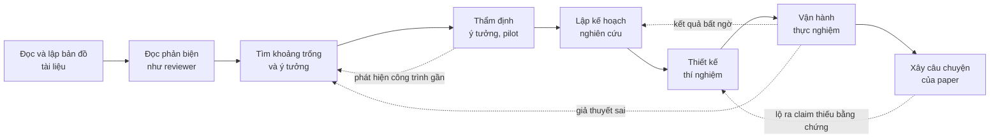

# 1. Nghiên cứu trước khi viết

> Một paper tốt được quyết định phần lớn trước khi chữ đầu tiên được viết ra.

Nhiều người mới hình dung viết paper là công đoạn cuối cùng: làm thí nghiệm xong, có kết quả tốt, rồi "viết lại" cho đẹp. Hình dung đó bỏ qua một thực tế quan trọng. Phần lớn những gì reviewer đánh giá đã được định hình từ rất sớm, khi nhóm tác giả đọc tài liệu, chọn bài toán, lập kế hoạch và thiết kế thí nghiệm. Những thứ đó gồm điểm mới (novelty) của ý tưởng, mức độ am hiểu các công trình liên quan, độ chặt chẽ của bằng chứng thực nghiệm và sự mạch lạc của lập luận. Văn phong tốt giúp một ý tưởng hay được hiểu đúng. Nhưng văn phong không biến được một ý tưởng thiếu điểm mới thành một đóng góp đáng kể, cũng không bù được cho một bảng kết quả thiếu baseline mạnh.

Chương này vì vậy đứng ngay sau phần Tổng quan và trước các chương về kỹ năng viết. Ở [Chương 0](../00-tong-quan/index.md), người học đã thấy hệ sinh thái các hội nghị A\* và cách một paper được đánh giá. Chương này đi qua toàn bộ vòng đời nghiên cứu trước khi viết, gồm tám bài chia thành bốn nhóm.

- **Nhóm thứ nhất: đọc và nhìn ra khoảng trống.** Nhóm này trả lời câu hỏi mà người mới hay bế tắc nhất: ý tưởng đến từ đâu. Câu trả lời ngắn là ý tưởng tốt hiếm khi đến từ cảm hứng. Chúng thường đến từ việc đọc có hệ thống, đọc phản biện như một reviewer, và chủ động săn tìm những chỗ mà các công trình trước còn bỏ ngỏ.
- **Nhóm thứ hai: từ ý tưởng tới kế hoạch.** Ý tưởng được sàng lọc qua các câu hỏi thẩm định và một pilot nhỏ. Sau đó, ý tưởng được biến thành một kế hoạch nghiên cứu có claim, giả thuyết, thứ tự giảm rủi ro, cổng quyết định và ngân sách.
- **Nhóm thứ ba: thực nghiệm.** Nhóm này tách hai việc hay bị gộp làm một: *thiết kế* thí nghiệm như thiết kế bằng chứng cho từng claim, và *vận hành* thực nghiệm hằng ngày một cách chuyên nghiệp, có thể tái lập.
- **Nhóm thứ tư: dựng câu chuyện.** Nhóm này nối toàn bộ những gì đã làm thành một lập luận để viết paper.

Tám bài này áp dụng như nhau cho Computer Vision, NLP và Machine Learning, dù mỗi cộng đồng có những kỳ vọng riêng về bằng chứng. Các ví dụ trong chương được chọn luân phiên từ cả ba cộng đồng. Lời khuyên của các nhà nghiên cứu đi trước, như Hamming, Schulman, Karpathy hay Uri Alon, được dẫn kèm nguồn ở những chỗ liên quan. Phụ lục [Lời khuyên từ các nhà nghiên cứu hàng đầu](../phu-luc/loi-khuyen.md) tập hợp chúng lại theo từng giai đoạn.

## Vòng đời nghiên cứu trước khi viết

Các bài trong chương được sắp theo thứ tự logic. Trong thực tế, các bước không diễn ra tuần tự một lần rồi thôi mà lặp đi lặp lại. Một kết quả pilot có thể buộc nhóm tác giả xem lại ý tưởng. Một paper mới xuất hiện trên arXiv có thể làm thay đổi cách định vị. Một câu chuyện được viết rõ ràng thường chỉ ra ngay thí nghiệm nào còn thiếu. Sơ đồ dưới đây tóm tắt các bước và những vòng phản hồi chính.

Ba vòng phản hồi trong sơ đồ đáng được chú ý.

- **Vòng từ thẩm định quay về tìm khoảng trống.** Nó nhắc rằng phần lớn ý tưởng bị loại ở bước thẩm định, và đó là điều bình thường: cần nhiều ý tưởng để có một dự án.
- **Vòng từ vận hành thực nghiệm quay về kế hoạch.** Kế hoạch nghiên cứu là tài liệu sống, được cập nhật mỗi khi bằng chứng mới xuất hiện.
- **Vòng từ câu chuyện quay về thiết kế thí nghiệm.** Đây là lý do nên viết sớm: một câu chuyện rõ ràng làm lộ ra những claim chưa có bằng chứng, khi vẫn còn đủ thời gian để bổ sung.

Khi dự án lệch khỏi kịch bản, ví dụ ý tưởng mới mà thua baseline hay bằng chứng mâu thuẫn với câu chuyện, [Chương 7](../07-tinh-huong-kho/index.md) có cẩm nang xử lý chi tiết. Khi muốn dùng mô hình ngôn ngữ lớn hoặc coding agent hỗ trợ bất kỳ bước nào trong sơ đồ, xem [Chương 8](../08-ai-cong-su/index.md).

## Cách đọc chương

Người mới bắt đầu, chưa có ý tưởng cụ thể, nên đọc theo thứ tự các bài. Người đã có ý tưởng trên giấy nhưng chưa biết bắt đầu từ đâu có thể bắt đầu từ bài [Lập kế hoạch nghiên cứu](ke-hoach.md), rồi quay lại bài [Thẩm định ý tưởng](y-tuong.md) để kiểm tra lại ý tưởng trước khi cam kết nguồn lực. Người đã có một dự án đang chạy có thể làm ngược lại: đọc bài về câu chuyện trước, viết thử một bản *one-page pitch* cho dự án, rồi quay lại các bài còn lại để lấp những chỗ trống mà bản pitch bộc lộ. Các phân tích chi tiết về những paper được nhắc tới trong chương nằm ở [Chương 5](../05-case-studies/index.md).

## Các bài trong chương

### Đọc và nhìn ra khoảng trống

1. [Đọc và lập bản đồ tài liệu](literature.md): phương pháp đọc ba lượt, đọc với con mắt người viết, công cụ tìm kiếm và quản lý tài liệu, bảng literature và bản đồ định vị công trình.
2. [Đọc paper như một reviewer](doc-nhu-reviewer.md): đọc để đánh giá chứ không chỉ để học. Bài dạy cách bóc tách contribution, ước lượng novelty so với công trình gần nhất, đối chiếu claim với bằng chứng, nhận diện điểm yếu và giả định ngầm, tránh các heuristic phản biện lười, và viết một bản review có cấu trúc.
3. [Tìm khoảng trống và nguồn ý tưởng](tim-khoang-trong.md): các loại khoảng trống trong nghiên cứu, những phương pháp có hệ thống để tìm điểm yếu và câu hỏi chưa được giải, sổ ý tưởng, gu nghiên cứu, và phễu kiểm ý tưởng nhiều tầng.

### Từ ý tưởng tới kế hoạch

4. [Thẩm định ý tưởng](y-tuong.md): các kiểu đóng góp được chấp nhận ở hội nghị A\*, bẫy "A + B", bộ câu hỏi thẩm định, tìm kiếm novelty ba tầng, concurrent work, pilot experiment và tiêu chí dừng.
5. [Lập kế hoạch nghiên cứu](ke-hoach.md): biến các contribution dự kiến thành claim, giả thuyết và ma trận bằng chứng. Bài trình bày research proposal hai trang, thứ tự làm việc theo rủi ro, mốc và cổng quyết định, ngân sách tính toán, premortem và kế hoạch B, vai trò nhóm và thỏa thuận tác giả.

### Thực nghiệm

6. [Thiết kế thí nghiệm](thi-nghiem.md): đi từ claim tới câu hỏi rồi tới thí nghiệm, bộ thí nghiệm chuẩn mà mỗi cộng đồng kỳ vọng, so sánh công bằng, ablation và ghi chép thí nghiệm.
7. [Vận hành thực nghiệm](thuc-thi.md): dựng nền móng codebase có thể tái lập, công thức huấn luyện từng bước, debug khi mô hình không học, tune có phương pháp, quản lý nhiều run và tài nguyên tính toán, nhịp rà soát hằng tuần, và đường đi từ log tới hình và bảng trong paper.

### Câu chuyện

8. [Xây "câu chuyện" của paper](cau-chuyen.md): năm mắt xích của một lập luận khoa học, vai trò của insight, bản pitch một trang, claim kiểm chứng được, và cách giữ trung thực khi kết quả không như mong đợi.
