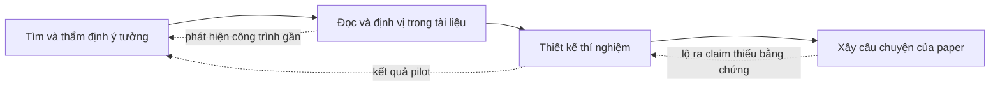

# 1. Trước khi viết

> Một paper tốt được quyết định phần lớn trước khi chữ đầu tiên được viết ra.

Nhiều người mới bước vào nghiên cứu hình dung việc viết paper là công đoạn cuối cùng: làm thí nghiệm xong, có kết quả tốt, rồi "viết lại" cho đẹp. Cách hình dung đó bỏ qua một thực tế quan trọng. Phần lớn những gì reviewer (người bình duyệt) đánh giá, gồm điểm mới (novelty) của ý tưởng, mức độ am hiểu các công trình liên quan, độ chặt chẽ của bằng chứng thực nghiệm và sự mạch lạc của lập luận, đã được định hình từ rất sớm, khi nhóm tác giả chọn bài toán, đọc tài liệu và thiết kế thí nghiệm. Văn phong tốt giúp một ý tưởng hay được hiểu đúng, nhưng không thể biến một ý tưởng thiếu điểm mới thành một đóng góp đáng kể, cũng không thể bù cho một bảng kết quả thiếu baseline (phương pháp đối chứng) mạnh.

Chương này vì vậy được đặt ngay sau phần Tổng quan và trước các chương về kỹ năng viết. Sau khi đã hiểu hệ sinh thái các hội nghị A\* và cách một paper được đánh giá ở [Chương 0](../00-tong-quan/index.md), người học cần nắm vững bốn việc nền tảng: thẩm định ý tưởng, đọc tài liệu để định vị công trình trong bức tranh chung, thiết kế thí nghiệm như thiết kế bằng chứng, và xây dựng câu chuyện cho paper. Bốn việc này áp dụng như nhau cho Computer Vision, NLP và Machine Learning, dù mỗi cộng đồng có những kỳ vọng riêng về bằng chứng; các ví dụ trong chương được chọn luân phiên từ cả ba cộng đồng để người học thấy rõ điểm chung lẫn điểm khác.

Cần nhấn mạnh rằng bốn việc trên không diễn ra tuần tự một lần rồi thôi. Chúng lặp đi lặp lại song song với quá trình nghiên cứu: một kết quả pilot (thí nghiệm thăm dò quy mô nhỏ) có thể buộc nhóm tác giả xem lại ý tưởng, một paper mới xuất hiện trên arXiv có thể làm thay đổi cách định vị, và một câu chuyện được viết rõ ràng thường chỉ ra ngay thí nghiệm nào còn thiếu. Sơ đồ dưới đây tóm tắt các vòng phản hồi đó.

Về cách đọc, người học mới bắt đầu nên đi theo thứ tự các bài. Người đã có một dự án đang chạy có thể làm ngược lại: đọc bài về câu chuyện trước, viết thử một bản *one-page pitch* cho dự án đang làm, rồi quay lại các bài còn lại để lấp những chỗ trống mà bản pitch bộc lộ. Các phân tích chi tiết về những paper được nhắc tới trong chương (ResNet, NeRF, BERT, CheckList, Transformer, Adam, DDPM…) nằm ở [Chương 5](../05-case-studies/index.md).

## Các bài trong chương

1. [Tìm và thẩm định ý tưởng](y-tuong.md): các kiểu đóng góp được chấp nhận ở hội nghị A\*, bẫy "A + B", nguồn ý tưởng, cách kiểm tra novelty, xử lý concurrent work và thiết kế pilot experiment với tiêu chí dừng.
2. [Đọc và lập bản đồ tài liệu](literature.md): phương pháp đọc ba lượt, đọc với con mắt người viết, công cụ tìm kiếm và quản lý tài liệu, bảng literature và bản đồ định vị công trình.
3. [Thiết kế thí nghiệm](thi-nghiem.md): đi từ claim tới câu hỏi rồi tới thí nghiệm, bộ thí nghiệm chuẩn mà mỗi cộng đồng kỳ vọng, so sánh công bằng, ablation và ghi chép thí nghiệm.
4. [Xây "câu chuyện" của paper](cau-chuyen.md): năm mắt xích của một lập luận khoa học, vai trò của insight, bản pitch một trang, claim kiểm chứng được và cách giữ trung thực khi kết quả không như mong đợi.
