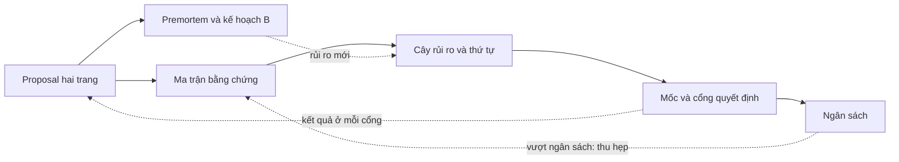
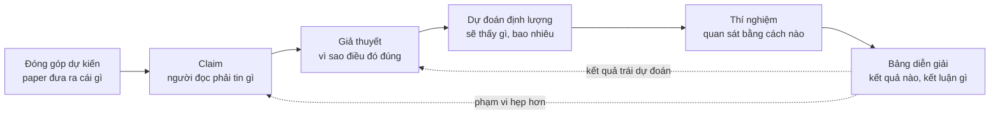

# Lập kế hoạch nghiên cứu

!!! abstract "Mục tiêu của bài"
    Sau bài này, người học có thể:

    - Giải thích vì sao một ý tưởng đã qua thẩm định vẫn chưa phải là một kế hoạch, và nhận ra các triệu chứng của một dự án chạy mà không có kế hoạch.
    - Viết một research proposal hai trang dựa trên Heilmeier Catechism, và phân biệt nó với bản pitch một trang.
    - Đi từ đóng góp dự kiến tới claim, giả thuyết có thể bác bỏ, dự đoán định lượng, thí nghiệm và bảng diễn giải kết quả, rồi tổng hợp vào một ma trận bằng chứng.
    - Sắp xếp công việc theo thứ tự giảm rủi ro, vẽ đồ thị phụ thuộc, và đặt các mốc M0–M5 với cổng quyết định đi tiếp, đổi hướng hoặc dừng.
    - Lập ngân sách compute, dữ liệu, thời gian và chi phí API có biên dự phòng; tổ chức premortem; xác định kết quả tối thiểu đáng công bố và kế hoạch B.
    - Thỏa thuận vai trò và thứ tự tác giả, tổ chức nhịp họp và cập nhật, và duy trì kế hoạch như một tài liệu sống.

Bài [Thẩm định ý tưởng](y-tuong.md) khép lại ở một thời điểm dễ chịu: ý tưởng đã vượt qua bộ câu hỏi thẩm định, cuộc tìm kiếm novelty ba tầng, và một pilot cho tín hiệu đủ để đi tiếp. Lúc này nhóm tác giả thường có một danh sách đóng góp dự kiến (*proposed contributions*) viết khá gọn: "một module mới", "một phân tích về nguồn lỗi", "một tập đánh giá". Cảm giác chung là phần khó nhất đã qua. Thực tế thường ngược lại. Danh sách đóng góp mô tả paper ở thời điểm kết thúc; nó không nói tuần tới chạy gì, theo thứ tự nào, tốn bao nhiêu GPU, ai làm phần nào, và dựa vào đâu để biết hướng đi đã sai. Khoảng cách giữa "paper sẽ đóng góp gì" và "thứ Hai tuần sau làm gì" là nơi nhiều dự án đầu tay đánh mất hàng tháng.

Bài này lấp khoảng cách đó bằng một bộ tài liệu lập kế hoạch gọn, mỗi tài liệu có template cụ thể: một research proposal hai trang; một ma trận bằng chứng nối đóng góp với claim, giả thuyết, dự đoán và thí nghiệm; một cây rủi ro kèm thứ tự làm việc; các mốc với cổng quyết định; một bảng ngân sách; một buổi premortem cùng kế hoạch B; và các thỏa thuận làm việc nhóm. Trọng tâm là chuỗi đi từ đóng góp tới thí nghiệm, mắt xích người mới hay bỏ qua nhất và cũng là mắt xích quyết định phần lớn chất lượng bằng chứng của paper.

Bài này bổ sung chứ không thay thế hai bài khác. Bài [Lộ trình thực hiện một paper](../00-tong-quan/lo-trinh.md) lập lịch tính ngược từ deadline; bài này lập kế hoạch tính tiến từ ý tưởng, rồi chỉ cách ghép hai chiều lại. Bài [Thiết kế thí nghiệm](thi-nghiem.md), ngay sau bài này, đi sâu vào cách thiết kế từng thí nghiệm cho công bằng và thuyết phục; ở đây chỉ cần mô tả thí nghiệm đủ rõ để biết nó trả lời claim nào, tốn bao nhiêu và nên chạy lúc nào. Cuối bài là một kế hoạch hoàn chỉnh cho một dự án NLP giả định.

## Vì sao ý tưởng trên giấy chưa phải là kế hoạch

Một ý tưởng đã qua thẩm định trả lời câu hỏi "có đáng làm không". Một kế hoạch phải trả lời bốn câu hỏi khác: làm gì để có bằng chứng, theo thứ tự nào, tốn bao nhiêu, và dấu hiệu nào cho biết phải đổi hướng. Câu hỏi thứ nhất được trả lời bằng lập luận và một pilot nhỏ. Bốn câu hỏi sau chỉ trả lời được khi đóng góp đã được phân rã thành những đơn vị công việc gắn với thời gian, tài nguyên và người chịu trách nhiệm.

Có bằng chứng thực nghiệm về độ lớn của khoảng cách này. Trong nghiên cứu của Si, Yang và Hashimoto về ý tưởng nghiên cứu NLP dựa trên prompting (*Can LLMs Generate Novel Research Ideas?*, ICLR 2025), các reviewer chuyên gia chấm những đề xuất ý tưởng viết trên giấy; điểm tổng tương quan mạnh với novelty và mức độ hấp dẫn, nhưng gần như không tương quan với tính khả thi. Ở nghiên cứu tiếp theo (Si, Hashimoto, Yang, *The Ideation–Execution Gap*, ICLR 2026), một phần các ý tưởng được thực thi thành paper; sau khi thực thi, reviewer bắt đầu cân nhắc những yếu tố đã bị bỏ qua ở giai đoạn ý tưởng, như hiệu quả thực nghiệm, độ chặt chẽ, và baseline hay ablation còn thiếu. Phạm vi của hai nghiên cứu hẹp (ý tưởng prompting trong NLP, vài chục dự án được thực thi), nên không nên khái quát các con số. Thông điệp thì quen thuộc: ý tưởng trên giấy được chấm theo tiêu chí khác hẳn một paper đã có bằng chứng. Kế hoạch là công cụ để đưa những tiêu chí "sau thực thi" vào tầm nhìn từ trước khi thực thi.

Thiếu kế hoạch, dự án thường có ba triệu chứng chính. **Chạy thí nghiệm theo cảm hứng**: mỗi sáng chạy điều vừa nghĩ ra, log đầy lên nhanh, nhưng không ai nói được thí nghiệm hôm qua chứng minh điều gì. **Không biết thí nghiệm nào trả lời claim nào**: bảng kết quả nhiều cột, nhưng thí nghiệm có thể bác bỏ claim trung tâm thì chưa ai chạy. **Tới gần deadline mới thấy thiếu baseline**: một baseline đơn giản mà reviewer chắc chắn sẽ hỏi, như một mô hình có sẵn được fine-tune cẩn thận hay một LLM được prompt tử tế, chưa từng được chạy; khi chạy thì nó thu hẹp phần lớn khoảng cách. Bảng dưới đây nối mỗi triệu chứng, kể cả vài triệu chứng phụ, với thành phần kế hoạch chữa nó.

| Triệu chứng | Nguyên nhân gốc | Thành phần kế hoạch xử lý |
|---|---|---|
| Chạy thí nghiệm theo cảm hứng | Không có dự đoán viết trước, không có thứ tự ưu tiên | Ma trận bằng chứng; thứ tự giảm rủi ro |
| Không biết thí nghiệm nào trả lời claim nào | Đóng góp chưa được phân rã thành claim kiểm chứng được | Ma trận bằng chứng |
| Gần deadline mới thấy thiếu baseline | Chưa liệt kê giải thích thay thế cần loại trừ | Thẻ claim; premortem |
| Hết GPU hoặc tiền API giữa chừng | Không ước lượng, hoặc chỉ tính cho phương pháp đề xuất | Bảng ngân sách có biên dự phòng |
| Tranh luận lặp lại, quyết định theo cảm xúc | Không có tiêu chí đi tiếp, đổi hướng, dừng | Mốc và cổng quyết định |
| Không rõ ai làm gì, bất đồng về tác giả | Chưa thỏa thuận vai trò | Phân vai; thỏa thuận tác giả |

Kế hoạch nghiên cứu, theo nghĩa của bài này, là vài tài liệu ngắn liên kết với nhau như sơ đồ dưới đây. Proposal xác định đích đến và claim; ma trận biến claim thành thí nghiệm; cây rủi ro cho biết làm gì trước; các mốc gom thí nghiệm thành chặng, mỗi chặng kết thúc bằng một cổng quyết định; ngân sách kiểm tra tính khả thi; premortem tấn công kế hoạch từ phía thất bại và sinh ra kế hoạch B. Kết quả ở mỗi cổng quay về cập nhật proposal. Cả bộ thường gói gọn trong khoảng năm trang và vài ngày làm việc tập trung. Mục tiêu không phải là đoán đúng tương lai, mà là biết trước nhóm sẽ phản ứng thế nào khi tương lai khác dự đoán.



## Research proposal hai trang

Tài liệu đầu tiên là một research proposal (đề cương nghiên cứu) ngắn, viết cho chính nhóm tác giả và người hướng dẫn. Nó không phải thuyết phục hội đồng nào; nó được viết để thực thi.

### Heilmeier Catechism và nửa sau thường bị bỏ quên

Khung phù hợp nhất cho proposal là *Heilmeier Catechism*, bộ câu hỏi do George H. Heilmeier, giám đốc DARPA giai đoạn 1975–1977, đặt ra để đánh giá các chương trình nghiên cứu được đề xuất; ông đọc từng đề xuất và đòi câu trả lời trước khi phê duyệt. Phiên bản DARPA công bố gồm tám câu, diễn giải như sau:

1. Đang cố làm gì? Nêu mục tiêu mà tuyệt đối không dùng biệt ngữ (*"What are you trying to do?"*).
2. Hiện nay việc đó được làm thế nào, và giới hạn của cách làm hiện tại là gì?
3. Cái gì mới trong cách tiếp cận, và vì sao tin rằng nó sẽ thành công?
4. Ai quan tâm? Nếu thành công, điều gì sẽ khác đi?
5. Rủi ro là gì?
6. Tốn bao nhiêu?
7. Mất bao lâu?
8. Đâu là các "bài kiểm tra giữa kỳ và cuối kỳ" (*mid-term and final exams*) để biết đã thành công?

Có những biến thể từ bảy đến chín câu, nhưng tám câu trên là dạng phổ biến nhất. Bộ câu hỏi thẩm định ở bài Thẩm định ý tưởng chủ yếu khai thác bốn câu đầu, những câu về *giá trị* của ý tưởng. Bốn câu sau, về rủi ro, chi phí, thời gian và các bài kiểm tra, mới là phần biến một ý tưởng thành một dự án, và cũng là phần người làm nghiên cứu ít được rèn luyện để trả lời nhất.

Một số nhà nghiên cứu khuyến nghị những thói quen cùng tinh thần. Trong ghi chú *Research Taste Exercises* (2021), Chris Olah dẫn lời khuyên của Preetum Nakkiran: trước khi cam kết hơn một tháng cho một dự án, hãy viết một đề xuất ngắn nêu vì sao câu hỏi thú vị, vì sao câu trả lời có giá trị, và kỳ vọng sẽ tìm thấy gì. Ý cuối là hạt giống của các dự đoán ở mục sau. Olah cũng dẫn một phép thử của Rachel Prudden cho câu "ai quan tâm": hình dung một nhóm khác đã công bố đúng paper này, rồi tự hỏi có háo hức đọc nó không.

### Chuyển thể tám câu hỏi cho nghiên cứu AI

Tám câu hỏi được viết cho những chương trình quốc phòng kéo dài nhiều năm. Với một dự án paper vài tháng trong Computer Vision, NLP hay Machine Learning, mỗi câu cần một phiên bản cụ thể hơn. Bảng dưới đây kèm cả câu trả lời yếu thường gặp, vì nhận ra câu trả lời yếu là cách nhanh nhất để viết được câu trả lời mạnh.

| Câu hỏi Heilmeier | Phiên bản cho một dự án AI | Câu trả lời yếu thường gặp |
|---|---|---|
| Đang cố làm gì? | Một câu mục tiêu không biệt ngữ, kèm kiểu đóng góp chủ đạo | Mô tả phương pháp thay cho mục tiêu |
| Hiện nay làm thế nào, giới hạn ở đâu? | Baseline mạnh nhất cụ thể, con số đã tái lập, một thất bại đo được | "Các phương pháp hiện có chưa hiệu quả", không có con số |
| Cái gì mới, vì sao sẽ thành công? | Insight phát biểu không cần tên phương pháp; bằng chứng sơ bộ từ pilot | Chỉ có "chưa ai làm" |
| Ai quan tâm? | Cộng đồng, venue mục tiêu; ai sẽ làm khác đi; phép thử "nhóm khác công bố" | "Có ứng dụng rộng rãi" |
| Rủi ro là gì? | Ba đến năm rủi ro lớn nhất, xác suất ước lượng, phép kiểm tra rẻ nhất cho mỗi rủi ro | Chỉ nêu "có thể thiếu GPU" |
| Tốn bao nhiêu? | GPU-giờ, chi phí API, giờ gán nhãn, kèm biên dự phòng | Quên phần dành cho baseline |
| Mất bao lâu? | Các mốc M0–M5 có ngày, đối chiếu với deadline | Một ngày duy nhất là deadline |
| Bài kiểm tra giữa kỳ và cuối kỳ? | Tiêu chí ở mỗi cổng; kết quả mục tiêu và kết quả tối thiểu đáng công bố | "Đạt SOTA" |

Hai dòng cần thêm lời giải thích. Ở câu thứ hai, một hướng dẫn gắn với DARPA thêm câu hỏi phụ: người đề xuất có thật sự biết state of the art, hay đang tấn công một hình nộm (*strawman*)? Với nghiên cứu AI, câu này gần như đồng nghĩa với việc đã tái lập được baseline mạnh nhất chưa: "baseline X đạt 45,2 theo paper gốc; nhóm tái lập được 44,9 bằng code chính thức" mạnh hơn nhiều so với chỉ ghi tên X. Ở câu cuối, "đạt SOTA" là câu trả lời yếu vì nó chỉ là bài kiểm tra cuối kỳ. Phần lớn giá trị của câu thứ tám nằm ở chữ "giữa kỳ": những dấu hiệu sớm cho biết hướng đi đúng hay sai từ rất lâu trước khi có bảng kết quả cuối cùng.

### Ba template tóm tắt dự án: proposal, pitch và Tầng 0

Giáo trình có ba template cùng tóm tắt một dự án trong một hai trang: research proposal của bài này, bản pitch một trang ở bài [Xây câu chuyện của paper](cau-chuyen.md), và bản pitch rút gọn ở Tầng 0 trong bài [Quy trình viết & tự review](../03-ky-thuat/quy-trinh-viet.md). Cả ba chia sẻ một phần lõi gồm vấn đề, khoảng trống, insight và claim. Chúng khác nhau ở câu hỏi mà mỗi template giúp trả lời, nên khác nhau ở thời điểm viết và ở những mục chỉ template đó có.

| | Research proposal (bài này) | Bản pitch một trang | Tầng 0 của quy trình viết |
|---|---|---|---|
| Câu hỏi chính | Làm gì, theo thứ tự nào, với nguồn lực nào, khi nào đổi hướng? | Câu chuyện có đứng được, có thuyết phục không? | Câu chuyện đã đủ chín để bắt đầu viết bản thảo chưa? |
| Chức năng | Thực thi | Thuyết phục và định hình câu chuyện | Mở đầu quy trình viết theo tầng |
| Thời điểm | Ngay sau thẩm định, trước khi cam kết nguồn lực lớn | Khi kết quả bắt đầu về (khoảng D − 3,5 tháng theo lộ trình) | Ngay trước khi viết outline và bản nháp |
| Mục riêng | Rủi ro, ngân sách, mốc và cổng, kết quả tối thiểu đáng công bố, phân vai | Câu tóm tắt một dòng, phác thảo Figure 1, câu hỏi đáng ngại nhất từ reviewer | Bằng chứng chính nằm ở bảng hay hình nào; venue và track |
| Người đọc chính | Nhóm thực hiện, đọc lại hằng tuần | Người hướng dẫn, đồng tác giả, người ngoài nhóm | Người hướng dẫn |

Theo thời gian, ba template nối tiếp nhau. Proposal ra đời đầu tiên. Khi bằng chứng đã định hình, nhóm rút phần lõi của proposal ra viết thành pitch, chuyển trọng tâm từ kế hoạch sang lập luận; các mục claim, thí nghiệm và rủi ro của pitch kế thừa trực tiếp từ proposal và ma trận bằng chứng. Khi bắt đầu viết paper, pitch được nén lại thành Tầng 0. Không cần viết ba tài liệu từ đầu; cần giữ cho chúng không kể ba câu chuyện khác nhau. Mỗi khi claim đổi, proposal tăng số phiên bản, pitch được cập nhật theo, và thay đổi được ghi vào nhật ký quyết định.

### Template proposal

Template dưới đây trải tám câu hỏi Heilmeier thành chín mục; mục (5) được tách riêng vì nó là đầu vào của ma trận bằng chứng. Hai trang là giới hạn cứng, buộc người viết chọn điều quan trọng nhất.

```markdown
# Research proposal: <tên tạm của dự án>
Phiên bản: v0.1   Ngày: ____   Người giữ tài liệu: Tác giả A   Người duyệt: Người hướng dẫn

## (1) Mục tiêu (2–3 câu, không biệt ngữ)
- Câu mục tiêu một dòng (tiếng Anh): "We aim to show that ___, and to build ___ that ___."
- Kiểu đóng góp chủ đạo: phương pháp / cách đặt bài toán / dataset / phương pháp đánh giá / phân tích / hiệu quả

## (2) Hiện trạng và giới hạn
- Baseline mạnh nhất: <tên, venue, năm>. Paper báo cáo ___; nhóm tái lập được ___ (code chính thức / tự cài đặt)
- Thất bại cụ thể đã đo được: <con số, tập con, ví dụ>
- Hai công trình gần nhất và khác biệt (mỗi công trình một câu):

## (3) Cái mới và vì sao có thể thành công
- Insight (phát biểu không nhắc tên phương pháp):
- Bằng chứng sơ bộ: <kết quả pilot, phân tích lỗi, link log>

## (4) Ai quan tâm
- Cộng đồng, venue mục tiêu, venue dự phòng:
- Nếu thành công, ai sẽ làm khác đi điều gì?
- Phép thử: nếu một nhóm khác công bố đúng paper này, nhóm có háo hức đọc không? Vì sao?

## (5) Đóng góp dự kiến và claim
- Đ1: ___ -> claim trung tâm C1: ___ (đo bằng gì, trong phạm vi nào, so với gì)
- Đ2: ___ -> claim C2, C3: ___
- Điều nhóm kỳ vọng sẽ thấy (viết TRƯỚC khi chạy): ___

## (6) Rủi ro (chi tiết ở cây rủi ro)
| Rủi ro | Chí mạng / thu hẹp | Xác suất ước lượng | Phép kiểm tra rẻ nhất | Mốc |

## (7) Chi phí (chi tiết ở bảng ngân sách)
- Compute: ___ GPU-giờ   API: ___ USD   Gán nhãn: ___ giờ người   Biên dự phòng: ___

## (8) Thời gian và các bài kiểm tra
- M1 (ngày ___): đi tiếp nếu ___ / đổi hướng nếu ___ / dừng nếu ___
- M2 ... M5
- Kết quả mục tiêu: ___      Kết quả tối thiểu đáng công bố: ___

## (9) Phân vai và cam kết thời gian
- Tác giả A: ___ (___ giờ/tuần)   Tác giả B: ___   Người hướng dẫn: duyệt tại M0, M2, M3
```

Viết xong, có hai phép thử nhanh. Đọc to mục (1) cho một người ngoài lĩnh vực hẹp; nếu họ không nhắc lại được mục tiêu, mục (1) còn biệt ngữ. Rồi đánh dấu câu Heilmeier nào khó trả lời nhất: câu đó thường chỉ thẳng vào chỗ rủi ro của dự án. Không trả lời được câu thứ ba nghĩa là chưa có insight, nên quay lại bước thẩm định; không trả lời được câu thứ sáu hay thứ bảy nghĩa là dự án chưa được phân rã, việc mà phần còn lại của bài này giải quyết.

## Từ đóng góp dự kiến tới claim, giả thuyết và thí nghiệm

Đây là phần quan trọng nhất của kế hoạch, và cũng là nơi nỗi đau "có ý tưởng nhưng không biết thực thi" bắt nguồn. Một đóng góp như "một module khử nhiễu cho ảnh ban đêm" chưa nói được thí nghiệm nào cần chạy. Để đi từ nó tới một danh sách thí nghiệm, cần qua sáu mắt xích, mỗi mắt xích trả lời một câu hỏi mà mắt xích trước chưa trả lời: đóng góp nói paper đưa cho cộng đồng *cái gì*; claim nói người đọc phải *tin điều gì*; giả thuyết nói *vì sao* điều đó đúng; dự đoán nói nếu giả thuyết đúng thì *sẽ thấy gì*; thí nghiệm là *cách quan sát*; và bảng diễn giải nói với mỗi kết quả thì *kết luận gì, làm gì tiếp*.



### Từ đóng góp tới claim

Đóng góp và claim khác nhau về ngữ pháp, và khác biệt này có hệ quả thực tế. Đóng góp là một *danh từ*: "một phương pháp", "một benchmark". Claim là một *mệnh đề* có thể đúng hoặc sai: "phương pháp X giảm lỗi trên vật thể nhỏ ít nhất một nửa so với baseline mạnh nhất". Reviewer không đánh giá danh từ, họ đánh giá mệnh đề; chừng nào đóng góp còn là danh từ, nhóm chưa biết cần bằng chứng gì cho nó.

Mỗi đóng góp thường sinh ra một đến ba claim, trong đó cần phân biệt **claim trung tâm** (sai thì paper sụp) với **claim phụ** (sai thì paper hẹp lại); sự phân biệt này quyết định thứ tự làm việc ở mục sau. Một paper tốt có rất ít claim trung tâm. Andrej Karpathy, trong *A Survival Guide to a PhD* (2016), khuyên xác định đóng góp cốt lõi duy nhất, vì theo ông các đóng góp không cộng dồn và một đóng góp phụ thứ hai thường làm loãng paper: *"The paper sells a single thing that was not obvious or present before."* (Paper "bán" một điều duy nhất trước đó chưa hiển nhiên hoặc chưa có.) Khi phân rã đóng góp thành claim, người viết thường phát hiện một "đóng góp" thật ra chỉ là phạm vi của một đóng góp khác; ví dụ ở cuối mục có đúng trường hợp đó, và những biến thể khó hơn được phân tích ở bài [Ghép ý tưởng và "độn" đóng góp](../07-tinh-huong-kho/ghep-va-don.md).

Claim kiểm chứng được nêu rõ đo bằng gì, trong phạm vi nào, so với cái gì, như bài Xây câu chuyện của paper đã trình bày. Ở giai đoạn lập kế hoạch, claim còn phải đủ cụ thể để suy ra thí nghiệm: "phương pháp tổng quát hóa tốt" không suy ra được gì, còn "phương pháp giữ ít nhất 90% mức cải thiện khi chuyển từ backbone CNN sang Transformer" suy ra ngay một thí nghiệm kèm một ngưỡng.

### Từ claim tới giả thuyết có thể bác bỏ

Claim nói điều gì đúng; giả thuyết nói vì sao nó đúng, tức một phát biểu về *cơ chế*: "lỗi tăng ở ảnh tối vì nhiễu cảm biến làm hỏng đặc trưng cấp thấp", chứ không chỉ "lỗi tăng ở ảnh tối". Kế hoạch cần mắt xích này vì hai lý do. Với người đọc, một claim chỉ có con số dễ bị coi là may mắn hoặc là kết quả của tune kỹ, còn một cơ chế được xác nhận để lại hiểu biết mang đi được. Với người lập kế hoạch, giả thuyết cho biết thí nghiệm nào có sức phân biệt: hai phương pháp có thể cho cùng con số tổng, nhưng cơ chế khác nhau để lại dấu vết khác nhau ở các tập con, và giả thuyết chỉ ra phải nhìn vào tập con nào.

Giả thuyết hữu ích phải **có thể bác bỏ**: phải tồn tại một kết quả quan sát được mà nếu xảy ra thì nó sai. "Phương pháp hoạt động nhờ học được biểu diễn tốt hơn" không bác bỏ được, vì kết quả nào cũng giải thích được là "biểu diễn tốt hơn". "Phương pháp hoạt động nhờ khôi phục chi tiết tần số cao ở vùng tối" thì bác bỏ được: nếu cải thiện không tập trung ở vùng tối, giả thuyết sai.

Bước dễ bị bỏ qua nhất ở mắt xích này là liệt kê **giải thích thay thế**, những lý do khác có thể tạo ra cùng kết quả. Lipton và Steinhardt, trong *Troubling Trends in Machine Learning Scholarship* (2018), coi việc xem xét và loại trừ các giả thuyết thay thế là phẩm chất cốt lõi của nghiên cứu thực nghiệm tốt, và chỉ ra xu hướng không xác định được nguồn gốc thật của mức cải thiện, như gán công cho thay đổi kiến trúc trong khi cải thiện thực ra đến từ tune hyperparameter. Với nghiên cứu AI, danh sách giải thích thay thế khá ổn định: phương pháp mới có nhiều tham số hoặc tính toán hơn; được tune kỹ hơn baseline; dùng thêm dữ liệu; lợi dụng một đặc điểm của benchmark; dữ liệu test bị lộ vào dữ liệu huấn luyện; chênh lệch nằm trong dao động giữa các seed; hoặc chỉ một thành phần đơn giản tạo ra toàn bộ hiệu quả. Mỗi giải thích thay thế quan trọng cần một thí nghiệm đối chứng.

Danh sách này chính là liều thuốc cho triệu chứng "gần deadline mới thấy thiếu baseline": phần lớn baseline bị phát hiện muộn là đối chứng cho một giải thích thay thế không ai viết ra từ đầu. Với một bài toán hoàn toàn mới, danh sách vẫn sinh ra baseline: một lời giải tầm thường cho biết con số có hơn mức đoán mò không, một thí nghiệm oracle (biết trước một phần thông tin đúng) cho biết trần, và kết quả của con người cho biết bài toán khó tới đâu. Tình huống 30 trong bài [Bài toán, dữ liệu và phạm vi](../07-tinh-huong-kho/bai-toan-va-pham-vi.md) phân tích kỹ trường hợp này; ở giai đoạn lập kế hoạch, việc cần làm là đưa ngay những baseline đó vào ma trận.

### Từ giả thuyết tới dự đoán định lượng

Dự đoán là hệ quả quan sát được của giả thuyết trong một thí nghiệm cụ thể. Một dự đoán tốt nêu năm điều: **chiều** của hiệu ứng, **độ lớn** tối thiểu, **nơi** hiệu ứng xuất hiện, **so với cái gì**, và **mức nhiễu** dùng làm thước đo (thường là độ lệch chuẩn giữa các seed). Hai dự đoán dưới đây (ví dụ giả định) cho thấy khác biệt.

<div class="bad" markdown>
*"Phương pháp sẽ tốt hơn baseline trên ảnh ban đêm."*

Dự đoán này gần như không thể sai: hơn 0,1 điểm cũng là "tốt hơn", và nó không nói gì về cơ chế.
</div>

<div class="good" markdown>
*"Trên 20% ảnh tối nhất của tập validation ban đêm, mIoU tăng ít nhất 3 điểm so với baseline cùng recipe (trung bình 3 seed; độ lệch chuẩn giữa seed ở pilot khoảng 0,5), còn trên 50% ảnh sáng nhất thay đổi không quá 0,5 điểm."*

Dự đoán này có thể sai theo ba cách khác nhau, và mỗi cách sai mang một thông tin khác nhau về giả thuyết.
</div>

Ngưỡng trong dự đoán đến từ kích thước hiệu ứng ở pilot (trừ đi một khoản cho sự lạc quan của thiết lập nhỏ), từ mức nhiễu (một hiệu ứng nhỏ hơn hai ba lần độ lệch chuẩn giữa seed khó thuyết phục ai), và từ cộng đồng (mức cải thiện nào reviewer coi là có ý nghĩa trên benchmark này). Nên phân biệt **ngưỡng đi tiếp**, đủ để tin hướng đi đúng, với **ngưỡng đáng công bố**, đủ để thành claim; ngưỡng thứ nhất thường thấp hơn.

Ngưỡng đáng công bố còn phụ thuộc vào kiểu claim. Tài liệu hướng dẫn reviewer do ban chương trình CVPR và ICCV soạn (năm 2019, được dùng lại các năm sau) phân biệt nhiều mức bằng chứng: ý tưởng có tiềm năng thay đổi lĩnh vực chỉ cần bằng chứng khái niệm, ý tưởng hợp lý cho một bài toán quen thuộc cần kết quả trên benchmark, còn ý tưởng *"weird, overly complex, implausible, and/or seemingly incremental"* (kỳ lạ, quá phức tạp, khó tin, hoặc trông như cải tiến nhỏ) thì cần kết quả xuất sắc. Xếp claim trung tâm vào đúng mức giúp đặt ngưỡng và ngân sách cho bằng chứng. Ngược lại, không cần bằng chứng vượt quá claim: hướng dẫn phản biện của ACL Rolling Review nhắc rằng *"a paper only needs to present sufficient evidence for the claim that the authors are making"* (paper chỉ cần đủ bằng chứng cho claim mà tác giả đưa ra). Claim hẹp và rõ là cách rẻ nhất để giữ ngân sách trong tầm tay.

Điều kiện quan trọng nhất là dự đoán phải được **viết ra trước khi chạy**; viết sau khi đã thấy kết quả thì không còn là dự đoán, và trí nhớ tự sắp xếp lại sự kiện theo hướng có lợi cho câu chuyện hiện tại. Bài [Thực hành: ba dự án đi qua ngõ cụt](../07-tinh-huong-kho/thuc-hanh.md) ở Chương 7 phân tích cơ chế này và đưa ra mẫu nhật ký quyết định có ô "dự đoán và điều kiện đảo ngược", một hình thức đăng ký trước (*pre-registration*) gọn nhẹ. Ma trận bằng chứng là nơi các dự đoán được viết lần đầu, từ trước thí nghiệm đầu tiên.

### Từ dự đoán tới thí nghiệm và bảng diễn giải

Thí nghiệm cần được chọn sao cho giả thuyết và các giải thích thay thế **dự đoán những kết quả khác nhau**; đó là định nghĩa thực dụng của một thí nghiệm có sức phân biệt. Nếu cả hai cùng dự đoán "phương pháp tốt hơn baseline", bảng so sánh chính không phân biệt được chúng, và cần một đánh giá trên tập con hoặc một biến thể đối chứng.

*Deep Learning Tuning Playbook* của nhóm Google Research (Godbole và cộng sự, 2023) cung cấp một công cụ hữu ích ở bước này: chia hyperparameter thành ba vai. Hyperparameter **khoa học** là thứ có tác động đang được đo. Hyperparameter **phiền nhiễu** (*nuisance*) phải được tối ưu riêng cho từng giá trị của hyperparameter khoa học để so sánh công bằng, chẳng hạn learning rate khi so hai kiến trúc. Hyperparameter **cố định** được giữ nguyên trong vòng thí nghiệm, và Playbook lưu ý *"fixed hyperparameters create caveats for any conclusions we draw from the experiments"* (mỗi hyperparameter cố định tạo ra một giới hạn cho kết luận). Ghi rõ ba vai cho mỗi thí nghiệm cho biết cần tune bao nhiêu lần, tức đầu vào của ngân sách compute, và cho biết phạm vi của claim phải hẹp đến đâu.

Mắt xích cuối là **bảng diễn giải**: với mỗi thí nghiệm quyết định, viết trước ít nhất ba kết cục (như dự đoán; không có hiệu ứng vượt nhiễu; ngược chiều hoặc xuất hiện ở chỗ khác), mỗi kết cục kèm kết luận và hành động. Bảng này còn là phép thử giá trị thông tin: nếu cả ba kết cục dẫn tới cùng một hành động, thí nghiệm không giúp ra quyết định nào và nên được hoãn hoặc thiết kế lại, đúng như phân tích Tình huống 26 trong bài [Áp lực từ bên ngoài](../07-tinh-huong-kho/ap-luc-ben-ngoai.md).

Kế hoạch không cấm khám phá. Playbook của Google cho biết nhóm tác giả dành phần lớn thời gian để khám phá nhằm hiểu bài toán, chỉ một phần nhỏ để tối ưu kết quả. Điều kế hoạch yêu cầu là gắn nhãn: thí nghiệm khám phá có ngân sách riêng và không được dùng trực tiếp làm bằng chứng cho claim. Khi khám phá làm lộ ra một hiện tượng thú vị, hiện tượng đó trở thành giả thuyết mới, được kiểm chứng bằng một thí nghiệm riêng có dự đoán viết trước. Đó là ranh giới giữa một phát hiện và một kết quả được chọn lọc sau khi đã nhìn dữ liệu.

### Ma trận bằng chứng

Ma trận bằng chứng gom toàn bộ chuỗi trên vào một tài liệu hai lớp. Lớp thứ nhất là **bảng claim nhân thí nghiệm**, mỗi ô ghi vai trò của thí nghiệm đối với claim: **Q** (quyết định: kết quả có thể bác bỏ claim), **H** (hỗ trợ: làm claim thuyết phục hơn nhưng không bác bỏ được nó), **Đ** (đối chứng: loại một giải thích thay thế), **N** (nền: điều kiện tiên quyết, như tái lập baseline). Lớp thứ hai là **thẻ claim** cho mỗi claim trung tâm, ghi đủ chuỗi từ đóng góp tới bảng diễn giải. Bảng cho cái nhìn toàn cục; thẻ cho chiều sâu.

```markdown
## Ma trận bằng chứng — dự án ____   Phiên bản: __   Cập nhật: ____

### Lớp 1: claim x thí nghiệm   (Q = quyết định, H = hỗ trợ, Đ = đối chứng, N = nền)
| Claim                  | E0 | E1 | E2 | E3 | ... | Trạng thái claim |
|------------------------|----|----|----|----|-----|------------------|
| C1 (trung tâm): ...    | N  | Q  | H  |    |     | chưa có / mức A-B-C-D |
| C2 (phụ): ...          | N  |    | Q  | Đ  |     |                  |

### Lớp 2: thẻ claim (một thẻ cho mỗi claim trung tâm)
Claim C__: <đo gì, phạm vi nào, so với gì>        Thuộc đóng góp: Đ__   Loại: trung tâm / phụ
Giả thuyết (cơ chế): ___
Giải thích thay thế cần loại:  R1: ___ -> đối chứng E__    R2: ___ -> đối chứng E__
Dự đoán (viết ngày ____, TRƯỚC khi chạy):
  E__: chiều ___, độ lớn tối thiểu ___, nơi ___, so với ___, mức nhiễu ___
Thiết lập của thí nghiệm quyết định:
  Dữ liệu và split: ___   Metric: ___   Số seed: ___
  Baseline (kể cả baseline đơn giản, oracle, con người nếu cần): ___
  Ablation cần có cho claim này: ___
Vai hyperparameter: khoa học ___ / phiền nhiễu ___ (số lần tune, CHO CẢ baseline) / cố định ___
Bảng diễn giải:
  Nếu như dự đoán:            kết luận ___ -> hành động ___
  Nếu không có hiệu ứng:      kết luận ___ -> hành động ___
  Nếu ngược chiều / chỗ khác: kết luận ___ -> hành động ___
Mốc cần có kết quả: M__        Người chịu trách nhiệm: ____
```

Khi đã điền xong, ma trận được đọc theo năm quy tắc, mỗi quy tắc bắt một kiểu lỗi kế hoạch:

- [ ] Mỗi claim trung tâm có ít nhất một ô **Q**, và thẻ của nó ghi đủ dữ liệu, metric, baseline, ablation. Claim không có thí nghiệm quyết định chỉ được minh họa, chưa được kiểm chứng.
- [ ] Mỗi cột phục vụ ít nhất một claim; cột trống là thí nghiệm khám phá, cần gắn nhãn và có ngân sách riêng, hoặc bỏ.
- [ ] Mỗi giải thích thay thế quan trọng có một cột **Đ** tương ứng.
- [ ] Các cột **N** đứng đầu thứ tự làm việc, vì mọi thứ khác phụ thuộc vào chúng.
- [ ] Mọi ô "nếu không có hiệu ứng" có một hành động cụ thể, không phải "chạy thêm".

!!! info "Ma trận bằng chứng khác gì bảng claim ở bài Thiết kế thí nghiệm"
    Bài [Thiết kế thí nghiệm](thi-nghiem.md) có một bảng nối claim với câu hỏi của reviewer, thí nghiệm và kết quả ủng hộ. Ma trận ở đây đứng ở tầng trên: nó nối thêm claim với đóng góp, giả thuyết, giải thích thay thế và hành động cho từng kết cục, và được dùng để sắp thứ tự công việc, đặt cổng quyết định và tính ngân sách. Mỗi cột của ma trận về sau trở thành một mục trong kế hoạch thí nghiệm chi tiết của bài đó.

### Ví dụ đầy đủ: một dự án Computer Vision

Xét một dự án giả định về phân đoạn ngữ nghĩa (*semantic segmentation*) ảnh đường phố ban đêm; mọi tên phương pháp và con số là ví dụ giả định. Pilot ở giai đoạn thẩm định cho thấy mô hình huấn luyện trên ảnh ban ngày sụt mIoU mạnh trên ảnh ban đêm, và một bước khử nhiễu đơn giản đặt trước mạng làm tăng nhẹ độ chính xác ở vùng tối. Nhóm viết ba đóng góp dự kiến: Đ1, một phân tích cho thấy nguồn lỗi chính là nhiễu cảm biến ở vùng tối chứ không phải lệch màu và độ sáng; Đ2, NoctDN (tên giả định), một mô-đun khử nhiễu nhận biết độ sáng, huấn luyện cùng mạng phân đoạn; Đ3, hiệu quả nhất quán trên nhiều backbone và hai benchmark ban đêm.

Ngay khi phân rã, Đ3 lộ ra không phải đóng góp riêng mà là phạm vi của Đ2, nên nó trở thành claim phụ C4. Bốn claim được viết như sau.

- **C1 (trung tâm, Đ1):** khi làm tối ảnh ban ngày có kiểm soát, thêm nhiễu cảm biến mô phỏng làm mIoU giảm nhiều hơn hẳn so với chỉ giảm sáng và đổi màu ở cùng độ sáng.
- **C2 (phụ, Đ1):** trên ảnh ban đêm thật, lỗi tập trung ở vùng tối và tương quan với mức nhiễu ước lượng mạnh hơn với độ lệch màu, kể cả trong cùng một lớp đối tượng.
- **C3 (trung tâm, Đ2):** với cùng recipe, NoctDN tăng mIoU ở vùng tối rõ hơn hẳn ở vùng sáng, và vượt cách ghép một bộ khử nhiễu có sẵn với mạng phân đoạn.
- **C4 (phụ, Đ2):** cải thiện giữ cùng chiều trên ba backbone và hai benchmark ban đêm.

Giả thuyết chung: ở vùng tối, tỉ lệ tín hiệu trên nhiễu thấp làm hỏng đặc trưng cấp thấp trước khi mạng kịp tổng hợp ngữ cảnh, còn lệch màu phần lớn được các lớp chuẩn hóa đầu mạng xử lý. Năm giải thích thay thế: R1, lệch màu và độ sáng mới là nguyên nhân chính; R2, vùng tối chứa nhiều lớp nhỏ và hiếm; R3, nhãn ở vùng tối kém chính xác hơn; R4, cải thiện của NoctDN đến từ tham số và tính toán thêm; R5, một bộ khử nhiễu có sẵn đặt trước mạng là đủ. Từ đó có tám thí nghiệm: E0 tái lập baseline với hai backbone; E1 làm tối có kiểm soát ảnh ban ngày ở ba mức độ sáng, có nhiễu và không nhiễu, chỉ cần suy luận; E2 phân tầng lỗi trên ảnh ban đêm thật theo độ sáng, nhiễu và lệch màu trong từng lớp, kèm kiểm tra lại nhãn 100 ảnh; E3 ghép bộ khử nhiễu có sẵn với mạng phân đoạn; E4 NoctDN so với baseline cùng recipe, 3 seed; E5 ablation (khối cùng số tham số, bỏ tín hiệu độ sáng, huấn luyện tách rời); E6 thêm hai backbone trên hai benchmark; E7 khám phá với hình định tính và failure cases.

| Claim | E0 | E1 | E2 | E3 | E4 | E5 | E6 | E7 |
|---|---|---|---|---|---|---|---|---|
| C1 (trung tâm): nhiễu gây sụt nhiều hơn màu | N | Q | H | | | | | |
| C2 (phụ): lỗi ban đêm theo nhiễu, trong từng lớp | N | | Q | | | | | H |
| C3 (trung tâm): NoctDN cải thiện vùng tối, vượt khử nhiễu có sẵn | N | | | Đ | Q | Đ | | H |
| C4 (phụ): cùng chiều trên ba backbone, hai benchmark | N | | | | H | | Q | |

Đọc ma trận, ba điều hiện ra ngay. E0 nằm dưới mọi claim nên làm đầu tiên. E1 rẻ (chỉ suy luận trên checkpoint của E0) và là thí nghiệm quyết định của một claim trung tâm, nên làm ngay sau E0, trước khi viết dòng code nào cho NoctDN. E3 là đúng loại baseline thường bị phát hiện muộn: nếu bộ khử nhiễu có sẵn thu hẹp phần lớn khoảng cách, đóng góp phương pháp sụp đổ và paper phải chuyển sang hướng phân tích kèm một baseline đơn giản. Rủi ro lớn như vậy cần được biết từ tháng đầu, nên E3 được xếp trước E4 dù nó không xây thêm gì cho phương pháp. Bảng diễn giải cho E1 được viết trước khi chạy:

| Kết quả của E1 | Kết luận | Hành động |
|---|---|---|
| Có nhiễu làm mIoU giảm ít nhất gấp đôi chỉ giảm sáng và đổi màu, ở cả ba mức | Giả thuyết được ủng hộ; R1 bị loại phần lớn | Giữ C1; xây NoctDN; chạy E3 song song |
| Hai kiểu suy giảm gây sụt tương đương | Cả hai yếu tố quan trọng; giả thuyết phát biểu quá mạnh | Thu hẹp C1; xem lại thiết kế mô-đun cho cả màu; tìm lại novelty với các công trình thích nghi màu |
| Chỉ giảm sáng và đổi màu gây sụt nhiều hơn | Giả thuyết bị bác bỏ | Dừng hướng khử nhiễu; ghi nhật ký; cân nhắc paper phân tích nếu cộng đồng đang tin điều ngược lại |

Thẻ claim của C3 được điền như sau.

```text
Claim C3: Với cùng recipe, NoctDN tăng mIoU trên 20% ảnh tối nhất ít nhất 3 điểm so với
          baseline, rõ hơn hẳn mức thay đổi trên ảnh sáng, và vượt cách ghép bộ khử nhiễu có sẵn.
Thuộc đóng góp: Đ2        Loại: trung tâm
Giả thuyết: mô-đun khôi phục đặc trưng cấp thấp ở vùng tín hiệu/nhiễu thấp -> lợi ích tập trung ở vùng tối.
Giải thích thay thế cần loại:
  R4: lợi ích do tham số, tính toán thêm -> E5 (khối cùng số tham số)
  R5: bộ khử nhiễu có sẵn là đủ          -> E3
  Tune không cân sức                      -> cùng số lần thử tune cho mọi cấu hình
Dự đoán (viết TRƯỚC khi chạy E3, E4, E5):
  E4: vùng tối +3 mIoU trở lên (3 seed; độ lệch chuẩn pilot ~0,5); vùng sáng trong ±0,5
  E5: khối cùng số tham số tăng dưới 1 điểm ở vùng tối
  E3: khử nhiễu có sẵn + phân đoạn kém NoctDN ít nhất 1,5 điểm ở vùng tối
Thiết lập của E4:
  Dữ liệu: huấn luyện trên ảnh ban ngày cộng phần ảnh ban đêm có nhãn; đánh giá trên split
           validation của hai benchmark ban đêm, chia theo độ sáng ảnh       Seed: 3
  Metric: mIoU trên 20% ảnh tối nhất, 50% ảnh sáng nhất, và toàn bộ
  Baseline: cùng backbone không có NoctDN; hai bộ khử nhiễu có sẵn đặt trước mạng (E3)
  Ablation: khối cùng số tham số; bỏ tín hiệu độ sáng; huấn luyện tách rời (E5)
Vai hyperparameter: khoa học = có/không NoctDN; phiền nhiễu = learning rate, weight decay
  (4 lần thử cho MỖI cấu hình); cố định = độ phân giải, lịch huấn luyện -> claim chỉ nói về đúng thiết lập này
Bảng diễn giải:
  Như dự đoán            -> giữ C3, qua cổng M3 phần phương pháp
  Lợi ích đều ở mọi vùng -> cơ chế sai; viết lại giả thuyết, kiểm tra C1–C2 có nhất quán không
  E3 ngang NoctDN        -> đóng góp phương pháp không đứng; kế hoạch B: phân tích (C1, C2)
                            + baseline đơn giản mạnh
Mốc: E3, E4 rút gọn ở M2; đầy đủ ở M3        Người chịu trách nhiệm: Tác giả A
```

Từ một đóng góp dài một dòng, nhóm đã có tám thí nghiệm có tên, vai trò rõ và một thứ tự gợi ý: đó là cây cầu giữa "paper sẽ đóng góp gì" và "thứ Hai tuần sau làm gì". Thiết kế chi tiết từng thí nghiệm (chọn benchmark, metric, so sánh công bằng, bảng ablation) thuộc về bài Thiết kế thí nghiệm.
