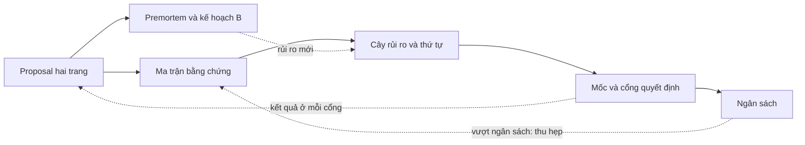
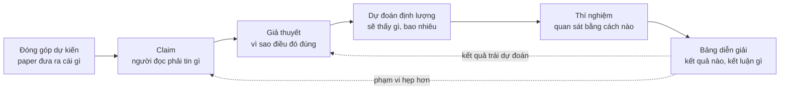
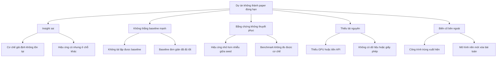
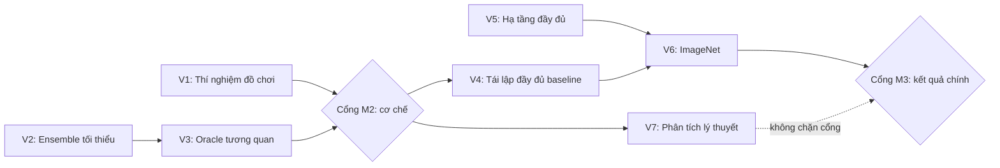
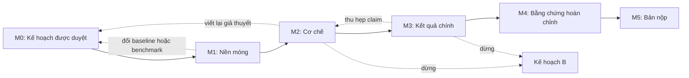

# Lập kế hoạch nghiên cứu

!!! abstract "Mục tiêu của bài"
    Sau bài này, người học có thể:

    - Giải thích vì sao một ý tưởng đã qua thẩm định vẫn chưa phải là một kế hoạch, và nhận ra các triệu chứng của một dự án chạy mà không có kế hoạch.
    - Viết một research proposal hai trang dựa trên Heilmeier Catechism, và phân biệt nó với bản pitch một trang.
    - Đi từ đóng góp dự kiến tới claim, giả thuyết có thể bác bỏ, dự đoán định lượng, thí nghiệm và bảng diễn giải kết quả, rồi tổng hợp vào một ma trận bằng chứng.
    - Sắp xếp công việc theo thứ tự giảm rủi ro, vẽ đồ thị phụ thuộc, và đặt các mốc M0–M5 với cổng quyết định đi tiếp, đổi hướng hoặc dừng.
    - Lập ngân sách compute, dữ liệu, thời gian và chi phí API có biên dự phòng; tổ chức premortem; xác định kết quả tối thiểu đáng công bố và kế hoạch B.
    - Thỏa thuận vai trò và thứ tự tác giả, tổ chức nhịp họp và cập nhật, và duy trì kế hoạch như một tài liệu sống.

Bài [Thẩm định ý tưởng](y-tuong.md) khép lại ở một thời điểm dễ chịu: ý tưởng đã qua bộ câu hỏi thẩm định, cuộc tìm kiếm novelty ba tầng và một pilot có tín hiệu. Nhóm tác giả có trong tay một danh sách đóng góp dự kiến (*proposed contributions*) viết khá gọn: "một module mới", "một phân tích về nguồn lỗi", "một tập đánh giá". Cảm giác chung là phần khó nhất đã qua, nhưng thực tế thường ngược lại. Danh sách đóng góp mô tả paper lúc kết thúc; nó không nói tuần tới chạy gì, theo thứ tự nào, tốn bao nhiêu GPU, ai làm phần nào, và dựa vào đâu để biết hướng đi đã sai. Khoảng cách giữa "paper sẽ đóng góp gì" và "thứ Hai tuần sau làm gì" là nơi nhiều dự án đầu tay mất hàng tháng.

Bài này lấp khoảng cách đó bằng một bộ tài liệu gọn, mỗi tài liệu có template: research proposal hai trang, ma trận bằng chứng, cây rủi ro và thứ tự làm việc, các mốc với cổng quyết định, bảng ngân sách, premortem cùng kế hoạch B, và các thỏa thuận làm việc nhóm. Trọng tâm là chuỗi đi từ đóng góp tới thí nghiệm, mắt xích người mới hay bỏ qua nhất và quyết định phần lớn chất lượng bằng chứng của paper.

Bài này bổ sung cho hai bài khác. Bài [Lộ trình thực hiện một paper](../00-tong-quan/lo-trinh.md) lập lịch tính ngược từ deadline; bài này lập kế hoạch tính tiến từ ý tưởng, rồi ghép hai chiều lại. Bài [Thiết kế thí nghiệm](thi-nghiem.md), ngay sau bài này, đi sâu vào thiết kế từng thí nghiệm; ở đây chỉ cần biết mỗi thí nghiệm trả lời claim nào, tốn bao nhiêu và nên chạy lúc nào. Cuối bài là một kế hoạch hoàn chỉnh cho một dự án NLP giả định.

## Vì sao ý tưởng trên giấy chưa phải là kế hoạch

Một ý tưởng đã qua thẩm định trả lời câu hỏi "có đáng làm không". Một kế hoạch phải trả lời bốn câu hỏi khác: làm gì để có bằng chứng, theo thứ tự nào, tốn bao nhiêu, và dấu hiệu nào cho biết phải đổi hướng. Câu hỏi thứ nhất được trả lời bằng lập luận và một pilot nhỏ. Bốn câu hỏi sau chỉ trả lời được khi đóng góp đã được phân rã thành những đơn vị công việc gắn với thời gian, tài nguyên và người chịu trách nhiệm.

Bằng chứng thực nghiệm cho thấy khoảng cách này lớn đến đâu. Trong nghiên cứu của Si, Yang và Hashimoto về ý tưởng NLP dựa trên prompting (*Can LLMs Generate Novel Research Ideas?*, ICLR 2025), điểm tổng mà reviewer chuyên gia cho các đề xuất trên giấy tương quan mạnh với novelty và mức độ hấp dẫn, nhưng gần như không tương quan với tính khả thi. Ở nghiên cứu tiếp theo (Si, Hashimoto, Yang, *The Ideation–Execution Gap*, ICLR 2026), khi ý tưởng được thực thi thành paper, reviewer bắt đầu xét những yếu tố bị bỏ qua lúc trước: hiệu quả thực nghiệm, độ chặt chẽ, baseline và ablation còn thiếu. Phạm vi hẹp (ý tưởng prompting trong NLP, vài chục dự án), nên không nên khái quát các con số; thông điệp thì quen thuộc: ý tưởng trên giấy và paper có bằng chứng được chấm theo tiêu chí khác nhau. Kế hoạch đưa các tiêu chí "sau thực thi" vào tầm nhìn từ trước.

Thiếu kế hoạch, dự án thường có ba triệu chứng. **Chạy thí nghiệm theo cảm hứng**: mỗi sáng chạy điều vừa nghĩ ra, log đầy lên, nhưng không ai nói được thí nghiệm hôm qua chứng minh điều gì. **Không biết thí nghiệm nào trả lời claim nào**: bảng kết quả nhiều cột, còn thí nghiệm có thể bác bỏ claim trung tâm thì chưa ai chạy. **Tới gần deadline mới thấy thiếu baseline**: một baseline đơn giản mà reviewer chắc chắn sẽ hỏi, như một mô hình có sẵn được fine-tune cẩn thận hay một LLM được prompt tử tế, chưa từng được chạy, và khi chạy thì nó thu hẹp phần lớn khoảng cách. Đi kèm là những triệu chứng phụ: hết GPU giữa chừng, tranh luận lặp lại vì không có tiêu chí quyết định, không rõ ai làm gì. Mỗi triệu chứng ứng với một thành phần còn thiếu: ma trận bằng chứng và thứ tự giảm rủi ro chữa hai triệu chứng đầu; danh sách giải thích thay thế và premortem chữa triệu chứng thứ ba; ngân sách, cổng quyết định và phân vai chữa các triệu chứng phụ.

Kế hoạch nghiên cứu, theo nghĩa của bài này, là vài tài liệu ngắn liên kết như sơ đồ dưới đây: proposal xác định đích đến và claim; ma trận biến claim thành thí nghiệm; cây rủi ro cho biết làm gì trước; các mốc gom thí nghiệm thành chặng, mỗi chặng kết thúc bằng một cổng quyết định; ngân sách kiểm tra tính khả thi; premortem tấn công kế hoạch từ phía thất bại và sinh ra kế hoạch B. Cả bộ thường gói trong khoảng năm trang. Mục tiêu không phải là đoán đúng tương lai, mà là biết trước nhóm sẽ phản ứng thế nào khi tương lai khác dự đoán.



## Research proposal hai trang

Tài liệu đầu tiên là một research proposal (đề cương nghiên cứu) ngắn, viết cho chính nhóm và người hướng dẫn, để thực thi chứ không để thuyết phục hội đồng nào.

### Heilmeier Catechism và nửa sau thường bị bỏ quên

Khung phù hợp nhất cho proposal là *Heilmeier Catechism*, bộ câu hỏi do George H. Heilmeier, giám đốc DARPA giai đoạn 1975–1977, đặt ra để đánh giá các chương trình nghiên cứu được đề xuất; ông đọc từng đề xuất và đòi câu trả lời trước khi phê duyệt. Phiên bản DARPA công bố gồm tám câu, diễn giải như sau:

1. Đang cố làm gì? Nêu mục tiêu mà tuyệt đối không dùng biệt ngữ (*"What are you trying to do?"*).
2. Hiện nay việc đó được làm thế nào, và giới hạn của cách làm hiện tại là gì?
3. Cái gì mới trong cách tiếp cận, và vì sao tin rằng nó sẽ thành công?
4. Ai quan tâm? Nếu thành công, điều gì sẽ khác đi?
5. Rủi ro là gì?
6. Tốn bao nhiêu?
7. Mất bao lâu?
8. Đâu là các "bài kiểm tra giữa kỳ và cuối kỳ" (*mid-term and final exams*) để biết đã thành công?

Có những biến thể từ bảy đến chín câu, nhưng tám câu trên là dạng phổ biến nhất. Bộ câu hỏi ở bài Thẩm định ý tưởng chủ yếu khai thác bốn câu đầu, về *giá trị* của ý tưởng. Bốn câu sau, về rủi ro, chi phí, thời gian và các bài kiểm tra, mới biến một ý tưởng thành một dự án, và cũng là phần người làm nghiên cứu ít được rèn luyện nhất.

Trong ghi chú *Research Taste Exercises* (2021), Chris Olah dẫn lời khuyên của Preetum Nakkiran: trước khi cam kết hơn một tháng cho một dự án, hãy viết một đề xuất ngắn nêu vì sao câu hỏi thú vị, vì sao câu trả lời có giá trị, và kỳ vọng sẽ tìm thấy gì. Ý cuối là hạt giống của các dự đoán ở mục sau. Olah cũng dẫn phép thử của Rachel Prudden cho câu "ai quan tâm": hình dung một nhóm khác đã công bố đúng paper này, rồi tự hỏi có háo hức đọc nó không.

### Chuyển thể tám câu hỏi cho nghiên cứu AI

Tám câu hỏi được viết cho những chương trình kéo dài nhiều năm; với một dự án paper vài tháng, mỗi câu cần một phiên bản cụ thể hơn, như bảng dưới đây, kèm câu trả lời yếu thường gặp để dễ nhận ra.

| Câu hỏi Heilmeier | Phiên bản cho một dự án AI | Câu trả lời yếu thường gặp |
|---|---|---|
| Đang cố làm gì? | Một câu mục tiêu không biệt ngữ, kèm kiểu đóng góp chủ đạo | Mô tả phương pháp thay cho mục tiêu |
| Hiện nay làm thế nào, giới hạn ở đâu? | Baseline mạnh nhất cụ thể, con số đã tái lập, một thất bại đo được | "Các phương pháp hiện có chưa hiệu quả", không có con số |
| Cái gì mới, vì sao sẽ thành công? | Insight phát biểu không cần tên phương pháp; bằng chứng sơ bộ từ pilot | Chỉ có "chưa ai làm" |
| Ai quan tâm? | Cộng đồng, venue mục tiêu; ai sẽ làm khác đi; phép thử "nhóm khác công bố" | "Có ứng dụng rộng rãi" |
| Rủi ro là gì? | Ba đến năm rủi ro lớn nhất, xác suất ước lượng, phép kiểm tra rẻ nhất cho mỗi rủi ro | Chỉ nêu "có thể thiếu GPU" |
| Tốn bao nhiêu? | GPU-giờ, chi phí API, giờ gán nhãn, kèm biên dự phòng | Quên phần dành cho baseline |
| Mất bao lâu? | Các mốc M0–M5 có ngày, đối chiếu với deadline | Một ngày duy nhất là deadline |
| Bài kiểm tra giữa kỳ và cuối kỳ? | Tiêu chí ở mỗi cổng; kết quả mục tiêu và kết quả tối thiểu đáng công bố | "Đạt SOTA" |

Hai dòng cần giải thích thêm. Ở câu thứ hai, một hướng dẫn gắn với DARPA hỏi thêm: người đề xuất có thật sự biết state of the art, hay đang tấn công một hình nộm (*strawman*)? Với nghiên cứu AI, câu này gần như đồng nghĩa với việc đã tái lập được baseline mạnh nhất chưa. Ở câu cuối, "đạt SOTA" yếu vì nó chỉ là bài kiểm tra cuối kỳ; giá trị của câu thứ tám nằm ở chữ "giữa kỳ", tức những dấu hiệu sớm cho biết hướng đi đúng hay sai từ lâu trước khi có bảng kết quả.

### Ba template tóm tắt dự án: proposal, pitch và Tầng 0

Giáo trình có ba template cùng tóm tắt một dự án trong một hai trang: research proposal của bài này, bản pitch một trang ở bài [Xây câu chuyện của paper](cau-chuyen.md), và bản pitch rút gọn ở Tầng 0 trong bài [Quy trình viết & tự review](../03-ky-thuat/quy-trinh-viet.md). Cả ba chia sẻ phần lõi gồm vấn đề, khoảng trống, insight và claim, nhưng mỗi template giúp trả lời một câu hỏi khác, nên khác nhau ở thời điểm viết và ở những mục riêng.

| | Research proposal (bài này) | Bản pitch một trang | Tầng 0 của quy trình viết |
|---|---|---|---|
| Câu hỏi chính | Làm gì, theo thứ tự nào, với nguồn lực nào, khi nào đổi hướng? | Câu chuyện có đứng được, có thuyết phục không? | Câu chuyện đã đủ chín để bắt đầu viết bản thảo chưa? |
| Chức năng | Thực thi | Thuyết phục và định hình câu chuyện | Mở đầu quy trình viết theo tầng |
| Thời điểm | Ngay sau thẩm định, trước khi cam kết nguồn lực lớn | Khi kết quả bắt đầu về (khoảng D − 3,5 tháng theo lộ trình) | Ngay trước khi viết outline và bản nháp |
| Mục riêng | Rủi ro, ngân sách, mốc và cổng, kết quả tối thiểu đáng công bố, phân vai | Câu tóm tắt một dòng, phác thảo Figure 1, câu hỏi đáng ngại nhất từ reviewer | Bằng chứng chính nằm ở bảng hay hình nào; venue và track |
| Người đọc chính | Nhóm thực hiện, đọc lại hằng tuần | Người hướng dẫn, đồng tác giả, người ngoài nhóm | Người hướng dẫn |

Theo thời gian, ba template nối tiếp nhau. Proposal ra đời đầu tiên. Khi bằng chứng đã định hình, phần lõi của nó được viết lại thành pitch, chuyển trọng tâm từ kế hoạch sang lập luận; các mục claim, thí nghiệm và rủi ro của pitch kế thừa từ proposal và ma trận. Khi bắt đầu viết paper, pitch được nén thành Tầng 0. Điều cần giữ là ba tài liệu không kể ba câu chuyện khác nhau: mỗi khi claim đổi, proposal tăng phiên bản, pitch cập nhật theo, và thay đổi được ghi vào nhật ký quyết định.

### Template proposal

Template dưới đây trải tám câu hỏi thành chín mục; mục (5) tách riêng vì nó là đầu vào của ma trận bằng chứng. Hai trang là giới hạn cứng.

```markdown
# Research proposal: <tên tạm của dự án>
Phiên bản: v0.1   Ngày: ____   Người giữ tài liệu: Tác giả A   Người duyệt: Người hướng dẫn

## (1) Mục tiêu (2–3 câu, không biệt ngữ)
- Câu mục tiêu một dòng (tiếng Anh): "We aim to show that ___, and to build ___ that ___."
- Kiểu đóng góp chủ đạo: phương pháp / cách đặt bài toán / dataset / phương pháp đánh giá / phân tích / hiệu quả

## (2) Hiện trạng và giới hạn
- Baseline mạnh nhất: <tên, venue, năm>. Paper báo cáo ___; nhóm tái lập được ___ (code chính thức / tự cài đặt)
- Thất bại cụ thể đã đo được: <con số, tập con, ví dụ>
- Hai công trình gần nhất và khác biệt (mỗi công trình một câu):

## (3) Cái mới và vì sao có thể thành công
- Insight (phát biểu không nhắc tên phương pháp):
- Bằng chứng sơ bộ: <kết quả pilot, phân tích lỗi, link log>

## (4) Ai quan tâm
- Cộng đồng, venue mục tiêu, venue dự phòng:
- Nếu thành công, ai sẽ làm khác đi điều gì?
- Phép thử: nếu một nhóm khác công bố đúng paper này, nhóm có háo hức đọc không? Vì sao?

## (5) Đóng góp dự kiến và claim
- Đ1: ___ -> claim trung tâm C1: ___ (đo bằng gì, trong phạm vi nào, so với gì)
- Đ2: ___ -> claim C2, C3: ___
- Điều nhóm kỳ vọng sẽ thấy (viết TRƯỚC khi chạy): ___

## (6) Rủi ro (chi tiết ở cây rủi ro)
| Rủi ro | Chí mạng / thu hẹp | Xác suất ước lượng | Phép kiểm tra rẻ nhất | Mốc |

## (7) Chi phí (chi tiết ở bảng ngân sách)
- Compute: ___ GPU-giờ   API: ___ USD   Gán nhãn: ___ giờ người   Biên dự phòng: ___

## (8) Thời gian và các bài kiểm tra
- M1 (ngày ___): đi tiếp nếu ___ / đổi hướng nếu ___ / dừng nếu ___
- M2 ... M5
- Kết quả mục tiêu: ___      Kết quả tối thiểu đáng công bố: ___

## (9) Phân vai và cam kết thời gian
- Tác giả A: ___ (___ giờ/tuần)   Tác giả B: ___   Người hướng dẫn: duyệt tại M0, M2, M3
```

Viết xong, có hai phép thử nhanh. Đọc to mục (1) cho một người ngoài lĩnh vực hẹp; nếu họ không nhắc lại được mục tiêu, mục (1) còn biệt ngữ. Rồi đánh dấu câu Heilmeier khó trả lời nhất, vì nó thường chỉ thẳng vào chỗ rủi ro: không trả lời được câu thứ ba nghĩa là chưa có insight; không trả lời được câu thứ sáu hay thứ bảy nghĩa là dự án chưa được phân rã.

## Từ đóng góp dự kiến tới claim, giả thuyết và thí nghiệm

Đây là phần quan trọng nhất của kế hoạch, và là nơi nỗi đau "có ý tưởng nhưng không biết thực thi" bắt nguồn. Một đóng góp như "một module khử nhiễu cho ảnh ban đêm" chưa nói được thí nghiệm nào cần chạy. Để có danh sách thí nghiệm, cần qua sáu mắt xích: đóng góp nói paper đưa ra *cái gì*; claim nói người đọc phải *tin gì*; giả thuyết nói *vì sao* điều đó đúng; dự đoán nói *sẽ thấy gì*; thí nghiệm là *cách quan sát*; bảng diễn giải nói với mỗi kết quả thì *kết luận gì, làm gì tiếp*.



### Từ đóng góp tới claim

Đóng góp là một *danh từ* ("một phương pháp", "một benchmark"); claim là một *mệnh đề* có thể đúng hoặc sai ("phương pháp X giảm lỗi trên vật thể nhỏ ít nhất một nửa so với baseline mạnh nhất"). Reviewer đánh giá mệnh đề, không đánh giá danh từ; chừng nào đóng góp còn là danh từ, nhóm chưa biết cần bằng chứng gì.

Mỗi đóng góp thường sinh ra một đến ba claim, cần phân biệt **claim trung tâm** (sai thì paper sụp) với **claim phụ** (sai thì paper hẹp lại); sự phân biệt này quyết định thứ tự làm việc. Paper tốt có rất ít claim trung tâm. Andrej Karpathy, trong *A Survival Guide to a PhD* (2016), khuyên xác định đóng góp cốt lõi duy nhất, vì các đóng góp không cộng dồn và một đóng góp phụ thứ hai thường làm loãng paper: *"The paper sells a single thing that was not obvious or present before."* (Paper "bán" một điều duy nhất trước đó chưa hiển nhiên hoặc chưa có.) Khi phân rã, người viết thường phát hiện một "đóng góp" thật ra chỉ là phạm vi của đóng góp khác, như ví dụ cuối mục; những biến thể khó hơn ở bài [Ghép ý tưởng và "độn" đóng góp](../07-tinh-huong-kho/ghep-va-don.md).

Claim kiểm chứng được nêu rõ đo bằng gì, trong phạm vi nào, so với cái gì (xem bài Xây câu chuyện của paper), và ở giai đoạn này còn phải đủ cụ thể để suy ra thí nghiệm: "giữ ít nhất 90% mức cải thiện khi chuyển từ backbone CNN sang Transformer" suy ra ngay một thí nghiệm kèm ngưỡng, còn "tổng quát hóa tốt" thì không.

### Từ claim tới giả thuyết có thể bác bỏ

Claim nói điều gì đúng; giả thuyết nói vì sao, tức một phát biểu về *cơ chế*: "lỗi tăng ở ảnh tối vì nhiễu cảm biến làm hỏng đặc trưng cấp thấp". Với người đọc, cơ chế được xác nhận để lại hiểu biết mang đi được, còn con số đơn thuần dễ bị coi là may mắn hay do tune kỹ. Với người lập kế hoạch, giả thuyết cho biết thí nghiệm nào có sức phân biệt: hai cơ chế khác nhau có thể cho cùng con số tổng nhưng để lại dấu vết khác nhau ở các tập con.

Giả thuyết phải **có thể bác bỏ**: tồn tại một kết quả mà nếu xảy ra thì nó sai. "Hoạt động nhờ học được biểu diễn tốt hơn" không bác bỏ được; "hoạt động nhờ khôi phục chi tiết tần số cao ở vùng tối" thì được: nếu cải thiện không tập trung ở vùng tối, giả thuyết sai.

Bước dễ bị bỏ qua nhất là liệt kê **giải thích thay thế**, những lý do khác có thể tạo ra cùng kết quả. Lipton và Steinhardt, trong *Troubling Trends in Machine Learning Scholarship* (2018), coi việc xem xét và loại trừ giả thuyết thay thế là phẩm chất cốt lõi của nghiên cứu thực nghiệm tốt, và chỉ ra xu hướng không xác định được nguồn gốc thật của mức cải thiện, như gán công cho kiến trúc trong khi cải thiện đến từ tune hyperparameter. Danh sách giải thích thay thế khá ổn định giữa các dự án: nhiều tham số hoặc tính toán hơn; tune kỹ hơn baseline; thêm dữ liệu; lợi dụng đặc điểm của benchmark; dữ liệu test bị lộ; chênh lệch nằm trong dao động giữa seed; hoặc chỉ một thành phần đơn giản tạo ra toàn bộ hiệu quả. Mỗi giải thích quan trọng cần một thí nghiệm đối chứng.

Đây chính là liều thuốc cho triệu chứng "gần deadline mới thấy thiếu baseline": phần lớn baseline bị phát hiện muộn là đối chứng cho một giải thích thay thế không ai viết ra. Với bài toán hoàn toàn mới, danh sách vẫn sinh ra baseline: lời giải tầm thường cho biết con số có hơn mức đoán mò không, thí nghiệm oracle (biết trước một phần thông tin đúng) cho biết trần, và kết quả của con người cho biết bài toán khó tới đâu; Tình huống 30 trong bài [Bài toán, dữ liệu và phạm vi](../07-tinh-huong-kho/bai-toan-va-pham-vi.md) phân tích kỹ trường hợp này.

### Từ giả thuyết tới dự đoán định lượng

Dự đoán là hệ quả quan sát được của giả thuyết trong một thí nghiệm cụ thể. Một dự đoán tốt nêu năm điều: **chiều** của hiệu ứng, **độ lớn** tối thiểu, **nơi** hiệu ứng xuất hiện, **so với cái gì**, và **mức nhiễu** dùng làm thước đo (thường là độ lệch chuẩn giữa các seed). Hai dự đoán dưới đây (ví dụ giả định) cho thấy khác biệt.

<div class="bad" markdown>
*"Phương pháp sẽ tốt hơn baseline trên ảnh ban đêm."*

Dự đoán này gần như không thể sai: hơn 0,1 điểm cũng là "tốt hơn", và nó không nói gì về cơ chế.
</div>

<div class="good" markdown>
*"Trên 20% ảnh tối nhất của tập validation ban đêm, mIoU tăng ít nhất 3 điểm so với baseline cùng recipe (trung bình 3 seed; độ lệch chuẩn giữa seed ở pilot khoảng 0,5), còn trên 50% ảnh sáng nhất thay đổi không quá 0,5 điểm."*

Dự đoán này có thể sai theo ba cách khác nhau, và mỗi cách sai mang một thông tin khác nhau về giả thuyết.
</div>

Ngưỡng đến từ kích thước hiệu ứng ở pilot (trừ một khoản cho sự lạc quan của thiết lập nhỏ), từ mức nhiễu (hiệu ứng nhỏ hơn hai ba lần độ lệch chuẩn giữa seed khó thuyết phục ai), và từ cộng đồng. Nên phân biệt **ngưỡng đi tiếp**, đủ để tin hướng đi đúng, với **ngưỡng đáng công bố**, đủ để thành claim; ngưỡng đầu thường thấp hơn.

Ngưỡng đáng công bố còn tùy kiểu claim. Tài liệu hướng dẫn reviewer của ban chương trình CVPR và ICCV (2019, được dùng lại các năm sau) phân biệt nhiều mức: ý tưởng có thể thay đổi lĩnh vực chỉ cần bằng chứng khái niệm, ý tưởng hợp lý cho bài toán quen thuộc cần kết quả trên benchmark, còn ý tưởng *"weird, overly complex, implausible, and/or seemingly incremental"* (kỳ lạ, quá phức tạp, khó tin, hoặc trông như cải tiến nhỏ) cần kết quả xuất sắc. Ngược lại, hướng dẫn phản biện của ACL Rolling Review nhắc rằng *"a paper only needs to present sufficient evidence for the claim that the authors are making"* (paper chỉ cần đủ bằng chứng cho claim tác giả đưa ra). Claim hẹp và rõ là cách rẻ nhất để giữ ngân sách.

Điều kiện quan trọng nhất là dự đoán phải được **viết trước khi chạy**; viết sau thì không còn là dự đoán, vì trí nhớ tự sắp xếp lại sự kiện theo câu chuyện hiện tại. Bài [Thực hành: ba dự án đi qua ngõ cụt](../07-tinh-huong-kho/thuc-hanh.md) ở Chương 7 phân tích cơ chế này và đưa ra mẫu nhật ký quyết định có ô "dự đoán và điều kiện đảo ngược", một hình thức đăng ký trước (*pre-registration*) gọn nhẹ; ma trận bằng chứng là nơi các dự đoán được viết lần đầu.

### Từ dự đoán tới thí nghiệm và bảng diễn giải

Thí nghiệm có sức phân biệt là thí nghiệm mà giả thuyết và các giải thích thay thế **dự đoán kết quả khác nhau**. Nếu cả hai cùng dự đoán "tốt hơn baseline", bảng so sánh chính không phân biệt được chúng, và cần đánh giá trên tập con hoặc một biến thể đối chứng.

*Deep Learning Tuning Playbook* của Google Research (Godbole và cộng sự, 2023) chia hyperparameter thành ba vai. **Khoa học** là thứ có tác động đang được đo. **Phiền nhiễu** (*nuisance*) phải được tối ưu riêng cho từng giá trị khoa học để so sánh công bằng, như learning rate khi so hai kiến trúc. **Cố định** được giữ nguyên, và Playbook lưu ý *"fixed hyperparameters create caveats for any conclusions we draw from the experiments"* (mỗi hyperparameter cố định tạo ra một giới hạn cho kết luận). Ghi rõ ba vai cho biết cần tune bao nhiêu lần, đầu vào của ngân sách compute, và phạm vi claim hẹp đến đâu.

Mắt xích cuối là **bảng diễn giải**: với mỗi thí nghiệm quyết định, viết trước ít nhất ba kết cục (như dự đoán; không có hiệu ứng vượt nhiễu; ngược chiều hoặc ở chỗ khác), mỗi kết cục kèm kết luận và hành động. Nếu cả ba dẫn tới cùng một hành động, thí nghiệm không giúp quyết định gì và nên hoãn hoặc thiết kế lại, đúng như phân tích Tình huống 26 trong bài [Áp lực từ bên ngoài](../07-tinh-huong-kho/ap-luc-ben-ngoai.md).

Kế hoạch không cấm khám phá; Playbook cho biết nhóm tác giả dành phần lớn thời gian khám phá để hiểu bài toán. Điều kế hoạch yêu cầu là gắn nhãn: thí nghiệm khám phá có ngân sách riêng và không được dùng trực tiếp làm bằng chứng. Hiện tượng thú vị lộ ra khi khám phá trở thành giả thuyết mới, được kiểm chứng bằng một thí nghiệm có dự đoán viết trước.

### Ma trận bằng chứng

Ma trận bằng chứng gom chuỗi trên vào hai lớp. Lớp một là **bảng claim nhân thí nghiệm**, mỗi ô ghi vai trò: **Q** (quyết định: kết quả có thể bác bỏ claim), **H** (hỗ trợ), **Đ** (đối chứng: loại một giải thích thay thế), **N** (nền: điều kiện tiên quyết, như tái lập baseline). Lớp hai là **thẻ claim** cho mỗi claim trung tâm. Bảng cho cái nhìn toàn cục; thẻ cho chiều sâu.

```markdown
## Ma trận bằng chứng — dự án ____   Phiên bản: __   Cập nhật: ____

### Lớp 1: claim x thí nghiệm   (Q = quyết định, H = hỗ trợ, Đ = đối chứng, N = nền)
| Claim                  | E0 | E1 | E2 | E3 | ... | Trạng thái claim |
|------------------------|----|----|----|----|-----|------------------|
| C1 (trung tâm): ...    | N  | Q  | H  |    |     | chưa có / mức A-B-C-D |
| C2 (phụ): ...          | N  |    | Q  | Đ  |     |                  |

### Lớp 2: thẻ claim (một thẻ cho mỗi claim trung tâm)
Claim C__: <đo gì, phạm vi nào, so với gì>        Thuộc đóng góp: Đ__   Loại: trung tâm / phụ
Giả thuyết (cơ chế): ___
Giải thích thay thế cần loại:  R1: ___ -> đối chứng E__    R2: ___ -> đối chứng E__
Dự đoán (viết ngày ____, TRƯỚC khi chạy):
  E__: chiều ___, độ lớn tối thiểu ___, nơi ___, so với ___, mức nhiễu ___
Thiết lập của thí nghiệm quyết định:
  Dữ liệu và split: ___   Metric: ___   Số seed: ___
  Baseline (kể cả baseline đơn giản, oracle, con người nếu cần): ___
  Ablation cần có cho claim này: ___
Vai hyperparameter: khoa học ___ / phiền nhiễu ___ (số lần tune, CHO CẢ baseline) / cố định ___
Bảng diễn giải:
  Nếu như dự đoán:            kết luận ___ -> hành động ___
  Nếu không có hiệu ứng:      kết luận ___ -> hành động ___
  Nếu ngược chiều / chỗ khác: kết luận ___ -> hành động ___
Mốc cần có kết quả: M__        Người chịu trách nhiệm: ____
```

Khi đã điền xong, ma trận được đọc theo năm quy tắc, mỗi quy tắc bắt một kiểu lỗi kế hoạch:

- [ ] Mỗi claim trung tâm có ít nhất một ô **Q**, và thẻ của nó ghi đủ dữ liệu, metric, baseline, ablation. Claim không có thí nghiệm quyết định chỉ được minh họa, chưa được kiểm chứng.
- [ ] Mỗi cột phục vụ ít nhất một claim; cột trống là thí nghiệm khám phá, cần gắn nhãn và có ngân sách riêng, hoặc bỏ.
- [ ] Mỗi giải thích thay thế quan trọng có một cột **Đ** tương ứng.
- [ ] Các cột **N** đứng đầu thứ tự làm việc, vì mọi thứ khác phụ thuộc vào chúng.
- [ ] Mọi ô "nếu không có hiệu ứng" có một hành động cụ thể, không phải "chạy thêm".

!!! info "Ma trận bằng chứng khác gì bảng claim ở bài Thiết kế thí nghiệm"
    Bài [Thiết kế thí nghiệm](thi-nghiem.md) có một bảng nối claim với câu hỏi của reviewer, thí nghiệm và kết quả ủng hộ. Ma trận ở đây đứng ở tầng trên: nó nối thêm claim với đóng góp, giả thuyết, giải thích thay thế và hành động cho từng kết cục, và được dùng để sắp thứ tự công việc, đặt cổng quyết định và tính ngân sách. Mỗi cột của ma trận về sau trở thành một mục trong kế hoạch thí nghiệm chi tiết của bài đó.

### Ví dụ đầy đủ: một dự án Computer Vision

Xét một dự án giả định về phân đoạn ngữ nghĩa (*semantic segmentation*) ảnh đường phố ban đêm; mọi tên và con số là giả định. Pilot cho thấy mô hình huấn luyện trên ảnh ban ngày sụt mIoU mạnh trên ảnh ban đêm, và một bước khử nhiễu đơn giản trước mạng làm tăng nhẹ độ chính xác ở vùng tối. Nhóm viết ba đóng góp: Đ1, phân tích cho thấy nguồn lỗi chính là nhiễu cảm biến ở vùng tối chứ không phải lệch màu và độ sáng; Đ2, NoctDN (tên giả định), mô-đun khử nhiễu nhận biết độ sáng huấn luyện cùng mạng phân đoạn; Đ3, hiệu quả nhất quán trên nhiều backbone và hai benchmark ban đêm.

Ngay khi phân rã, Đ3 lộ ra không phải đóng góp riêng mà là phạm vi của Đ2, nên nó trở thành claim phụ C4. Bốn claim được viết như sau.

- **C1 (trung tâm, Đ1):** khi làm tối ảnh ban ngày có kiểm soát, thêm nhiễu cảm biến mô phỏng làm mIoU giảm nhiều hơn hẳn so với chỉ giảm sáng và đổi màu ở cùng độ sáng.
- **C2 (phụ, Đ1):** trên ảnh ban đêm thật, lỗi tập trung ở vùng tối và tương quan với mức nhiễu ước lượng mạnh hơn với độ lệch màu, kể cả trong cùng một lớp đối tượng.
- **C3 (trung tâm, Đ2):** với cùng recipe, NoctDN tăng mIoU ở vùng tối rõ hơn hẳn ở vùng sáng, và vượt cách ghép một bộ khử nhiễu có sẵn với mạng phân đoạn.
- **C4 (phụ, Đ2):** cải thiện giữ cùng chiều trên ba backbone và hai benchmark ban đêm.

Giả thuyết chung: ở vùng tối, tỉ lệ tín hiệu trên nhiễu thấp làm hỏng đặc trưng cấp thấp trước khi mạng kịp tổng hợp ngữ cảnh, còn lệch màu phần lớn được các lớp chuẩn hóa đầu mạng xử lý. Giải thích thay thế: R1, lệch màu và độ sáng mới là nguyên nhân chính; R2, vùng tối chứa nhiều lớp nhỏ và hiếm; R3, nhãn vùng tối kém chính xác; R4, cải thiện đến từ tham số thêm; R5, bộ khử nhiễu có sẵn là đủ. Tám thí nghiệm: E0 tái lập baseline với hai backbone; E1 làm tối có kiểm soát ảnh ban ngày (ba mức độ sáng, có và không có nhiễu, chỉ suy luận); E2 phân tầng lỗi ảnh ban đêm thật theo độ sáng, nhiễu, lệch màu trong từng lớp, kèm kiểm tra lại nhãn 100 ảnh; E3 bộ khử nhiễu có sẵn ghép với mạng phân đoạn; E4 NoctDN so với baseline cùng recipe; E5 ablation; E6 thêm hai backbone; E7 khám phá (hình định tính, failure cases).

| Claim | E0 | E1 | E2 | E3 | E4 | E5 | E6 | E7 |
|---|---|---|---|---|---|---|---|---|
| C1 (trung tâm): nhiễu gây sụt nhiều hơn màu | N | Q | H | | | | | |
| C2 (phụ): lỗi ban đêm theo nhiễu, trong từng lớp | N | | Q | | | | | H |
| C3 (trung tâm): NoctDN cải thiện vùng tối, vượt khử nhiễu có sẵn | N | | | Đ | Q | Đ | | H |
| C4 (phụ): cùng chiều trên ba backbone, hai benchmark | N | | | | H | | Q | |

Đọc ma trận, ba điều hiện ra ngay. E0 nằm dưới mọi claim nên làm đầu tiên. E1 rẻ và là thí nghiệm quyết định của một claim trung tâm, nên chạy ngay sau E0, trước khi viết dòng code nào cho NoctDN. E3 là đúng loại baseline hay bị phát hiện muộn: nếu bộ khử nhiễu có sẵn thu hẹp phần lớn khoảng cách, đóng góp phương pháp sụp đổ, nên E3 được xếp trước E4 dù nó không xây thêm gì cho phương pháp. Bảng diễn giải cho E1 được viết trước khi chạy:

| Kết quả của E1 | Kết luận | Hành động |
|---|---|---|
| Có nhiễu làm mIoU giảm ít nhất gấp đôi chỉ giảm sáng và đổi màu, ở cả ba mức | Giả thuyết được ủng hộ; R1 bị loại phần lớn | Giữ C1; xây NoctDN; chạy E3 song song |
| Hai kiểu suy giảm gây sụt tương đương | Cả hai yếu tố quan trọng; giả thuyết phát biểu quá mạnh | Thu hẹp C1; xem lại thiết kế mô-đun cho cả màu; tìm lại novelty với các công trình thích nghi màu |
| Chỉ giảm sáng và đổi màu gây sụt nhiều hơn | Giả thuyết bị bác bỏ | Dừng hướng khử nhiễu; ghi nhật ký; cân nhắc paper phân tích nếu cộng đồng đang tin điều ngược lại |

Thẻ claim của C3 được điền như sau.

```text
Claim C3: Với cùng recipe, NoctDN tăng mIoU trên 20% ảnh tối nhất ít nhất 3 điểm so với
          baseline, rõ hơn hẳn mức thay đổi trên ảnh sáng, và vượt cách ghép bộ khử nhiễu có sẵn.
Thuộc đóng góp: Đ2        Loại: trung tâm
Giả thuyết: mô-đun khôi phục đặc trưng cấp thấp ở vùng tín hiệu/nhiễu thấp -> lợi ích tập trung ở vùng tối.
Giải thích thay thế cần loại:
  R4: lợi ích do tham số, tính toán thêm -> E5 (khối cùng số tham số)
  R5: bộ khử nhiễu có sẵn là đủ          -> E3
  Tune không cân sức                      -> cùng số lần thử tune cho mọi cấu hình
Dự đoán (viết TRƯỚC khi chạy E3, E4, E5):
  E4: vùng tối +3 mIoU trở lên (3 seed; độ lệch chuẩn pilot ~0,5); vùng sáng trong ±0,5
  E5: khối cùng số tham số tăng dưới 1 điểm ở vùng tối
  E3: khử nhiễu có sẵn + phân đoạn kém NoctDN ít nhất 1,5 điểm ở vùng tối
Thiết lập của E4:
  Dữ liệu: huấn luyện trên ảnh ban ngày cộng phần ảnh ban đêm có nhãn; đánh giá trên split
           validation của hai benchmark ban đêm, chia theo độ sáng ảnh       Seed: 3
  Metric: mIoU trên 20% ảnh tối nhất, 50% ảnh sáng nhất, và toàn bộ
  Baseline: cùng backbone không có NoctDN; hai bộ khử nhiễu có sẵn đặt trước mạng (E3)
  Ablation: khối cùng số tham số; bỏ tín hiệu độ sáng; huấn luyện tách rời (E5)
Vai hyperparameter: khoa học = có/không NoctDN; phiền nhiễu = learning rate, weight decay
  (4 lần thử cho MỖI cấu hình); cố định = độ phân giải, lịch huấn luyện -> claim chỉ nói về đúng thiết lập này
Bảng diễn giải:
  Như dự đoán            -> giữ C3, qua cổng M3 phần phương pháp
  Lợi ích đều ở mọi vùng -> cơ chế sai; viết lại giả thuyết, kiểm tra C1–C2 có nhất quán không
  E3 ngang NoctDN        -> đóng góp phương pháp không đứng; kế hoạch B: phân tích (C1, C2)
                            + baseline đơn giản mạnh
Mốc: E3, E4 rút gọn ở M2; đầy đủ ở M3        Người chịu trách nhiệm: Tác giả A
```

Từ một đóng góp dài một dòng, nhóm đã có tám thí nghiệm có tên, vai trò và thứ tự gợi ý; thiết kế chi tiết từng thí nghiệm thuộc về bài Thiết kế thí nghiệm.

## Cây rủi ro và thứ tự làm việc

Ma trận cho biết cần làm thí nghiệm nào, chưa cho biết làm cái nào trước. Không có nguyên tắc sắp xếp, người mới thường bắt đầu bằng việc dễ chịu nhất (dựng codebase, viết data loader, cấu hình logging): những việc cần thiết nhưng gần như không bao giờ thất bại, nên làm trước không cho biết gì về số phận dự án.

### Làm trước việc dễ thất bại và cho nhiều thông tin nhất

Jacob Steinhardt, trong *Research as a Stochastic Decision Process* (2018), đề xuất nhìn dự án như một chuỗi việc con bất định, việc nào cũng có thể thất bại và kéo cả dự án đổ theo; mục tiêu là tối đa hóa xác suất thành công và tối thiểu hóa thời gian kỳ vọng, nhất là thời gian bỏ ra *trước khi phát hiện* thất bại. Quy tắc cốt lõi: làm theo thứ tự từ việc cho nhiều thông tin nhất trên mỗi đơn vị thời gian tới việc cho ít nhất, tức bắt đầu từ phần có khả năng giết dự án cao nhất so với chi phí kiểm tra nó. Steinhardt còn hình thức hóa ý này; bài này chỉ dùng tinh thần chung.

Một phép tính minh họa (giả định): việc A là dựng đầy đủ hạ tầng và tái lập toàn bộ baseline, mất ba tuần, hiếm khi thất bại; việc B là thí nghiệm oracle kiểm tra giả thuyết cốt lõi, mất một tuần, thất bại khoảng một nửa. Làm A trước, khi B thất bại thì bốn tuần đã trôi qua; làm B trước, tin xấu đến sau một tuần, và tính trung bình hai kịch bản thì tiết kiệm khoảng một tuần rưỡi. Nếu B cần một phần của A, lời giải là **tách A ra**: làm phần tối thiểu mà B cần, rồi chạy B ngay.

Jia-Bin Huang (*awesome-tips*, mục về cách tiến bộ đều đặn) gợi ý các chiến thuật biến rủi ro đắt thành phép kiểm tra rẻ: **làm ngược từ cuối** (giả định bước trước cho đầu ra hoàn hảo để xây bước sau, nhờ đó thấy sớm kết quả cuối và cận trên); **ví dụ đồ chơi**, tốt nhất là dữ liệu tổng hợp có đáp án ở mọi bước; **baseline trước**, vì nếu baseline đã đủ tốt thì cần hỏi vì sao còn làm bài toán này; **trường hợp đơn giản trước**; và **tìm một proxy**, tức thí nghiệm nhỏ và nhanh thay cho những lần chạy kéo dài hàng tuần.

### Cây rủi ro

Để sắp theo rủi ro, trước hết phải liệt kê rủi ro: cây rủi ro đặt ở gốc câu "dự án không thành paper đúng hạn" và chia nhánh tới những rủi ro đủ cụ thể để kiểm tra được.



Mỗi lá được gắn hai thông tin: rủi ro **chí mạng** (xảy ra thì dự án sụp) hay **thu hẹp** (paper hẹp lại), và phép kiểm tra rẻ nhất. Cơ chế giả định được kiểm tra bằng thí nghiệm đồ chơi hoặc can thiệp có kiểm soát trên checkpoint sẵn có; tái lập baseline, bằng một lần chạy code chính thức; baseline đơn giản đã đủ tốt, bằng chính baseline đó được tune cẩn thận cùng một oracle; nhiễu giữa seed, bằng việc đo độ lệch chuẩn của baseline từ đầu; mô hình nền mới, bằng việc thử bài toán trên mô hình tổng quát mạnh nhất ngay khi chọn hướng. Hai nhánh cuối không kiểm soát được nhưng chuẩn bị được: Tình huống 24 và 25 trong bài [Áp lực từ bên ngoài](../07-tinh-huong-kho/ap-luc-ben-ngoai.md) phân tích cách xử lý, và bảng phòng ngừa cuối bài đó là danh sách việc nên đưa vào kế hoạch từ M0.

Ở dự án paper thật, nhiều thất bại chỉ làm paper hẹp lại, nên thứ tự có hai bậc: rủi ro chí mạng trước, xếp theo lượng thông tin trên thời gian; rủi ro thu hẹp sau. Hạ tầng được dựng dần, vừa đủ cho việc tiếp theo; trong cùng bậc, ưu tiên thí nghiệm vẫn có giá trị cho paper ngay cả khi giả thuyết chính sai.

### Ví dụ: một dự án Machine Learning

Một dự án ML giả định muốn dùng thống kê kích hoạt ở các lớp giữa để ước lượng độ bất định với một lần truyền xuôi, rồi phát hiện dữ liệu ngoài phân phối (OOD); claim trung tâm là chất lượng gần deep ensemble với chi phí của một mô hình. Các phần trăm dưới đây là ước lượng chủ quan, chỉ để so sánh tương đối.

| Việc | Câu hỏi được trả lời | Chí mạng? | Khả năng thất bại | Thời gian | Phụ thuộc |
|---|---|---|---|---|---|
| V1: thí nghiệm đồ chơi | Tách được vùng OOD trên dữ liệu tổng hợp? | Có | Cao (~40%) | 0,5 tuần | |
| V2: ensemble tối thiểu (CIFAR-10) | Có thước đo độ bất định để đối chiếu? | Có (nền) | Thấp (~10%) | 0,5 tuần | |
| V3: oracle | Tương quan với độ bất định của ensemble trên dữ liệu thật? | Có | Cao (~50%) | 1 tuần | V2 |
| V4: tái lập đầy đủ baseline | So sánh có công bằng? | Có | Thấp đến vừa (~20%) | 2 tuần | V2 |
| V5: hạ tầng đầy đủ | (không trả lời câu hỏi khoa học) | Không | Rất thấp | 1,5 tuần | |
| V6: ImageNet | Còn đúng ở quy mô lớn? | Thu hẹp | Vừa (~30%) | 3 tuần | V4, V5 |
| V7: phân tích lý thuyết | Có bound giải thích hiện tượng? | Thu hẹp | Cao (~60%) | 4 tuần | V3 |

Một nhóm mới thường làm V5, rồi V4, rồi mới tới V3, nên câu trả lời cho việc dễ giết dự án nhất chỉ có sau khoảng bốn tuần rưỡi. Theo tinh thần giảm rủi ro: V1 rẻ và dễ thất bại, làm ngay; V2 hiếm khi thất bại nhưng là phần tối thiểu V3 cần, nên tách khỏi V4 và làm sớm; V3 chạy ngay sau. Sau khoảng hai tuần, nhóm biết hai rủi ro chí mạng lớn nhất có xảy ra không, rồi mới đầu tư vào V4, V5. V7 dễ thất bại nhưng không chí mạng, giao cho một đồng tác giả thiên về lý thuyết chạy song song; V6 đắt nhất, đứng cuối.



Đồ thị còn cho thấy **đường găng** (*critical path*), chuỗi việc phụ thuộc có tổng thời gian dài nhất: V2, V4, V6, khoảng năm tuần rưỡi, quyết định ngày sớm nhất đạt M3. Muốn đạt M3 sớm hơn phải rút ngắn một việc trên đường găng (chẳng hạn chạy V6 trên tập con của ImageNet trước); rút ngắn V5 không giúp gì.

Thứ tự cũng không chỉ quyết định một lần. Môn *CS197: Computer Science Research* của Michael Bernstein (Stanford) dùng hai khái niệm hằng tuần: *vectoring*, xác định chiều rủi ro hay bất định lớn nhất lúc này, và *velocity*, giảm nhanh rủi ro theo chiều đó, chạy thành vòng lặp chặt. Velocity không đồng nghĩa tiến độ: một chuỗi ý tưởng nối nhau thất bại là tiến độ thấp nhưng velocity cao, vì mỗi thất bại loại bỏ một phần bất định. Câu hỏi đầu tuần nên là "điều chưa biết lớn nhất là gì, và thí nghiệm rẻ nhất để thu hẹp nó là gì?"; vòng lặp này được bàn ở bài [Vận hành thực nghiệm](thuc-thi.md).

## Mốc và cổng quyết định

Giá trị của mốc nằm ở **cổng quyết định** cuối chặng, nơi nhóm xem bằng chứng và chọn một trong ba hành động viết sẵn: đi tiếp, đổi hướng, dừng. Bài Thẩm định ý tưởng giới thiệu ý này ở quy mô pilot; bài Lộ trình thực hiện một paper có bảng mốc tính theo lịch. Các cổng ở đây là phiên bản tính theo *nội dung*: định nghĩa bằng câu hỏi khoa học, rồi mới đặt lên lịch.

### Sáu mốc từ M0 tới M5

| Mốc | Câu hỏi | Bằng chứng cần có | Đi tiếp nếu | Đổi hướng nếu | Dừng nếu |
|---|---|---|---|---|---|
| M0: kế hoạch được duyệt | Có đáng cam kết nguồn lực? | Proposal, ma trận, ngân sách, pilot từ giai đoạn thẩm định | Được duyệt; độ trễ cho phép không âm | Độ trễ âm: thu hẹp phạm vi hoặc chọn deadline sau | Không trả lời được câu Heilmeier về cái mới |
| M1: nền móng | Có nền so sánh đáng tin? | Baseline tái lập trong codebase của nhóm; hạ tầng và sanity check đã qua; pilot chạy lại | Sai lệch tái lập nhỏ hoặc giải thích được; pilot giữ tín hiệu | Không tái lập được: đổi baseline hoặc benchmark | Tín hiệu pilot biến mất khi baseline chạy đúng |
| M2: cơ chế | Giả thuyết cốt lõi có đúng? | Các ô Q của claim cơ chế, ở quy mô proxy, đủ seed | Dự đoán đạt ngưỡng đi tiếp | Hiệu ứng ở chỗ khác: viết lại giả thuyết | Không vượt nhiễu: kế hoạch B hoặc dừng |
| M3: kết quả chính | Claim trung tâm có đứng ở quy mô đầy đủ? | Bảng chính, baseline cùng recipe, đối chứng quan trọng | Đạt ngưỡng đáng công bố | Chỉ đứng trong một chế độ: thu hẹp claim | Thua baseline đơn giản: kết quả tối thiểu đáng công bố |
| M4: bằng chứng hoàn chỉnh | Mọi ô Q và Đ của claim giữ lại đã có kết quả? | Ablation, độ nhạy, phân tích lỗi | Đóng băng thí nghiệm, hoàn thiện bản thảo | Còn ô trống: phân loại mức bằng chứng, cắt claim | |
| M5: bản nộp | Paper đã sẵn sàng? | Review nội bộ, checklist, bản nộp an toàn | Nộp | Chuyển deadline hoặc đổi hình thức | |

Trên lịch tính ngược của bài [Lộ trình thực hiện một paper](../00-tong-quan/lo-trinh.md), M0 rơi vào khoảng D − 6 tháng; M1 khoảng D − 5 tháng, khi baseline mạnh nhất phải được tái tạo; M2 khoảng D − 4 tới D − 3,5 tháng, khi lộ trình chờ pilot có tín hiệu và bản pitch; M3 khoảng D − 6 tuần; M4 từ bản thảo v1 ở D − 4 tuần tới ngày đóng băng thí nghiệm ở D − 1 tuần; M5 là bản nộp an toàn ở D − 2 ngày. Ở M4, khi ma trận còn ô trống, cách phân loại claim theo bốn mức bằng chứng A, B, C, D ở Tình huống 26 (bài [Áp lực từ bên ngoài](../07-tinh-huong-kho/ap-luc-ben-ngoai.md)) giúp quyết định cắt claim nào.

### Cổng M1 và checklist trước thí nghiệm chính

M1 là cổng cuối trước khi phần lớn compute được tiêu, nên sai sót lọt qua M1 nhân lên trong mọi lần chạy sau. Phụ lục có nhóm mục "Trước khi bắt đầu thí nghiệm chính" trong trang [Checklist](../phu-luc/checklist.md). Một nửa nhóm mục là sản phẩm của bài này: claim kèm kết quả bác bỏ; ma trận có dữ liệu, metric, baseline, ablation và thứ tự giảm rủi ro; premortem; cổng và kế hoạch B; ngân sách có dự trữ cho rebuttal; thỏa thuận vai trò và tác giả bằng văn bản. Nửa còn lại là nền kỹ thuật, cần hiểu lý do trước khi đánh dấu.

**Baseline mạnh nhất được tái tạo trong codebase của nhóm**, khớp số công bố hoặc có giải thích chênh lệch, vì baseline chạy ở môi trường khác thì chênh lệch có thể đến từ môi trường. **Hạ tầng sẵn sàng**: config tách khỏi code, seed được ghi lại, mỗi lần chạy lưu commit hash, config và log; **bảng và hình sinh tự động từ log**, không chép tay. Lý do và cách làm nằm ở bài Thiết kế thí nghiệm và bài Vận hành thực nghiệm; câu hỏi ở M1 chỉ là: một kết quả bất ngờ ngày mai có tái tạo được trong một giờ không.

**Sanity check đã qua**: mô hình overfit được một tập rất nhỏ; pipeline dữ liệu và metric được kiểm tra trên ví dụ biết trước đáp án. Karpathy, trong *A Recipe for Training Neural Networks* (2019), giải thích rằng huấn luyện mạng nơ-ron thất bại lặng lẽ: một cấu hình sai *"Most of the time it will train but silently work a bit worse"* (phần lớn thời gian vẫn huấn luyện được, chỉ âm thầm kém đi một chút). Một bug làm baseline yếu đi một điểm có thể tạo ra toàn bộ "đóng góp" của paper. **Hyperparameter được phân vai**, và **baseline được tune với ngân sách ngang phương pháp đề xuất**, ghi thành con số, vì ngân sách không ghi ra thường co lại khi GPU khan hiếm. Cuối cùng, **nếu dùng coding agent hay trợ lý AI, nhóm thống nhất cách kiểm tra và ghi lại phần code do AI sinh**: nhóm tác giả *The AI Scientist* (Lu và cộng sự, 2024) ghi nhận hệ thống của họ có thể cài đặt ý tưởng sai theo cách khó phát hiện và khuyên kiểm tra thủ công trước khi tin kết quả (xem bài [AI trong lập trình và thực nghiệm](../08-ai-cong-su/thuc-nghiem.md)).

### Thiết kế một cổng quyết định

Một cổng tốt trỏ vào **các ô cần có** của ma trận, có **quy tắc viết trước** với ngưỡng cho từng nhánh, **ngày xét cố định** ("chưa xong đúng hạn" cũng là kết quả cần quyết định), **người quyết định**, và **phương án đổi hướng chọn sẵn**. Mỗi cổng được gia hạn **tối đa một lần**; gia hạn lần hai thường là dấu hiệu của chi phí chìm.

```text
CỔNG M__: <tên mốc>
Ngày xét: ____ (xét vào ngày này, dù thí nghiệm đã xong hay chưa)
Bằng chứng cần có: <các ô Q và Đ, ví dụ C1/E1, C3/E3>
Người đề xuất: Tác giả A          Người duyệt: Người hướng dẫn
Đi tiếp nếu:   <ngưỡng định lượng, viết trước>
Đổi hướng nếu: <điều kiện>  -> phương án đã chọn sẵn: ___
Dừng nếu:      <điều kiện>  -> kích hoạt kế hoạch B: ___ / dừng dự án
Gia hạn: tối đa một lần, ___ ngày, chỉ khi ___
---- điền sau khi xét ----
Kết quả thực tế: ___   Quyết định: ___   Mục nhật ký quyết định số: ___
```



Lối ra "dừng lại theo tiêu chí đã đặt trước" trong bài [Khi novelty và hiệu quả lệch pha](../07-tinh-huong-kho/novelty-va-hieu-qua.md) cho thấy giá trị của cổng: thay vì "thử thêm một chút", nhóm có sẵn câu trả lời viết khi chưa bị kết quả ảnh hưởng.

### Ghép kế hoạch tiến với kế hoạch lùi

Kế hoạch ở đây được lập *tiến*, từ đồ thị phụ thuộc tới ngày **sớm nhất** đạt mỗi mốc; bài Lộ trình lập *lùi*, từ D tới ngày **muộn nhất** được phép. Kế hoạch tiến không biết deadline nên dễ trôi; kế hoạch lùi không biết dự án cần bao lâu nên dễ đặt ngày bất khả thi. Ghép lại cho ra **độ trễ cho phép** của mỗi mốc, bằng muộn nhất trừ sớm nhất (ví dụ giả định, ngày sớm nhất đã cộng biên dự phòng):

| Mốc | Sớm nhất (lập tiến) | Muộn nhất (lập lùi từ D) | Độ trễ cho phép |
|---|---|---|---|
| M1 | D − 22 tuần | D − 20 tuần | +2 tuần |
| M2 | D − 17 tuần | D − 15 tuần | +2 tuần |
| M3 | D − 5 tuần | D − 6 tuần | −1 tuần |
| M4 | D − 3 tuần | D − 4 tuần | −1 tuần |

Độ trễ âm ở M3 nghĩa là ngay cả khi suôn sẻ, kết quả chính vẫn muộn một tuần. Điều quan trọng là con số này xuất hiện **ở M0**, khi xử lý còn rẻ: rút ngắn một việc trên đường găng, cắt một claim phụ, hoặc nhắm deadline sau. Phát hiện ở D − 2 tuần thì thường chỉ còn cắt claim trong hoảng loạn, như Tình huống 26 mô tả. Độ trễ cho phép nên được tính lại mỗi tuần, vì nó là chỉ số sớm nhất cho biết kế hoạch đang trượt.

## Ngân sách

Câu "tốn bao nhiêu" thường được trả lời bằng cảm giác, và cảm giác sai có hệ thống: người lập kế hoạch hình dung lần chạy cuối của phương pháp đề xuất, quên các lần tune, các seed, baseline, lần chạy hỏng và thí nghiệm phát sinh.

### Compute

Công thức cơ bản là số cấu hình nhân số seed nhân số dataset nhân GPU-giờ mỗi run, cộng thêm số hạng hay bị quên: các lần thử tune hyperparameter phiền nhiễu, vì theo Tuning Playbook chúng phải được tối ưu cho từng cấu hình khoa học trước khi cấu hình tốt nhất được chạy lại với nhiều seed.

```text
GPU-giờ một thí nghiệm = số cấu hình x (số lần thử tune + số seed) x số dataset x GPU-giờ mỗi run
Tổng ngân sách = (tổng các thí nghiệm) x (1 + hệ số chạy lại) + khám phá + dự trữ cho rebuttal
```

GPU-giờ mỗi run nên được **đo** bằng một lần chạy thử một hai phần trăm lịch huấn luyện, cộng thời gian đánh giá. Khi thiếu ngân sách, Playbook gợi ý chọn có ý thức giữa số giá trị khoa học, độ rộng và độ dày của tìm kiếm hyperparameter phiền nhiễu. Ví dụ cho dự án phân đoạn ban đêm (giả định):

| Thí nghiệm | Cấu hình | Thử tune | Seed | Dataset | GPU-giờ/run | GPU-giờ |
|---|---|---|---|---|---|---|
| E0: tái lập baseline | 2 | 0 | 3 | 1 | 16 | 2 × 3 × 1 × 16 = 96 |
| E1: làm tối có kiểm soát (suy luận) | 6 | 0 | 3 checkpoint | 1 | 0,5 | 6 × 3 × 1 × 0,5 = 9 |
| E3: khử nhiễu có sẵn + phân đoạn | 2 | 4 | 3 | 2 | 16 | 2 × 7 × 2 × 16 = 448 |
| E4: NoctDN và baseline cùng recipe | 2 | 4 | 3 | 2 | 20 | 2 × 7 × 2 × 20 = 560 |
| E5: ablation | 3 | 2 | 3 | 1 | 20 | 3 × 5 × 1 × 20 = 300 |
| E6: hai backbone thêm, hai phương pháp mỗi backbone | 4 | 2 | 3 | 2 | 20 | 4 × 5 × 2 × 20 = 800 |
| Cộng | | | | | | 2.213 |

Cộng hệ số chạy lại 0,4, 15% cho khám phá và 10% dự trữ rebuttal, ngân sách khoảng 3.650 GPU-giờ. Với bốn GPU và mức sử dụng thực tế 60%, năng lực khoảng 400 GPU-giờ mỗi tuần, tức khoảng chín tuần GPU; nếu từ M1 tới M3 chỉ có mười tuần, nên quyết định ngay ở M0 chạy E5 trên thiết lập nhỏ hơn.

Bảng còn làm lộ ra rằng các lần thử tune chiếm gần một nửa tổng GPU-giờ, và hơn một nửa phần đó dành cho baseline và đối chứng. Cắt phần này tiết kiệm nhiều nhất, và tạo ra đúng lỗi mà hướng dẫn phản biện của ACL Rolling Review xếp vào nhóm lỗi phân tích: baseline không được tune đủ. Khi chi phí là một phần của claim, ngân sách còn phải gồm so sánh ở cùng thời gian hoặc FLOPs (Tình huống 32 trong bài [Bài toán, dữ liệu và phạm vi](../07-tinh-huong-kho/bai-toan-va-pham-vi.md)); claim nào cần quy mô lớn cũng nên được quyết định lúc này, như bài [Khi con số không đẹp](../07-tinh-huong-kho/con-so-khong-dep.md) khuyến nghị.

### Dữ liệu

Thu thập dữ liệu ít tốn tiền nhưng nhiều rủi ro: mỗi nguồn cần kiểm tra giấy phép, điều khoản sử dụng, dữ liệu cá nhân và quyền phát hành lại. Hướng dẫn phản biện của ACL Rolling Review những năm gần đây có mã riêng cho vấn đề đạo đức khi thu thập dữ liệu và giấy phép không rõ ràng; một dataset không phát hành được nên được biết ở M0. Gán nhãn ước lượng như sau:

```text
Giờ người = số mẫu x số người mỗi mẫu x phút mỗi mẫu / 60 x (1 + hệ số pilot, đào tạo, phân xử)
Chi phí   = giờ người x đơn giá theo giờ (mức trả công công bằng, theo quy định của cơ sở)
Thời gian lịch = tuyển người + các vòng pilot hướng dẫn + giờ người / (số người x giờ mỗi tuần)
```

Dòng cuối thường quan trọng hơn: tuyển người có chuyên môn hay người bản ngữ của ngôn ngữ ít phổ biến có thể mất nhiều tuần, và hướng dẫn gán nhãn hầu như luôn phải sửa sau vòng pilot đầu. Tuyển người, pilot và chờ phê duyệt đạo đức (nếu cần) thường nằm trên đường găng, nên bắt đầu ở M0.

### Thời gian

Ngân sách thời gian bắt đầu từ năng lực thực tế mỗi tuần, không phải số giờ lý tưởng.

```text
NĂNG LỰC THỰC TẾ MỖI TUẦN — Tác giả A                      (ví dụ giả định)
Tổng giờ làm việc trong tuần:                                  45
  Trừ học phần, trợ giảng, họp, hành chính, review hội nghị:   -21
= Giờ dành cho dự án:                                          24
  Trong đó giờ tập trung sâu (code, phân tích, viết):          ~15
Năng lực dùng để lập kế hoạch (x 0,8 cho ốm, việc phát sinh):  ~19 giờ/tuần
```

Lý do cần thận trọng là *planning fallacy* (ngụy biện lập kế hoạch): xu hướng đánh giá thấp thời gian hoàn thành, ngay cả khi biết việc tương tự trước đây đã kéo dài hơn dự kiến. Trong nghiên cứu của Buehler, Griffin và Ross (1994), thời gian thực tế để sinh viên hoàn thành luận văn tốt nghiệp trung bình dài hơn đáng kể so với dự đoán, thậm chí dài hơn ước lượng của chính họ cho kịch bản xấu nhất. Đối phó bằng cách ước lượng từ lịch sử của chính người lập kế hoạch với những việc tương tự, chia việc thành đơn vị không quá một tuần, và ghi tỉ lệ thực tế trên ước lượng mỗi tuần để hiệu chỉnh.

Vài số liệu giúp định cỡ. Trong *The Ideation–Execution Gap*, các chuyên gia thực hiện một ý tưởng NLP dựa trên prompting thành paper ngắn (tối thiểu bốn trang định dạng ACL) mất trung bình khoảng 103 giờ; đó là dự án không cần huấn luyện lớn, nên con số chỉ là mức sàn. Bài Lộ trình ước lượng riêng phần viết khoảng 120 đến 200 giờ cho người viết lần đầu. Uri Alon (*How To Choose a Good Scientific Problem*, 2009) khuyên ghép độ khó của bài toán với giai đoạn sự nghiệp: dự án đầu tiên nên ngắn và khả thi; khi năng lực không đủ, thu hẹp phạm vi ở M0 là quyết định đúng.

Cũng đừng tính sẵn một mức tăng tốc nhờ AI. Trong thử nghiệm ngẫu nhiên có đối chứng của METR (Becker và cộng sự, 2025) với mười sáu lập trình viên giàu kinh nghiệm làm trên kho mã nguồn mở quen thuộc, cho phép dùng công cụ AI đầu năm 2025 làm thời gian hoàn thành tăng khoảng 19%, trong khi chính họ tin AI đã giúp nhanh hơn khoảng 20%. Đầu năm 2026, METR cho biết kết quả này đã lỗi thời với công cụ mới; bài học còn lại là khoảng cách giữa cảm nhận và đo lường, nên mức tăng tốc cũng phải được đo trên chính dự án (xem Chương 8, [AI làm cộng sự nghiên cứu](../08-ai-cong-su/index.md)).

### Chi phí API

```text
Số lời gọi = số mẫu x số cấu hình prompt x số lần lấy mẫu x số mô hình
Chi phí    = số lời gọi x (token vào x giá token vào + token ra x giá token ra)
Tổng       = chi phí lần chạy cuối x (1 + hệ số phát triển prompt) + chi phí mô hình giám khảo
```

Ba khoản hay bị quên: phát triển prompt (thường ngang hoặc hơn lần chạy cuối), mô hình giám khảo (*LLM-as-a-judge*), và chạy lại khi mô hình phía sau API thay đổi. Giới hạn tốc độ gọi cũng làm hai mươi nghìn lời gọi có thể cần vài ngày lịch.

!!! info "Giá API và phiên bản mô hình thay đổi thường xuyên"
    Mọi giá API trong bài là giả định để minh họa cách tính. Trước khi lập ngân sách, cần tra giá hiện hành, ghi ngày tra, tên và phiên bản chính xác của mô hình, và lưu cache đầu ra từ lần gọi đầu tiên. Tình huống 27 trong bài [Áp lực từ bên ngoài](../07-tinh-huong-kho/ap-luc-ben-ngoai.md) giải thích vì sao kết quả không có phiên bản và cache gần như không thể kiểm chứng lại sau vài tháng.

### Biên dự phòng và template ngân sách

Mọi ước lượng trên mô tả kịch bản suôn sẻ; biên dự phòng thừa nhận điều đó bằng con số. Giáo trình khuyến nghị các mức thận trọng sau (không phải kết quả nghiên cứu, nên chỉnh theo lịch sử của nhóm): compute thêm 30–50% cộng khoảng 10% dự trữ cho rebuttal; thời gian thêm 25–50% cho mỗi việc lớn và một tuần đệm trước M3, M4; API dành cho phát triển prompt ít nhất bằng lần chạy cuối; gán nhãn thêm khoảng 20% giờ người cộng ít nhất một vòng pilot. Khoản dự trữ rebuttal cần cả GPU-giờ lẫn thời gian người chạy, vì yêu cầu thí nghiệm bổ sung thường đến khi nhóm đã chuyển sang việc khác.

```text
NGÂN SÁCH DỰ ÁN ____   Phiên bản: __   Ngày: ____
1. Compute: | Thí nghiệm | Cấu hình | Thử tune | Seed | Dataset | GPU-giờ/run (đã đo) | GPU-giờ |
   Cộng ___ x (1 + chạy lại ___) + khám phá ___ + dự trữ rebuttal ___ = ___
   Năng lực: ___ GPU x 24 x 7 x mức sử dụng ___ = ___ GPU-giờ/tuần -> ___ tuần
2. Dữ liệu: nguồn và giấy phép đã kiểm tra ___; quyền phát hành: có / không / chưa rõ
   Gán nhãn: ___ mẫu x ___ người x ___ phút = ___ giờ người (+___%); tuyển người ___ tuần
3. Thời gian: | Người | Giờ/tuần thực tế | Số tuần | Tổng giờ | Việc được giao (giờ ước lượng) |
   Tỉ lệ thực tế / ước lượng (cập nhật hằng tuần): ___
4. API: | Mô hình (phiên bản) | Ngày tra giá | Số lời gọi | Token vào/ra | Chi phí |
   Phát triển prompt ___   Giám khảo ___   Dự phòng ___
5. Kết luận: đủ / thiếu -> thu hẹp gì, quyết định ở mốc nào
```

## Premortem và kế hoạch B

Mọi phần trước được viết từ góc nhìn thành công. Premortem nhìn từ góc ngược lại, và vì thế tìm ra những lỗ hổng mà góc nhìn thành công bỏ qua.

### Premortem

Premortem là kỹ thuật do Gary Klein mô tả trong *Performing a Project Premortem* (Harvard Business Review, 2007), hình ảnh đảo ngược của postmortem: phân tích vì sao dự án thất bại *trước khi* nó bắt đầu. Sau khi cả nhóm nghe trình bày kế hoạch, người điều phối tuyên bố dự án đã thất bại thảm hại; mỗi thành viên viết độc lập mọi lý do có thể dẫn tới thất bại; các lý do được chia sẻ lần lượt và dùng để củng cố kế hoạch. Theo Klein, kỹ thuật dựa trên hiện tượng *prospective hindsight* (nhìn lại từ tương lai) đã được Mitchell, Russo và Pennington nghiên cứu năm 1989: khi coi một kết cục là chuyện đã rồi, người ta nêu lý do cụ thể hơn so với khi chỉ được hỏi "điều gì có thể sai". Premortem còn biến việc nêu nghi ngờ thành nhiệm vụ chung, nên người hiểu chuyện nhưng ngại lên tiếng có dịp an toàn để nói, và sự tự tin thái quá của nhóm được kéo về mức thực tế.

Với nghiên cứu AI có hai phiên bản hữu ích. **Premortem kỹ thuật** làm ở M0, mở đầu bằng "đã tới M3, và phương pháp không hơn baseline". **Premortem phản biện** làm trước M3 hoặc M4, mở đầu bằng "paper đã bị reject; hãy viết điểm yếu mà mỗi reviewer đã nêu", dùng kỹ năng của bài [Đọc paper như một reviewer](doc-nhu-reviewer.md). Bảng phòng ngừa ở cuối bài [Áp lực từ bên ngoài](../07-tinh-huong-kho/ap-luc-ben-ngoai.md) là nguồn gợi ý tốt: hình dung dự án thất bại vì bị trùng ý tưởng, vì một mô hình nền mới, hay vì deadline tới khi thí nghiệm chưa xong, rồi hỏi biện pháp nào lẽ ra đã ngăn được điều đó.

```text
PREMORTEM — dự án ____   Ngày: ____   Người điều phối: ____   Thời lượng: khoảng 45 phút
Bước 1 (5 phút): nhắc lại proposal và các mốc, rồi tuyên bố: "Hôm nay là ngày ___.
  Dự án đã thất bại: <đến M3 phương pháp không hơn baseline / paper bị reject với điểm thấp>."
Bước 2 (10 phút): mỗi người viết độc lập, không trao đổi, mọi lý do dẫn tới thất bại.
Bước 3 (15 phút): lần lượt từng người nêu một lý do chưa ai nêu; người điều phối ghi, không tranh luận.
Bước 4 (15 phút): gom nhóm; mỗi lý do quan trọng nhận đúng một hành động:
  KIỂM TRA SỚM (thêm thí nghiệm rẻ vào M1–M2) / GIẢM THIỂU (đổi kế hoạch) /
  CHẤP NHẬN (ghi vào Limitations dự kiến) / KẾ HOẠCH B (chuẩn bị đường lui)
| Lý do thất bại | Khả năng | Dấu hiệu sớm | Hành động | Gắn vào mốc / thí nghiệm | Người theo dõi |
```

Bước 4 quyết định giá trị của buổi premortem: danh sách lý do không kèm hành động chỉ làm nhóm lo hơn. Mỗi dòng phải dẫn tới một thay đổi trong ma trận, cây rủi ro, ngân sách hoặc kế hoạch B, hoặc được ghi rõ là "chấp nhận" và trở thành một câu trong Limitations dự kiến.

### Kết quả tối thiểu đáng công bố

Câu hỏi trung tâm của kế hoạch B là: nếu đóng góp chính thất bại, còn paper nào không? Để trả lời cần khái niệm **kết quả tối thiểu đáng công bố**: tập kết quả nhỏ nhất mà, nếu chỉ có chúng, vẫn tạo ra một paper trung thực, có người đọc cần và có ít nhất một venue phù hợp. Một kết quả tối thiểu tốt **không phụ thuộc vào claim rủi ro nhất**, và **được tạo ra sớm**, vì đường lui chỉ sẵn sàng sau M4 thì không còn là đường lui.

| Kịch bản | Claim còn đứng | Dạng paper | Venue phù hợp |
|---|---|---|---|
| Mục tiêu | Mọi claim trung tâm và phụ | Paper đầy đủ như proposal | Main conference mục tiêu |
| Giữa | Claim trung tâm đứng trong phạm vi hẹp hơn | Paper với claim thu hẹp | Main conference; Findings hoặc short paper ở NLP |
| Tối thiểu đáng công bố | Phân tích, tài nguyên hoặc kết quả âm tính chặt chẽ | Paper phân tích, benchmark, negative result | Track phù hợp, workshop, TMLR |
| Dưới ngưỡng | Không claim nào đủ bằng chứng | Không nộp; báo cáo nội bộ | |

Trong dự án phân đoạn ban đêm, kết quả tối thiểu là phân tích nguồn lỗi (C1, C2) cộng baseline đơn giản từ E3: nếu NoctDN không vượt được bộ khử nhiễu có sẵn, paper vẫn nói được một điều có giá trị về nguồn gốc lỗi ban đêm và về một baseline mạnh đang bị bỏ qua. Đó cũng là lý do E1, E2, E3 đứng đầu: chúng có giá trị trong mọi kịch bản. Các venue cho những dạng paper này được bàn ở bài [Xây câu chuyện của paper](cau-chuyen.md) và bài [Khi bị reject](../04-nop-va-sau-nop/reject.md).

Kế hoạch B tốt nhất không phải một dự án khác chờ sẵn, mà là cách sắp kế hoạch A sao cho sản phẩm trung gian có giá trị độc lập: ưu tiên thí nghiệm có giá trị trong nhiều kịch bản (phân tích lỗi, thí nghiệm chẩn đoán, baseline đơn giản mạnh); làm những sản phẩm đứng riêng được (một tập đánh giá gán nhãn cẩn thận, một bản tái lập kỹ lưỡng); và viết kế hoạch B vào mục (8) của proposal cùng nhật ký quyết định ngay từ M0, kèm điều kiện kích hoạt ở cổng M2 và M3.

!!! warning "Kế hoạch B không phải là giấy phép để đổi câu chuyện tùy ý"
    Chuyển sang kế hoạch B là đổi claim theo bằng chứng, không phải tìm một câu chuyện mới vừa với con số. Vì kế hoạch B và điều kiện kích hoạt được viết từ M0, việc chuyển hướng có dấu vết và được báo cáo trung thực. Chọn tập con hay metric sau khi đã thấy kết quả rồi trình bày như đã định từ đầu, hay thêm đóng góp phụ để bù cho đóng góp chính đã sụp, là những lối tắt được phân tích ở các bài [Khi con số không đẹp](../07-tinh-huong-kho/con-so-khong-dep.md), [Ghép ý tưởng và "độn" đóng góp](../07-tinh-huong-kho/ghep-va-don.md) và [Ranh giới trung thực](../07-tinh-huong-kho/ranh-gioi-trung-thuc.md) của Chương 7.

## Vai trò nhóm, thỏa thuận tác giả và nhịp làm việc

Bài Lộ trình thực hiện một paper đã trình bày vai trò điều phối của tác giả chính, nguyên tắc thống nhất sớm vai trò và thứ tự tác giả bằng văn bản, một nguồn sự thật duy nhất, và cách xin góp ý đúng lúc. Mục này không nhắc lại mà bổ sung những công cụ còn thiếu.

### Phân vai theo luồng việc

Phân vai có ích nhất khi đi theo luồng việc của ma trận và cây rủi ro, với một nguyên tắc: **mỗi luồng việc có đúng một người chịu trách nhiệm chính**, dù nhiều người cùng giúp. Một luồng việc có hai người cùng "phụ trách" thường là luồng việc không ai phụ trách.

| Luồng việc | Người chịu trách nhiệm | Sản phẩm bàn giao | Mốc |
|---|---|---|---|
| Baseline và đánh giá | Tác giả B | Baseline tái lập, script đánh giá, độ lệch chuẩn giữa seed | M1 |
| Phương pháp | Tác giả A | Code phương pháp, kết quả các thí nghiệm chính | M2–M3 |
| Dữ liệu và gán nhãn | Tác giả C | Hướng dẫn gán nhãn, dữ liệu, IAA | M1–M3 |
| Phân tích, hình, viết và điều phối | Tác giả A, Tác giả B | Phân tích lỗi, hình sinh từ log, proposal, ma trận, bản thảo | M0–M5 |
| Định hướng và duyệt cổng | Người hướng dẫn | Quyết định ở M0, M2, M3 | |

### Bổ sung cho thỏa thuận tác giả

Ngoài thứ tự tác giả và phạm vi đóng góp, một thỏa thuận tốt trả lời thêm bốn câu hỏi mà nhóm thường chỉ nghĩ tới khi đã có bất đồng: tiêu chí nào để là tác giả và điều gì chỉ được ghi trong phần cảm ơn; khi nào thứ tự được xem lại; chuyện gì xảy ra nếu một người rời dự án; ai được dùng dữ liệu, code và ý tưởng cho các hướng tiếp theo. Để mô tả đóng góp cụ thể, có thể dùng **CRediT** (*Contributor Roles Taxonomy*), bộ từ vựng 14 vai trò đã được chuẩn hóa thành tiêu chuẩn ANSI/NISO Z39.104-2022: Conceptualization, Data curation, Formal analysis, Funding acquisition, Investigation, Methodology, Project administration, Resources, Software, Supervision, Validation, Visualization, Writing – original draft, Writing – review & editing; mỗi vai trò có thể kèm mức *lead*, *equal* hoặc *supporting*. CRediT mô tả ai đã làm gì, không tự quyết định ai đủ tư cách tác giả hay thứ tự tác giả. Phần lớn hội nghị AI không yêu cầu khai báo CRediT (nhiều tạp chí thì có), nhưng dùng nó trong nội bộ giúp cuộc trao đổi dựa trên đóng góp cụ thể thay vì cảm giác.

```text
THỎA THUẬN TÁC GIẢ — dự án ____   Phiên bản: __   Ngày: ____
1. Thứ tự dự kiến: Tác giả A, Tác giả B, Tác giả C, Người hướng dẫn. Đóng góp ngang nhau: không / giữa ___
2. Vai trò theo CRediT (lead / equal / supporting):
   Tác giả A: Conceptualization (lead), Methodology (lead), Software (lead), Writing – original draft (lead)
   Tác giả B: Validation (lead), Formal analysis (lead), Visualization (lead)
   Tác giả C: Data curation (lead), Investigation (supporting)
   Người hướng dẫn: Supervision (lead), Writing – review & editing (lead)
3. Tiêu chí tác giả: ___   Ghi trong phần cảm ơn: ___
4. Xem lại thứ tự khi: một người nhận thêm hoặc bỏ một luồng việc lớn; tại M2 và M4
5. Nếu một người rời dự án: ghi nhận phần đã làm thế nào; bàn giao cho ai
6. Dữ liệu, code, hướng phát triển tiếp: ai được dùng, cần báo trước cho ai
7. Xác nhận của từng người (chữ ký hoặc email, có ngày)
```

### Họp hằng tuần và cập nhật bất đồng bộ

Buổi họp hằng tuần có giá trị nhất khi dành cho **quyết định**, không phải để đọc lại tiến độ. Jia-Bin Huang, trong ghi chú về cách làm nghiên cứu hiệu quả với người hướng dẫn (*awesome-tips*), gợi ý cập nhật thường xuyên giữa các buổi họp, gửi kết quả và chương trình họp trước, gửi tóm tắt cùng kế hoạch hành động sau, và giữ một bộ slide duy nhất cho mọi kết quả. Ông cũng dẫn lời khuyên từ bản thảo *How To Do Research* của Bill Freeman: đừng chỉ nói "nó không chạy", mà khoanh vùng lỗi, theo kiểu *"I've narrowed down the problem to step B."* và *"I've ruled out W and Z as the cause."* (đã khoanh vùng vấn đề tới bước B; đã loại trừ W và Z). Huang khuyên thêm đừng hủy buổi họp khi đang bế tắc, và hỏi giúp đỡ sau khoảng mười lăm phút tìm kiếm không kết quả.

```markdown
# Họp tuần __ — dự án ____     Ngày: ____   Người ghi: ____   (gửi trước họp ít nhất một ngày)
## 1. Quyết định cần đưa ra hôm nay
- Quyết định: ___   Lựa chọn: (a) ___ (b) ___   Đề xuất: (a), vì ___
## 2. Tiến độ so với kế hoạch
| Thí nghiệm | Claim | Trạng thái | Kết quả so với dự đoán | Link run |
## 3. Vướng mắc: hiện tượng ___ / đã khoanh vùng tới ___ / đã loại trừ ___ / cần giúp ___
## 4. Rủi ro, GPU-giờ đã dùng so với dự kiến, độ trễ cho phép tới mốc gần nhất
## 5. Kế hoạch tuần tới
| Việc | Người chịu trách nhiệm | Tiêu chí xong | Hạn |
## 6. Ghi sau họp: quyết định đã chốt; mục nhật ký quyết định số ___
```

Giữa các buổi họp, một cập nhật bất đồng bộ tốt ngắn, có link tới lần chạy, đối chiếu kết quả với dự đoán, và nêu rõ câu hỏi cần ai trả lời trước khi nào:

```text
[Cập nhật thứ Ba] Tác giả B
Đã xong: E3 với bộ khử nhiễu thứ nhất, 3 seed (link)
Kết quả: vùng tối +1,1 ± 0,3 mIoU; dự đoán là kém NoctDN ít nhất 1,5 -> chưa bác bỏ
Tiếp theo: bộ khử nhiễu thứ hai, xong thứ Sáu
Cần quyết định: hàng đợi GPU dài; ưu tiên E3 trước E5? (Tác giả A trả lời trước thứ Năm)
```

Thời gian quý nhất của người hướng dẫn nên dành cho các cổng quyết định và cho câu chuyện. Hai thói quen giúp điều đó: luôn mang tới buổi họp một quyết định đã chuẩn bị sẵn lựa chọn và đề xuất; và đặt một deadline nội bộ sớm. Karpathy, trong *A Survival Guide to a PhD*, kể về thông lệ ở phòng thí nghiệm của Fei-Fei Li: deadline nội bộ khoảng hai tuần trước hạn nộp, với bản thảo ít nhất năm trang được đọc theo đúng mẫu review của hội nghị. Trong khung của bài này, deadline nội bộ đó thuộc về cổng M4.

## Kế hoạch là tài liệu sống

Kế hoạch viết ở M0 chắc chắn sai ở nhiều chỗ, miễn là nó được sửa có phương pháp. John Schulman, trong *An Opinionated Guide to ML Research* (2020), khuyên giữ sổ ghi chép nghiên cứu hằng ngày và đọc lại mỗi một hai tuần để tóm tắt kết quả, điều đã học và bước tiếp theo. Richard Hamming, trong bài nói *You and Your Research* (1986), kể rằng ông dành các buổi chiều thứ Sáu cho "Great Thoughts Time", thời gian chỉ để nghĩ về câu hỏi lớn. Buổi rà soát hằng tuần dưới đây kết hợp hai ý đó.

```text
RÀ SOÁT KẾ HOẠCH CUỐI TUẦN (khoảng 30 phút)
[ ] Cập nhật ma trận bằng chứng; kết quả nào trái dự đoán, đã có mục nhật ký quyết định chưa?
[ ] Khả năng thất bại ước lượng của các rủi ro chí mạng thay đổi thế nào?
[ ] Tỉ lệ thời gian, GPU-giờ thực tế so với ước lượng; độ trễ cho phép tới mốc gần nhất
[ ] Có tín hiệu nào buộc lập lại kế hoạch (bảng bên dưới)?
[ ] Câu hỏi lớn: việc quan trọng nhất của dự án lúc này có đang được làm không?
[ ] Nếu claim đổi: tăng phiên bản proposal, cập nhật pitch, commit cùng code
```

Mỗi thay đổi đáng kể được ghi vào nhật ký quyết định theo mẫu ở bài [Thực hành: ba dự án đi qua ngõ cụt](../07-tinh-huong-kho/thuc-hanh.md); ma trận ghi dự đoán trước khi chạy, nhật ký ghi quyết định sau khi có kết quả, và cả hai được commit cùng code để có dấu thời gian. Kế hoạch cũng không nên bị sửa theo tâm trạng: Schulman nhận xét rằng, theo kinh nghiệm của ông, đổi bài toán quá thường xuyên và bỏ dở ý tưởng có triển vọng là lỗi phổ biến hơn việc không chịu đổi, vì kết quả ban đầu của một ý tưởng mới thường gây thất vọng. Việc lập lại kế hoạch vì vậy nên được kích hoạt bởi những tín hiệu định nghĩa trước.

| Tín hiệu | Ví dụ | Phản ứng |
|---|---|---|
| Thí nghiệm quyết định trái dự đoán | E1 cho thấy màu quan trọng hơn nhiễu | Xét cổng sớm; viết lại giả thuyết; cập nhật ma trận |
| Baseline mạnh hơn dự kiến hoặc không tái lập được | Bộ khử nhiễu có sẵn gần bằng phương pháp | Xem lại claim trung tâm; cân nhắc kế hoạch B |
| Công trình trùng hoặc mô hình nền mới | Một preprint gần giống xuất hiện | Xử lý theo Tình huống 24, 25 ở Chương 7 |
| Vượt ngân sách | Thực tế vượt khoảng 1,5 lần ước lượng tại một mốc | Ước lượng lại phần còn lại; thu hẹp phạm vi |
| Độ trễ cho phép thành âm | M3 sớm nhất muộn hơn M3 muộn nhất | Cắt phạm vi hoặc đổi deadline ngay |
| Thay đổi về người hoặc venue | Một đồng tác giả rời nhóm | Cập nhật phân vai, thỏa thuận tác giả, mốc |
| Ma trận trôi | Hai tuần liền phần lớn GPU dùng cho thí nghiệm ngoài ma trận | Đưa vào ma trận kèm lý do, hoặc dừng |

## Ví dụ hoàn chỉnh: kế hoạch cho một dự án NLP

!!! note "Đây là ví dụ giả định"
    Tên phương pháp CheckSpan, mọi con số, giá API, số giờ và tuần trong mục này đều là giả định để minh họa. Bài [Thực hành: một paper từ con số 0](../05-case-studies/worked-example.md) ở Chương 5 đi theo trọn vòng đời một paper; mục này chỉ tập trung vào bộ kế hoạch ở M0.

Dự án nhắm hội nghị NLP qua ACL Rolling Review, với deadline của một chu kỳ cách 24 tuần. Nhóm gồm Tác giả A (dẫn dắt, 25 giờ/tuần), Tác giả B (dữ liệu, gán nhãn và đánh giá checker, 12 giờ/tuần), người hướng dẫn, và người gán nhãn bản ngữ thuê ngoài. Kế hoạch gồm sáu mảnh dưới đây.

**Proposal (rút gọn).**

```markdown
# Research proposal: CheckSpan          v1.0 (M0, tuần 0)   Người giữ: Tác giả A
(1) "We aim to show that most unsupported statements in multilingual RAG answers are
    near-copies of the retrieved text with a changed number or entity, and to build a small
    verifier that catches them in low-resource languages."   Kiểu đóng góp: phân tích + phương pháp
(2) Checker hiện có: NLI đa ngôn ngữ, LLM làm giám khảo. Pilot 60 câu tiếng Việt: checker tốt nhất
    bỏ sót phần lớn lỗi thay số. Hai công trình gần nhất: ___ (khác biệt: ___)
(3) Insight: lỗi gần-sao-chép trùng từ vựng rất cao với đoạn nguồn, nên tín hiệu dựa trên độ trùng
    không bắt được; cần so sánh ở mức span.
(4) Cộng đồng RAG và đánh giá đa ngôn ngữ. Venue: ARR; dự phòng: chu kỳ sau, Findings.
(5) Đ1 phân tích -> C1 (trung tâm). Đ2 CheckSpan -> C2 (trung tâm), C3 (phụ). Tập đánh giá -> C4 (phụ).
(6) Rủi ro chí mạng: IAA thấp; checker không bỏ sót như giả định; học từ lỗi tổng hợp không chuyển sang lỗi thật.
(7) ~190 GPU-giờ; ~620 USD API; ~430 giờ người gán nhãn.
(8) M1 tuần 3, M2 tuần 6, M3 tuần 15, M4 tuần 20, M5 tuần 24 trừ 2 ngày.
    Mục tiêu: C1–C4. Tối thiểu đáng công bố: C1 + C4 (phân tích + tập đánh giá).
(9) A: phương pháp, thí nghiệm, viết. B: dữ liệu, gán nhãn, E1–E3. Người hướng dẫn: duyệt M0, M2, M3.
```

**Ma trận bằng chứng.** Bốn claim: C1, ít nhất một nửa số câu không được hỗ trợ là lỗi gần-sao-chép, và checker tốt nhất bỏ sót loại lỗi này nhiều hơn rõ rệt các loại khác; C2, CheckSpan vượt checker mạnh nhất (kể cả LLM giám khảo) về F1 mức span ở ngôn ngữ ít tài nguyên, với chi phí suy luận thấp hơn ít nhất mười lần; C3, lợi ích chủ yếu đến từ nhiễu loạn số và thực thể; C4, tập đánh giá có chất lượng nhãn cao. Các thí nghiệm: E0 pipeline RAG cho bốn ngôn ngữ; E1 pilot gán nhãn 200 câu trả lời và đo IAA; E2 gán nhãn đầy đủ 2.000 câu trả lời; E3 đánh giá checker hiện có; E4 thí nghiệm đồ chơi trên nhiễu loạn tổng hợp; E5 so sánh chính, 3 seed, khoảng tin cậy bootstrap; E6 ablation theo loại nhiễu loạn; E7 đối chứng fine-tune cùng mô hình trên dữ liệu NLI dịch máy; E8 đo chi phí suy luận.

| Claim | E0 | E1 | E2 | E3 | E4 | E5 | E6 | E7 | E8 |
|---|---|---|---|---|---|---|---|---|---|
| C1 (trung tâm) | N | H | Q | Q | | | | | |
| C2 (trung tâm) | N | | N | Đ | H | Q | | Đ | Q |
| C3 (phụ) | | | N | | | H | Q | | |
| C4 (phụ) | | Q | Q | | | | | | |

**Thứ tự giảm rủi ro.** Ba rủi ro chí mạng được kiểm tra trong sáu tuần đầu, trước khi tiêu phần lớn ngân sách gán nhãn. Tuyển người gán nhãn tiếng Thái là việc chủ yếu là chờ, nên bắt đầu ngay tuần 0 song song với mọi việc khác.

| Việc | Rủi ro được kiểm tra | Khả năng thất bại | Thời gian | Thứ tự |
|---|---|---|---|---|
| E1 rút gọn (60 câu tiếng Việt) + E3 trên 60 câu | Checker có bỏ sót lỗi gần-sao-chép? | Cao | 1 tuần | 1 |
| E4 đồ chơi | Verifier học được từ nhiễu loạn tổng hợp? | Vừa | 1 tuần | 1 (song song) |
| E1 đầy đủ | Nhãn có định nghĩa nhất quán được? | Vừa | 2 tuần | 2 |
| E5 rút gọn trên 200 câu pilot | Lỗi tổng hợp có chuyển sang lỗi thật? | Cao | 1,5 tuần | 3 |
| E2, rồi E5–E8 đầy đủ | Quy mô và độ chặt của bằng chứng | Thấp đến vừa | 10 tuần | 4 |

**Mốc và cổng.** Ngưỡng IAA dưới đây là lựa chọn của nhóm cho bài toán này, không phải chuẩn chung.

| Mốc | Tuần | Đi tiếp nếu | Đổi hướng nếu | Dừng nếu |
|---|---|---|---|---|
| M1 | 3 | Cohen's kappa ≥ 0,6; recall của checker tốt nhất trên lỗi gần-sao-chép thấp hơn trên lỗi khác ít nhất 15 điểm | Kappa 0,4–0,6: sửa hướng dẫn, thêm một vòng (tối đa một tuần) | Kappa < 0,4 sau hai vòng, hoặc checker không bỏ sót: quay lại thẩm định |
| M2 | 6 | CheckSpan rút gọn vượt checker mạnh nhất ít nhất 3 F1 trên 200 câu pilot | Vượt ít nhưng rõ ở lỗi số: thu hẹp C2 | Không vượt: kế hoạch B (C1 + C4) |
| M3 | 15 | C2 đứng trên ít nhất hai trong ba ngôn ngữ ít tài nguyên, khoảng tin cậy không chứa 0 | Chỉ một ngôn ngữ: thu hẹp claim | |
| M4 | 20 | E6–E8, phân tích lỗi, Limitations xong; đóng băng thí nghiệm tuần 23 | Thiếu: cắt C3 | |
| M5 | 24 trừ 2 ngày | Bản nộp an toàn | Chuyển chu kỳ ARR sau | |

Đối chiếu với lộ trình lùi: M3 muộn nhất là D − 6 tuần, tức tuần 18, nên độ trễ cho phép là +3 tuần; M4 muộn nhất là D − 4 tuần, tức tuần 20, nên độ trễ bằng 0. Vì vậy, ngay ở M0 nhóm quyết định: nếu M3 trễ quá một tuần, E6 chạy trên thiết lập rút gọn.

**Ngân sách.**

```text
Compute (verifier vài trăm triệu tham số; đo được ~2 GPU-giờ mỗi run):
  E4: 2 x (4+2) x 1 x 1 = 12    E5: 2 x (8+3) x 1 x 2 = 44    E6: 4 x (2+3) x 1 x 2 = 40
  E7: 1 x (4+3) x 1 x 2 = 14    sinh câu trả lời bằng mô hình mở, suy luận checker: ~15
  Cộng ~125; x 1,5 (chạy lại, rebuttal) -> ~190 GPU-giờ. Compute không phải điểm nghẽn.
API (giá giả định: 3 USD / 1 triệu token vào, 15 USD / 1 triệu token ra):
  Sinh câu trả lời: 2.400 lời gọi x (1.500 vào, 200 ra) = 2.400 x 0,0075 USD = 18 USD
  LLM giám khảo: 2.000 câu trả lời x 3 prompt x 3 lần lấy mẫu = 18.000 lời gọi
                 x (2.000 vào, 300 ra) = 18.000 x 0,0105 USD = 189 USD
  Phát triển prompt (bằng lần chạy cuối): 207 USD -> cộng 414 USD; x 1,5 -> ~620 USD
Gán nhãn: pilot 200 x 2 người x 6 phút = 40 giờ; đầy đủ 2.000 x 2 x 4 phút ≈ 267 giờ;
  phân xử 15% x 10 phút ≈ 50 giờ -> ~357 giờ; +20% -> ~430 giờ người
Thời gian: A có 25 x 24 = 600 giờ, việc giao ~440 giờ (+30% ≈ 570): vừa đủ
           B có 12 x 24 = 288 giờ, việc giao ~220 giờ (+30% ≈ 286): không còn dư
```

**Premortem và bậc thang kết quả.** Buổi premortem ở M0 cho ra sáu lý do quan trọng, mỗi lý do nhận một hành động.

| Lý do thất bại | Hành động | Gắn vào |
|---|---|---|
| IAA thấp vì "không được hỗ trợ" mơ hồ | Kiểm tra sớm: pilot E1 với hướng dẫn có ví dụ biên | M1 |
| LLM giám khảo với prompt tốt bắt kịp CheckSpan | Giảm thiểu: ngân sách thiết kế prompt ngang nhau; chạy E3 sớm trên dữ liệu pilot | M1, M3 |
| Không tuyển đủ người gán nhãn tiếng Thái | Kế hoạch B: ba ngôn ngữ, nêu trong Limitations | Tuần 0–3 |
| Mô hình qua API đổi phiên bản giữa dự án | Giảm thiểu: ghi phiên bản, ngày gọi, cache mọi đầu ra | Từ E0 |
| Preprint gần giống xuất hiện | Kiểm tra sớm: theo dõi arXiv hằng tuần; viết sẵn khác biệt ở mức span và phân tích | Suốt dự án |
| Tác giả B quá tải (ngân sách thời gian không dư) | Giảm thiểu: chuyển E3 cho Tác giả A nếu E2 trễ quá một tuần | M2 |

Bậc thang kết quả: kịch bản mục tiêu là C1–C4 cho main conference; kịch bản giữa là C2 chỉ đứng ở lỗi số hoặc ở một phần ngôn ngữ, chấp nhận khả năng Findings; kết quả tối thiểu đáng công bố là C1 và C4, một paper phân tích kèm tập đánh giá, hợp với track tài nguyên và đánh giá; dưới ngưỡng là IAA không đạt sau hai vòng, khi đó không nộp ở chu kỳ này và quay lại định nghĩa bài toán. Nếu dự án thuộc cộng đồng khác, các mảnh vẫn giữ nguyên nhưng trọng tâm thay đổi, như mục dưới đây trình bày.

## Khác biệt giữa các cộng đồng

Khung kế hoạch không đổi giữa các cộng đồng; cái đổi là loại tài nguyên chi phối, loại rủi ro chí mạng điển hình, và dạng của kế hoạch B.

### Machine Learning: dự án lý thuyết

Với dự án lý thuyết ở NeurIPS, ICML hay ICLR, "thí nghiệm" phần lớn là các lần thử chứng minh, và rủi ro chí mạng điển hình là một bổ đề then chốt sai hoặc một giả định quá mạnh. Thứ tự giảm rủi ro vẫn áp dụng: tìm phản ví dụ bằng mô phỏng số trước khi dành tuần lễ chứng minh, chứng minh trường hợp đơn giản trước, và kiểm tra sớm xem giả định có đúng trong các thiết lập thực tế không. Ngân sách chi phối là thời gian của người, không phải GPU; cổng quyết định thường có dạng "nếu chứng minh tổng quát bế tắc quá N tuần, thu hẹp giả định". Kế hoạch B tự nhiên là một định lý yếu hơn kèm nghiên cứu thực nghiệm kiểm chứng dự đoán của lý thuyết. Tình huống 34 trong bài [Bài toán, dữ liệu và phạm vi](../07-tinh-huong-kho/bai-toan-va-pham-vi.md) bàn về sự lệch pha giữa lý thuyết và thí nghiệm; bài Lộ trình nhắc phải dành thời gian đáng kể cho việc viết chứng minh trong appendix.

### Computer Vision: dự án hệ thống nặng về huấn luyện

Ở dự án CV huấn luyện lớn, compute chi phối, và rủi ro chí mạng đặc thù là phương pháp hoạt động ở quy mô proxy nhưng không giữ được ở quy mô đầy đủ. Vì vậy, nên chạy sớm một lần đầy đủ cho cấu hình chính, ngay sau M2 và trước phần lớn ablation, để kiểm tra rủi ro mở rộng khi còn thời gian phản ứng. Ngân sách còn phải tính hàng đợi GPU, dung lượng lưu checkpoint và dataset, cùng thời gian làm kết quả định tính, hình và video cho tài liệu bổ sung. Lịch tính ngược đi theo chu kỳ CVPR, ICCV, ECCV như bài Lộ trình mô tả; công thức huấn luyện và cách vận hành nhiều run nằm ở bài Vận hành thực nghiệm.

### NLP: dự án dữ liệu, đánh giá, hoặc dựa trên LLM qua API

Như ví dụ hoàn chỉnh cho thấy, đường găng của dự án NLP về dữ liệu và đánh giá thường là con người: viết hướng dẫn, tuyển người gán nhãn, các vòng pilot, phân xử, phê duyệt đạo đức. Với dự án dựa trên LLM qua API, chi phí tiền và sự thay đổi của mô hình phía sau API là rủi ro hằng ngày, nên phiên bản, cache và một mô hình mở đối chiếu thuộc về kế hoạch từ M0. Nhiễm dữ liệu (*data contamination*) và human evaluation cần thời gian thiết kế riêng, và mục Limitations bắt buộc ở ARR là nơi nhận các rủi ro được "chấp nhận" từ premortem. Vì ARR có nhiều chu kỳ trong năm, chi phí chờ chu kỳ sau thấp hơn, nên cổng M5 có thể đặt ngưỡng chặt hơn; kế hoạch B tự nhiên là paper tài nguyên hoặc phân tích, và Findings là một kịch bản giữa hợp lý.

## Tóm tắt

Một ý tưởng đã qua thẩm định trả lời câu hỏi có đáng làm không; kế hoạch trả lời làm gì để có bằng chứng, theo thứ tự nào, tốn bao nhiêu, và khi nào phải đổi hướng. Research proposal hai trang theo Heilmeier Catechism buộc nhóm trả lời cả bốn câu về rủi ro, chi phí, thời gian và các bài kiểm tra, đồng thời là gốc của bản pitch và của Tầng 0 trong quy trình viết. Trọng tâm của kế hoạch là chuỗi đi từ đóng góp dự kiến tới claim kiểm chứng được, giả thuyết có thể bác bỏ cùng các giải thích thay thế, dự đoán định lượng viết trước khi chạy, thí nghiệm có sức phân biệt và bảng diễn giải cho từng kết cục, tất cả gom vào một ma trận bằng chứng. Thứ tự làm việc đi theo tinh thần giảm rủi ro: làm trước việc dễ thất bại và cho nhiều thông tin nhất, tách nhỏ việc để kiểm tra rủi ro sớm, và theo dõi đường găng. Sáu mốc M0–M5 có cổng quyết định với tiêu chí đi tiếp, đổi hướng, dừng viết sẵn và ngày xét cố định; ghép kế hoạch tiến với lịch lùi cho ra độ trễ cho phép. Ngân sách compute phải tính cả các lần tune, cho cả baseline; ngân sách dữ liệu, thời gian và API đều cần biên dự phòng. Premortem tìm lỗ hổng từ phía thất bại; kết quả tối thiểu đáng công bố và kế hoạch B được thiết kế ngay vào kế hoạch A. Phân vai theo luồng việc, thỏa thuận tác giả có mô tả đóng góp cụ thể, họp tuần dành cho quyết định, và rà soát hằng tuần cùng nhật ký quyết định giữ cho kế hoạch sống.

Khi kế hoạch đã qua M0, mỗi cột của ma trận bằng chứng cần được thiết kế thành một thí nghiệm cụ thể: chọn benchmark và metric, bảo đảm so sánh công bằng, dựng ablation có đối chứng. Đó là nội dung của bài tiếp theo, [Thiết kế thí nghiệm](thi-nghiem.md).

## Bài tập

1. Viết research proposal hai trang cho dự án hiện tại theo template trong bài. Nhờ một người ngoài nhóm đọc, ghi lại câu Heilmeier mà người đó thấy câu trả lời yếu nhất, và viết lại câu trả lời đó.
2. Lập ma trận bằng chứng cho dự án: bảng claim nhân thí nghiệm với các vai Q, H, Đ, N, và một thẻ claim đầy đủ cho mỗi claim trung tâm, gồm ít nhất hai giải thích thay thế và bảng diễn giải ba kết cục viết trước khi chạy. Đọc ma trận theo năm quy tắc và sửa những lỗi tìm được.
3. Vẽ cây rủi ro và liệt kê ít nhất tám việc kèm câu hỏi được trả lời, tính chí mạng, khả năng thất bại ước lượng, thời gian và phụ thuộc. Vẽ đồ thị phụ thuộc bằng Mermaid, chỉ ra đường găng, và so sánh thứ tự đề xuất với thứ tự đang thực sự làm.
4. Đặt sáu cổng M0–M5 với ngày xét và tiêu chí viết sẵn; tính ngân sách compute, dữ liệu, thời gian và API theo template; rồi đối chiếu với lịch lùi trong bài Lộ trình thực hiện một paper để tính độ trễ cho phép của từng mốc. Nếu có độ trễ âm, viết quyết định thu hẹp cụ thể.
5. Tổ chức một buổi premortem 45 phút với nhóm theo template. Từ kết quả, viết bậc thang kết quả, xác định kết quả tối thiểu đáng công bố, và soạn thỏa thuận tác giả có phần mô tả đóng góp theo CRediT.

## Tài liệu tham khảo của bài

- Alon, U. (2009). *How To Choose a Good Scientific Problem*. Bài luận, *Molecular Cell* 35(6), 726–728. https://doi.org/10.1016/j.molcel.2009.09.013
- ACL Rolling Review. *ARR Reviewer Guidelines* (phiên bản có changelog tháng 10/2025; cần kiểm tra bản mới nhất). Trang hướng dẫn. https://aclrollingreview.org/reviewerguidelines
- Becker, J., Rush, N., Barnes, B., Rein, D. (2025). *Measuring the Impact of Early-2025 AI on Experienced Open-Source Developer Productivity*. METR, arXiv:2507.09089. https://metr.org/blog/2025-07-10-early-2025-ai-experienced-os-dev-study/ ; cập nhật của METR (02/2026): https://metr.org/blog/2026-02-24-uplift-update/
- Bernstein, M. *CS197: Computer Science Research*. Môn học, Stanford University (slide "Velocity in Research"). https://web.stanford.edu/class/cs197/
- Buehler, R., Griffin, D., Ross, M. (1994). *Exploring the "Planning Fallacy": Why People Underestimate Their Task Completion Times*. Bài báo, *Journal of Personality and Social Psychology* 67(3), 366–381.
- CVPR/ICCV Program Chairs (2019, được dùng lại các năm sau). *How to Write Good Reviews for CVPR*. Slide hướng dẫn reviewer (bản lưu lại). https://kshah33.github.io/files/CVPRReviewerTutorial.pdf
- DARPA. *The Heilmeier Catechism*. Trang web; bản chép lại: https://murray.cds.caltech.edu/Heilmeier_Catechism
- Godbole, V., Dahl, G. E., Gilmer, J., Shallue, C. J., Nado, Z. (2023). *Deep Learning Tuning Playbook* (Version 1.0). Tài liệu trên GitHub. https://github.com/google-research/tuning_playbook
- Hamming, R. W. (1986). *You and Your Research*. Bài nói tại Bellcore, bản ghi của J. F. Kaiser. https://www.cs.virginia.edu/~robins/YouAndYourResearch.html
- Huang, J.-B. *Awesome Tips* (các mục về tiến bộ đều đặn và làm việc với người hướng dẫn; mục sau dẫn bản thảo *How To Do Research* của W. T. Freeman). Kho GitHub. https://github.com/jbhuang0604/awesome-tips
- Karpathy, A. (2016). *A Survival Guide to a PhD*. Blog. https://karpathy.github.io/2016/09/07/phd/
- Karpathy, A. (2019). *A Recipe for Training Neural Networks*. Blog. https://karpathy.github.io/2019/04/25/recipe/
- Klein, G. (2007). *Performing a Project Premortem*. *Harvard Business Review* 85(9), 18–19. https://hbr.org/2007/09/performing-a-project-premortem
- Lipton, Z. C., Steinhardt, J. (2018). *Troubling Trends in Machine Learning Scholarship*. Position paper, arXiv:1807.03341. https://arxiv.org/abs/1807.03341
- Lu, C., Lu, C., Lange, R. T., Foerster, J., Clune, J., Ha, D. (2024). *The AI Scientist: Towards Fully Automated Open-Ended Scientific Discovery*. arXiv:2408.06292. https://github.com/SakanaAI/AI-Scientist
- NISO (2022). *CRediT (Contributor Roles Taxonomy)*, ANSI/NISO Z39.104-2022. Tiêu chuẩn. https://credit.niso.org/
- Olah, C. (2021). *Research Taste Exercises*. Ghi chú trên blog. https://colah.github.io/notes/taste/
- Schulman, J. (2020). *An Opinionated Guide to ML Research*. Blog. http://joschu.net/blog/opinionated-guide-ml-research.html
- Si, C., Yang, D., Hashimoto, T. (2025). *Can LLMs Generate Novel Research Ideas? A Large-Scale Human Study with 100+ NLP Researchers*. ICLR 2025, arXiv:2409.04109. https://iclr.cc/virtual/2025/poster/29961
- Si, C., Hashimoto, T., Yang, D. (2026). *The Ideation–Execution Gap: Execution Outcomes of LLM-Generated versus Human Research Ideas*. ICLR 2026, arXiv:2506.20803. https://iclr.cc/virtual/2026/poster/10010564
- Steinhardt, J. (2018). *Research as a Stochastic Decision Process*. Bài luận trên trang cá nhân. https://cs.stanford.edu/~jsteinhardt/ResearchasaStochasticDecisionProcess.html
