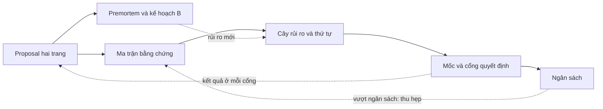
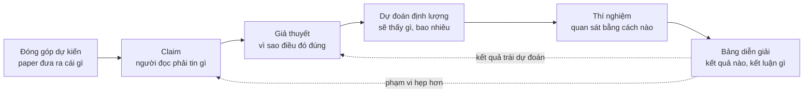

# Lập kế hoạch nghiên cứu

!!! abstract "Mục tiêu của bài"
    Sau bài này, người học có thể:

    - Giải thích vì sao một ý tưởng đã qua thẩm định vẫn chưa phải là một kế hoạch, và nhận ra các triệu chứng của một dự án chạy mà không có kế hoạch.
    - Viết một research proposal hai trang dựa trên Heilmeier Catechism, và phân biệt nó với bản pitch một trang.
    - Đi từ đóng góp dự kiến tới claim, giả thuyết có thể bác bỏ, dự đoán định lượng, thí nghiệm và bảng diễn giải kết quả, rồi tổng hợp tất cả vào một ma trận bằng chứng.
    - Sắp xếp công việc theo thứ tự giảm rủi ro, vẽ đồ thị phụ thuộc, và đặt các mốc M0–M5 với cổng quyết định đi tiếp, đổi hướng hoặc dừng.
    - Lập ngân sách compute, dữ liệu, thời gian và chi phí API có biên dự phòng; tổ chức premortem; xác định kết quả tối thiểu đáng công bố và kế hoạch B.
    - Thỏa thuận vai trò và thứ tự tác giả, tổ chức nhịp họp và cập nhật, và duy trì kế hoạch như một tài liệu sống.

Bài [Thẩm định ý tưởng](y-tuong.md) khép lại ở một thời điểm dễ chịu: ý tưởng đã vượt qua bộ câu hỏi thẩm định, cuộc tìm kiếm novelty ba tầng, và một pilot cho tín hiệu đủ để đi tiếp. Lúc này nhóm tác giả thường có trong tay một danh sách đóng góp dự kiến (*proposed contributions*) viết khá gọn gàng, chẳng hạn "một module mới", "một phân tích về nguồn lỗi", "một tập đánh giá". Cảm giác chung là phần khó nhất đã qua. Thực tế thường ngược lại. Danh sách đóng góp mô tả paper ở thời điểm kết thúc. Nó không nói tuần tới phải chạy gì, chạy theo thứ tự nào, tốn bao nhiêu GPU, ai làm phần nào, và dựa vào đâu để biết hướng đi đã sai. Khoảng cách giữa câu hỏi "paper sẽ đóng góp gì" và câu hỏi "thứ Hai tuần sau làm gì" là nơi nhiều dự án đầu tay đánh mất hàng tháng trời.

Bài này lấp khoảng cách đó bằng một bộ tài liệu lập kế hoạch gọn, mỗi tài liệu có template cụ thể. Bộ tài liệu gồm một research proposal hai trang; một ma trận bằng chứng nối mỗi đóng góp với claim, giả thuyết, dự đoán và thí nghiệm; một cây rủi ro kèm thứ tự làm việc; các mốc với cổng quyết định; một bảng ngân sách; một buổi premortem cùng kế hoạch B; và các thỏa thuận làm việc nhóm. Trọng tâm của bài là chuỗi đi từ đóng góp tới thí nghiệm. Đó là mắt xích người mới hay bỏ qua nhất, và cũng là mắt xích quyết định phần lớn chất lượng bằng chứng của paper về sau.

Bài này bổ sung cho hai bài khác chứ không thay thế chúng. Bài [Lộ trình thực hiện một paper](../00-tong-quan/lo-trinh.md) lập lịch tính ngược từ deadline; bài này lập kế hoạch tính tiến từ ý tưởng, rồi chỉ ra cách ghép hai chiều lập kế hoạch lại với nhau. Bài [Thiết kế thí nghiệm](thi-nghiem.md), ngay sau bài này, đi sâu vào cách thiết kế từng thí nghiệm sao cho công bằng và thuyết phục. Ở đây, chúng ta chỉ cần mô tả thí nghiệm đủ rõ để biết nó trả lời claim nào, tốn bao nhiêu, và nên chạy vào lúc nào. Cuối bài có một kế hoạch hoàn chỉnh cho một dự án NLP giả định, để người học thấy mọi mảnh ghép khi được đặt cạnh nhau.

## Vì sao ý tưởng trên giấy chưa phải là kế hoạch

Một ý tưởng đã qua thẩm định trả lời câu hỏi "có đáng làm không". Một kế hoạch phải trả lời bốn câu hỏi khác: cần làm gì để có bằng chứng, làm theo thứ tự nào, tốn bao nhiêu, và dấu hiệu nào cho biết phải đổi hướng. Hai loại câu hỏi này khác nhau về bản chất. Câu hỏi thứ nhất được trả lời bằng lập luận cùng một pilot nhỏ. Bốn câu hỏi sau chỉ trả lời được khi đóng góp đã được phân rã thành những đơn vị công việc cụ thể, mỗi đơn vị gắn với thời gian, tài nguyên và người chịu trách nhiệm.

Có bằng chứng thực nghiệm cho thấy khoảng cách giữa hai giai đoạn này lớn đến mức nào. Trong nghiên cứu quy mô lớn của Si, Yang và Hashimoto về ý tưởng nghiên cứu NLP dựa trên prompting (*Can LLMs Generate Novel Research Ideas?*, ICLR 2025), các reviewer chuyên gia chấm những đề xuất ý tưởng viết trên giấy. Điểm tổng mà họ cho tương quan mạnh với novelty và mức độ hấp dẫn (*excitement*), nhưng gần như không tương quan với tính khả thi. Ở nghiên cứu tiếp theo (Si, Hashimoto, Yang, *The Ideation–Execution Gap*, ICLR 2026), một phần các ý tưởng đó được giao cho người thực hiện thành paper hoàn chỉnh. Sau khi thực thi, reviewer bắt đầu cân nhắc những yếu tố đã bị bỏ qua ở giai đoạn ý tưởng: hiệu quả thực nghiệm, độ chặt chẽ, và baseline hay ablation còn thiếu. Hai nghiên cứu này có phạm vi hẹp (ý tưởng prompting trong NLP, vài chục dự án được thực thi), nên không nên khái quát hóa các con số. Thông điệp của chúng thì rất quen thuộc với bất kỳ ai từng làm nghiên cứu: một ý tưởng trên giấy được đánh giá theo những tiêu chí khác hẳn một paper đã có bằng chứng. Kế hoạch là công cụ để đưa những tiêu chí "sau thực thi" vào tầm nhìn ngay từ trước khi thực thi.

Khi thiếu kế hoạch, dự án thường bộc lộ những triệu chứng dễ nhận ra. Triệu chứng đầu tiên là **chạy thí nghiệm theo cảm hứng**: mỗi buổi sáng, nhóm chạy điều vừa nghĩ ra hôm trước; log tích lũy rất nhanh, nhưng khi được hỏi thí nghiệm hôm qua giúp chứng minh điều gì thì không ai trả lời được. Triệu chứng thứ hai là **không biết thí nghiệm nào trả lời claim nào**: bảng kết quả có nhiều cột, nhưng claim trung tâm của paper chỉ được ủng hộ một cách gián tiếp, còn thí nghiệm có khả năng bác bỏ nó thì chưa ai chạy. Triệu chứng thứ ba, và đau nhất, là **tới gần deadline mới thấy thiếu baseline**: một baseline đơn giản mà reviewer chắc chắn sẽ hỏi, chẳng hạn một mô hình có sẵn được fine-tune cẩn thận hay một LLM được prompt tử tế, chưa bao giờ được chạy; đến khi chạy thì nó thu hẹp phần lớn khoảng cách. Bên cạnh đó còn những triệu chứng phụ: GPU cạn giữa chừng vì không ai cộng lại số lần chạy cần thiết, nhóm tranh luận đi tranh luận lại một câu hỏi vì không có tiêu chí quyết định, và đồng tác giả không biết phần việc nào thuộc về ai.

Bảng dưới đây nối mỗi triệu chứng với nguyên nhân gốc và với thành phần của kế hoạch giúp chữa nó.

| Triệu chứng | Nguyên nhân gốc | Thành phần kế hoạch xử lý |
|---|---|---|
| Chạy thí nghiệm theo cảm hứng | Không có dự đoán viết trước, không có thứ tự ưu tiên | Ma trận bằng chứng; thứ tự giảm rủi ro |
| Không biết thí nghiệm nào trả lời claim nào | Đóng góp chưa được phân rã thành claim kiểm chứng được | Ma trận bằng chứng |
| Gần deadline mới thấy thiếu baseline | Chưa liệt kê các giải thích thay thế cần loại trừ | Thẻ claim (cột giải thích thay thế); premortem |
| Hết GPU hoặc tiền API giữa chừng | Không ước lượng ngân sách, hoặc chỉ tính cho phương pháp đề xuất | Bảng ngân sách có biên dự phòng |
| Tranh luận lặp lại, quyết định theo cảm xúc | Không có tiêu chí đi tiếp, đổi hướng, dừng | Mốc và cổng quyết định |
| Không rõ ai làm gì, bất đồng về tác giả | Chưa thỏa thuận vai trò từ đầu | Phân vai; thỏa thuận tác giả |

Kế hoạch nghiên cứu, theo nghĩa dùng trong bài này, là một bộ vài tài liệu ngắn liên kết với nhau như trong sơ đồ dưới đây. Proposal xác định đích đến và các claim. Ma trận bằng chứng biến claim thành thí nghiệm. Cây rủi ro cho biết nên làm thí nghiệm nào trước. Các mốc gom thí nghiệm thành từng chặng, mỗi chặng kết thúc bằng một cổng quyết định. Ngân sách kiểm tra rằng toàn bộ kế hoạch là khả thi với nguồn lực hiện có. Premortem tấn công kế hoạch từ phía thất bại và sinh ra kế hoạch B. Những gì học được ở mỗi cổng lại quay về cập nhật proposal và ma trận.



Một kế hoạch tốt không dài. Toàn bộ bộ tài liệu trên thường gói gọn trong khoảng năm trang, và nên được soạn trong vài ngày làm việc tập trung chứ không phải vài tuần. Kế hoạch dài hơn thế thường đang mô tả quá kỹ những phần chắc chắn và quá sơ sài những phần bất định. Mục tiêu của kế hoạch không phải là đoán đúng tương lai. Mục tiêu là biết trước nhóm sẽ phản ứng thế nào khi tương lai khác với dự đoán.

## Research proposal hai trang

Tài liệu đầu tiên là một research proposal ngắn, viết cho chính nhóm tác giả. Nó khác với đề cương xin tài trợ ở chỗ không phải thuyết phục một hội đồng nào; người đọc chính là những người sẽ làm dự án, cùng với người hướng dẫn. Nó cũng khác với bản pitch một trang trong bài [Xây câu chuyện của paper](cau-chuyen.md). Pitch được viết để kiểm tra và thuyết phục rằng câu chuyện đứng được, còn proposal được viết để thực thi. Khác biệt về mục đích kéo theo khác biệt về nội dung, như sẽ thấy ở cuối mục này.

### Heilmeier Catechism và nửa sau thường bị bỏ quên

Khung phù hợp nhất cho một proposal như vậy là *Heilmeier Catechism*, bộ câu hỏi do George H. Heilmeier, giám đốc DARPA giai đoạn 1975–1977, đặt ra để đánh giá các chương trình nghiên cứu được đề xuất. Heilmeier đọc từng đề xuất và đòi câu trả lời cho mỗi câu hỏi trước khi phê duyệt. Phiên bản được DARPA công bố gồm tám câu, có thể diễn giải như sau:

1. Đang cố làm gì? Nêu mục tiêu mà tuyệt đối không dùng biệt ngữ (*"What are you trying to do?"*).
2. Hiện nay việc đó được làm thế nào, và giới hạn của cách làm hiện tại là gì?
3. Cái gì mới trong cách tiếp cận, và vì sao tin rằng nó sẽ thành công?
4. Ai quan tâm? Nếu thành công, điều gì sẽ khác đi?
5. Rủi ro là gì?
6. Tốn bao nhiêu?
7. Mất bao lâu?
8. Đâu là các "bài kiểm tra giữa kỳ và cuối kỳ" (*mid-term and final exams*) để biết đã thành công?

Có nhiều biến thể từ bảy đến chín câu đang được lưu hành, và ARPA-H có một phiên bản bổ sung thêm câu hỏi về tác động xã hội, nhưng cấu trúc tám câu trên là dạng phổ biến nhất. Bài [Thẩm định ý tưởng](y-tuong.md) đã dùng một bộ câu hỏi lấy cảm hứng từ Heilmeier để quyết định có nên theo đuổi ý tưởng hay không. Bộ câu hỏi thẩm định chủ yếu khai thác bốn câu đầu, tức những câu về *giá trị* của ý tưởng. Bốn câu sau, về rủi ro, chi phí, thời gian và các bài kiểm tra, mới là phần biến một ý tưởng thành một dự án. Một proposal tốt trả lời đủ cả tám câu. Nửa sau thường khó viết hơn nửa đầu, đơn giản vì người làm nghiên cứu ít khi được rèn luyện để trả lời chúng.

Một số nhà nghiên cứu khuyến nghị những thói quen rất gần với tinh thần này. Trong ghi chú *Research Taste Exercises* (2021), Chris Olah dẫn lời khuyên của Preetum Nakkiran: trước khi cam kết hơn một tháng cho một dự án, hãy viết một đề xuất ngắn nêu vì sao câu hỏi thú vị, vì sao câu trả lời có giá trị, và kỳ vọng sẽ tìm thấy gì. Ý cuối cùng, "kỳ vọng sẽ tìm thấy gì", chính là hạt giống của các dự đoán mà mục sau sẽ phát triển. Cũng trong ghi chú đó, Olah dẫn một phép thử của Rachel Prudden rất hợp với câu hỏi "ai quan tâm": hình dung rằng một nhóm khác đã công bố đúng paper này, rồi tự hỏi có háo hức đọc nó không.

### Chuyển thể tám câu hỏi cho nghiên cứu AI

Tám câu hỏi của Heilmeier được viết cho các chương trình nghiên cứu quốc phòng kéo dài nhiều năm. Khi áp dụng cho một dự án paper kéo dài vài tháng trong Computer Vision, NLP hay Machine Learning, mỗi câu cần một phiên bản cụ thể hơn. Bảng dưới đây đưa ra phiên bản đó, kèm kiểu câu trả lời yếu thường gặp ở người mới, vì nhận ra câu trả lời yếu là cách nhanh nhất để viết được câu trả lời mạnh.

| Câu hỏi Heilmeier | Phiên bản cho một dự án AI | Câu trả lời yếu thường gặp |
|---|---|---|
| Đang cố làm gì? | Một câu mục tiêu không biệt ngữ, kèm kiểu đóng góp chủ đạo (phương pháp, phân tích, dataset, phương pháp đánh giá…) | Mô tả phương pháp thay cho mục tiêu: "dùng attention đa tỉ lệ cho…" |
| Hiện nay làm thế nào, giới hạn ở đâu? | Baseline mạnh nhất cụ thể, con số đã tái lập, một thất bại đo được | "Các phương pháp hiện có chưa hiệu quả" mà không có con số; so với một baseline yếu |
| Cái gì mới, vì sao sẽ thành công? | Insight phát biểu được mà không cần tên phương pháp; bằng chứng sơ bộ từ pilot | Chỉ có "chưa ai làm"; không có bằng chứng sơ bộ nào |
| Ai quan tâm? | Cộng đồng và venue mục tiêu; ai sẽ làm khác đi nhờ kết quả; phép thử "nhóm khác công bố" | "Có ứng dụng rộng rãi" |
| Rủi ro là gì? | Ba đến năm rủi ro lớn nhất, xác suất ước lượng, thí nghiệm rẻ nhất để kiểm tra mỗi rủi ro | Không nêu rủi ro nào, hoặc chỉ nêu "có thể thiếu GPU" |
| Tốn bao nhiêu? | GPU-giờ, chi phí API, giờ gán nhãn, kèm biên dự phòng | Không ước lượng, hoặc quên phần dành cho baseline |
| Mất bao lâu? | Các mốc M0–M5 có ngày, đối chiếu với deadline | Chỉ có một ngày duy nhất là deadline |
| Bài kiểm tra giữa kỳ và cuối kỳ? | Tiêu chí ở mỗi cổng quyết định; kết quả mục tiêu và kết quả tối thiểu đáng công bố | "Đạt SOTA" |

Hai dòng trong bảng cần thêm lời giải thích. Ở câu thứ hai, một hướng dẫn gắn với DARPA thêm một câu hỏi phụ rất đáng dùng: người đề xuất có thật sự biết state of the art, hay đang tấn công một hình nộm (*strawman*)? Với nghiên cứu AI, câu hỏi này gần như đồng nghĩa với việc nhóm đã tái lập được baseline mạnh nhất hay chưa. Một proposal ghi "baseline X đạt 45,2 theo paper gốc; nhóm tái lập được 44,9 bằng code chính thức" mạnh hơn nhiều so với một proposal chỉ ghi tên X. Ở câu cuối cùng, "đạt SOTA" là một câu trả lời yếu không phải vì SOTA không quan trọng, mà vì nó chỉ là bài kiểm tra cuối kỳ. Một dự án cần cả bài kiểm tra giữa kỳ, tức những dấu hiệu sớm cho biết hướng đi đúng hay sai từ rất lâu trước khi có bảng kết quả cuối cùng. Phần lớn giá trị của câu hỏi thứ tám nằm ở chữ "giữa kỳ".

### Ba template tóm tắt dự án: proposal, pitch và Tầng 0

Giáo trình có ba template cùng tóm tắt một dự án trên một hai trang, nên người học dễ hỏi vì sao cần tới ba. Ngoài research proposal (đề cương nghiên cứu) của bài này, còn có bản pitch một trang ở bài [Xây câu chuyện của paper](cau-chuyen.md) và bản pitch rút gọn ở Tầng 0 trong bài [Quy trình viết & tự review](../03-ky-thuat/quy-trinh-viet.md). Cả ba chia sẻ một phần lõi gồm vấn đề, khoảng trống, insight và claim. Chúng khác nhau ở câu hỏi mà mỗi template giúp trả lời, và vì thế khác nhau ở thời điểm viết và ở những mục riêng mà chỉ template đó có.

| | Research proposal hai trang (bài này) | Bản pitch một trang ([cau-chuyen.md](cau-chuyen.md)) | Tầng 0 ([quy-trinh-viet.md](../03-ky-thuat/quy-trinh-viet.md)) |
|---|---|---|---|
| Câu hỏi chính | Làm gì, theo thứ tự nào, với nguồn lực nào, và khi nào phải đổi hướng? | Câu chuyện có đứng được không, có thuyết phục được người đọc không? | Câu chuyện đã đủ chín để bắt đầu viết bản thảo chưa? |
| Chức năng | Thực thi | Thuyết phục và định hình câu chuyện | Mở đầu quy trình viết theo tầng |
| Thời điểm | Ngay sau khi ý tưởng qua thẩm định, trước khi cam kết nguồn lực lớn | Khi kết quả bắt đầu về và cần chốt câu chuyện (khoảng D − 3,5 tháng theo [lộ trình](../00-tong-quan/lo-trinh.md)) | Ngay trước khi viết outline và bản nháp đầu tiên |
| Mục riêng | Rủi ro, ngân sách, mốc và cổng, kết quả tối thiểu đáng công bố, phân vai | Câu tóm tắt một dòng, phác thảo Figure 1, câu hỏi đáng ngại nhất từ reviewer | Bằng chứng chính nằm ở bảng hay hình nào; venue và track |
| Người đọc chính | Chính nhóm thực hiện, đọc lại hằng tuần | Người hướng dẫn, đồng tác giả, người đọc ngoài nhóm | Người hướng dẫn |

Đọc bảng theo chiều thời gian, ba template nối tiếp nhau trong vòng đời dự án. Proposal ra đời đầu tiên. Khi bằng chứng đã định hình, nhóm rút phần lõi của proposal ra và viết lại thành pitch, lúc này trọng tâm chuyển từ kế hoạch sang lập luận; các mục claim, thí nghiệm và rủi ro của pitch kế thừa trực tiếp từ proposal và ma trận bằng chứng. Khi bắt đầu viết paper, pitch được nén lại thành Tầng 0 để mở quy trình viết. Vì vậy không cần viết ba tài liệu từ đầu; cần giữ cho chúng không kể ba câu chuyện khác nhau. Mỗi khi claim thay đổi, proposal được tăng số phiên bản, pitch được cập nhật theo, và thay đổi được ghi vào nhật ký quyết định (xem mục "Kế hoạch là tài liệu sống" ở cuối bài).

### Template proposal

Template dưới đây trải tám câu hỏi Heilmeier ra thành chín mục, trong đó mục (5) về đóng góp và claim được tách riêng vì nó là đầu vào của ma trận bằng chứng. Khi điền, mỗi mục nên ngắn: hai trang là giới hạn cứng, và giới hạn đó buộc người viết chọn điều quan trọng nhất.

```markdown
# Research proposal: <tên tạm của dự án>
Phiên bản: v0.1   Ngày: ____   Người giữ tài liệu: Tác giả A   Người duyệt: Người hướng dẫn

## (1) Mục tiêu (2–3 câu, không biệt ngữ)
- Câu mục tiêu một dòng (tiếng Anh): "We aim to show that ___, and to build ___ that ___."
- Kiểu đóng góp chủ đạo: phương pháp / cách đặt bài toán / dataset / phương pháp đánh giá / phân tích / hiệu quả

## (2) Hiện trạng và giới hạn
- Baseline mạnh nhất: <tên, venue, năm>. Paper báo cáo ___; nhóm tái lập được ___ (code chính thức / tự cài đặt)
- Thất bại cụ thể đã đo được: <con số, tập con, ví dụ>
- Hai công trình gần nhất và khác biệt (mỗi công trình một câu):

## (3) Cái mới và vì sao có thể thành công
- Insight (phát biểu không nhắc tên phương pháp):
- Bằng chứng sơ bộ: <kết quả pilot, phân tích lỗi, link log>

## (4) Ai quan tâm
- Cộng đồng, venue mục tiêu, venue dự phòng:
- Nếu thành công, ai sẽ làm khác đi điều gì?
- Phép thử: nếu một nhóm khác công bố đúng paper này, nhóm có háo hức đọc không? Vì sao?

## (5) Đóng góp dự kiến và claim
- Đ1: ___ -> claim trung tâm C1: ___ (đo bằng gì, trong phạm vi nào, so với gì)
- Đ2: ___ -> claim C2, C3: ___
- Điều nhóm kỳ vọng sẽ thấy (viết TRƯỚC khi chạy): ___

## (6) Rủi ro (chi tiết ở cây rủi ro)
| Rủi ro | Chí mạng / thu hẹp | Xác suất ước lượng | Thí nghiệm rẻ nhất để kiểm tra | Mốc |

## (7) Chi phí (chi tiết ở bảng ngân sách)
- Compute: ___ GPU-giờ   API: ___ USD   Gán nhãn: ___ giờ người   Biên dự phòng: ___

## (8) Thời gian và các bài kiểm tra
- M1 (ngày ___): đi tiếp nếu ___ / đổi hướng nếu ___ / dừng nếu ___
- M2 ... M5
- Kết quả mục tiêu: ___
- Kết quả tối thiểu đáng công bố: ___

## (9) Phân vai và cam kết thời gian
- Tác giả A: ___ (___ giờ/tuần)   Tác giả B: ___   Người hướng dẫn: duyệt tại M0, M2, M3
```

Sau khi viết xong, có hai phép thử nhanh. Phép thử thứ nhất là đọc to mục (1) cho một người ngoài lĩnh vực hẹp nghe; nếu họ không nhắc lại được mục tiêu, mục (1) vẫn còn biệt ngữ. Phép thử thứ hai là đánh dấu câu hỏi Heilmeier nào khó trả lời nhất. Câu khó nhất thường chỉ thẳng vào chỗ rủi ro của dự án nằm. Không trả lời được câu thứ ba nghĩa là chưa có insight, và nên quay lại bước thẩm định. Không trả lời được câu thứ sáu hay thứ bảy nghĩa là dự án chưa được phân rã, và phần còn lại của bài này dành cho việc đó.

## Từ đóng góp dự kiến tới claim, giả thuyết và thí nghiệm

Đây là phần quan trọng nhất của kế hoạch, và cũng là phần mà nỗi đau "có ý tưởng nhưng không biết thực thi" thường bắt nguồn. Một đóng góp dự kiến như "một module khử nhiễu cho ảnh ban đêm" chưa nói được thí nghiệm nào cần chạy. Để đi từ nó tới một danh sách thí nghiệm, cần đi qua một chuỗi sáu mắt xích. Mỗi mắt xích trả lời một câu hỏi mà mắt xích trước chưa trả lời: đóng góp nói paper đưa cho cộng đồng *cái gì*; claim nói người đọc phải *tin điều gì*; giả thuyết nói *vì sao* điều đó đúng; dự đoán nói nếu giả thuyết đúng thì *sẽ quan sát thấy gì*; thí nghiệm là *cách quan sát*; và bảng diễn giải nói với mỗi kết quả có thể xảy ra thì *kết luận gì và làm gì tiếp*.



Các mục con dưới đây đi qua từng mắt xích, rồi gom tất cả vào một ma trận bằng chứng, và kết thúc bằng một ví dụ đầy đủ cho một dự án Computer Vision giả định.

### Từ đóng góp tới claim

Đóng góp và claim thường bị dùng lẫn lộn, nhưng chúng khác nhau về ngữ pháp, và khác biệt ngữ pháp này có hệ quả thực tế. Đóng góp là một *danh từ*: "một phương pháp", "một benchmark", "một phân tích". Claim là một *mệnh đề*, có thể đúng hoặc sai: "phương pháp X giảm lỗi trên vật thể nhỏ ít nhất bằng một nửa so với baseline mạnh nhất". Reviewer không đánh giá danh từ; họ đánh giá mệnh đề. Một danh từ không thể bị bác bỏ, nên cũng không thể được chứng minh. Chừng nào đóng góp còn ở dạng danh từ, nhóm tác giả chưa biết cần bằng chứng gì cho nó.

Mỗi đóng góp thường sinh ra một đến ba claim. Trong số đó, cần phân biệt **claim trung tâm**, tức claim mà nếu sai thì paper sụp đổ, với **claim phụ**, tức claim mà nếu sai thì paper chỉ hẹp lại. Sự phân biệt này quyết định thứ tự làm việc ở mục sau. Một paper tốt có rất ít claim trung tâm. Andrej Karpathy, trong *A Survival Guide to a PhD* (2016), khuyên xác định đóng góp cốt lõi duy nhất của paper, vì theo ông các đóng góp không cộng dồn: một đóng góp phụ thứ hai thường làm loãng paper chứ không làm nó mạnh thêm. Ông viết: *"The paper sells a single thing that was not obvious or present before."* (Paper "bán" một điều duy nhất trước đó chưa hiển nhiên hoặc chưa có.) Khi phân rã đóng góp thành claim, người viết thường phát hiện ra một "đóng góp" trong danh sách thực ra chỉ là phạm vi của một đóng góp khác; ví dụ ở cuối mục này có đúng trường hợp đó. Những biến thể khó hơn của hiện tượng "độn" đóng góp được phân tích ở bài [Ghép ý tưởng và "độn" đóng góp](../07-tinh-huong-kho/ghep-va-don.md).

Một claim kiểm chứng được nêu rõ ba điều: đo bằng gì, trong phạm vi nào, và so với cái gì. Cách viết claim như vậy đã được trình bày kỹ ở bài Xây câu chuyện của paper. Ở giai đoạn lập kế hoạch, claim còn cần thêm một thuộc tính: nó phải đủ cụ thể để suy ra được thí nghiệm. "Phương pháp tổng quát hóa tốt" không suy ra được thí nghiệm nào. "Phương pháp giữ ít nhất 90% mức cải thiện khi chuyển từ backbone CNN sang backbone Transformer" suy ra ngay một thí nghiệm, kèm luôn một ngưỡng.

### Từ claim tới giả thuyết có thể bác bỏ

Claim nói điều gì đúng; giả thuyết nói vì sao nó đúng. Giả thuyết là một phát biểu về *cơ chế*: "lỗi tăng ở ảnh tối vì nhiễu cảm biến làm hỏng đặc trưng cấp thấp", chứ không chỉ "lỗi tăng ở ảnh tối". Có hai lý do khiến kế hoạch cần mắt xích này. Lý do thứ nhất là về phía người đọc: một claim chỉ được ủng hộ bằng con số thì dễ bị coi là may mắn hoặc là kết quả của tune kỹ, còn một claim kèm cơ chế được xác nhận thì để lại một hiểu biết có thể mang đi nơi khác, đúng như phân tích về insight trong bài Xây câu chuyện của paper. Lý do thứ hai là về phía kế hoạch: chính giả thuyết cho biết thí nghiệm nào có sức phân biệt. Hai phương pháp có thể cùng cho một con số tổng, nhưng nếu cơ chế khác nhau thì chúng sẽ để lại dấu vết khác nhau ở các tập con, và giả thuyết cho biết phải nhìn vào tập con nào.

Một giả thuyết hữu ích phải **có thể bác bỏ**: phải tồn tại một kết quả quan sát được mà nếu xảy ra thì giả thuyết sai. "Phương pháp hoạt động nhờ học được biểu diễn tốt hơn" không bác bỏ được, vì gần như mọi kết quả đều có thể được giải thích là "biểu diễn tốt hơn". "Phương pháp hoạt động nhờ khôi phục chi tiết tần số cao ở vùng tối" bác bỏ được: nếu cải thiện không tập trung ở vùng tối, hoặc nếu một bộ lọc thông thấp đặt trước mạng không làm mất cải thiện, giả thuyết sai.

Bước dễ bị bỏ qua nhất ở mắt xích này là liệt kê **giải thích thay thế** (*alternative explanations*), tức những lý do khác có thể tạo ra cùng kết quả. Lipton và Steinhardt, trong bài *Troubling Trends in Machine Learning Scholarship* (2018), coi việc xem xét và loại trừ các giả thuyết thay thế là một trong những phẩm chất cốt lõi của một nghiên cứu thực nghiệm tốt, và chỉ ra một xu hướng đáng lo ngại là không xác định được nguồn gốc thật của mức cải thiện, chẳng hạn gán công cho thay đổi kiến trúc trong khi cải thiện thực ra đến từ việc tune hyperparameter. Với nghiên cứu AI, danh sách giải thích thay thế khá ổn định giữa các dự án: phương pháp mới có nhiều tham số hoặc tính toán hơn; được tune kỹ hơn baseline; dùng thêm dữ liệu; lợi dụng một đặc điểm của benchmark thay vì giải quyết bài toán; dữ liệu test bị lộ vào dữ liệu huấn luyện; chênh lệch nằm trong dao động giữa các seed; hoặc chỉ một thành phần đơn giản trong phương pháp tạo ra toàn bộ hiệu quả. Mỗi giải thích thay thế quan trọng cần một thí nghiệm đối chứng để loại nó.

Danh sách này cũng chính là liều thuốc cho triệu chứng "gần deadline mới thấy thiếu baseline": phần lớn những baseline bị phát hiện muộn là đối chứng cho một giải thích thay thế mà không ai viết ra từ đầu. Với một bài toán hoàn toàn mới, nơi chưa có phương pháp nào để so sánh, danh sách giải thích thay thế vẫn sinh ra baseline: một lời giải tầm thường cho biết con số có cao hơn mức đoán mò không, một thí nghiệm oracle (biết trước một phần thông tin đúng) cho biết trần của bài toán, và kết quả của con người cho biết bài toán khó tới đâu. Tình huống 30 trong bài [Bài toán, dữ liệu và phạm vi](../07-tinh-huong-kho/bai-toan-va-pham-vi.md) phân tích kỹ trường hợp này; điều cần làm ở giai đoạn lập kế hoạch là đưa ngay những baseline đó vào ma trận, thay vì để reviewer đòi.

### Từ giả thuyết tới dự đoán định lượng

Dự đoán là hệ quả quan sát được của giả thuyết trong một thí nghiệm cụ thể. Một dự đoán tốt nêu năm điều: **chiều** của hiệu ứng (tăng hay giảm), **độ lớn** tối thiểu, **nơi** hiệu ứng xuất hiện (toàn bộ hay một tập con), **so với cái gì**, và **mức nhiễu** dùng làm thước đo (thường là độ lệch chuẩn giữa các seed). Hai dự đoán dưới đây (ví dụ giả định) cho thấy khác biệt.

<div class="bad" markdown>
*"Phương pháp sẽ tốt hơn baseline trên ảnh ban đêm."*

Dự đoán này gần như không thể sai: một cải thiện 0,1 điểm cũng "tốt hơn", và nó không nói gì về cơ chế. Mọi kết quả dương đều được diễn giải là thành công.
</div>

<div class="good" markdown>
*"Trên 20% ảnh tối nhất của tập validation ban đêm, mIoU tăng ít nhất 3 điểm so với baseline huấn luyện cùng recipe (trung bình 3 seed; độ lệch chuẩn giữa seed ở pilot khoảng 0,5), trong khi trên 50% ảnh sáng nhất thay đổi không quá 0,5 điểm."*

Dự đoán này nêu chiều, độ lớn, nơi xuất hiện, đối tượng so sánh và mức nhiễu. Nó có thể sai theo ba cách khác nhau, và mỗi cách sai mang một thông tin khác nhau về giả thuyết.
</div>

Ngưỡng trong dự đoán đến từ ba nguồn. Nguồn thứ nhất là pilot: kích thước hiệu ứng quan sát được ở pilot, trừ đi một khoản cho sự lạc quan của thiết lập nhỏ. Nguồn thứ hai là mức nhiễu: một hiệu ứng nhỏ hơn hai ba lần độ lệch chuẩn giữa các seed khó thuyết phục được ai. Nguồn thứ ba là cộng đồng: mức cải thiện nào đủ để reviewer coi là có ý nghĩa thực tế trên benchmark này. Nên phân biệt **ngưỡng đi tiếp**, tức mức đủ để tin rằng hướng đi đúng, với **ngưỡng đáng công bố**, tức mức đủ để thành claim trong paper; ngưỡng thứ nhất thường thấp hơn ngưỡng thứ hai.

Ngưỡng đáng công bố còn phụ thuộc vào kiểu claim. Tài liệu hướng dẫn reviewer do ban chương trình CVPR và ICCV soạn (năm 2019, được dùng lại ở các năm sau) phân biệt nhiều mức bằng chứng: một ý tưởng có tiềm năng thay đổi lĩnh vực chỉ cần một bằng chứng khái niệm (*proof of concept*), một ý tưởng hợp lý cho một bài toán đã quen thuộc cần kết quả trên benchmark, còn một ý tưởng *"weird, overly complex, implausible, and/or seemingly incremental"* (kỳ lạ, quá phức tạp, khó tin, hoặc trông có vẻ chỉ cải tiến nhỏ) thì cần kết quả xuất sắc. Người lập kế hoạch nên tự xếp claim trung tâm của dự án vào một trong các mức đó, vì mức càng cao thì ngưỡng trong dự đoán càng phải chặt và ngân sách cho bằng chứng càng lớn. Ngược lại, không cần chuẩn bị bằng chứng vượt quá claim: hướng dẫn phản biện của ACL Rolling Review nhắc reviewer rằng *"a paper only needs to present sufficient evidence for the claim that the authors are making"* (paper chỉ cần trình bày đủ bằng chứng cho claim mà tác giả đưa ra). Claim được phát biểu hẹp và rõ là cách rẻ nhất để giữ ngân sách trong tầm tay.

Điều kiện quan trọng nhất là dự đoán phải được **viết ra trước khi chạy**. Một dự đoán viết sau khi đã thấy kết quả không còn là dự đoán, và trí nhớ con người sắp xếp lại thứ tự sự kiện theo hướng có lợi cho câu chuyện hiện tại nhanh hơn người ta tưởng. Bài [Thực hành: ba dự án đi qua ngõ cụt](../07-tinh-huong-kho/thuc-hanh.md) ở Chương 7 phân tích kỹ cơ chế này và đưa ra mẫu nhật ký quyết định, trong đó ô "dự đoán và điều kiện đảo ngược" đóng vai trò một hình thức đăng ký trước (*pre-registration*) gọn nhẹ. Ma trận bằng chứng của bài này là nơi các dự đoán đó được viết lần đầu, từ trước khi thí nghiệm đầu tiên bắt đầu.

### Từ dự đoán tới thí nghiệm và bảng diễn giải

Khi đã có dự đoán, thí nghiệm cần được chọn sao cho giả thuyết và các giải thích thay thế **dự đoán những kết quả khác nhau**. Đó là định nghĩa thực dụng của một thí nghiệm có sức phân biệt. Nếu cả giả thuyết lẫn giải thích thay thế đều dự đoán "phương pháp tốt hơn baseline", thì bảng so sánh chính không phân biệt được chúng, và cần một thí nghiệm khác, thường là đánh giá trên tập con hoặc một biến thể đối chứng.

Một công cụ hữu ích ở bước này đến từ *Deep Learning Tuning Playbook* của nhóm Google Research (Godbole và cộng sự, 2023). Tài liệu này chia các hyperparameter trong một thí nghiệm thành ba vai. Hyperparameter **khoa học** (*scientific*) là thứ có tác động đang được đo. Hyperparameter **phiền nhiễu** (*nuisance*) phải được tối ưu riêng cho từng giá trị của hyperparameter khoa học để so sánh là công bằng, chẳng hạn learning rate khi so sánh hai kiến trúc. Hyperparameter **cố định** (*fixed*) được giữ nguyên trong vòng thí nghiệm này. Vai của một hyperparameter không cố hữu mà phụ thuộc vào mục tiêu của thí nghiệm. Playbook lưu ý rằng *"fixed hyperparameters create caveats for any conclusions we draw from the experiments"*, tức mỗi hyperparameter cố định tạo ra một giới hạn cho kết luận. Khi lập kế hoạch, viết rõ ba vai này cho mỗi thí nghiệm có hai lợi ích: nó cho biết cần tune bao nhiêu lần (đầu vào của ngân sách compute), và nó cho biết phạm vi của claim phải hẹp đến đâu.

Mắt xích cuối là **bảng diễn giải**: với mỗi thí nghiệm quyết định, viết trước ít nhất ba kết cục có thể xảy ra, mỗi kết cục kèm kết luận và hành động. Ba kết cục tối thiểu là: kết quả như dự đoán; không có hiệu ứng vượt nhiễu; và hiệu ứng ngược chiều hoặc xuất hiện ở chỗ khác với dự đoán. Bảng diễn giải có một công dụng ít người để ý: nó là phép thử giá trị thông tin của thí nghiệm. Nếu cả ba kết cục đều dẫn tới cùng một hành động, chẳng hạn "dù sao cũng tiếp tục", thì thí nghiệm đó không giúp ra quyết định nào, và nên được hoãn lại hoặc thiết kế lại. Ý này cũng xuất hiện trong phân tích Tình huống 26 ở bài [Áp lực từ bên ngoài](../07-tinh-huong-kho/ap-luc-ben-ngoai.md): thí nghiệm mà kết quả không làm thay đổi gì là thí nghiệm có giá trị thông tin thấp.

Kế hoạch không cấm khám phá. Playbook của Google cho biết phần lớn thời gian của nhóm tác giả dành cho *khám phá* để hiểu bài toán, chỉ một phần nhỏ dành cho việc tối ưu kết quả (*"we spend most of our time on "exploration" and only a small amount on "exploitation""*). Điều kế hoạch yêu cầu là gắn nhãn: thí nghiệm khám phá được ghi là khám phá, có ngân sách riêng, và không được dùng trực tiếp làm bằng chứng cho claim. Khi khám phá làm lộ ra một hiện tượng thú vị, hiện tượng đó trở thành một giả thuyết mới, được kiểm chứng bằng một thí nghiệm riêng có dự đoán viết trước. Ranh giới giữa hai loại thí nghiệm là ranh giới giữa một phát hiện và một kết quả được chọn lọc sau khi đã nhìn dữ liệu.

### Ma trận bằng chứng

Ma trận bằng chứng gom toàn bộ chuỗi trên vào một tài liệu. Nó gồm hai lớp. Lớp thứ nhất là một **bảng claim nhân thí nghiệm**: mỗi dòng là một claim, mỗi cột là một thí nghiệm, và mỗi ô ghi vai trò của thí nghiệm đó đối với claim đó. Bốn vai trò được dùng:

- **Q (quyết định):** kết quả của thí nghiệm có thể bác bỏ claim.
- **H (hỗ trợ):** thí nghiệm làm claim thuyết phục hơn nhưng không thể bác bỏ nó.
- **Đ (đối chứng):** thí nghiệm loại một giải thích thay thế.
- **N (nền):** thí nghiệm là điều kiện tiên quyết, chẳng hạn tái lập baseline.

Lớp thứ hai là một **thẻ claim** cho mỗi claim trung tâm, ghi đầy đủ chuỗi từ đóng góp tới bảng diễn giải. Tách thành hai lớp vì chúng phục vụ hai câu hỏi khác nhau: bảng cho cái nhìn toàn cục (claim nào thiếu bằng chứng, thí nghiệm nào không phục vụ claim nào), còn thẻ cho chiều sâu của từng claim.

```markdown
## Ma trận bằng chứng — dự án ____   Phiên bản: __   Cập nhật: ____

### Lớp 1: claim x thí nghiệm   (Q = quyết định, H = hỗ trợ, Đ = đối chứng, N = nền)
| Claim                  | E0 | E1 | E2 | E3 | ... | Trạng thái claim |
|------------------------|----|----|----|----|-----|------------------|
| C1 (trung tâm): ...    | N  | Q  | H  |    |     | chưa có bằng chứng / mức A-B-C-D |
| C2 (phụ): ...          | N  |    | Q  | Đ  |     |                  |

### Lớp 2: thẻ claim (một thẻ cho mỗi claim trung tâm)
Claim C__: <đo gì, phạm vi nào, so với gì>
Thuộc đóng góp: Đ__            Loại: trung tâm / phụ
Giả thuyết (cơ chế): ___
Giải thích thay thế cần loại:
  R1: ___ -> thí nghiệm đối chứng E__
  R2: ___ -> thí nghiệm đối chứng E__
Dự đoán (viết ngày ____, TRƯỚC khi chạy):
  Thí nghiệm E__: chiều ___, độ lớn tối thiểu ___, nơi ___, so với ___, mức nhiễu ___
Thiết lập của thí nghiệm quyết định:
  Dữ liệu và split: ___      Metric: ___      Số seed: ___
  Baseline (kể cả baseline đơn giản, oracle, con người nếu cần): ___
  Ablation cần có cho claim này: ___
Vai hyperparameter: khoa học ___ / phiền nhiễu ___ (tune bao nhiêu lần, CHO CẢ baseline) / cố định ___
Bảng diễn giải:
  Nếu như dự đoán:            kết luận ___ -> hành động ___
  Nếu không có hiệu ứng:      kết luận ___ -> hành động ___
  Nếu ngược chiều / chỗ khác: kết luận ___ -> hành động ___
Mốc cần có kết quả: M__        Người chịu trách nhiệm: ____
```

Khi ma trận đã điền xong, nhóm đọc nó theo năm quy tắc. Mỗi quy tắc bắt một kiểu lỗi kế hoạch khác nhau.

- [ ] Mỗi claim trung tâm có ít nhất một ô **Q**, và thẻ claim của nó ghi đủ dữ liệu, metric, baseline và ablation của thí nghiệm quyết định. Claim không có thí nghiệm quyết định là claim chỉ được minh họa chứ chưa được kiểm chứng.
- [ ] Mỗi cột phục vụ ít nhất một claim. Cột không có ô nào là thí nghiệm khám phá, cần được gắn nhãn và có ngân sách riêng, hoặc được bỏ.
- [ ] Mỗi giải thích thay thế quan trọng trong các thẻ claim có một cột **Đ** tương ứng.
- [ ] Các cột **N** được xếp lên đầu thứ tự làm việc, vì mọi thứ khác phụ thuộc vào chúng.
- [ ] Mọi ô "nếu không có hiệu ứng" trong bảng diễn giải đều có một hành động cụ thể, không phải "chạy thêm".

!!! info "Ma trận bằng chứng khác gì bảng claim ở bài Thiết kế thí nghiệm"
    Bài [Thiết kế thí nghiệm](thi-nghiem.md) có một bảng kế hoạch nối claim với câu hỏi của reviewer, thí nghiệm và kết quả ủng hộ. Ma trận ở đây đứng ở tầng trên: nó nối thêm claim với đóng góp, giả thuyết, giải thích thay thế và hành động cho từng kết cục, và nó được dùng để sắp thứ tự công việc, đặt cổng quyết định và tính ngân sách. Khi chuyển sang thiết kế chi tiết từng thí nghiệm (benchmark, metric, so sánh công bằng, ablation), người học dùng bài Thiết kế thí nghiệm; mỗi cột của ma trận trở thành một mục trong kế hoạch thí nghiệm chi tiết đó.

### Ví dụ đầy đủ: một dự án Computer Vision

Để thấy chuỗi vận hành thế nào, hãy theo dõi một dự án giả định về phân đoạn ngữ nghĩa (*semantic segmentation*) ảnh đường phố ban đêm. Mọi tên phương pháp và con số dưới đây đều là ví dụ giả định. Pilot ở giai đoạn thẩm định cho thấy hai điều: mô hình phân đoạn huấn luyện trên ảnh ban ngày sụt mIoU rất mạnh trên ảnh ban đêm, và việc đặt một bước khử nhiễu đơn giản trước mạng làm tăng nhẹ độ chính xác ở vùng tối. Từ đó nhóm viết ba đóng góp dự kiến:

- Đ1: một phân tích cho thấy nguồn lỗi chính của phân đoạn ban đêm là nhiễu cảm biến ở vùng tối, chứ không phải sự lệch màu sắc và độ sáng.
- Đ2: NoctDN (tên giả định), một mô-đun khử nhiễu nhận biết độ sáng, huấn luyện cùng mạng phân đoạn.
- Đ3: hiệu quả nhất quán trên nhiều backbone và hai benchmark ban đêm.

Ngay khi phân rã sang claim, Đ3 lộ ra là không phải một đóng góp riêng: nó là phạm vi của Đ2. Trong ma trận, nó trở thành claim phụ C4 của Đ2. Danh sách đóng góp còn lại hai mục, gọn và mạnh hơn. Bốn claim được viết như sau.

- **C1 (trung tâm, Đ1):** khi làm tối ảnh ban ngày một cách có kiểm soát, thêm nhiễu cảm biến mô phỏng làm mIoU giảm nhiều hơn hẳn so với chỉ giảm sáng và đổi màu ở cùng mức độ sáng.
- **C2 (phụ, Đ1):** trên ảnh ban đêm thật, lỗi tập trung ở vùng tối và tương quan với mức nhiễu ước lượng mạnh hơn với độ lệch màu, kể cả khi so trong cùng một lớp đối tượng.
- **C3 (trung tâm, Đ2):** với cùng recipe huấn luyện, NoctDN tăng mIoU ở vùng tối rõ rệt hơn ở vùng sáng, và vượt cách ghép một bộ khử nhiễu có sẵn với mạng phân đoạn.
- **C4 (phụ, Đ2):** cải thiện giữ cùng chiều trên ba backbone và hai benchmark ban đêm.

Giả thuyết chung cho C1 đến C3 là: ở vùng tối, tỉ lệ tín hiệu trên nhiễu thấp làm hỏng đặc trưng cấp thấp trước khi mạng kịp tổng hợp ngữ cảnh, còn sự lệch màu phần lớn đã được các lớp chuẩn hóa đầu mạng xử lý. Nhóm liệt kê năm giải thích thay thế. R1: sự lệch màu và độ sáng mới là nguyên nhân chính, cạnh tranh trực tiếp với giả thuyết. R2: vùng tối chứa nhiều lớp nhỏ và hiếm, nên lỗi cao là do thành phần lớp chứ không do điều kiện ảnh. R3: nhãn ở vùng tối kém chính xác hơn. R4: cải thiện của NoctDN đến từ tham số và tính toán thêm. R5: một bộ khử nhiễu có sẵn đặt trước mạng đã đủ, mô-đun huấn luyện cùng không cần thiết. Từ giả thuyết và các giải thích thay thế, tám thí nghiệm được xác định.

- **E0:** tái lập baseline với hai backbone trên benchmark ban ngày và ban đêm.
- **E1:** làm tối có kiểm soát ảnh ban ngày ở ba mức độ sáng, hai kiểu suy giảm (có nhiễu và không nhiễu); chỉ cần suy luận.
- **E2:** phân tầng lỗi trên ảnh ban đêm thật theo độ sáng, mức nhiễu và độ lệch màu, trong từng lớp; kiểm tra lại nhãn trên 100 ảnh.
- **E3:** ghép bộ khử nhiễu có sẵn với mạng phân đoạn.
- **E4:** NoctDN so với baseline cùng recipe, 3 seed.
- **E5:** ablation: khối đối chứng cùng số tham số; bỏ tín hiệu độ sáng; huấn luyện tách rời.
- **E6:** thêm hai backbone, trên hai benchmark ban đêm.
- **E7:** khám phá: hình định tính, failure cases.

Lớp thứ nhất của ma trận như sau.

| Claim | E0 | E1 | E2 | E3 | E4 | E5 | E6 | E7 |
|---|---|---|---|---|---|---|---|---|
| C1 (trung tâm): nhiễu gây sụt nhiều hơn màu | N | Q | H | | | | | |
| C2 (phụ): lỗi ban đêm theo nhiễu, trong từng lớp | N | | Q | | | | | H |
| C3 (trung tâm): NoctDN cải thiện vùng tối, vượt khử nhiễu có sẵn | N | | | Đ | Q | Đ | | H |
| C4 (phụ): cùng chiều trên ba backbone, hai benchmark | N | | | | H | | Q | |

Đọc ma trận, ba điều hiện ra ngay. Thứ nhất, E0 nằm dưới mọi claim, nên phải làm đầu tiên. Thứ hai, E1 vừa rẻ (chỉ cần suy luận trên checkpoint của E0) vừa là thí nghiệm quyết định của một claim trung tâm, nên nên làm ngay sau E0, trước khi viết dòng code nào cho NoctDN. Thứ ba, E3 là đúng loại baseline thường bị phát hiện muộn. Nó là đối chứng cho R5, và nếu bộ khử nhiễu có sẵn thu hẹp được phần lớn khoảng cách, đóng góp phương pháp sụp đổ và paper phải chuyển sang hướng phân tích kèm một baseline đơn giản. Một rủi ro lớn như vậy cần được biết từ tháng đầu, không phải từ tuần trước deadline. Vì vậy E3 được xếp lên trước E4, dù về mặt "tiến độ" nó không xây thêm gì cho phương pháp.

Bảng diễn giải cho thí nghiệm quyết định E1 của claim C1 được viết trước khi chạy:

| Kết quả của E1 | Kết luận | Hành động |
|---|---|---|
| Kiểu có nhiễu làm mIoU giảm ít nhất gấp đôi kiểu chỉ giảm sáng và đổi màu, ở cả ba mức độ sáng | Giả thuyết được ủng hộ; R1 bị loại phần lớn | Giữ C1; bắt đầu xây NoctDN; chạy E3 song song |
| Hai kiểu suy giảm gây sụt tương đương | Cả hai yếu tố đều quan trọng; giả thuyết phát biểu quá mạnh | Thu hẹp C1 thành "nhiễu là một trong hai nguồn lỗi chính"; xem lại thiết kế mô-đun để xử lý cả màu; tìm kiếm lại novelty với các công trình thích nghi màu sắc |
| Kiểu chỉ giảm sáng và đổi màu gây sụt nhiều hơn | Giả thuyết bị bác bỏ | Dừng hướng khử nhiễu; ghi nhật ký quyết định; cân nhắc paper phân tích nếu cộng đồng đang tin vào điều ngược lại |

Thẻ claim cho C3, claim trung tâm thứ hai, được điền đầy đủ như sau.

```text
Claim C3: Với cùng recipe huấn luyện, NoctDN tăng mIoU trên 20% ảnh tối nhất
          ít nhất 3 điểm so với baseline, rõ hơn hẳn mức thay đổi trên ảnh sáng,
          và vượt cách ghép bộ khử nhiễu có sẵn với mạng phân đoạn.
Thuộc đóng góp: Đ2          Loại: trung tâm
Giả thuyết: mô-đun khôi phục đặc trưng cấp thấp ở vùng có tỉ lệ tín hiệu/nhiễu
            thấp, nên lợi ích phải tập trung ở vùng tối.
Giải thích thay thế cần loại:
  R4: lợi ích đến từ tham số và tính toán thêm  -> E5 (khối cùng số tham số)
  R5: bộ khử nhiễu có sẵn là đủ                 -> E3
  Tune không cân sức                            -> E4 dùng cùng số lần thử tune cho cả hai
Dự đoán (viết TRƯỚC khi chạy E3, E4, E5):
  E4: vùng tối +3 mIoU trở lên (3 seed; độ lệch chuẩn pilot ~0,5); vùng sáng trong ±0,5
  E5: khối cùng số tham số tăng dưới 1 điểm ở vùng tối
  E3: khử nhiễu có sẵn + phân đoạn kém NoctDN ít nhất 1,5 điểm ở vùng tối
Thiết lập của E4:
  Dữ liệu: huấn luyện trên tập ban ngày cộng phần ảnh ban đêm có nhãn; đánh giá trên
           split validation của hai benchmark ban đêm, chia theo độ sáng ảnh
  Metric: mIoU trên 20% ảnh tối nhất, 50% ảnh sáng nhất, và toàn bộ   Seed: 3
  Baseline: cùng backbone không có NoctDN; hai bộ khử nhiễu có sẵn đặt trước mạng (E3)
  Ablation: khối cùng số tham số; bỏ tín hiệu độ sáng; huấn luyện tách rời (E5)
Vai hyperparameter (E4): khoa học = có/không NoctDN; phiền nhiễu = learning rate,
  weight decay (4 lần thử cho MỖI cấu hình); cố định = độ phân giải, lịch huấn luyện
  -> claim chỉ nói về đúng độ phân giải và lịch này
Bảng diễn giải:
  Như dự đoán            -> giữ C3, qua cổng M3 phần phương pháp
  Lợi ích đều ở mọi vùng -> cơ chế sai; viết lại giả thuyết, xem lại C1–C2 có nhất quán không
  E3 ngang NoctDN        -> đóng góp phương pháp không đứng; chuyển sang kế hoạch B:
                            paper phân tích (C1, C2) + baseline đơn giản mạnh
Mốc cần có kết quả: E3 và E4 rút gọn ở M2; đầy đủ ở M3   Người chịu trách nhiệm: Tác giả A
```

Từ một đóng góp dự kiến chỉ dài một dòng, nhóm đã có tám thí nghiệm có tên, vai trò rõ ràng, và một thứ tự gợi ý. Đó chính là cây cầu giữa "paper sẽ đóng góp gì" và "thứ Hai tuần sau làm gì". Thiết kế chi tiết của từng thí nghiệm, như chọn benchmark ban đêm nào, metric nào, cách bảo đảm so sánh công bằng và cách dựng bảng ablation, thuộc về bài Thiết kế thí nghiệm.
