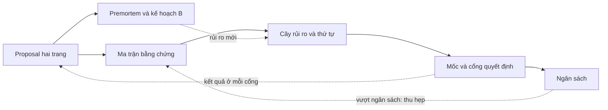
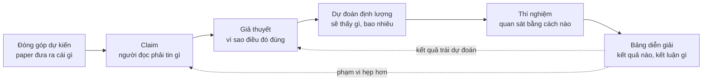
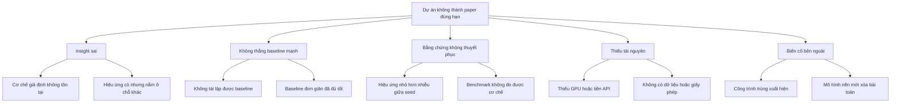
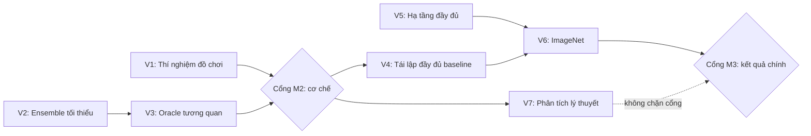
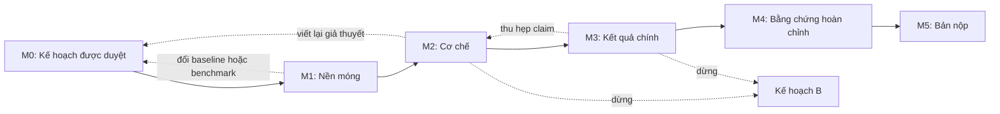

# Lập kế hoạch nghiên cứu

!!! abstract "Mục tiêu của bài"
    Sau bài này, người học có thể:

    - Giải thích vì sao một ý tưởng đã qua thẩm định vẫn chưa phải là một kế hoạch, và nhận ra các triệu chứng của một dự án chạy mà không có kế hoạch.
    - Viết một research proposal hai trang dựa trên Heilmeier Catechism, và phân biệt nó với bản pitch một trang.
    - Đi từ đóng góp dự kiến tới claim, giả thuyết có thể bác bỏ, dự đoán định lượng, thí nghiệm và bảng diễn giải kết quả, rồi tổng hợp tất cả vào một ma trận bằng chứng.
    - Sắp xếp công việc theo thứ tự giảm rủi ro, vẽ đồ thị phụ thuộc, và đặt các mốc M0–M5 với cổng quyết định đi tiếp, đổi hướng hoặc dừng.
    - Lập ngân sách compute, dữ liệu, thời gian và chi phí API có biên dự phòng; tổ chức premortem; xác định kết quả tối thiểu đáng công bố và kế hoạch B.
    - Thỏa thuận vai trò và thứ tự tác giả, tổ chức nhịp họp và cập nhật, và duy trì kế hoạch như một tài liệu sống.

Bài [Thẩm định ý tưởng](y-tuong.md) khép lại ở một thời điểm dễ chịu: ý tưởng đã vượt qua bộ câu hỏi thẩm định, cuộc tìm kiếm novelty ba tầng, và một pilot cho tín hiệu đủ để đi tiếp. Lúc này nhóm tác giả thường có trong tay một danh sách đóng góp dự kiến (*proposed contributions*) viết khá gọn gàng, chẳng hạn "một module mới", "một phân tích về nguồn lỗi", "một tập đánh giá". Cảm giác chung là phần khó nhất đã qua. Thực tế thường ngược lại. Danh sách đóng góp mô tả paper ở thời điểm kết thúc. Nó không nói tuần tới phải chạy gì, chạy theo thứ tự nào, tốn bao nhiêu GPU, ai làm phần nào, và dựa vào đâu để biết hướng đi đã sai. Khoảng cách giữa câu hỏi "paper sẽ đóng góp gì" và câu hỏi "thứ Hai tuần sau làm gì" là nơi nhiều dự án đầu tay đánh mất hàng tháng trời.

Bài này lấp khoảng cách đó bằng một bộ tài liệu lập kế hoạch gọn, mỗi tài liệu có template cụ thể. Bộ tài liệu gồm một research proposal hai trang; một ma trận bằng chứng nối mỗi đóng góp với claim, giả thuyết, dự đoán và thí nghiệm; một cây rủi ro kèm thứ tự làm việc; các mốc với cổng quyết định; một bảng ngân sách; một buổi premortem cùng kế hoạch B; và các thỏa thuận làm việc nhóm. Trọng tâm của bài là chuỗi đi từ đóng góp tới thí nghiệm. Đó là mắt xích người mới hay bỏ qua nhất, và cũng là mắt xích quyết định phần lớn chất lượng bằng chứng của paper về sau.

Bài này bổ sung cho hai bài khác chứ không thay thế chúng. Bài [Lộ trình thực hiện một paper](../00-tong-quan/lo-trinh.md) lập lịch tính ngược từ deadline; bài này lập kế hoạch tính tiến từ ý tưởng, rồi chỉ ra cách ghép hai chiều lập kế hoạch lại với nhau. Bài [Thiết kế thí nghiệm](thi-nghiem.md), ngay sau bài này, đi sâu vào cách thiết kế từng thí nghiệm sao cho công bằng và thuyết phục. Ở đây, chúng ta chỉ cần mô tả thí nghiệm đủ rõ để biết nó trả lời claim nào, tốn bao nhiêu, và nên chạy vào lúc nào. Cuối bài có một kế hoạch hoàn chỉnh cho một dự án NLP giả định, để người học thấy mọi mảnh ghép khi được đặt cạnh nhau.

## Vì sao ý tưởng trên giấy chưa phải là kế hoạch

Một ý tưởng đã qua thẩm định trả lời câu hỏi "có đáng làm không". Một kế hoạch phải trả lời bốn câu hỏi khác: cần làm gì để có bằng chứng, làm theo thứ tự nào, tốn bao nhiêu, và dấu hiệu nào cho biết phải đổi hướng. Hai loại câu hỏi này khác nhau về bản chất. Câu hỏi thứ nhất được trả lời bằng lập luận cùng một pilot nhỏ. Bốn câu hỏi sau chỉ trả lời được khi đóng góp đã được phân rã thành những đơn vị công việc cụ thể, mỗi đơn vị gắn với thời gian, tài nguyên và người chịu trách nhiệm.

Có bằng chứng thực nghiệm cho thấy khoảng cách giữa hai giai đoạn này lớn đến mức nào. Trong nghiên cứu quy mô lớn của Si, Yang và Hashimoto về ý tưởng nghiên cứu NLP dựa trên prompting (*Can LLMs Generate Novel Research Ideas?*, ICLR 2025), các reviewer chuyên gia chấm những đề xuất ý tưởng viết trên giấy. Điểm tổng mà họ cho tương quan mạnh với novelty và mức độ hấp dẫn (*excitement*), nhưng gần như không tương quan với tính khả thi. Ở nghiên cứu tiếp theo (Si, Hashimoto, Yang, *The Ideation–Execution Gap*, ICLR 2026), một phần các ý tưởng đó được giao cho người thực hiện thành paper hoàn chỉnh. Sau khi thực thi, reviewer bắt đầu cân nhắc những yếu tố đã bị bỏ qua ở giai đoạn ý tưởng: hiệu quả thực nghiệm, độ chặt chẽ, và baseline hay ablation còn thiếu. Hai nghiên cứu này có phạm vi hẹp (ý tưởng prompting trong NLP, vài chục dự án được thực thi), nên không nên khái quát hóa các con số. Thông điệp của chúng thì rất quen thuộc với bất kỳ ai từng làm nghiên cứu: một ý tưởng trên giấy được đánh giá theo những tiêu chí khác hẳn một paper đã có bằng chứng. Kế hoạch là công cụ để đưa những tiêu chí "sau thực thi" vào tầm nhìn ngay từ trước khi thực thi.

Khi thiếu kế hoạch, dự án thường bộc lộ những triệu chứng dễ nhận ra. Triệu chứng đầu tiên là **chạy thí nghiệm theo cảm hứng**: mỗi buổi sáng, nhóm chạy điều vừa nghĩ ra hôm trước; log tích lũy rất nhanh, nhưng khi được hỏi thí nghiệm hôm qua giúp chứng minh điều gì thì không ai trả lời được. Triệu chứng thứ hai là **không biết thí nghiệm nào trả lời claim nào**: bảng kết quả có nhiều cột, nhưng claim trung tâm của paper chỉ được ủng hộ một cách gián tiếp, còn thí nghiệm có khả năng bác bỏ nó thì chưa ai chạy. Triệu chứng thứ ba, và đau nhất, là **tới gần deadline mới thấy thiếu baseline**: một baseline đơn giản mà reviewer chắc chắn sẽ hỏi, chẳng hạn một mô hình có sẵn được fine-tune cẩn thận hay một LLM được prompt tử tế, chưa bao giờ được chạy; đến khi chạy thì nó thu hẹp phần lớn khoảng cách. Bên cạnh đó còn những triệu chứng phụ: GPU cạn giữa chừng vì không ai cộng lại số lần chạy cần thiết, nhóm tranh luận đi tranh luận lại một câu hỏi vì không có tiêu chí quyết định, và đồng tác giả không biết phần việc nào thuộc về ai.

Bảng dưới đây nối mỗi triệu chứng với nguyên nhân gốc và với thành phần của kế hoạch giúp chữa nó.

| Triệu chứng | Nguyên nhân gốc | Thành phần kế hoạch xử lý |
|---|---|---|
| Chạy thí nghiệm theo cảm hứng | Không có dự đoán viết trước, không có thứ tự ưu tiên | Ma trận bằng chứng; thứ tự giảm rủi ro |
| Không biết thí nghiệm nào trả lời claim nào | Đóng góp chưa được phân rã thành claim kiểm chứng được | Ma trận bằng chứng |
| Gần deadline mới thấy thiếu baseline | Chưa liệt kê các giải thích thay thế cần loại trừ | Thẻ claim (cột giải thích thay thế); premortem |
| Hết GPU hoặc tiền API giữa chừng | Không ước lượng ngân sách, hoặc chỉ tính cho phương pháp đề xuất | Bảng ngân sách có biên dự phòng |
| Tranh luận lặp lại, quyết định theo cảm xúc | Không có tiêu chí đi tiếp, đổi hướng, dừng | Mốc và cổng quyết định |
| Không rõ ai làm gì, bất đồng về tác giả | Chưa thỏa thuận vai trò từ đầu | Phân vai; thỏa thuận tác giả |

Kế hoạch nghiên cứu, theo nghĩa dùng trong bài này, là một bộ vài tài liệu ngắn liên kết với nhau như trong sơ đồ dưới đây. Proposal xác định đích đến và các claim. Ma trận bằng chứng biến claim thành thí nghiệm. Cây rủi ro cho biết nên làm thí nghiệm nào trước. Các mốc gom thí nghiệm thành từng chặng, mỗi chặng kết thúc bằng một cổng quyết định. Ngân sách kiểm tra rằng toàn bộ kế hoạch là khả thi với nguồn lực hiện có. Premortem tấn công kế hoạch từ phía thất bại và sinh ra kế hoạch B. Những gì học được ở mỗi cổng lại quay về cập nhật proposal và ma trận.



Một kế hoạch tốt không dài. Toàn bộ bộ tài liệu trên thường gói gọn trong khoảng năm trang, và nên được soạn trong vài ngày làm việc tập trung chứ không phải vài tuần. Kế hoạch dài hơn thế thường đang mô tả quá kỹ những phần chắc chắn và quá sơ sài những phần bất định. Mục tiêu của kế hoạch không phải là đoán đúng tương lai. Mục tiêu là biết trước nhóm sẽ phản ứng thế nào khi tương lai khác với dự đoán.

## Research proposal hai trang

Tài liệu đầu tiên là một research proposal ngắn, viết cho chính nhóm tác giả. Nó khác với đề cương xin tài trợ ở chỗ không phải thuyết phục một hội đồng nào; người đọc chính là những người sẽ làm dự án, cùng với người hướng dẫn. Nó cũng khác với bản pitch một trang trong bài [Xây câu chuyện của paper](cau-chuyen.md). Pitch được viết để kiểm tra và thuyết phục rằng câu chuyện đứng được, còn proposal được viết để thực thi. Khác biệt về mục đích kéo theo khác biệt về nội dung, như sẽ thấy ở cuối mục này.

### Heilmeier Catechism và nửa sau thường bị bỏ quên

Khung phù hợp nhất cho một proposal như vậy là *Heilmeier Catechism*, bộ câu hỏi do George H. Heilmeier, giám đốc DARPA giai đoạn 1975–1977, đặt ra để đánh giá các chương trình nghiên cứu được đề xuất. Heilmeier đọc từng đề xuất và đòi câu trả lời cho mỗi câu hỏi trước khi phê duyệt. Phiên bản được DARPA công bố gồm tám câu, có thể diễn giải như sau:

1. Đang cố làm gì? Nêu mục tiêu mà tuyệt đối không dùng biệt ngữ (*"What are you trying to do?"*).
2. Hiện nay việc đó được làm thế nào, và giới hạn của cách làm hiện tại là gì?
3. Cái gì mới trong cách tiếp cận, và vì sao tin rằng nó sẽ thành công?
4. Ai quan tâm? Nếu thành công, điều gì sẽ khác đi?
5. Rủi ro là gì?
6. Tốn bao nhiêu?
7. Mất bao lâu?
8. Đâu là các "bài kiểm tra giữa kỳ và cuối kỳ" (*mid-term and final exams*) để biết đã thành công?

Có nhiều biến thể từ bảy đến chín câu đang được lưu hành, và ARPA-H có một phiên bản bổ sung thêm câu hỏi về tác động xã hội, nhưng cấu trúc tám câu trên là dạng phổ biến nhất. Bài [Thẩm định ý tưởng](y-tuong.md) đã dùng một bộ câu hỏi lấy cảm hứng từ Heilmeier để quyết định có nên theo đuổi ý tưởng hay không. Bộ câu hỏi thẩm định chủ yếu khai thác bốn câu đầu, tức những câu về *giá trị* của ý tưởng. Bốn câu sau, về rủi ro, chi phí, thời gian và các bài kiểm tra, mới là phần biến một ý tưởng thành một dự án. Một proposal tốt trả lời đủ cả tám câu. Nửa sau thường khó viết hơn nửa đầu, đơn giản vì người làm nghiên cứu ít khi được rèn luyện để trả lời chúng.

Một số nhà nghiên cứu khuyến nghị những thói quen rất gần với tinh thần này. Trong ghi chú *Research Taste Exercises* (2021), Chris Olah dẫn lời khuyên của Preetum Nakkiran: trước khi cam kết hơn một tháng cho một dự án, hãy viết một đề xuất ngắn nêu vì sao câu hỏi thú vị, vì sao câu trả lời có giá trị, và kỳ vọng sẽ tìm thấy gì. Ý cuối cùng, "kỳ vọng sẽ tìm thấy gì", chính là hạt giống của các dự đoán mà mục sau sẽ phát triển. Cũng trong ghi chú đó, Olah dẫn một phép thử của Rachel Prudden rất hợp với câu hỏi "ai quan tâm": hình dung rằng một nhóm khác đã công bố đúng paper này, rồi tự hỏi có háo hức đọc nó không.

### Chuyển thể tám câu hỏi cho nghiên cứu AI

Tám câu hỏi của Heilmeier được viết cho các chương trình nghiên cứu quốc phòng kéo dài nhiều năm. Khi áp dụng cho một dự án paper kéo dài vài tháng trong Computer Vision, NLP hay Machine Learning, mỗi câu cần một phiên bản cụ thể hơn. Bảng dưới đây đưa ra phiên bản đó, kèm kiểu câu trả lời yếu thường gặp ở người mới, vì nhận ra câu trả lời yếu là cách nhanh nhất để viết được câu trả lời mạnh.

| Câu hỏi Heilmeier | Phiên bản cho một dự án AI | Câu trả lời yếu thường gặp |
|---|---|---|
| Đang cố làm gì? | Một câu mục tiêu không biệt ngữ, kèm kiểu đóng góp chủ đạo (phương pháp, phân tích, dataset, phương pháp đánh giá…) | Mô tả phương pháp thay cho mục tiêu: "dùng attention đa tỉ lệ cho…" |
| Hiện nay làm thế nào, giới hạn ở đâu? | Baseline mạnh nhất cụ thể, con số đã tái lập, một thất bại đo được | "Các phương pháp hiện có chưa hiệu quả" mà không có con số; so với một baseline yếu |
| Cái gì mới, vì sao sẽ thành công? | Insight phát biểu được mà không cần tên phương pháp; bằng chứng sơ bộ từ pilot | Chỉ có "chưa ai làm"; không có bằng chứng sơ bộ nào |
| Ai quan tâm? | Cộng đồng và venue mục tiêu; ai sẽ làm khác đi nhờ kết quả; phép thử "nhóm khác công bố" | "Có ứng dụng rộng rãi" |
| Rủi ro là gì? | Ba đến năm rủi ro lớn nhất, xác suất ước lượng, thí nghiệm rẻ nhất để kiểm tra mỗi rủi ro | Không nêu rủi ro nào, hoặc chỉ nêu "có thể thiếu GPU" |
| Tốn bao nhiêu? | GPU-giờ, chi phí API, giờ gán nhãn, kèm biên dự phòng | Không ước lượng, hoặc quên phần dành cho baseline |
| Mất bao lâu? | Các mốc M0–M5 có ngày, đối chiếu với deadline | Chỉ có một ngày duy nhất là deadline |
| Bài kiểm tra giữa kỳ và cuối kỳ? | Tiêu chí ở mỗi cổng quyết định; kết quả mục tiêu và kết quả tối thiểu đáng công bố | "Đạt SOTA" |

Hai dòng trong bảng cần thêm lời giải thích. Ở câu thứ hai, một hướng dẫn gắn với DARPA thêm một câu hỏi phụ rất đáng dùng: người đề xuất có thật sự biết state of the art, hay đang tấn công một hình nộm (*strawman*)? Với nghiên cứu AI, câu hỏi này gần như đồng nghĩa với việc nhóm đã tái lập được baseline mạnh nhất hay chưa. Một proposal ghi "baseline X đạt 45,2 theo paper gốc; nhóm tái lập được 44,9 bằng code chính thức" mạnh hơn nhiều so với một proposal chỉ ghi tên X. Ở câu cuối cùng, "đạt SOTA" là một câu trả lời yếu không phải vì SOTA không quan trọng, mà vì nó chỉ là bài kiểm tra cuối kỳ. Một dự án cần cả bài kiểm tra giữa kỳ, tức những dấu hiệu sớm cho biết hướng đi đúng hay sai từ rất lâu trước khi có bảng kết quả cuối cùng. Phần lớn giá trị của câu hỏi thứ tám nằm ở chữ "giữa kỳ".

### Ba template tóm tắt dự án: proposal, pitch và Tầng 0

Giáo trình có ba template cùng tóm tắt một dự án trên một hai trang, nên người học dễ hỏi vì sao cần tới ba. Ngoài research proposal (đề cương nghiên cứu) của bài này, còn có bản pitch một trang ở bài [Xây câu chuyện của paper](cau-chuyen.md) và bản pitch rút gọn ở Tầng 0 trong bài [Quy trình viết & tự review](../03-ky-thuat/quy-trinh-viet.md). Cả ba chia sẻ một phần lõi gồm vấn đề, khoảng trống, insight và claim. Chúng khác nhau ở câu hỏi mà mỗi template giúp trả lời, và vì thế khác nhau ở thời điểm viết và ở những mục riêng mà chỉ template đó có.

| | Research proposal hai trang (bài này) | Bản pitch một trang ([cau-chuyen.md](cau-chuyen.md)) | Tầng 0 ([quy-trinh-viet.md](../03-ky-thuat/quy-trinh-viet.md)) |
|---|---|---|---|
| Câu hỏi chính | Làm gì, theo thứ tự nào, với nguồn lực nào, và khi nào phải đổi hướng? | Câu chuyện có đứng được không, có thuyết phục được người đọc không? | Câu chuyện đã đủ chín để bắt đầu viết bản thảo chưa? |
| Chức năng | Thực thi | Thuyết phục và định hình câu chuyện | Mở đầu quy trình viết theo tầng |
| Thời điểm | Ngay sau khi ý tưởng qua thẩm định, trước khi cam kết nguồn lực lớn | Khi kết quả bắt đầu về và cần chốt câu chuyện (khoảng D − 3,5 tháng theo [lộ trình](../00-tong-quan/lo-trinh.md)) | Ngay trước khi viết outline và bản nháp đầu tiên |
| Mục riêng | Rủi ro, ngân sách, mốc và cổng, kết quả tối thiểu đáng công bố, phân vai | Câu tóm tắt một dòng, phác thảo Figure 1, câu hỏi đáng ngại nhất từ reviewer | Bằng chứng chính nằm ở bảng hay hình nào; venue và track |
| Người đọc chính | Chính nhóm thực hiện, đọc lại hằng tuần | Người hướng dẫn, đồng tác giả, người đọc ngoài nhóm | Người hướng dẫn |

Đọc bảng theo chiều thời gian, ba template nối tiếp nhau trong vòng đời dự án. Proposal ra đời đầu tiên. Khi bằng chứng đã định hình, nhóm rút phần lõi của proposal ra và viết lại thành pitch, lúc này trọng tâm chuyển từ kế hoạch sang lập luận; các mục claim, thí nghiệm và rủi ro của pitch kế thừa trực tiếp từ proposal và ma trận bằng chứng. Khi bắt đầu viết paper, pitch được nén lại thành Tầng 0 để mở quy trình viết. Vì vậy không cần viết ba tài liệu từ đầu; cần giữ cho chúng không kể ba câu chuyện khác nhau. Mỗi khi claim thay đổi, proposal được tăng số phiên bản, pitch được cập nhật theo, và thay đổi được ghi vào nhật ký quyết định (xem mục "Kế hoạch là tài liệu sống" ở cuối bài).

### Template proposal

Template dưới đây trải tám câu hỏi Heilmeier ra thành chín mục, trong đó mục (5) về đóng góp và claim được tách riêng vì nó là đầu vào của ma trận bằng chứng. Khi điền, mỗi mục nên ngắn: hai trang là giới hạn cứng, và giới hạn đó buộc người viết chọn điều quan trọng nhất.

```markdown
# Research proposal: <tên tạm của dự án>
Phiên bản: v0.1   Ngày: ____   Người giữ tài liệu: Tác giả A   Người duyệt: Người hướng dẫn

## (1) Mục tiêu (2–3 câu, không biệt ngữ)
- Câu mục tiêu một dòng (tiếng Anh): "We aim to show that ___, and to build ___ that ___."
- Kiểu đóng góp chủ đạo: phương pháp / cách đặt bài toán / dataset / phương pháp đánh giá / phân tích / hiệu quả

## (2) Hiện trạng và giới hạn
- Baseline mạnh nhất: <tên, venue, năm>. Paper báo cáo ___; nhóm tái lập được ___ (code chính thức / tự cài đặt)
- Thất bại cụ thể đã đo được: <con số, tập con, ví dụ>
- Hai công trình gần nhất và khác biệt (mỗi công trình một câu):

## (3) Cái mới và vì sao có thể thành công
- Insight (phát biểu không nhắc tên phương pháp):
- Bằng chứng sơ bộ: <kết quả pilot, phân tích lỗi, link log>

## (4) Ai quan tâm
- Cộng đồng, venue mục tiêu, venue dự phòng:
- Nếu thành công, ai sẽ làm khác đi điều gì?
- Phép thử: nếu một nhóm khác công bố đúng paper này, nhóm có háo hức đọc không? Vì sao?

## (5) Đóng góp dự kiến và claim
- Đ1: ___ -> claim trung tâm C1: ___ (đo bằng gì, trong phạm vi nào, so với gì)
- Đ2: ___ -> claim C2, C3: ___
- Điều nhóm kỳ vọng sẽ thấy (viết TRƯỚC khi chạy): ___

## (6) Rủi ro (chi tiết ở cây rủi ro)
| Rủi ro | Chí mạng / thu hẹp | Xác suất ước lượng | Thí nghiệm rẻ nhất để kiểm tra | Mốc |

## (7) Chi phí (chi tiết ở bảng ngân sách)
- Compute: ___ GPU-giờ   API: ___ USD   Gán nhãn: ___ giờ người   Biên dự phòng: ___

## (8) Thời gian và các bài kiểm tra
- M1 (ngày ___): đi tiếp nếu ___ / đổi hướng nếu ___ / dừng nếu ___
- M2 ... M5
- Kết quả mục tiêu: ___
- Kết quả tối thiểu đáng công bố: ___

## (9) Phân vai và cam kết thời gian
- Tác giả A: ___ (___ giờ/tuần)   Tác giả B: ___   Người hướng dẫn: duyệt tại M0, M2, M3
```

Sau khi viết xong, có hai phép thử nhanh. Phép thử thứ nhất là đọc to mục (1) cho một người ngoài lĩnh vực hẹp nghe; nếu họ không nhắc lại được mục tiêu, mục (1) vẫn còn biệt ngữ. Phép thử thứ hai là đánh dấu câu hỏi Heilmeier nào khó trả lời nhất. Câu khó nhất thường chỉ thẳng vào chỗ rủi ro của dự án nằm. Không trả lời được câu thứ ba nghĩa là chưa có insight, và nên quay lại bước thẩm định. Không trả lời được câu thứ sáu hay thứ bảy nghĩa là dự án chưa được phân rã, và phần còn lại của bài này dành cho việc đó.

## Từ đóng góp dự kiến tới claim, giả thuyết và thí nghiệm

Đây là phần quan trọng nhất của kế hoạch, và cũng là phần mà nỗi đau "có ý tưởng nhưng không biết thực thi" thường bắt nguồn. Một đóng góp dự kiến như "một module khử nhiễu cho ảnh ban đêm" chưa nói được thí nghiệm nào cần chạy. Để đi từ nó tới một danh sách thí nghiệm, cần đi qua một chuỗi sáu mắt xích. Mỗi mắt xích trả lời một câu hỏi mà mắt xích trước chưa trả lời: đóng góp nói paper đưa cho cộng đồng *cái gì*; claim nói người đọc phải *tin điều gì*; giả thuyết nói *vì sao* điều đó đúng; dự đoán nói nếu giả thuyết đúng thì *sẽ quan sát thấy gì*; thí nghiệm là *cách quan sát*; và bảng diễn giải nói với mỗi kết quả có thể xảy ra thì *kết luận gì và làm gì tiếp*.



Các mục con dưới đây đi qua từng mắt xích, rồi gom tất cả vào một ma trận bằng chứng, và kết thúc bằng một ví dụ đầy đủ cho một dự án Computer Vision giả định.

### Từ đóng góp tới claim

Đóng góp và claim thường bị dùng lẫn lộn, nhưng chúng khác nhau về ngữ pháp, và khác biệt ngữ pháp này có hệ quả thực tế. Đóng góp là một *danh từ*: "một phương pháp", "một benchmark", "một phân tích". Claim là một *mệnh đề*, có thể đúng hoặc sai: "phương pháp X giảm lỗi trên vật thể nhỏ ít nhất bằng một nửa so với baseline mạnh nhất". Reviewer không đánh giá danh từ; họ đánh giá mệnh đề. Một danh từ không thể bị bác bỏ, nên cũng không thể được chứng minh. Chừng nào đóng góp còn ở dạng danh từ, nhóm tác giả chưa biết cần bằng chứng gì cho nó.

Mỗi đóng góp thường sinh ra một đến ba claim. Trong số đó, cần phân biệt **claim trung tâm**, tức claim mà nếu sai thì paper sụp đổ, với **claim phụ**, tức claim mà nếu sai thì paper chỉ hẹp lại. Sự phân biệt này quyết định thứ tự làm việc ở mục sau. Một paper tốt có rất ít claim trung tâm. Andrej Karpathy, trong *A Survival Guide to a PhD* (2016), khuyên xác định đóng góp cốt lõi duy nhất của paper, vì theo ông các đóng góp không cộng dồn: một đóng góp phụ thứ hai thường làm loãng paper chứ không làm nó mạnh thêm. Ông viết: *"The paper sells a single thing that was not obvious or present before."* (Paper "bán" một điều duy nhất trước đó chưa hiển nhiên hoặc chưa có.) Khi phân rã đóng góp thành claim, người viết thường phát hiện ra một "đóng góp" trong danh sách thực ra chỉ là phạm vi của một đóng góp khác; ví dụ ở cuối mục này có đúng trường hợp đó. Những biến thể khó hơn của hiện tượng "độn" đóng góp được phân tích ở bài [Ghép ý tưởng và "độn" đóng góp](../07-tinh-huong-kho/ghep-va-don.md).

Một claim kiểm chứng được nêu rõ ba điều: đo bằng gì, trong phạm vi nào, và so với cái gì. Cách viết claim như vậy đã được trình bày kỹ ở bài Xây câu chuyện của paper. Ở giai đoạn lập kế hoạch, claim còn cần thêm một thuộc tính: nó phải đủ cụ thể để suy ra được thí nghiệm. "Phương pháp tổng quát hóa tốt" không suy ra được thí nghiệm nào. "Phương pháp giữ ít nhất 90% mức cải thiện khi chuyển từ backbone CNN sang backbone Transformer" suy ra ngay một thí nghiệm, kèm luôn một ngưỡng.

### Từ claim tới giả thuyết có thể bác bỏ

Claim nói điều gì đúng; giả thuyết nói vì sao nó đúng. Giả thuyết là một phát biểu về *cơ chế*: "lỗi tăng ở ảnh tối vì nhiễu cảm biến làm hỏng đặc trưng cấp thấp", chứ không chỉ "lỗi tăng ở ảnh tối". Có hai lý do khiến kế hoạch cần mắt xích này. Lý do thứ nhất là về phía người đọc: một claim chỉ được ủng hộ bằng con số thì dễ bị coi là may mắn hoặc là kết quả của tune kỹ, còn một claim kèm cơ chế được xác nhận thì để lại một hiểu biết có thể mang đi nơi khác, đúng như phân tích về insight trong bài Xây câu chuyện của paper. Lý do thứ hai là về phía kế hoạch: chính giả thuyết cho biết thí nghiệm nào có sức phân biệt. Hai phương pháp có thể cùng cho một con số tổng, nhưng nếu cơ chế khác nhau thì chúng sẽ để lại dấu vết khác nhau ở các tập con, và giả thuyết cho biết phải nhìn vào tập con nào.

Một giả thuyết hữu ích phải **có thể bác bỏ**: phải tồn tại một kết quả quan sát được mà nếu xảy ra thì giả thuyết sai. "Phương pháp hoạt động nhờ học được biểu diễn tốt hơn" không bác bỏ được, vì gần như mọi kết quả đều có thể được giải thích là "biểu diễn tốt hơn". "Phương pháp hoạt động nhờ khôi phục chi tiết tần số cao ở vùng tối" bác bỏ được: nếu cải thiện không tập trung ở vùng tối, hoặc nếu một bộ lọc thông thấp đặt trước mạng không làm mất cải thiện, giả thuyết sai.

Bước dễ bị bỏ qua nhất ở mắt xích này là liệt kê **giải thích thay thế** (*alternative explanations*), tức những lý do khác có thể tạo ra cùng kết quả. Lipton và Steinhardt, trong bài *Troubling Trends in Machine Learning Scholarship* (2018), coi việc xem xét và loại trừ các giả thuyết thay thế là một trong những phẩm chất cốt lõi của một nghiên cứu thực nghiệm tốt, và chỉ ra một xu hướng đáng lo ngại là không xác định được nguồn gốc thật của mức cải thiện, chẳng hạn gán công cho thay đổi kiến trúc trong khi cải thiện thực ra đến từ việc tune hyperparameter. Với nghiên cứu AI, danh sách giải thích thay thế khá ổn định giữa các dự án: phương pháp mới có nhiều tham số hoặc tính toán hơn; được tune kỹ hơn baseline; dùng thêm dữ liệu; lợi dụng một đặc điểm của benchmark thay vì giải quyết bài toán; dữ liệu test bị lộ vào dữ liệu huấn luyện; chênh lệch nằm trong dao động giữa các seed; hoặc chỉ một thành phần đơn giản trong phương pháp tạo ra toàn bộ hiệu quả. Mỗi giải thích thay thế quan trọng cần một thí nghiệm đối chứng để loại nó.

Danh sách này cũng chính là liều thuốc cho triệu chứng "gần deadline mới thấy thiếu baseline": phần lớn những baseline bị phát hiện muộn là đối chứng cho một giải thích thay thế mà không ai viết ra từ đầu. Với một bài toán hoàn toàn mới, nơi chưa có phương pháp nào để so sánh, danh sách giải thích thay thế vẫn sinh ra baseline: một lời giải tầm thường cho biết con số có cao hơn mức đoán mò không, một thí nghiệm oracle (biết trước một phần thông tin đúng) cho biết trần của bài toán, và kết quả của con người cho biết bài toán khó tới đâu. Tình huống 30 trong bài [Bài toán, dữ liệu và phạm vi](../07-tinh-huong-kho/bai-toan-va-pham-vi.md) phân tích kỹ trường hợp này; điều cần làm ở giai đoạn lập kế hoạch là đưa ngay những baseline đó vào ma trận, thay vì để reviewer đòi.

### Từ giả thuyết tới dự đoán định lượng

Dự đoán là hệ quả quan sát được của giả thuyết trong một thí nghiệm cụ thể. Một dự đoán tốt nêu năm điều: **chiều** của hiệu ứng (tăng hay giảm), **độ lớn** tối thiểu, **nơi** hiệu ứng xuất hiện (toàn bộ hay một tập con), **so với cái gì**, và **mức nhiễu** dùng làm thước đo (thường là độ lệch chuẩn giữa các seed). Hai dự đoán dưới đây (ví dụ giả định) cho thấy khác biệt.

<div class="bad" markdown>
*"Phương pháp sẽ tốt hơn baseline trên ảnh ban đêm."*

Dự đoán này gần như không thể sai: một cải thiện 0,1 điểm cũng "tốt hơn", và nó không nói gì về cơ chế. Mọi kết quả dương đều được diễn giải là thành công.
</div>

<div class="good" markdown>
*"Trên 20% ảnh tối nhất của tập validation ban đêm, mIoU tăng ít nhất 3 điểm so với baseline huấn luyện cùng recipe (trung bình 3 seed; độ lệch chuẩn giữa seed ở pilot khoảng 0,5), trong khi trên 50% ảnh sáng nhất thay đổi không quá 0,5 điểm."*

Dự đoán này nêu chiều, độ lớn, nơi xuất hiện, đối tượng so sánh và mức nhiễu. Nó có thể sai theo ba cách khác nhau, và mỗi cách sai mang một thông tin khác nhau về giả thuyết.
</div>

Ngưỡng trong dự đoán đến từ ba nguồn. Nguồn thứ nhất là pilot: kích thước hiệu ứng quan sát được ở pilot, trừ đi một khoản cho sự lạc quan của thiết lập nhỏ. Nguồn thứ hai là mức nhiễu: một hiệu ứng nhỏ hơn hai ba lần độ lệch chuẩn giữa các seed khó thuyết phục được ai. Nguồn thứ ba là cộng đồng: mức cải thiện nào đủ để reviewer coi là có ý nghĩa thực tế trên benchmark này. Nên phân biệt **ngưỡng đi tiếp**, tức mức đủ để tin rằng hướng đi đúng, với **ngưỡng đáng công bố**, tức mức đủ để thành claim trong paper; ngưỡng thứ nhất thường thấp hơn ngưỡng thứ hai.

Ngưỡng đáng công bố còn phụ thuộc vào kiểu claim. Tài liệu hướng dẫn reviewer do ban chương trình CVPR và ICCV soạn (năm 2019, được dùng lại ở các năm sau) phân biệt nhiều mức bằng chứng: một ý tưởng có tiềm năng thay đổi lĩnh vực chỉ cần một bằng chứng khái niệm (*proof of concept*), một ý tưởng hợp lý cho một bài toán đã quen thuộc cần kết quả trên benchmark, còn một ý tưởng *"weird, overly complex, implausible, and/or seemingly incremental"* (kỳ lạ, quá phức tạp, khó tin, hoặc trông có vẻ chỉ cải tiến nhỏ) thì cần kết quả xuất sắc. Người lập kế hoạch nên tự xếp claim trung tâm của dự án vào một trong các mức đó, vì mức càng cao thì ngưỡng trong dự đoán càng phải chặt và ngân sách cho bằng chứng càng lớn. Ngược lại, không cần chuẩn bị bằng chứng vượt quá claim: hướng dẫn phản biện của ACL Rolling Review nhắc reviewer rằng *"a paper only needs to present sufficient evidence for the claim that the authors are making"* (paper chỉ cần trình bày đủ bằng chứng cho claim mà tác giả đưa ra). Claim được phát biểu hẹp và rõ là cách rẻ nhất để giữ ngân sách trong tầm tay.

Điều kiện quan trọng nhất là dự đoán phải được **viết ra trước khi chạy**. Một dự đoán viết sau khi đã thấy kết quả không còn là dự đoán, và trí nhớ con người sắp xếp lại thứ tự sự kiện theo hướng có lợi cho câu chuyện hiện tại nhanh hơn người ta tưởng. Bài [Thực hành: ba dự án đi qua ngõ cụt](../07-tinh-huong-kho/thuc-hanh.md) ở Chương 7 phân tích kỹ cơ chế này và đưa ra mẫu nhật ký quyết định, trong đó ô "dự đoán và điều kiện đảo ngược" đóng vai trò một hình thức đăng ký trước (*pre-registration*) gọn nhẹ. Ma trận bằng chứng của bài này là nơi các dự đoán đó được viết lần đầu, từ trước khi thí nghiệm đầu tiên bắt đầu.

### Từ dự đoán tới thí nghiệm và bảng diễn giải

Khi đã có dự đoán, thí nghiệm cần được chọn sao cho giả thuyết và các giải thích thay thế **dự đoán những kết quả khác nhau**. Đó là định nghĩa thực dụng của một thí nghiệm có sức phân biệt. Nếu cả giả thuyết lẫn giải thích thay thế đều dự đoán "phương pháp tốt hơn baseline", thì bảng so sánh chính không phân biệt được chúng, và cần một thí nghiệm khác, thường là đánh giá trên tập con hoặc một biến thể đối chứng.

Một công cụ hữu ích ở bước này đến từ *Deep Learning Tuning Playbook* của nhóm Google Research (Godbole và cộng sự, 2023). Tài liệu này chia các hyperparameter trong một thí nghiệm thành ba vai. Hyperparameter **khoa học** (*scientific*) là thứ có tác động đang được đo. Hyperparameter **phiền nhiễu** (*nuisance*) phải được tối ưu riêng cho từng giá trị của hyperparameter khoa học để so sánh là công bằng, chẳng hạn learning rate khi so sánh hai kiến trúc. Hyperparameter **cố định** (*fixed*) được giữ nguyên trong vòng thí nghiệm này. Vai của một hyperparameter không cố hữu mà phụ thuộc vào mục tiêu của thí nghiệm. Playbook lưu ý rằng *"fixed hyperparameters create caveats for any conclusions we draw from the experiments"*, tức mỗi hyperparameter cố định tạo ra một giới hạn cho kết luận. Khi lập kế hoạch, viết rõ ba vai này cho mỗi thí nghiệm có hai lợi ích: nó cho biết cần tune bao nhiêu lần (đầu vào của ngân sách compute), và nó cho biết phạm vi của claim phải hẹp đến đâu.

Mắt xích cuối là **bảng diễn giải**: với mỗi thí nghiệm quyết định, viết trước ít nhất ba kết cục có thể xảy ra, mỗi kết cục kèm kết luận và hành động. Ba kết cục tối thiểu là: kết quả như dự đoán; không có hiệu ứng vượt nhiễu; và hiệu ứng ngược chiều hoặc xuất hiện ở chỗ khác với dự đoán. Bảng diễn giải có một công dụng ít người để ý: nó là phép thử giá trị thông tin của thí nghiệm. Nếu cả ba kết cục đều dẫn tới cùng một hành động, chẳng hạn "dù sao cũng tiếp tục", thì thí nghiệm đó không giúp ra quyết định nào, và nên được hoãn lại hoặc thiết kế lại. Ý này cũng xuất hiện trong phân tích Tình huống 26 ở bài [Áp lực từ bên ngoài](../07-tinh-huong-kho/ap-luc-ben-ngoai.md): thí nghiệm mà kết quả không làm thay đổi gì là thí nghiệm có giá trị thông tin thấp.

Kế hoạch không cấm khám phá. Playbook của Google cho biết phần lớn thời gian của nhóm tác giả dành cho *khám phá* để hiểu bài toán, chỉ một phần nhỏ dành cho việc tối ưu kết quả (*"we spend most of our time on "exploration" and only a small amount on "exploitation""*). Điều kế hoạch yêu cầu là gắn nhãn: thí nghiệm khám phá được ghi là khám phá, có ngân sách riêng, và không được dùng trực tiếp làm bằng chứng cho claim. Khi khám phá làm lộ ra một hiện tượng thú vị, hiện tượng đó trở thành một giả thuyết mới, được kiểm chứng bằng một thí nghiệm riêng có dự đoán viết trước. Ranh giới giữa hai loại thí nghiệm là ranh giới giữa một phát hiện và một kết quả được chọn lọc sau khi đã nhìn dữ liệu.

### Ma trận bằng chứng

Ma trận bằng chứng gom toàn bộ chuỗi trên vào một tài liệu. Nó gồm hai lớp. Lớp thứ nhất là một **bảng claim nhân thí nghiệm**: mỗi dòng là một claim, mỗi cột là một thí nghiệm, và mỗi ô ghi vai trò của thí nghiệm đó đối với claim đó. Bốn vai trò được dùng:

- **Q (quyết định):** kết quả của thí nghiệm có thể bác bỏ claim.
- **H (hỗ trợ):** thí nghiệm làm claim thuyết phục hơn nhưng không thể bác bỏ nó.
- **Đ (đối chứng):** thí nghiệm loại một giải thích thay thế.
- **N (nền):** thí nghiệm là điều kiện tiên quyết, chẳng hạn tái lập baseline.

Lớp thứ hai là một **thẻ claim** cho mỗi claim trung tâm, ghi đầy đủ chuỗi từ đóng góp tới bảng diễn giải. Tách thành hai lớp vì chúng phục vụ hai câu hỏi khác nhau: bảng cho cái nhìn toàn cục (claim nào thiếu bằng chứng, thí nghiệm nào không phục vụ claim nào), còn thẻ cho chiều sâu của từng claim.

```markdown
## Ma trận bằng chứng — dự án ____   Phiên bản: __   Cập nhật: ____

### Lớp 1: claim x thí nghiệm   (Q = quyết định, H = hỗ trợ, Đ = đối chứng, N = nền)
| Claim                  | E0 | E1 | E2 | E3 | ... | Trạng thái claim |
|------------------------|----|----|----|----|-----|------------------|
| C1 (trung tâm): ...    | N  | Q  | H  |    |     | chưa có bằng chứng / mức A-B-C-D |
| C2 (phụ): ...          | N  |    | Q  | Đ  |     |                  |

### Lớp 2: thẻ claim (một thẻ cho mỗi claim trung tâm)
Claim C__: <đo gì, phạm vi nào, so với gì>
Thuộc đóng góp: Đ__            Loại: trung tâm / phụ
Giả thuyết (cơ chế): ___
Giải thích thay thế cần loại:
  R1: ___ -> thí nghiệm đối chứng E__
  R2: ___ -> thí nghiệm đối chứng E__
Dự đoán (viết ngày ____, TRƯỚC khi chạy):
  Thí nghiệm E__: chiều ___, độ lớn tối thiểu ___, nơi ___, so với ___, mức nhiễu ___
Thiết lập của thí nghiệm quyết định:
  Dữ liệu và split: ___      Metric: ___      Số seed: ___
  Baseline (kể cả baseline đơn giản, oracle, con người nếu cần): ___
  Ablation cần có cho claim này: ___
Vai hyperparameter: khoa học ___ / phiền nhiễu ___ (tune bao nhiêu lần, CHO CẢ baseline) / cố định ___
Bảng diễn giải:
  Nếu như dự đoán:            kết luận ___ -> hành động ___
  Nếu không có hiệu ứng:      kết luận ___ -> hành động ___
  Nếu ngược chiều / chỗ khác: kết luận ___ -> hành động ___
Mốc cần có kết quả: M__        Người chịu trách nhiệm: ____
```

Khi ma trận đã điền xong, nhóm đọc nó theo năm quy tắc. Mỗi quy tắc bắt một kiểu lỗi kế hoạch khác nhau.

- [ ] Mỗi claim trung tâm có ít nhất một ô **Q**, và thẻ claim của nó ghi đủ dữ liệu, metric, baseline và ablation của thí nghiệm quyết định. Claim không có thí nghiệm quyết định là claim chỉ được minh họa chứ chưa được kiểm chứng.
- [ ] Mỗi cột phục vụ ít nhất một claim. Cột không có ô nào là thí nghiệm khám phá, cần được gắn nhãn và có ngân sách riêng, hoặc được bỏ.
- [ ] Mỗi giải thích thay thế quan trọng trong các thẻ claim có một cột **Đ** tương ứng.
- [ ] Các cột **N** được xếp lên đầu thứ tự làm việc, vì mọi thứ khác phụ thuộc vào chúng.
- [ ] Mọi ô "nếu không có hiệu ứng" trong bảng diễn giải đều có một hành động cụ thể, không phải "chạy thêm".

!!! info "Ma trận bằng chứng khác gì bảng claim ở bài Thiết kế thí nghiệm"
    Bài [Thiết kế thí nghiệm](thi-nghiem.md) có một bảng kế hoạch nối claim với câu hỏi của reviewer, thí nghiệm và kết quả ủng hộ. Ma trận ở đây đứng ở tầng trên: nó nối thêm claim với đóng góp, giả thuyết, giải thích thay thế và hành động cho từng kết cục, và nó được dùng để sắp thứ tự công việc, đặt cổng quyết định và tính ngân sách. Khi chuyển sang thiết kế chi tiết từng thí nghiệm (benchmark, metric, so sánh công bằng, ablation), người học dùng bài Thiết kế thí nghiệm; mỗi cột của ma trận trở thành một mục trong kế hoạch thí nghiệm chi tiết đó.

### Ví dụ đầy đủ: một dự án Computer Vision

Để thấy chuỗi vận hành thế nào, hãy theo dõi một dự án giả định về phân đoạn ngữ nghĩa (*semantic segmentation*) ảnh đường phố ban đêm. Mọi tên phương pháp và con số dưới đây đều là ví dụ giả định. Pilot ở giai đoạn thẩm định cho thấy hai điều: mô hình phân đoạn huấn luyện trên ảnh ban ngày sụt mIoU rất mạnh trên ảnh ban đêm, và việc đặt một bước khử nhiễu đơn giản trước mạng làm tăng nhẹ độ chính xác ở vùng tối. Từ đó nhóm viết ba đóng góp dự kiến:

- Đ1: một phân tích cho thấy nguồn lỗi chính của phân đoạn ban đêm là nhiễu cảm biến ở vùng tối, chứ không phải sự lệch màu sắc và độ sáng.
- Đ2: NoctDN (tên giả định), một mô-đun khử nhiễu nhận biết độ sáng, huấn luyện cùng mạng phân đoạn.
- Đ3: hiệu quả nhất quán trên nhiều backbone và hai benchmark ban đêm.

Ngay khi phân rã sang claim, Đ3 lộ ra là không phải một đóng góp riêng: nó là phạm vi của Đ2. Trong ma trận, nó trở thành claim phụ C4 của Đ2. Danh sách đóng góp còn lại hai mục, gọn và mạnh hơn. Bốn claim được viết như sau.

- **C1 (trung tâm, Đ1):** khi làm tối ảnh ban ngày một cách có kiểm soát, thêm nhiễu cảm biến mô phỏng làm mIoU giảm nhiều hơn hẳn so với chỉ giảm sáng và đổi màu ở cùng mức độ sáng.
- **C2 (phụ, Đ1):** trên ảnh ban đêm thật, lỗi tập trung ở vùng tối và tương quan với mức nhiễu ước lượng mạnh hơn với độ lệch màu, kể cả khi so trong cùng một lớp đối tượng.
- **C3 (trung tâm, Đ2):** với cùng recipe huấn luyện, NoctDN tăng mIoU ở vùng tối rõ rệt hơn ở vùng sáng, và vượt cách ghép một bộ khử nhiễu có sẵn với mạng phân đoạn.
- **C4 (phụ, Đ2):** cải thiện giữ cùng chiều trên ba backbone và hai benchmark ban đêm.

Giả thuyết chung cho C1 đến C3 là: ở vùng tối, tỉ lệ tín hiệu trên nhiễu thấp làm hỏng đặc trưng cấp thấp trước khi mạng kịp tổng hợp ngữ cảnh, còn sự lệch màu phần lớn đã được các lớp chuẩn hóa đầu mạng xử lý. Nhóm liệt kê năm giải thích thay thế. R1: sự lệch màu và độ sáng mới là nguyên nhân chính, cạnh tranh trực tiếp với giả thuyết. R2: vùng tối chứa nhiều lớp nhỏ và hiếm, nên lỗi cao là do thành phần lớp chứ không do điều kiện ảnh. R3: nhãn ở vùng tối kém chính xác hơn. R4: cải thiện của NoctDN đến từ tham số và tính toán thêm. R5: một bộ khử nhiễu có sẵn đặt trước mạng đã đủ, mô-đun huấn luyện cùng không cần thiết. Từ giả thuyết và các giải thích thay thế, tám thí nghiệm được xác định.

- **E0:** tái lập baseline với hai backbone trên benchmark ban ngày và ban đêm.
- **E1:** làm tối có kiểm soát ảnh ban ngày ở ba mức độ sáng, hai kiểu suy giảm (có nhiễu và không nhiễu); chỉ cần suy luận.
- **E2:** phân tầng lỗi trên ảnh ban đêm thật theo độ sáng, mức nhiễu và độ lệch màu, trong từng lớp; kiểm tra lại nhãn trên 100 ảnh.
- **E3:** ghép bộ khử nhiễu có sẵn với mạng phân đoạn.
- **E4:** NoctDN so với baseline cùng recipe, 3 seed.
- **E5:** ablation: khối đối chứng cùng số tham số; bỏ tín hiệu độ sáng; huấn luyện tách rời.
- **E6:** thêm hai backbone, trên hai benchmark ban đêm.
- **E7:** khám phá: hình định tính, failure cases.

Lớp thứ nhất của ma trận như sau.

| Claim | E0 | E1 | E2 | E3 | E4 | E5 | E6 | E7 |
|---|---|---|---|---|---|---|---|---|
| C1 (trung tâm): nhiễu gây sụt nhiều hơn màu | N | Q | H | | | | | |
| C2 (phụ): lỗi ban đêm theo nhiễu, trong từng lớp | N | | Q | | | | | H |
| C3 (trung tâm): NoctDN cải thiện vùng tối, vượt khử nhiễu có sẵn | N | | | Đ | Q | Đ | | H |
| C4 (phụ): cùng chiều trên ba backbone, hai benchmark | N | | | | H | | Q | |

Đọc ma trận, ba điều hiện ra ngay. Thứ nhất, E0 nằm dưới mọi claim, nên phải làm đầu tiên. Thứ hai, E1 vừa rẻ (chỉ cần suy luận trên checkpoint của E0) vừa là thí nghiệm quyết định của một claim trung tâm, nên nên làm ngay sau E0, trước khi viết dòng code nào cho NoctDN. Thứ ba, E3 là đúng loại baseline thường bị phát hiện muộn. Nó là đối chứng cho R5, và nếu bộ khử nhiễu có sẵn thu hẹp được phần lớn khoảng cách, đóng góp phương pháp sụp đổ và paper phải chuyển sang hướng phân tích kèm một baseline đơn giản. Một rủi ro lớn như vậy cần được biết từ tháng đầu, không phải từ tuần trước deadline. Vì vậy E3 được xếp lên trước E4, dù về mặt "tiến độ" nó không xây thêm gì cho phương pháp.

Bảng diễn giải cho thí nghiệm quyết định E1 của claim C1 được viết trước khi chạy:

| Kết quả của E1 | Kết luận | Hành động |
|---|---|---|
| Kiểu có nhiễu làm mIoU giảm ít nhất gấp đôi kiểu chỉ giảm sáng và đổi màu, ở cả ba mức độ sáng | Giả thuyết được ủng hộ; R1 bị loại phần lớn | Giữ C1; bắt đầu xây NoctDN; chạy E3 song song |
| Hai kiểu suy giảm gây sụt tương đương | Cả hai yếu tố đều quan trọng; giả thuyết phát biểu quá mạnh | Thu hẹp C1 thành "nhiễu là một trong hai nguồn lỗi chính"; xem lại thiết kế mô-đun để xử lý cả màu; tìm kiếm lại novelty với các công trình thích nghi màu sắc |
| Kiểu chỉ giảm sáng và đổi màu gây sụt nhiều hơn | Giả thuyết bị bác bỏ | Dừng hướng khử nhiễu; ghi nhật ký quyết định; cân nhắc paper phân tích nếu cộng đồng đang tin vào điều ngược lại |

Thẻ claim cho C3, claim trung tâm thứ hai, được điền đầy đủ như sau.

```text
Claim C3: Với cùng recipe huấn luyện, NoctDN tăng mIoU trên 20% ảnh tối nhất
          ít nhất 3 điểm so với baseline, rõ hơn hẳn mức thay đổi trên ảnh sáng,
          và vượt cách ghép bộ khử nhiễu có sẵn với mạng phân đoạn.
Thuộc đóng góp: Đ2          Loại: trung tâm
Giả thuyết: mô-đun khôi phục đặc trưng cấp thấp ở vùng có tỉ lệ tín hiệu/nhiễu
            thấp, nên lợi ích phải tập trung ở vùng tối.
Giải thích thay thế cần loại:
  R4: lợi ích đến từ tham số và tính toán thêm  -> E5 (khối cùng số tham số)
  R5: bộ khử nhiễu có sẵn là đủ                 -> E3
  Tune không cân sức                            -> E4 dùng cùng số lần thử tune cho cả hai
Dự đoán (viết TRƯỚC khi chạy E3, E4, E5):
  E4: vùng tối +3 mIoU trở lên (3 seed; độ lệch chuẩn pilot ~0,5); vùng sáng trong ±0,5
  E5: khối cùng số tham số tăng dưới 1 điểm ở vùng tối
  E3: khử nhiễu có sẵn + phân đoạn kém NoctDN ít nhất 1,5 điểm ở vùng tối
Thiết lập của E4:
  Dữ liệu: huấn luyện trên tập ban ngày cộng phần ảnh ban đêm có nhãn; đánh giá trên
           split validation của hai benchmark ban đêm, chia theo độ sáng ảnh
  Metric: mIoU trên 20% ảnh tối nhất, 50% ảnh sáng nhất, và toàn bộ   Seed: 3
  Baseline: cùng backbone không có NoctDN; hai bộ khử nhiễu có sẵn đặt trước mạng (E3)
  Ablation: khối cùng số tham số; bỏ tín hiệu độ sáng; huấn luyện tách rời (E5)
Vai hyperparameter (E4): khoa học = có/không NoctDN; phiền nhiễu = learning rate,
  weight decay (4 lần thử cho MỖI cấu hình); cố định = độ phân giải, lịch huấn luyện
  -> claim chỉ nói về đúng độ phân giải và lịch này
Bảng diễn giải:
  Như dự đoán            -> giữ C3, qua cổng M3 phần phương pháp
  Lợi ích đều ở mọi vùng -> cơ chế sai; viết lại giả thuyết, xem lại C1–C2 có nhất quán không
  E3 ngang NoctDN        -> đóng góp phương pháp không đứng; chuyển sang kế hoạch B:
                            paper phân tích (C1, C2) + baseline đơn giản mạnh
Mốc cần có kết quả: E3 và E4 rút gọn ở M2; đầy đủ ở M3   Người chịu trách nhiệm: Tác giả A
```

Từ một đóng góp dự kiến chỉ dài một dòng, nhóm đã có tám thí nghiệm có tên, vai trò rõ ràng, và một thứ tự gợi ý. Đó chính là cây cầu giữa "paper sẽ đóng góp gì" và "thứ Hai tuần sau làm gì". Thiết kế chi tiết của từng thí nghiệm, như chọn benchmark ban đêm nào, metric nào, cách bảo đảm so sánh công bằng và cách dựng bảng ablation, thuộc về bài Thiết kế thí nghiệm.

## Cây rủi ro và thứ tự làm việc

Ma trận bằng chứng cho biết cần làm những thí nghiệm nào, nhưng chưa cho biết làm cái nào trước. Khi không có nguyên tắc sắp xếp, người mới thường bắt đầu bằng những việc dễ chịu nhất: dựng codebase "cho đàng hoàng", viết data loader, cấu hình hệ thống logging, đọc thêm vài paper. Những việc này đều cần, và làm chúng tạo cảm giác tiến bộ. Vấn đề là chúng gần như không bao giờ thất bại, nên làm chúng trước không cho biết thêm điều gì về số phận của dự án. Sau sáu tuần, nhóm có một codebase đẹp và vẫn chưa biết giả thuyết cốt lõi có đúng hay không.

### Làm trước việc dễ thất bại và cho nhiều thông tin nhất

Jacob Steinhardt, trong bài *Research as a Stochastic Decision Process* (2018), đề xuất nhìn một dự án nghiên cứu như một chuỗi các việc con bất định, trong đó việc nào cũng có thể thất bại và kéo cả dự án đổ theo. Mục tiêu khi đó không chỉ là tối đa hóa xác suất thành công cuối cùng, mà còn là tối thiểu hóa thời gian kỳ vọng phải bỏ ra, đặc biệt là thời gian bỏ ra *trước khi phát hiện* một thất bại. Từ cách nhìn đó, quy tắc cốt lõi của ông là làm các việc theo thứ tự từ việc cho nhiều thông tin nhất trên mỗi đơn vị thời gian tới việc cho ít thông tin nhất. Trên thực tế, điều này có nghĩa là không bắt đầu từ phần dễ hoặc quen thuộc nhất, mà bắt đầu từ phần có khả năng giết chết dự án cao nhất so với chi phí để kiểm tra nó. Steinhardt còn hình thức hóa ý này bằng vài cách tính; bài này chỉ dùng tinh thần chung, người học muốn đi sâu nên đọc bài gốc.

Một phép tính minh họa (ví dụ giả định) cho thấy vì sao thứ tự quan trọng. Giả sử dự án có hai việc. Việc A là dựng đầy đủ hạ tầng và tái lập toàn bộ baseline, mất ba tuần và hiếm khi thất bại. Việc B là một thí nghiệm oracle kiểm tra xem giả thuyết cốt lõi có cơ sở không, mất một tuần và có khả năng thất bại khoảng một nửa. Nếu làm A trước, nhóm luôn tiêu ba tuần rồi mới biết kết quả của B; khi B thất bại, bốn tuần đã trôi qua. Nếu làm B trước, khi B thất bại nhóm biết ngay sau một tuần và tiết kiệm được ba tuần còn lại. Tính trung bình trên hai kịch bản thành công và thất bại của B, làm B trước tiết kiệm khoảng một tuần rưỡi; quan trọng hơn, trong kịch bản xấu, tin xấu đến sớm hơn ba tuần. Trong thực tế, B thường cần một phần của A, chẳng hạn cần một baseline chạy được. Lời giải không phải là quay về làm A trước, mà là **tách A ra**, làm phần tối thiểu của A mà B cần, rồi chạy B ngay.

Kỹ thuật tách việc để kiểm tra rủi ro sớm là nơi lời khuyên của Jia-Bin Huang trong bộ ghi chú *awesome-tips* trở nên rất thực dụng. Ở mục về cách tiến bộ đều đặn trong nghiên cứu, ông gợi ý một loạt chiến thuật. **Làm ngược từ cuối** (*work backward*): với một pipeline gồm nhiều bước, trước hết giả định bước phía trước cho đầu ra hoàn hảo để xây bước phía sau, nhờ đó thấy sớm kết quả cuối và đo được cận trên. **Ví dụ đồ chơi** (*toy examples*) nắm được bản chất của bài toán, tốt nhất là dữ liệu tổng hợp để biết đáp án đúng ở mọi bước. **Baseline trước**: thử baseline để thấy giới hạn của state of the art; nếu baseline đã hoạt động tốt, câu hỏi là vì sao còn làm bài toán này. **Trường hợp đơn giản trước**, và **tìm một proxy**, tức những thí nghiệm nhỏ, nhanh thay cho những lần chạy đầy đủ kéo dài hàng tuần. Mỗi chiến thuật là một cách biến một rủi ro đắt thành một phép kiểm tra rẻ.

### Liệt kê rủi ro bằng cây rủi ro

Để sắp xếp được theo rủi ro, trước hết cần liệt kê rủi ro một cách có hệ thống. Một **cây rủi ro** đặt ở gốc câu "dự án không thành một paper đúng hạn", rồi chia nhánh theo các nhóm nguyên nhân, và chia tiếp cho tới những rủi ro đủ cụ thể để có thể kiểm tra bằng một thí nghiệm hay một việc làm. Với dự án AI, năm nhánh dưới đây phủ được phần lớn trường hợp: insight sai, không thắng được baseline mạnh, bằng chứng không thuyết phục, thiếu tài nguyên, và biến cố bên ngoài.



Mỗi lá của cây cần được gắn với hai thông tin: nó là rủi ro **chí mạng** (xảy ra thì dự án sụp) hay rủi ro **thu hẹp** (xảy ra thì paper hẹp lại), và phép kiểm tra rẻ nhất cho nó là gì. Bảng dưới đây đưa ra những phép kiểm tra điển hình.

| Rủi ro | Loại | Phép kiểm tra rẻ nhất | Thời điểm |
|---|---|---|---|
| Cơ chế giả định không tồn tại | Chí mạng | Thí nghiệm đồ chơi, hoặc can thiệp có kiểm soát trên dữ liệu và checkpoint sẵn có | M1–M2 |
| Hiệu ứng có nhưng nằm ở chỗ khác | Thu hẹp | Phân tầng lỗi của baseline theo tập con trước khi xây phương pháp | M1 |
| Không tái lập được baseline | Chí mạng cho mọi so sánh | Chạy code chính thức trên một cấu hình, so với số công bố | M1 |
| Baseline đơn giản đã đủ tốt | Chí mạng | Chạy baseline đơn giản được tune cẩn thận; thí nghiệm oracle cho thấy trần | M1–M2 |
| Hiệu ứng nhỏ hơn nhiễu giữa seed | Chí mạng | Đo độ lệch chuẩn giữa seed của baseline ngay từ đầu | M1 |
| Benchmark không đo được cơ chế | Thu hẹp | Kiểm tra benchmark có đủ mẫu ở tập con liên quan không | M0–M1 |
| Thiếu GPU hoặc tiền API | Thu hẹp | Lập ngân sách; chạy thử một run ngắn để đo thời gian thật | M0 |
| Không có dữ liệu hoặc giấy phép | Chí mạng hoặc thu hẹp | Đọc giấy phép, hỏi chủ dữ liệu, gán nhãn thử vài chục mẫu | M0–M1 |
| Công trình trùng xuất hiện | Thu hẹp, đôi khi chí mạng | Theo dõi arXiv hằng tuần; viết sẵn phần đóng góp còn lại nếu bị trùng | Suốt dự án |
| Mô hình nền mới xóa bài toán | Chí mạng | Thử bài toán trên mô hình tổng quát mạnh nhất hiện có ngay khi chọn hướng | M0 |

Hai nhánh cuối của cây là những rủi ro mà nhóm không kiểm soát được, nhưng vẫn có thể chuẩn bị. Tình huống 24 (bị trùng ý tưởng) và Tình huống 25 (mô hình nền mới khiến bài toán lỗi thời) trong bài [Áp lực từ bên ngoài](../07-tinh-huong-kho/ap-luc-ben-ngoai.md) phân tích cách xử lý khi chúng xảy ra, và bảng phòng ngừa ở cuối bài đó chính là danh sách việc nên đưa vào kế hoạch từ M0.

### Rủi ro chí mạng trước, rủi ro thu hẹp sau

Cách nhìn của Steinhardt coi mỗi thất bại là một lần dự án đổ. Trong dự án paper thật, nhiều thất bại chỉ làm paper hẹp lại: phần lý thuyết không chứng minh được thì paper vẫn còn phần thực nghiệm; kết quả không giữ được trên benchmark thứ ba thì claim về tính tổng quát hẹp lại. Vì vậy, thứ tự làm việc nên đi theo hai bậc. Bậc thứ nhất gồm các rủi ro chí mạng, xếp theo lượng thông tin trên thời gian, và được kiểm tra càng sớm càng tốt. Bậc thứ hai gồm các rủi ro thu hẹp, làm sau khi bậc thứ nhất đã qua. Hạ tầng được dựng dần, mỗi lần chỉ vừa đủ cho việc tiếp theo. Trong cùng một bậc, nên ưu tiên những thí nghiệm có giá trị trong nhiều kịch bản, tức những thí nghiệm mà kết quả của chúng vẫn dùng được cho paper ngay cả khi giả thuyết chính sai; mục về kế hoạch B sẽ quay lại ý này.

### Ví dụ: một dự án Machine Learning

Xét một dự án giả định về ước lượng độ bất định cho mạng sâu. Ý tưởng là dùng thống kê kích hoạt ở các lớp giữa để ước lượng độ bất định chỉ với một lần truyền xuôi, rồi dùng nó phát hiện dữ liệu ngoài phân phối (*out-of-distribution*, OOD). Claim trung tâm là phương pháp đạt chất lượng phát hiện OOD gần với deep ensemble, trong khi chi phí suy luận chỉ bằng một mô hình. Nhóm liệt kê bảy việc, kèm ước lượng chủ quan về khả năng thất bại. Các con số phần trăm là ước lượng của nhóm, chỉ dùng để so sánh tương đối giữa các việc.

| Việc | Câu hỏi được trả lời | Chí mạng? | Khả năng thất bại | Thời gian | Phụ thuộc |
|---|---|---|---|---|---|
| V1: thí nghiệm đồ chơi hai chiều | Thống kê kích hoạt có tách được vùng OOD trên dữ liệu tổng hợp không? | Có | Cao (khoảng 40%) | 0,5 tuần | |
| V2: ensemble tối thiểu trên CIFAR-10 | Có một thước đo độ bất định đáng tin để đối chiếu không? | Có (nền) | Thấp (khoảng 10%) | 0,5 tuần | |
| V3: thí nghiệm oracle | Trên dữ liệu thật, thống kê kích hoạt có tương quan với độ bất định của ensemble không? | Có | Cao (khoảng 50%) | 1 tuần | V2 |
| V4: tái lập đầy đủ baseline | Ensemble, MC dropout và phương pháp một lần truyền gần nhất có được chạy công bằng không? | Có | Thấp đến vừa (khoảng 20%) | 2 tuần | V2 |
| V5: hạ tầng đầy đủ | Config, logging, script đánh giá OOD cho quy mô lớn | Không | Rất thấp | 1,5 tuần | |
| V6: mở rộng lên ImageNet | Kết quả còn đúng ở quy mô lớn không? | Thu hẹp | Vừa (khoảng 30%) | 3 tuần | V4, V5 |
| V7: phân tích lý thuyết | Có bound nào liên hệ thống kê kích hoạt với độ bất định không? | Thu hẹp | Cao (khoảng 60%) | 4 tuần | V3 |

Thứ tự mà một nhóm mới thường làm là V5, rồi V4, rồi mới tới V3: dựng hạ tầng cho chắc, tái lập baseline cho đủ, rồi mới thử ý tưởng. Theo thứ tự đó, câu trả lời cho V3, việc có khả năng giết dự án cao nhất trên dữ liệu thật, chỉ có sau khoảng bốn tuần rưỡi. Thứ tự theo tinh thần giảm rủi ro thì khác. V1 rẻ và dễ thất bại nên làm ngay. V2 hiếm khi thất bại, nhưng nó là phần tối thiểu mà V3 cần, nên được tách khỏi V4 và làm sớm. V3 chạy ngay sau V2. Nhờ vậy, sau khoảng hai tuần nhóm đã biết hai rủi ro chí mạng lớn nhất có xảy ra hay không. Chỉ khi chúng đã qua, nhóm mới đầu tư vào V4 và phiên bản đầy đủ của V5. V7 có khả năng thất bại cao nhưng không chí mạng, nên được giao cho một đồng tác giả thiên về lý thuyết và chạy song song sau V3. V6 đắt nhất và đứng cuối.



Đồ thị phụ thuộc còn cho thấy một điều mà danh sách việc không cho thấy: **đường găng** (*critical path*), tức chuỗi việc phụ thuộc nhau có tổng thời gian dài nhất. Ở đây, chuỗi V2, V4, V6 kéo dài khoảng năm tuần rưỡi, và nó quyết định ngày sớm nhất có thể đạt cổng M3. Muốn đạt M3 sớm hơn, nhóm phải rút ngắn một việc trên đường găng, chẳng hạn chạy V6 trên một tập con của ImageNet trước. Rút ngắn một việc nằm ngoài đường găng, như V5, không làm M3 đến sớm hơn chút nào. Đường găng cũng là đầu vào của mục ghép kế hoạch tiến với kế hoạch lùi ở phần sau.

### Nhịp tuần: vectoring và velocity

Thứ tự giảm rủi ro không chỉ được quyết định một lần ở M0. Môn *CS197: Computer Science Research* do Michael Bernstein dạy ở Stanford gói ý này vào hai khái niệm dùng hằng tuần. *Vectoring* là xác định chiều rủi ro hay bất định lớn nhất của dự án ở thời điểm hiện tại. *Velocity* là giảm nhanh rủi ro theo chiều đã chọn. Hai việc vận hành thành một vòng lặp chặt: mỗi tuần chọn câu hỏi lớn nhất còn chưa có lời đáp, và dành một chặng nước rút ngắn cho nó. Bernstein nhấn mạnh rằng velocity không đồng nghĩa với tiến độ: một chuỗi ý tưởng sáng tạo nối nhau thất bại là tiến độ thấp nhưng velocity cao, vì mỗi thất bại loại bỏ một phần bất định. Câu hỏi đầu tuần của nhóm vì vậy nên là "điều chưa biết lớn nhất của dự án tuần này là gì, và thí nghiệm rẻ nhất để thu hẹp nó là gì?", chứ không phải "tuần này làm tiếp phần nào". Cách tổ chức vòng lặp thực thi hằng tuần được bàn chi tiết ở bài [Vận hành thực nghiệm](thuc-thi.md).

## Mốc và cổng quyết định

Thứ tự làm việc là một dòng chảy liên tục; mốc chia dòng chảy đó thành từng chặng. Điều làm một mốc có giá trị không phải là ngày tháng, mà là **cổng quyết định** đặt ở cuối chặng: tại đó, nhóm xem bằng chứng đã có và chọn một trong ba hành động đã viết sẵn, gồm đi tiếp, đổi hướng, hoặc dừng. Bài [Thẩm định ý tưởng](y-tuong.md) đã giới thiệu ý này ở quy mô một pilot, với tiêu chí dừng viết ra trước khi chạy. Bài [Lộ trình thực hiện một paper](../00-tong-quan/lo-trinh.md) có một bảng mốc kiểm tra tính theo lịch, mỗi mốc kèm việc cần làm nếu chưa đạt. Các cổng ở đây là phiên bản tính theo *nội dung* của những mốc đó: chúng được định nghĩa bằng câu hỏi khoa học cần trả lời, rồi mới được đặt lên lịch.

### Sáu mốc từ M0 tới M5

Sáu mốc dưới đây là một khung chung, đủ dùng cho phần lớn dự án paper hội nghị. Mỗi mốc trả lời một câu hỏi, đòi một loại bằng chứng, và có ba nhánh quyết định.

| Mốc | Câu hỏi được trả lời | Bằng chứng cần có | Đi tiếp nếu | Đổi hướng nếu | Dừng nếu |
|---|---|---|---|---|---|
| M0: kế hoạch được duyệt | Dự án có đáng cam kết nguồn lực không? | Proposal, ma trận bằng chứng, ngân sách, kết quả pilot từ giai đoạn thẩm định | Người hướng dẫn duyệt; độ trễ cho phép không âm | Độ trễ âm: thu hẹp phạm vi hoặc chọn deadline sau | Không trả lời được câu Heilmeier về cái mới |
| M1: nền móng | Có nền so sánh đáng tin không? | Baseline tái lập trong codebase của nhóm; hạ tầng và sanity check đã qua; pilot chạy lại trên hạ tầng mới | Sai lệch tái lập nhỏ hoặc giải thích được; pilot giữ tín hiệu | Không tái lập được: đổi baseline hoặc benchmark | Tín hiệu pilot biến mất khi baseline được chạy đúng |
| M2: cơ chế | Giả thuyết cốt lõi có đúng không? | Các ô "quyết định" của claim cơ chế, ở quy mô proxy, đủ seed | Dự đoán đạt ngưỡng đi tiếp | Hiệu ứng có nhưng ở chỗ khác: viết lại giả thuyết, cập nhật ma trận | Không có hiệu ứng vượt nhiễu: kích hoạt kế hoạch B hoặc dừng |
| M3: kết quả chính | Claim trung tâm có đứng ở quy mô đầy đủ, trước baseline mạnh nhất? | Bảng chính đầy đủ, baseline cùng recipe, các đối chứng quan trọng | Claim trung tâm đạt ngưỡng đáng công bố | Chỉ đứng trong một chế độ: thu hẹp claim | Thua baseline đơn giản: chuyển sang kết quả tối thiểu đáng công bố |
| M4: bộ bằng chứng hoàn chỉnh | Mọi ô quyết định và đối chứng của claim được giữ lại đã có kết quả chưa? | Ablation, độ nhạy, phân tích lỗi; ma trận không còn ô trống | Đóng băng thí nghiệm, hoàn thiện bản thảo | Còn ô trống: phân loại mức bằng chứng và cắt claim | |
| M5: bản nộp | Paper đã sẵn sàng chưa? | Bản thảo qua review nội bộ, checklist, bản nộp an toàn | Nộp | Chưa sẵn sàng: chuyển deadline hoặc đổi hình thức | |

Đặt lên lịch tính ngược của bài Lộ trình thực hiện một paper, các mốc này rơi vào những vị trí khá tự nhiên: M0 vào khoảng D − 6 tháng; M1 vào khoảng D − 5 tháng, đúng lúc lộ trình yêu cầu baseline mạnh nhất đã được tái tạo; M2 vào khoảng D − 4 tháng tới D − 3,5 tháng, khi lộ trình chờ một pilot có tín hiệu và một bản pitch; M3 vào khoảng D − 6 tuần, khi kết quả chính phải xong; M4 trải từ bản thảo v1 ở D − 4 tuần tới ngày đóng băng thí nghiệm ở D − 1 tuần; và M5 là bản nộp an toàn ở D − 2 ngày. Một dự án có pilot đã chạy kỹ trong giai đoạn thẩm định sẽ qua M1 nhanh, vì việc còn lại chỉ là chạy lại pilot trên hạ tầng và baseline chính thức của nhóm. Ở M4, khi còn những ô trống trong ma trận, cách phân loại claim theo bốn mức bằng chứng A, B, C, D ở Tình huống 26 trong bài [Áp lực từ bên ngoài](../07-tinh-huong-kho/ap-luc-ben-ngoai.md) là công cụ chuẩn để quyết định cắt claim nào.

### Cổng M1 và checklist trước thí nghiệm chính

Trong sáu cổng, M1 có vị trí đặc biệt: đó là cổng cuối cùng trước khi phần lớn ngân sách compute được tiêu. Sai sót lọt qua M1 sẽ nhân lên trong mọi lần chạy sau. Vì vậy Phụ lục có hẳn một nhóm mục "Trước khi bắt đầu thí nghiệm chính" trong trang [Checklist](../phu-luc/checklist.md). Phần lớn các mục trong nhóm đó là sản phẩm của chính bài này: claim kiểm chứng được kèm kết quả bác bỏ, ma trận thí nghiệm có dữ liệu, metric, baseline và ablation cho mỗi claim, thứ tự giảm rủi ro, premortem, cổng quyết định và kế hoạch B, ngân sách compute và dữ liệu, thỏa thuận vai trò và tác giả. Những mục còn lại thuộc về nền kỹ thuật, và cần được hiểu lý do trước khi đánh dấu.

**Baseline mạnh nhất phải được tái tạo trong codebase của nhóm**, khớp với số công bố hoặc có giải thích cho chênh lệch. Lý do là mọi con số của phương pháp đề xuất sau này sẽ được đặt cạnh baseline đó; nếu baseline chạy trong một môi trường khác, chênh lệch đo được có thể đến từ môi trường chứ không từ phương pháp. Đây cũng là câu trả lời cụ thể cho câu Heilmeier thứ hai: biết state of the art nghĩa là chạy được nó.

**Hạ tầng phải sẵn sàng**: config tách khỏi code, seed được ghi lại, mỗi lần chạy lưu commit hash, config và log. Bài [Thiết kế thí nghiệm](thi-nghiem.md) đã giải thích vì sao mỗi con số trong paper phải truy được về đúng lần chạy tạo ra nó; bài [Vận hành thực nghiệm](thuc-thi.md) trình bày cách dựng hạ tầng đó. Ở cổng M1, câu hỏi chỉ là: nếu ngày mai một kết quả bất ngờ xuất hiện, nhóm có tái tạo được nó trong một giờ hay không. Cùng tinh thần đó, **bảng và hình nên được sinh tự động từ log**, không chép số bằng tay, vì con số sẽ thay đổi nhiều lần trước deadline và mỗi lần chép tay là một cơ hội sai.

**Sanity check phải qua**: mô hình overfit được một tập rất nhỏ, pipeline dữ liệu và metric được kiểm tra trên những ví dụ biết trước đáp án. Andrej Karpathy, trong *A Recipe for Training Neural Networks* (2019), giải thích vì sao bước này không thể bỏ: huấn luyện mạng nơ-ron thất bại một cách lặng lẽ. Ông viết rằng một cấu hình sai *"Most of the time it will train but silently work a bit worse"* (phần lớn thời gian nó vẫn huấn luyện được, chỉ âm thầm hoạt động kém đi một chút). Một bug làm baseline yếu đi một điểm hoặc làm phương pháp đề xuất mạnh lên một điểm có thể tạo ra toàn bộ "đóng góp" của paper. Khuyến nghị overfit một batch nhỏ của Karpathy là phép thử rẻ nhất cho loại lỗi này.

**Hyperparameter được phân vai** khoa học, phiền nhiễu và cố định, và **baseline được tune với ngân sách ngang phương pháp đề xuất**. Mục về chuỗi đóng góp và thí nghiệm ở trên đã giải thích phân vai; điều cần thêm ở đây là ngân sách tune của baseline phải được ghi thành con số trong kế hoạch, vì một ngân sách không được ghi ra thường âm thầm co lại khi GPU khan hiếm.

Cuối cùng, **nếu dùng coding agent hay trợ lý AI để viết code, nhóm thống nhất cách kiểm tra và ghi lại phần code do AI sinh**. Lý do có bằng chứng cụ thể: nhóm tác giả của hệ thống *The AI Scientist* (Lu và cộng sự, 2024) ghi nhận rằng hệ thống của họ có thể cài đặt ý tưởng sai theo những cách khó phát hiện, và khuyên phải kiểm tra thủ công phần cài đặt trước khi tin vào kết quả. Cách tổ chức việc kiểm tra này được trình bày ở bài [AI trong lập trình và thực nghiệm](../08-ai-cong-su/thuc-nghiem.md) của Chương 8.

### Thiết kế một cổng quyết định

Một cổng quyết định tốt có năm thuộc tính. Thứ nhất, nó nêu **bằng chứng cần có**, trỏ thẳng vào các ô của ma trận. Thứ hai, **quy tắc quyết định được viết trước** khi có kết quả, với ngưỡng định lượng cho từng nhánh. Thứ ba, cổng có **ngày xét cố định**: đến ngày đó, cổng được xét dù thí nghiệm đã xong hay chưa, vì "chưa xong đúng hạn" cũng là một kết quả cần ra quyết định. Thứ tư, cổng nêu **ai quyết định**, thường là tác giả chính đề xuất và người hướng dẫn duyệt. Thứ năm, các **phương án đổi hướng được chọn sẵn**, để khi phải đổi hướng nhóm không mất thêm hai tuần tranh luận đổi sang đâu. Một quy tắc phụ hữu ích là chỉ cho phép gia hạn một cổng **tối đa một lần**, với thời hạn cố định; một cổng được gia hạn lần thứ hai thường là dấu hiệu của chi phí chìm chứ không phải của bằng chứng sắp tới.

```text
CỔNG M__: <tên mốc>
Ngày xét: ____ (cổng được xét vào ngày này, dù thí nghiệm đã xong hay chưa)
Bằng chứng cần có: <các ô Q và Đ trong ma trận, ví dụ C1/E1, C3/E3>
Người đề xuất: Tác giả A          Người duyệt: Người hướng dẫn
Đi tiếp nếu:   <ngưỡng định lượng, viết trước>
Đổi hướng nếu: <điều kiện>  -> phương án đổi hướng đã chọn sẵn: ___
Dừng nếu:      <điều kiện>  -> kích hoạt kế hoạch B: ___ / dừng dự án
Gia hạn: tối đa một lần, ___ ngày, chỉ khi ___
---- điền sau khi xét ----
Kết quả thực tế: ___   Quyết định: ___   Mục nhật ký quyết định số: ___
```

Sơ đồ dưới đây cho thấy dòng chảy của các cổng. Mũi tên liền là đi tiếp; mũi tên nét đứt là những nhánh đổi hướng hoặc dừng đã được viết sẵn.



Giá trị của cổng nằm ở chỗ quyết định được đưa ra khi nhóm còn bình tĩnh. Tình huống "dừng lại theo tiêu chí đã đặt trước" trong bài [Khi novelty và hiệu quả lệch pha](../07-tinh-huong-kho/novelty-va-hieu-qua.md) cho thấy cổng phát huy tác dụng thế nào khi một hướng đi không còn tín hiệu: thay vì "thử thêm một chút nữa", nhóm có sẵn một câu trả lời đã được viết khi chưa bị kết quả ảnh hưởng.

### Ghép kế hoạch tiến với kế hoạch lùi

Kế hoạch trong bài này được lập *tiến*: từ ý tưởng, qua đồ thị phụ thuộc và ước lượng thời gian, tới ngày **sớm nhất** có thể đạt mỗi mốc. Bài Lộ trình thực hiện một paper lập kế hoạch *lùi*: từ deadline D, tới ngày **muộn nhất** được phép đạt mỗi mốc để các việc sau còn kịp. Mỗi cách đều có điểm mù. Kế hoạch tiến không biết deadline, nên dễ trôi. Kế hoạch lùi không biết dự án cần bao lâu, nên dễ đặt ra những ngày bất khả thi. Ghép hai cách lại cho ra một con số mà cả hai cách riêng lẻ đều không có: **độ trễ cho phép** của mỗi mốc, tức ngày muộn nhất trừ ngày sớm nhất.

Bảng dưới đây (ví dụ giả định) cho thấy cách đọc. Ngày sớm nhất được tính từ đường găng, sau khi đã cộng biên dự phòng cho từng việc; ngày muộn nhất lấy từ bảng mốc của bài Lộ trình.

| Mốc | Sớm nhất (lập tiến) | Muộn nhất (lập lùi từ D) | Độ trễ cho phép |
|---|---|---|---|
| M1 | D − 22 tuần | D − 20 tuần | +2 tuần |
| M2 | D − 17 tuần | D − 15 tuần | +2 tuần |
| M3 | D − 5 tuần | D − 6 tuần | −1 tuần |
| M4 | D − 3 tuần | D − 4 tuần | −1 tuần |

Độ trễ âm ở M3 và M4 nói rằng, ngay cả khi mọi việc suôn sẻ, nhóm vẫn đạt kết quả chính muộn một tuần so với mức lộ trình cho phép. Điều quan trọng là con số này xuất hiện **ở M0**, khi việc xử lý còn rẻ. Nhóm có ba lựa chọn: rút ngắn một việc trên đường găng (chẳng hạn chạy ablation trên thiết lập nhỏ hơn, như mẹo ở bài Thiết kế thí nghiệm); cắt một claim phụ (bớt một backbone trong claim về tính tổng quát); hoặc nhắm deadline sau. Phát hiện cùng con số ấy ở D − 2 tuần thì lựa chọn duy nhất còn lại thường là cắt claim trong hoảng loạn, đúng như Tình huống 26 mô tả. Độ trễ cho phép nên được tính lại ở mỗi lần rà soát hằng tuần, vì nó là chỉ số sớm nhất cho biết kế hoạch đang trượt.

## Ngân sách

Câu hỏi Heilmeier thứ sáu, "tốn bao nhiêu", thường được trả lời bằng cảm giác: "chắc đủ GPU", "API cũng không đắt lắm". Cảm giác này sai theo một hướng có hệ thống, vì người lập kế hoạch thường chỉ hình dung lần chạy cuối cùng của phương pháp đề xuất, và quên mọi thứ xung quanh nó: các lần tune, các seed, các baseline, các lần chạy hỏng, và các thí nghiệm phát sinh khi câu chuyện thay đổi. Mục này lập ngân sách cho bốn loại tài nguyên: compute, dữ liệu, thời gian và chi phí API.

### Compute

Công thức cơ bản cho một thí nghiệm rất đơn giản: GPU-giờ bằng số cấu hình nhân số seed nhân số dataset nhân số GPU-giờ của mỗi lần chạy. Công thức này cần thêm một số hạng mà người mới hay quên, đó là các lần thử để tune hyperparameter phiền nhiễu. Theo Deep Learning Tuning Playbook, hyperparameter phiền nhiễu phải được tối ưu riêng cho từng giá trị của hyperparameter khoa học, rồi cấu hình tốt nhất mới được chạy lại với nhiều seed để đo phương sai. Như vậy, với mỗi cấu hình khoa học, số lần chạy là số lần thử tune cộng số seed. Ngân sách của toàn dự án là tổng của các thí nghiệm, cộng một hệ số cho các lần chạy hỏng và chạy lại, cộng một khoản cho khám phá, và cộng một khoản dự trữ cho giai đoạn rebuttal.

```text
GPU-giờ của một thí nghiệm = số cấu hình x (số lần thử tune + số seed) x số dataset x GPU-giờ mỗi run

Tổng ngân sách = (tổng các thí nghiệm) x (1 + hệ số chạy lại)
               + ngân sách khám phá
               + dự trữ cho thí nghiệm bổ sung khi rebuttal
```

Số GPU-giờ mỗi run nên được **đo**, không đoán: chạy thử một hai phần trăm lịch huấn luyện, đo thời gian, nhân lên, rồi cộng thời gian đánh giá. Playbook của Google cũng nhắc rằng ngân sách cho một vòng thí nghiệm là sự đánh đổi giữa ba thứ: số giá trị khoa học muốn so sánh, độ rộng của không gian tìm kiếm cho hyperparameter phiền nhiễu, và độ dày của việc lấy mẫu trong không gian đó. Khi ngân sách không đủ, phải chọn hy sinh thứ nào một cách có ý thức, thay vì để việc tune baseline tự co lại.

Quay lại dự án phân đoạn ban đêm ở mục trước. Bảng dưới đây (mọi con số là ví dụ giả định) tính ngân sách cho sáu thí nghiệm đầu tiên, với GPU-giờ mỗi run được đo từ một lần chạy thử.

| Thí nghiệm | Cấu hình | Thử tune | Seed | Dataset | GPU-giờ/run | GPU-giờ |
|---|---|---|---|---|---|---|
| E0: tái lập baseline | 2 backbone | 0 | 3 | 1 | 16 | 2 × 3 × 1 × 16 = 96 |
| E1: làm tối có kiểm soát (chỉ suy luận) | 6 | 0 | 3 checkpoint | 1 | 0,5 | 6 × 3 × 1 × 0,5 = 9 |
| E3: khử nhiễu có sẵn + phân đoạn | 2 | 4 | 3 | 2 | 16 | 2 × 7 × 2 × 16 = 448 |
| E4: NoctDN và baseline cùng recipe | 2 | 4 | 3 | 2 | 20 | 2 × 7 × 2 × 20 = 560 |
| E5: ablation | 3 | 2 | 3 | 1 | 20 | 3 × 5 × 1 × 20 = 300 |
| E6: thêm hai backbone, mỗi backbone hai phương pháp | 4 | 2 | 3 | 2 | 20 | 4 × 5 × 2 × 20 = 800 |
| Cộng | | | | | | 2.213 |

Cộng thêm hệ số chạy lại 0,4 (bug, lỗi node, chạy lại khi phát hiện sai sót), 15% cho khám phá, và 10% dự trữ cho rebuttal, ngân sách vào khoảng 3.650 GPU-giờ. Nếu nhóm dùng được trung bình bốn GPU, với mức sử dụng thực tế khoảng 60% vì hàng đợi và thời gian chết, năng lực là khoảng 400 GPU-giờ mỗi tuần, tức khoảng chín tuần GPU chạy liên tục. Con số này cần được đặt cạnh đường găng: nếu khoảng thời gian từ M1 tới M3 chỉ có mười tuần, kế hoạch gần như không còn chỗ thở, và nên quyết định ngay từ M0 chạy E5 trên thiết lập nhỏ hơn.

Bảng ngân sách còn làm lộ ra hai điều mà người mới hiếm khi thấy trước. Thứ nhất, các lần thử tune chiếm gần một nửa tổng số GPU-giờ. Thứ hai, hơn một nửa phần tune đó dành cho baseline và đối chứng, không phải cho phương pháp đề xuất. Một kế hoạch cắt phần tune của baseline để tiết kiệm sẽ tiết kiệm được nhiều GPU nhất, và cũng tạo ra đúng loại so sánh không cân sức mà hướng dẫn phản biện của ACL Rolling Review liệt kê trong nhóm lỗi phân tích (baseline không được tune đủ). Khi chi phí của chính phương pháp là một phần của claim, chẳng hạn phương pháp tốt hơn nhưng chậm hơn nhiều, ngân sách còn phải bao gồm các thí nghiệm so sánh ở cùng thời gian hoặc cùng FLOPs; Tình huống 32 trong bài [Bài toán, dữ liệu và phạm vi](../07-tinh-huong-kho/bai-toan-va-pham-vi.md) phân tích vì sao. Tương tự, câu hỏi claim nào cần quy mô lớn nên được trả lời ngay lúc lập ngân sách, như bài [Khi con số không đẹp](../07-tinh-huong-kho/con-so-khong-dep.md) khuyến nghị.

### Dữ liệu

Ngân sách dữ liệu có hai phần: thu thập và gán nhãn. Phần thu thập ít tốn tiền nhưng nhiều rủi ro. Mỗi nguồn dữ liệu cần được kiểm tra về giấy phép, điều khoản sử dụng, dữ liệu cá nhân, và quyền phát hành lại nếu nhóm định công bố dữ liệu. Hướng dẫn phản biện của ACL Rolling Review trong những năm gần đây có hẳn những mã riêng để reviewer đánh dấu vấn đề đạo đức khi thu thập dữ liệu và giấy phép không rõ ràng. Một dataset không phát hành được vì vướng giấy phép có thể làm mất đi một đóng góp, và điều đó nên được biết ở M0 chứ không phải lúc chuẩn bị camera-ready.

Phần gán nhãn có thể ước lượng bằng một công thức tương tự compute:

```text
Giờ người gán nhãn = số mẫu x số người gán nhãn mỗi mẫu x phút mỗi mẫu / 60
                     x (1 + hệ số cho vòng pilot, đào tạo và phân xử)
Chi phí = giờ người x đơn giá theo giờ (theo mức trả công công bằng và quy định của cơ sở)
Thời gian lịch = thời gian tuyển người + số vòng pilot hướng dẫn + giờ người / (số người x giờ mỗi tuần)
```

Dòng cuối thường quan trọng hơn dòng thứ hai. Tuyển người gán nhãn có chuyên môn hoặc người bản ngữ của một ngôn ngữ ít phổ biến có thể mất nhiều tuần, và hướng dẫn gán nhãn hầu như luôn phải sửa sau vòng pilot đầu tiên. Vì vậy, với dự án cần dữ liệu mới, việc tuyển người và vòng pilot gán nhãn thường nằm trên đường găng, và nên được bắt đầu ngay ở M0. Nếu dự án cần phê duyệt đạo đức từ cơ sở nghiên cứu cho việc làm với con người, thời gian chờ phê duyệt cũng thuộc đường găng.

### Thời gian

Ngân sách thời gian bắt đầu từ năng lực thực tế mỗi tuần, không phải từ số giờ lý tưởng. Một nghiên cứu sinh có bốn mươi lăm giờ làm việc trong tuần không có bốn mươi lăm giờ cho dự án: học phần, trợ giảng, họp, hành chính và review cho hội nghị lấy đi một phần đáng kể, và trong số giờ còn lại, chỉ một phần là giờ tập trung sâu. Template dưới đây (số liệu giả định) giúp tính con số đó một cách trung thực.

```text
NĂNG LỰC THỰC TẾ MỖI TUẦN — Tác giả A                  (ví dụ giả định)
Tổng giờ làm việc trong tuần:                              45
  Trừ học phần và bài tập:                                 -8
  Trừ trợ giảng hoặc công việc được giao:                  -6
  Trừ họp nhóm, họp lab, seminar:                          -4
  Trừ hành chính, email, review cho hội nghị:              -3
= Giờ dành cho dự án:                                      24
  Trong đó giờ tập trung sâu (code, phân tích, viết):     ~15
Năng lực dùng để lập kế hoạch (x 0,8 cho ốm, việc phát sinh): ~19 giờ/tuần
```

Có một lý do tâm lý khiến con số năng lực cần được tính thận trọng như vậy. Hiện tượng *planning fallacy* (ngụy biện lập kế hoạch) mô tả xu hướng đánh giá thấp thời gian cần để hoàn thành một việc, ngay cả khi người ước lượng biết rằng những việc tương tự trước đây đã kéo dài hơn dự kiến. Trong nghiên cứu kinh điển của Buehler, Griffin và Ross (1994), sinh viên được hỏi khi nào sẽ hoàn thành luận văn tốt nghiệp; thời gian thực tế trung bình dài hơn đáng kể so với dự đoán, thậm chí dài hơn cả ước lượng của chính họ cho kịch bản xấu nhất. Ba biện pháp đối phó đơn giản là: ước lượng dựa trên lịch sử của chính mình với những việc tương tự, thay vì dựa trên hình dung về việc mới; chia nhỏ việc thành những đơn vị không quá một tuần; và ghi lại tỉ lệ giữa thời gian thực tế và thời gian ước lượng sau mỗi tuần, rồi dùng tỉ lệ đó hiệu chỉnh phần còn lại của kế hoạch.

Một vài số liệu bên ngoài có thể giúp định cỡ. Trong nghiên cứu *The Ideation–Execution Gap* đã nhắc ở đầu bài, các chuyên gia NLP thực hiện một ý tưởng dựa trên prompting thành một paper ngắn (tối thiểu bốn trang theo định dạng ACL), trong khung ba tháng, đã bỏ ra trung bình khoảng 103 giờ cho mỗi dự án. Đó là những dự án không cần huấn luyện mô hình lớn, nên con số này là một mức sàn hữu ích để đối chiếu, không phải ước lượng cho một dự án paper hội nghị đầy đủ. Riêng phần viết, bài Lộ trình thực hiện một paper ước lượng khoảng 120 đến 200 giờ cho người viết lần đầu. Uri Alon, trong bài *How To Choose a Good Scientific Problem* (2009), khuyên ghép độ khó của bài toán với giai đoạn sự nghiệp: dự án đầu tiên của một nghiên cứu sinh nên ngắn và khả thi. Khi năng lực thực tế không đủ cho kế hoạch, thu hẹp phạm vi dự án ở M0 là một quyết định nghiên cứu đúng đắn chứ không phải một sự thất bại.

Cũng cần thận trọng với việc tính trước một mức tăng tốc nhờ công cụ AI vào ngân sách thời gian. Trong một thử nghiệm ngẫu nhiên có đối chứng của METR (Becker và cộng sự, 2025), với mười sáu lập trình viên giàu kinh nghiệm làm việc trên chính những kho mã nguồn mở lớn mà họ quen thuộc, việc cho phép dùng các công cụ AI của đầu năm 2025 làm thời gian hoàn thành tăng khoảng 19%, trong khi sau khi làm xong, chính các lập trình viên vẫn tin rằng AI đã giúp họ nhanh hơn khoảng 20%. Đầu năm 2026, METR cho biết kết quả này đã lỗi thời với công cụ mới, nên con số không nên được áp vào dự án của người học. Bài học còn lại là về khoảng cách giữa cảm nhận và đo lường: nếu kế hoạch dựa vào giả định "có AI sẽ nhanh gấp đôi", giả định đó cần được đo trên chính dự án sau vài tuần, như mọi ước lượng khác. Cách dùng AI cho lập trình và thực nghiệm được bàn ở Chương 8, [AI làm cộng sự nghiên cứu](../08-ai-cong-su/index.md).

### Chi phí API

Với dự án dùng mô hình ngôn ngữ lớn qua API, chi phí tiền thường thay thế một phần chi phí GPU, và cũng có thể ước lượng bằng công thức:

```text
Số lời gọi = số mẫu x số cấu hình prompt x số lần lấy mẫu mỗi lời gọi x số mô hình
Chi phí    = số lời gọi x (token vào trung bình x giá mỗi token vào
                          + token ra trung bình x giá mỗi token ra)
Tổng       = chi phí lần chạy cuối x (1 + hệ số phát triển prompt) + chi phí mô hình giám khảo (nếu có)
```

Ba khoản thường bị quên là chi phí phát triển prompt (thử nhiều phiên bản prompt trên tập phát triển, thường ngang hoặc hơn chi phí của lần chạy cuối), chi phí của mô hình dùng làm giám khảo (*LLM-as-a-judge*) khi đánh giá tự động, và chi phí chạy lại khi mô hình phía sau API thay đổi. Ngoài tiền, API còn có giới hạn tốc độ gọi, nên một thí nghiệm hai mươi nghìn lời gọi có thể cần vài ngày lịch dù chi phí không lớn. Ví dụ tính đầy đủ có trong kế hoạch hoàn chỉnh ở cuối bài.

!!! info "Giá API và phiên bản mô hình thay đổi thường xuyên"
    Mọi giá API trong bài là giả định để minh họa cách tính. Trước khi lập ngân sách, cần tra giá hiện hành của nhà cung cấp, ghi lại ngày tra, tên và phiên bản chính xác của mô hình. Kết quả trên mô hình qua API cũng nên được lưu cache ngay từ lần gọi đầu tiên; Tình huống 27 trong bài [Áp lực từ bên ngoài](../07-tinh-huong-kho/ap-luc-ben-ngoai.md) giải thích vì sao một kết quả không có phiên bản và cache gần như không thể kiểm chứng lại sau vài tháng.

### Biên dự phòng và template ngân sách

Mọi ước lượng ở trên đều lạc quan, vì chúng mô tả kịch bản mọi việc diễn ra như dự định. Biên dự phòng là cách thừa nhận điều đó bằng con số. Bảng dưới đây đưa ra các mức mà giáo trình khuyến nghị như một quy tắc thận trọng; chúng không phải kết quả nghiên cứu, và nên được điều chỉnh theo lịch sử của chính nhóm.

| Khoản | Biên dự phòng khuyến nghị | Lý do |
|---|---|---|
| Compute | Thêm 30% đến 50%, cộng khoảng 10% dự trữ cho rebuttal | Bug, chạy lại, hàng đợi, thí nghiệm phát sinh khi câu chuyện đổi, yêu cầu của reviewer |
| Thời gian | Thêm 25% đến 50% cho mỗi việc lớn; một tuần đệm trước các cổng M3 và M4 | Planning fallacy; việc phát sinh ngoài dự án |
| Chi phí API | Ngân sách phát triển prompt ít nhất bằng chi phí lần chạy cuối | Thử prompt, đổi mô hình, chạy lại khi API thay đổi |
| Gán nhãn | Thêm khoảng 20% giờ người, cộng ít nhất một vòng pilot | Hướng dẫn thay đổi, phân xử bất đồng, gán nhãn lại |

Khoản dự trữ cho rebuttal đáng được nói riêng. Ở nhiều hội nghị, giai đoạn rebuttal hoặc thảo luận với reviewer chỉ kéo dài một vài tuần, và yêu cầu thí nghiệm bổ sung thường đến đúng lúc nhóm đã chuyển sang dự án khác. Một kế hoạch tốt giữ sẵn cả GPU-giờ lẫn thời gian của người chạy thí nghiệm cho giai đoạn này; bài Lộ trình thực hiện một paper nhắc điều đó cho chu kỳ NeurIPS, và nó đúng với mọi hội nghị có rebuttal. Toàn bộ ngân sách được gom vào một template.

```text
NGÂN SÁCH DỰ ÁN ____   Phiên bản: __   Ngày: ____
1. Compute
   | Thí nghiệm | Cấu hình | Thử tune | Seed | Dataset | GPU-giờ/run (đã đo) | GPU-giờ |
   Cộng: ___   x (1 + hệ số chạy lại ___) + khám phá ___ + dự trữ rebuttal ___ = ___
   Năng lực: ___ GPU x 24 x 7 x mức sử dụng ___ = ___ GPU-giờ/tuần -> ___ tuần
2. Dữ liệu
   Nguồn và giấy phép đã kiểm tra: ___   Quyền phát hành: có / không / chưa rõ
   Gán nhãn: ___ mẫu x ___ người x ___ phút = ___ giờ người (+___%)   Đơn giá: ___
   Thời gian tuyển người: ___ tuần   Phê duyệt đạo đức: cần / không cần, dự kiến ___
3. Thời gian
   | Người | Giờ/tuần cho dự án (thực tế) | Số tuần | Tổng giờ | Việc được giao (giờ ước lượng) |
   Tỉ lệ thực tế / ước lượng (cập nhật hằng tuần): ___
4. API
   | Mô hình (phiên bản) | Ngày tra giá | Số lời gọi | Token vào/ra | Chi phí |
   Phát triển prompt: ___   Giám khảo: ___   Dự phòng: ___
5. Kết luận ngân sách: đủ / thiếu -> thu hẹp gì, ở mốc nào

## Premortem và kế hoạch B

Mọi phần trước của kế hoạch được viết từ góc nhìn thành công: claim nào cần bằng chứng gì, làm theo thứ tự nào, tốn bao nhiêu. Premortem nhìn từ góc ngược lại, và chính vì thế nó tìm ra những lỗ hổng mà góc nhìn thành công bỏ qua.

### Premortem

Premortem là kỹ thuật do Gary Klein mô tả trong bài *Performing a Project Premortem* (Harvard Business Review, 2007). Nó là hình ảnh đảo ngược của postmortem: thay vì phân tích vì sao dự án đã thất bại sau khi mọi chuyện đã rồi, nhóm làm việc đó *trước khi* dự án bắt đầu. Sau khi cả nhóm đã nghe trình bày kế hoạch, người điều phối tuyên bố rằng dự án đã thất bại thảm hại. Mỗi thành viên viết độc lập mọi lý do có thể dẫn tới thất bại đó. Các lý do được chia sẻ lần lượt, rồi dùng để củng cố kế hoạch. Theo Klein, kỹ thuật này dựa trên hiện tượng *prospective hindsight* (nhìn lại từ tương lai), tức hình dung một sự kiện như thể nó đã xảy ra, vốn được nghiên cứu trước đó bởi Mitchell, Russo và Pennington (1989): khi coi thất bại là chuyện đã rồi, người ta nêu lý do cụ thể và đầy đủ hơn so với khi chỉ được hỏi "điều gì có thể sai". Premortem còn có một tác dụng xã hội: nó biến việc nêu nghi ngờ thành nhiệm vụ của cả nhóm, nên những thành viên hiểu chuyện nhưng ngại lên tiếng có một dịp an toàn để nói, và sự tự tin thái quá của nhóm bị kéo về mức thực tế.

Áp dụng cho nghiên cứu AI, có hai phiên bản hữu ích. **Premortem kỹ thuật** làm ở M0, với câu mở đầu "đã tới M3, và phương pháp không hơn baseline". **Premortem phản biện** làm trước M3 hoặc M4, với câu mở đầu "paper đã bị reject; hãy viết ba điểm yếu mà ba reviewer đã nêu", và dùng kỹ năng của bài [Đọc paper như một reviewer](doc-nhu-reviewer.md) để viết chúng. Bảng phòng ngừa ở cuối bài [Áp lực từ bên ngoài](../07-tinh-huong-kho/ap-luc-ben-ngoai.md) là nguồn gợi ý tốt cho cả hai phiên bản: hình dung dự án đã thất bại vì bị trùng ý tưởng, vì một mô hình nền mới, hay vì deadline tới khi thí nghiệm chưa xong, rồi hỏi biện pháp nào lẽ ra đã ngăn được điều đó.

```text
PREMORTEM — dự án ____   Ngày: ____   Người điều phối: ____   Thời lượng: khoảng 45 phút
Bước 1 (5 phút): nhắc lại proposal và các mốc. Rồi tuyên bố:
  "Hôm nay là ngày ___. Dự án đã thất bại: <đến M3 phương pháp không hơn baseline /
   paper bị reject với điểm thấp>."
Bước 2 (10 phút): mỗi người viết độc lập, không trao đổi, mọi lý do dẫn tới thất bại.
Bước 3 (15 phút): lần lượt từng người nêu một lý do chưa ai nêu, cho tới khi hết.
                  Người điều phối ghi lại, không tranh luận, không bác bỏ.
Bước 4 (15 phút): gom nhóm; với mỗi lý do quan trọng, chọn đúng một hành động:
  KIỂM TRA SỚM (thêm thí nghiệm rẻ vào M1–M2) / GIẢM THIỂU (đổi kế hoạch) /
  CHẤP NHẬN (ghi vào Limitations dự kiến) / KẾ HOẠCH B (chuẩn bị đường lui)
| Lý do thất bại | Khả năng | Dấu hiệu sớm | Hành động | Gắn vào mốc / thí nghiệm | Người theo dõi |
```

Điều quyết định giá trị của premortem là bước 4. Một danh sách lý do thất bại không đi kèm hành động chỉ làm nhóm lo lắng hơn. Mỗi dòng của bảng phải dẫn tới một thay đổi cụ thể trong ma trận bằng chứng, cây rủi ro, ngân sách hoặc kế hoạch B; nếu không, dòng đó được ghi rõ là "chấp nhận" và trở thành một câu trong mục Limitations dự kiến.

### Kết quả tối thiểu đáng công bố

Câu hỏi trung tâm của kế hoạch B là: nếu đóng góp chính thất bại, còn paper nào không? Để trả lời, cần một khái niệm mà giáo trình gọi là **kết quả tối thiểu đáng công bố**: tập kết quả nhỏ nhất mà, nếu chỉ có chúng, vẫn tạo ra một paper trung thực, có người đọc cần, và có ít nhất một venue phù hợp. Một kết quả tối thiểu tốt có hai thuộc tính. Nó **không phụ thuộc vào claim rủi ro nhất**, vì nếu phụ thuộc thì nó sụp cùng claim đó. Và nó **được tạo ra sớm** trong kế hoạch, vì một đường lui chỉ sẵn sàng sau M4 thì không còn là đường lui. Bậc thang dưới đây giúp viết ra các kịch bản ngay từ M0.

| Kịch bản | Claim còn đứng | Dạng paper | Venue phù hợp |
|---|---|---|---|
| Mục tiêu | Mọi claim trung tâm và phụ | Paper đầy đủ như proposal | Main conference mục tiêu |
| Giữa | Claim trung tâm đứng trong phạm vi hẹp hơn | Paper với claim thu hẹp, nêu rõ phạm vi | Main conference; Findings hoặc short paper ở NLP |
| Tối thiểu đáng công bố | Phân tích, tài nguyên hoặc kết quả âm tính chặt chẽ | Paper phân tích, benchmark, hoặc negative result | Track phù hợp, workshop, TMLR |
| Dưới ngưỡng | Không claim nào đủ bằng chứng | Không nộp; báo cáo nội bộ và nhật ký quyết định | |

Trong dự án phân đoạn ban đêm, kết quả tối thiểu đáng công bố là phân tích nguồn lỗi (C1, C2) cộng với baseline đơn giản từ E3: nếu NoctDN không vượt được bộ khử nhiễu có sẵn, paper vẫn có thể nói một điều có giá trị về nguồn gốc lỗi ban đêm và về một baseline mạnh mà cộng đồng đang bỏ qua. Đó cũng là lý do E1, E2 và E3 được xếp lên đầu: chúng là những thí nghiệm có giá trị trong mọi kịch bản. Các venue cho những dạng paper này, cùng tiêu chí của chúng, được bàn ở bài [Xây câu chuyện của paper](cau-chuyen.md) và bài [Khi bị reject](../04-nop-va-sau-nop/reject.md).

### Thiết kế kế hoạch B vào kế hoạch A

Kế hoạch B tốt nhất không phải là một dự án khác chờ sẵn, mà là một cách sắp xếp kế hoạch A sao cho các sản phẩm trung gian có giá trị độc lập. Có ba cách làm cụ thể. Thứ nhất, ưu tiên những thí nghiệm có giá trị trong nhiều kịch bản, như phân tích lỗi, thí nghiệm chẩn đoán và baseline đơn giản mạnh. Thứ hai, làm những sản phẩm phụ có thể đứng riêng, như một tập đánh giá được gán nhãn cẩn thận, một bản tái lập kỹ lưỡng, hoặc một thước đo mới cho đúng cơ chế đang nghiên cứu. Thứ ba, viết kế hoạch B vào proposal ở mục (8) và vào nhật ký quyết định ngay từ M0, kèm điều kiện kích hoạt cụ thể ở các cổng M2 và M3.

!!! warning "Kế hoạch B không phải là giấy phép để đổi câu chuyện tùy ý"
    Chuyển sang kế hoạch B là đổi claim theo bằng chứng, không phải tìm một câu chuyện mới vừa với con số. Vì kế hoạch B được viết từ M0 và điều kiện kích hoạt được ghi trước, việc chuyển hướng có dấu vết rõ ràng và được báo cáo trung thực trong paper. Điều ngược lại, như chọn một tập con hay một metric sau khi đã thấy kết quả rồi trình bày như thể đã định từ đầu, hay thêm đóng góp phụ để bù cho đóng góp chính đã sụp, là những lối tắt được phân tích ở các bài [Khi con số không đẹp](../07-tinh-huong-kho/con-so-khong-dep.md), [Ghép ý tưởng và "độn" đóng góp](../07-tinh-huong-kho/ghep-va-don.md) và [Ranh giới trung thực](../07-tinh-huong-kho/ranh-gioi-trung-thuc.md) của Chương 7.

## Vai trò nhóm, thỏa thuận tác giả và nhịp làm việc

Một kế hoạch chỉ chạy được khi mỗi phần của nó có người chịu trách nhiệm, và khi nhóm có một nhịp trao đổi đều đặn. Bài Lộ trình thực hiện một paper đã trình bày vai trò điều phối của tác giả chính, nguyên tắc thống nhất sớm vai trò và thứ tự tác giả bằng văn bản, nguyên tắc một nguồn sự thật duy nhất, và cách xin góp ý đúng lúc, đúng loại. Mục này không nhắc lại những điều đó mà bổ sung những công cụ còn thiếu: phân vai theo luồng việc của kế hoạch, một mẫu thỏa thuận tác giả chi tiết hơn, và các template cho họp và cập nhật.

### Phân vai theo luồng việc

Cách phân vai có ích nhất là đi theo các luồng việc của ma trận và cây rủi ro, chứ không theo chức danh. Nguyên tắc duy nhất là **mỗi luồng việc có đúng một người chịu trách nhiệm chính**, dù nhiều người cùng giúp. Một luồng việc có hai người cùng "phụ trách" thường là luồng việc không ai phụ trách.

| Luồng việc | Người chịu trách nhiệm | Người hỗ trợ | Sản phẩm bàn giao | Mốc |
|---|---|---|---|---|
| Baseline và đánh giá | Tác giả B | Tác giả A | Baseline tái lập, script đánh giá, độ lệch chuẩn giữa seed | M1 |
| Phương pháp | Tác giả A | | Code phương pháp, kết quả E4–E6 | M2–M3 |
| Dữ liệu và gán nhãn | Tác giả C | Tác giả B | Hướng dẫn gán nhãn, dữ liệu, IAA | M1–M3 |
| Phân tích và hình | Tác giả B | Tác giả A | Phân tích lỗi, hình sinh tự động từ log | M4 |
| Viết và điều phối kế hoạch | Tác giả A | Tất cả | Proposal, ma trận, bản thảo | M0–M5 |
| Định hướng và duyệt cổng | Người hướng dẫn | | Quyết định ở M0, M2, M3 | |

### Bổ sung cho thỏa thuận tác giả

Ngoài thứ tự tác giả và phạm vi đóng góp mà bài Lộ trình đã khuyên thống nhất sớm, một thỏa thuận tốt nên trả lời thêm bốn câu hỏi mà nhóm thường chỉ nghĩ tới khi đã có bất đồng: tiêu chí nào để trở thành tác giả, và điều gì chỉ được ghi trong phần cảm ơn; khi nào thứ tự tác giả được xem lại; chuyện gì xảy ra nếu một người rời dự án giữa chừng; và ai được dùng dữ liệu, code, ý tưởng của dự án cho các hướng tiếp theo.

Để mô tả đóng góp một cách cụ thể thay vì chung chung, có thể dùng **CRediT** (*Contributor Roles Taxonomy*), một bộ từ vựng gồm 14 vai trò đóng góp đã được chuẩn hóa thành tiêu chuẩn ANSI/NISO Z39.104-2022. Mười bốn vai trò là: Conceptualization, Data curation, Formal analysis, Funding acquisition, Investigation, Methodology, Project administration, Resources, Software, Supervision, Validation, Visualization, Writing – original draft, và Writing – review & editing. Mỗi vai trò có thể kèm mức độ *lead*, *equal* hoặc *supporting*. CRediT mô tả ai đã làm gì; nó không tự quyết định ai đủ tư cách làm tác giả hay thứ tự tác giả. Phần lớn hội nghị AI không yêu cầu khai báo CRediT, trong khi nhiều tạp chí có yêu cầu, nhưng dùng nó trong nội bộ giúp cuộc trao đổi về tác giả dựa trên những đóng góp cụ thể thay vì cảm giác.

```text
THỎA THUẬN TÁC GIẢ — dự án ____   Phiên bản: __   Ngày: ____   (bổ sung cho mục vai trò trong proposal)
1. Thứ tự dự kiến: Tác giả A, Tác giả B, Tác giả C, Người hướng dẫn. Đóng góp ngang nhau: không / giữa ___
2. Vai trò theo CRediT (lead / equal / supporting):
   Tác giả A: Conceptualization (lead), Methodology (lead), Software (lead), Writing – original draft (lead)
   Tác giả B: Validation (lead), Formal analysis (lead), Visualization (lead), Software (supporting)
   Tác giả C: Data curation (lead), Investigation (supporting)
   Người hướng dẫn: Supervision (lead), Conceptualization (supporting), Writing – review & editing (lead)
3. Tiêu chí tác giả: ___   Ghi trong phần cảm ơn: ___
4. Xem lại thứ tự khi: một người nhận thêm hoặc bỏ một luồng việc lớn; tại M2 và M4
5. Nếu một người rời dự án: phần việc đã làm được ghi nhận thế nào; bàn giao cho ai
6. Dữ liệu, code và hướng phát triển tiếp sau dự án: ai được dùng, cần báo trước cho ai
7. Xác nhận của từng người (chữ ký hoặc email, có ngày)
```

### Họp hằng tuần và cập nhật bất đồng bộ

Buổi họp hằng tuần có giá trị nhất khi nó dành cho **quyết định**, không phải cho việc đọc lại tiến độ. Vì vậy tài liệu họp nên được gửi trước, với phần quyết định đặt lên đầu. Jia-Bin Huang, trong ghi chú về cách làm nghiên cứu hiệu quả với người hướng dẫn (*awesome-tips*), gợi ý gửi kết quả và chương trình họp trước buổi họp, gửi tóm tắt cùng kế hoạch hành động sau buổi họp, và giữ một bộ slide duy nhất cho mọi kết quả của dự án. Template dưới đây đi theo tinh thần đó.

```markdown
# Họp tuần __ — dự án ____        Ngày: ____   Người ghi: ____
(gửi trước họp ít nhất một ngày; link tới bộ slide kết quả chung)

## 1. Quyết định cần đưa ra hôm nay
- Quyết định: ___   Lựa chọn: (a) ___ (b) ___   Đề xuất: (a), vì ___

## 2. Tiến độ so với kế hoạch
| Thí nghiệm | Claim | Trạng thái | Kết quả so với dự đoán | Link run |

## 3. Vướng mắc
- Hiện tượng: ___   Đã khoanh vùng tới: ___   Đã loại trừ: ___   Cần giúp: ___

## 4. Rủi ro, ngân sách, độ trễ cho phép
- Rủi ro thay đổi: ___   GPU-giờ đã dùng / dự kiến: ___   Độ trễ cho phép tới mốc gần nhất: ___

## 5. Kế hoạch tuần tới
| Việc | Người chịu trách nhiệm | Tiêu chí xong | Hạn |

## 6. Ghi sau họp: quyết định đã chốt; mục nhật ký quyết định số ___
```

Mục "vướng mắc" có cấu trúc riêng vì một lý do. Trong cùng ghi chú, Huang dẫn lời khuyên từ bản thảo *How To Do Research* của Bill Freeman: đừng bao giờ chỉ nói "nó không chạy", mà hãy khoanh vùng lỗi, theo kiểu *"I've narrowed down the problem to step B."* và *"I've ruled out W and Z as the cause."* (đã khoanh vùng vấn đề tới bước B; đã loại trừ W và Z khỏi danh sách nguyên nhân). Một vướng mắc được khoanh vùng như vậy cho người hướng dẫn chỗ để giúp; một câu "nó không chạy" thì không. Huang còn khuyên không hủy buổi họp khi đang bế tắc, vì đó chính là lúc buổi họp có ích nhất, và nên hỏi giúp đỡ sau khoảng mười lăm phút tìm kiếm không kết quả, thay vì tự vật lộn nhiều ngày.

Giữa các buổi họp, cập nhật bất đồng bộ giữ cho nhóm không lệch nhau. Một cập nhật tốt ngắn, có link tới lần chạy, đối chiếu kết quả với dự đoán, và nêu rõ câu hỏi cần ai trả lời trước khi nào.

```text
[Cập nhật thứ Ba] Tác giả B
Đã xong: E3 với bộ khử nhiễu thứ nhất, 3 seed (link tới các run)
Kết quả: vùng tối +1,1 ± 0,3 mIoU so với baseline; dự đoán là kém NoctDN ít nhất 1,5 -> chưa bác bỏ
Tiếp theo: bộ khử nhiễu thứ hai, xong thứ Sáu
Cần quyết định: hàng đợi GPU dài; ưu tiên E3 trước E5? (cần Tác giả A trả lời trước thứ Năm)
```

Với người hướng dẫn, thời gian quý nhất nên dành cho các cổng quyết định và cho câu chuyện, không phải cho chi tiết thí nghiệm. Hai thói quen giúp điều đó. Thói quen thứ nhất là luôn mang tới buổi họp một quyết định đã được chuẩn bị, gồm các lựa chọn và một đề xuất, để người hướng dẫn có thể đồng ý, phản đối hoặc chỉnh sửa trong vài phút. Thói quen thứ hai là đặt một deadline nội bộ sớm hơn deadline thật. Karpathy, trong *A Survival Guide to a PhD*, kể về thông lệ ở phòng thí nghiệm của Fei-Fei Li: một deadline nội bộ khoảng hai tuần trước hạn nộp, khi đã có bản thảo ít nhất năm trang để được đọc và chấm theo đúng mẫu review của hội nghị. Trong khung của bài này, deadline nội bộ đó là một phần của cổng M4.

## Kế hoạch là tài liệu sống

Kế hoạch được viết ở M0 chắc chắn sẽ sai ở nhiều chỗ, và điều đó không sao, miễn là nó được sửa có phương pháp. Ba công cụ giúp kế hoạch sống: một buổi rà soát hằng tuần, nhật ký quyết định, và một danh sách tín hiệu buộc phải lập lại kế hoạch.

John Schulman, trong *An Opinionated Guide to ML Research* (2020), khuyên giữ một sổ ghi chép nghiên cứu hằng ngày và đọc lại nó mỗi một hai tuần để tóm tắt kết quả, những điều đã học, và các bước tiếp theo. Richard Hamming, trong bài nói *You and Your Research* (1986), kể rằng ông dành các buổi chiều thứ Sáu cho "Great Thoughts Time", thời gian chỉ để nghĩ về những câu hỏi lớn. Buổi rà soát hằng tuần dưới đây kết hợp hai ý đó: phần lớn thời gian dành cho việc cập nhật kế hoạch bằng bằng chứng mới, và câu hỏi cuối dành cho bức tranh lớn.

```text
RÀ SOÁT KẾ HOẠCH CUỐI TUẦN (khoảng 30 phút)
[ ] Cập nhật trạng thái ma trận bằng chứng; ô nào vừa đổi?
[ ] Kết quả nào trái dự đoán? Đã viết mục nhật ký quyết định chưa?
[ ] Ước lượng khả năng thất bại của các rủi ro chí mạng thay đổi thế nào?
[ ] Tỉ lệ thời gian và GPU-giờ thực tế so với ước lượng; độ trễ cho phép tới mốc gần nhất
[ ] Có tín hiệu nào trong danh sách "buộc lập lại kế hoạch" không?
[ ] Câu hỏi lớn: việc quan trọng nhất của dự án lúc này có đang được làm không?
[ ] Nếu claim đổi: tăng số phiên bản proposal, cập nhật pitch, commit cùng code
```

Mỗi thay đổi đáng kể của kế hoạch được ghi vào **nhật ký quyết định**, theo mẫu ở bài [Thực hành: ba dự án đi qua ngõ cụt](../07-tinh-huong-kho/thuc-hanh.md). Nhật ký này và ma trận bằng chứng bổ sung cho nhau: ma trận ghi dự đoán trước khi chạy, nhật ký ghi quyết định sau khi có kết quả, và cả hai được commit cùng code để có dấu thời gian.

Kế hoạch cũng không nên bị sửa theo tâm trạng. Schulman nhận xét rằng, theo kinh nghiệm của ông, đổi bài toán quá thường xuyên và bỏ dở những ý tưởng có triển vọng là lỗi phổ biến hơn việc không chịu đổi, vì kết quả ban đầu của một ý tưởng mới thường gây thất vọng. Vì vậy, việc lập lại kế hoạch nên được kích hoạt bởi những tín hiệu đã định nghĩa trước, như trong bảng dưới đây, chứ không phải bởi một tuần không như ý.

| Tín hiệu | Ví dụ | Phản ứng |
|---|---|---|
| Thí nghiệm quyết định trái dự đoán | E1 cho thấy màu quan trọng hơn nhiễu | Xét cổng sớm; viết lại giả thuyết; cập nhật ma trận |
| Baseline mạnh hơn dự kiến hoặc không tái lập được | Bộ khử nhiễu có sẵn gần bằng phương pháp | Xem lại claim trung tâm; cân nhắc kế hoạch B |
| Công trình trùng hoặc mô hình nền mới | Một preprint gần giống xuất hiện | Xử lý theo Tình huống 24, 25 ở Chương 7 |
| Vượt ngân sách | GPU-giờ hoặc thời gian thực tế vượt khoảng 1,5 lần ước lượng tại một mốc | Ước lượng lại toàn bộ phần còn lại; thu hẹp phạm vi |
| Độ trễ cho phép thành âm | M3 sớm nhất muộn hơn M3 muộn nhất | Cắt phạm vi hoặc đổi deadline ngay, không chờ |
| Thay đổi về người hoặc venue | Một đồng tác giả rời nhóm; đổi sang hội nghị khác | Cập nhật phân vai, thỏa thuận tác giả, mốc |
| Ma trận trôi | Hai tuần liền phần lớn GPU dùng cho thí nghiệm không có trong ma trận | Đưa vào ma trận kèm lý do, hoặc dừng lại |
