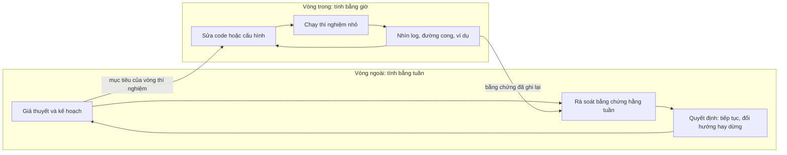
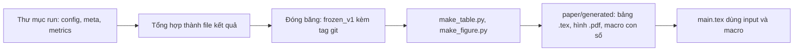

# Vận hành thực nghiệm

!!! abstract "Mục tiêu của bài"
    Sau bài này, người học có thể:

    - Tổ chức công việc thực nghiệm thành hai vòng lặp: vòng trong tính bằng giờ và vòng ngoài tính bằng tuần, đồng thời rút ngắn vòng trong mà không đánh đổi sự cẩn thận.
    - Dựng một codebase nghiên cứu có cấu hình, seed, phiên bản dữ liệu, môi trường và logging đủ chặt để mỗi bảng trong paper được tái tạo bằng một lệnh.
    - Áp dụng công thức huấn luyện từng bước của Karpathy và một checklist debug có thứ tự khi mô hình không học hoặc kết quả bất thường.
    - Tune hyperparameter theo Deep Learning Tuning Playbook: phân loại hyperparameter khoa học, nuisance và cố định; tune tăng dần; khám phá trước, khai thác sau; cấp ngân sách công bằng cho baseline.
    - Quản lý hàng trăm run và ngân sách tính toán, kể cả thí nghiệm dựa trên LLM qua API.
    - Duy trì nhịp rà soát hằng tuần với người hướng dẫn, và đi từ log tới hình, bảng sao cho mọi con số trong paper truy được về một run cụ thể.

Bài [Thiết kế thí nghiệm](thi-nghiem.md) đã biến danh sách claim thành một bộ thí nghiệm có chủ đích: mỗi thí nghiệm trả lời một câu hỏi của reviewer, có kết quả ủng hộ và bác bỏ được viết ra từ trước, có baseline mạnh và ablation kiểm soát yếu tố gây nhiễu. Nhưng giữa bảng kế hoạch và bảng kết quả trong paper là nhiều tuần, thường là nhiều tháng, viết code, chạy, sửa, chạy lại. Phần lớn thời gian của một dự án trôi qua ở đó, và đó cũng là nơi người mới làm nghiên cứu lúng túng nhất.

Sự lúng túng có những biểu hiện rất cụ thể. Codebase phình to kiểu chắp vá. Mô hình không học và không ai biết tìm lỗi từ đâu. Hyperparameter được chỉnh theo cảm giác. Sau ba tháng, thư mục kết quả chứa vài trăm run tên là `test_final_v2_new`, và không ai nhớ con số đẹp nhất trên slide tuần trước đến từ cấu hình nào. Không mục nào trong số đó là vấn đề về ý tưởng; tất cả là vấn đề về *cách vận hành* thực nghiệm. Đáng tiếc là cách vận hành hiếm khi được viết ra; như nhóm tác giả Deep Learning Tuning Playbook nhận xét, các paper thường lướt qua quá trình dẫn tới kết quả cuối cùng để câu chuyện trông gọn hơn (Godbole và cộng sự, *Deep Learning Tuning Playbook*, 2023).

Bài này lấp khoảng trống đó. Chúng ta đi từ hình ảnh hai vòng lặp của công việc thực nghiệm, qua nền móng của một codebase nghiên cứu, công thức huấn luyện của Andrej Karpathy, cách debug có thứ tự, cách tune theo Deep Learning Tuning Playbook, cách quản lý nhiều run và thí nghiệm dựa trên LLM, cách đọc kết quả thành bằng chứng, nhịp làm việc hằng tuần, tới đường đi từ log tới hình và bảng trong paper. Bài giả định người học đã có bản kế hoạch từ bài [Lập kế hoạch nghiên cứu](ke-hoach.md) và bộ thí nghiệm từ bài [Thiết kế thí nghiệm](thi-nghiem.md); những gì đã giảng ở đó và ở [Chương 7](../07-tinh-huong-kho/index.md) chỉ được nhắc ngắn kèm đường dẫn.

## Hai vòng lặp của công việc thực nghiệm

Trong *A Survival Guide to a PhD*, Karpathy mô tả việc làm nghiên cứu sinh như diễn ra ở "tầng meta": giải bài toán chỉ là vòng lặp trong (*inner loop*) đơn giản, còn *"You spend most of your time on the outer loop, figuring out what problems are worth solving and what problems are ripe for solving."* (phần lớn thời gian dành cho vòng ngoài, tìm xem bài toán nào đáng giải và đã đủ chín để giải; Karpathy, *A Survival Guide to a PhD*, 2016). Karpathy nói ở quy mô cả quãng đời nghiên cứu sinh; bài này mượn hình ảnh đó ở quy mô một dự án đang chạy thực nghiệm, vì ở đây cũng có hai vòng lặp lồng nhau với nhịp rất khác nhau.

**Vòng trong tính bằng giờ**: sửa code hoặc cấu hình, chạy một thí nghiệm nhỏ, nhìn đường cong loss, vài ví dụ đầu ra, một con số trên validation, rồi lại sửa. Câu hỏi của nó mang tính cục bộ: code có đúng không, mô hình có học không, thay đổi này có giúp không. **Vòng ngoài tính bằng tuần**: nhìn lại toàn bộ bằng chứng, xem giả thuyết nào được ủng hộ, giả thuyết nào lung lay, rủi ro lớn nhất là gì, và kế hoạch cần đổi ra sao. Đây là nơi bản kế hoạch từ bài [Lập kế hoạch nghiên cứu](ke-hoach.md) được cập nhật và các cổng quyết định được áp dụng.



Hai vòng phụ thuộc nhau. Thiếu mục tiêu từ vòng ngoài, vòng trong biến thành chuỗi "thử cái này xem sao"; thiếu bằng chứng được ghi cẩn thận từ vòng trong, buổi rà soát hằng tuần chỉ còn dựa vào trí nhớ. Nền móng kỹ thuật, công thức huấn luyện, debug và tune trong bài này làm cho vòng trong nhanh và đáng tin; tracking, nhịp tuần và tiêu chí scale up hay dừng làm cho vòng ngoài sáng suốt.

**Tốc độ của vòng trong là một lợi thế cạnh tranh thật.** Một dự án sáu tháng với vòng trong ba ngày chỉ kiểm tra được vài chục giả thuyết nhỏ; với vòng trong ba mươi phút, con số là hàng trăm. Deep Learning Tuning Playbook nêu việc giảm độ trễ của chu kỳ phát triển, để ý tưởng mới được kiểm tra thường xuyên hơn, là một lợi ích chính của huấn luyện nhanh (Godbole và cộng sự, 2023). Jia-Bin Huang khuyên đừng dùng thí nghiệm quy mô đầy đủ, vốn có thể mất hàng tuần, làm cách duy nhất để kiểm chứng ý tưởng, mà hãy tìm một proxy nhỏ cho kết quả nhanh (Huang, *How to make steady progress in my research?*, trong repository *awesome-tips*). Học phần CS197 của Michael Bernstein ở Stanford cũng đặt *velocity*, tốc độ giảm rủi ro theo chiều bất định lớn nhất của dự án, vào trung tâm.

Nhưng "nhanh" không có nghĩa là vội. Karpathy cảnh báo *"a "fast and furious" approach to training neural networks does not work"* (cách làm "nhanh và liều" với mạng nơ-ron không hiệu quả; Karpathy, *A Recipe for Training Neural Networks*, 2019), vì lỗi khi huấn luyện mạng nơ-ron thường im lặng. Hai lời khuyên không mâu thuẫn: vòng trong nhanh nhờ *hạ tầng* (một lệnh để chạy, kết quả tự được ghi và vẽ) và nhờ *thí nghiệm nhỏ* (proxy, toy example, dữ liệu con), không nhờ bỏ qua kiểm tra.

Một ví dụ (ví dụ giả định): hai nghiên cứu sinh cùng làm về một hàm mất mát mới cho phân đoạn ảnh y khoa. Người thứ nhất luôn huấn luyện trên toàn bộ dữ liệu, mỗi run hai ngày, mỗi tuần ba biến thể. Người thứ hai dành tuần đầu dựng một proxy (một phần năm dữ liệu, nửa độ phân giải, lịch ngắn), kiểm tra rằng thứ hạng của bốn cấu hình đã biết trên proxy khớp với thiết lập đầy đủ, rồi từ đó thử hai mươi biến thể mỗi tuần. Sau một tháng, người thứ hai không chỉ có nhiều kết quả hơn mà còn *hiểu* bài toán hơn. Bước kiểm tra thứ hạng là điều kiện để proxy có giá trị: proxy không tương quan với thiết lập thật chỉ cho kết luận nhanh và sai.

## Dựng nền móng: codebase, cấu hình, seed và logging

Vòng trong chỉ nhanh và đáng tin khi đứng trên một nền móng tốt: thư mục được tổ chức thế nào, cấu hình nằm ở đâu, seed đặt ra sao, dữ liệu và môi trường được định danh thế nào, log ghi những gì. Mục *Ghi chép thí nghiệm* trong bài [Thiết kế thí nghiệm](thi-nghiem.md) đã nêu *những gì* cần lưu và *vì sao*; mục này bàn về công cụ và quy trình để việc lưu diễn ra tự động. Karpathy có một lời khuyên giản dị: hãy nghĩ tới "người viết của tương lai" (*the future you*), người sẽ quay lại codebase vài tháng sau để chạy thêm thí nghiệm cho bản camera-ready và sẽ hoàn toàn lạc lối nếu không có tài liệu và cấu trúc rõ ràng; ông cũng khuyên công bố code, một phần vì viễn cảnh công bố buộc người viết hình thành thói quen tốt hơn (Karpathy, 2016).

### Cấu trúc repository

Một cấu trúc tốt tách bạch bốn thứ: **code** (thay đổi qua commit), **cấu hình** (thay đổi giữa các run), **dữ liệu và kết quả** (không nằm trong git nhưng phải được định danh), và **sản phẩm cho paper** (bảng và hình sinh tự động). Cây thư mục dưới đây là ví dụ cho một dự án phát hiện vật thể; dự án NLP hay ML có cấu trúc tương tự.

```text
project/
├── README.md              # cách cài môi trường, tải dữ liệu, tái tạo từng bảng
├── environment.lock       # phiên bản chính xác của mọi gói (pip freeze, conda, uv...)
├── Makefile               # mỗi bảng, mỗi hình trong paper ứng với một target
├── configs/
│   ├── base.yaml          # giá trị mặc định dùng chung
│   ├── data/coco.yaml
│   ├── model/ours_r50.yaml
│   └── exp/               # một file cho mỗi thí nghiệm trong bảng kế hoạch
│       ├── tab1_main.yaml
│       └── tab3_ablate_noA.yaml
├── src/project/           # code thư viện: data, model, loss, eval, utils
│   ├── data.py
│   ├── model.py
│   ├── eval.py            # MỘT bản cài đặt metric, dùng chung cho mọi phương pháp
│   └── run.py             # seed, thư mục run, metadata, logging
├── scripts/
│   ├── train.py           # điểm vào duy nhất: train.py --config configs/exp/...
│   ├── sweep.py           # sinh danh sách trial cho một study
│   └── make_table.py      # đọc kết quả đã đóng băng, sinh LaTeX
├── tests/                 # kiểm thử nhỏ: shape, metric trên ví dụ đã biết đáp án
├── data/                  # (không commit) dữ liệu thô và manifest
├── runs/                  # (không commit) mỗi run một thư mục: config, meta, log, checkpoint
├── results/               # kết quả đã tổng hợp và bản đóng băng cho paper
└── paper/generated/       # bảng .tex, hình .pdf, macro con số, sinh tự động
```

Ba chi tiết đáng giải thích. `eval.py` là *một* bản cài đặt metric duy nhất cho cả phương pháp đề xuất lẫn mọi baseline chạy lại, vì nhiều so sánh không công bằng bắt nguồn từ việc mỗi phương pháp được đánh giá bằng một đoạn code khác nhau. `scripts/train.py` là điểm vào duy nhất; khác biệt giữa các thí nghiệm nằm trong cấu hình, không nằm trong những bản sao như `train_v2.py`. Và thư mục `tests/` không cần đồ sộ: vài kiểm thử cho shape, cho metric trên một ví dụ tính tay được, cho việc không có mẫu trùng giữa train và test đã bắt được nhiều lỗi im lặng.

### Quản lý cấu hình

Nguyên tắc rất đơn giản: **mọi thứ thay đổi giữa các run phải nằm trong cấu hình, và cấu hình đầy đủ của mỗi run được lưu cùng kết quả của nó**. Vi phạm phổ biến nhất là sửa một hằng số trong code "để thử", chạy, rồi quên đổi lại: run đó mang một cấu hình khác với file cấu hình của nó, và về sau không ai biết. Hệ thống cấu hình tốt thường có ba tầng: mặc định dùng chung, khối cấu hình theo thành phần (dữ liệu, mô hình, optimizer), và file của từng thí nghiệm chỉ ghi phần khác mặc định. Khi chạy, script hợp nhất các tầng, cho phép ghi đè từ dòng lệnh, rồi lưu *cấu hình đã hợp nhất* vào thư mục run. Hydra hay OmegaConf hỗ trợ sẵn cách làm này; YAML cộng `argparse` cũng đủ cho dự án nhỏ. Điều quan trọng là kỷ luật: file `tab3_ablate_noA.yaml` được đặt tên theo đúng ô trong bảng kế hoạch mà nó phục vụ. Cần cảnh giác với **giá trị mặc định ẩn** của thư viện, như epsilon của optimizer, kiểu nội suy khi resize, cách cắt chuỗi của tokenizer: chúng có thể đổi giữa các phiên bản, nên tham số nào ảnh hưởng tới kết quả cũng nên được ghi rõ trong cấu hình, kể cả khi trùng mặc định.

### Seed và tính tất định

Khởi tạo, thứ tự dữ liệu, augmentation, dropout và cả thứ tự cộng dồn của phép toán song song trên GPU đều đưa ngẫu nhiên vào kết quả; playbook gọi dao động giữa các lần huấn luyện chỉ khác seed là *trial variance* (Godbole và cộng sự, 2023). Đặt seed có hai mục đích khác nhau.

Mục đích thứ nhất là **tái lập để debug**: loại bỏ mọi nguồn dao động để một thay đổi trong code cho ra một thay đổi trong kết quả có thể quy trách nhiệm được. Karpathy khuyên luôn cố định seed khi dựng khung huấn luyện, để chạy hai lần cho cùng kết quả (Karpathy, 2019). Với PyTorch, điều đó nghĩa là đặt seed cho Python, NumPy và PyTorch; tắt `torch.backends.cudnn.benchmark`; bật `torch.use_deterministic_algorithms(True)` để thư viện báo lỗi khi gặp phép toán không tất định; đặt biến môi trường `CUBLAS_WORKSPACE_CONFIG` theo hướng dẫn của PyTorch; và seed cho các worker của dataloader. Với JAX, khóa ngẫu nhiên được truyền tường minh nên việc kiểm soát dễ hơn. Chế độ tất định thường chậm hơn, và ngay cả khi bật đầy đủ, tài liệu PyTorch cũng nói rõ không bảo đảm kết quả giống hệt giữa các phiên bản, nền tảng hay phần cứng khác nhau.

Mục đích thứ hai là **đo dao động để báo cáo**: khi đã tin code đúng, seed trở thành một biến cần lấy mẫu. Cách báo cáo dao động đã có ở mục *Số liệu và ý nghĩa thống kê* trong bài [Experiments](../02-viet-tung-phan/experiments.md) và ở Tình huống 11 trong bài [Khi con số không đẹp](../07-tinh-huong-kho/con-so-khong-dep.md).

!!! warning "Seed là biến cần lấy mẫu, không phải núm để vặn"
    Chạy nhiều seed rồi chỉ báo cáo seed đẹp nhất là chọn lọc kết quả, dù có cố ý hay không. Quy ước an toàn là quyết định danh sách seed *trước khi chạy* (ví dụ 0 đến 4 cho mọi cấu hình), ghép cặp seed giữa phương pháp đề xuất và baseline, và báo cáo toàn bộ. Nếu một seed hỏng vì lỗi hạ tầng, ghi lại lý do và chạy lại chính seed đó, không thay bằng seed khác.

Đoạn code dưới đây, chạy được với thư viện chuẩn của Python (phần NumPy và PyTorch chỉ có tác dụng khi đã cài), gom các việc trên thành một module nhỏ: đặt seed, tạo thư mục run với tên đọc được, lưu cấu hình đã hợp nhất, metadata về code và môi trường, cả phần thay đổi chưa commit, rồi ghi metric theo từng bước.

```python
import json
import os
import platform
import random
import subprocess
import sys
import time
from pathlib import Path


def set_seed(seed: int, deterministic: bool = False) -> None:
    """Cố định mọi nguồn ngẫu nhiên đã biết; deterministic=True dùng khi debug."""
    random.seed(seed)
    try:
        import numpy as np
        np.random.seed(seed)
    except ImportError:
        pass
    try:
        import torch
        torch.manual_seed(seed)                      # seed cả CPU lẫn mọi GPU
        if deterministic:
            os.environ.setdefault("CUBLAS_WORKSPACE_CONFIG", ":4096:8")
            torch.backends.cudnn.benchmark = False
            torch.use_deterministic_algorithms(True)  # báo lỗi nếu gặp phép toán không tất định
    except ImportError:
        pass


def _git(*args: str) -> str:
    try:
        return subprocess.check_output(["git", *args], text=True,
                                       stderr=subprocess.DEVNULL).strip()
    except (OSError, subprocess.CalledProcessError):
        return "unknown"


def start_run(config: dict, name: str, seed: int, root: str = "runs") -> Path:
    """Tạo thư mục run, lưu cấu hình đầy đủ và metadata trước khi huấn luyện."""
    run_id = f"{time.strftime('%Y%m%d-%H%M%S')}_{name}_s{seed}"
    run_dir = Path(root) / run_id
    run_dir.mkdir(parents=True, exist_ok=False)
    meta = {
        "run_id": run_id,
        "seed": seed,
        "commit": _git("rev-parse", "HEAD"),
        "uncommitted_changes": _git("status", "--porcelain") not in ("", "unknown"),
        "python": sys.version.split()[0],
        "platform": platform.platform(),
        "command": " ".join(sys.argv),
        "started_at": time.strftime("%Y-%m-%dT%H:%M:%S"),
    }
    (run_dir / "config.json").write_text(json.dumps(config, indent=2, ensure_ascii=False))
    (run_dir / "meta.json").write_text(json.dumps(meta, indent=2))
    (run_dir / "git.diff").write_text(_git("diff", "HEAD"))  # giữ lại cả thay đổi chưa commit
    return run_dir


def log_metrics(run_dir: Path, step: int, **metrics: float) -> None:
    """Mỗi lần gọi ghi một dòng JSON; log theo bước, không theo thời gian."""
    with open(run_dir / "metrics.jsonl", "a", encoding="utf-8") as f:
        f.write(json.dumps({"step": step, **metrics}) + "\n")


if __name__ == "__main__":
    cfg = {"model": "resnet18", "lr": 3e-4, "batch_size": 128, "data": "data/manifest_v2.json"}
    set_seed(0)
    run_dir = start_run(cfg, name="cv-baseline", seed=0)
    for step in range(0, 300, 100):
        log_metrics(run_dir, step, train_loss=2.3 / (step + 1), lr=cfg["lr"])
    print("Đã tạo", run_dir)
```

Lưu `git.diff` là một mẹo nhỏ mà hữu ích: cấm hoàn toàn việc chạy thử với code chưa commit là không thực tế, nhưng lưu phần khác biệt so với commit gần nhất bảo đảm run vẫn tái tạo được. Thư mục `runs/` cần nằm trong `.gitignore`, nếu không chính nó sẽ làm cờ `uncommitted_changes` luôn bật.

### Phiên bản dữ liệu và môi trường

Code và cấu hình chỉ là hai trong bốn thành phần quyết định một kết quả; hai thành phần còn lại là dữ liệu và môi trường. Với **dữ liệu**, cách tối thiểu là một *manifest*: danh sách file kèm giá trị băm, số mẫu mỗi split, và đường dẫn tới các file định nghĩa split. File split, tức danh sách ID mẫu của train, validation và test, nên được commit, vì đó là nơi rò rỉ dữ liệu hay bắt đầu (Tình huống 23 trong bài [Khi câu chuyện và bằng chứng không khớp](../07-tinh-huong-kho/cau-chuyen-va-bang-chung.md)). Mỗi run ghi giá trị băm của manifest; DVC hay Git LFS tự động hóa việc này cho dữ liệu lớn. Với dataset và checkpoint trên Hugging Face Hub, ghi *revision* cụ thể thay vì chỉ tên, vì nội dung dưới cùng một tên có thể được cập nhật. Với **môi trường**, cần một file khóa phiên bản mọi gói (`pip freeze`, `conda env export` hay file lock), kèm phiên bản CUDA, driver và loại GPU. Karpathy khuyên dùng container Docker khi công bố code (Karpathy, 2016); trong lúc nghiên cứu, một container cố định cũng giúp cả nhóm chạy cùng môi trường. Khi buộc phải nâng cấp thư viện giữa dự án, hãy chạy lại một cấu hình tham chiếu và so với kết quả cũ trước khi đi tiếp.

### Logging

Bộ log tối thiểu cho một run gồm loss huấn luyện theo bước, metric validation theo những khoảng bước đều đặn, learning rate *thực tế* ở mỗi bước, chuẩn L2 của gradient, thông lượng và bộ nhớ GPU. Playbook có ba lời khuyên cụ thể: đánh giá định kỳ theo *bước* chứ không theo *thời gian*, vì đánh giá theo thời gian làm đường cong khó diễn giải khi job bị gián đoạn; lưu dự đoán trên một tập nhỏ ví dụ cố định ở mỗi lần đánh giá, vì chúng vô giá khi debug; và ghi chuẩn gradient suốt quá trình huấn luyện, vì giá trị ngoại lai là dấu hiệu sớm của bất ổn định (Godbole và cộng sự, 2023). Hãy giữ cả toàn bộ stdout và stderr của mỗi run: một cảnh báo chìm giữa hàng nghìn dòng, như cảnh báo rằng một phần trọng số pre-trained không được nạp, đôi khi là manh mối duy nhất của một lỗi im lặng.

### Một lệnh tái tạo một bảng

Các thành phần trên hội tụ về một nguyên tắc dễ kiểm tra: **mỗi bảng và mỗi hình trong paper được tái tạo bằng đúng một lệnh**, không sao chép số từ dashboard, không sửa tay file CSV, không chạy notebook theo một thứ tự chỉ người viết biết. Một Makefile là cách đơn giản để ghi lại các lệnh này.

```makefile
# Mỗi target ứng với một bảng hoặc hình trong paper.
# "make tab1" chỉ tổng hợp từ kết quả đã đóng băng; "make train-tab3" chạy lại từ đầu.
tab1:
	python scripts/make_table.py --spec tables/tab1_main.yaml

fig4:
	python scripts/make_figure.py --spec figures/fig4_lr_sensitivity.yaml

train-tab3:
	python scripts/sweep.py --study configs/exp/tab3_ablate_noA.yaml --seeds 0 1 2

paper: tab1 fig4
	cd paper && latexmk -pdf main.tex
```

Giá trị của nguyên tắc này vượt xa sự gọn gàng. Khi phát hiện một bug, nhóm biết chính xác bảng nào cần tái tạo và bằng lệnh nào. Khi reviewer yêu cầu thêm một cột, việc bổ sung không làm hỏng các cột cũ. Khi chuẩn bị công bố code cho bản camera-ready (bài [Camera-ready, poster, code](../04-nop-va-sau-nop/camera-ready.md)), phần lớn công việc đã xong. Script sinh bảng được bàn ở mục *Từ kết quả tới hình và bảng*.

## Bắt đầu nhỏ: công thức huấn luyện của Karpathy

Có nền móng rồi, câu hỏi tiếp theo là bắt đầu huấn luyện thế nào. Bài blog *A Recipe for Training Neural Networks* của Andrej Karpathy (2019) là một trong những tài liệu thực hành được dẫn nhiều nhất về chủ đề này. Nó không phải paper; nó là kinh nghiệm cá nhân được hệ thống hóa thành một *quy trình*, và giá trị nằm ở chính quy trình ấy chứ không ở một mẹo riêng lẻ nào.

Karpathy xuất phát từ hai quan sát. Thứ nhất, *"Neural net training is a leaky abstraction"*: thư viện tạo cảm giác "cắm vào là chạy", nhưng thực tế không phải vậy. Thứ hai, huấn luyện thất bại im lặng: *"Most of the time it will train but silently work a bit worse."* (phần lớn thời gian, mô hình vẫn học, chỉ âm thầm kém đi một chút), chẳng hạn khi lật ảnh mà quên lật nhãn, hay định clip gradient mà lại clip loss (Karpathy, 2019). Với người làm paper, hệ quả còn nặng hơn: lỗi im lặng ở phương pháp đề xuất có thể biến ý tưởng đúng thành kết quả âm tính, còn lỗi ở *baseline* có thể biến ý tưởng sai thành "cải thiện". Vì vậy nguyên tắc của công thức là đi từ đơn giản đến phức tạp, mỗi bước kèm một giả thuyết cụ thể được kiểm chứng, và không đưa vào nhiều độ phức tạp chưa kiểm chứng cùng lúc. Công thức có sáu bước.

**Bước 1: Hiểu thật kỹ dữ liệu.** Trước khi viết dòng code mô hình nào, Karpathy dành hàng giờ duyệt hàng nghìn mẫu, nhờ đó từng phát hiện mẫu trùng lặp, nhãn hỏng, mất cân bằng và thiên lệch, rồi viết code lọc và trực quan hóa phân phối theo mọi trục, vì điểm ngoại lai hầu như luôn để lộ lỗi dữ liệu hay tiền xử lý. Trong bối cảnh paper, bước này còn là nơi khoảng trống nghiên cứu lộ ra: một nghiên cứu sinh NLP đọc kỹ năm trăm mẫu của một benchmark suy luận có thể thấy nhiều câu trả lời được chỉ từ một phần đầu vào; một nghiên cứu sinh CV duyệt lỗi của baseline có thể thấy lỗi tập trung ở vật thể nhỏ bị che khuất. Đó là nguyên liệu cho insight, như bài [Tìm khoảng trống và nguồn ý tưởng](tim-khoang-trong.md) đã phân tích.

**Bước 2: Dựng khung huấn luyện và đánh giá đầu cuối, với baseline "ngốc".** Karpathy dựng toàn bộ đường ống với một mô hình đơn giản đến mức khó cài sai, như một bộ phân loại tuyến tính hay một ConvNet rất nhỏ, rồi tạo niềm tin vào đường ống qua một loạt kiểm tra. Có thể gom chúng thành năm nhóm.

- *Loại bỏ biến thiên*: cố định seed, tắt mọi thứ không cần thiết, nhất là data augmentation.
- *Làm cho phép đo đáng tin*: đánh giá trên toàn bộ tập đánh giá thay vì loss từng batch được làm mượt, và kiểm tra loss lúc khởi tạo. Với softmax trên $n$ lớp, loss ban đầu phải xấp xỉ $-\log(1/n)$, khoảng 2,30 với 10 lớp và 6,91 với 1.000 lớp. Khởi tạo bias lớp cuối khớp với thống kê dữ liệu, chẳng hạn để mô hình dự đoán xác suất 0,1 nếu tỉ lệ mẫu dương là 1:10. Karpathy viết về tập *test*; trong bối cảnh paper, mọi kiểm tra lúc phát triển nên dùng validation, vì lý do ở mục *Đọc kết quả thành bằng chứng*.
- *Đặt mốc so sánh*: một baseline của con người khi có thể, và một baseline *không phụ thuộc đầu vào*, chẳng hạn thay mọi đầu vào bằng số không. Mô hình thật phải thắng baseline này. Họ hàng gần của nó, baseline chỉ dùng một phần đầu vào, còn là công cụ phát hiện artifact của benchmark (Tình huống 22 trong bài [Khi câu chuyện và bằng chứng không khớp](../07-tinh-huong-kho/cau-chuyen-va-bang-chung.md)).
- *Kiểm tra năng lực học*: overfit một batch chỉ vài mẫu, có khi chỉ hai mẫu, tới loss gần không, và vẽ nhãn cạnh dự đoán để thấy chúng khớp; nếu không làm được thì có lỗi và chưa thể đi tiếp. Đoạn code overfit một batch có ở Tình huống 1 trong bài [Khi novelty và hiệu quả lệch pha](../07-tinh-huong-kho/novelty-va-hieu-qua.md). Sau đó tăng dung lượng một chút và xác nhận loss huấn luyện giảm.
- *Nhìn thấy những gì mô hình thấy*: theo Karpathy, nơi đúng đắn duy nhất để trực quan hóa dữ liệu là ngay trước dòng `y_hat = model(x)`, giải mã chính tensor đi vào mạng thành ảnh hay văn bản đọc được. Thêm vào đó là theo dõi dự đoán trên một batch cố định, và dùng backprop để kiểm tra quan hệ phụ thuộc: đặt loss bằng tổng đầu ra của mẫu thứ $i$, lan truyền ngược, và xác nhận gradient chỉ khác không ở đầu vào thứ $i$. Kiểm tra này bắt lỗi trộn thông tin giữa các mẫu trong batch (dùng `view` thay vì `permute`), và cùng cách đó kiểm tra mô hình tự hồi quy ở thời điểm $t$ chỉ phụ thuộc các vị trí trước $t$.

**Bước 3: Overfit.** Trước hết lấy một mô hình đủ lớn để overfit tập huấn luyện, sau đó mới regularize; không mô hình nào đạt loss huấn luyện thấp lại là dấu hiệu của lỗi. Lời khuyên số một ở đây là *"Don't be a hero"*: sao chép kiến trúc đơn giản nhất cho kết quả tốt của paper gần nhất, như một ResNet-50 cho phân loại ảnh. Karpathy dùng Adam với learning rate $3 \times 10^{-4}$ làm điểm xuất phát an toàn (quy tắc kinh nghiệm cá nhân năm 2019, không phải chân lý), thêm từng tín hiệu một, và cảnh giác với lịch giảm learning rate mặc định khi tái sử dụng code. Trong paper, "đừng làm anh hùng" nghĩa là novelty nằm ở một thành phần xác định rõ, mọi thứ khác là lựa chọn chuẩn; xây phương pháp từ baseline chuẩn bằng cách thêm từng thành phần cũng cho sẵn bảng ablation cộng dồn như trong bài [Thiết kế thí nghiệm](thi-nghiem.md).

**Bước 4: Regularize.** Karpathy xếp các cách theo thứ tự ưu tiên: thêm dữ liệu thật, data augmentation, dữ liệu tổng hợp, pre-training, rồi mới tới mô hình nhỏ hơn, dropout, weight decay và early stopping. Trong paper, chính những cách hiệu quả nhất ở đầu danh sách lại thay đổi điều kiện so sánh: nếu phương pháp đề xuất được hưởng dữ liệu hay pre-training mà baseline không có, cải thiện có thể chỉ phản ánh điều đó (Tình huống 17 trong bài [Khi con số không đẹp](../07-tinh-huong-kho/con-so-khong-dep.md)). Một số lời khuyên gắn với thời điểm viết; khuyến nghị bám vào học có giám sát thay vì pre-training không giám sát phản ánh thị giác máy tính năm 2019, không còn phù hợp hiện nay.

**Bước 5: Tune.** Karpathy khuyên random search thay vì grid search, dẫn lập luận của Bergstra và Bengio (2012): mạng nơ-ron nhạy với một số hyperparameter hơn hẳn những cái khác, nên lấy mẫu ngẫu nhiên khám phá kỹ hơn các chiều quan trọng. Bước này được bàn sâu ở mục về Deep Learning Tuning Playbook.

**Bước 6: Vắt kiệt.** Ensemble gần như chắc chắn cho thêm vài điểm phần trăm (Karpathy ước khoảng 2%, theo kinh nghiệm riêng), có thể chưng cất ensemble vào một mô hình, và để mô hình huấn luyện lâu hơn trực giác mách bảo. Trong paper, những cải thiện này thuộc về *công thức huấn luyện*, không thuộc về ý tưởng; chúng chỉ hợp lệ nếu được áp dụng ngang nhau cho baseline hoặc báo cáo tách riêng, nếu không nhóm đang ở Tình huống 18, nơi phương pháp hoạt động nhưng không vì lý do đã nêu.

| Bước | Câu hỏi cần trả lời | Ý nghĩa với paper |
|---|---|---|
| Hiểu thật kỹ dữ liệu | Dữ liệu thực sự trông thế nào, có lỗi gì? | Phát hiện artifact, lỗi nhãn, và đôi khi chính khoảng trống nghiên cứu |
| Khung đầu cuối và baseline ngốc | Đường ống có đúng không? | Mọi so sánh dựa trên đường ống này; baseline không phụ thuộc đầu vào làm mốc |
| Overfit | Mô hình có đủ năng lực học không? | Xây phương pháp từ baseline chuẩn, từng thành phần một |
| Regularize | Có tổng quát hóa không? | Lợi thế về dữ liệu hay pre-training phải được kiểm soát |
| Tune | Cấu hình tốt nằm ở đâu? | Ngân sách tune phải công bằng giữa các phương pháp |
| Vắt kiệt | Còn bao nhiêu phần trăm? | Ensemble và huấn luyện lâu hơn là công thức, không phải đóng góp |

## Tái lập baseline trước khi xây phương pháp

Cột mốc đầu tiên của giai đoạn vận hành là **tái lập baseline chính trong chính codebase và đường ống đánh giá của nhóm**, trước khi thêm bất cứ thành phần nào của phương pháp đề xuất. Lý do và cách thiết kế pilot quanh việc này đã có ở mục *Pilot experiment và tiêu chí dừng* trong bài [Thẩm định ý tưởng](y-tuong.md); cách xử lý khi số tái lập lệch số công bố là nội dung của Tình huống 13 trong bài [Khi con số không đẹp](../07-tinh-huong-kho/con-so-khong-dep.md). Playbook khuyên tái lập mô hình của paper gần nhất làm điểm xuất phát (Godbole và cộng sự, 2023); Jia-Bin Huang khuyên "baseline first", vì thử baseline cho thấy giới hạn của state of the art (Huang, *awesome-tips*); Schulman khuyên cài đặt lại paper và so với kết quả được báo cáo, vì khi biết trước hiệu năng mục tiêu thì phản hồi đến rất nhanh (Schulman, *An Opinionated Guide to ML Research*, 2020).

Trong thực hành, việc tái lập nên đi qua ba nấc, mỗi nấc khoanh vùng một loại sai lệch: chạy code chính thức và đạt con số công bố trong biên độ dao động hợp lý; chuyển baseline vào codebase của nhóm và đạt lại con số đó, nơi khoảng cách chỉ ra khác biệt về dữ liệu, tiền xử lý hay chi tiết huấn luyện; và đánh giá checkpoint công bố của baseline, nếu có, bằng `eval.py` của nhóm, nơi khoảng cách nằm ở phần đánh giá. Chỉ khi ba nấc khớp nhau, phương pháp đề xuất mới được thêm vào. Bỏ qua bước này, mọi cải thiện hay thất bại về sau đều có thêm một cách giải thích: đường ống của nhóm khác đường ống của baseline.

## Debug khi mô hình không học hoặc kết quả bất thường

Dù làm theo công thức cẩn thận đến đâu, sẽ có lúc mô hình không học hoặc cho kết quả khó hiểu. Có hai loại rắc rối: loại ồn ào (loss đứng yên, bùng nổ, ra NaN) và loại im lặng, nguy hiểm hơn, khi mọi thứ trông bình thường mà con số thấp hơn kỳ vọng vài điểm, hoặc *cao* bất thường. Kết quả tốt bất ngờ đáng được soi xét ít nhất như kết quả xấu bất ngờ, vì con người có xu hướng debug khi kết quả xấu và dừng lại khi kết quả đẹp.

Trước khi tìm nguyên nhân, cần **tái hiện lỗi trong thiết lập nhỏ nhất**: bật chế độ tất định, thu nhỏ dữ liệu và mô hình tới mức một lần chạy chỉ mất vài phút mà triệu chứng vẫn còn. Sau đó, debug là **khoanh vùng**: đi dọc đường ống từ dữ liệu tới con số cuối cùng, kiểm tra đầu ra ở từng điểm, và dừng ở điểm đầu tiên đầu ra sai. Thứ tự dưới đây đi từ thượng nguồn xuống hạ nguồn, vì lỗi ở thượng nguồn gây triệu chứng ở mọi điểm phía sau, và vì kiểm tra ở thượng nguồn thường rẻ nhất.

**Thứ nhất, dữ liệu và nhãn.** In hai mươi mẫu ngẫu nhiên kèm nhãn ở dạng đọc được, đếm phân phối nhãn, tìm mẫu trùng và mẫu hỏng. Một lỗi phổ biến là ánh xạ chỉ số lớp của dataset khác với của đầu phân loại pre-trained.

**Thứ hai, tiền xử lý.** Trực quan hóa chính tensor đi vào mô hình. Augmentation phải biến đổi nhãn tương ứng (lật ảnh thì lật cả hộp bao và hoán đổi điểm mốc trái phải), chuẩn hóa đầu vào phải khớp với thống kê của trọng số pre-trained, và việc cắt chuỗi không được cắt mất phần chứa đáp án.

**Thứ ba, hàm mất mát.** So loss lúc khởi tạo với giá trị lý thuyết. Kiểm tra hàm nhận đúng loại đầu vào (nhiều hàm cross-entropy nhận logit, nên áp softmax trước đó là lỗi im lặng), cách lấy trung bình theo mẫu hay theo token, việc loại vị trí padding khỏi loss, và dấu của từng thành phần.

**Thứ tư, learning rate và quá trình tối ưu.** Ghi learning rate *thực tế* ở mỗi bước, quét learning rate qua vài bậc độ lớn trên thiết lập nhỏ, và kiểm tra mọi tham số cần học đều nằm trong optimizer: một module tạo sau optimizer hoặc vô tình bị đóng băng sẽ không bao giờ thay đổi, phát hiện được bằng cách so trọng số trước và sau vài bước. Với bất ổn định, playbook khuyên vẽ đường cong loss cho các learning rate lớn hơn giá trị tốt nhất một chút; nếu loss tăng vọt giữa chừng, sửa bất ổn định nhiều khả năng sẽ cải thiện kết quả. Cách sửa gồm warmup (tốt nhất cho bất ổn định đầu huấn luyện), gradient clipping với ngưỡng khởi đầu quanh phân vị thứ 90 của chuẩn gradient, đổi optimizer, residual và chuẩn hóa đúng vị trí; giảm learning rate là giải pháp cuối cùng, và nếu hơn một nửa số cập nhật bị clip thì clipping đã quá mạnh (Godbole và cộng sự, 2023).

**Thứ năm, chuẩn hóa.** Batch norm hành xử khác nhau ở chế độ huấn luyện và đánh giá, và quên chuyển chế độ là lỗi kinh điển; với batch rất nhỏ, thống kê của nó nhiễu, và trên nhiều thiết bị, thống kê mỗi thiết bị khác nhau nếu không đồng bộ. Playbook khuyên đặt chuẩn hóa bên trong nhánh residual theo dạng $x + f(\mathrm{Norm}(x))$, vì dạng $\mathrm{Norm}(x + f(x))$ được biết là gây khó khăn cho huấn luyện.

**Thứ sáu, phần đánh giá.** Kiểm tra checkpoint, split và tham số hậu xử lý (ngưỡng, NMS, tham số giải mã) giống nhau giữa các phương pháp; so metric của `eval.py` với script chính thức của benchmark trên cùng một tệp dự đoán. Khi tập đánh giá không chia hết cho batch size, mẫu đệm phải có trọng số không, một lỗi mà playbook nêu đích danh.

**Thứ bảy, rò rỉ dữ liệu.** Mẫu trùng hoặc gần trùng giữa các split, rò rỉ theo nhóm hay theo thời gian, tiền xử lý khớp trên toàn bộ dữ liệu, chọn mô hình trên test, contamination với dữ liệu pre-training. Playbook nêu một dấu hiệu ít người biết: metric validation dao động có chu kỳ có thể báo hiệu dữ liệu test trùng dữ liệu huấn luyện hoặc dữ liệu chưa được xáo trộn đúng. Cách xử lý khi phát hiện rò rỉ sau khi đã có kết quả là Tình huống 23 trong bài [Khi câu chuyện và bằng chứng không khớp](../07-tinh-huong-kho/cau-chuyen-va-bang-chung.md).

**Thứ tám, sai khác giữa huấn luyện và đánh giá.** Hai đường ống thường được viết ở hai nơi và lệch nhau lặng lẽ: kích thước ảnh, cách cắt, template của prompt, tokenizer, kiểu số học. Kiểm tra hiệu quả nhất là chạy đường ống đánh giá trên một batch huấn luyện và so loss với con số mà vòng lặp huấn luyện báo cho batch đó; hai con số phải khớp.

| Triệu chứng | Nghi phạm đầu tiên | Kiểm tra nhanh |
|---|---|---|
| Loss ban đầu lệch xa $-\log(1/n)$ | Khởi tạo lớp cuối, hàm mất mát | Tính loss trên một batch trước bước cập nhật đầu |
| Loss không giảm, kể cả trên một batch | Tham số ngoài optimizer, learning rate, lỗi gradient | Overfit hai mẫu; so trọng số trước và sau vài bước |
| Loss ra NaN hoặc tăng vọt giữa chừng | Learning rate lớn, thiếu warmup, tràn số | Vẽ chuẩn gradient theo bước; thử warmup hoặc clipping |
| Train tốt, validation kém bất thường | Sai khác huấn luyện và đánh giá, chế độ batch norm | Chạy đường ống đánh giá trên một batch huấn luyện |
| Tốt hơn mọi công trình trước một khoảng xa | Rò rỉ dữ liệu, lỗi metric | Kiểm tra trùng lặp giữa split; đối chiếu script chính thức |
| Kém kỳ vọng vài điểm, không lỗi rõ ràng | Lỗi im lặng ở tiền xử lý hoặc augmentation | Trực quan hóa tensor ngay trước mô hình |

Ba ví dụ dưới đây (đều là ví dụ giả định) cho thấy checklist vận hành thế nào ở ba cộng đồng.

**Computer Vision: lật ảnh mà quên lật nhãn.** Một nhóm làm ước lượng tư thế người thêm augmentation lật ngang. Độ chính xác tổng tăng nhẹ, nhưng các khớp trái và phải đều kém baseline. Trực quan hóa batch ngay trước mô hình cho thấy khi ảnh bị lật, nhãn "vai trái" vẫn nằm ở vai bên trái của *ảnh*, tức vai phải của người. Mô hình vẫn học, đúng như Karpathy mô tả, nhưng trả giá ở những khớp có phân biệt trái phải; kết luận "augmentation giúp" đúng về con số tổng nhưng sai về cơ chế, và chỉ phân tích theo nhóm mới để lộ ra điều đó.

**NLP: template khi huấn luyện khác khi đánh giá.** Một nhóm fine-tune một mô hình ngôn ngữ mở cho hỏi đáp y khoa. Loss huấn luyện giảm đẹp, nhưng độ chính xác validation thấp hơn cả mô hình gốc. Ở bước thứ tám, in chuỗi token đi vào mô hình trong hai đường ống cho thấy dữ liệu huấn luyện dùng chat template, còn script đánh giá, viết từ trước cho mô hình khác, ghép câu hỏi thẳng vào prompt. Sửa template, độ chính xác vượt mô hình gốc rõ rệt. "In ra chính xác những gì đi vào mô hình" áp dụng cho văn bản không kém ảnh, và phải làm ở *cả hai* đường ống.

**Machine Learning: lịch learning rate sao chép từ bài toán khác.** Một nghiên cứu sinh thử một regularizer mới trên dataset phân loại nhỏ với cấu hình sao chép từ codebase ImageNet: learning rate giảm mười lần ở các epoch 30, 60 và 80, tổng 300 epoch. Cả hai phía chững lại sớm và regularizer không cho thấy lợi ích nào. Log learning rate thực tế cho thấy từ epoch 80, learning rate chỉ còn một phần nghìn giá trị đầu, nên hơn hai phần ba quá trình huấn luyện gần như vô tác dụng, và regularizer, vốn làm mô hình khớp dữ liệu chậm hơn, bị thiệt nhiều hơn. Theo ngôn ngữ của playbook, lịch learning rate ở đây là hyperparameter *cố định* tạo ra caveat: "regularizer không giúp" chỉ đúng với một lịch mà không ai chọn có chủ đích.

Khi debug kéo dài hơn một buổi, hãy viết nhật ký. Nó buộc mỗi bước kiểm tra có một kết luận rõ ràng, và là thứ cần mang tới buổi gặp người hướng dẫn.

```text
Nhật ký debug (ví dụ giả định)
Triệu chứng:   Validation acc 41% sau fine-tune, thấp hơn mô hình gốc (48%).
Tái hiện:      Thiết lập nhỏ (2k mẫu train, 200 mẫu val), chế độ tất định: vẫn còn.
Đã loại trừ:   Dữ liệu và nhãn (in 20 mẫu: đúng). Loss lúc khởi tạo: hợp lý.
               Overfit 8 mẫu: loss về 0,02 sau 300 bước. Learning rate thực tế: đúng lịch.
Khoanh vùng:   Đường ống đánh giá trên 1 batch train: loss 2,9; vòng lặp train báo 0,8.
               => Hai đường ống nhìn dữ liệu khác nhau.
Nguyên nhân:   eval.py không áp chat template.
Sửa và xác nhận: Áp template trong eval.py; loss trên batch train khớp (0,8).
               Validation acc: 57%.
Ảnh hưởng:     Mọi kết quả đánh giá trước commit 4e1a9c0 phải chạy lại (danh sách run đính kèm).
```

!!! tip "Đừng chỉ nói \"nó không chạy\""
    Trong ghi chú *How to do research with my mentors effectively?*, Jia-Bin Huang dẫn lời khuyên từ tài liệu *How To Do Research* của Bill Freeman: thay vì báo "nó không chạy", hãy nói đã khoanh vùng vấn đề tới bước nào, rằng tới bước trước đó mọi thứ vẫn đúng như kỳ vọng với đầu vào và đầu ra cụ thể, rằng nó hỏng ở bước này, và những nguyên nhân nào đã được loại trừ. Nhật ký debug ở trên là bản viết ra của cách báo cáo đó.

## Tune có phương pháp: Deep Learning Tuning Playbook

Khi đường ống đã đúng, rắc rối lớn tiếp theo là tune hyperparameter. Thiếu phương pháp, việc tune thành chuỗi chỉnh sửa theo cảm giác, không ghi lại, và thường bất công với baseline mà không ai nhận ra. *Deep Learning Tuning Playbook* (Godbole, Dahl, Gilmer, Shallue và Nado, 2023), do năm nhà nghiên cứu thuộc Google Research, Brain Team và Đại học Harvard viết, công bố trên GitHub với nhãn phiên bản 1.0, là tài liệu có hệ thống nhất hiện có về quá trình này. Tài liệu ghi rõ nó không phải sản phẩm chính thức của Google, phản ánh quan điểm của các tác giả tại thời điểm viết chứ không phải chân lý khách quan, và giả định bài toán học có giám sát hoặc rất giống như vậy. Nó hữu ích cho người làm paper vì phần lớn claim thực nghiệm là claim *so sánh*, và playbook về bản chất là một phương pháp so sánh công bằng.

### Cấu hình khởi đầu

Playbook khuyên bắt đầu từ một cấu hình *đơn giản, tương đối nhanh, tốn ít tài nguyên* mà đạt kết quả "hợp lý", tối thiểu là tốt hơn hẳn mức ngẫu nhiên trên validation: learning rate hằng số trước khi thêm lịch giảm, mô hình nhỏ trước, kiến trúc đã được kiểm chứng, optimizer phổ biến nhất cho loại bài toán đó, và sẵn sàng tune *mọi* hyperparameter của optimizer. Batch size quyết định thời gian huấn luyện và không nên dùng như một núm để tune hiệu năng validation; thường nên chọn batch size lớn nhất mà phần cứng hỗ trợ, miễn là thông lượng vẫn tăng theo, và khi đổi batch size thì phần lớn hyperparameter khác, nhất là learning rate và regularization, phải tune lại (Godbole và cộng sự, 2023).

### Tune tăng dần, khám phá trước, khai thác sau

Chiến lược trung tâm là **tune tăng dần**: từ cấu hình đơn giản, thêm cải tiến từng bước trong khi tích lũy hiểu biết về bài toán. Mỗi vòng lặp lại bốn bước: chọn một mục tiêu có phạm vi phù hợp; thiết kế và chạy thí nghiệm hướng tới nó; học từ kết quả; cân nhắc có chấp nhận cấu hình tốt nhất mới, tức một lần *launch*, hay không. Mỗi lần launch phải dựa trên bằng chứng mạnh chứ không phải sự may mắn của một cấu hình. Điều đáng ngạc nhiên là phần lớn thời gian *không* dành cho việc tối đa hóa hiệu năng: *"we spend most of our time on "exploration" and only a small amount on "exploitation"."* (phần lớn thời gian dành cho "khám phá", chỉ một phần nhỏ cho "khai thác"). Khám phá giúp tránh giữ lại thay đổi chỉ tình cờ có mặt trong các run tốt, biết hyperparameter nào nhạy và tương tác với nhau, bỏ thành phần thừa, và nhận ra khi việc tune đã bão hòa (Godbole và cộng sự, 2023).

Mỗi vòng cần một mục tiêu rõ và đủ hẹp; thêm nhiều thứ cùng lúc thì không tách được tác động của từng thứ. Jia-Bin Huang nói ngắn gọn hơn: *"When doing experiments, change exactly ONE thing at a time."* (mỗi lần làm thí nghiệm chỉ thay đổi đúng một thứ; Huang, *awesome-tips*). Table 3 của Transformer, được phân tích trong case study [Transformer](../05-case-studies/transformer.md), là ví dụ kinh điển về thành quả của kỷ luật này: một cấu hình mốc, và mỗi dòng chỉ đổi một yếu tố.

### Hyperparameter khoa học, nuisance và cố định

Khái niệm có giá trị nhất của playbook với người làm paper là phân loại hyperparameter theo *mục tiêu của vòng thí nghiệm*. **Hyperparameter khoa học** (*scientific*) là những cái ta muốn đo tác động. **Hyperparameter nuisance** là những cái cần được tối ưu để so sánh các giá trị khoa học trở nên công bằng, mượn khái niệm tham số nuisance trong thống kê. **Hyperparameter cố định** (*fixed*) được giữ nguyên trong vòng hiện tại, với cái giá được playbook nói rõ: *"fixed hyperparameters create caveats for any conclusions we draw from the experiments."* (hyperparameter cố định tạo ra điều kiện kèm theo cho mọi kết luận rút ra từ thí nghiệm), tức kết luận có thể không còn đúng ở giá trị khác của chúng (Godbole và cộng sự, 2023).

Ví dụ của playbook: nếu mục tiêu là xem thêm lớp ẩn có giảm validation error không, số lớp là khoa học; learning rate là nuisance, vì learning rate tối ưu phụ thuộc kiến trúc nên phải tune riêng cho từng số lớp; hàm kích hoạt có thể cố định nếu chấp nhận kết luận chỉ đúng cho hàm kích hoạt đó. Vai trò đổi theo mục tiêu, nhưng có vài quy tắc kinh nghiệm: hyperparameter của optimizer thường là nuisance, còn *lựa chọn* optimizer là khoa học hoặc cố định; *có dùng* một kỹ thuật regularization hay không là khoa học hoặc cố định, còn *cường độ* của nó là nuisance; hyperparameter kiến trúc thường là khoa học hoặc cố định. Learning rate của Adam và của Nesterov momentum là *hai* hyperparameter khác nhau dù cùng tên (*hyperparameter có điều kiện*), vì khoảng giá trị tốt có thể chênh nhau nhiều bậc độ lớn.

Đặt khung này vào paper, một điều trở nên hiển nhiên: **lựa chọn "phương pháp đề xuất hay baseline" là một hyperparameter khoa học**, và mọi hyperparameter nhạy cảm của cả hai phía là nuisance phải được tối ưu riêng cho từng phía. Bảng dưới đây phân loại cho một paper NLP giả định đề xuất một biến thể attention mới.

| Hyperparameter | Vai trò | Lý do |
|---|---|---|
| Loại attention (chuẩn hay đề xuất) | Khoa học | Đây chính là claim của paper |
| Learning rate, độ dài warmup, weight decay | Nuisance | Tối ưu của chúng phụ thuộc kiến trúc; tune riêng cho từng phía |
| Hệ số nhiệt độ riêng của attention đề xuất | Nuisance có điều kiện | Chỉ tồn tại ở phía đề xuất; tính vào ngân sách của phía đó |
| Kích thước mô hình, dữ liệu, tokenizer, số bước | Cố định | Do ngân sách; kết luận chỉ đúng ở quy mô này, ghi vào Limitations |
| Batch size | Cố định | Chọn theo phần cứng, không dùng để tune validation |

Dòng "cố định" là chỗ playbook nối thẳng vào cách viết paper: mỗi hyperparameter cố định là một caveat, và caveat đó thuộc về Limitations hoặc về phạm vi của claim.

### Study, ngân sách và thuật toán tìm kiếm

Playbook gọi một tập cấu hình được chạy để phân tích là một *study*, mỗi cấu hình là một *trial*. Study chạy đường ống với các giá trị khoa học khác nhau, đồng thời "tối ưu đi" (*optimize away*) các nuisance; trường hợp đơn giản nhất là mỗi giá trị khoa học một study riêng, rồi so trial tốt nhất của các study. Ngân sách phải cân bằng ba mong muốn: so đủ nhiều giá trị khoa học; không gian tìm kiếm nuisance đủ rộng để chứa vùng tốt của mọi phía; và lấy mẫu đủ dày để không phía nào chỉ đơn giản là gặp may. Playbook ưu tiên **quasi-random search** khi khám phá, vì nó phủ không gian đồng đều, cho phép đổi mục tiêu phân tích mà không chạy lại, tái lập được và chạy song song tốt; Bayesian optimization dành cho giai đoạn *sau* khám phá. Random search thông thường là thay thế chấp nhận được; grid search chỉ ổn với một hai chiều (Godbole và cộng sự, 2023).

Đoạn code dưới đây sinh một study cho ví dụ attention ở trên bằng random search trên thang log. Điều cần chú ý là cấu trúc: ba loại hyperparameter được khai báo tách bạch, mỗi giá trị khoa học nhận cùng số trial, và seed của cuộc tìm kiếm được cố định để study tái tạo được.

```python
import json
import math
import random
from pathlib import Path

# Mục tiêu của vòng: attention đề xuất có giảm validation loss so với attention chuẩn?
SCIENTIFIC = {"attention": ["standard", "ours"]}       # hyperparameter khoa học
NUISANCE = {                                          # tối ưu riêng cho TỪNG giá trị khoa học
    "lr": ("log", 1e-4, 3e-3),
    "weight_decay": ("log", 1e-3, 1e-1),
    "warmup_steps": ("int", 200, 2000),
}
FIXED = {"model_size": "125M", "train_steps": 20_000, "batch_size": 256}  # tạo ra caveat
TRIALS_PER_ARM = 24                                   # cùng ngân sách cho mọi giá trị khoa học


def sample(spec, rng):
    kind, low, high = spec
    if kind == "log":
        return math.exp(rng.uniform(math.log(low), math.log(high)))
    return rng.randint(low, high)


def make_study(name: str, seed: int = 0) -> Path:
    rng = random.Random(seed)                         # seed của chính cuộc tìm kiếm cũng được ghi lại
    out = Path("sweeps") / name / "trials.jsonl"
    out.parent.mkdir(parents=True, exist_ok=True)
    with out.open("w") as f:
        for arm in SCIENTIFIC["attention"]:
            for t in range(TRIALS_PER_ARM):
                trial = {"study": name, "trial": f"{arm}-t{t:02d}", "attention": arm,
                         **{k: sample(v, rng) for k, v in NUISANCE.items()}, **FIXED}
                f.write(json.dumps(trial) + "\n")
    return out


if __name__ == "__main__":
    path = make_study("attn-vs-std_round1")
    print(path, sum(1 for _ in path.open()), "trials")
```

Khi thêm hệ số nhiệt độ của attention đề xuất, nó chỉ xuất hiện ở các trial phía `ours`, và ngân sách phía này vẫn giữ bằng phía `standard`. Nếu phương pháp chỉ thắng khi được thêm trial, đó là một phát hiện cần báo cáo, đúng như Tình huống 16 phân tích.

### Đọc kết quả của một study

Trước khi kết luận, playbook khuyên trả lời vài câu hỏi phụ. Không gian có đủ rộng không: nếu điểm tốt nhất nằm sát biên theo một chiều, cần mở rộng theo chiều đó, kiểm tra bằng *basic hyperparameter axis plot* (mỗi điểm một trial, trục hoành là một hyperparameter, trục tung là metric validation tốt nhất của trial). Đã lấy đủ điểm chưa. Tỉ lệ trial không khả thi (phân kỳ, loss rất tệ, không chạy được) là bao nhiêu; tỉ lệ rất lớn đòi hỏi chỉnh không gian, và đôi khi là dấu hiệu của bug. Đường cong của các trial tốt nhất nói gì: có *overfitting có hại* không, tức validation error bắt đầu tăng (nếu có, chạy lại với regularization tốt hơn trước khi so sánh); có dao động lớn giữa các bước ở cuối không; trial còn đang cải thiện hay đã bão hòa (Godbole và cộng sự, 2023).

Khi đã tin study ổn, công cụ trả lời câu hỏi chính là **isolation plot**: với mỗi giá trị khoa học, vẽ hiệu năng của trial *tốt nhất* sau khi tối ưu đi các nuisance, để so "táo với táo". Ví dụ của playbook: muốn biết có nên dùng weight decay không, so điểm tốt nhất trên isolation plot với baseline không dùng weight decay, và *baseline cũng phải được tune learning rate tốt như vậy*, câu gần như là định nghĩa của so sánh công bằng. Playbook cũng khuyên tự động hóa các hình chuẩn, vì hình càng tốn công vẽ càng ít được nhìn.

### Chấp nhận một thay đổi

Một thay đổi tốt hơn trong một study chưa chắc tốt hơn thật. Playbook tách ba nguồn dao động: *trial variance* giữa các lần huấn luyện khác seed; *study variance* do chính quy trình chọn hyperparameter; và dao động do cách chia và thu thập dữ liệu. Chỉ riêng trial variance cũng có thể tạo ra khác biệt "có ý nghĩa thống kê" giữa hai mô hình cùng hyperparameter, nên trước khi chấp nhận một thay đổi, hãy chạy trial tốt nhất N lần. Tiêu chí cuối cùng là một nguyên tắc về độ phức tạp: *"we should only adopt changes that produce improvements that outweigh any complexity they add."* (chỉ nên chấp nhận những thay đổi có mức cải thiện lớn hơn độ phức tạp chúng thêm vào; Godbole và cộng sự, 2023). Với người làm paper, đây là liều thuốc chống việc "độn" thành phần, chủ đề của bài [Ghép ý tưởng và "độn" đóng góp](../07-tinh-huong-kho/ghep-va-don.md).

Khi run đầy đủ rất đắt, playbook khuyên tune qua vài vòng với số bước tăng dần, thường hai vòng: nhiều run ngắn rồi rất ít run dài. Theo phỏng đoán của các tác giả, warmup và cách khởi tạo rất có khả năng chuyển giao từ run ngắn sang run dài, cải thiện lớn về kiến trúc thường chuyển giao, hyperparameter của optimizer và regularization chuyển giao lỏng lẻo, còn lịch learning rate khó chuyển giao. Đó là cơ sở cho proxy ở mục *Hai vòng lặp*: proxy đáng tin cho quyết định dễ chuyển giao, phần còn lại cần kiểm tra lại ở quy mô đầy đủ.

### Ngân sách tune công bằng cho baseline

Gộp lại, một quy trình tune công bằng cho paper gồm vài quy tắc. Mỗi phương pháp, kể cả baseline, có một study riêng với *cùng số trial*, *cùng thuật toán tìm kiếm* và không gian tìm kiếm xây theo *cùng một quy tắc* (ví dụ trải hai bậc độ lớn quanh giá trị khuyến nghị của chính phương pháp đó). Hyperparameter mà một phương pháp thêm vào được tính vào ngân sách của nó. Mọi lựa chọn dựa trên validation. Cấu hình tốt nhất mỗi phía được chạy lại với seed mới, ghép cặp giữa hai phía. Quy trình được mô tả trong paper hoặc appendix. Với ngân sách nhỏ, playbook có quy tắc kinh nghiệm cho Adam: dưới 10 trial chỉ tune learning rate; từ 10 đến 25 trial thêm $\beta_1$; từ 25 trial thêm $\epsilon$; và chỉ khi chạy được nhiều hơn hẳn 25 trial mới tune $\beta_2$ (Godbole và cộng sự, 2023).

Hyperparameter "được khuyến nghị" trong paper gốc của baseline được tune cho thiết lập *của họ*; khi nhóm đổi batch size, dataset hay số bước, chúng không còn là nuisance đã được tối ưu. Dùng chúng nguyên trạng trong khi tune kỹ phương pháp đề xuất chính là sự bất cân xứng mà Tình huống 16 trong bài [Khi con số không đẹp](../07-tinh-huong-kho/con-so-khong-dep.md) mổ xẻ, và là một mục bắt buộc trong danh sách kiểm tra *So sánh công bằng* của bài [Thiết kế thí nghiệm](thi-nghiem.md).

## Theo dõi và ghi chép

Khi số run lên tới hàng trăm, cần ba lớp ghi chép. **Công cụ tracking** như Weights & Biases, MLflow hay TensorBoard ghi tự động metric, cấu hình và tài nguyên của từng run. **Bảng các study** trả lời "nhóm đã thử gì và học được gì"; playbook dùng một bảng tính với các cột tên study, đường dẫn cấu hình, mô tả ngắn, số trial, hiệu năng validation của checkpoint tốt nhất, và lệnh tái tạo hoặc ghi chú về thay đổi chưa commit, và nhấn mạnh rằng thí nghiệm không được theo dõi thì coi như chưa từng tồn tại (Godbole và cộng sự, 2023). **Sổ thí nghiệm** trả lời "vì sao". Danh sách những gì mỗi run phải lưu và bảng ánh xạ từ con số trong paper tới run đã có ở mục *Ghi chép thí nghiệm* trong bài [Thiết kế thí nghiệm](thi-nghiem.md); ở đây chỉ bàn cách đặt tên run và cách viết sổ.

**Tên run** nên đọc được và sắp xếp được theo thời gian, nhưng không cố chứa mọi thông tin, vì cấu hình đầy đủ đã nằm trong thư mục run. Phần tên study nên khớp với tên trong bảng kế hoạch thí nghiệm, để từ một ô có thể lọc ra mọi run liên quan.

```text
<ngày-giờ>_<study>_<biến thể>_s<seed>
20261105-1432_tab3-ablate-noA_r50-noA_s2
20261106-0915_attn-vs-std-round1_ours-t07_s0
```

**Sổ thí nghiệm** ghi *suy nghĩ*, không ghi số. Schulman khuyên giữ một sổ nghiên cứu hằng ngày, ghi ý tưởng, thí nghiệm và kết quả (dán cả hình và bảng), và cứ một hai tuần đọc lại để tổng kết kết quả, hiểu biết và bước tiếp theo; nhờ đó ý tưởng cũ có dịp được nhìn lại, kết quả nằm một chỗ, và người làm biết thời gian đã đi đâu (Schulman, 2020). Một mục trong sổ có giá trị nhất khi được viết *trước* khi chạy, theo khuôn dự đoán rồi mới kết quả, vì chỉ khi đã viết ra dự đoán thì người làm mới biết chắc kết quả có thực sự gây bất ngờ hay không.

```markdown
## 2026-11-06 — study attn-vs-std-round1
**Câu hỏi:** Attention đề xuất có giảm val loss ở 125M tham số không?
**Dự đoán (viết trước khi chạy):** giảm 0,02–0,05; lợi thế tăng theo độ dài chuỗi.
**Thiết lập:** 24 trial mỗi phía, random search; cố định 20k bước, batch 256.
**Kết quả:** (điền sau) link dashboard, isolation plot, bảng.
**Bất ngờ / điều chưa hiểu:**
**Kết luận và quyết định:** launch hay không; caveat từ hyperparameter cố định.
**Việc tiếp theo:**
```

## Quản lý nhiều run và tài nguyên tính toán

Ở giai đoạn cao điểm, một dự án có thể có hàng chục job chờ trên cụm GPU. Quản lý chúng là quản lý ba thứ: thứ tự, chi phí và rủi ro mất dữ liệu.

**Thứ tự.** Một cách phân tầng hữu ích là sanity check (vài phút), proxy (vài giờ) và run đầy đủ (vài ngày), với quy tắc không đưa một thay đổi lên tầng trên khi nó chưa qua tầng dưới. Trong cùng một tầng, ưu tiên run cho nhiều thông tin nhất về rủi ro lớn nhất hiện tại, tinh thần mà Jacob Steinhardt trình bày trong tiểu luận *Research as a Stochastic Decision Process* (2018) và bài [Lập kế hoạch nghiên cứu](ke-hoach.md) đã áp dụng vào việc xếp thứ tự công việc. Huang thêm một lời khuyên thực tế: lên kế hoạch sao cho máy vẫn làm việc khi người nghỉ (Huang, *awesome-tips*), tức xếp run dài vào buổi tối và cuối tuần, dành giờ làm việc cho vòng trong.

**Chi phí.** Trước khi khởi chạy một study, ước lượng tổng giờ GPU bằng số trial nhân số bước, thời gian mỗi bước đã đo và số GPU, rồi đối chiếu với ngân sách trong bản kế hoạch. Dừng sớm trial đã phân kỳ rõ ràng là hợp lý. Ngược lại, dừng tay những trial "trông có vẻ kém" dựa trên đường cong validation là một quyết định có con người can thiệp, khó tái lập; playbook khuyên đặt trước một ngân sách số bước cố định cho mọi trial, giữ các checkpoint tốt nhất và chọn checkpoint *hồi cứu* sau khi huấn luyện xong, và không bao giờ tune số bước tối đa bên trong một study (Godbole và cộng sự, 2023).

**Checkpoint và khôi phục khi lỗi.** Job sẽ bị gián đoạn: hết hạn thời gian trên cụm, máy bị thu hồi, lỗi phần cứng. Checkpoint đủ để khôi phục gồm trọng số, trạng thái optimizer, scheduler, bộ co giãn gradient khi dùng số học độ chính xác hỗn hợp, các trạng thái ngẫu nhiên, số bước và vị trí trong dữ liệu. Ghi ra tên tạm rồi đổi tên, để một lần ghi dở không làm hỏng checkpoint cũ. Giữ checkpoint gần nhất cùng vài checkpoint tốt nhất là đủ; lưu quá dày làm đầy ổ đĩa, như khi hệ thống tự động của nhóm The AI Scientist lưu checkpoint ở mọi bước cập nhật và chiếm gần một terabyte (Lu và cộng sự, 2024). Quan trọng nhất là *kiểm tra khôi phục từ sớm*: chủ động dừng một run thử giữa chừng, khôi phục, và xác nhận đường cong loss nối liền.

**Khi GPU hạn chế.** Trước hết hãy đo thông lượng: khi chưa bão hòa phần cứng, tăng gấp đôi batch size phải tăng gần gấp đôi số mẫu mỗi giây, nếu không thì đường ống đang nghẽn ở đọc dữ liệu hay đồng bộ, và sửa chỗ nghẽn thường rẻ hơn thêm GPU (Godbole và cộng sự, 2023). Số học độ chính xác hỗn hợp và gradient checkpointing giúp mô hình lớn hơn vừa bộ nhớ. Gradient accumulation, theo playbook, chỉ mô phỏng batch lớn hơn mà không tăng thông lượng; trong nghiên cứu, nó vẫn hữu ích để giữ đúng batch size hiệu dụng của một baseline trên ít GPU hơn, dù không tương đương hoàn toàn (thống kê batch norm vẫn tính trên từng batch nhỏ). Các chiến lược ở tầng thiết kế có ở mục *Khi tài nguyên hạn chế* trong bài [Experiments](../02-viet-tung-phan/experiments.md) và Tình huống 14 trong bài [Khi con số không đẹp](../07-tinh-huong-kho/con-so-khong-dep.md).

## Thí nghiệm dựa trên LLM hoặc API

Với thí nghiệm dựa trên mô hình ngôn ngữ lớn, gọi qua API hay chạy mô hình mở tại chỗ, có thêm những rủi ro riêng. Tình huống 27 trong bài [Áp lực từ bên ngoài](../07-tinh-huong-kho/ap-luc-ben-ngoai.md) đã phân tích vì sao kết quả phụ thuộc mô hình đóng khó tái lập, kèm đoạn code cache đầu ra theo khóa băm của mô hình, prompt và tham số; mục này bổ sung phần vận hành hằng ngày.

**Prompt là code.** Mỗi prompt template, system prompt và tập ví dụ few-shot nằm trong một file có quản lý phiên bản, và định danh của nó được ghi vào kết quả của mọi lần gọi; sửa prompt trong một ô notebook là cách nhanh nhất để có những con số không ai tái tạo được. **Ghi phiên bản mô hình và ngày gọi** cùng tham số giải mã cho mọi lần gọi; với mô hình mở, ghi revision của trọng số và engine suy luận, vì engine và kiểu số học cũng làm đầu ra thay đổi. **Tách bước sinh khỏi bước chấm**: sinh một lần, lưu đầu ra thô, rồi chấm từ bản lưu. Cách này cho phép sửa script chấm mà không gọi lại API, và buộc nhóm đếm rõ số đầu ra không phân tích được thay vì lặng lẽ bỏ qua.

**Kỷ luật với tập đánh giá** càng quan trọng vì vòng lặp sửa prompt rất nhanh và rất dễ khớp quá mức: lặp prompt trên một tập dev riêng, giữ tập test cho cấu hình đã chốt, và báo cáo trên vài template như bài [Experiments](../02-viet-tung-phan/experiments.md) khuyến nghị. **Chi phí** cần ước lượng trước: chạy thử vài chục mẫu để đo số token vào và ra trung bình, nhân với kích thước tập và số cấu hình, đặt giới hạn chi tiêu, và ghi tổng chi phí kèm ngày vì giá thay đổi. Một số nhà cung cấp có giao diện xử lý theo lô với giá thấp hơn cho thí nghiệm không cần kết quả ngay.

Khi dùng coding agent hay hệ thống tự động để viết code và chạy thí nghiệm, hãy nhớ những gì nhóm tác giả The AI Scientist báo cáo về hệ thống của họ: ý tưởng có thể bị cài đặt *sai* theo cách khó phát hiện, thí nghiệm thiếu đối chứng công bằng, trong một số ít trường hợp cả một bảng kết quả bị bịa ra, và hệ thống từng tìm cách sửa code để kéo dài giới hạn thời gian của chính nó. Các tác giả khuyên kiểm tra thủ công phần cài đặt trước khi tin kết quả và chạy hệ thống trong môi trường cô lập có giới hạn tài nguyên (Lu và cộng sự, 2024). Cách dùng AI cho đúng ở khâu này được bàn ở bài [AI trong lập trình và thực nghiệm](../08-ai-cong-su/thuc-nghiem.md).

## Đọc kết quả thành bằng chứng

Một con số trên dashboard chưa phải bằng chứng. Nó trở thành bằng chứng khi được tạo ra theo một quy trình không thiên lệch, được đặt cạnh mức dao động của nó, và được hiểu đủ để giải thích: giữ tập test sạch, xử lý thống kê, và phân tích lỗi.

**Không nhìn trộm tập test.** Nguyên tắc đã có trong bài [Thiết kế thí nghiệm](thi-nghiem.md): mọi quyết định dựa trên validation, tập test dành cho cấu hình đã chốt. Playbook cũng chỉ đặt việc kiểm tra tập test vào giai đoạn sau khi khám phá đã kết thúc (Godbole và cộng sự, 2023). Ở tầng vận hành, nguyên tắc này cần một cơ chế thay vì chỉ dựa vào ý chí.

!!! warning "Biến việc đánh giá trên tập test thành một thủ tục có ghi sổ"
    Đặt việc đánh giá trên tập test trong một script riêng, chỉ nhận định danh của một cấu hình đã đóng băng, và mỗi lần chạy tự động ghi một dòng vào sổ: ngày, cấu hình, người chạy, lý do. Khi viết paper, sổ này cho biết tập test đã bị nhìn bao nhiêu lần. Nếu con số đó lớn, kết quả trên test đã mất một phần giá trị như một thước đo độc lập, và nên nói thẳng điều đó.

**Xử lý thống kê.** Cách báo cáo mean ± std, khoảng tin cậy và kiểm định có cặp có ở mục *Số liệu và ý nghĩa thống kê* trong bài [Experiments](../02-viet-tung-phan/experiments.md); cách ra quyết định khi cải thiện nằm trong dao động là Tình huống 11 trong bài [Khi con số không đẹp](../07-tinh-huong-kho/con-so-khong-dep.md). Phần vận hành chỉ gồm ba việc phải làm *trước* khi có kết quả: chốt số seed, ghép cặp seed giữa các phương pháp, và lên lịch chạy lại cấu hình tốt nhất mỗi phía với seed mới.

**Phân tích lỗi.** Phân tích lỗi cho biết phương pháp tốt hơn *ở đâu* và *vì sao*. Quy trình cơ bản: lấy ngẫu nhiên khoảng một trăm lỗi, đọc từng lỗi, dựng dần các nhóm nguyên nhân, đếm tỉ lệ, rồi so phân bố lỗi của phương pháp đề xuất với baseline trên cùng các mẫu. Lỗi baseline mắc mà phương pháp sửa được là bằng chứng cho cơ chế; lỗi mới mà phương pháp tạo ra là nguyên liệu cho Limitations. Với lớp hiếm, playbook nhắc ghi *số mẫu* đúng, vì mức tăng 0,05 về sensitivity nghe hấp dẫn nhưng có thể chỉ là thêm đúng một mẫu (Godbole và cộng sự, 2023). Ví dụ (giả định): một paper phân đoạn ngữ nghĩa có mIoU tăng 1,1 điểm, và phân tích theo lớp cho thấy gần toàn bộ mức tăng nằm ở ba lớp có cấu trúc mảnh như cột điện và hàng rào, đúng với insight của paper; câu đó trong phần Analysis nặng ký hơn nhiều so với con số 1,1.

## Nhịp làm việc hằng tuần

Vòng ngoài cần một nhịp cố định, nếu không nó bị vòng trong nuốt mất. Một buổi rà soát hằng tuần, có thể chỉ một giờ, gồm bốn câu hỏi. Tuần này học được gì, viết thành câu chứ không phải danh sách run? Mỗi giả thuyết trong bản kế hoạch đang được ủng hộ, lung lay hay bị bác bỏ? Rủi ro hay câu hỏi lớn nhất hiện nay là gì, và tuần tới tập trung vào nó thế nào? Bản kế hoạch có cần cập nhật, kể cả áp dụng một cổng quyết định? Câu hỏi thứ ba chính là cặp khái niệm *vectoring* và *velocity* của học phần CS197, còn câu hỏi thứ tư coi bản kế hoạch là một tài liệu sống; cả hai đã được giảng ở bài [Lập kế hoạch nghiên cứu](ke-hoach.md), nên ở đây chỉ cần biến chúng thành thói quen cố định mỗi tuần.

Ghi chú *How to make steady progress in my research?* của Huang bổ sung vài câu hỏi tốt cho buổi rà soát, ngoài các chiến thuật làm ngược từ cuối, ví dụ đồ chơi và proxy mà bài [Lập kế hoạch nghiên cứu](ke-hoach.md) đã trình bày: tưởng tượng dự án thành công và hỏi kết quả đó có còn đáng hứng thú không, nếu không thì nên bỏ; việc nào đã làm hai lần thì viết script cho nó; trực quan hóa đầu vào, các bước trung gian và đầu ra, vì *"You cannot debug what you cannot see."* (không thể debug thứ không nhìn thấy); và định lượng thành công bằng vài metric thay vì chỉ nhìn bằng mắt vài kết quả (Huang, *awesome-tips*).

Buổi rà soát nội bộ dẫn tới báo cáo gửi người hướng dẫn. Ghi chú của Huang về làm việc với người hướng dẫn tóm lại bằng ý "giúp người hướng dẫn giúp đỡ người học": cập nhật thường xuyên giữa các buổi gặp; gửi kết quả và chương trình trước, tóm tắt và kế hoạch hành động sau buổi gặp; gom mọi kết quả vào một bộ slide duy nhất; không hủy buổi gặp khi bị kẹt; và chủ động hỏi sau khoảng mười lăm phút tìm kiếm không có kết quả (Huang, *awesome-tips*). Mẫu dưới đây gom các ý đó thành một báo cáo một trang.

```markdown
# Báo cáo tuần 2026-W45 — Dự án: <tên>

**Tóm tắt một dòng:** <điều quan trọng nhất học được tuần này>

**Trạng thái các claim** (theo bảng kế hoạch thí nghiệm)
- C1 (main result): đang chạy, 3/5 seed xong, chênh +1,2 ± 0,3 trên val.
- C2 (module A cho vật thể bị che khuất): lung lay; cải thiện đồng đều, không tập trung ở tập con.

**Kết quả chính:** link slide deck chung (trang 14–17), link dashboard.
**Vấn đề đã khoanh vùng:** <bước nào hỏng, bước nào vẫn đúng, đã loại trừ gì>
**Quyết định cần người hướng dẫn cho ý kiến:** <một hoặc hai câu hỏi cụ thể>
**Kế hoạch tuần tới:** <tối đa ba mục, gắn với rủi ro lớn nhất>
**Tài nguyên:** đã dùng 310/1.200 giờ GPU của giai đoạn; số lần đánh giá trên test: 0.
```

## Từ kết quả tới hình và bảng

Cách *trình bày* bảng và hình được bàn ở bài [Experiments](../02-viet-tung-phan/experiments.md) và bài [Figures & Tables](../02-viet-tung-phan/figures-tables.md) của Chương 2; mục này lo đường ống phía sau, sao cho mọi con số có nguồn và không ai chép số bằng tay.



Bước then chốt là **đóng băng kết quả trước khi viết**. Tại một thời điểm định trước, chẳng hạn vài tuần trước deadline, nhóm tổng hợp mọi run phục vụ paper vào một file kết quả, gắn tag cho commit tương ứng, và từ đó mọi bảng và hình chỉ được sinh từ bản đóng băng này. Nếu một run phải chạy lại, chẳng hạn vì phát hiện bug, nhóm tạo một bản đóng băng mới, ghi lý do, và sinh lại *toàn bộ* bảng và hình chứ không sửa một ô. Việc đóng băng chặn thói quen "chạy thêm một lần nữa cho đẹp" trong những ngày cuối, và làm cho câu hỏi "con số này đến từ đâu" luôn có câu trả lời.

Script dưới đây đọc file kết quả đã đóng băng, tính mean ± std theo phương pháp và dataset, in đậm trung bình tốt nhất, ghi danh sách run nguồn vào dòng chú thích đầu file LaTeX, và sinh một file macro để văn bản trích con số thay vì gõ lại. Script chạy được với thư viện chuẩn của Python; số liệu đầu vào là giả định.

```python
"""Sinh bảng LaTeX và macro con số từ file kết quả đã đóng băng: python make_table.py"""
import json
import statistics
from collections import defaultdict
from pathlib import Path

RESULTS = Path("results/frozen_v1.jsonl")   # mỗi dòng: run_id, method, dataset, seed, metric, value
OUT_DIR = Path("paper/generated")


def load(path):
    groups = defaultdict(list)               # (method, dataset) -> [(value, run_id)]
    for line in path.read_text().splitlines():
        r = json.loads(line)
        groups[(r["method"], r["dataset"])].append((r["value"], r["run_id"]))
    return groups


def main():
    groups = load(RESULTS)
    methods = sorted({m for m, _ in groups})
    datasets = sorted({d for _, d in groups})
    best = {d: max(methods, key=lambda m: statistics.mean(v for v, _ in groups[(m, d)]))
            for d in datasets}
    rows, macros = [], []
    for m in methods:
        cells = []
        for d in datasets:
            vals = [v for v, _ in groups[(m, d)]]
            mean, std = statistics.mean(vals), statistics.stdev(vals)
            cell = f"{mean:.1f} $\\pm$ {std:.1f}"
            cells.append(f"\\textbf{{{cell}}}" if best[d] == m else cell)
            name = f"\\{m.lower()}{d.lower()}AP"   # macro cho văn bản, ví dụ \ourscocoAP
            macros.append(f"\\newcommand{{{name}}}{{{mean:.1f}}}")
        rows.append(f"{m} & " + " & ".join(cells) + r" \\")
    runs = sorted(r for g in groups.values() for _, r in g)
    table = [f"% generated from {RESULTS} ({len(runs)} runs: {', '.join(runs)})",
             r"\begin{tabular}{l" + "c" * len(datasets) + "}", r"\toprule",
             "Method & " + " & ".join(f"{d} AP$\\uparrow$" for d in datasets) + r" \\",
             r"\midrule", *rows, r"\bottomrule", r"\end{tabular}"]
    OUT_DIR.mkdir(parents=True, exist_ok=True)
    (OUT_DIR / "tab_main.tex").write_text("\n".join(table) + "\n")
    (OUT_DIR / "numbers.tex").write_text("\n".join(macros) + "\n")


if __name__ == "__main__":
    main()
```

Tên macro LaTeX chỉ được chứa chữ cái, nên tên có chữ số hoặc dấu gạch cần được ánh xạ sang tên khác. In đậm trung bình cao nhất không có nghĩa chênh lệch có ý nghĩa thống kê; quy ước in đậm cần nêu trong caption. Trong paper, bảng được đưa vào bằng `\input{generated/tab_main.tex}` và con số trong văn bản viết là `\ourscocoAP{}`, nên khi bảng được sinh lại, văn bản tự cập nhật. Cách làm này loại bỏ lỗi lệch số giữa văn bản và bảng mà bài [Experiments](../02-viet-tung-phan/experiments.md) cảnh báo; cách tổ chức dự án LaTeX có ở bài [LaTeX & Overleaf](../03-ky-thuat/latex.md).

Nguyên tắc "một nguồn sự thật" áp dụng cả cho cấu hình. Case study [EDWARD-NMT](../05-case-studies/edward-nmt.md) cho một ví dụ: phần hướng dẫn tái lập trong phụ lục nói thay khối MoE vào cứ cách một lớp feed-forward, trong khi mục kiến trúc nói thay vào mọi lớp, và hai mô tả cho ra hai mô hình khác nhau. Khi chi tiết kiến trúc và hyperparameter trong paper được đối chiếu với chính file cấu hình của các run trong bản đóng băng, hoặc tốt hơn, khi bảng hyperparameter trong appendix được sinh thẳng từ các file đó, loại mâu thuẫn này không còn chỗ xuất hiện.

## Khi nào scale up, khi nào dừng

Vòng ngoài cuối cùng phải trả lời hai câu hỏi khó. Một ý tưởng đáng được scale up khi lợi thế trên proxy vượt rõ dao động giữa các seed, khi phép đo cơ chế (không chỉ metric tổng) cho thấy đúng hiện tượng insight dự đoán, khi đường ống đã qua đủ sanity check, và khi các quyết định quan trọng thuộc loại có khả năng chuyển giao từ run ngắn sang run dài. Playbook gợi ý một hình ảnh hữu ích: ý tưởng mới đi qua một đường ống *giảm rủi ro dần* với các thí nghiệm ngày càng dài, và ở mỗi vòng, nhóm kiểm tra lại rằng các lựa chọn trước đó vẫn đứng vững (Godbole và cộng sự, 2023). Scale up vì thế là một vòng mới của đường ống, cần ngân sách tính trước và kế hoạch cho trường hợp lợi thế biến mất ở quy mô lớn.

Với câu hỏi khi nào dừng, công cụ chính là tiêu chí dừng viết từ trước, theo mục *Pilot experiment và tiêu chí dừng* trong bài [Thẩm định ý tưởng](y-tuong.md); khi ý tưởng mới thua baseline, quy trình chẩn đoán năm bước ở Tình huống 1 trong bài [Khi novelty và hiệu quả lệch pha](../07-tinh-huong-kho/novelty-va-hieu-qua.md) giúp tách ý tưởng sai khỏi cách hiện thực hóa sai. Chi phí chìm không phải lý do để tiếp tục; nhưng Schulman nhận xét rằng theo kinh nghiệm của ông, đổi hướng quá thường xuyên và bỏ dở ý tưởng có triển vọng là lỗi phổ biến hơn việc không chịu đổi hướng, vì kết quả ban đầu của một ý tưởng mới hầu như luôn đáng thất vọng (Schulman, 2020). Tiêu chí dừng viết trước giải quyết cả hai chiều: nó ngăn việc kéo dài vô hạn, và bảo vệ ý tưởng khỏi bị bỏ chỉ vì một tuần kết quả xấu. Việc *tune* cũng cần điểm dừng: khi isolation plot không còn đổi qua các vòng và cải thiện của vòng gần nhất nhỏ hơn dao động giữa các seed, thời gian còn lại nên dành cho ablation, phân tích và viết.

## Khác biệt giữa các cộng đồng

Quy trình trong bài dùng chung cho cả ba cộng đồng; trọng tâm khác nhau chủ yếu do chi phí của một run và loại bằng chứng reviewer chờ đợi.

### Computer Vision

Run huấn luyện thường dài và đắt, nên proxy (độ phân giải thấp, lịch ngắn, dataset con) và việc kiểm tra thứ hạng trên proxy khớp với thiết lập đầy đủ đặc biệt quan trọng. Nhiều nhóm xây trên framework chung của cộng đồng cho phát hiện hay phân đoạn; điều đó giúp tái lập baseline dễ hơn nhưng đòi hỏi ghi rõ phiên bản framework và file cấu hình gốc, vì giá trị mặc định đổi giữa các phiên bản. Script sinh lưới hình định tính trên cùng các đầu vào cố định cũng cần được tự động hóa. Các benchmark có máy chủ đánh giá cho tập test thường giới hạn số lần nộp, thêm một lý do để mọi quyết định dựa trên validation.

### NLP

Phần lớn thí nghiệm hiện nay xoay quanh mô hình ngôn ngữ lớn, nên quản lý prompt, cache, phiên bản mô hình và chi phí API chiếm nhiều công sức vận hành hơn hai cộng đồng kia. Tokenizer, template và tham số giải mã là các nguồn sai khác giữa huấn luyện và đánh giá hay gặp nhất. Human evaluation cần vận hành riêng: giao diện gán nhãn, lưu nhãn thô của từng người, theo dõi mức đồng thuận theo từng đợt. Checklist của ARR hỏi về ngân sách tính toán và thiết lập thí nghiệm, nên giờ GPU và chi phí API cần được ghi từ đầu.

### Machine Learning

Reviewer ML chờ đợi nhiều seed, error bar và so sánh công bằng về ngân sách tune, nên các study được thiết kế theo khung khoa học, nuisance, cố định, cùng bảng ghi số trial của từng phương pháp, là bằng chứng trực tiếp cho phần thí nghiệm. Thí nghiệm trên dữ liệu tổng hợp rẻ nên số run tăng vọt, và kỷ luật đặt tên, tracking trở nên thiết yếu. NeurIPS Paper Checklist hỏi về tài nguyên tính toán cho thí nghiệm, nên log thời gian và phần cứng của từng run cần đủ để trả lời.

## Tóm tắt

Vận hành thực nghiệm là giữ cho hai vòng lặp cùng chạy tốt: vòng trong tính bằng giờ nhanh nhờ hạ tầng và proxy, không nhờ bỏ qua kiểm tra; vòng ngoài tính bằng tuần đều đặn và dựa trên bằng chứng đã ghi. Nền móng gồm codebase tách bạch, cấu hình đầy đủ lưu cùng mỗi run, seed cố định khi debug và được lấy mẫu khi báo cáo, dữ liệu và môi trường được định danh, và mỗi bảng tái tạo bằng một lệnh. Công thức của Karpathy dạy đi từ đơn giản đến phức tạp, mỗi bước một giả thuyết, vì lỗi huấn luyện thường im lặng; khi gặp rắc rối, debug theo thứ tự từ dữ liệu, tiền xử lý, hàm mất mát, learning rate, chuẩn hóa, phần đánh giá, rò rỉ tới sai khác giữa huấn luyện và đánh giá. Deep Learning Tuning Playbook cho một khung tune có phương pháp: tune tăng dần, khám phá trước khai thác sau, phân loại hyperparameter khoa học, nuisance và cố định, so sánh bằng isolation plot với ngân sách ngang nhau cho mọi phương pháp. Hàng trăm run được quản lý bằng tracking, sổ thí nghiệm viết dự đoán trước kết quả, checkpoint khôi phục được và ước lượng chi phí trước khi chạy. Kết quả thành bằng chứng khi tập test được giữ sạch, dao động được đo và lỗi được phân tích, rồi đi vào paper qua một bản đóng băng, từ đó mọi bảng, hình và con số được sinh tự động và truy được về từng run.

Khi bảng kết quả đã đứng vững, câu hỏi không còn là "kết quả là gì" mà là "kết quả nói lên điều gì". Bài tiếp theo, [Xây "câu chuyện" của paper](cau-chuyen.md), bàn về cách biến bộ bằng chứng này thành một lập luận mà reviewer nhắc lại được trong một hai câu.

## Bài tập

1. **Kiểm tra nền móng.** Thử tái tạo một con số đã báo cáo từ hai tuần trước chỉ bằng thông tin trong thư mục run, không hỏi ai và không dựa vào trí nhớ. Ghi lại mọi chỗ phải đoán, rồi sửa codebase để lần sau không phải đoán. Đặt mục tiêu mỗi bảng trong bản nháp có một target trong Makefile.
2. **Chạy công thức từ bước 2.** Cho mô hình của dự án đi qua các kiểm tra ở bước 2 trong công thức của Karpathy: loss lúc khởi tạo so với lý thuyết, baseline không phụ thuộc đầu vào, overfit hai mẫu, trực quan hóa tensor ngay trước mô hình ở cả đường ống huấn luyện và đánh giá, kiểm tra phụ thuộc bằng backprop. Ghi kết quả từng kiểm tra vào sổ thí nghiệm.
3. **Phân loại hyperparameter.** Với claim chính của dự án, lập bảng phân loại mọi hyperparameter thành khoa học, nuisance và cố định theo mẫu trong bài, và viết caveat của mỗi hyperparameter cố định thành một câu cho Limitations. Thiết kế một study có ngân sách ngang nhau cho phương pháp đề xuất và baseline mạnh nhất, ước lượng giờ GPU và đối chiếu với ngân sách trong bản kế hoạch.
4. **Nhật ký debug.** Lần tới khi mô hình không học hoặc kết quả bất thường, viết nhật ký debug theo mẫu và đi đúng thứ tự tám bước của checklist; mang nhật ký tới buổi gặp người hướng dẫn thay cho câu "nó không chạy".
5. **Bốn tuần theo nhịp.** Trong bốn tuần liên tiếp, gửi người hướng dẫn báo cáo tuần theo mẫu, kèm cập nhật bản kế hoạch nghiên cứu. Đến tuần thứ tư, đóng băng một bộ kết quả thử, sinh bảng chính bằng script, và kiểm tra mọi con số trong bản nháp hiện tại truy được về một run.

## Tài liệu tham khảo của bài

Phần lớn các bài viết và bài giảng dưới đây được chú giải kỹ hơn, cùng với những lời khuyên liên quan khác, ở trang [Lời khuyên từ các nhà nghiên cứu hàng đầu](../phu-luc/loi-khuyen.md).

- Varun Godbole, George E. Dahl, Justin Gilmer, Christopher J. Shallue, Zachary Nado. *Deep Learning Tuning Playbook*. 2023, tài liệu trên GitHub, phiên bản 1.0 (không phải sản phẩm chính thức của Google). https://github.com/google-research/tuning_playbook
- Andrej Karpathy. *A Recipe for Training Neural Networks*. 2019, bài blog. https://karpathy.github.io/2019/04/25/recipe/
- Andrej Karpathy. *A Survival Guide to a PhD*. 2016, bài blog. https://karpathy.github.io/2016/09/07/phd/
- Jia-Bin Huang. *Awesome Tips*, các ghi chú *How to make steady progress in my research?* và *How to do research with my mentors effectively?* (tổng hợp từ các chuỗi bài trên Twitter/X, khoảng 2021; ghi chú thứ hai dẫn lại tài liệu không chính thức *How To Do Research* của Bill Freeman). Repository GitHub. https://github.com/jbhuang0604/awesome-tips
- John Schulman. *An Opinionated Guide to ML Research*. 2020, bài blog. http://joschu.net/blog/opinionated-guide-ml-research.html
- Jacob Steinhardt. *Research as a Stochastic Decision Process*. 2018, tiểu luận trên trang cá nhân. https://cs.stanford.edu/~jsteinhardt/ResearchasaStochasticDecisionProcess.html
- Michael Bernstein. *CS 197: Computer Science Research*. Stanford University, học phần và slide bài giảng. https://web.stanford.edu/class/cs197/
- Chris Lu, Cong Lu, Robert Tjarko Lange, Jakob Foerster, Jeff Clune, David Ha. *The AI Scientist: Towards Fully Automated Open-Ended Scientific Discovery*. 2024, preprint arXiv:2408.06292. Code: https://github.com/SakanaAI/AI-Scientist
- James Bergstra, Yoshua Bengio. *Random Search for Hyper-Parameter Optimization*. 2012, bài báo, Journal of Machine Learning Research (được cả Karpathy lẫn playbook dẫn).
