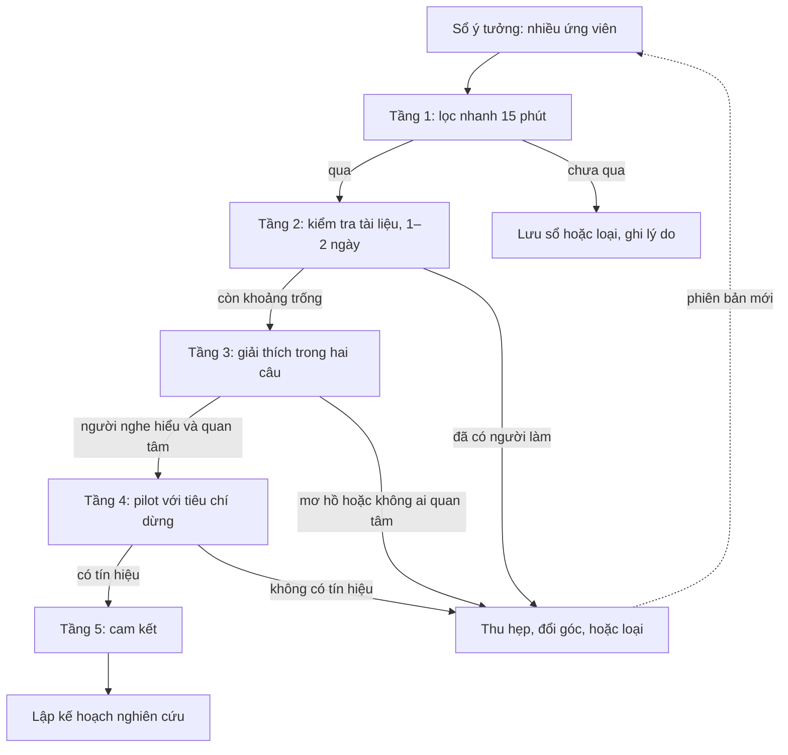

# Tìm khoảng trống và nguồn ý tưởng

!!! abstract "Mục tiêu của bài"
    Sau bài này, người học có thể:

    - Phân biệt một khoảng trống nghiên cứu thật với một ô trống không ai cần, và phát biểu khoảng trống theo một khuôn có thể kiểm chứng.
    - Nhận diện chín loại khoảng trống thường gặp ở Computer Vision, NLP và Machine Learning, cùng kiểu đóng góp mà mỗi loại thường dẫn tới.
    - Dùng lời khuyên của Hamming, Karpathy, Schulman, Alon, Nielsen, Sutton, Steinhardt và Olah như những câu hỏi lọc cụ thể khi chọn bài toán.
    - Áp dụng mười một phương pháp có hệ thống để tìm khoảng trống, mỗi phương pháp với quy trình, đầu ra và những chỗ dễ sai riêng.
    - Lập bản đồ khoảng trống, giữ sổ ý tưởng, cân bằng danh mục ý tưởng theo rủi ro, và đưa ý tưởng qua một phễu kiểm tra năm tầng trước khi cam kết.

Bài trước, [Đọc paper như một reviewer](doc-nhu-reviewer.md), rèn cho người học con mắt nhìn ra những chỗ yếu bên trong từng paper: một claim thiếu bằng chứng, một baseline chưa được tune công bằng, một giả định ngầm mà tác giả không nói ra. Bài này đi tiếp một bước. Những chỗ yếu rời rạc ấy, khi được gom lại, so sánh với nhau và đặt cạnh nhu cầu của cộng đồng, trở thành *khoảng trống* nghiên cứu; và một khoảng trống được phát biểu rõ ràng là nguyên liệu của ý tưởng. Người mới làm nghiên cứu thường hỏi bốn câu liền nhau: ý tưởng từ đâu ra, gap nằm ở đâu, điểm yếu hay điểm mà các paper chưa giải được nằm ở đâu, và kiểm một ý tưởng thế nào trước khi dồn vài tháng công sức vào nó. Bài này trả lời cả bốn câu theo một trình tự có thể làm theo.

Câu trả lời ngắn gọn là ý tưởng tốt hiếm khi đến từ cảm hứng bất chợt. Andrej Karpathy, trong *A Survival Guide to a PhD* (2016), mô tả công việc của nghiên cứu sinh như hai vòng lặp lồng nhau: vòng trong là giải bài toán, còn vòng ngoài là quyết định bài toán nào đáng giải. Theo ông, phần lớn thời gian thực ra nằm ở vòng ngoài: *"You spend most of your time on the outer loop, figuring out what problems are worth solving and what problems are ripe for solving."* (phần lớn thời gian dành cho vòng ngoài, để tìm xem bài toán nào đáng giải và bài toán nào đã "chín" để giải). Chris Olah, trong ghi chú *Research Taste Exercises* (2021), chỉ ra vì sao vòng ngoài khó học: kiểm tra một ý tưởng có tốt hay không thường tốn nhiều tháng, nên mỗi năm người nghiên cứu chỉ nhận được vài lần phản hồi về khả năng chọn bài toán của chính họ. Hệ quả thực tế là người học cần hai thứ: những phương pháp có hệ thống để sinh ra nhiều ứng viên khoảng trống, và những bộ lọc rẻ để loại phần lớn ứng viên thật sớm, trước khi chúng kịp tiêu tốn nhiều tháng.

Bài được tổ chức theo đúng hai nhu cầu đó. Phần đầu định nghĩa khoảng trống, phân loại chúng, rồi điểm lại lời khuyên của những nhà nghiên cứu đi trước về việc chọn bài toán. Phần trọng tâm trình bày mười một phương pháp tìm khoảng trống, mỗi phương pháp kèm quy trình, ví dụ, đầu ra và những chỗ dễ sai. Tiếp theo là ba công cụ tổ chức: bản đồ khoảng trống, sổ ý tưởng và danh mục ý tưởng. Phần cuối gồm một phễu kiểm tra nhiều tầng, cách rèn "gu" nghiên cứu, và những cái bẫy thường gặp. Phễu ở đây là bước sàng lọc sớm; các công cụ thẩm định sâu hơn, như các kiểu đóng góp được chấp nhận, bẫy "A + B", bộ câu hỏi thẩm định, quy trình tìm novelty ba tầng và pilot experiment, nằm ở bài kế tiếp, [Thẩm định ý tưởng](y-tuong.md).

## Khoảng trống là gì

Trong ngôn ngữ hằng ngày của giới nghiên cứu, chữ "gap" thường được dùng khá lỏng: chưa có paper nào làm X trên dataset Y thì gọi là gap. Cách hiểu đó dễ dẫn tới những dự án mà reviewer chê là thiếu động lực (*weak motivation*): đúng là chưa ai làm, nhưng cũng chẳng ai cần. Bài [Đọc và lập bản đồ tài liệu](literature.md) đã cảnh báo rằng một góc trống trên bản đồ định vị có thể trống vì chưa ai làm được, nhưng cũng có thể vì không ai cần. Vì vậy, trước khi học cách tìm, cần một định nghĩa đủ chặt để biết rõ thứ đang tìm là gì.

Trong giáo trình này, một **khoảng trống nghiên cứu** (*research gap*) là chỗ chênh giữa điều mà một cộng đồng cần biết hoặc cần làm được và điều mà tri thức, phương pháp, dữ liệu hiện có cung cấp, kèm theo một lý do giải thích vì sao chỗ chênh ấy vẫn còn. Định nghĩa có ba vế, và mỗi vế là một phép thử. Vế thứ nhất là *có người cần*: phải chỉ ra được ai hưởng lợi khi khoảng trống được lấp, dù đó là người dùng một hệ thống, các nhà nghiên cứu ở dòng lân cận, hay chính cộng đồng đang đo tiến bộ bằng một benchmark có vấn đề. Vế thứ hai là *chưa có câu trả lời đáng tin*: không chỉ là chưa có paper, mà còn có thể là đã có paper nhưng kết luận mâu thuẫn nhau, không tái lập được, hoặc chỉ đúng trong một thiết lập hẹp. Vế thứ ba là *có lý do vì sao còn mở*: một rào cản kỹ thuật, một giả định chưa ai đặt câu hỏi, một năng lực hay một nguồn dữ liệu vừa mới xuất hiện.

Vế thứ ba thường bị bỏ qua nhưng lại quan trọng nhất. Lý do khiến khoảng trống còn mở thường gợi ý luôn cách tấn công nó: nếu khoảng trống còn mở vì chưa có dữ liệu, cách tấn công là xây dữ liệu; nếu vì một giả định chưa bị nghi ngờ, cách tấn công là kiểm tra giả định đó. Ngược lại, nếu không nêu được lý do nào, nhiều khả năng khoảng trống đã được lấp ở đâu đó mà người viết chưa thấy, hoặc nó còn mở chỉ vì không ai thấy cần lấp. Jennifer Widom, trong *Tips for Writing Technical Papers* (2006), đưa câu hỏi "vì sao bài toán chưa được giải trước đây?" vào khung năm câu hỏi của đoạn Introduction; câu hỏi ấy nên được trả lời ngay từ lúc chọn bài toán, không phải đợi đến lúc viết.

Ba vế này có thể gói thành một khuôn phát biểu. Mỗi khoảng trống ứng viên nên được viết theo khuôn dưới đây trước khi được đưa vào sổ ý tưởng; nếu một ô không điền được, đó là việc cần làm tiếp chứ không phải chi tiết có thể bỏ qua.

```text
KHUÔN PHÁT BIỂU KHOẢNG TRỐNG
Thiết lập:        Trong [bài toán / miền / chế độ dữ liệu S],
Nhu cầu:          [ai: người dùng, cộng đồng, dòng nghiên cứu U] cần [năng lực hoặc hiểu biết X].
Hiện trạng:       Các phương pháp / dữ liệu / phân tích hiện có [Y, kèm 2–3 trích dẫn]
                  chưa đáp ứng X, vì [Z: giả định bị vi phạm, giới hạn, mâu thuẫn].
Bằng chứng:       [failure case, con số tự đo, trích dẫn phần limitation, review công khai].
Vì sao còn mở:    [W: rào cản kỹ thuật, năng lực hoặc dữ liệu mới xuất hiện, giả định chưa bị nghi ngờ].
Loại khoảng trống: [một trong chín loại ở mục dưới].
```

Hai phát biểu dưới đây (ví dụ giả định) cho thấy khuôn này tạo ra khác biệt thế nào.

<div class="bad" markdown>
*"Chưa có công trình nào áp dụng mô hình khuếch tán cho bài toán phân vùng ảnh CT ba chiều."*

Phát biểu chỉ nói rằng chưa ai làm. Nó không cho biết ai cần kết quả, phương pháp hiện có thất bại ở đâu, và vì sao khoảng trống vẫn còn. Đây cũng là mầm của một ý tưởng "A + B" điển hình.
</div>

<div class="good" markdown>
*"Các phương pháp phân vùng ảnh CT ba chiều đạt điểm Dice cao trên các benchmark công khai, nhưng các benchmark này chủ yếu gồm ảnh có lát cắt mỏng. Nhiều cơ sở y tế chỉ có máy cho lát cắt dày hơn nhiều, và thử nghiệm sơ bộ với hai phương pháp mạnh nhất cho thấy lỗi tăng mạnh trên các cấu trúc nhỏ. Khoảng trống còn mở vì chưa có tập đánh giá công khai nào cho dữ liệu lát cắt dày."*

Phát biểu nêu đủ ba vế: ai cần (cơ sở y tế với thiết bị phổ thông), bằng chứng thất bại (thử nghiệm sơ bộ), và lý do còn mở (thiếu tập đánh giá). Nó cũng gợi ý luôn kiểu đóng góp: một benchmark kèm phân tích, có thể đi cùng một phương pháp.
</div>

### Chín loại khoảng trống

Phân loại khoảng trống không phải là việc làm hình thức. Mỗi loại khoảng trống dẫn tới một kiểu đóng góp khác nhau và đòi hỏi một loại bằng chứng khác nhau, theo đúng các kiểu đóng góp được trình bày ở bài [Thẩm định ý tưởng](y-tuong.md). Biết khoảng trống đang nhắm tới thuộc loại nào giúp nhóm tác giả hình dung sớm paper cuối cùng sẽ trông ra sao. Nó cũng giúp tránh một tình trạng khá phổ biến: phát hiện ra một khoảng trống về đánh giá, nhưng lại cố viết thành một paper phương pháp.

**Loại thứ nhất: câu hỏi chưa có lời đáp.** Có những câu hỏi cộng đồng đang đặt ra, thường một cách ngầm định, nhưng chưa ai trả lời có hệ thống. Khi các mô hình ngôn ngữ bắt đầu nhận được ngữ cảnh rất dài, một câu hỏi tự nhiên là chúng có thực sự *dùng* được toàn bộ ngữ cảnh đó hay không. *Lost in the Middle* (Liu et al., TACL 2024) trả lời câu hỏi này bằng các thí nghiệm có kiểm soát trên hỏi đáp nhiều tài liệu và truy xuất khóa–giá trị: hiệu năng thường cao nhất khi thông tin cần thiết nằm ở đầu hoặc cuối ngữ cảnh, và giảm rõ khi thông tin nằm ở giữa, kể cả với những mô hình được thiết kế riêng cho ngữ cảnh dài. Khoảng trống loại này thường dẫn tới paper phân tích, và giá trị của paper nằm ở chỗ câu trả lời thay đổi cách người khác thiết kế hệ thống hoặc đánh giá.

**Loại thứ hai: phương pháp còn thiếu.** Bài toán đã được định nghĩa rõ, có benchmark và có người cần, nhưng chưa có phương pháp nào đáp ứng được một yêu cầu cụ thể: độ chính xác, khả năng mở rộng, hay một ràng buộc thực tế. Trước ResNet (CVPR 2016), huấn luyện mạng rất sâu là một khoảng trống loại này: mạng sâu hơn lại cho training error cao hơn, và cộng đồng chưa có cách vượt qua hiện tượng đó (xem case study [ResNet](../05-case-studies/resnet.md)). Đây là loại khoảng trống quen thuộc nhất và cũng đông người tranh nhau nhất, vì nó hiện ra ngay trên bảng xếp hạng của benchmark.

**Loại thứ ba: đánh giá hoặc benchmark còn thiếu.** Đôi khi khoảng trống không nằm ở phương pháp mà ở thước đo: cách đo hiện tại không phân biệt được phương pháp tốt với phương pháp kém, hoặc che khuất những lỗi quan trọng. CheckList (ACL 2020) cho thấy độ chính xác tổng thể trên một tập test che đi những lỗi có hệ thống theo từng năng lực ngôn ngữ, như xử lý phủ định. Ở dịch máy, *A Call for Clarity in Reporting BLEU Scores* (Post, WMT 2018) chỉ ra rằng "điểm BLEU" thực chất là một metric có tham số: giá trị có thể chênh tới 1,8 điểm giữa các cấu hình thông dụng, chủ yếu do cách tách từ và chuẩn hóa bản dịch tham chiếu, nên số liệu giữa các paper không so sánh trực tiếp được. Paper đề xuất công cụ SacreBLEU để chuẩn hóa việc báo cáo. Khoảng trống về đánh giá có giá trị đặc biệt vì nó tác động lên cách cả cộng đồng đo tiến bộ.

**Loại thứ tư: tài nguyên còn thiếu.** Nhiều ngôn ngữ, miền dữ liệu và nhóm người dùng chưa có dữ liệu, mô hình pre-trained hay công cụ đạt chuẩn. ImageNet (CVPR 2009) lấp một khoảng trống tài nguyên ở quy mô cả lĩnh vực. PhoBERT (Findings of EMNLP 2020) lấp một khoảng trống hẹp hơn nhưng rõ ràng: mô hình ngôn ngữ đơn ngữ quy mô lớn cho tiếng Việt, kèm một quan sát ngôn ngữ học về đơn vị tách từ (xem case study [PhoBERT](../05-case-studies/phobert.md)). Các miền như ảnh y tế, viễn thám, văn bản pháp lý hay ngôn ngữ ít tài nguyên thường có loại khoảng trống này. Điều kiện để nó thành đóng góp là tài nguyên phải được xây đạt chuẩn và đi kèm phân tích cho thấy nó làm lộ ra điều mà dữ liệu cũ không cho thấy.

**Loại thứ năm: hiểu biết còn thiếu.** Đây là loại khoảng trống "chạy được nhưng chưa biết vì sao". In-context learning của các mô hình ngôn ngữ lớn hoạt động tốt từ khi GPT-3 phổ biến nó, nhưng cơ chế của nó còn mờ. *Rethinking the Role of Demonstrations* (Min et al., EMNLP 2022) cho thấy việc thay nhãn đúng trong các ví dụ minh họa bằng nhãn ngẫu nhiên hầu như không làm giảm hiệu năng trên nhiều tác vụ phân loại và trắc nghiệm, nhất quán qua mười hai mô hình; những yếu tố quan trọng hơn là không gian nhãn, phân phối của văn bản đầu vào và định dạng chung của chuỗi. Ở ML, *Understanding Deep Learning Requires Rethinking Generalization* (Zhang et al., ICLR 2017) là ví dụ kinh điển của loại khoảng trống này. Paper lấp khoảng trống hiểu biết thường không đề xuất phương pháp mới, và được đánh giá qua độ chặt chẽ của các thí nghiệm có kiểm soát.

**Loại thứ sáu: hiệu quả tính toán.** Phương pháp tốt đã có, nhưng quá chậm, quá tốn bộ nhớ hoặc quá đắt để huấn luyện và triển khai. FlashAttention (NeurIPS 2022) và LoRA (ICLR 2022) là hai ví dụ đã được phân tích ở bài [Thẩm định ý tưởng](y-tuong.md). Khoảng trống loại này dễ phát biểu, vì chi phí đo được, nhưng đòi hỏi đo trên phần cứng thực và so sánh công bằng về chất lượng.

**Loại thứ bảy: độ bền vững, công bằng và an toàn.** Một phương pháp đạt điểm cao trong điều kiện chuẩn vẫn có thể sụp đổ trước những nhiễu nhỏ được thiết kế có chủ đích, đối xử khác nhau với các nhóm người dùng, hoặc bị lợi dụng để làm điều có hại. *Intriguing Properties of Neural Networks* (Szegedy et al., ICLR 2014) mở ra cả một dòng nghiên cứu khi cho thấy những nhiễu rất nhỏ, gần như không nhìn thấy, có thể khiến mạng phân loại ảnh đoán sai. Với các mô hình nền tảng đa phương thức và agent, loại khoảng trống này đang mở rộng rất nhanh; [Chương 9](../09-ai-security/index.md) phân tích nhiều paper AI Security theo hướng này.

**Loại thứ tám: khoảng cách giữa benchmark và thực tế.** Kết quả tốt trên benchmark không bảo đảm kết quả tốt khi dữ liệu thay đổi dù chỉ một chút. *Do ImageNet Classifiers Generalize to ImageNet?* (Recht et al., ICML 2019) xây lại tập test mới cho CIFAR-10 và ImageNet theo sát quy trình thu thập gốc, và thấy độ chính xác của nhiều mô hình giảm từ 11% đến 14% trên ImageNet, dù thứ hạng giữa các mô hình gần như được giữ nguyên. WILDS (Koh et al., ICML 2021) gom các dạng dịch chuyển phân phối (*distribution shift*) gặp trong thực tế thành một benchmark. Khoảng trống loại này thường dẫn tới paper benchmark hoặc phân tích, và cần lập luận rằng khoảng cách quan sát được là phổ biến chứ không riêng của một bộ dữ liệu.

**Loại thứ chín: khoảng trống lý thuyết.** Thực hành đi trước lý thuyết, và lý thuyết hiện có mâu thuẫn với điều quan sát được. *Reconciling Modern Machine-Learning Practice and the Classical Bias–Variance Trade-off* (Belkin et al., PNAS 2019) mở đầu bằng chính mâu thuẫn ấy: theo đánh đổi bias–variance cổ điển, một mô hình khớp hoàn toàn dữ liệu huấn luyện là một mô hình overfit, vậy mà mạng nơ-ron hiện đại làm đúng điều đó và vẫn đạt độ chính xác cao trên dữ liệu test. Khoảng trống lý thuyết được cộng đồng ML đặc biệt coi trọng, và có thể được lấp bằng phân tích toán học, bằng thực nghiệm có hệ thống, hoặc bằng cả hai.

Bảng dưới đây tổng hợp chín loại khoảng trống cùng câu hỏi giúp nhận diện từng loại.

| Loại khoảng trống | Câu hỏi nhận diện | Kiểu đóng góp thường gặp | Ví dụ |
|---|---|---|---|
| Câu hỏi chưa có lời đáp | Cộng đồng đang ngầm hỏi gì mà chưa ai đo? | Phân tích | Lost in the Middle (NLP) |
| Phương pháp còn thiếu | Yêu cầu nào chưa phương pháp nào đạt? | Phương pháp | ResNet (CV) |
| Đánh giá, benchmark | Thước đo hiện tại che khuất điều gì? | Phương pháp luận đánh giá, benchmark | CheckList, SacreBLEU (NLP) |
| Tài nguyên | Ngôn ngữ, miền nào chưa có dữ liệu đạt chuẩn? | Dataset, mô hình, công cụ | ImageNet (CV), PhoBERT (NLP) |
| Hiểu biết | Cái gì chạy được mà chưa ai biết vì sao? | Phân tích | Min et al. (NLP), Zhang et al. (ML) |
| Hiệu quả tính toán | Cái gì tốt nhưng quá đắt? | Hiệu quả | FlashAttention (ML), LoRA (NLP) |
| Bền vững, công bằng, an toàn | Phương pháp sụp đổ hoặc gây hại khi nào? | Tấn công, phòng thủ, đánh giá | Szegedy et al. (CV) |
| Benchmark và thực tế | Kết quả còn đứng được khi dữ liệu đổi? | Benchmark, phân tích | Recht et al. (CV), WILDS (ML) |
| Lý thuyết | Lý thuyết nào mâu thuẫn với thực hành? | Lý thuyết, phân tích | Belkin et al. (ML) |

Một paper thường chạm tới nhiều loại khoảng trống cùng lúc. *Lost in the Middle* vừa trả lời một câu hỏi mở vừa để lại một giao thức đánh giá cho các mô hình ngữ cảnh dài về sau; công trình của Recht và cộng sự vừa là một benchmark vừa là một phân tích. Tuy vậy, như bài [Thẩm định ý tưởng](y-tuong.md) nhấn mạnh, một paper tốt có một kiểu đóng góp chủ đạo, và loại khoảng trống chủ đạo thường quyết định kiểu đóng góp ấy. Sau khi biết khoảng trống có những dạng nào, câu hỏi tiếp theo là chọn khoảng trống nào để theo đuổi. Đây là chỗ mà kinh nghiệm của những người đi trước hữu ích nhất.

## Những người đi trước nói gì về việc chọn bài toán

Nhiều nhà nghiên cứu có ảnh hưởng đã viết về việc chọn bài toán. Những bài viết ấy ra đời ở những thời điểm và lĩnh vực rất khác nhau, từ vật lý, sinh học hệ thống tới học sâu, và không bài nào là một công thức. Cách đọc hữu ích nhất là rút từ mỗi bài một hoặc hai *câu hỏi lọc* có thể đặt ra cho một ứng viên khoảng trống cụ thể. Các mục dưới đây được sắp theo chủ đề thay vì theo người viết; cuối phần có một bảng tổng hợp các câu hỏi lọc, được dùng lại ở phễu kiểm ý tưởng. Những bài viết này được giới thiệu đầy đủ hơn ở phụ lục [Lời khuyên từ các nhà nghiên cứu hàng đầu](../phu-luc/loi-khuyen.md).

### Bài toán quan trọng phải đi kèm cách tấn công

Richard Hamming trình bày bài nói *You and Your Research* tại Bell Communications Research (Bellcore) năm 1986, khi đã nghỉ hưu khỏi Bell Labs, nơi ông làm việc nhiều năm. Câu hỏi trung tâm của bài nói là vì sao rất ít nhà khoa học tạo ra đóng góp lớn trong khi phần đông bị lãng quên, và câu trả lời của ông là thói quen và lựa chọn, chứ không chủ yếu là may mắn hay thiên tài. Lựa chọn quan trọng nhất là làm việc trên những bài toán quan trọng. Ông kể việc hỏi các đồng nghiệp ngành hóa ở bàn ăn trưa rằng đâu là những bài toán quan trọng của lĩnh vực họ, và họ có đang làm những bài toán đó không.

Điều làm lời khuyên của Hamming hữu ích cho việc tìm khoảng trống không nằm ở chữ "quan trọng", mà ở cách ông định nghĩa nó. Theo Hamming, du hành thời gian, dịch chuyển tức thời hay phản trọng lực không phải là bài toán quan trọng, dù hệ quả của chúng là khổng lồ, vì không ai có cách tấn công hợp lý: *"It's not the consequence that makes a problem important, it is that you have a reasonable attack."* (không phải hệ quả làm nên tầm quan trọng của bài toán, mà là việc có một cách tấn công hợp lý). Nói theo ngôn ngữ của bài này, một khoảng trống chỉ đáng theo đuổi khi vế thứ ba của định nghĩa, lý do vì sao nó còn mở, đi kèm một cách vượt qua lý do đó. Với mỗi ứng viên, người học nên viết ra "cách tấn công" cụ thể: thí nghiệm đầu tiên, insight khiến bài toán trở nên giải được *bây giờ*, hay nguồn lực mà nhóm có còn người khác không có.

Hai thói quen khác của Hamming cũng liên quan trực tiếp. Ông dành riêng một khoảng thời gian cố định mỗi tuần, vào chiều thứ Sáu, cho việc nghĩ về bức tranh lớn, chẳng hạn máy tính sẽ thay đổi khoa học như thế nào; khoảng thời gian này thường được gọi là *Great Thoughts Time*. Ông cũng khuyên chú ý tới những chỗ có vẻ sai hoặc bất thường trong các lý thuyết đang được chấp nhận, vì đó thường là nguồn gốc của những đóng góp lớn. Thói quen thứ hai là nền tảng của phương pháp tìm mâu thuẫn trong tài liệu ở phần sau.

### Vòng lặp ngoài, đất màu mỡ và tham vọng có kiểm soát

Karpathy viết *A Survival Guide to a PhD* khi kết thúc chương trình tiến sĩ ở Stanford, và phần về chọn đề tài là một trong những bản phân tích cụ thể nhất về "gu" chọn bài toán. Ông kể rằng khi nghe một đề xuất, người hướng dẫn gần như ngay lập tức đánh giá tầm quan trọng của bài toán, độ khó, mức độ hấp dẫn, bối cảnh lịch sử của nó, và gu ấy là có thật, được học qua thực hành và qua làm việc cạnh người giỏi hơn. Ông cũng thừa nhận rằng gu của chính mình khi mới bắt đầu là rất tệ: nhiều bài toán từng khiến ông hào hứng, nhìn lại, là những bài toán được đặt ra kém, không giải được, hoặc không liên quan.

Từ kinh nghiệm đó, Karpathy rút ra một số tiêu chí. Thứ nhất là **đất màu mỡ**: các paper của một nghiên cứu sinh thường nối tiếp nhau thành một luận án, nên khi chọn bài toán cần nghĩ trước vài bước xem còn bao nhiêu chỗ cho công trình tiếp theo. Thứ hai là **tham vọng**: theo kinh nghiệm của ông, một bài toán quan trọng hơn gấp mười lần thường chỉ khó hơn tối đa hai đến ba lần, vì việc nhắm tới mức cải thiện gấp mười buộc người nghiên cứu suy nghĩ từ nguyên lý ban đầu và đổi hẳn chiến lược. Thứ ba, ngay sau đó, là **tham vọng nhưng phải có cách tấn công**, và ông dẫn lại chính đoạn của Hamming ở trên. Cuối cùng là những thứ nên tránh: công trình *incremental*, tức làm một thứ có sẵn phức tạp hơn để tăng vài phần trăm trên một benchmark, loại paper dễ được chấp nhận nhưng ít được trích dẫn; và những ý tưởng kiểu "có một bước tiếp theo hiển nhiên đang lơ lửng mà chưa ai làm".

Phần đáng đọc nhất là cách Karpathy kể lại quá trình chọn đề tài luận án của chính ông. Ông mất khoảng hai năm loay hoay ở vòng ngoài, với các đề tài về 3D và video, trước khi một cuộc trò chuyện với Richard Socher giúp ông nhận ra giao điểm giữa ảnh và ngôn ngữ là một hướng đầy hứa hẹn. Ông liệt kê vì sao: hướng đó rất màu mỡ, với nhiều bài toán chưa giải; nó thú vị và quan trọng; nó dễ giải thích; nó nằm ở ranh giới của cái khả thi, vì học sâu vừa bắt đầu hoạt động; các dataset vừa bắt đầu xuất hiện, như Flickr8K; nó hợp với mối quan tâm của người hướng dẫn; và kể cả khi thất bại, ông vẫn có được kỹ năng tối ưu các mạng sâu để dùng ở nơi khác. Bài học ở đây không phải là danh sách cụ thể, mà là cấu trúc của quyết định: một bài toán tốt thường thỏa mãn *nhiều* tiêu chí độc lập cùng lúc, và cảm giác "mọi thứ khớp vào nhau" ấy đáng tin hơn sự hào hứng với một tiêu chí duy nhất. Việc ông mất hai năm ở vòng ngoài cũng là một lời trấn an: loay hoay khi chọn bài toán là bình thường, miễn là quá trình loay hoay có phương pháp.

### Dẫn dắt bởi mục tiêu hay bởi ý tưởng

John Schulman, đồng tác giả của TRPO và PPO, viết *An Opinionated Guide to ML Research* lần đầu vào tháng 12 năm 2017 cho chương trình OpenAI Fellows và đăng lên blog cá nhân năm 2020. Ông mở đầu bằng nhận định rằng khả năng chọn đúng bài toán quan trọng hơn kỹ năng kỹ thuật, rồi phân biệt hai cách quyết định làm gì tiếp theo. Nghiên cứu **dẫn dắt bởi ý tưởng** (*idea-driven*) đi theo một dòng tài liệu: đọc một paper làm X, nảy ra ý làm X tốt hơn, rồi thử. Nghiên cứu **dẫn dắt bởi mục tiêu** (*goal-driven*) bắt đầu từ hình dung về một năng lực AI mới muốn đạt được, rồi giải những bài toán đưa mình lại gần mục tiêu đó; theo Schulman, kiểu nghiên cứu này thường giống việc làm cho X hoạt động *lần đầu tiên* hơn là làm X tốt hơn.

Schulman khuyên phần lớn người nên theo hướng dẫn dắt bởi mục tiêu, và lý do của ông liên quan trực tiếp tới việc tìm khoảng trống. Với nghiên cứu dẫn dắt bởi ý tưởng, các nhà nghiên cứu trên khắp thế giới đọc cùng những paper, nên dễ đi tới cùng những ý tưởng và dễ bị người khác công bố trước; muốn tạo đột phá theo hướng này cần một hiểu biết đặc biệt sâu và một góc nhìn khác hẳn cộng đồng. Một mục tiêu cụ thể, ngược lại, cho người nghiên cứu một góc nhìn riêng và dẫn họ tới những câu hỏi mà người khác không hỏi. Ví dụ của chính ông cho thấy điều này: trong nửa đầu thời gian làm tiến sĩ, mục tiêu là cho robot thao tác với vật thể biến dạng như thắt nút hay gấp quần áo, và một bài toán con không lường trước, tối ưu quỹ đạo, lại trở thành kết quả có ảnh hưởng nhất. Ở nửa sau, mục tiêu về vận động của robot mô phỏng dẫn ông tới TRPO và GAE, và sau đó là PPO; ông chủ ý không đi theo hướng Q-learning đang thịnh hành vì nó không hợp với mục tiêu của ông.

Schulman cũng cảnh báo hai điều. Thứ nhất, không nên hiểu mục tiêu quá theo nghĩa đen: có những cách đạt mục tiêu cụ thể mà không đóng góp gì cho ML, nên cần tự giới hạn vào những lời giải tổng quát, áp dụng được cho bài toán khác. Thứ hai, cần tự hỏi một dự án nhắm tới cải thiện 10% hay gấp mười lần. Cải thiện nhỏ có giá trị khi chúng cộng dồn hướng tới một mục tiêu lớn hơn, và với một ý tưởng incremental, giá trị của nó phụ thuộc vào độ phức tạp: một cải thiện nhỏ chỉ đáng giá nếu thay đổi rất đơn giản. Hệ quả cho bài này là những khoảng trống phát hiện được *trong lúc theo đuổi một mục tiêu* thường ít người tranh hơn những khoảng trống đọc được từ phần Future Work của một paper nổi tiếng.

### Khả thi, thú vị và "đám mây"

Uri Alon, nhà sinh học hệ thống ở Viện Weizmann, viết bài luận ngắn *How To Choose a Good Scientific Problem* trên tạp chí *Molecular Cell* năm 2009. Ông bắt đầu từ nhận xét rằng chọn bài toán là năng lực trung tâm của nhà khoa học nhưng hiếm khi được dạy một cách tường minh, rồi đề xuất đặt các bài toán ứng viên lên một mặt phẳng hai trục: **tính khả thi** (bài toán khó hay dễ, dài hay ngắn) và **mức độ thú vị** (bài toán bổ sung bao nhiêu hiểu biết). Bài toán đáng chọn nằm ở góc vừa khả thi vừa thú vị; khi phải đánh đổi, chỉ nên giữ lại những lựa chọn không bị lựa chọn khác vượt trên cả hai trục, tức đường biên Pareto. Ông nhấn mạnh rằng độ khó phải hợp với giai đoạn sự nghiệp: người mới nên bắt đầu bằng bài toán khả thi hơn, ngắn hơn, còn những bài toán dài hơi dành cho giai đoạn sau.

Alon thêm hai lời khuyên ít thấy ở nơi khác. Mức độ thú vị là chủ quan và mang tính cá nhân: nên lắng nghe "tiếng nói bên trong", tức những ý tưởng cứ quay lại trong đầu suốt nhiều tháng và người nghiên cứu thích kể cho người khác nghe, thay vì chọn theo những gì đang thời thượng. Và cần dành thời gian cho việc chọn: theo ông, trong nhóm của ông, việc dành khoảng ba tháng trước khi cam kết với một bài toán là chuyện bình thường, vì chọn vội thường dẫn tới thất vọng về sau. Trong một bài nói TED về sự sáng tạo trong khoa học, Alon mô tả thêm một hình ảnh đã trở nên quen thuộc: người ta hình dung nghiên cứu là đi thẳng từ câu hỏi A tới câu trả lời B, nhưng trên thực tế thí nghiệm thường ngừng hoạt động và người nghiên cứu đi vào một "đám mây" của sự bối rối, nằm ở ranh giới giữa cái đã biết và cái chưa biết; đôi khi họ ra khỏi đám mây ở một câu trả lời C khác, thường thú vị hơn B. Hình ảnh này có hệ quả trực tiếp cho việc tìm khoảng trống: việc tìm không kết thúc khi dự án bắt đầu, vì nhiều khoảng trống tốt nhất được phát hiện ngay trong đám mây, giống như bài toán tối ưu quỹ đạo của Schulman.

### Người tạo bài toán và những lĩnh vực "lộn xộn"

Michael Nielsen viết *Principles of Effective Research* năm 2004, khi còn là nhà vật lý lý thuyết ở Đại học Queensland, nên bài luận xuất phát từ vật lý và thông tin lượng tử chứ không phải ML. Ông phân biệt hai hình mẫu lý tưởng hóa. *Người giải bài toán* (*problem-solver*) tấn công những bài toán kỹ thuật đã được đặt ra rõ ràng và được cộng đồng biết tới. *Người tạo bài toán* (*problem-creator*) tìm ra những câu hỏi hay những mối liên hệ mới, đôi khi trong những paper rất đơn giản về mặt kỹ thuật. Nielsen cảnh báo việc coi độ khó là chỉ dấu của tầm quan trọng, một lời cảnh báo mà Michael J. Black lặp lại theo cách khác trong bài *Novelty in Science* (2022) khi bàn về việc reviewer nhầm độ phức tạp với novelty.

Nielsen cũng có một nhận xét rất đáng nhớ về những lĩnh vực đang rối ren. Khi một lĩnh vực còn lộn xộn, phản xạ tự nhiên của nhiều người là tránh xa để tìm chỗ dễ hiểu hơn, nhưng theo ông: *"But a field that is a mess is really an opportunity."* (một lĩnh vực đang lộn xộn thực ra là một cơ hội), vì rất có thể ở đó còn những khái niệm hợp nhất và đơn giản hóa đang chờ được tìm ra. Ở một tầng sâu hơn, Nielsen coi nghiên cứu sáng tạo là phần mở rộng của quá trình tự phát triển, đặc biệt là của một chương trình đọc được xây dựng tốt; người không chịu đầu tư cho việc tự học thường cũng thiếu nguyên liệu để nhìn ra khoảng trống.

### Bộ lọc của "Bài học cay đắng"

Rich Sutton viết bài luận ngắn *The Bitter Lesson* năm 2019. Luận điểm của ông là bài học lớn nhất từ bảy mươi năm nghiên cứu AI: những phương pháp tổng quát tận dụng được sức tính toán cuối cùng luôn hiệu quả nhất, với khoảng cách rất lớn, vì chi phí tính toán liên tục giảm theo cấp số nhân. Các nhà nghiên cứu nhiều lần đưa tri thức của con người về lĩnh vực vào hệ thống; điều đó giúp ích trong ngắn hạn và làm người nghiên cứu hài lòng, nhưng về lâu dài thì chững lại và thậm chí cản trở tiến bộ, trong khi đột phá đến từ việc mở rộng tính toán qua tìm kiếm và học. Ông dẫn ví dụ cờ vua, cờ vây, nhận dạng tiếng nói và thị giác máy tính, và kết luận rằng tìm kiếm và học là hai phương pháp có vẻ mở rộng không giới hạn theo sức tính toán.

Đối với việc chọn khoảng trống, bài luận của Sutton có thể biến thành một câu hỏi lọc rất cụ thể: *nếu sức tính toán tăng gấp mười, ý tưởng này còn giá trị không?* Câu hỏi này chia ứng viên thành ba nhóm. Nhóm thứ nhất là những ý tưởng mã hóa tri thức thủ công để bù cho mô hình hoặc dữ liệu chưa đủ lớn; chúng có nguy cơ bị quy mô xóa bỏ, và paper về chúng có thể lỗi thời rất nhanh. Nhóm thứ hai là những phương pháp tổng quát càng có ích khi quy mô tăng; đây là nhóm mà Sutton khuyến khích. Nhóm thứ ba là những khoảng trống không nằm trên cùng trục với quy mô, như đánh giá, hiểu biết, an toàn, hay hiệu quả tính toán, vốn thường *càng* quan trọng khi mô hình càng lớn. Cần đọc Sutton đúng phạm vi: ông thừa nhận tri thức chuyên ngành giúp ích trong ngắn hạn, và bài luận năm 2019 nói về tiến bộ dài hạn của AI, không bàn về việc paper nào được chấp nhận ở hội nghị năm sau.

### Làm phần dễ thất bại trước

Jacob Steinhardt, trong bài luận *Research as a Stochastic Decision Process* (2018), nhìn một dự án nghiên cứu như một chuỗi các nhiệm vụ con không chắc chắn, mà bất kỳ nhiệm vụ nào thất bại cũng có thể làm cả dự án sụp đổ. Mục tiêu khi đó là tối đa hóa khả năng thành công đồng thời tối thiểu hóa thời gian kỳ vọng, đặc biệt là thời gian bỏ ra *trước khi* phát hiện ra một thất bại. Nguyên tắc cốt lõi của ông là làm các nhiệm vụ theo thứ tự từ nhiều thông tin nhất trên mỗi đơn vị thời gian tới ít nhất: không bắt đầu bằng phần dễ hay phần quen tay, mà bắt đầu bằng phần có khả năng giết chết dự án cao nhất so với chi phí kiểm tra nó.

Bài của Steinhardt chủ yếu bàn về thực thi, và được trình bày kỹ ở bài [Lập kế hoạch nghiên cứu](ke-hoach.md). Ở giai đoạn tìm khoảng trống, nguyên tắc này có một hệ quả gọn: khi so sánh hai ứng viên có sức hấp dẫn tương đương, nên ưu tiên ứng viên mà phép thử "giết" nó rẻ nhất. Một khoảng trống mà chỉ sau ba ngày đã biết có đáng theo đuổi hay không là một khoản đầu tư tốt hơn nhiều so với một khoảng trống cần ba tháng mới biết. Khóa học CS197 *Computer Science Research* của Michael Bernstein ở Stanford diễn đạt cùng tinh thần bằng hai khái niệm: xác định chiều rủi ro lớn nhất của dự án, rồi giảm rủi ro dọc theo chiều đó thật nhanh.

### Những câu hỏi ngắn được cộng đồng chia sẻ

Trong ghi chú *Research Taste Exercises*, Olah tổng hợp thêm một số gợi ý mà những người khác chia sẻ khi thảo luận ghi chú của ông, và một vài gợi ý trong đó là những câu hỏi lọc rất gọn. Rachel Prudden đề xuất hình dung rằng một nhóm khác vừa công bố đúng paper đang nghĩ tới: có thấy hào hứng muốn đọc không? Andy Matuschak đề xuất "câu hỏi phản Hamming": đâu là những bài toán *thú vị* nhất, không phải quan trọng nhất, của lĩnh vực, và vì sao chưa làm chúng? Matuschak cũng chỉ ra một kiểu thất bại: lao vào thực hiện ý tưởng ngay khi nó có vẻ làm được, trong khi nếu ngồi lâu hơn với ý tưởng, thường có thể phát triển ra một biến thể sâu hơn. Arthur Allshire gợi ý hỏi đâu là những bài toán *nút thắt* của lĩnh vực, và lấy ví dụ rằng trong nhiều nghiên cứu học tăng cường, phần lớn công sức dồn vào tinh chỉnh thuật toán trong khi những cải thiện lớn nhất lại đến từ việc cải thiện mô phỏng. Boaz Barak thích những dự án mà ông gọi là "20/80": thay vì hỏi kết quả hấp dẫn nhất có thể đạt với ít công sức nhất là gì, hãy tìm một bài toán chắt lọc được trở ngại chính, dù kết quả cuối nghe không hấp dẫn.

### Tổng hợp: từ lời khuyên tới câu hỏi lọc

Các lời khuyên trên không mâu thuẫn mà bổ sung cho nhau, và có thể rút thành một bộ câu hỏi lọc. Bảng dưới đây ghi lại nguồn, ý chính và câu hỏi tương ứng; phễu kiểm ý tưởng ở phần sau dùng lại các câu hỏi này.

| Nguồn | Ý chính | Câu hỏi lọc |
|---|---|---|
| Hamming, 1986 | Quan trọng nghĩa là có cách tấn công hợp lý | Cách tấn công cụ thể là gì, và vì sao nó khả thi *bây giờ*? |
| Karpathy, 2016 | Vòng lặp ngoài, đất màu mỡ, tham vọng có cách tấn công, tránh incremental | Sau paper này còn những paper nào? Có nhiều tiêu chí độc lập cùng thỏa mãn không? |
| Schulman, 2020 | Dẫn dắt bởi mục tiêu; 10% hay gấp mười | Ý tưởng phục vụ năng lực nào? Có phải làm X hoạt động lần đầu, hay chỉ làm X tốt hơn một chút? |
| Alon, 2009 | Khả thi × thú vị, đường biên Pareto, hợp với giai đoạn | Ý tưởng nằm ở đâu trên hai trục, và có hợp với kinh nghiệm hiện tại không? |
| Nielsen, 2004 | Tạo bài toán; lĩnh vực lộn xộn là cơ hội | Đang giải một bài toán có sẵn hay đặt ra một câu hỏi mới? |
| Sutton, 2019 | Phương pháp tổng quát tận dụng tính toán thắng về lâu dài | Nếu sức tính toán tăng gấp mười, ý tưởng còn giá trị không? |
| Steinhardt, 2018 | Làm phần nhiều thông tin trên mỗi đơn vị thời gian trước | Phép thử rẻ nhất có thể giết ý tưởng là gì? |
| Prudden, Matuschak, Allshire, Barak (qua Olah, 2021) | Hình dung paper đã công bố; câu hỏi phản Hamming; nút thắt; dự án 20/80 | Nếu nhóm khác công bố ý tưởng này, có muốn đọc không? Ý tưởng có chạm vào nút thắt chính không? |

## Mười một phương pháp tìm khoảng trống

Các lời khuyên ở phần trước giúp *chọn* giữa các khoảng trống; phần này trình bày cách *sinh ra* chúng. Mười một phương pháp dưới đây giống như mười một lăng kính đặt lên cùng một khối tài liệu: mỗi lăng kính làm hiện lên một kiểu khoảng trống khác nhau. Chúng không loại trừ nhau, và một ý tưởng tốt thường xuất hiện ở chỗ hai lăng kính cùng chỉ vào một điểm, chẳng hạn khi một failure case lặp lại được giải thích bởi một giả định mà cả dòng nghiên cứu chưa từng nghi ngờ.

Mỗi phương pháp được trình bày theo cùng một khuôn: vì sao nó hoạt động, quy trình từng bước, ví dụ, đầu ra cụ thể, và khi nào nó hiệu quả hay dễ dẫn sai. Ví dụ được luân phiên giữa Computer Vision, NLP và ML. Một lưu ý chung cho cả phần: đầu ra của mọi phương pháp là một *ứng viên khoảng trống*, chưa phải ý tưởng đã được thẩm định. Ứng viên được ghi vào sổ ý tưởng theo khuôn phát biểu ở đầu bài, rồi mới đi vào phễu kiểm tra.

### Phương pháp 1: Lật giả định

Khóa học CS197 của Michael Bernstein ở Stanford dạy một kỹ thuật gọn gàng gọi là *bit flip*. Điểm xuất phát của kỹ thuật là nhận xét rằng ý tưởng mới hiếm khi đến từ hư không; chúng thường xoay quanh công trình hiện có. Bước thứ nhất là *xác định bit*: phát biểu một giả định mà các công trình trước dựa vào, thường là giả định không được nói ra. Bước thứ hai là *lật bit*: đề xuất một giả định thay thế, kiểu "không, hãy làm theo cách này". Theo cách nhìn này, một bit flip là một phát biểu cô đọng về đóng góp trí tuệ cốt lõi của một paper. Kỹ thuật đủ hữu dụng để có những nhóm nghiên cứu dùng nó làm khung dữ liệu: O'Neill và cộng sự (arXiv 2025) xây một dataset khoảng 5.500 paper NeurIPS 2023 và ICLR 2024 được tóm tắt theo dạng giả định thông thường, insight then chốt và đề xuất thay thế.

Nhiều đóng góp nổi tiếng có thể được đọc lại như một phép lật giả định, dù đây là cách đọc của giáo trình chứ không phải cách các tác giả tự mô tả. Transformer lật giả định rằng mô hình hóa chuỗi cần recurrence hoặc convolution. ViT lật giả định rằng thị giác cần các thiên kiến quy nạp của convolution. LoRA lật giả định rằng fine-tune cần cập nhật toàn bộ trọng số, bằng cách cho rằng một cập nhật hạng thấp là đủ. Công trình của Min và cộng sự lật giả định rằng in-context learning học từ nhãn của các ví dụ minh họa. Điểm chung là mỗi bit đều từng được coi là hiển nhiên đến mức không ai viết nó ra.

**Quy trình.** Kỹ thuật lật giả định có thể chạy theo năm bước.

1. Chọn một dòng nghiên cứu hẹp và năm đến mười paper gần nhất của nó, lấy từ bảng literature.
2. Với mỗi paper, viết một câu "bit" cho mỗi giả định mà paper dựa vào. Những nơi nên tìm là phần đặt bài toán, các câu "we assume", cách chọn dataset, cách chia train và test, metric, và danh sách baseline được chọn.
3. Gom các bit chung của cả dòng. CS197 phân biệt phép lật ở cấp một paper với phép lật ở cấp cả một dòng tài liệu; bit chung của cả dòng thường có giá trị cao hơn.
4. Lật từng bit thành một câu khẳng định thay thế, kèm một câu "nếu phép lật đúng thì điều gì thay đổi".
5. Lọc các phép lật theo ba vế của định nghĩa khoảng trống, và ghi cho mỗi phép lật còn lại một thí nghiệm rẻ nhất có thể kiểm tra nó.

**Ví dụ.** Bảng dưới đây (ví dụ giả định) áp dụng quy trình cho dòng nghiên cứu retrieval-augmented generation trong hỏi đáp.

```text
Dòng nghiên cứu: retrieval-augmented generation cho hỏi đáp (ví dụ giả định)

Bit 1: Truy xuất một lần, trước khi sinh.            Flip: truy xuất theo nhu cầu, xen kẽ trong lúc sinh.
Bit 2: Kho văn bản tĩnh và đáng tin cậy.              Flip: kho thay đổi theo thời gian, có tài liệu sai hoặc có hại.
Bit 3: Đơn vị truy xuất là đoạn văn độ dài cố định.   Flip: đơn vị do mô hình chọn theo từng câu hỏi.
Bit 4: Câu hỏi của người dùng là truy vấn tốt nhất.  Flip: truy vấn cần được viết lại hoặc tách nhỏ.
Bit 5: Đánh giá bằng độ khớp với đáp án chuẩn.       Flip: đánh giá bằng mức độ câu trả lời được tài liệu hỗ trợ.
```

Một vài phép lật trong bảng có thể đã được nghiên cứu khá nhiều, và đó là điều bình thường: mục đích của bài tập không phải là tìm ngay một phép lật chưa ai làm, mà là nhanh chóng sinh ra nhiều câu hỏi cụ thể và thấy được giả định nào của dòng nghiên cứu *còn* chưa bị thách thức. Mỗi phép lật cần đi qua quy trình tìm novelty ba tầng ở bài [Thẩm định ý tưởng](y-tuong.md) trước khi được coi là ứng viên nghiêm túc.

**Đầu ra.** Một bảng gồm các cột: bit, nguồn (paper hay cả dòng), flip, hệ quả nếu flip đúng, thí nghiệm rẻ nhất, và ghi chú "đã có ai lật chưa".

**Khi nào hiệu quả, khi nào dễ sai.** Phương pháp hiệu quả nhất ở những dòng nghiên cứu đã trưởng thành, nơi nhiều paper chia sẻ cùng giả định. Nó dễ sai theo ba cách. Cách thứ nhất là lật chỉ để khác, không có lý do tin rằng phép lật đúng; CS197 nhấn mạnh rằng không phải phép lật nào cũng có ý nghĩa, và một số phép lật chỉ là cải tiến nhỏ. Cách thứ hai là phép lật thực chất là một sự ghép "A + B" trá hình, chẳng hạn "bit: chưa ai dùng module X" không phải là một giả định. Cách thứ ba là quên rằng một bit flip tự nó chưa đủ: nó phải được lập luận và đánh giá, và nếu không phát biểu được chính xác giả định cùng phép lật, sẽ không thiết kế được thí nghiệm phù hợp.

### Phương pháp 2: Khai thác failure case của SOTA

Nếu phương pháp thứ nhất bắt đầu từ suy nghĩ, phương pháp thứ hai bắt đầu từ dữ liệu. Jia-Bin Huang, trong bộ ghi chú *awesome-tips*, khuyên người chưa biết bắt đầu từ đâu hãy thử các phương pháp baseline trên chính bài toán của mình: việc đó làm lộ ra giới hạn của state of the art, và nếu chúng đã hoạt động hoàn hảo thì không có lý do gì để làm bài toán này nữa; một khoảng trống cụ thể là thứ tạo động lực cho công trình. Karpathy, trong *A Recipe for Training Neural Networks* (2019), khuyên dành nhiều giờ để xem hàng nghìn mẫu dữ liệu trước khi viết dòng code mô hình nào, vì những mẫu bất thường gần như luôn để lộ lỗi về chất lượng dữ liệu hoặc tiền xử lý. Ghép hai lời khuyên lại, ta có một quy trình nhìn vào lỗi của mô hình mạnh nhất một cách có hệ thống thay vì ngẫu hứng.

**Quy trình.** Quy trình mượn kỹ thuật mã hóa mở (*open coding*) của nghiên cứu định tính.

1. Chạy phương pháp SOTA, bằng code và checkpoint chính thức, trên tập test chuẩn và trên một tập nhỏ gần với cách dùng thực tế.
2. Lấy khoảng một đến hai trăm lỗi, gồm một mẫu ngẫu nhiên trong số các lỗi và một nhóm lỗi nặng nhất. Chỉ lấy lỗi nặng nhất sẽ cho một bức tranh lệch.
3. Đọc từng lỗi và ghi một mô tả ngắn bằng lời. Sau khoảng ba mươi đến năm mươi lỗi, gom các mô tả thành nhóm và đặt tên nhóm, rồi mã hóa lại toàn bộ theo các nhóm đó.
4. Đếm tần suất và mức độ nghiêm trọng của từng nhóm, và so với tỉ lệ của loại đầu vào tương ứng trong dữ liệu. Một nhóm lỗi chiếm 30% số lỗi nhưng chỉ ứng với 5% số mẫu là một tín hiệu mạnh.
5. Với nhóm lớn nhất hoặc nghiêm trọng nhất, viết một giả thuyết về cơ chế gây lỗi, và thiết kế một phép thử nhỏ, chẳng hạn một tập kiểm tra riêng cho nhóm đó.
6. Kiểm tra xem lỗi có lặp lại ở một phương pháp mạnh thứ hai không. Lỗi chung cho nhiều phương pháp là khoảng trống của cả dòng; lỗi chỉ có ở một phương pháp có thể chỉ là chi tiết cài đặt.

**Ví dụ.** Bài [Thực hành: một paper từ con số 0](../05-case-studies/worked-example.md) theo chân một dự án Computer Vision bắt đầu từ quan sát rằng detector hoạt động kém với vật thể nhỏ trong ảnh drone. Ở NLP, kết quả của bước 3 và bước 4 có thể trông như bảng dưới đây (ví dụ giả định, cho một mô hình tóm tắt tin tức tiếng Việt).

```text
Bảng phân loại lỗi (ví dụ giả định; 150 lỗi được mã hóa)
Nhóm lỗi                        Số lỗi   Ví dụ ngắn                         Giả thuyết cơ chế
Sai con số, ngày tháng           41      "tăng 12%" thành "tăng 21%"        token hóa tách rời chữ số
Gán sai chủ thể của phát ngôn    29      lời của bộ trưởng gán cho thứ trưởng  nhiều thực thể cùng chức danh
Bỏ mất phủ định                  17      "chưa thông qua" thành "thông qua"  phủ định nằm xa động từ
Thông tin không có trong bài     38      thêm bối cảnh "hợp lý" nhưng sai   ảo giác từ tri thức pre-train
Khác (lặp, cụt câu, định dạng)   25      ...                                ...
```

Đọc bảng này, nhóm "sai con số" đáng chú ý không phải vì nó lớn nhất, mà vì nó có một giả thuyết cơ chế cụ thể, kiểm chứng được bằng một tập test nhỏ chỉ thay đổi con số. Nhóm "thông tin không có trong bài" lớn hơn nhưng đã được nghiên cứu rộng rãi dưới tên hallucination, nên cần tìm kiếm kỹ trước khi coi nó là khoảng trống.

**Đầu ra.** Một bảng phân loại lỗi với tần suất, ví dụ, giả thuyết cơ chế và ghi chú "đã được biết hay chưa"; cùng một tập kiểm tra nhỏ cho nhóm lỗi được chọn.

**Khi nào hiệu quả, khi nào dễ sai.** Phương pháp mạnh nhất khi nhóm có dữ liệu gần với ứng dụng thật mà các benchmark công khai không có. Nó dễ sai khi người phân tích chỉ nhìn thấy loại lỗi đã muốn thấy từ trước; khi "lỗi" thực ra là lỗi gán nhãn của dữ liệu, đúng như Karpathy cảnh báo; khi loại lỗi đã nổi tiếng, như lỗi phủ định mà CheckList đã làm lộ ra; khi lỗi hiếm gặp trong thực tế; và đặc biệt khi lỗi đến từ chính việc chạy baseline sai cấu hình. Trường hợp cuối dẫn thẳng tới phương pháp tái lập ở phần sau.

### Phương pháp 3: Đọc phê phán Limitations, Future Work và review công khai

Có một nguồn khoảng trống mà chính các chuyên gia đã viết sẵn: phần Limitations và Future Work của các paper, và các bản review công khai. Ở các hội nghị thuộc hệ ACL, phần Limitations đã trở thành bắt buộc trong những năm gần đây; nhiều hội nghị ML cũng hỏi về hạn chế trong checklist nộp bài, dù quy định cụ thể cần được kiểm tra theo năm. Trên OpenReview, review, rebuttal và meta-review của các paper ICLR được công khai, kể cả với nhiều paper bị reject, và trong những năm gần đây điều này cũng đúng với nhiều paper NeurIPS. Bài [Đọc paper như một reviewer](doc-nhu-reviewer.md) đã hướng dẫn cách đọc review một cách phê phán; ở đây, các bản review được đọc với một mục đích khác: tìm những điểm yếu *chưa ai giải*.

**Quy trình.** Quy trình gồm năm bước, và kết quả là một "ngân hàng điểm yếu" của cả dòng nghiên cứu.

1. Chọn hai mươi đến ba mươi paper của dòng nghiên cứu trong khoảng mười hai đến mười tám tháng gần nhất.
2. Trích từng câu nói về hạn chế hoặc hướng mở vào một bảng, kèm tên paper.
3. Phân loại mỗi câu: (a) một hạn chế thật và cụ thể; (b) một câu rào đón chung chung, kiểu "future work could explore other datasets"; (c) một hạn chế đã được công trình sau giải quyết, kiểm tra bằng cách đi tiến theo trích dẫn.
4. Với các paper có trên OpenReview, đọc review, rebuttal và meta-review, rồi ghi lại những điểm yếu được hơn một reviewer nêu, những điểm mà tác giả thừa nhận hoặc đẩy sang "future work" trong rebuttal, và những điểm lặp lại ở nhiều paper của cùng dòng.
5. Gom các điểm yếu theo chủ đề. Một điểm yếu lặp lại ở nhiều paper và vẫn chưa được giải là một khoảng trống ở cấp cả dòng nghiên cứu.

**Ví dụ.** Giả sử khi đọc review của một loạt paper về thích nghi mô hình lúc test (*test-time adaptation*), người học nhận thấy reviewer liên tục hỏi về hiệu năng khi dữ liệu test đến theo từng lô rất nhỏ hoặc khi phân phối lớp mất cân bằng, và tác giả thường trả lời rằng đó là hướng nghiên cứu tương lai (ví dụ giả định). Ba điểm yếu cùng xuất hiện ở năm paper, được ba nhóm tác giả khác nhau thừa nhận, là một tín hiệu mạnh hơn nhiều so với một câu Future Work của một paper riêng lẻ. Ứng viên khoảng trống được phát biểu thành: các phương pháp thích nghi lúc test được đánh giá trên luồng dữ liệu lý tưởng, trong khi luồng dữ liệu thật có lô nhỏ và mất cân bằng.

**Đầu ra.** Một ngân hàng điểm yếu với các cột: điểm yếu, số paper và số review nêu nó, đã có công trình nào giải chưa, và loại khoảng trống tương ứng.

**Khi nào hiệu quả, khi nào dễ sai.** Phương pháp đặc biệt hợp với người mới vào lĩnh vực, vì nó cho một bản đồ nhanh về những chỗ mà chuyên gia cho là yếu. Hạn chế đầu tiên là những gì được viết công khai thì ai cũng đọc được, nên tốc độ và chiều sâu quyết định; Schulman cảnh báo đúng nguy cơ này với nghiên cứu dẫn dắt bởi ý tưởng. Hạn chế thứ hai là tác giả thường chọn viết những hạn chế "an toàn", còn hạn chế thật có khi nằm ở chỗ không được nói ra. Hạn chế thứ ba là reviewer cũng có thể sai hoặc đòi hỏi không hợp lý, nên một điểm yếu chỉ được một reviewer nêu cần được kiểm tra lại. Cuối cùng, review của ACL Rolling Review không được công khai như ICLR, nên với NLP, nguồn chính vẫn là phần Limitations và các paper phân tích.

### Phương pháp 4: Đẩy tới cực trị

Hành vi của một phương pháp thường thay đổi về chất khi một đại lượng nào đó tăng hoặc giảm vài bậc độ lớn. Một kỹ thuật hoạt động tốt với một nghìn mẫu có thể vô dụng với một triệu mẫu, một kiến trúc tốt ở độ phân giải thấp có thể không chạy nổi ở độ phân giải cao, và một mô hình đa ngôn ngữ tốt với mười ngôn ngữ có thể kém đi khi nhận một trăm ngôn ngữ. Phương pháp đẩy tới cực trị tìm khoảng trống bằng cách vặn từng "núm" của phương pháp về hai đầu và quan sát điều gì gãy.

**Quy trình.** Quy trình gồm bốn bước.

1. Liệt kê các núm của phương pháp: lượng dữ liệu, độ nhiễu nhãn, sức tính toán, kích thước mô hình, độ dài ngữ cảnh, độ phân giải, số ngôn ngữ, số lớp, độ dài chuỗi thời gian, kích thước batch.
2. Với mỗi núm, hỏi ở mỗi đầu cực trị, giả định nào của phương pháp bị phá vỡ, và ghi một dự đoán về điều sẽ xảy ra.
3. Chạy phép thử rẻ ở đầu cực trị rẻ, thường là đầu nhỏ: ít dữ liệu, mô hình nhỏ, ít lớp.
4. Tìm thay đổi về chất: điểm gãy, điểm bão hòa, hoặc sự đảo chiều, chứ không chỉ mức giảm từ từ.

**Ví dụ.** Ở NLP, núm độ dài ngữ cảnh dẫn tới chính *Lost in the Middle* đã nhắc ở phần phân loại. Núm số ngôn ngữ dẫn tới hiện tượng mà nhóm tác giả XLM-R (Conneau et al., ACL 2020) gọi là "lời nguyền đa ngôn ngữ" (*curse of multilinguality*): với dung lượng mô hình cố định, thêm ngôn ngữ giúp các ngôn ngữ ít tài nguyên tới một mức nhất định, rồi sau đó hiệu năng chung bắt đầu giảm. Ở ML, *Deep Double Descent* (Nakkiran et al., ICLR 2020) quét kích thước mô hình và số epoch, và thấy test error có thể tăng lên rồi mới giảm khi mô hình lớn dần; trong một số chế độ, tăng số mẫu huấn luyện thậm chí làm kết quả xấu đi. Ở Computer Vision, núm độ phân giải là một nguồn khoảng trống quen thuộc với ảnh viễn thám hay ảnh giải phẫu bệnh, nơi số mảnh ảnh, và do đó chi phí self-attention vốn tăng theo bình phương số token, bùng nổ khi độ phân giải tăng.

**Đầu ra.** Một bảng núm với các cột: núm, hướng, giả định bị phá vỡ, dự đoán, thí nghiệm rẻ, và kết quả.

**Khi nào hiệu quả, khi nào dễ sai.** Đầu nhỏ của các núm, như ít dữ liệu, ít tính toán, ngôn ngữ ít tài nguyên, đặc biệt hợp với các nhóm có nguồn lực hạn chế và thường bị bỏ ngỏ. Phương pháp dễ sai theo ba cách. Một là chọn cực trị mà không ai cần, như huấn luyện với đúng một mẫu cho một bài toán vốn có nhiều dữ liệu. Hai là kết quả "nó gãy" là hiển nhiên và không cho hiểu biết gì. Ba, và nguy hiểm nhất, là nhầm sự gãy với hyperparameter chưa được tune lại: learning rate tối ưu ở quy mô này thường không tối ưu ở quy mô khác. *Deep Learning Tuning Playbook* (Godbole et al., 2023) nhắc rằng *"fixed hyperparameters create caveats for any conclusions we draw from the experiments"* (những hyperparameter bị giữ cố định tạo ra điều kiện kèm theo cho mọi kết luận rút ra từ thí nghiệm). Một điểm gãy chỉ đáng tin khi các hyperparameter quan trọng đã được tune lại ở mỗi đầu.

### Phương pháp 5: Chuyển giao giữa các lĩnh vực

Rất nhiều bước tiến lớn đến từ việc mang một ý tưởng thành công ở lĩnh vực này sang lĩnh vực khác: Transformer từ NLP sang thị giác, masked modeling từ BERT sang MAE, mô hình khuếch tán từ nghiên cứu về mô hình sinh sang sinh ảnh. Ngay cả CheckList cũng là một phép chuyển giao, mượn tư duy kiểm thử phần mềm sang đánh giá mô hình NLP. Câu hỏi then chốt của phương pháp này là *"ý tưởng X đã thành công ở lĩnh vực A, vì sao chưa ai làm ở lĩnh vực B?"*, và giá trị của phương pháp nằm gần như hoàn toàn ở việc trả lời câu hỏi đó một cách trung thực.

**Quy trình.** Quy trình gồm bốn bước.

1. Duy trì một danh sách "ý tưởng thành công ở nơi khác", có được từ việc đọc ngoài lĩnh vực của mình: paper đoạt giải ở hội nghị của cộng đồng lân cận, các bài nói, sách giáo khoa của thống kê, xử lý tín hiệu, kỹ thuật phần mềm, tương tác người–máy hay vật lý.
2. Với mỗi cặp ứng viên, viết câu trả lời cho câu hỏi "vì sao chưa ai làm". Có bốn câu trả lời khả dĩ: (a) đã có người làm, dưới tên gọi khác; (b) có một rào cản kỹ thuật; (c) giả định khiến ý tưởng thành công ở A không đúng ở B; (d) B không cần ý tưởng này.
3. Với câu trả lời (a), tìm kiếm bằng thuật ngữ của *cả hai* lĩnh vực. Với (b) và (c), chính rào cản hay giả định bị phá vỡ là đóng góp tiềm năng. Với (d), loại ứng viên.
4. Chạy phép chuyển giao ngây thơ trước, như một baseline. Nếu nó đã hoạt động hoàn hảo, không còn nhiều để đóng góp; nếu nó thất bại, việc chẩn đoán vì sao thất bại là bước đầu của paper.

**Ví dụ.** Bài [Thẩm định ý tưởng](y-tuong.md) đã phân tích vì sao ViT và MAE không phải là những phép ghép "A + B" đơn thuần: cả hai đều giải thích được vì sao sự chuyển giao hiển nhiên trước đây chưa thành công, như việc MAE phải che một tỉ lệ rất lớn các mảnh ảnh vì ảnh dư thừa thông tin không gian hơn văn bản nhiều. Một phép chuyển giao giả định trong ML có thể được ghi lại bằng phiếu dưới đây.

```text
PHIẾU CHUYỂN GIAO (ví dụ giả định)
Ý tưởng gốc:           Kiểm định tuần tự (sequential testing): dừng thu thập mẫu sớm
                       khi đã đủ bằng chứng, với sai số loại I được kiểm soát.
Lĩnh vực gốc:          Thống kê, thử nghiệm lâm sàng, A/B testing.
Lĩnh vực đích:         So sánh hai mô hình ngôn ngữ trên benchmark lớn, nơi mỗi lượt
                       đánh giá tốn nhiều chi phí suy luận.
Giả định ở lĩnh vực gốc:  các mẫu độc lập, cùng phân phối, đến theo thứ tự ngẫu nhiên.
Giả định ở lĩnh vực đích: benchmark có các nhóm câu hỏi tương quan; thứ tự không ngẫu nhiên.
Rào cản dự kiến:       tương quan trong nhóm làm sai lệch mức ý nghĩa danh nghĩa.
Chuyển giao ngây thơ:  áp dụng nguyên trạng, đo tỉ lệ kết luận sai trên mô phỏng.
Từ khóa tìm kiếm:      sequential testing, early stopping evaluation, adaptive evaluation,
                       anytime-valid inference, efficient benchmarking.
```

**Đầu ra.** Phiếu chuyển giao như trên, trong đó dòng "rào cản dự kiến" là phần quan trọng nhất.

**Khi nào hiệu quả, khi nào dễ sai.** Phương pháp hiệu quả nhất với người có nền tảng ở hai lĩnh vực, vì họ thấy được những sự tương ứng mà người chỉ biết một lĩnh vực không thấy. Nó dễ sai theo hai hướng ngược nhau. Hướng thứ nhất là chuyển giao hời hợt, rơi thẳng vào bẫy "A + B". Hướng thứ hai là "phát minh lại" một thứ đã có ở lĩnh vực kia từ nhiều năm trước, tình huống được phân tích kỹ ở bài [Khi novelty và hiệu quả lệch pha](../07-tinh-huong-kho/novelty-va-hieu-qua.md) của Chương 7. Cũng cần nhớ rằng paper chuyển giao có thể được đọc bởi reviewer của cả hai lĩnh vực, và mỗi bên sẽ kiểm tra phần mà họ thành thạo nhất.

### Phương pháp 6: Năng lực mới sinh câu hỏi mới

Mỗi khi một năng lực mới xuất hiện, như một thế hệ mô hình, một nguồn dữ liệu quy mô lớn hay một công cụ mới, nó kéo theo hàng loạt câu hỏi mà trước đó không thể đặt ra. Trong câu chuyện chọn đề tài của Karpathy, hai trong số những lý do khiến hướng ảnh–ngôn ngữ hấp dẫn chính là thời điểm: học sâu vừa bắt đầu hoạt động và các dataset phù hợp vừa xuất hiện. Theo ngôn ngữ của Schulman, năng lực mới cho phép làm cho một thứ hoạt động *lần đầu tiên*.

**Quy trình.** Khi một năng lực mới xuất hiện, đi qua bảy họ câu hỏi dưới đây và ghi lại những câu hỏi cụ thể cho từng họ.

1. *Đánh giá*: năng lực mới nên được đo thế nào cho đúng, benchmark cũ còn phù hợp không, dữ liệu test có bị lộ vào dữ liệu huấn luyện không?
2. *Giới hạn*: năng lực mới thất bại ở đâu, với loại đầu vào nào?
3. *Cơ chế*: vì sao nó hoạt động?
4. *Chi phí*: làm sao để nó rẻ hơn, nhanh hơn, nhỏ hơn?
5. *Chuyển giao*: nó có hoạt động ở miền khác, ngôn ngữ khác, phương thức khác không?
6. *An toàn*: nó có thể bị lợi dụng hoặc tấn công thế nào?
7. *Điều trước đây bất khả*: bài toán nào trước đây không thể làm mà nay đã có thể?

**Ví dụ.** Khi GPT-3 (NeurIPS 2020) phổ biến in-context learning, họ câu hỏi về cơ chế dẫn tới những công trình như của Min và cộng sự. Khi các mô hình nền tảng thị giác–ngôn ngữ như CLIP cho phép phân loại zero-shot, họ câu hỏi về giới hạn và độ bền vững mở ra trước mắt; khi một mô hình phân vùng có thể nhận prompt như Segment Anything xuất hiện, họ câu hỏi về chuyển giao đặt ra ngay việc nó hoạt động thế nào với ảnh y tế hay ảnh viễn thám. Mỗi câu hỏi như vậy có thể được theo đuổi mà không cần tài nguyên để huấn luyện lại mô hình nền tảng.

**Đầu ra.** Một ma trận câu hỏi cho năng lực mới: bảy họ câu hỏi ở hàng, các câu hỏi cụ thể và ghi chú về mức độ đông người ở cột.

**Khi nào hiệu quả, khi nào dễ sai.** Phương pháp có tốc độ cao nhưng cũng đông người nhất: cả thế giới nhìn thấy năng lực mới cùng một lúc, nên những câu hỏi hiển nhiên thường được nhiều nhóm làm song song. Rủi ro thứ hai là lỗi thời: một kết quả về giới hạn của một phiên bản mô hình có thể mất giá trị khi phiên bản tiếp theo ra đời, và kết quả dựa trên mô hình đóng qua API có thể không tái lập được. Hai tình huống này được phân tích ở bài [Áp lực từ bên ngoài](../07-tinh-huong-kho/ap-luc-ben-ngoai.md) của Chương 7. Cách giảm rủi ro là ưu tiên những câu hỏi có câu trả lời sống lâu hơn một phiên bản mô hình, như cơ chế và phương pháp luận đánh giá, đúng tinh thần câu hỏi lọc của Sutton.

### Phương pháp 7: Đơn giản hóa hoặc ablate SOTA

Khi một phương pháp có năm thành phần, rất có thể chỉ một hoặc hai thành phần thực sự tạo ra kết quả. *Deep Learning Tuning Playbook* khuyên *"we should only adopt changes that produce improvements that outweigh any complexity they add"* (chỉ nên chấp nhận những thay đổi mang lại cải thiện lớn hơn độ phức tạp mà chúng thêm vào), nhưng trong thực tế, nhiều paper không có điều kiện kiểm tra điều đó cho từng thành phần. Phương pháp đơn giản hóa tìm khoảng trống ở đúng chỗ này: khoảng cách giữa điều mà một phương pháp phức tạp *nói* là cần và điều mà nó *thực sự* cần.

**Quy trình.** Quy trình gồm năm bước.

1. Chọn một phương pháp SOTA có nhiều thành phần và đọc ablation của chính paper đó với con mắt reviewer: ablation có được làm với cùng ngân sách tune không, có nhiều seed không, thành phần nào chưa từng được bỏ ra?
2. Dựng một phiên bản tối giản, là một baseline mạnh được tune cẩn thận.
3. Thêm lại từng thành phần một, mỗi lần chỉ một thay đổi, với cùng ngân sách tune và nhiều seed. Jia-Bin Huang viết rất gọn: *"When doing experiments, change exactly ONE thing at a time."* (khi làm thí nghiệm, mỗi lần chỉ thay đổi đúng một thứ).
4. Vẽ một lộ trình: mỗi bước một thay đổi, kèm mức cải thiện và độ dao động giữa các seed.
5. Diễn giải lộ trình: thành phần nào thực sự quan trọng, phần lớn cải thiện đến từ đâu, và có phải nó đến từ công thức huấn luyện chứ không từ kiến trúc hay không.

**Ví dụ.** ConvNeXt (CVPR 2022) là ví dụ kinh điển ở Computer Vision của một lộ trình như vậy, theo chiều ngược lại: hiện đại hóa từng bước một ResNet theo các lựa chọn thiết kế của vision transformer, và đo đóng góp của từng bước. Ở NLP, *On the State of the Art of Evaluation in Neural Language Models* (Melis et al., ICLR 2018) cho thấy các kiến trúc LSTM tiêu chuẩn, khi được điều chuẩn và tune cẩn thận, vượt nhiều mô hình mới hơn trong language modeling. Ở ML, *Are GANs Created Equal?* (Lucic et al., NeurIPS 2018) so sánh nhiều biến thể GAN trong cùng một thiết lập quy mô lớn và thấy phần lớn chúng đạt điểm tương tự nhau nếu được tìm kiếm hyperparameter và khởi động lại ngẫu nhiên đủ nhiều. Cả ba công trình đều cho thấy cùng một điều: khoảng cách được báo cáo giữa các phương pháp có thể nhỏ hơn nhiều so với khoảng cách gây ra bởi việc tune không đồng đều.

**Đầu ra.** Một bảng lộ trình, và một câu kết luận dạng "phần lớn cải thiện đến từ thành phần X; các thành phần Y và Z không tạo khác biệt vượt mức dao động".

**Khi nào hiệu quả, khi nào dễ sai.** Phương pháp hiệu quả ở những dòng nghiên cứu mà độ phức tạp tăng nhanh qua các năm. Nó dễ sai khi chính người làm tune phiên bản tối giản kỹ hơn phiên bản SOTA, tạo ra một sự bất công ngược chiều mà reviewer sẽ nhận ra. Nó cũng có thể dẫn tới một kết quả không có giá trị: Black nhắc rằng *"A simple idea can be important. But it can also be trivial."* (một ý tưởng đơn giản có thể quan trọng, nhưng cũng có thể tầm thường). Kết quả chỉ có giá trị khi nó đi ngược một niềm tin hoặc một thực hành có thật của cộng đồng. Cách trình bày một phát hiện kiểu này để không bị chê "thiếu novelty" được phân tích ở bài [Khi novelty và hiệu quả lệch pha](../07-tinh-huong-kho/novelty-va-hieu-qua.md).

### Phương pháp 8: Tái lập và đo lại

Schulman khuyên người mới bắt đầu sự nghiệp dành nhiều thời gian cài đặt lại các paper và so sánh kết quả với con số được công bố. Lý do thứ nhất là cài đặt lại cho hiểu biết sâu hơn nhiều so với đọc thụ động. Lý do thứ hai là phản hồi nhanh: khi tái lập một công trình đã biết mức hiệu năng mục tiêu, người học biết ngay mình đúng hay sai, điều không có được khi làm nghiên cứu mới. Lượt đọc thứ ba trong phương pháp của Keshav, đã trình bày ở bài [Đọc và lập bản đồ tài liệu](literature.md), cũng là một dạng tái lập trong đầu. Với việc tìm khoảng trống, tái lập có thêm một giá trị: mỗi chỗ không khớp giữa paper và thực tế là một hạt giống.

**Quy trình.** Quy trình gồm năm bước, và kết quả được ghi vào một báo cáo tái lập.

1. Chọn một paper quan trọng của dòng nghiên cứu, có code.
2. Chạy code chính thức, ghi lại số liệu và so với con số trong paper.
3. Tự cài đặt lại từ mô tả trong paper, trước khi đọc kỹ code. Những chỗ khác nhau giữa mô tả trong paper và code chính thức là phát hiện.
4. Đo độ nhạy của kết quả với seed, với các hyperparameter chính, với cách chia dữ liệu, với tiền xử lý và với script đánh giá.
5. Ghi mỗi sai lệch vào nhật ký và truy nguyên nhân cho tới khi giải thích được.

```text
BÁO CÁO TÁI LẬP (mẫu)
Paper:                 [tên, venue, năm]      Code: [link, commit]
Con số công bố:        [metric = giá trị, thiết lập]
Code chính thức:       [giá trị, trung bình ± độ lệch qua N seed]
Tự cài đặt:            [giá trị]
Sai lệch và nguyên nhân:
  (1) [chi tiết có trong code nhưng không có trong paper] -> ảnh hưởng [Δ]
  (2) [script đánh giá khác quy ước chuẩn]               -> ảnh hưởng [Δ]
Độ nhạy:               seed [±], learning rate [±], cách chia dữ liệu [±]
Câu hỏi mở được:       [ví dụ: cải thiện của paper có còn khi kiểm soát chi tiết (1)?]
```

**Ví dụ.** Ở ML, *Deep Reinforcement Learning that Matters* (Henderson et al., AAAI 2018) cho thấy tính bất định của các môi trường benchmark cùng với phương sai vốn có của các phương pháp khiến nhiều kết quả được báo cáo khó diễn giải, và kêu gọi dùng các thước đo ý nghĩa thống kê cùng cách báo cáo chuẩn hóa hơn. Ở NLP, công trình của Post về BLEU đã nhắc ở phần phân loại bắt nguồn từ chính câu hỏi vì sao các con số giữa các paper không khớp nhau. Ở Computer Vision, *A Metric Learning Reality Check* (ECCV 2020), được phân tích ở bài [Thẩm định ý tưởng](y-tuong.md), đánh giá lại nhiều phương pháp trong cùng một thiết lập công bằng. Cả ba đều biến việc tái lập thành một đóng góp về phương pháp luận.

**Đầu ra.** Báo cáo tái lập như mẫu trên, và một danh sách câu hỏi mở được từ các sai lệch.

**Khi nào hiệu quả, khi nào dễ sai.** Phương pháp hợp với mọi người mới, vì kể cả khi không tìm ra khoảng trống, người học vẫn có hạ tầng thí nghiệm và một baseline đáng tin cho dự án. Nó dễ sai khi sai lệch thực ra đến từ lỗi của chính người tái lập: Karpathy nhắc rằng mạng nơ-ron cấu hình sai thường vẫn huấn luyện được, chỉ kém đi một chút, nên lỗi rất khó thấy. Trước khi kết luận một paper không tái lập được, cần liên hệ tác giả một cách lịch sự và loại trừ các nguyên nhân phía mình. Tình huống baseline không đạt số trong paper gốc được bàn kỹ ở bài [Khi con số không đẹp](../07-tinh-huong-kho/con-so-khong-dep.md).

### Phương pháp 9: Đo khoảng cách giữa benchmark và thực tế

Benchmark là sự đơn giản hóa cần thiết của thực tế, và mỗi sự đơn giản hóa là một giả định có thể sai. Phương pháp này tìm khoảng trống bằng cách viết ra các giả định của benchmark, đặt chúng cạnh một kịch bản sử dụng thật, rồi đo xem kết quả thay đổi bao nhiêu khi giả định bị nới lỏng.

**Quy trình.** Quy trình gồm năm bước.

1. Mô tả cụ thể một kịch bản sử dụng thật: ai dùng, dữ liệu đến từ đâu, có những ràng buộc nào về độ trễ, bộ nhớ, ngôn ngữ, quyền riêng tư, và dữ liệu thay đổi theo thời gian ra sao.
2. Liệt kê giả định của benchmark: chia train và test ngẫu nhiên theo kiểu i.i.d., nhãn sạch, tập lớp cố định, chỉ tiếng Anh, chỉ một lượt hội thoại, ảnh chất lượng cao.
3. Với mỗi giả định lệch khỏi thực tế, thiết kế một phép đo: xây tập test mới theo đúng quy trình cũ, chia lại theo thời gian, theo địa lý hay theo nguồn, thêm nhiễu thực tế, hoặc đánh giá trên dữ liệu thật khi có sự cho phép.
4. Đo mức giảm của nhiều phương pháp, và kiểm tra xem thứ hạng giữa chúng có thay đổi không.
5. Phân tích nguyên nhân, chẳng hạn bằng các baseline chỉ nhìn một phần đầu vào để phát hiện dấu vết của quá trình tạo dữ liệu.

**Ví dụ.** Ở Computer Vision, Recht và cộng sự áp dụng đúng bước 3 bằng cách xây lại tập test ImageNet; điểm thú vị trong kết quả của họ là thứ hạng gần như được giữ nguyên, nên khoảng cách không phải do các phương pháp đã overfit vào tập test cũ theo cách thông thường. Ở ML, WILDS gom các dịch chuyển phân phối thật từ nhiều miền thành một benchmark chung. Ở NLP, *Annotation Artifacts in Natural Language Inference Data* (Gururangan et al., NAACL 2018) dùng bước 5: một bộ phân loại chỉ nhìn phần hypothesis đã đạt độ chính xác cao bất thường, cho thấy benchmark có những dấu hiệu bề mặt mà mô hình khai thác được.

**Đầu ra.** Một bảng giả định của benchmark với các cột: giả định, thực tế, phép đo, mức giảm, và thứ hạng có đổi hay không.

**Khi nào hiệu quả, khi nào dễ sai.** Phương pháp mạnh khi nhóm hiểu rõ một miền ứng dụng. Rủi ro lớn nhất là "thực tế" chỉ là dữ liệu riêng của nhóm, và reviewer sẽ hỏi khoảng cách quan sát được có phổ biến không; nếu dữ liệu không thể công bố, xem bài [Bài toán, dữ liệu và phạm vi](../07-tinh-huong-kho/bai-toan-va-pham-vi.md). Khi kết quả là một tập đánh giá mới, nó phải đáp ứng các chuẩn của một đóng góp dataset, như đã trình bày ở mục *Dataset và benchmark* của bài [Thẩm định ý tưởng](y-tuong.md).

### Phương pháp 10: Tìm mâu thuẫn trong tài liệu

Hamming khuyên chú ý tới những chỗ có vẻ sai trong các lý thuyết được chấp nhận; Nielsen coi một lĩnh vực lộn xộn là một cơ hội. Dạng cụ thể nhất của sự lộn xộn là hai paper kết luận ngược nhau về cùng một câu hỏi. Mâu thuẫn hiếm khi có nghĩa là một bên sai hoàn toàn; thường hơn, nó báo hiệu một biến ẩn đang điều tiết hiệu ứng, và việc tìm ra biến ẩn đó là một đóng góp.

**Quy trình.** Quy trình gồm năm bước.

1. Khi đọc, ghi mỗi claim theo một dạng chuẩn: "X giúp, hoặc không giúp, Y, trong điều kiện Z, đo bằng M".
2. Gom các claim về cùng một câu hỏi vào một bảng mâu thuẫn.
3. Với mỗi cặp mâu thuẫn, so cột điều kiện: kích thước mô hình, lượng dữ liệu, thời gian huấn luyện, ngân sách tune, metric, và cả định nghĩa của các thuật ngữ.
4. Đề xuất một biến điều tiết và một dự đoán, dạng "X giúp khi W nhỏ và gây hại khi W lớn".
5. Thiết kế một thí nghiệm quét W có hệ thống, với cách tune công bằng ở mỗi giá trị.

```text
BẢNG MÂU THUẪN (ví dụ giả định)
Câu hỏi: kỹ thuật tăng cường dữ liệu A có giúp phân loại ảnh hạt mịn không?
Paper   Kết luận     Backbone    Epoch   Ngân sách tune   Metric        Dataset
P1      giúp +2,1    ResNet-50   100     thấp             top-1         D1
P2      hại  -0,8    ViT-B       300     cao              top-1         D1
P3      không đổi    ResNet-50   300     cao              top-1         D2
Biến điều tiết ứng viên: số epoch (A giúp khi huấn luyện ngắn, mất tác dụng khi dài).
Dự đoán kiểm tra được:  quét epoch 50–400 với cả hai backbone, tune lại learning rate mỗi điểm.
```

**Ví dụ.** Ở ML, mâu thuẫn giữa đường cong hình chữ U của lý thuyết cổ điển, theo đó mô hình quá lớn sẽ overfit, và thực hành hiện đại, theo đó mô hình càng lớn thường càng tốt, được Belkin và cộng sự (PNAS 2019) cùng Nakkiran và cộng sự (ICLR 2020) hòa giải bằng hiện tượng double descent: hai kết luận tưởng như ngược nhau thực ra mô tả hai chế độ khác nhau của cùng một đường cong. Bảng giả định ở trên minh họa cùng logic cho một câu hỏi Computer Vision nhỏ hơn nhiều, nơi biến điều tiết có thể đơn giản chỉ là thời gian huấn luyện.

**Đầu ra.** Bảng mâu thuẫn và một giả thuyết hòa giải kèm dự đoán kiểm tra được.

**Khi nào hiệu quả, khi nào dễ sai.** Phương pháp mạnh với người đọc rộng và ghi chép kỹ. Nó dễ sai khi "mâu thuẫn" thực ra đến từ cách đo khác nhau, như hai cấu hình BLEU khác nhau, từ lỗi cài đặt, hoặc từ việc hai paper dùng cùng một từ cho hai khái niệm khác nhau. Lipton và Steinhardt gọi những từ như "interpretability" hay "generalization" là *từ vali* (*suitcase words*) vì chúng chứa nhiều nghĩa; vấn đề này được bàn ở bài [Ghép ý tưởng và "độn" đóng góp](../07-tinh-huong-kho/ghep-va-don.md). Trước khi coi một mâu thuẫn là khoảng trống, cần chắc chắn rằng hai paper thực sự nói về cùng một thứ.

### Phương pháp 11: Hợp nhất hoặc lý thuyết hóa các hiện tượng thực nghiệm

Phương pháp cuối cùng đi theo hướng ngược với phương pháp mâu thuẫn. Thay vì tìm chỗ các paper nói khác nhau, nó tìm chỗ nhiều hiện tượng hay thủ thuật tưởng như rời rạc thực ra là biểu hiện của cùng một nguyên lý. Đây là điều Nielsen gợi ý khi nói rằng trong một lĩnh vực lộn xộn có thể còn những khái niệm hợp nhất và đơn giản hóa đang chờ được tìm ra. Giá trị của một sự hợp nhất nằm ở hai chỗ: nó giảm "nợ nghiên cứu" mà người đến sau phải trả để hiểu lĩnh vực, như Olah và Carter lập luận trong *Research Debt* (Distill, 2017), và nó thường sinh ra những dự đoán mới.

**Quy trình.** Quy trình gồm bốn bước.

1. Gom một họ hiện tượng hoặc thủ thuật rời rạc, chẳng hạn nhiều thủ thuật khác nhau cùng giúp ổn định huấn luyện, hoặc nhiều phương pháp khác tên cùng giải một bài toán.
2. Tìm cấu trúc chung: chúng có cùng tối ưu một đại lượng không, có tương đương với cùng một phép biến đổi không, có là các trường hợp riêng của một khung tổng quát không?
3. Phát biểu sự hợp nhất một cách chính xác: tương đương dưới giả định nào, theo nghĩa nào.
4. Rút ra ít nhất một dự đoán mới mà từng hiện tượng riêng lẻ không cho, và kiểm tra dự đoán đó bằng thí nghiệm.

**Ví dụ.** Ở NLP, *Neural Word Embedding as Implicit Matrix Factorization* (Levy và Goldberg, NeurIPS 2014) chỉ ra rằng skip-gram với negative sampling ngầm phân rã một ma trận từ–ngữ cảnh gồm các giá trị PMI bị dịch đi một hằng số, nối phương pháp nơ-ron với các phương pháp dựa trên đếm cổ điển. Ở ML, *Score-Based Generative Modeling through Stochastic Differential Equations* (Song et al., ICLR 2021) đặt các mô hình score-based và các mô hình khuếch tán vào cùng một khung phương trình vi phân ngẫu nhiên; trước đó, DDPM đã chỉ ra mối liên hệ giữa mô hình khuếch tán và denoising score matching. Chính Nakkiran và cộng sự cũng hợp nhất double descent theo kích thước mô hình và theo số epoch bằng một thước đo độ phức tạp mới, rồi dùng nó để dự đoán những chế độ mà thêm dữ liệu lại gây hại. Ở Computer Vision, Panoptic Segmentation (CVPR 2019) là một sự hợp nhất ở cấp bài toán: semantic segmentation và instance segmentation được gộp thành một tác vụ chung với một metric chung.

**Đầu ra.** Một phát biểu tương đương hoặc một khung hợp nhất, kèm ít nhất một dự đoán mới và thí nghiệm kiểm tra nó.

**Khi nào hiệu quả, khi nào dễ sai.** Phương pháp hợp với người có nền tảng toán vững, và được cộng đồng ML đặc biệt coi trọng. Nó dễ sai khi sự hợp nhất chỉ là đặt tên mới cho những thứ đã biết mà không cho dự đoán mới nào; khi phát biểu tương đương có lỗi toán học; hoặc khi khung hợp nhất được khái quát hóa vượt quá những gì đã được chứng minh.

### Tổng hợp và chọn phương pháp phù hợp

Mười một phương pháp có chi phí và đầu ra rất khác nhau, nên việc chọn phương pháp nên dựa vào hoàn cảnh của người học. Bảng dưới đây tóm tắt chúng.

| Phương pháp | Câu hỏi khởi động | Đầu ra | Hợp với | Rủi ro chính |
|---|---|---|---|---|
| Lật giả định | Cả dòng nghiên cứu đang ngầm giả định điều gì? | Bảng bit–flip | Dòng nghiên cứu trưởng thành | Lật chỉ để khác |
| Failure case | Mô hình mạnh nhất sai ở đâu, có quy luật không? | Bảng phân loại lỗi | Nhóm có dữ liệu thật | Thấy điều muốn thấy |
| Limitations và review | Chuyên gia đã chỉ ra điểm yếu nào chưa ai giải? | Ngân hàng điểm yếu | Người mới vào lĩnh vực | Đông người đọc cùng nguồn |
| Đẩy tới cực trị | Ở hai đầu của mỗi núm, điều gì gãy? | Bảng núm | Nhóm ít tài nguyên (đầu nhỏ) | Nhầm gãy với chưa tune |
| Chuyển giao | Vì sao chưa ai làm X ở lĩnh vực B? | Phiếu chuyển giao | Người biết hai lĩnh vực | A + B, phát minh lại |
| Năng lực mới | Năng lực mới đặt ra câu hỏi gì? | Ma trận câu hỏi | Người theo sát tiến bộ | Đông người, lỗi thời |
| Đơn giản hóa | Thành phần nào thực sự cần? | Bảng lộ trình | Dòng có độ phức tạp tăng nhanh | Tune không công bằng, tầm thường |
| Tái lập | Con số có đứng vững khi chạy lại? | Báo cáo tái lập | Mọi người mới | Lỗi của chính mình |
| Benchmark và thực tế | Kết quả còn đứng khi giả định nới lỏng? | Bảng giả định benchmark | Người hiểu một miền ứng dụng | Thực tế chỉ là dữ liệu riêng |
| Mâu thuẫn | Vì sao hai paper kết luận ngược nhau? | Bảng mâu thuẫn | Người đọc rộng, ghi chép kỹ | Mâu thuẫn do cách đo |
| Hợp nhất | Các hiện tượng rời rạc có chung nguyên lý? | Khung hợp nhất và dự đoán | Người vững toán | Đặt tên mới, không dự đoán |

Một vài gợi ý chọn phương pháp theo hoàn cảnh. Người mới vào một lĩnh vực nên bắt đầu bằng tái lập và đọc Limitations cùng review, vì hai phương pháp này vừa tìm khoảng trống vừa dạy lĩnh vực. Nhóm có nguồn lực tính toán hạn chế nên ưu tiên failure case, đầu nhỏ của các núm, tái lập và khoảng cách giữa benchmark và thực tế, vì cả bốn đều không đòi hỏi huấn luyện mô hình lớn. Người có thiên hướng lý thuyết nên dùng mâu thuẫn và hợp nhất. Và trong mọi trường hợp, ứng viên mạnh nhất là ứng viên được hai hay ba phương pháp cùng chỉ tới: một failure case cho thấy loại lỗi, phép lật giả định giải thích vì sao lỗi xảy ra, và phép đo khoảng cách với thực tế cho thấy lỗi đó quan trọng.

## Bản đồ khoảng trống

Các phương pháp ở phần trước sinh ra những ứng viên rời rạc. Để thấy ứng viên nào nằm trong một vùng trống lớn và ứng viên nào chỉ là một điểm lẻ, cần một cái nhìn tổng thể về dòng nghiên cứu. Công cụ cho việc này là **bản đồ khoảng trống** (*gap map*): một ma trận mà mỗi hàng là một phương pháp hay một họ phương pháp, mỗi cột là một thiết lập mà cộng đồng quan tâm, và mỗi ô ghi trạng thái của cặp phương pháp và thiết lập đó trong tài liệu.

Bản đồ khoảng trống khác với bản đồ định vị đã trình bày ở bài [Đọc và lập bản đồ tài liệu](literature.md) ở mục đích sử dụng. Bản đồ định vị dùng hai trục liên tục để *đặt* công trình của nhóm vào bức tranh chung, thường ở giai đoạn đã biết mình làm gì và cần lập luận cho vị trí đó. Bản đồ khoảng trống dùng một ma trận rời rạc để *khám phá* nên đi về đâu, ở giai đoạn còn đang chọn. Hai công cụ dùng chung nguyên liệu là bảng literature: cột "Ý tưởng chính" cho các hàng, cột "Giả định và hạn chế" gợi ý các cột, và cột "Kết quả" giúp điền các ô. Một ô trống đáng theo đuổi trên bản đồ khoảng trống, sau đó, trở thành một vị trí cần lập luận trên bản đồ định vị.

Cách dựng bản đồ gồm bốn bước. Bước thứ nhất là chọn hàng: bốn đến tám họ phương pháp chính, lấy từ cách gom nhóm của bảng literature. Bước thứ hai là chọn cột: những chiều mà cộng đồng thực sự quan tâm, như chế độ dữ liệu, ngôn ngữ, phương thức, miền ứng dụng, ràng buộc tính toán hay kiểu đánh giá; các cột không được chọn sao cho dễ có ô trống, mà phải là những thiết lập có người cần. Bước thứ ba là điền ô bằng một bộ ký hiệu thống nhất, mỗi ô có trích dẫn đi kèm. Bước thứ tư là đọc bản đồ.

Ví dụ dưới đây (ví dụ giả định) dựng bản đồ cho bài toán phát hiện ảo giác (*hallucination*) trong văn bản do mô hình ngôn ngữ sinh ra. Ký hiệu: ✓ đã được làm và báo cáo, ◐ chỉ được làm một phần hoặc trong thiết lập hẹp, ✗ chưa thấy công trình nào, ! có kết quả mâu thuẫn.

| Họ phương pháp | Hỏi đáp ngắn, tiếng Anh | Tóm tắt văn bản dài | Đa ngôn ngữ | Tiếng Việt | Miền y tế | Mô hình đóng qua API |
|---|---|---|---|---|---|---|
| Dựa trên độ bất định của token | ✓ | ◐ | ◐ | ✗ | ◐ | ✗ |
| Đối chiếu với tài liệu truy xuất | ✓ | ✓ | ◐ | ✗ | ✓ | ✓ |
| Dùng LLM làm giám khảo | ✓ | ✓ | ! | ✗ | ◐ | ✓ |
| Lấy mẫu nhiều lần, đo độ nhất quán | ✓ | ✗ | ◐ | ✗ | ✗ | ✓ |

Có bốn mẫu hình đáng đọc trên một bản đồ như vậy. Một *cột gần như trống*, như cột "Tiếng Việt" ở trên, thường báo hiệu một khoảng trống về tài nguyên hoặc đánh giá: không phải phương pháp nào cũng thất bại ở đó, mà chưa ai có công cụ để đo. Một *hàng thưa*, như họ "lấy mẫu nhiều lần" chỉ có kết quả tốt ở hỏi đáp ngắn, đặt ra câu hỏi về khả năng tổng quát hóa của họ phương pháp đó. Một *mẫu hình đường chéo*, khi mỗi họ phương pháp chỉ mạnh ở một thiết lập riêng, gợi ý cơ hội cho một phương pháp hợp nhất hoặc một phân tích so sánh. Và một *ô có dấu chấm than* là đầu vào trực tiếp cho phương pháp tìm mâu thuẫn.

!!! warning "Ô trống chưa phải là khoảng trống"
    Một ô trống có thể trống vì bốn lý do khác nhau: phương pháp không thể áp dụng ở thiết lập đó vì giả định của nó bị vi phạm; thiết lập đó không ai cần; ô đã được làm nhưng dưới tên gọi khác hoặc ở cộng đồng khác; hoặc ô thực sự còn mở. Chỉ lý do cuối cùng là khoảng trống, và lý do thứ nhất có thể trở thành khoảng trống nếu việc vượt qua giả định bị vi phạm là khả thi. Mỗi ô trống được chọn phải đi qua ba vế của định nghĩa ở đầu bài, rồi qua tầng kiểm tra tài liệu của phễu, trước khi được coi là ứng viên. Trong ví dụ trên, ô "lấy mẫu nhiều lần, mô hình đóng qua API" có dấu ✓ là hợp lý vì phương pháp này chỉ cần đầu ra văn bản; còn ô "độ bất định của token, mô hình đóng qua API" trống có thể đơn giản vì nhiều API không trả về xác suất của token.

Template dưới đây có thể dùng trực tiếp cho dự án của người học.

```markdown
# Bản đồ khoảng trống: [tên bài toán]
Ngày cập nhật: [...]   Nguồn: bảng literature, [số] paper

## Hàng (họ phương pháp) và cột (thiết lập)
- Hàng: [H1: ...], [H2: ...], [H3: ...], [H4: ...]
- Cột:  [C1: ...], [C2: ...], [C3: ...], [C4: ...]
- Vì sao chọn các cột này (ai cần từng thiết lập): [...]

## Ma trận
| Họ phương pháp | C1 | C2 | C3 | C4 |
|---|---|---|---|---|
| H1 | ✓ [trích dẫn] | ◐ [trích dẫn] | ✗ | ! [P_a vs P_b] |
| H2 | ... | ... | ... | ... |

## Đọc bản đồ
- Cột gần như trống: [...] -> loại khoảng trống dự kiến: [...]
- Hàng thưa: [...]
- Mẫu hình đường chéo: [...]
- Ô mâu thuẫn: [...]

## Ứng viên chuyển sang sổ ý tưởng
- [ô (H?, C?)]: lý do trống = [không thể / không ai cần / tên khác / thật sự mở]
```

## Sổ ý tưởng và danh mục ý tưởng

Bản đồ khoảng trống và mười một phương pháp sinh ra nhiều ứng viên hơn mức một người có thể theo đuổi. Phần này trình bày cách giữ và chọn lọc chúng: vì sao cần nhiều ứng viên, cách ghi chúng vào một sổ ý tưởng, và cách cân bằng các dự án đang chạy theo rủi ro.

### Vì sao cần nhiều ý tưởng cho một dự án

Olah nhận xét rằng người đầu tư nghiêm túc vào việc nghĩ ý tưởng sẽ có hàng chục, thậm chí hàng trăm ý tưởng cho mỗi ý tưởng thực sự được thử. Điều này không phải là lãng phí, mà là hệ quả của chính phễu: phần lớn ứng viên sẽ hóa ra đã có người làm, không ai cần, không đo được, hoặc không có cách tấn công. Nếu chỉ có một ý tưởng, người nghiên cứu không có lựa chọn nào khác ngoài việc theo đuổi nó, kể cả khi các tín hiệu đều xấu; khi có hai mươi ý tưởng, việc loại mười chín là một quyết định nhẹ nhàng. Alon, như đã nói, coi việc dành vài tháng để chọn bài toán là chuyện bình thường; Matuschak cảnh báo việc lao vào ý tưởng đầu tiên có vẻ làm được, trong khi ngồi lâu hơn với nó thường cho ra một biến thể sâu hơn.

Cần phân biệt nhiều ý tưởng trong sổ với nhiều dự án đang chạy. Schulman nhận xét rằng, theo kinh nghiệm của ông, việc chuyển đổi bài toán quá thường xuyên và bỏ dở những ý tưởng có triển vọng là kiểu thất bại phổ biến hơn việc không chịu chuyển, vì kết quả ban đầu của một ý tưởng mới thường gây thất vọng. Sổ ý tưởng lớn để *chọn* tốt hơn, không phải để nhảy từ dự án này sang dự án khác mỗi khi gặp khó khăn.

### Sổ ý tưởng

Schulman khuyên giữ một sổ ghi chép nghiên cứu hằng ngày, ghi lại ý tưởng, thí nghiệm và kết quả, rồi cứ một đến hai tuần đọc lại và tóm tắt. Theo ông, lợi ích đầu tiên là ý tưởng được ghi ngay khi xuất hiện có thể được xem lại sau, và khi đọc lại, người viết thường nhận ra mảnh ghép còn thiếu mà lúc đầu chưa thấy. Sổ ý tưởng là một phần riêng của sổ ghi chép đó, với một cấu trúc cố định cho mỗi mục để việc so sánh và lọc trở nên dễ dàng.

```text
MỤC SỔ Ý TƯỞNG
ID / ngày:              [I-023 / ...]
Một dòng:               [ý tưởng trong một câu, không dùng thuật ngữ tự đặt]
Nguồn:                  [phương pháp số mấy; paper, review, failure case hay cuộc trò chuyện nào]
Phát biểu khoảng trống: [theo khuôn: thiết lập, nhu cầu, hiện trạng, bằng chứng, vì sao còn mở]
Loại khoảng trống:      [một trong chín loại]
Cách tấn công:          [insight hoặc thí nghiệm đầu tiên; vì sao khả thi bây giờ]
Đánh giá nhanh:         thú vị [1–5]   khả thi [1–5]   novelty [chưa kiểm / đã kiểm tầng 2]
Phép thử rẻ nhất:       [thí nghiệm, chi phí ước tính]
Câu hỏi lọc chưa qua:   [ví dụ: Sutton ×10? ai quan tâm?]
Trạng thái:             [mới / đang ở tầng ... / lưu / loại (lý do) / gộp vào I-0xx]
Liên kết:               [I-0xx, mục bản đồ khoảng trống, ghi chú đọc]
```

Bốn quy tắc giúp sổ ý tưởng hoạt động. Thứ nhất, ghi ngay khi ý tưởng xuất hiện, kể cả khi nó còn rất thô; phần "phát biểu khoảng trống" có thể điền sau. Thứ hai, ghi nguồn, vì sau vài tháng, việc biết ý tưởng đến từ phương pháp nào giúp nhận ra phương pháp nào hiệu quả với chính người học. Thứ ba, không xóa ý tưởng bị loại mà đánh dấu lý do loại: nhiều ý tưởng bị loại vì "chưa đến lúc", và khi một năng lực hay một dataset mới xuất hiện, chúng có thể sống lại. Thứ tư, đọc lại sổ định kỳ để gộp các ý tưởng trùng nhau, nâng cấp những ý tưởng có bằng chứng mới, và để ý những ý tưởng cứ quay lại. Theo Alon, những ý tưởng quay lại nhiều lần trong nhiều tháng là tín hiệu của mối quan tâm thật, thứ cần thiết để đi qua "đám mây" về sau.

### Danh mục cân bằng rủi ro

Khi đã có nhiều ứng viên, câu hỏi tiếp theo là nên theo đuổi đồng thời những gì. Một cách nhìn hữu ích là coi các dự án như một danh mục đầu tư: không đặt toàn bộ thời gian vào một dự án rủi ro cao, cũng không chỉ làm những dự án an toàn nhưng ít giá trị. Biểu đồ khả thi và thú vị của Alon là công cụ tự nhiên để sắp xếp danh mục: mỗi ứng viên được đặt lên mặt phẳng hai trục, những ứng viên bị ứng viên khác vượt trên cả hai trục được loại, và danh mục được chọn từ đường biên Pareto còn lại sao cho trải ra các mức rủi ro khác nhau.

Bảng dưới đây gợi ý một cấu trúc danh mục cho nghiên cứu sinh. Tỉ lệ thời gian chỉ là gợi ý để bắt đầu, cần được điều chỉnh theo người hướng dẫn, giai đoạn và hoàn cảnh của từng người.

| Vai trò | Mức rủi ro | Tỉ lệ thời gian gợi ý | Ví dụ | Dấu hiệu cần điều chỉnh |
|---|---|---|---|---|
| Dự án chính | Trung bình | Phần lớn | Một phương pháp cho một khoảng trống đã qua pilot | Hai mốc liên tiếp không đạt tiêu chí |
| Dự án an toàn | Thấp | Một phần nhỏ | Báo cáo tái lập, một phân tích, một tập đánh giá | Chiếm thời gian của dự án chính |
| Dự án dài hơi | Cao | Một phần nhỏ, cố định | Một phép lật giả định ở cấp cả dòng nghiên cứu | Không có phép thử rẻ nào sau vài tháng |
| Khám phá | Chưa xác định | Một khoảng cố định mỗi tuần | Đọc ngoài lĩnh vực, chạy phép thử tầng 1–2 cho sổ ý tưởng | Biến thành cái cớ để bỏ dự án chính |

Hai nguyên tắc giữ cho danh mục không biến thành sự phân tán. Nguyên tắc thứ nhất là khoảng thời gian dành cho khám phá phải *cố định*, chẳng hạn một buổi chiều mỗi tuần theo kiểu *Great Thoughts Time* của Hamming. Schulman cũng nêu, như một gợi ý mà ông chưa tự thử, việc dành một ngân sách thời gian cố định để thử những ý tưởng nằm ngoài hướng chính. Nguyên tắc thứ hai là các dự án trong danh mục nên chia sẻ hạ tầng hoặc hiểu biết: một báo cáo tái lập làm baseline cho dự án chính, một tập đánh giá phục vụ cả dự án chính lẫn dự án dài hơi. Khi đó, dự án an toàn không chỉ là bảo hiểm mà còn là bước đệm.

!!! info "AI có thể làm nguồn ý tưởng không?"
    Các mô hình ngôn ngữ lớn có thể giúp mở rộng sổ ý tưởng, nhưng bằng chứng hiện có cho thấy cần dùng chúng có kiểm soát. Trong một nghiên cứu với hơn một trăm nhà nghiên cứu NLP (Si, Yang, Hashimoto, ICLR 2025), các đề xuất ý tưởng do một agent dựa trên LLM sinh ra được đánh giá là mới hơn đề xuất của chuyên gia, trong phạm vi nghiên cứu về prompting trong NLP và khi chỉ đánh giá trên giấy. Cùng nghiên cứu đó ghi nhận rằng trong 4.000 ý tưởng hạt giống agent sinh ra cho mỗi chủ đề, chỉ khoảng 200 ý tưởng không trùng lặp, và việc dùng LLM để chấm ý tưởng kém tin cậy hơn reviewer là con người. Nghiên cứu tiếp theo của cùng nhóm (Si, Hashimoto, Yang, ICLR 2026) cho người thực hiện các ý tưởng đó thành dự án hoàn chỉnh, và thấy điểm của ý tưởng do AI sinh ra giảm nhiều hơn đáng kể so với ý tưởng của con người sau khi được thực hiện. Bài học cho người học là LLM có thể giúp tăng số ứng viên đi vào phễu, nhưng phễu, và đặc biệt là tầng kiểm tra tài liệu và pilot, vẫn là trách nhiệm của người nghiên cứu. Cách dùng AI trong đọc tài liệu và tìm ý tưởng được trình bày ở bài [AI trong đọc tài liệu và tìm ý tưởng](../08-ai-cong-su/doc-va-y-tuong.md) của Chương 8.

## Phễu kiểm ý tưởng nhiều tầng

Một ý tưởng trong sổ cần đi qua nhiều phép thử trước khi nhận được vài tháng công sức. Phễu dưới đây sắp các phép thử theo chi phí tăng dần: tầng đầu chỉ tốn mười lăm phút, tầng cuối tốn vài tuần. Thứ tự này áp dụng trực tiếp nguyên tắc của Steinhardt: làm trước những phép thử cho nhiều thông tin nhất trên mỗi đơn vị thời gian. Ở mỗi tầng, ý tưởng nhận một trong bốn quyết định: đi tiếp, sửa rồi thử lại, lưu vào sổ chờ thời điểm khác, hoặc loại. Điều quan trọng là quyết định được *viết ra* cùng lý do, để sau vài tháng người học có thể nhìn lại xem phễu của mình lọc có tốt không.



### Tầng 1: lọc nhanh trong mười lăm phút

Tầng đầu tiên dùng một phiên bản rút gọn của *Heilmeier Catechism*. George Heilmeier, giám đốc DARPA từ năm 1975 đến 1977, đặt ra một bộ câu hỏi mà mọi đề xuất chương trình nghiên cứu phải trả lời trước khi được duyệt; trang của DARPA liệt kê tám câu, bắt đầu bằng *"What are you trying to do? Articulate your objectives using absolutely no jargon."* (đang cố gắng làm gì? hãy nêu mục tiêu mà tuyệt đối không dùng biệt ngữ). Bài [Thẩm định ý tưởng](y-tuong.md) dùng một bộ câu hỏi đầy đủ lấy cảm hứng từ Heilmeier; ở tầng lọc nhanh, chỉ cần năm câu dưới đây, mỗi câu trả lời bằng một hai câu văn.

1. **Đang cố làm gì**, nói không dùng biệt ngữ?
2. **Hiện nay người ta làm thế nào**, và giới hạn ở đâu?
3. **Cái gì mới** trong cách tiếp cận, vì sao nghĩ nó sẽ thành công, và vì sao *bây giờ* mới làm được?
4. **Ai quan tâm**? Nếu thành công, điều gì sẽ khác?
5. **Làm sao biết đã thành công**? "Bài kiểm tra giữa kỳ và cuối kỳ", theo cách nói của Heilmeier, là gì?

Ba câu hỏi lọc từ phần trước được thêm vào tầng này vì chúng cũng rẻ: câu hỏi của Sutton về sức tính toán tăng gấp mười, câu hỏi của Prudden về việc có muốn đọc paper nếu nhóm khác công bố, và câu hỏi của Hamming về cách tấn công, vốn đã nằm trong câu thứ ba. Quy tắc quyết định đơn giản: nếu không trả lời được câu một hoặc câu năm trong mười lăm phút, ý tưởng chưa đủ chín và nên được lưu lại trong sổ; nếu ý tưởng không qua câu hỏi của Sutton, cần đóng khung lại nó, chẳng hạn chuyển từ một phương pháp thủ công sang một câu hỏi về đánh giá, hoặc loại. Các câu hỏi còn lại của Heilmeier, về rủi ro, chi phí và thời gian, thuộc về bài [Lập kế hoạch nghiên cứu](ke-hoach.md).

### Tầng 2: kiểm tra tài liệu trong một đến hai ngày

Ý tưởng qua tầng 1 cần một cuộc kiểm tra tài liệu nghiêm túc. Quy trình tìm novelty ba tầng, gồm từ khóa, trích dẫn và con người, đã được trình bày đầy đủ ở bài [Thẩm định ý tưởng](y-tuong.md) và không nhắc lại ở đây. Điều cần thêm là đầu ra cụ thể của tầng này: danh sách năm công trình gần nhất, mỗi công trình kèm một câu nêu chính xác khác biệt, và một phát biểu khoảng trống đã được cập nhật với trích dẫn thật.

Có ba kết quả khả dĩ. Nếu tìm thấy một công trình trùng khớp, ý tưởng bị loại hoặc phải đổi góc. Nếu tìm thấy những công trình trùng một phần, phần còn lại thường là một khoảng trống hẹp hơn nhưng rõ hơn, và ý tưởng được thu hẹp vào đó. Nếu không tìm thấy công trình nào gần, đây là kết quả đáng *nghi ngờ* nhất chứ không phải đáng mừng nhất: nó thường có nghĩa là từ khóa chưa đúng, hoặc khoảng trống không có người cần. Câu hỏi của Widom, "vì sao bài toán chưa được giải trước đây?", cần có câu trả lời thuyết phục trước khi rời tầng này.

### Tầng 3: giải thích ý tưởng trong hai câu

Tầng thứ ba kiểm tra xem ý tưởng có đủ rõ để truyền đạt hay không. Người học viết ý tưởng thành đúng hai câu: câu thứ nhất nêu khoảng trống, tức ai cần gì và hiện có gì còn thiếu; câu thứ hai nêu insight và cách tiếp cận, tức vì sao cách làm này có thể lấp khoảng trống. Sau đó, hai câu này được nói với hai kiểu người nghe. Người thứ nhất là một đồng nghiệp ở lĩnh vực lân cận: phép thử là họ có nhắc lại được ý tưởng bằng lời của chính họ không. Người thứ hai là một chuyên gia của lĩnh vực, lý tưởng là người hướng dẫn.

Phản ứng của chuyên gia là thông tin quý nhất của tầng này, và mỗi kiểu phản ứng dẫn tới một hành động. Câu hỏi "chẳng phải đó là X sao?" đưa ý tưởng quay lại tầng 2 với một từ khóa mới. Câu hỏi "thì sao?" cho thấy vế "có người cần" còn yếu. Câu "cách đó sẽ không chạy vì..." là thông tin về rủi ro, cần được biến thành phép thử đầu tiên của pilot. Olah gợi ý một bài tập cùng tinh thần: viết một danh sách ý tưởng, nhờ một người hướng dẫn đáng tin chấm mỗi ý tưởng từ 1 đến 10, rồi thảo luận về những ý tưởng mà hai bên đánh giá khác nhau. Preetum Nakkiran, cũng qua ghi chú của Olah, đề xuất rằng trước khi cam kết hơn một tháng cho một hướng, nên viết vài trang giải thích vì sao câu hỏi thú vị, vì sao câu trả lời có giá trị, và dự kiến sẽ thấy gì, rồi xin góp ý.

Hai phiên bản dưới đây (ví dụ giả định, cho một ý tưởng Computer Vision) cho thấy khác biệt giữa một lời giải thích chưa qua và một lời giải thích đã qua tầng 3.

<div class="bad" markdown>
*"Ý tưởng là dùng một mô hình khuếch tán làm prior cho ước lượng độ sâu, với một module attention mới. Nó sẽ cải thiện kết quả trên các benchmark."*

Câu thứ nhất mô tả cách làm, không nêu khoảng trống; câu thứ hai không nói cải thiện ở đâu, cho ai, và vì sao.
</div>

<div class="good" markdown>
*"Các mô hình ước lượng độ sâu từ một ảnh hoạt động tốt với cảnh trong nhà và đường phố, nhưng sai nhiều với bề mặt trong suốt và phản chiếu, vốn rất phổ biến trong ứng dụng robot. Mô hình khuếch tán huấn luyện trên ảnh quy mô lớn có thể đã học được hình dạng điển hình của những vật thể này, nên dùng chúng làm prior có thể bù cho tín hiệu thị giác bị mất."*

Câu thứ nhất nêu khoảng trống và người cần; câu thứ hai nêu insight, kèm một giả định có thể kiểm tra ngay ở pilot.
</div>

### Tầng 4: pilot với tiêu chí dừng

Ý tưởng qua tầng 3 sẵn sàng cho một pilot experiment: thí nghiệm nhỏ, nhanh và rẻ để trả lời đúng một câu hỏi, đó là insight cốt lõi có tạo ra khác biệt đo được hay không. Năm nguyên tắc thiết kế pilot và cách viết tiêu chí dừng trước khi chạy được trình bày ở bài [Thẩm định ý tưởng](y-tuong.md). Ở góc nhìn của phễu, có hai điều cần nhấn mạnh thêm.

Thứ nhất là thứ tự của các phép thử trong pilot. Theo nguyên tắc của Steinhardt, phép thử đầu tiên nên là phép thử có khả năng giết ý tưởng cao nhất so với chi phí của nó, thường chính là giả định mà chuyên gia nghi ngờ ở tầng 3. Jia-Bin Huang gợi ý hai kỹ thuật giúp những phép thử này rẻ đi: dùng ví dụ đồ chơi, tốt nhất là dữ liệu tổng hợp để biết chính xác đáp án ở mọi bước; và "làm ngược", tức giả định một bước trung gian đã hoàn hảo để đo ngay giới hạn trên của cả hệ thống. Thứ hai là pilot không chỉ trả lời "có" hay "không". Một pilot thất bại theo một cách có quy luật thường mở ra một khoảng trống mới, giống "đám mây" của Alon; khi đó, ý tưởng cũ bị loại nhưng một mục mới được ghi vào sổ.

### Tầng 5: cam kết

Ý tưởng có tín hiệu ở pilot được cam kết thành dự án. Cam kết nghĩa là viết ra một bản ghi nhớ một trang, gồm phát biểu khoảng trống cuối cùng, hai câu giải thích, năm công trình gần nhất kèm khác biệt, kết quả pilot so với tiêu chí đã đặt, rủi ro lớn nhất còn lại, và quyết định cam kết cùng ngày xem xét lại. Bản ghi nhớ này là đầu vào cho bài [Lập kế hoạch nghiên cứu](ke-hoach.md), nơi các đóng góp dự kiến được biến thành claim, giả thuyết và ma trận thí nghiệm, và cũng là bản nháp đầu tiên của bản pitch một trang ở bài [Xây "câu chuyện" của paper](cau-chuyen.md).

Cam kết cũng có nghĩa là chấp nhận rằng dự án sẽ đi vào "đám mây". Đặt sẵn ngày xem xét lại giúp phân biệt một giai đoạn khó khăn bình thường với một hướng đã hết tín hiệu, đúng tinh thần cảnh báo của Schulman về việc bỏ dở quá sớm.

### Một ý tưởng đi trọn phễu

Ví dụ dưới đây là ví dụ giả định, theo chân một nghiên cứu sinh NLP đưa hai ý tưởng vào phễu trong cùng một tuần.

Ý tưởng thứ nhất đến từ phương pháp failure case: khi đọc đầu ra của một mô hình tóm tắt tiếng Việt, nghiên cứu sinh thấy nhiều lỗi dấu câu và viết hoa, và nảy ra ý viết một bộ luật hậu xử lý thủ công để sửa chúng. Ý tưởng không qua tầng 1. Câu hỏi của Sutton cho câu trả lời rõ ràng: các lỗi này giảm mạnh khi mô hình lớn hơn, nên một bộ luật thủ công khó có giá trị lâu dài. Câu hỏi năm câu cũng không có câu trả lời thuyết phục cho "ai quan tâm". Ý tưởng được lưu vào sổ với ghi chú "chỉ có giá trị nếu là công cụ cho mô hình nhỏ chạy trên thiết bị".

Ý tưởng thứ hai đến từ việc ghép hai phương pháp. Khi tái lập một benchmark tóm tắt tiếng Việt dùng LLM làm giám khảo (phương pháp tái lập), nghiên cứu sinh nhận thấy giám khảo hầu như không trừ điểm những bản tóm tắt sai số liệu; khi đọc lại các paper về LLM làm giám khảo (phương pháp đọc Limitations), các phân tích về độ tin cậy của giám khảo gần như chỉ làm trên tiếng Anh. Phát biểu ban đầu là "LLM làm giám khảo thiên vị bản tóm tắt dài khi chấm tiếng Việt". Ý tưởng qua tầng 1: mục tiêu nói được không cần biệt ngữ, người quan tâm là những ai đang dựng benchmark tiếng Việt, và cách đo thành công là độ tương quan với đánh giá của người.

Ở tầng 2, cuộc tìm kiếm cho thấy thiên vị độ dài của giám khảo LLM đã được nghiên cứu khá kỹ với tiếng Anh, nên phát biểu ban đầu gần như không còn khoảng trống. Nhưng tìm kiếm cũng cho thấy chưa có phân tích nào về việc giám khảo có phát hiện được lỗi thực tế, như sai số liệu, sai thực thể, mất phủ định, ở tiếng Việt tốt như ở tiếng Anh hay không. Ý tưởng được thu hẹp thành: *độ nhạy của giám khảo LLM với lỗi thực tế trong tóm tắt tiếng Việt, so với tiếng Anh, theo từng loại lỗi*.

Ở tầng 3, hai câu giải thích được nói với một đồng nghiệp làm Computer Vision, người nhắc lại được ý tưởng, và với người hướng dẫn, người hỏi ngay: "khác biệt giữa hai ngôn ngữ có phải chỉ do dữ liệu tiếng Việt là bản dịch không?". Câu hỏi này lộ ra một biến gây nhiễu: nếu dùng dữ liệu dịch, khác biệt có thể đến từ chất lượng bản dịch chứ không từ ngôn ngữ. Thiết kế được sửa lại: dùng văn bản tiếng Việt và tiếng Anh viết gốc, cùng thể loại tin tức, và chèn lỗi có kiểm soát theo cùng một quy trình cho cả hai ngôn ngữ.

Ở tầng 4, pilot được viết ra như sau, và chạy trong ba tuần.

```text
PILOT (ví dụ giả định)
Giả thuyết:   Giám khảo LLM kém nhạy với lỗi thực tế ở tiếng Việt hơn ở tiếng Anh.
Phép thử rủi ro nhất làm trước: chất lượng chèn lỗi có đồng đều giữa hai ngôn ngữ không
              (hai người kiểm tra 50 mẫu mỗi ngôn ngữ).
Thiết lập:    150 bản tóm tắt viết gốc mỗi ngôn ngữ; chèn 3 loại lỗi (số liệu, thực thể,
              phủ định); 2 giám khảo; 3 cách viết prompt; đo mức giảm điểm khi có lỗi.
Đi tiếp nếu:  chênh lệch độ nhạy giữa hai ngôn ngữ vượt rõ dao động giữa các prompt,
              ở ít nhất hai loại lỗi.
Thu hẹp nếu:  chênh lệch chỉ xuất hiện ở một loại lỗi -> paper ngắn tập trung vào loại đó.
Dừng nếu:     không có chênh lệch vượt dao động giữa các prompt.
```

Kết quả pilot cho thấy chênh lệch rõ ở lỗi số liệu và lỗi phủ định, không rõ ở lỗi thực thể. Ở tầng 5, nghiên cứu sinh viết bản ghi nhớ cam kết, với rủi ro lớn nhất được ghi là "kết quả có thể thay đổi theo phiên bản của giám khảo", và chuyển sang lập kế hoạch: mở rộng sang nhiều giám khảo mở để giảm phụ thuộc vào API, xây tập đánh giá đạt chuẩn để công bố, và đề xuất một cách hiệu chỉnh nếu thời gian cho phép. Điều đáng chú ý trong ví dụ là ý tưởng cuối cùng khác khá xa ý tưởng ban đầu, và mỗi lần thay đổi đều đến từ một tầng cụ thể của phễu.

## Gu nghiên cứu: rèn luyện thế nào

Olah định nghĩa gu nghiên cứu (*research taste*) một cách gần đúng là khả năng chọn được bài toán tốt để làm. Karpathy khẳng định gu là có thật, và được học qua thực hành cùng việc làm việc cạnh người có kinh nghiệm. Schulman nói rằng gu phát triển khi người nghiên cứu theo dõi theo thời gian xem ý tưởng nào thành công và ý tưởng nào bị lãng quên, và ông gợi ý bốn cách đẩy nhanh quá trình đó: đọc nhiều paper một cách phê phán và thảo luận với người hiểu sâu hơn; làm việc trong một nhóm có các chủ đề gần nhau để hấp thụ kinh nghiệm của người khác; hỏi ý kiến các nhà nghiên cứu giàu kinh nghiệm; và tự suy ngẫm về những câu hỏi như khi nào lý thuyết hữu ích, khi nào kết quả thực nghiệm chuyển giao được, và vì sao một số ý tưởng lan rộng trong khi số khác bị quên.

Vấn đề, như Olah chỉ ra ở đầu bài, là phản hồi thật về gu rất đắt: mỗi dự án tốn nhiều tháng. Vì vậy, các bài tập rèn gu đều là những cách tạo ra phản hồi *gần đúng* nhưng rẻ hơn nhiều, với số lượng lớn hơn nhiều. Bài tập hiệu quả nhất trong số đó, và cũng ít được dùng nhất, là dự đoán trước rồi đối chiếu sau.

### Dự đoán trước, đối chiếu sau

Ý tưởng của bài tập rất đơn giản: trước khi biết kết quả của một công trình, ghi lại dự đoán; sau khi biết, ghi lại chênh lệch và lý do. Sau vài tháng, nhật ký dự đoán cho người học một thứ mà không cuốn sách nào cho được: một bức tranh về những chỗ mà trực giác của chính họ hay sai. Có ba dạng dự đoán dễ thực hiện. Dạng thứ nhất là đọc phần đặt bài toán và phương pháp của một paper mới, rồi dừng lại để dự đoán kết quả chính, mức cải thiện và thành phần nào quan trọng nhất trong ablation, trước khi xem bảng kết quả. Dạng thứ hai là đọc một bài nộp ICLR trên OpenReview trước khi xem review, dự đoán quyết định cuối cùng và lời phê chính, rồi đối chiếu với meta-review. Dạng thứ ba là bài tập thứ hai của Olah: khi một nhóm khác công bố một ý tưởng từng nằm trong sổ ý tưởng, so kết quả của họ với kỳ vọng của mình; theo Olah, việc bị công bố trước có thể khó chịu, nhưng đó là phản hồi quý giá mà không phải trả giá.

```text
NHẬT KÝ DỰ ĐOÁN
Ngày:          [...]
Đối tượng:     [paper / bài nộp OpenReview / ý tưởng trong sổ bị công bố trước]
Đã đọc:        [chỉ phần đặt bài toán và phương pháp]
Dự đoán:       kết quả chính [...]; mức cải thiện [...]; ablation quan trọng nhất [...];
               (với bài nộp) quyết định [...], lời phê chính [...]
Độ tự tin:     [50% / 70% / 90%]
Thực tế:       [...]
Chênh lệch và lý do: [trực giác sai ở đâu: đánh giá thấp baseline? đánh giá cao insight?]
```

Nhật ký dự đoán hiệu quả hơn khi làm theo nhóm. Một buổi journal club có thể dành mười phút đầu để mỗi người ghi dự đoán về một paper trước khi người trình bày công bố kết quả, rồi dành thời gian thảo luận về những dự đoán sai nhiều nhất. Mỗi tháng, người học nên xem lại nhật ký để kiểm tra độ hiệu chỉnh: trong những dự đoán ghi "90% tự tin", có thực sự khoảng chín phần mười là đúng không?

### Những bài tập khác và các kiểu thất bại

Olah đề xuất thêm bốn bài tập. Bài tập thứ nhất là nhờ người hướng dẫn chấm điểm danh sách ý tưởng, đã nhắc ở tầng 3 của phễu. Bài tập thứ ba là phỏng vấn các nhà nghiên cứu xung quanh về gu của họ: vì sao họ làm những bài toán đang làm, họ chọn bài toán thế nào, bức tranh lớn của họ là gì; theo ông, những cuộc gặp ngắn với khách mời đến thăm phòng thí nghiệm thường hữu ích hơn khi dành để hỏi về cách họ nghĩ về nghiên cứu, thay vì chỉ trình bày dự án của mình. Bài tập thứ tư là đọc lịch sử khoa học và suy ngẫm vì sao một số nhà nghiên cứu tập trung vào những hướng quan trọng mà người cùng thời bỏ qua. Bài tập thứ năm là tự phê phán gu của bản thân và của cộng đồng xung quanh: gu ấy đã sai ở đâu trong vài năm gần đây, các "trường phái" lân cận nghĩ khác thế nào, và mục tiêu sâu xa của việc nghiên cứu là gì.

Olah cũng chỉ ra ba kiểu thất bại của gu. Kiểu thứ nhất là gắn bó quá mức với một hướng và rơi vào chi phí chìm; cách chữa là cứ một đến hai năm lại dành một hai tuần để liệt kê các hướng khác có triển vọng và hỏi nếu bắt đầu lại từ đầu thì sẽ chọn gì. Kiểu thứ hai là thiếu hiểu biết và trải nghiệm thực tế với nghiên cứu: *"You can't have research taste in a vacuum."* (không thể có gu nghiên cứu trong chân không); cách chữa là giúp một dự án của người khác trong lĩnh vực mình quan tâm, hoặc tự làm những dự án ngắn. Kiểu thứ ba là môi trường không hợp với mối quan tâm, khi nghiên cứu sinh cố uốn mối quan tâm của mình cho vừa ý người hướng dẫn và kết quả là những ý tưởng *"optimized for compromise rather than quality"* (được tối ưu cho sự thỏa hiệp thay vì cho chất lượng).

Hai thói quen dài hạn hoàn thiện bức tranh. Thói quen thứ nhất là dành thời gian cố định cho suy nghĩ về bức tranh lớn, theo kiểu *Great Thoughts Time* của Hamming. Thói quen thứ hai là một chương trình đọc nằm ngoài dự án hiện tại, đúng như Nielsen nhấn mạnh. Schulman gợi ý cụ thể hơn: ở giai đoạn đầu sự nghiệp, chia thời gian đọc khá đều giữa sách giáo khoa và paper, vì sách trình bày hàng chục năm ý tưởng với một hệ ký hiệu thống nhất và theo đúng thứ tự; và đọc luận án tiến sĩ, đặc biệt là chương mở đầu và chương kết luận, nơi một chuyên gia trình bày quá khứ và tương lai của một lĩnh vực trong một góc nhìn thống nhất.

## Bẫy thường gặp

Những cái bẫy dưới đây không phải là lỗi kỹ thuật, mà là những thiên lệch có hệ thống trong cách chọn khoảng trống. Mỗi bẫy được nêu kèm dấu hiệu nhận biết và cách tránh.

### Chạy theo trào lưu

Dấu hiệu của bẫy này là ý tưởng được chọn chủ yếu vì chủ đề đang được nhắc nhiều trên mạng xã hội hay trong các danh sách paper hằng ngày, và câu "vì sao còn mở" được trả lời bằng "vì chủ đề mới". Vấn đề không nằm ở bản thân trào lưu, vì nhiều trào lưu là có lý do, mà ở chỗ một chủ đề nóng là nơi Schulman cảnh báo nguy cơ bị người khác làm trước cao nhất: mọi người đọc cùng những paper và đi tới cùng những ý tưởng. Alon khuyên chọn theo giá trị của chính người nghiên cứu thay vì theo thời thượng. Cách tránh không phải là né trào lưu, mà là tìm cho mình một góc nhìn riêng trong trào lưu: một mục tiêu cụ thể, một miền dữ liệu, một ngôn ngữ, hay một phương pháp luận đánh giá mà ít người có.

### Ý tưởng sẽ bị scaling giải

Dấu hiệu là khoảng trống thu hẹp khi mô hình lớn hơn. Một cách kiểm tra rẻ là chạy thử phép đo khoảng trống trên hai ba kích thước mô hình của cùng một họ: nếu khoảng trống thu hẹp rõ theo kích thước, ý tưởng có nguy cơ lỗi thời trước cả khi paper được chấp nhận. Đây là ứng dụng trực tiếp của câu hỏi lọc từ Sutton, và tình huống "một mô hình nền mới làm bài toán trở nên lỗi thời" được phân tích ở bài [Áp lực từ bên ngoài](../07-tinh-huong-kho/ap-luc-ben-ngoai.md). Cách tránh là đóng khung lại khoảng trống thành một câu hỏi không phụ thuộc vào quy mô, chẳng hạn từ "sửa lỗi X của mô hình" sang "đo và hiểu vì sao lỗi X giảm theo quy mô", hoặc chọn một thiết lập mà quy mô lớn không khả thi, như thiết bị biên.

### Bẫy "A + B"

Dấu hiệu là ý tưởng được phát biểu bằng hai thành phần có sẵn và một con số kỳ vọng. Bẫy này đã được phân tích đầy đủ, kèm bốn cách thoát, ở bài [Thẩm định ý tưởng](y-tuong.md). Ở góc nhìn của bài này, cách tránh tốt nhất là đi từ khoảng trống: một ý tưởng sinh ra từ khuôn phát biểu khoảng trống, với vế "hiện trạng" chỉ ra chính xác vì sao phương pháp hiện có thất bại, hiếm khi rơi vào bẫy, vì thành phần được chọn là câu trả lời cho một chẩn đoán chứ không phải một lựa chọn ngẫu nhiên.

### Giải pháp đi tìm bài toán

Dấu hiệu là người nghiên cứu bắt đầu từ một kỹ thuật mà họ thích hoặc vừa học, rồi đi tìm bài toán để áp dụng nó. Phần motivation của những paper như vậy thường yếu, vì bài toán được chọn sau. Cách tránh là đảo ngược thứ tự: bắt đầu từ một mục tiêu hoặc một nút thắt của lĩnh vực, theo gợi ý của Schulman và Allshire, rồi mới hỏi kỹ thuật nào giúp được. Kỹ thuật yêu thích vẫn có chỗ: nó có thể là "cách tấn công" mà Hamming nói tới, nhưng chỉ khi bài toán đã được chứng minh là quan trọng một cách độc lập.

### Quá tham vọng hoặc quá nhỏ

Hai bẫy này đối xứng nhau. Ý tưởng quá tham vọng không có cách tấn công, giống những bài toán mà Hamming nói Bell Labs không làm; dấu hiệu là không thiết kế được một phép thử nào cho kết quả trong vài tuần. Ý tưởng quá nhỏ là loại cải thiện incremental mà Karpathy cảnh báo; dấu hiệu là câu trả lời cho câu hỏi "10% hay gấp mười" của Schulman rõ ràng là 10%, và thay đổi thì không hề đơn giản. Karpathy khuyên tham vọng, vì theo kinh nghiệm của ông độ khó tăng chậm hơn tầm quan trọng; Alon khuyên độ khó hợp với giai đoạn sự nghiệp. Hai lời khuyên gặp nhau ở dự án "20/80" của Barak: một bài toán nhỏ về quy mô nhưng chắt lọc đúng trở ngại chính của một mục tiêu lớn. Với paper đầu tay, đó thường là lựa chọn tốt nhất.

### Ý tưởng không có cách đánh giá

Dấu hiệu là không trả lời được câu thứ năm của tầng 1: không có benchmark, metric hay quy trình đánh giá bằng người nào phân biệt được thành công với thất bại. Một ý tưởng như vậy có thể rất hay, nhưng không thể thành paper, vì reviewer đánh giá claim qua bằng chứng. Cách tránh là xác định "thí nghiệm quyết định" ngay từ lúc ghi vào sổ ý tưởng. Nếu thí nghiệm ấy chưa tồn tại vì chưa có cách đo, đó có thể là một khoảng trống loại ba, và đôi khi xây được cách đo chính là đóng góp lớn hơn bản thân ý tưởng ban đầu.

## Khác biệt giữa các cộng đồng

Các phương pháp trong bài áp dụng cho cả ba cộng đồng, nhưng mỗi cộng đồng có những nguồn khoảng trống đặc trưng và những kỳ vọng riêng về cách phát biểu khoảng trống. Bài [Thẩm định ý tưởng](y-tuong.md) đã trình bày khác biệt về kiểu đóng góp; ở đây chỉ nêu những khác biệt liên quan tới việc tìm khoảng trống.

### Computer Vision

Khoảng trống trong Computer Vision thường lộ ra dưới dạng những failure case nhìn thấy được, nên phương pháp failure case và một hình minh họa thất bại có sức thuyết phục đặc biệt, thường trở thành Figure 1 của paper. Bài toán mới và dataset mới được đón nhận khi chúng mở ra một hướng rõ ràng, và các năng lực mới, như mô hình nền tảng thị giác, sinh ra rất nhiều câu hỏi về chuyển giao sang các miền như y tế hay viễn thám. Vì cộng đồng chuyển động nhanh và reviewer thường chú ý tới các phương pháp mới nhất trong vòng một năm, tầng kiểm tra tài liệu cần được lặp lại thường xuyên.

### NLP

Trong NLP, khoảng trống về tài nguyên và đánh giá cho ngôn ngữ ít tài nguyên, cho đánh giá đa ngôn ngữ, và cho các khía cạnh xã hội của công nghệ ngôn ngữ đặc biệt được coi trọng, thể hiện qua các track riêng về tài nguyên, đánh giá, diễn giải và phân tích ở các hội nghị thuộc hệ ACL. Phần Limitations bắt buộc làm cho phương pháp đọc Limitations rất hiệu quả, trong khi review của ACL Rolling Review không công khai như ICLR. Short paper là lựa chọn hợp lý cho một khoảng trống hẹp và rõ, như một phát hiện về độ nhạy của giám khảo LLM với một loại lỗi.

### Machine Learning

Ở NeurIPS, ICML và ICLR, khoảng trống lý thuyết và khoảng trống hiểu biết được coi trọng hơn hai cộng đồng còn lại, nên các phương pháp tìm mâu thuẫn và hợp nhất phát huy tác dụng tốt nhất. Reviewer ML thường hỏi một phương pháp có tổng quát không, nên một khoảng trống chỉ tồn tại ở một miền dữ liệu cần được lập luận cẩn thận. Review công khai trên OpenReview là nguồn đặc biệt phong phú cho phương pháp đọc review, và các track riêng cho datasets và benchmarks hay cho position paper trong những năm gần đây mở thêm chỗ cho những khoảng trống không thuộc dạng phương pháp; người viết nên kiểm tra Call for Papers của năm nộp.

## Tóm tắt

Một khoảng trống nghiên cứu thật có ba vế: có người cần, chưa có câu trả lời đáng tin, và có lý do vì sao nó còn mở, trong đó vế thứ ba thường gợi ý luôn cách tấn công. Khoảng trống có chín loại chính, từ câu hỏi chưa có lời đáp, phương pháp, đánh giá, tài nguyên, hiểu biết, hiệu quả, độ bền vững và an toàn, khoảng cách với thực tế cho tới lý thuyết, và mỗi loại dẫn tới một kiểu đóng góp riêng. Lời khuyên của những người đi trước có thể rút thành những câu hỏi lọc cụ thể: có cách tấn công không (Hamming), sau paper này còn gì (Karpathy), ý tưởng phục vụ mục tiêu nào và nhắm 10% hay gấp mười (Schulman), nằm ở đâu trên hai trục khả thi và thú vị (Alon), còn giá trị khi sức tính toán tăng gấp mười không (Sutton), và phép thử rẻ nhất có thể giết nó là gì (Steinhardt).

Mười một phương pháp, từ lật giả định, failure case, đọc Limitations và review, đẩy tới cực trị, chuyển giao, năng lực mới, đơn giản hóa, tái lập, đo khoảng cách với thực tế, tìm mâu thuẫn cho tới hợp nhất, sinh ra các ứng viên khoảng trống với đầu ra cụ thể; ứng viên mạnh nhất là ứng viên được nhiều phương pháp cùng chỉ tới. Bản đồ khoảng trống tổ chức tài liệu để thấy các vùng trống, nhưng mỗi ô trống phải được kiểm tra vì sao nó trống. Sổ ý tưởng và danh mục cân bằng rủi ro giúp có đủ ứng viên để chọn tốt mà không phân tán. Phễu năm tầng, gồm lọc nhanh theo Heilmeier, kiểm tra tài liệu, giải thích trong hai câu, pilot với tiêu chí dừng và cam kết, sắp các phép thử theo chi phí tăng dần để loại phần lớn ý tưởng thật sớm. Gu nghiên cứu được rèn bằng những vòng phản hồi rẻ, đặc biệt là ghi dự đoán trước rồi đối chiếu sau.

Ý tưởng ra khỏi phễu của bài này mới chỉ qua vòng sàng lọc sớm. Bài tiếp theo, [Thẩm định ý tưởng](y-tuong.md), cung cấp các công cụ thẩm định sâu: xác định kiểu đóng góp và loại bằng chứng mà reviewer sẽ đòi, tránh bẫy "A + B", trả lời bộ câu hỏi thẩm định bằng văn bản, tìm novelty qua ba tầng, xử lý concurrent work, và thiết kế pilot với tiêu chí dừng.

## Bài tập

1. **Lật giả định trên năm paper.** Chọn năm paper gần nhất trong dòng nghiên cứu của dự án. Với mỗi paper, viết ít nhất ba bit, trong đó ít nhất một bit là giả định không được nói ra. Gom các bit chung của cả dòng, lật từng bit, và chọn hai phép lật đáng theo đuổi nhất; với mỗi phép lật, viết phát biểu khoảng trống theo khuôn trong bài và một thí nghiệm rẻ nhất có thể kiểm tra nó.
2. **Phân loại lỗi của SOTA.** Chạy phương pháp mạnh nhất có code trong lĩnh vực của dự án trên dữ liệu gần với ứng dụng thật, mã hóa ít nhất một trăm lỗi theo quy trình mã hóa mở, và lập bảng phân loại lỗi với tần suất và giả thuyết cơ chế. Đánh dấu nhóm lỗi nào đã được biết trong tài liệu và nhóm nào chưa.
3. **Bản đồ khoảng trống.** Dựng bản đồ khoảng trống cho dự án với bốn đến sáu họ phương pháp và năm đến bảy thiết lập, mỗi ô có trích dẫn. Với ba ô trống đáng chú ý nhất, ghi rõ lý do trống thuộc loại nào trong bốn loại ở khung cảnh báo, và chuyển những ô thực sự mở vào sổ ý tưởng.
4. **Giữ sổ ý tưởng hai tuần.** Ghi sổ ý tưởng theo template trong bài trong hai tuần liên tiếp, với ít nhất mười mục đến từ ít nhất bốn phương pháp khác nhau. Cuối mỗi tuần, đọc lại, gộp các ý tưởng trùng, và đặt các ý tưởng lên biểu đồ khả thi và thú vị để chọn đường biên Pareto.
5. **Đưa ba ý tưởng qua phễu.** Chọn ba ý tưởng từ sổ và đưa chúng qua tầng 1 đến tầng 3 của phễu: trả lời năm câu hỏi kiểu Heilmeier và ba câu hỏi lọc, tìm năm công trình gần nhất cho mỗi ý tưởng, và giải thích mỗi ý tưởng trong hai câu cho một đồng nghiệp ở lĩnh vực lân cận và cho người hướng dẫn. Ghi lại quyết định ở mỗi tầng cùng lý do; với ý tưởng đi xa nhất, viết tiêu chí dừng cho pilot theo mẫu ở bài [Thẩm định ý tưởng](y-tuong.md).

## Tài liệu tham khảo của bài

**Bài viết, bài nói và khóa học về nghiên cứu**

- Alon, Uri. *How To Choose a Good Scientific Problem*. Tiểu luận, *Molecular Cell* 35(6): 726–728, 2009. Bản PDF: li.me.jhu.edu/wp-content/uploads/Alon_2009.pdf
- Alon, Uri. *Why truly innovative science demands a leap into the unknown*. Bài nói TED (thường được ghi là TEDGlobal 2013; cần kiểm tra), nguồn của hình ảnh "đám mây".
- Bernstein, Michael S. *CS 197: Computer Science Research*. Khóa học, Stanford University. https://web.stanford.edu/class/cs197/
- Black, Michael J. *Novelty in Science: A guide for reviewers*. Bài blog, 2022. https://medium.com/@black_51980/novelty-in-science-8f1fd1a0a143
- Godbole, Varun; Dahl, George E.; Gilmer, Justin; Shallue, Christopher J.; Nado, Zachary. *Deep Learning Tuning Playbook*. Tài liệu trên GitHub, phiên bản 1.0, 2023. https://github.com/google-research/tuning_playbook
- Hamming, Richard W. *You and Your Research*. Bài nói tại Bell Communications Research (Bellcore), 7/3/1986, bản ghi của J. F. Kaiser. https://www.cs.virginia.edu/~robins/YouAndYourResearch.html
- Heilmeier, George H. *The Heilmeier Catechism*. Bộ câu hỏi của DARPA, thập niên 1970. Bản chép lại: https://murray.cds.caltech.edu/Heilmeier_Catechism
- Huang, Jia-Bin. *Awesome Tips* (đặc biệt mục "How to make steady progress in my research?"). Kho GitHub. https://github.com/jbhuang0604/awesome-tips
- Karpathy, Andrej. *A Survival Guide to a PhD*. Bài blog, 2016. https://karpathy.github.io/2016/09/07/phd/
- Karpathy, Andrej. *A Recipe for Training Neural Networks*. Bài blog, 2019. https://karpathy.github.io/2019/04/25/recipe/
- Nielsen, Michael A. *Principles of Effective Research*. Tiểu luận, Technical Note 0404, University of Queensland, 2004. https://michaelnielsen.org/blog/principles-of-effective-research/
- Olah, Chris. *Research Taste Exercises*. Ghi chú trên blog, 2021. https://colah.github.io/notes/taste/
- Olah, Chris; Carter, Shan. *Research Debt*. Tiểu luận, *Distill*, 2017. https://distill.pub/2017/research-debt/
- Schulman, John. *An Opinionated Guide to ML Research*. Bài blog, 2020 (viết lần đầu năm 2017). http://joschu.net/blog/opinionated-guide-ml-research.html
- Steinhardt, Jacob. *Research as a Stochastic Decision Process*. Tiểu luận trên trang cá nhân, 2018. https://cs.stanford.edu/~jsteinhardt/ResearchasaStochasticDecisionProcess.html
- Sutton, Richard S. *The Bitter Lesson*. Tiểu luận, 2019. http://www.incompleteideas.net/IncIdeas/BitterLesson.html
- Widom, Jennifer. *Tips for Writing Technical Papers*. Ghi chú trên web, 2006. https://cs.stanford.edu/people/widom/paper-writing.html

**Nghiên cứu về AI trong việc sinh ý tưởng**

- Si, Chenglei; Yang, Diyi; Hashimoto, Tatsunori. *Can LLMs Generate Novel Research Ideas? A Large-Scale Human Study with 100+ NLP Researchers*. ICLR 2025. arXiv:2409.04109. https://iclr.cc/virtual/2025/poster/29961
- Si, Chenglei; Hashimoto, Tatsunori; Yang, Diyi. *The Ideation–Execution Gap: Execution Outcomes of LLM-Generated versus Human Research Ideas*. ICLR 2026. arXiv:2506.20803. https://iclr.cc/virtual/2026/poster/10010564
- O'Neill et al. *Sparks of Science: Hypothesis Generation Using Structured Paper Data*. Preprint, 2025. arXiv:2504.12976.

**Các paper được dùng làm ví dụ**

- Belkin, Mikhail; Hsu, Daniel; Ma, Siyuan; Mandal, Soumik. *Reconciling Modern Machine-Learning Practice and the Classical Bias–Variance Trade-off*. PNAS, 2019. arXiv:1812.11118.
- Conneau, Alexis et al. *Unsupervised Cross-lingual Representation Learning at Scale* (XLM-R). ACL 2020.
- Gururangan, Suchin et al. *Annotation Artifacts in Natural Language Inference Data*. NAACL 2018.
- Henderson, Peter; Islam, Riashat; Bachman, Philip; Pineau, Joelle; Precup, Doina; Meger, David. *Deep Reinforcement Learning that Matters*. AAAI 2018. arXiv:1709.06560.
- Koh, Pang Wei; Sagawa, Shiori et al. *WILDS: A Benchmark of in-the-Wild Distribution Shifts*. ICML 2021. arXiv:2012.07421.
- Levy, Omer; Goldberg, Yoav. *Neural Word Embedding as Implicit Matrix Factorization*. NeurIPS 2014.
- Liu, Nelson F. et al. *Lost in the Middle: How Language Models Use Long Contexts*. TACL 2024. arXiv:2307.03172.
- Lucic, Mario; Kurach, Karol; Michalski, Marcin; Gelly, Sylvain; Bousquet, Olivier. *Are GANs Created Equal? A Large-Scale Study*. NeurIPS 2018.
- Melis, Gábor; Dyer, Chris; Blunsom, Phil. *On the State of the Art of Evaluation in Neural Language Models*. ICLR 2018.
- Min, Sewon et al. *Rethinking the Role of Demonstrations: What Makes In-Context Learning Work?* EMNLP 2022. arXiv:2202.12837.
- Nakkiran, Preetum; Kaplun, Gal; Bansal, Yamini; Yang, Tristan; Barak, Boaz; Sutskever, Ilya. *Deep Double Descent: Where Bigger Models and More Data Hurt*. ICLR 2020. arXiv:1912.02292.
- Post, Matt. *A Call for Clarity in Reporting BLEU Scores*. WMT 2018. arXiv:1804.08771.
- Recht, Benjamin; Roelofs, Rebecca; Schmidt, Ludwig; Shankar, Vaishaal. *Do ImageNet Classifiers Generalize to ImageNet?* ICML 2019. arXiv:1902.10811.
- Ribeiro, Marco Tulio et al. *Beyond Accuracy: Behavioral Testing of NLP Models with CheckList*. ACL 2020.
- Song, Yang et al. *Score-Based Generative Modeling through Stochastic Differential Equations*. ICLR 2021.
- Szegedy, Christian et al. *Intriguing Properties of Neural Networks*. ICLR 2014.
- Zhang, Chiyuan; Bengio, Samy; Hardt, Moritz; Recht, Benjamin; Vinyals, Oriol. *Understanding Deep Learning Requires Rethinking Generalization*. ICLR 2017.
