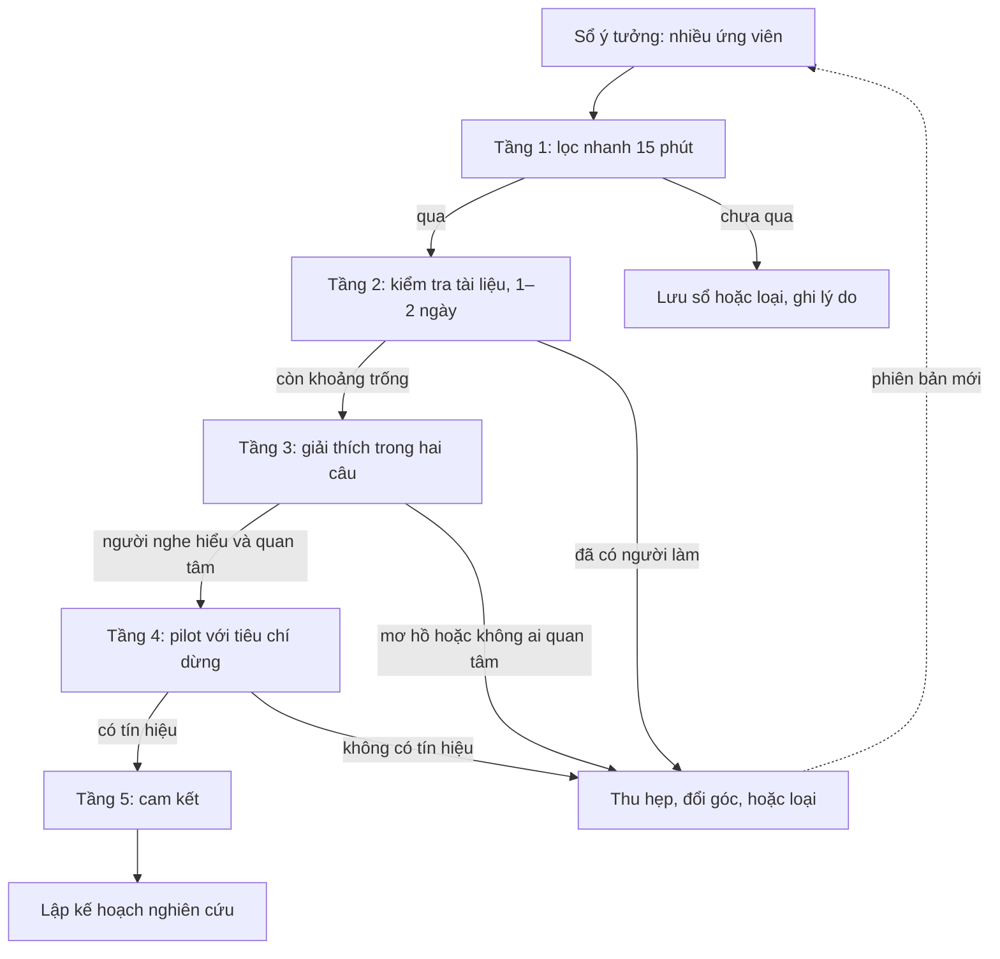

# Tìm khoảng trống và nguồn ý tưởng

!!! abstract "Mục tiêu của bài"
    Sau bài này, người học có thể:

    - Phân biệt một khoảng trống nghiên cứu thật với một ô trống không ai cần, và phát biểu khoảng trống theo một khuôn kiểm chứng được.
    - Nhận diện chín loại khoảng trống thường gặp ở Computer Vision, NLP và Machine Learning, cùng kiểu đóng góp mà mỗi loại thường dẫn tới.
    - Dùng lời khuyên của Hamming, Karpathy, Schulman, Alon, Nielsen, Sutton, Steinhardt và Olah như những câu hỏi lọc cụ thể khi chọn bài toán.
    - Áp dụng mười một phương pháp có hệ thống để tìm khoảng trống, biết đầu ra của từng phương pháp và chỗ nó dễ dẫn sai.
    - Lập bản đồ khoảng trống, giữ sổ ý tưởng, cân bằng danh mục ý tưởng theo rủi ro, và đưa ý tưởng qua một phễu kiểm tra năm tầng.

Bài trước, [Đọc paper như một reviewer](doc-nhu-reviewer.md), rèn con mắt nhìn ra những chỗ yếu bên trong từng paper: một claim thiếu bằng chứng, một baseline chưa được tune công bằng, một giả định ngầm không được nói ra. Bài này đi tiếp một bước. Khi được gom lại, so sánh với nhau và đặt cạnh nhu cầu của cộng đồng, những chỗ yếu rời rạc ấy trở thành *khoảng trống* nghiên cứu, và một khoảng trống được phát biểu rõ ràng là nguyên liệu của ý tưởng. Người mới làm nghiên cứu thường hỏi bốn câu liền nhau: ý tưởng từ đâu ra, gap nằm ở đâu, điểm yếu hay điểm mà các paper chưa giải được nằm ở đâu, và kiểm một ý tưởng thế nào trước khi dồn vài tháng vào nó. Bài này trả lời cả bốn câu theo một trình tự có thể làm theo.

Câu trả lời ngắn gọn là ý tưởng tốt hiếm khi đến từ cảm hứng bất chợt. Andrej Karpathy, trong *A Survival Guide to a PhD* (2016), mô tả công việc của nghiên cứu sinh như hai vòng lặp lồng nhau: vòng trong là giải bài toán, vòng ngoài là quyết định bài toán nào đáng giải, và phần lớn thời gian nằm ở vòng ngoài: *"You spend most of your time on the outer loop, figuring out what problems are worth solving and what problems are ripe for solving."* (phần lớn thời gian dành cho vòng ngoài, để tìm xem bài toán nào đáng giải và bài toán nào đã "chín" để giải). Chris Olah, trong ghi chú *Research Taste Exercises* (2021), giải thích vì sao vòng ngoài khó học: kiểm tra một ý tưởng thường tốn nhiều tháng, nên mỗi năm người nghiên cứu chỉ nhận được vài lần phản hồi về khả năng chọn bài toán của chính họ. Vì vậy, người học cần hai thứ: phương pháp có hệ thống để sinh ra nhiều ứng viên khoảng trống, và bộ lọc rẻ để loại phần lớn ứng viên thật sớm.

Bài đi theo đúng hai nhu cầu đó: định nghĩa và phân loại khoảng trống, lời khuyên của người đi trước, mười một phương pháp tìm khoảng trống, ba công cụ tổ chức (bản đồ khoảng trống, sổ ý tưởng, danh mục ý tưởng), một phễu kiểm tra nhiều tầng, cách rèn "gu" nghiên cứu và những cái bẫy thường gặp. Phễu ở đây chỉ là bước sàng lọc sớm; các công cụ thẩm định sâu hơn nằm ở bài kế tiếp, [Thẩm định ý tưởng](y-tuong.md).

## Khoảng trống là gì

Chữ "gap" thường được dùng khá lỏng: chưa có paper nào làm X trên dataset Y thì gọi là gap. Cách hiểu đó dẫn tới những dự án bị reviewer chê là thiếu động lực (*weak motivation*): đúng là chưa ai làm, nhưng cũng chẳng ai cần. Bài [Đọc và lập bản đồ tài liệu](literature.md) đã cảnh báo rằng một góc trống trên bản đồ định vị có thể trống vì chưa ai làm được, nhưng cũng có thể vì không ai cần.

Trong giáo trình này, một **khoảng trống nghiên cứu** (*research gap*) là chỗ chênh giữa điều một cộng đồng cần biết hoặc cần làm được và điều mà tri thức, phương pháp, dữ liệu hiện có cung cấp, kèm theo lý do vì sao chỗ chênh ấy vẫn còn. Định nghĩa có ba vế, mỗi vế là một phép thử: *có người cần*; *chưa có câu trả lời đáng tin*, có thể vì chưa có paper, nhưng cũng có thể vì các paper mâu thuẫn, không tái lập được hoặc chỉ đúng trong thiết lập hẹp; và *có lý do vì sao còn mở*, như một rào cản kỹ thuật, một giả định chưa ai đặt câu hỏi, một năng lực hay nguồn dữ liệu vừa xuất hiện.

Vế thứ ba quan trọng nhất, vì lý do khoảng trống còn mở thường gợi ý luôn cách tấn công: thiếu dữ liệu thì xây dữ liệu, một giả định chưa bị nghi ngờ thì kiểm tra giả định đó. Không nêu được lý do nào thường có nghĩa là khoảng trống đã được lấp ở đâu đó, hoặc không ai thấy cần lấp. Jennifer Widom, trong *Tips for Writing Technical Papers* (2006), đặt câu hỏi "vì sao bài toán chưa được giải trước đây?" vào khung năm câu hỏi của Introduction; câu hỏi ấy nên được trả lời ngay từ lúc chọn bài toán. Mỗi ứng viên nên được viết theo khuôn dưới đây trước khi vào sổ ý tưởng.

```text
KHUÔN PHÁT BIỂU KHOẢNG TRỐNG
Thiết lập:          Trong [bài toán / miền / chế độ dữ liệu S],
Nhu cầu:            [ai] cần [năng lực hoặc hiểu biết X].
Hiện trạng:         Các phương pháp / dữ liệu hiện có [Y, 2–3 trích dẫn] chưa đáp ứng X, vì [Z].
Bằng chứng:         [failure case, con số tự đo, câu trong phần Limitations, review công khai].
Vì sao còn mở:      [rào cản kỹ thuật, năng lực hoặc dữ liệu mới, giả định chưa bị nghi ngờ].
Loại khoảng trống:  [một trong chín loại ở mục dưới].
```

<div class="bad" markdown>
*"Chưa có công trình nào áp dụng mô hình khuếch tán cho phân vùng ảnh CT ba chiều."* (ví dụ giả định)

Chỉ nói rằng chưa ai làm: không có ai cần, không có thất bại cụ thể, không có lý do còn mở. Đây là mầm của một ý tưởng "A + B".
</div>

<div class="good" markdown>
*"Các phương pháp phân vùng ảnh CT ba chiều đạt điểm Dice cao trên benchmark công khai, vốn chủ yếu gồm ảnh lát cắt mỏng. Nhiều cơ sở y tế chỉ có máy cho lát cắt dày hơn nhiều, và thử nghiệm sơ bộ với hai phương pháp mạnh nhất cho thấy lỗi tăng mạnh trên cấu trúc nhỏ. Khoảng trống còn mở vì chưa có tập đánh giá công khai cho dữ liệu lát cắt dày."* (ví dụ giả định)

Đủ ba vế, và gợi ý luôn kiểu đóng góp: một benchmark kèm phân tích.
</div>

### Chín loại khoảng trống

Mỗi loại khoảng trống dẫn tới một kiểu đóng góp và một loại bằng chứng khác nhau, theo các kiểu đóng góp ở bài [Thẩm định ý tưởng](y-tuong.md). Biết loại giúp hình dung sớm paper cuối cùng, và tránh việc phát hiện một khoảng trống về đánh giá nhưng lại cố viết thành paper phương pháp.

**Câu hỏi chưa có lời đáp.** Mô hình ngôn ngữ nhận được ngữ cảnh rất dài, nhưng có thực sự *dùng* được nó không? *Lost in the Middle* (Liu et al., TACL 2024) cho thấy hiệu năng thường cao nhất khi thông tin cần thiết nằm ở đầu hoặc cuối ngữ cảnh và giảm rõ khi nó nằm ở giữa.

**Phương pháp còn thiếu.** Bài toán rõ, có người cần, nhưng chưa phương pháp nào đạt một yêu cầu cụ thể. Trước ResNet (CVPR 2016), mạng sâu hơn lại cho training error cao hơn và chưa có cách vượt qua (xem case study [ResNet](../05-case-studies/resnet.md)). Đây là loại quen thuộc nhất và đông người tranh nhất.

**Đánh giá hoặc benchmark còn thiếu.** CheckList (ACL 2020) cho thấy độ chính xác tổng thể che đi những lỗi có hệ thống như xử lý phủ định. *A Call for Clarity in Reporting BLEU Scores* (Post, WMT 2018) chỉ ra BLEU là metric có tham số, có thể chênh tới 1,8 điểm giữa các cấu hình thông dụng, và đề xuất công cụ SacreBLEU để chuẩn hóa việc báo cáo.

**Tài nguyên còn thiếu.** ImageNet (CVPR 2009) lấp khoảng trống này ở quy mô cả lĩnh vực; PhoBERT (Findings of EMNLP 2020) lấp nó cho mô hình ngôn ngữ đơn ngữ tiếng Việt (xem case study [PhoBERT](../05-case-studies/phobert.md)).

**Hiểu biết còn thiếu.** Chạy được nhưng chưa biết vì sao. *Rethinking the Role of Demonstrations* (Min et al., EMNLP 2022) cho thấy thay nhãn đúng trong ví dụ minh họa của in-context learning bằng nhãn ngẫu nhiên hầu như không làm giảm hiệu năng, nhất quán qua mười hai mô hình; điều quan trọng hơn là không gian nhãn, phân phối văn bản đầu vào và định dạng. *Understanding Deep Learning Requires Rethinking Generalization* (Zhang et al., ICLR 2017) là ví dụ kinh điển ở ML.

**Hiệu quả tính toán.** Phương pháp tốt nhưng quá chậm hoặc quá đắt, như trường hợp của FlashAttention (NeurIPS 2022) và LoRA (ICLR 2022); loại này dễ phát biểu nhưng đòi hỏi đo trên phần cứng thực.

**Độ bền vững, công bằng và an toàn.** *Intriguing Properties of Neural Networks* (Szegedy et al., ICLR 2014) mở ra cả một dòng nghiên cứu khi cho thấy nhiễu rất nhỏ có thể khiến mạng phân loại ảnh đoán sai; [Chương 9](../09-ai-security/index.md) phân tích nhiều paper theo hướng này.

**Khoảng cách giữa benchmark và thực tế.** *Do ImageNet Classifiers Generalize to ImageNet?* (Recht et al., ICML 2019) xây lại tập test ImageNet theo sát quy trình gốc và thấy độ chính xác giảm từ 11% đến 14%, dù thứ hạng giữa các mô hình gần như giữ nguyên. WILDS (Koh et al., ICML 2021) gom các dịch chuyển phân phối (*distribution shift*) thực tế thành một benchmark.

**Khoảng trống lý thuyết.** Belkin và cộng sự (PNAS 2019) mở đầu bằng một mâu thuẫn: theo đánh đổi bias–variance cổ điển, mô hình khớp hoàn toàn dữ liệu huấn luyện là overfit, vậy mà mạng nơ-ron hiện đại làm đúng điều đó và vẫn đạt độ chính xác cao trên dữ liệu test.

| Loại khoảng trống | Câu hỏi nhận diện | Kiểu đóng góp thường gặp |
|---|---|---|
| Câu hỏi chưa có lời đáp | Cộng đồng đang ngầm hỏi gì mà chưa ai đo? | Phân tích |
| Phương pháp còn thiếu | Yêu cầu nào chưa phương pháp nào đạt? | Phương pháp |
| Đánh giá, benchmark | Thước đo hiện tại che khuất điều gì? | Phương pháp luận đánh giá |
| Tài nguyên | Ngôn ngữ, miền nào chưa có dữ liệu đạt chuẩn? | Dataset, mô hình, công cụ |
| Hiểu biết | Cái gì chạy được mà chưa ai biết vì sao? | Phân tích |
| Hiệu quả tính toán | Cái gì tốt nhưng quá đắt? | Hiệu quả |
| Bền vững, công bằng, an toàn | Khi nào phương pháp sụp đổ hoặc gây hại? | Tấn công, phòng thủ, đánh giá |
| Benchmark và thực tế | Kết quả còn đứng khi dữ liệu đổi? | Benchmark, phân tích |
| Lý thuyết | Lý thuyết nào mâu thuẫn với thực hành? | Lý thuyết, phân tích |

Một paper thường chạm nhiều loại cùng lúc, nhưng nên có một kiểu đóng góp chủ đạo, và loại khoảng trống chủ đạo thường quyết định kiểu đóng góp ấy. Câu hỏi tiếp theo là chọn khoảng trống nào để theo đuổi, chỗ mà kinh nghiệm của người đi trước hữu ích nhất.

## Những người đi trước nói gì về việc chọn bài toán

Nhiều nhà nghiên cứu có ảnh hưởng đã viết về việc chọn bài toán, ở những thời điểm và lĩnh vực rất khác nhau. Không bài nào là công thức; cách đọc hữu ích là rút từ mỗi bài vài *câu hỏi lọc* đặt được cho một ứng viên cụ thể. Bảng cuối phần gom các câu hỏi đó; các bài viết được giới thiệu đầy đủ hơn ở phụ lục [Lời khuyên từ các nhà nghiên cứu hàng đầu](../phu-luc/loi-khuyen.md).

### Bài toán quan trọng phải đi kèm cách tấn công

Richard Hamming trình bày *You and Your Research* tại Bell Communications Research (Bellcore) năm 1986, khi đã nghỉ hưu khỏi Bell Labs. Ông hỏi vì sao rất ít nhà khoa học tạo ra đóng góp lớn, và cho rằng câu trả lời nằm ở thói quen và lựa chọn, trước hết là chọn làm những bài toán quan trọng. Nhưng "quan trọng" được định nghĩa rất cụ thể: du hành thời gian hay phản trọng lực không phải bài toán quan trọng vì không ai có cách tấn công hợp lý: *"It's not the consequence that makes a problem important, it is that you have a reasonable attack."* (không phải hệ quả làm nên tầm quan trọng của bài toán, mà là việc có một cách tấn công hợp lý). Theo ngôn ngữ của bài này, vế "vì sao còn mở" phải đi kèm một cách vượt qua lý do đó. Hamming còn dành riêng chiều thứ Sáu hằng tuần để nghĩ về bức tranh lớn, khoảng thời gian thường được gọi là *Great Thoughts Time*, và khuyên theo dõi những chỗ có vẻ sai hoặc bất thường trong các lý thuyết được chấp nhận, vì đó thường là nguồn của đóng góp lớn.

### Vòng lặp ngoài, đất màu mỡ và tham vọng có kiểm soát

Karpathy kể rằng khi nghe một đề xuất, người hướng dẫn gần như lập tức đánh giá tầm quan trọng, độ khó, sức hấp dẫn và bối cảnh lịch sử của bài toán; gu ấy có thật và được học qua thực hành, và ông thừa nhận gu của bản thân lúc mới bắt đầu rất tệ. Ông khuyên chọn **đất màu mỡ**, nơi các paper nối tiếp nhau thành luận án; **tham vọng**, vì theo kinh nghiệm của ông, một bài toán quan trọng hơn gấp mười thường chỉ khó hơn tối đa hai đến ba lần; nhưng **tham vọng phải có cách tấn công**, và ông dẫn lại chính đoạn của Hamming. Ông khuyên tránh công trình *incremental*, tức làm một thứ có sẵn phức tạp hơn để tăng vài phần trăm, loại paper dễ được chấp nhận nhưng ít được trích dẫn.

Karpathy cũng kể việc chọn đề tài luận án. Sau khoảng hai năm loay hoay ở vòng ngoài, ông nhận ra giao điểm giữa ảnh và ngôn ngữ là hướng hứa hẹn vì nhiều lý do cùng lúc: màu mỡ, thú vị và quan trọng, dễ giải thích, nằm ở ranh giới của cái khả thi vì học sâu vừa bắt đầu hoạt động, các dataset như Flickr8K vừa xuất hiện, hợp với mối quan tâm của người hướng dẫn, và kể cả nếu thất bại vẫn cho kỹ năng dùng được ở nơi khác. Bài học nằm ở cấu trúc quyết định: một bài toán tốt thường thỏa mãn *nhiều* tiêu chí độc lập cùng lúc. Việc ông mất hai năm cũng cho thấy loay hoay khi chọn bài toán là bình thường.

### Dẫn dắt bởi mục tiêu hay bởi ý tưởng

John Schulman viết *An Opinionated Guide to ML Research* lần đầu cuối năm 2017 cho chương trình OpenAI Fellows và đăng lên blog cá nhân năm 2020. Ông phân biệt nghiên cứu **dẫn dắt bởi ý tưởng** (*idea-driven*), đọc paper làm X rồi nảy ra ý làm X tốt hơn, với nghiên cứu **dẫn dắt bởi mục tiêu** (*goal-driven*), bắt đầu từ hình dung về một năng lực AI mới rồi giải những bài toán đưa tới gần nó, thường là làm cho X hoạt động *lần đầu tiên*. Ông khuyên phần lớn người theo hướng thứ hai: với hướng thứ nhất, mọi người đọc cùng những paper nên dễ đi tới cùng ý tưởng và dễ bị công bố trước, còn một mục tiêu cụ thể cho góc nhìn riêng. Với mục tiêu cho robot thao tác vật thể biến dạng, một bài toán con không lường trước, tối ưu quỹ đạo, thành kết quả có ảnh hưởng nhất của ông; với mục tiêu về vận động, ông đi tới TRPO, GAE rồi PPO.

Schulman khuyên giới hạn vào lời giải tổng quát thay vì hiểu mục tiêu theo nghĩa đen, và tự hỏi dự án nhắm cải thiện 10% hay gấp mười lần; với ý tưởng incremental, cải thiện nhỏ chỉ đáng giá khi thay đổi rất đơn giản. Hệ quả cho bài này: khoảng trống phát hiện *trong lúc theo đuổi một mục tiêu* thường ít người tranh hơn khoảng trống đọc được từ phần Future Work của một paper nổi tiếng.

### Khả thi, thú vị và "đám mây"

Uri Alon, trong *How To Choose a Good Scientific Problem* (*Molecular Cell*, 2009), đề xuất đặt bài toán ứng viên lên hai trục, **tính khả thi** và **mức độ thú vị**, chọn ở góc vừa khả thi vừa thú vị, và khi phải đánh đổi thì chỉ giữ những lựa chọn không bị lựa chọn khác vượt trên cả hai trục, tức đường biên Pareto. Độ khó phải hợp với giai đoạn sự nghiệp: người mới nên bắt đầu bằng bài toán khả thi và ngắn hơn. Ông khuyên lắng nghe những ý tưởng cứ quay lại suốt nhiều tháng thay vì chọn theo thời thượng, và dành đủ thời gian để chọn; trong nhóm của ông, khoảng ba tháng trước khi cam kết là bình thường.

Trong một bài nói TED, Alon mô tả hình ảnh "đám mây": người ta hình dung nghiên cứu là đi thẳng từ câu hỏi A tới câu trả lời B, nhưng thực tế thí nghiệm thường ngừng hoạt động và người nghiên cứu đi vào một đám mây bối rối ở ranh giới giữa cái đã biết và chưa biết, rồi đôi khi ra khỏi đó ở một câu trả lời C thú vị hơn B. Điều này có nghĩa là việc tìm khoảng trống không kết thúc khi dự án bắt đầu: nhiều khoảng trống tốt nhất được phát hiện ngay trong đám mây, giống bài toán tối ưu quỹ đạo của Schulman.

### Người tạo bài toán và những lĩnh vực "lộn xộn"

Michael Nielsen viết *Principles of Effective Research* năm 2004 từ nền tảng vật lý lý thuyết. Ông phân biệt *người giải bài toán*, tấn công những bài toán đã được đặt rõ, với *người tạo bài toán*, tìm ra câu hỏi hay mối liên hệ mới, đôi khi trong những paper rất đơn giản về kỹ thuật, và cảnh báo việc coi độ khó là chỉ dấu của tầm quan trọng. Về những lĩnh vực rối ren mà nhiều người né tránh, ông viết: *"But a field that is a mess is really an opportunity."* (một lĩnh vực đang lộn xộn thực ra là một cơ hội), vì ở đó có thể còn những khái niệm hợp nhất đang chờ được tìm ra.

### "Bài học cay đắng" như một bộ lọc

Rich Sutton, trong *The Bitter Lesson* (2019), cho rằng bài học lớn nhất của bảy mươi năm nghiên cứu AI là các phương pháp tổng quát tận dụng được sức tính toán cuối cùng luôn hiệu quả nhất; đưa tri thức của con người vào hệ thống giúp ích trong ngắn hạn nhưng về lâu dài thì chững lại. Từ đó có câu hỏi lọc: *nếu sức tính toán tăng gấp mười, ý tưởng còn giá trị không?* Câu hỏi chia ứng viên thành ba nhóm: ý tưởng mã hóa tri thức thủ công để bù cho quy mô, có nguy cơ lỗi thời nhanh; phương pháp tổng quát càng có ích khi quy mô tăng; và khoảng trống không nằm trên trục quy mô, như đánh giá, hiểu biết, an toàn hay hiệu quả, vốn thường *càng* quan trọng khi mô hình càng lớn. Cần đọc đúng phạm vi: Sutton thừa nhận tri thức chuyên ngành có ích trong ngắn hạn, và bài luận nói về tiến bộ dài hạn của AI, không phải về việc paper nào được chấp nhận.

### Làm phần dễ thất bại trước

Jacob Steinhardt, trong *Research as a Stochastic Decision Process* (2018), nhìn dự án như chuỗi nhiệm vụ con không chắc chắn mà bất kỳ nhiệm vụ nào thất bại cũng có thể làm dự án sụp đổ, nên khuyên làm trước những nhiệm vụ cho nhiều thông tin nhất trên mỗi đơn vị thời gian; bài [Lập kế hoạch nghiên cứu](ke-hoach.md) trình bày kỹ nguyên tắc này. Ở giai đoạn tìm khoảng trống, hệ quả gọn là: giữa hai ứng viên hấp dẫn như nhau, ưu tiên ứng viên có phép thử "giết" rẻ nhất. Khóa học CS197 *Computer Science Research* của Michael Bernstein ở Stanford diễn đạt cùng tinh thần bằng hai khái niệm mà khóa học gọi là *vectoring* và *velocity*: xác định chiều rủi ro lớn nhất, rồi giảm rủi ro dọc theo chiều đó thật nhanh.

### Những câu hỏi ngắn được cộng đồng chia sẻ

Olah còn tổng hợp vài gợi ý của người khác. Rachel Prudden đề xuất hình dung một nhóm khác vừa công bố đúng paper đang nghĩ tới: có muốn đọc không? Andy Matuschak đề xuất "câu hỏi phản Hamming": đâu là những bài toán *thú vị* nhất của lĩnh vực, và vì sao chưa làm chúng? Arthur Allshire gợi ý tìm những bài toán *nút thắt* của lĩnh vực. Boaz Barak thích dự án "20/80": tìm bài toán chắt lọc được trở ngại chính, dù kết quả nghe không hấp dẫn.

### Tổng hợp: từ lời khuyên tới câu hỏi lọc

| Nguồn | Câu hỏi lọc |
|---|---|
| Hamming, 1986 | Cách tấn công cụ thể là gì, vì sao khả thi *bây giờ*? |
| Karpathy, 2016 | Sau paper này còn gì? Nhiều tiêu chí độc lập có cùng thỏa mãn không? |
| Schulman, 2020 | Ý tưởng phục vụ năng lực nào? Nhắm 10% hay gấp mười? |
| Alon, 2009 | Ý tưởng nằm đâu trên hai trục khả thi và thú vị, có hợp với giai đoạn hiện tại không? |
| Nielsen, 2004 | Đang giải bài toán có sẵn hay đặt ra câu hỏi mới? |
| Sutton, 2019 | Nếu sức tính toán tăng gấp mười, ý tưởng còn giá trị không? |
| Steinhardt, 2018 | Phép thử rẻ nhất có thể giết ý tưởng là gì? |
| Prudden, Matuschak, Allshire, Barak (qua Olah, 2021) | Có muốn đọc nếu nhóm khác công bố? Ý tưởng có chạm nút thắt chính không? |

## Mười một phương pháp tìm khoảng trống

Các lời khuyên trên giúp *chọn* giữa các khoảng trống; phần này trình bày cách *sinh ra* chúng. Mười một phương pháp dưới đây giống mười một lăng kính đặt lên cùng một khối tài liệu, mỗi lăng kính làm hiện lên một kiểu khoảng trống, và ứng viên tốt thường xuất hiện ở chỗ hai lăng kính cùng chỉ tới. Mỗi phương pháp gồm: vì sao nó hoạt động, quy trình, ví dụ, đầu ra, và khi nào nó dễ dẫn sai. Đầu ra của mọi phương pháp là một *ứng viên khoảng trống*, được ghi vào sổ ý tưởng theo khuôn ở đầu bài rồi mới vào phễu kiểm tra.

### Phương pháp 1: Lật giả định

Khóa học CS197 của Bernstein dạy một kỹ thuật gọn gọi là *bit flip*, xuất phát từ nhận xét rằng ý tưởng mới hiếm khi đến từ hư không mà thường xoay quanh công trình hiện có. Bước thứ nhất là *xác định bit*: phát biểu một giả định mà các công trình trước dựa vào, thường là giả định không được nói ra. Bước thứ hai là *lật bit*: đề xuất một giả định thay thế. O'Neill và cộng sự (arXiv 2025) dùng khung này để tóm tắt khoảng 5.500 paper NeurIPS 2023 và ICLR 2024, kèm một thành phần "spark" (insight then chốt) do chính nhóm này bổ sung.

Nhiều đóng góp có thể đọc lại như một phép lật giả định, dù đó là cách đọc của giáo trình chứ không phải cách tác giả tự mô tả. Transformer lật giả định rằng mô hình hóa chuỗi cần recurrence hoặc convolution. PhoBERT xuất phát từ giả định ngầm của mô hình kiểu BERT rằng khoảng trắng phân tách từ, trong khi ở tiếng Việt khoảng trắng phân tách âm tiết. Case study [Pop-ups](../09-ai-security/popups.md) phân tích một paper ACL 2025 lật giả định rằng nội dung đối kháng phải khó bị con người nhận ra: khi agent làm việc với rất ít giám sát, điều đó không còn cốt yếu, và câu hỏi trở thành liệu agent có biết bỏ qua những thứ mà người dùng có kinh nghiệm đã quen bỏ qua.

**Quy trình.**

1. Chọn năm đến mười paper gần nhất của một dòng nghiên cứu hẹp, lấy từ bảng literature.
2. Với mỗi paper, viết một câu "bit" cho mỗi giả định, tìm ở phần đặt bài toán, các câu "we assume", cách chọn và chia dữ liệu, metric, danh sách baseline.
3. Gom các bit chung của cả dòng, vì phép lật ở cấp cả dòng tài liệu thường giá trị hơn ở cấp một paper.
4. Lật từng bit, ghi hệ quả nếu phép lật đúng và một thí nghiệm rẻ nhất để kiểm tra.

**Ví dụ** (giả định), cho dòng retrieval-augmented generation trong hỏi đáp:

```text
Bit 1: Truy xuất một lần, trước khi sinh.            Flip: truy xuất theo nhu cầu, trong lúc sinh.
Bit 2: Kho văn bản tĩnh và đáng tin cậy.              Flip: kho thay đổi theo thời gian, có tài liệu sai.
Bit 3: Đơn vị truy xuất là đoạn văn độ dài cố định.   Flip: đơn vị do mô hình chọn theo từng câu hỏi.
Bit 4: Đánh giá bằng độ khớp với đáp án chuẩn.       Flip: đánh giá bằng mức câu trả lời được tài liệu hỗ trợ.
```

Một số phép lật này có thể đã được nghiên cứu nhiều; mục đích là nhanh chóng sinh nhiều câu hỏi cụ thể và thấy giả định nào *còn* chưa bị thách thức, rồi đưa từng phép lật qua quy trình tìm novelty ba tầng ở bài [Thẩm định ý tưởng](y-tuong.md).

**Đầu ra.** Bảng gồm bit, nguồn, flip, hệ quả, thí nghiệm rẻ nhất, "đã có ai lật chưa".

**Khi nào dễ sai.** Phương pháp mạnh nhất ở dòng nghiên cứu trưởng thành, nơi nhiều paper chung giả định. Nó dễ sai khi lật chỉ để khác, khi "bit" thực chất là "chưa ai dùng module X" (một phép ghép "A + B" trá hình), và khi quên rằng, như CS197 nhấn mạnh, một bit flip phải được lập luận và đánh giá.

### Phương pháp 2: Khai thác failure case của SOTA

Phương pháp thứ hai bắt đầu từ dữ liệu. Jia-Bin Huang, trong bộ ghi chú *awesome-tips*, khuyên người chưa biết bắt đầu từ đâu hãy thử baseline trên chính bài toán đang quan tâm: việc đó làm lộ giới hạn của state of the art, và một khoảng trống cụ thể là thứ tạo động lực cho công trình. Karpathy, trong *A Recipe for Training Neural Networks* (2019), khuyên dành nhiều giờ xem hàng nghìn mẫu dữ liệu trước khi viết code mô hình, vì mẫu bất thường gần như luôn để lộ lỗi dữ liệu hoặc tiền xử lý.

**Quy trình**, mượn kỹ thuật mã hóa mở (*open coding*) của nghiên cứu định tính:

1. Chạy SOTA bằng code và checkpoint chính thức, trên tập test chuẩn và trên một tập nhỏ gần với cách dùng thực tế.
2. Lấy một đến hai trăm lỗi, gồm một mẫu ngẫu nhiên và một nhóm lỗi nặng nhất.
3. Ghi mô tả ngắn cho từng lỗi; sau ba mươi đến năm mươi lỗi, gom thành nhóm, đặt tên, rồi mã hóa lại toàn bộ.
4. Đếm tần suất, viết giả thuyết cơ chế cho nhóm đáng chú ý nhất, và kiểm tra lỗi có lặp lại ở một phương pháp mạnh thứ hai không.

**Ví dụ.** Bài [Thực hành: một paper từ con số 0](../05-case-studies/worked-example.md) theo chân một dự án CV bắt đầu từ quan sát rằng detector hoạt động kém với vật thể nhỏ trong ảnh drone. Ở NLP, bước 3 và 4 có thể cho bảng sau (ví dụ giả định, mô hình tóm tắt tin tức tiếng Việt):

```text
Nhóm lỗi (150 lỗi)               Số lỗi   Giả thuyết cơ chế
Sai con số, ngày tháng            41      token hóa tách rời chữ số
Gán sai chủ thể của phát ngôn     29      nhiều thực thể cùng chức danh
Bỏ mất phủ định                   17      phủ định nằm xa động từ
Thông tin không có trong bài      38      ảo giác từ tri thức pre-train
```

Nhóm "sai con số" đáng chú ý không vì lớn nhất, mà vì có giả thuyết cơ chế kiểm chứng được bằng một tập test nhỏ chỉ thay đổi con số; nhóm "thông tin không có trong bài" lớn hơn nhưng đã được nghiên cứu rộng rãi dưới tên hallucination.

**Đầu ra.** Bảng phân loại lỗi với tần suất, giả thuyết cơ chế, ghi chú "đã được biết chưa", và một tập kiểm tra nhỏ cho nhóm được chọn.

**Khi nào dễ sai.** Dễ sai khi người phân tích chỉ thấy loại lỗi đã muốn thấy, khi "lỗi" thực ra là lỗi gán nhãn, khi loại lỗi đã nổi tiếng, và khi lỗi đến từ việc chạy baseline sai cấu hình, trường hợp dẫn thẳng tới phương pháp tái lập.

### Phương pháp 3: Đọc phê phán Limitations, Future Work và review công khai

Có một nguồn khoảng trống mà chuyên gia đã viết sẵn. Ở các hội nghị thuộc hệ ACL, phần Limitations đã thành bắt buộc trong những năm gần đây. Trên OpenReview, review, rebuttal và meta-review của các paper ICLR được công khai, kể cả với nhiều paper bị reject, và những năm gần đây điều này cũng đúng với nhiều paper NeurIPS. Bài [Đọc paper như một reviewer](doc-nhu-reviewer.md) hướng dẫn đọc review một cách phê phán; ở đây chúng được đọc để tìm điểm yếu *chưa ai giải*.

**Quy trình.**

1. Chọn hai mươi đến ba mươi paper của dòng nghiên cứu trong mười hai đến mười tám tháng gần nhất.
2. Trích từng câu về hạn chế hoặc hướng mở, rồi phân loại: hạn chế thật và cụ thể; câu rào đón chung chung; hạn chế đã được công trình sau giải quyết (kiểm tra bằng cách đi tiến theo trích dẫn).
3. Với paper có trên OpenReview, ghi những điểm yếu được hơn một reviewer nêu, được tác giả đẩy sang "future work" trong rebuttal, hoặc lặp lại ở nhiều paper.
4. Gom theo chủ đề: điểm yếu lặp lại ở nhiều paper mà chưa được giải là khoảng trống ở cấp cả dòng.

**Ví dụ** (giả định). Khi đọc review của một loạt paper về thích nghi mô hình lúc test (*test-time adaptation*), người học thấy reviewer liên tục hỏi về hiệu năng khi dữ liệu test đến theo lô rất nhỏ hoặc mất cân bằng lớp, và tác giả thường trả lời rằng đó là hướng tương lai. Cùng điểm yếu ở năm paper của ba nhóm khác nhau là tín hiệu mạnh hơn nhiều so với một câu Future Work riêng lẻ.

**Đầu ra.** Một "ngân hàng điểm yếu": điểm yếu, số paper và review nêu nó, đã có ai giải chưa, loại khoảng trống.

**Khi nào dễ sai.** Những gì viết công khai thì ai cũng đọc được, nên tốc độ và chiều sâu quyết định. Tác giả thường chọn viết những hạn chế "an toàn", và một hạn chế được tự nêu không đồng nghĩa với điểm yếu của paper, như hướng dẫn phản biện của ACL Rolling Review những năm gần đây nói rõ; với mục đích tìm khoảng trống, nó là dấu chỉ đường chứ không phải lời phê. Reviewer cũng có thể sai, và review của ARR không công khai như ICLR.

### Phương pháp 4: Đẩy tới cực trị

Hành vi của một phương pháp thường thay đổi về chất khi một đại lượng tăng hoặc giảm vài bậc độ lớn. Phương pháp này vặn từng "núm" về hai đầu và quan sát điều gì gãy.

**Quy trình.** Liệt kê các núm: lượng dữ liệu, độ nhiễu nhãn, sức tính toán, kích thước mô hình, độ dài ngữ cảnh, độ phân giải, số ngôn ngữ, số lớp. Với mỗi núm, hỏi ở mỗi đầu giả định nào bị phá vỡ và ghi một dự đoán. Chạy phép thử ở đầu rẻ, thường là đầu nhỏ, và tìm thay đổi về chất: điểm gãy, bão hòa, hay đảo chiều.

**Ví dụ.** Ở NLP, núm độ dài ngữ cảnh dẫn tới *Lost in the Middle*; núm số ngôn ngữ dẫn tới hiện tượng mà nhóm tác giả XLM-R (Conneau et al., ACL 2020) gọi là "lời nguyền đa ngôn ngữ" (*curse of multilinguality*): với dung lượng mô hình cố định, thêm ngôn ngữ giúp ngôn ngữ ít tài nguyên tới một mức, rồi hiệu năng chung bắt đầu giảm. Ở ML, *Deep Double Descent* (Nakkiran et al., ICLR 2020) thấy test error có thể tăng rồi mới giảm khi mô hình lớn dần hoặc huấn luyện lâu hơn, và trong một số chế độ thêm dữ liệu lại làm kết quả xấu đi. Ở CV, núm độ phân giải là nguồn khoảng trống quen thuộc với ảnh viễn thám hay giải phẫu bệnh, nơi chi phí self-attention tăng theo bình phương số mảnh ảnh.

**Đầu ra.** Bảng núm: núm, hướng, giả định bị phá, dự đoán, thí nghiệm rẻ, kết quả.

**Khi nào dễ sai.** Đầu nhỏ của các núm hợp với nhóm ít tài nguyên và thường bị bỏ ngỏ. Phương pháp dễ sai khi chọn cực trị không ai cần, khi kết quả "nó gãy" là hiển nhiên, và nhất là khi nhầm sự gãy với hyperparameter chưa được tune lại. *Deep Learning Tuning Playbook* (Godbole et al., 2023) nhắc rằng *"fixed hyperparameters create caveats for any conclusions we draw from the experiments"* (hyperparameter bị giữ cố định tạo ra điều kiện kèm theo cho mọi kết luận).

### Phương pháp 5: Chuyển giao giữa các lĩnh vực

Nhiều bước tiến lớn đến từ việc mang ý tưởng thành công ở lĩnh vực này sang lĩnh vực khác: Transformer từ NLP sang thị giác, masked modeling từ BERT sang MAE. CheckList cũng là một phép chuyển giao, mượn tư duy kiểm thử phần mềm sang đánh giá mô hình NLP (xem case study [CheckList](../05-case-studies/checklist-acl2020.md)). Câu hỏi then chốt là *"ý tưởng X thành công ở lĩnh vực A, vì sao chưa ai làm ở lĩnh vực B?"*, và giá trị của phương pháp nằm gần như hoàn toàn ở việc trả lời câu đó trung thực.

**Quy trình.**

1. Duy trì một danh sách "ý tưởng thành công ở nơi khác", từ việc đọc ngoài lĩnh vực chính: paper đoạt giải ở cộng đồng lân cận, sách giáo khoa thống kê, xử lý tín hiệu, kỹ thuật phần mềm, bảo mật.
2. Với mỗi cặp, chọn một trong bốn câu trả lời cho "vì sao chưa ai làm": đã có người làm dưới tên khác (tìm bằng thuật ngữ của *cả hai* lĩnh vực); có rào cản kỹ thuật; giả định làm ý tưởng thành công ở A không đúng ở B; hoặc B không cần (loại). Rào cản hay giả định bị phá vỡ chính là đóng góp tiềm năng.
3. Chạy phép chuyển giao ngây thơ trước như một baseline: nếu nó đã hoạt động hoàn hảo, không còn nhiều để đóng góp; nếu thất bại, chẩn đoán vì sao là bước đầu của paper.

**Ví dụ.** Ba case study trong giáo trình minh họa cấu trúc "mượn công cụ, rồi chỉ ra vì sao nó chưa vừa". Paper trong case study [Streaming ITN](../05-case-studies/streaming-itn.md) mượn read–write policy của dịch máy đồng thời cho bài toán chuẩn hóa văn bản đầu ra của nhận dạng tiếng nói, rồi chỉ ra rằng dịch máy phải sắp lại trật tự từ còn chuẩn hóa văn bản chỉ gồm biến đổi cục bộ giữ nguyên trật tự, nên policy phải được thiết kế lại. StruQ (case study [StruQ](../09-ai-security/struq.md)) đóng khung prompt injection bằng bài học tách kênh điều khiển khỏi kênh dữ liệu, như prepared statements chống SQL injection, và case study chỉ ra cả chỗ phép so sánh cần được giới hạn. Mô hình khuếch tán được đề xuất từ năm 2015, lấy cảm hứng từ nhiệt động lực học không cân bằng, nhưng phải đến DDPM mới có minh chứng rằng lớp mô hình này sinh được ảnh chất lượng cao (xem case study [DDPM](../05-case-studies/ddpm.md)).

**Đầu ra.** Một phiếu ghi ý tưởng gốc, lĩnh vực gốc và đích, giả định then chốt ở mỗi bên, rào cản dự kiến, phép chuyển giao ngây thơ, và từ khóa tìm kiếm của cả hai lĩnh vực.

**Khi nào dễ sai.** Phương pháp dễ sai theo hai hướng ngược nhau: chuyển giao hời hợt, rơi vào bẫy "A + B"; hoặc "phát minh lại" thứ đã có từ lâu ở lĩnh vực kia, tình huống được phân tích ở bài [Khi novelty và hiệu quả lệch pha](../07-tinh-huong-kho/novelty-va-hieu-qua.md).

### Phương pháp 6: Năng lực mới sinh câu hỏi mới

Mỗi khi một năng lực mới xuất hiện, như một thế hệ mô hình, một nguồn dữ liệu lớn hay một công cụ mới, nó kéo theo những câu hỏi trước đó không thể đặt ra. Trong câu chuyện của Karpathy, hai lý do khiến hướng ảnh–ngôn ngữ hấp dẫn chính là thời điểm; theo ngôn ngữ của Schulman, năng lực mới cho phép làm cho một thứ hoạt động *lần đầu tiên*.

**Quy trình.** Đi qua bảy họ câu hỏi và ghi câu hỏi cụ thể cho từng họ: *đánh giá* (đo thế nào cho đúng, dữ liệu test có bị lộ vào dữ liệu huấn luyện không); *giới hạn* (thất bại ở đâu); *cơ chế* (vì sao hoạt động); *chi phí*; *chuyển giao* (sang miền, ngôn ngữ, phương thức khác); *an toàn*; và *điều trước đây bất khả*.

**Ví dụ.** Khi GPT-3 (NeurIPS 2020) phổ biến in-context learning, họ câu hỏi về cơ chế dẫn tới những công trình như của Min và cộng sự. Khi CLIP cho phép phân loại zero-shot, câu hỏi về giới hạn và độ bền vững mở ra ngay; khi Segment Anything xuất hiện, câu hỏi về chuyển giao sang ảnh y tế hay viễn thám đặt ra tức thì. Nhiều câu hỏi như vậy theo đuổi được mà không cần huấn luyện lại mô hình nền tảng.

**Đầu ra.** Ma trận bảy họ câu hỏi, mỗi câu kèm ghi chú về mức độ đông người.

**Khi nào dễ sai.** Phương pháp nhanh nhưng đông người nhất. Kết quả về giới hạn của một phiên bản mô hình có thể mất giá trị khi phiên bản sau ra đời, và kết quả trên mô hình đóng qua API có thể không tái lập được; cả hai tình huống được phân tích ở bài [Áp lực từ bên ngoài](../07-tinh-huong-kho/ap-luc-ben-ngoai.md). Nên ưu tiên câu hỏi có câu trả lời sống lâu hơn một phiên bản mô hình, như cơ chế và phương pháp luận đánh giá.

### Phương pháp 7: Đơn giản hóa hoặc ablate SOTA

Khi một phương pháp có năm thành phần, rất có thể chỉ một hai thành phần thực sự tạo ra kết quả. Lipton và Steinhardt, trong *Troubling Trends in Machine Learning Scholarship* (2018), xếp việc không xác định được nguồn gốc của cải thiện thực nghiệm vào bốn xu hướng đáng lo ngại của ngành: *"Too frequently, authors propose many tweaks absent proper ablation studies, obscuring the source of empirical gains."* (tác giả quá thường đề xuất nhiều tinh chỉnh mà không có ablation đúng mức, làm mờ nguồn gốc của cải thiện). Phương pháp này tìm khoảng trống ở khoảng cách giữa điều một phương pháp phức tạp *nói* là cần và điều nó *thực sự* cần.

**Quy trình.**

1. Đọc ablation của paper SOTA với con mắt reviewer: có cùng ngân sách tune không, có nhiều seed không, thành phần nào chưa từng được bỏ ra?
2. Dựng một phiên bản tối giản, là một baseline mạnh được tune cẩn thận.
3. Thêm lại từng thành phần với cùng ngân sách tune và nhiều seed; Jia-Bin Huang viết gọn: *"When doing experiments, change exactly ONE thing at a time."* (mỗi lần thí nghiệm chỉ thay đổi đúng một thứ).
4. Vẽ lộ trình từng bước kèm mức cải thiện và độ dao động, rồi xác định phần lớn cải thiện đến từ đâu, kể cả từ công thức huấn luyện.

**Ví dụ.** ConvNeXt (CVPR 2022) là lộ trình kinh điển ở CV theo chiều ngược lại: hiện đại hóa từng bước một ResNet và đo đóng góp của từng bước. Ở NLP, *On the State of the Art of Evaluation in Neural Language Models* (Melis et al., ICLR 2018) cho thấy LSTM tiêu chuẩn được điều chuẩn và tune cẩn thận vượt nhiều mô hình mới hơn. Ở ML, *Are GANs Created Equal?* (Lucic et al., NeurIPS 2018) thấy phần lớn biến thể GAN đạt điểm tương tự nhau nếu được tìm hyperparameter và khởi động lại đủ nhiều. Transformer cũng có thể đọc như một phép đơn giản hóa kiến trúc: attention trước đó thường đi kèm mạng hồi quy, và paper hỏi liệu có thể bỏ hẳn recurrence lẫn convolution hay không (xem case study [Transformer](../05-case-studies/transformer.md)).

**Đầu ra.** Bảng lộ trình và một câu kết luận dạng "phần lớn cải thiện đến từ X; Y và Z không vượt mức dao động".

**Khi nào dễ sai.** Dễ sai khi phiên bản tối giản được tune kỹ hơn phiên bản SOTA, một sự bất công ngược chiều mà reviewer sẽ nhận ra. Kết quả cũng có thể không có giá trị: Michael J. Black, trong *Novelty in Science* (2022), nhắc rằng *"A simple idea can be important. But it can also be trivial."* (ý tưởng đơn giản có thể quan trọng, nhưng cũng có thể tầm thường). Cách trình bày loại phát hiện này được phân tích ở bài [Khi novelty và hiệu quả lệch pha](../07-tinh-huong-kho/novelty-va-hieu-qua.md).

### Phương pháp 8: Tái lập và đo lại

Schulman khuyên người mới dành nhiều thời gian cài đặt lại paper và so với kết quả công bố, vì việc đó cho hiểu biết sâu hơn đọc thụ động và cho phản hồi nhanh khi mức hiệu năng mục tiêu đã biết trước. Với việc tìm khoảng trống, mỗi chỗ không khớp giữa paper và thực tế là một hạt giống.

**Quy trình.** Chọn một paper quan trọng có code và chạy code chính thức; tự cài đặt lại từ mô tả trong paper trước khi đọc kỹ code, vì chỗ khác nhau giữa mô tả và code là phát hiện; đo độ nhạy với seed, hyperparameter chính, cách chia dữ liệu, tiền xử lý và script đánh giá; rồi ghi mỗi sai lệch và truy nguyên nhân.

```text
BÁO CÁO TÁI LẬP (mẫu)
Paper / code:      [tên, venue, năm] / [link, commit]
Con số công bố:    [metric = giá trị]      Code chính thức: [trung bình ± độ lệch, N seed]
Sai lệch:          (1) [chi tiết có trong code, không có trong paper] -> [Δ]
                   (2) [script đánh giá khác quy ước chuẩn]          -> [Δ]
Câu hỏi mở được:   [ví dụ: cải thiện có còn khi kiểm soát chi tiết (1)?]
```

**Ví dụ.** *Deep Reinforcement Learning that Matters* (Henderson et al., AAAI 2018) cho thấy tính bất định của môi trường cùng phương sai vốn có của phương pháp khiến nhiều kết quả học tăng cường khó diễn giải, và kêu gọi dùng thước đo ý nghĩa thống kê cùng cách báo cáo chuẩn hóa. Công trình của Post về BLEU bắt nguồn từ chính câu hỏi vì sao con số giữa các paper không khớp. Ở quy mô một paper ngắn, case study [ViP-VL](../05-case-studies/vip-vl.md) (Interspeech 2026) cho thấy tái lập có thể thành một khoảng trống nêu ở Introduction: bản cài đặt công khai của một phương pháp tiền huấn luyện tiếng nói không tái hiện được hiệu năng được báo cáo, nhất là khi ít tài nguyên, và paper trả lời bằng một bản cài đặt được kiểm chứng trên benchmark tiếng Anh kèm mã nguồn, trước khi áp dụng cho tiếng Việt.

**Đầu ra.** Báo cáo tái lập và danh sách câu hỏi mở được từ các sai lệch.

**Khi nào dễ sai.** Kể cả khi không thấy khoảng trống, người học vẫn có hạ tầng và một baseline đáng tin. Phương pháp dễ sai khi sai lệch đến từ lỗi của chính người tái lập: Karpathy nhắc rằng mạng cấu hình sai thường vẫn huấn luyện được, chỉ kém đi một chút. Trước khi kết luận một paper không tái lập được, cần liên hệ tác giả lịch sự và loại trừ nguyên nhân phía người tái lập; xem thêm bài [Khi con số không đẹp](../07-tinh-huong-kho/con-so-khong-dep.md).

### Phương pháp 9: Đo khoảng cách giữa benchmark và thực tế

Benchmark là sự đơn giản hóa cần thiết của thực tế, và mỗi sự đơn giản hóa là một giả định có thể sai. Phương pháp này viết ra giả định của benchmark, đặt cạnh một kịch bản sử dụng thật, rồi đo xem kết quả đổi bao nhiêu khi giả định được nới lỏng.

**Quy trình.** Mô tả cụ thể một kịch bản thật: ai dùng, dữ liệu từ đâu, ràng buộc về độ trễ, bộ nhớ, ngôn ngữ, dữ liệu thay đổi theo thời gian ra sao. Liệt kê giả định của benchmark: chia i.i.d., nhãn sạch, tập lớp cố định, chỉ tiếng Anh, một lượt hội thoại. Với mỗi giả định lệch thực tế, thiết kế một phép đo, như tập test mới theo quy trình cũ, chia lại theo thời gian hay địa lý, hay thêm nhiễu thực tế. Đo mức giảm của nhiều phương pháp, kiểm tra thứ hạng có đổi không, rồi phân tích nguyên nhân.

**Ví dụ.** Recht và cộng sự làm đúng việc này với ImageNet, và việc thứ hạng gần như giữ nguyên cho thấy khoảng cách không đến từ việc overfit vào tập test cũ theo cách thông thường. WILDS gom các dịch chuyển phân phối thật thành benchmark chung. *Annotation Artifacts in Natural Language Inference Data* (Gururangan et al., NAACL 2018) dùng một baseline chỉ nhìn phần hypothesis, đạt độ chính xác cao bất thường, để lộ những dấu hiệu bề mặt của benchmark.

**Đầu ra.** Bảng giả định: giả định, thực tế, phép đo, mức giảm, thứ hạng có đổi không.

**Khi nào dễ sai.** Rủi ro lớn nhất là "thực tế" chỉ là dữ liệu riêng của nhóm, và reviewer sẽ hỏi khoảng cách có phổ biến không; nếu dữ liệu không công bố được, xem bài [Bài toán, dữ liệu và phạm vi](../07-tinh-huong-kho/bai-toan-va-pham-vi.md). Tập đánh giá mới phải đạt chuẩn của một đóng góp dataset, như mục *Dataset và benchmark* ở bài [Thẩm định ý tưởng](y-tuong.md).

### Phương pháp 10: Tìm mâu thuẫn trong tài liệu

Hamming khuyên chú ý tới chỗ có vẻ sai trong lý thuyết được chấp nhận; Nielsen coi lĩnh vực lộn xộn là cơ hội. Dạng cụ thể nhất của sự lộn xộn là hai paper kết luận ngược nhau về cùng một câu hỏi. Mâu thuẫn hiếm khi có nghĩa một bên sai hoàn toàn; thường hơn, nó báo hiệu một biến ẩn điều tiết hiệu ứng, và tìm ra biến đó là một đóng góp.

**Quy trình.** Khi đọc, ghi claim theo dạng chuẩn: "X giúp (hoặc không giúp) Y, trong điều kiện Z, đo bằng M". Gom claim cùng câu hỏi vào một bảng mâu thuẫn và so các cột điều kiện: kích thước mô hình, lượng dữ liệu, thời gian huấn luyện, ngân sách tune, metric, định nghĩa thuật ngữ. Đề xuất một biến điều tiết kèm dự đoán, rồi thiết kế thí nghiệm quét biến đó với cách tune công bằng ở mỗi giá trị.

```text
BẢNG MÂU THUẪN (ví dụ giả định): tăng cường dữ liệu A có giúp phân loại ảnh hạt mịn?
P1  giúp +2,1   ResNet-50  100 epoch  tune thấp
P2  hại  -0,8   ViT-B      300 epoch  tune cao
P3  không đổi   ResNet-50  300 epoch  tune cao
Biến điều tiết ứng viên: số epoch. Dự đoán: quét 50–400 epoch, tune lại learning rate mỗi điểm.
```

**Ví dụ.** Mâu thuẫn giữa đường cong chữ U của lý thuyết cổ điển và thực hành "mô hình càng lớn càng tốt" được Belkin và cộng sự (PNAS 2019) cùng Nakkiran và cộng sự (ICLR 2020) hòa giải bằng double descent: hai kết luận mô tả hai chế độ của cùng một đường cong.

**Đầu ra.** Bảng mâu thuẫn và giả thuyết hòa giải kèm dự đoán kiểm tra được.

**Khi nào dễ sai.** Dễ sai khi "mâu thuẫn" đến từ cách đo khác nhau, như hai cấu hình BLEU, từ lỗi cài đặt, hoặc từ việc hai paper dùng cùng một từ cho hai khái niệm. Lipton và Steinhardt xếp việc lạm dụng ngôn ngữ, như dùng thuật ngữ kỹ thuật theo nghĩa lỏng hơn nghĩa gốc, vào các xu hướng đáng lo ngại; bài [Ghép ý tưởng và "độn" đóng góp](../07-tinh-huong-kho/ghep-va-don.md) bàn kỹ vấn đề này.

### Phương pháp 11: Hợp nhất hoặc lý thuyết hóa các hiện tượng thực nghiệm

Phương pháp cuối đi ngược với phương pháp mâu thuẫn: tìm chỗ nhiều hiện tượng hay thủ thuật tưởng rời rạc thực ra là biểu hiện của cùng một nguyên lý, đúng điều Nielsen gợi ý. Một sự hợp nhất có giá trị ở hai chỗ: nó giảm "nợ nghiên cứu" mà người đến sau phải trả, như Olah và Carter lập luận trong *Research Debt* (Distill, 2017), và nó thường sinh ra dự đoán mới.

**Quy trình.** Gom một họ hiện tượng hay thủ thuật rời rạc; tìm cấu trúc chung, như cùng tối ưu một đại lượng hay cùng tương đương một phép biến đổi; phát biểu sự hợp nhất chính xác, dưới giả định nào và theo nghĩa nào; rồi rút ra ít nhất một dự đoán mới và kiểm tra nó.

**Ví dụ.** Ở NLP, *Neural Word Embedding as Implicit Matrix Factorization* (Levy và Goldberg, NeurIPS 2014) chỉ ra skip-gram với negative sampling ngầm phân rã một ma trận từ–ngữ cảnh gồm giá trị PMI dịch đi một hằng số, nối phương pháp nơ-ron với phương pháp đếm cổ điển. Ở ML, *Score-Based Generative Modeling through Stochastic Differential Equations* (Song et al., ICLR 2021) đặt mô hình score-based và mô hình khuếch tán vào cùng một khung phương trình vi phân ngẫu nhiên; Nakkiran và cộng sự hợp nhất double descent theo kích thước mô hình và theo số epoch bằng một thước đo độ phức tạp mới, rồi dùng nó dự đoán những chế độ mà thêm dữ liệu lại gây hại. Ở CV, Panoptic Segmentation (CVPR 2019) hợp nhất semantic và instance segmentation thành một tác vụ với một metric chung.

**Đầu ra.** Một phát biểu tương đương hoặc khung hợp nhất, kèm dự đoán mới và thí nghiệm kiểm tra.

**Khi nào dễ sai.** Phương pháp hợp với người vững toán và được cộng đồng ML đặc biệt coi trọng. Nó dễ sai khi sự hợp nhất chỉ là đặt tên mới mà không cho dự đoán nào, khi phát biểu tương đương có lỗi toán học, hoặc khi khung được khái quát vượt quá những gì đã chứng minh.

### Tổng hợp và chọn phương pháp phù hợp

| Phương pháp | Đầu ra | Hợp với | Rủi ro chính |
|---|---|---|---|
| Lật giả định | Bảng bit–flip | Dòng nghiên cứu trưởng thành | Lật chỉ để khác |
| Failure case | Bảng phân loại lỗi | Nhóm có dữ liệu thật | Thấy điều muốn thấy |
| Limitations và review | Ngân hàng điểm yếu | Người mới vào lĩnh vực | Đông người đọc cùng nguồn |
| Đẩy tới cực trị | Bảng núm | Nhóm ít tài nguyên | Nhầm gãy với chưa tune |
| Chuyển giao | Phiếu chuyển giao | Người biết hai lĩnh vực | A + B, phát minh lại |
| Năng lực mới | Ma trận câu hỏi | Người theo sát tiến bộ | Đông người, lỗi thời |
| Đơn giản hóa | Bảng lộ trình | Dòng có độ phức tạp tăng nhanh | Tune không công bằng |
| Tái lập | Báo cáo tái lập | Mọi người mới | Lỗi của người tái lập |
| Benchmark và thực tế | Bảng giả định | Người hiểu một miền ứng dụng | Thực tế chỉ là dữ liệu riêng |
| Mâu thuẫn | Bảng mâu thuẫn | Người đọc rộng, ghi chép kỹ | Mâu thuẫn do cách đo |
| Hợp nhất | Khung hợp nhất | Người vững toán | Đặt tên mới, không dự đoán |

Người mới vào một lĩnh vực nên bắt đầu bằng tái lập và đọc Limitations cùng review, vì hai phương pháp này vừa tìm khoảng trống vừa dạy lĩnh vực. Nhóm ít tài nguyên tính toán nên ưu tiên failure case, đầu nhỏ của các núm, tái lập và khoảng cách với thực tế; người thiên về lý thuyết nên dùng mâu thuẫn và hợp nhất. Ứng viên mạnh nhất được hai ba phương pháp cùng chỉ tới: failure case cho thấy loại lỗi, phép lật giả định giải thích vì sao, và phép đo khoảng cách với thực tế cho thấy lỗi đó quan trọng.

## Bản đồ khoảng trống

Để thấy ứng viên nào nằm trong một vùng trống lớn, cần một **bản đồ khoảng trống** (*gap map*): ma trận mà mỗi hàng là một họ phương pháp, mỗi cột là một thiết lập cộng đồng quan tâm, mỗi ô ghi trạng thái của cặp đó trong tài liệu. Bản đồ này khác bản đồ định vị ở bài [Đọc và lập bản đồ tài liệu](literature.md) về mục đích: bản đồ định vị dùng hai trục liên tục để *đặt* công trình vào bức tranh chung khi đã biết sẽ làm gì, còn bản đồ khoảng trống dùng ma trận rời rạc để *khám phá* khi còn đang chọn. Cả hai lấy nguyên liệu từ bảng literature: cột "Ý tưởng chính" cho các hàng, cột "Giả định và hạn chế" gợi ý các cột. Một ô đáng theo đuổi sau đó trở thành một vị trí cần lập luận trên bản đồ định vị, và các hàng của bản đồ về sau là khung cho phần Related Work, theo kỹ thuật ở bài [Related Work](../02-viet-tung-phan/related-work.md).

Ví dụ dưới đây (giả định) cho bài toán phát hiện ảo giác (*hallucination*) trong văn bản do mô hình ngôn ngữ sinh ra. Ký hiệu: ✓ đã làm và báo cáo, ◐ làm một phần hoặc trong thiết lập hẹp, ✗ chưa thấy, ! có kết quả mâu thuẫn.

| Họ phương pháp | Hỏi đáp ngắn, tiếng Anh | Tóm tắt dài | Đa ngôn ngữ | Tiếng Việt | Mô hình đóng qua API |
|---|---|---|---|---|---|
| Độ bất định của token | ✓ | ◐ | ◐ | ✗ | ✗ |
| Đối chiếu tài liệu truy xuất | ✓ | ✓ | ◐ | ✗ | ✓ |
| LLM làm giám khảo | ✓ | ✓ | ! | ✗ | ✓ |
| Lấy mẫu nhiều lần, đo nhất quán | ✓ | ✗ | ◐ | ✗ | ✓ |

Có bốn mẫu hình đáng đọc. Một *cột gần như trống*, như "Tiếng Việt", thường báo hiệu khoảng trống về tài nguyên hoặc đánh giá. Một *hàng thưa*, như "lấy mẫu nhiều lần", đặt câu hỏi về khả năng tổng quát hóa của họ phương pháp đó. Một *mẫu hình đường chéo*, khi mỗi họ chỉ mạnh ở một thiết lập, gợi ý cơ hội cho hợp nhất hoặc phân tích so sánh. Một *ô có dấu chấm than* là đầu vào trực tiếp cho phương pháp tìm mâu thuẫn.

!!! warning "Ô trống chưa phải là khoảng trống"
    Một ô có thể trống vì bốn lý do: phương pháp không áp dụng được vì giả định của nó bị vi phạm; thiết lập đó không ai cần; ô đã được làm dưới tên khác hoặc ở cộng đồng khác; hoặc ô thực sự còn mở. Chỉ lý do cuối là khoảng trống, và lý do thứ nhất có thể thành khoảng trống nếu vượt qua được giả định bị vi phạm. Trong ví dụ trên, ô "độ bất định của token, mô hình đóng qua API" trống có thể đơn giản vì nhiều API không trả về xác suất của token.

```markdown
# Bản đồ khoảng trống: [tên bài toán]   (cập nhật: [...]; nguồn: [số] paper)
Hàng: [H1], [H2], [H3]      Cột: [C1], [C2], [C3]   (ai cần từng thiết lập: [...])

| Họ phương pháp | C1 | C2 | C3 |
|---|---|---|---|
| H1 | ✓ [trích dẫn] | ◐ [trích dẫn] | ! [P_a vs P_b] |

Đọc bản đồ: cột gần như trống [...]; hàng thưa [...]; đường chéo [...]; ô mâu thuẫn [...]
Ứng viên vào sổ ý tưởng: [(H?, C?)], lý do trống: [không thể / không ai cần / tên khác / thật sự mở]
```

## Sổ ý tưởng và danh mục ý tưởng

### Vì sao cần nhiều ý tưởng cho một dự án

Olah nhận xét rằng người đầu tư nghiêm túc vào việc nghĩ ý tưởng sẽ có hàng chục, thậm chí hàng trăm ý tưởng cho mỗi ý tưởng thực sự được thử. Đó là hệ quả của chính phễu: phần lớn ứng viên hóa ra đã có người làm, không ai cần, không đo được, hoặc không có cách tấn công. Chỉ có một ý tưởng thì phải theo đuổi nó kể cả khi tín hiệu xấu; có hai mươi ý tưởng thì loại mười chín là một quyết định nhẹ nhàng. Matuschak, qua ghi chú của Olah, còn cảnh báo việc lao ngay vào ý tưởng đầu tiên có vẻ làm được, trong khi ngồi lâu hơn với nó thường cho ra một biến thể sâu hơn.

Tuy vậy, nhiều ý tưởng trong sổ không có nghĩa là nhiều dự án đang chạy. Schulman nhận xét rằng chuyển bài toán quá thường xuyên và bỏ dở những ý tưởng có triển vọng là kiểu thất bại phổ biến hơn việc không chịu chuyển, vì kết quả ban đầu của ý tưởng mới thường gây thất vọng. Sổ ý tưởng lớn để *chọn* tốt hơn, không phải để nhảy dự án mỗi khi gặp khó.

### Sổ ý tưởng

Schulman khuyên giữ sổ ghi chép nghiên cứu hằng ngày, rồi một đến hai tuần đọc lại và tóm tắt; khi đọc lại, người viết thường thấy mảnh ghép còn thiếu. Jason Eisner, trong *How to Read a Technical Paper* (2009), khuyên viết trong lúc đọc, ghi cả câu hỏi và ý tưởng của người đọc, vì những ghi chú ấy về sau thành nguyên liệu cho nghiên cứu. Sổ ý tưởng gom những ghi chú như vậy theo một cấu trúc cố định.

```text
MỤC SỔ Ý TƯỞNG
ID / ngày:              [I-023 / ...]
Một dòng:               [ý tưởng trong một câu, không dùng thuật ngữ tự đặt]
Nguồn:                  [phương pháp số mấy; paper, review, failure case nào]
Phát biểu khoảng trống: [theo khuôn ở đầu bài]
Cách tấn công:          [insight hoặc thí nghiệm đầu tiên; vì sao khả thi bây giờ]
Đánh giá nhanh:         thú vị [1–5]   khả thi [1–5]   novelty [chưa kiểm / đã qua tầng 2]
Phép thử rẻ nhất:       [thí nghiệm, chi phí ước tính]
Trạng thái:             [mới / đang ở tầng ... / lưu / loại (lý do) / gộp vào I-0xx]
```

Bốn quy tắc giúp sổ hoạt động: ghi ngay khi ý tưởng xuất hiện, kể cả khi còn thô; ghi nguồn, để sau vài tháng biết phương pháp nào hiệu quả với chính người học; không xóa ý tưởng bị loại mà ghi lý do, vì ý tưởng bị loại do "chưa đến lúc" có thể sống lại khi một năng lực hay dataset mới xuất hiện; và đọc lại định kỳ để gộp ý tưởng trùng và để ý những ý tưởng cứ quay lại, mà theo Alon là tín hiệu của mối quan tâm thật.

### Danh mục cân bằng rủi ro

Khi có nhiều ứng viên, có thể coi các dự án như một danh mục đầu tư: không dồn toàn bộ thời gian vào một dự án rủi ro cao, cũng không chỉ làm những dự án an toàn nhưng ít giá trị. Biểu đồ khả thi và thú vị của Alon là công cụ tự nhiên để sắp danh mục: đặt ứng viên lên hai trục, loại những ứng viên bị vượt trên cả hai trục, rồi chọn từ đường biên Pareto sao cho trải ra các mức rủi ro. Tỉ lệ thời gian dưới đây chỉ là điểm xuất phát, cần điều chỉnh theo người hướng dẫn và hoàn cảnh.

| Vai trò | Rủi ro | Thời gian gợi ý | Ví dụ |
|---|---|---|---|
| Dự án chính | Trung bình | Phần lớn | Một phương pháp cho khoảng trống đã qua pilot |
| Dự án an toàn | Thấp | Một phần nhỏ | Báo cáo tái lập, một phân tích, một tập đánh giá |
| Dự án dài hơi | Cao | Một phần nhỏ, cố định | Một phép lật giả định ở cấp cả dòng nghiên cứu |
| Khám phá | Chưa rõ | Một khoảng cố định mỗi tuần | Đọc ngoài lĩnh vực, chạy tầng 1–2 cho sổ ý tưởng |

Thời gian khám phá phải *cố định*, chẳng hạn một buổi chiều mỗi tuần theo kiểu *Great Thoughts Time* của Hamming; Schulman cũng nêu, như một gợi ý ông chưa tự thử, việc dành ngân sách thời gian cố định cho những ý tưởng ngoài hướng chính. Các dự án trong danh mục nên chia sẻ hạ tầng hoặc hiểu biết, như một báo cáo tái lập làm baseline cho dự án chính.

!!! info "AI có thể làm nguồn ý tưởng không?"
    Trong một nghiên cứu với hơn một trăm nhà nghiên cứu NLP (Si, Yang, Hashimoto, ICLR 2025), đề xuất ý tưởng do một agent dựa trên LLM sinh ra được đánh giá là mới hơn đề xuất của chuyên gia, trong phạm vi nghiên cứu về prompting trong NLP và khi chỉ đánh giá trên giấy; nhưng trong 4.000 ý tưởng hạt giống agent sinh cho mỗi chủ đề chỉ khoảng 200 ý tưởng không trùng lặp, và LLM chấm ý tưởng kém tin cậy hơn reviewer là người. Khi các ý tưởng được thực hiện thành dự án (Si, Hashimoto, Yang, ICLR 2026), điểm của ý tưởng do AI sinh giảm nhiều hơn đáng kể so với ý tưởng của người. *Artificial Hivemind* (Jiang et al., NeurIPS 2025) còn ghi nhận rằng với câu hỏi mở, các mô hình khác nhau có xu hướng hội tụ về câu trả lời giống nhau. LLM có thể tăng số ứng viên vào phễu, nhưng phễu vẫn là trách nhiệm của người nghiên cứu. Một số hội nghị, như ICLR 2026, yêu cầu mô tả vai trò của LLM khi nó đóng góp đáng kể vào việc hình thành ý tưởng; cần kiểm tra chính sách của năm nộp. Xem thêm bài [AI trong đọc tài liệu và tìm ý tưởng](../08-ai-cong-su/doc-va-y-tuong.md).

## Phễu kiểm ý tưởng nhiều tầng

Một ý tưởng trong sổ cần qua nhiều phép thử trước khi nhận vài tháng công sức. Phễu dưới đây sắp các phép thử theo chi phí tăng dần, từ mười lăm phút tới vài tuần, đúng nguyên tắc của Steinhardt. Ở mỗi tầng, ý tưởng nhận một trong bốn quyết định: đi tiếp, sửa rồi thử lại, lưu vào sổ, hoặc loại, và quyết định được *viết ra* cùng lý do để sau này có thể nhìn lại xem phễu lọc có tốt không.



### Tầng 1: lọc nhanh trong mười lăm phút

Tầng đầu dùng phiên bản rút gọn của *Heilmeier Catechism*, bộ câu hỏi mà George Heilmeier, giám đốc DARPA giai đoạn 1975–1977, yêu cầu mọi đề xuất chương trình nghiên cứu phải trả lời; câu đầu tiên là *"What are you trying to do? Articulate your objectives using absolutely no jargon."* (đang cố làm gì? hãy nêu mục tiêu mà tuyệt đối không dùng biệt ngữ). Bài [Thẩm định ý tưởng](y-tuong.md) dùng bộ câu hỏi đầy đủ; ở đây chỉ cần năm câu, mỗi câu trả lời bằng một hai câu văn:

1. **Đang cố làm gì**, nói không dùng biệt ngữ?
2. **Hiện nay người ta làm thế nào**, và giới hạn ở đâu?
3. **Cái gì mới**, vì sao nghĩ nó sẽ thành công, và vì sao *bây giờ* mới làm được?
4. **Ai quan tâm**? Nếu thành công, điều gì sẽ khác?
5. **Làm sao biết đã thành công**? "Bài kiểm tra giữa kỳ và cuối kỳ", theo cách nói của Heilmeier, là gì?

Hai câu hỏi lọc rẻ được thêm vào: câu của Sutton về sức tính toán tăng gấp mười, và câu của Prudden về việc có muốn đọc paper nếu nhóm khác công bố. Không trả lời được câu một hoặc câu năm thì ý tưởng chưa đủ chín và nên được lưu lại; không qua câu của Sutton thì cần đóng khung lại hoặc loại. Các câu còn lại của Heilmeier, về rủi ro, chi phí và thời gian, thuộc bài [Lập kế hoạch nghiên cứu](ke-hoach.md).

### Tầng 2: kiểm tra tài liệu trong một đến hai ngày

Quy trình tìm novelty ba tầng, gồm từ khóa, trích dẫn và con người, được trình bày ở bài [Thẩm định ý tưởng](y-tuong.md). Đầu ra của tầng này là năm công trình gần nhất, mỗi công trình kèm một câu nêu chính xác khác biệt, và phát biểu khoảng trống được cập nhật với trích dẫn thật. Trùng khớp thì loại hoặc đổi góc; trùng một phần thì phần còn lại thường là một khoảng trống hẹp hơn nhưng rõ hơn. Không tìm thấy công trình nào gần là kết quả đáng *nghi ngờ* nhất: thường do từ khóa chưa đúng, hoặc khoảng trống không có người cần.

### Tầng 3: giải thích ý tưởng trong hai câu

Ý tưởng được viết thành đúng hai câu: câu thứ nhất nêu khoảng trống, câu thứ hai nêu insight và cách tiếp cận. Hai câu được nói với một đồng nghiệp ở lĩnh vực lân cận, xem họ có nhắc lại được bằng lời của họ không, và với một chuyên gia, lý tưởng là người hướng dẫn. Phản ứng của chuyên gia là thông tin quý nhất: "chẳng phải đó là X sao?" đưa ý tưởng quay lại tầng 2 với từ khóa mới; "thì sao?" cho thấy vế "có người cần" còn yếu; "cách đó sẽ không chạy vì..." là thông tin rủi ro cần thành phép thử đầu tiên của pilot. Olah gợi ý nhờ người hướng dẫn chấm danh sách ý tưởng từ 1 đến 10 rồi thảo luận chỗ hai bên khác nhau; Preetum Nakkiran, qua ghi chú của Olah, đề xuất viết vài trang đề xuất ngắn trước khi cam kết hơn một tháng cho một hướng.

<div class="bad" markdown>
*"Ý tưởng là dùng mô hình khuếch tán làm prior cho ước lượng độ sâu, với một module attention mới. Nó sẽ cải thiện kết quả trên các benchmark."* (ví dụ giả định)

Câu đầu mô tả cách làm chứ không nêu khoảng trống; câu sau không nói cải thiện ở đâu, cho ai, vì sao.
</div>

<div class="good" markdown>
*"Mô hình ước lượng độ sâu từ một ảnh sai nhiều với bề mặt trong suốt và phản chiếu, vốn phổ biến trong ứng dụng robot. Mô hình khuếch tán huấn luyện trên ảnh quy mô lớn có thể đã học được hình dạng điển hình của những vật thể này, nên dùng chúng làm prior có thể bù cho tín hiệu thị giác bị mất."* (ví dụ giả định)

Câu đầu nêu khoảng trống và người cần; câu sau nêu insight, kèm một giả định kiểm tra được ngay ở pilot.
</div>

### Tầng 4: pilot với tiêu chí dừng

Nguyên tắc thiết kế pilot và cách viết tiêu chí dừng trước khi chạy nằm ở bài [Thẩm định ý tưởng](y-tuong.md). Từ góc nhìn của phễu, cần thêm hai điều. Thứ nhất, phép thử đầu tiên nên là phép thử dễ giết ý tưởng nhất so với chi phí, thường chính là giả định mà chuyên gia nghi ngờ ở tầng 3; Jia-Bin Huang gợi ý hai cách làm phép thử rẻ đi: ví dụ đồ chơi với dữ liệu tổng hợp để biết đáp án ở mọi bước, và "làm ngược", tức giả định một bước trung gian đã hoàn hảo để đo ngay giới hạn trên. Thứ hai, pilot thất bại theo một cách có quy luật thường mở ra một khoảng trống mới, giống "đám mây" của Alon.

### Tầng 5: cam kết

Cam kết nghĩa là viết một bản ghi nhớ một trang: phát biểu khoảng trống cuối cùng, hai câu giải thích, năm công trình gần nhất, kết quả pilot so với tiêu chí, rủi ro lớn nhất còn lại, và ngày xem xét lại. Bản ghi nhớ là đầu vào cho bài [Lập kế hoạch nghiên cứu](ke-hoach.md) và là bản nháp đầu của bản pitch một trang ở bài [Xây "câu chuyện" của paper](cau-chuyen.md). Ngày xem xét lại giúp phân biệt một giai đoạn khó khăn bình thường trong "đám mây" với một hướng đã hết tín hiệu.

### Một ý tưởng đi trọn phễu

Ví dụ giả định dưới đây theo chân một nghiên cứu sinh NLP đưa hai ý tưởng vào phễu trong cùng một tuần.

Ý tưởng thứ nhất đến từ failure case: đầu ra của một mô hình tóm tắt tiếng Việt có nhiều lỗi dấu câu và viết hoa, nên nghiên cứu sinh nghĩ tới một bộ luật hậu xử lý thủ công. Ý tưởng không qua tầng 1: các lỗi này giảm mạnh khi mô hình lớn hơn, nên bộ luật khó có giá trị lâu dài theo câu hỏi của Sutton, và câu "ai quan tâm" không có câu trả lời thuyết phục. Ý tưởng được lưu với ghi chú "chỉ có giá trị nếu dành cho mô hình nhỏ chạy trên thiết bị".

Ý tưởng thứ hai đến từ hai phương pháp cùng lúc. Khi tái lập một benchmark tóm tắt tiếng Việt dùng LLM làm giám khảo, nghiên cứu sinh thấy giám khảo hầu như không trừ điểm bản tóm tắt sai số liệu; khi đọc Limitations của các paper về LLM làm giám khảo, các phân tích độ tin cậy gần như chỉ làm trên tiếng Anh. Phát biểu ban đầu, "giám khảo LLM thiên vị bản tóm tắt dài khi chấm tiếng Việt", qua tầng 1. Ở tầng 2, tìm kiếm cho thấy thiên vị độ dài đã được nghiên cứu kỹ với tiếng Anh, nhưng chưa có phân tích nào về việc giám khảo phát hiện lỗi thực tế ở tiếng Việt tốt như ở tiếng Anh hay không, nên ý tưởng được thu hẹp thành *độ nhạy của giám khảo LLM với lỗi thực tế trong tóm tắt tiếng Việt so với tiếng Anh, theo từng loại lỗi*. Ở tầng 3, người hướng dẫn hỏi ngay: "khác biệt có phải chỉ do dữ liệu tiếng Việt là bản dịch?". Câu hỏi lộ ra một biến gây nhiễu, và thiết kế được sửa: dùng văn bản viết gốc ở cả hai ngôn ngữ, chèn lỗi có kiểm soát theo cùng một quy trình.

```text
PILOT (ví dụ giả định), 3 tuần
Giả thuyết:   Giám khảo LLM kém nhạy với lỗi thực tế ở tiếng Việt hơn ở tiếng Anh.
Làm trước:    kiểm tra chất lượng chèn lỗi có đồng đều giữa hai ngôn ngữ (50 mẫu mỗi ngôn ngữ).
Thiết lập:    150 bản tóm tắt viết gốc mỗi ngôn ngữ; 3 loại lỗi (số liệu, thực thể, phủ định);
              2 giám khảo; 3 cách viết prompt; đo mức giảm điểm khi có lỗi.
Đi tiếp nếu:  chênh lệch giữa hai ngôn ngữ vượt rõ dao động giữa các prompt, ở ít nhất hai loại lỗi.
Thu hẹp nếu:  chênh lệch chỉ ở một loại lỗi -> paper ngắn tập trung vào loại đó.
Dừng nếu:     không có chênh lệch vượt dao động giữa các prompt.
```

Pilot cho chênh lệch rõ ở lỗi số liệu và lỗi phủ định, không rõ ở lỗi thực thể. Ở tầng 5, bản ghi nhớ ghi rủi ro lớn nhất là "kết quả có thể đổi theo phiên bản giám khảo", và kế hoạch mở rộng sang nhiều giám khảo mở, xây tập đánh giá đạt chuẩn để công bố. Ý tưởng cuối cùng khác xa ý tưởng ban đầu, và mỗi lần thay đổi đều đến từ một tầng cụ thể của phễu.

## Gu nghiên cứu: rèn luyện thế nào

Olah định nghĩa gu nghiên cứu (*research taste*) gần đúng là khả năng chọn được bài toán tốt, và Karpathy khẳng định gu có thật và được học qua thực hành. Schulman cho rằng gu phát triển khi theo dõi xem ý tưởng nào thành công và ý tưởng nào bị quên, và gợi ý đẩy nhanh quá trình bằng cách đọc nhiều paper một cách phê phán rồi thảo luận với người hiểu sâu hơn, làm việc trong nhóm có chủ đề gần nhau, hỏi ý kiến người giàu kinh nghiệm, và tự hỏi những câu như khi nào lý thuyết hữu ích, khi nào kết quả thực nghiệm chuyển giao được. Vì phản hồi thật về gu rất đắt, các bài tập rèn gu đều là cách tạo phản hồi gần đúng nhưng rẻ hơn nhiều.

### Dự đoán trước, đối chiếu sau

Bài tập hiệu quả nhất, và ít được dùng nhất, là ghi dự đoán trước khi biết kết quả, rồi ghi chênh lệch và lý do sau khi biết. Sau vài tháng, nhật ký dự đoán cho thấy những chỗ mà trực giác của chính người học hay sai. Có ba dạng dễ làm: đọc phần đặt bài toán và phương pháp của một paper mới rồi dự đoán kết quả chính và ablation quan trọng nhất trước khi xem bảng; đọc một bài nộp ICLR trên OpenReview rồi dự đoán quyết định và lời phê chính trước khi xem review; và, theo bài tập thứ hai của Olah, khi một nhóm khác công bố ý tưởng từng nằm trong sổ, so kết quả của họ với kỳ vọng ban đầu, một phản hồi quý mà không phải trả giá.

```text
NHẬT KÝ DỰ ĐOÁN
Ngày / đối tượng:    [...] / [paper, bài nộp OpenReview, ý tưởng trong sổ bị công bố trước]
Dự đoán:             kết quả chính [...]; ablation quan trọng nhất [...]; (bài nộp) quyết định [...]
Độ tự tin:           [50% / 70% / 90%]
Thực tế:             [...]
Trực giác sai ở đâu: [đánh giá thấp baseline? đánh giá cao insight? ...]
```

Bài tập hiệu quả hơn khi làm theo nhóm: journal club dành mười phút đầu để mỗi người ghi dự đoán trước khi người trình bày công bố kết quả. Mỗi tháng, xem lại nhật ký để kiểm tra độ hiệu chỉnh: trong những dự đoán ghi "90% tự tin", có thực sự khoảng chín phần mười là đúng không?

### Những bài tập khác và các kiểu thất bại

Olah đề xuất thêm phỏng vấn các nhà nghiên cứu xung quanh về cách họ chọn bài toán, đọc lịch sử khoa học, và tự phê phán gu của bản thân và cộng đồng. Ông chỉ ra ba kiểu thất bại. Kiểu thứ nhất là gắn bó quá mức với một hướng; cách chữa là một đến hai năm một lần dành một hai tuần liệt kê các hướng khác và hỏi nếu bắt đầu lại thì sẽ chọn gì. Kiểu thứ hai là thiếu trải nghiệm thực tế: *"You can't have research taste in a vacuum."* (không thể có gu nghiên cứu trong chân không); cách chữa là giúp dự án của người khác hoặc làm dự án ngắn. Kiểu thứ ba là môi trường không hợp mối quan tâm, dẫn tới những ý tưởng *"optimized for compromise rather than quality"* (tối ưu cho sự thỏa hiệp thay vì chất lượng).

Hai thói quen dài hạn hoàn thiện bức tranh: thời gian cố định cho bức tranh lớn theo kiểu Hamming, và một chương trình đọc ngoài dự án hiện tại, như Nielsen nhấn mạnh. Schulman gợi ý chia thời gian đọc khá đều giữa sách giáo khoa và paper ở giai đoạn đầu sự nghiệp, và đọc luận án tiến sĩ, nhất là chương mở đầu và chương kết luận, nơi một chuyên gia trình bày quá khứ và tương lai của một lĩnh vực.

## Bẫy thường gặp

**Chạy theo trào lưu.** Ý tưởng được chọn chủ yếu vì chủ đề đang được nhắc nhiều, và câu "vì sao còn mở" được trả lời bằng "vì chủ đề mới". Đây là nơi Schulman cảnh báo nguy cơ bị làm trước cao nhất. Cách tránh không phải là né trào lưu, mà là có góc nhìn riêng trong đó: một mục tiêu cụ thể, một miền dữ liệu, một ngôn ngữ, hay một phương pháp luận đánh giá mà ít người có.

**Ý tưởng sẽ bị scaling giải.** Khoảng trống thu hẹp khi mô hình lớn hơn. Cách kiểm tra rẻ là đo khoảng trống trên hai ba kích thước mô hình cùng họ; nếu nó thu hẹp rõ, ý tưởng có thể lỗi thời trước cả khi paper được chấp nhận (xem bài [Áp lực từ bên ngoài](../07-tinh-huong-kho/ap-luc-ben-ngoai.md)). Cách tránh là đóng khung lại thành câu hỏi không phụ thuộc quy mô, như "đo và hiểu vì sao lỗi X giảm theo quy mô", hoặc chọn thiết lập mà quy mô lớn không khả thi, như thiết bị biên.

**Bẫy "A + B".** Ý tưởng được phát biểu bằng hai thành phần có sẵn và một con số kỳ vọng. Bẫy này được phân tích kỹ ở bài [Thẩm định ý tưởng](y-tuong.md); cách tránh tốt nhất là đi từ khoảng trống, vì khi vế "hiện trạng" chỉ ra chính xác vì sao phương pháp hiện có thất bại, thành phần được chọn là câu trả lời cho một chẩn đoán.

**Giải pháp đi tìm bài toán.** Người nghiên cứu bắt đầu từ một kỹ thuật yêu thích rồi đi tìm bài toán để áp dụng, và phần motivation vì thế yếu. Cách tránh là bắt đầu từ mục tiêu hoặc nút thắt của lĩnh vực, như Schulman và Allshire gợi ý. Kỹ thuật yêu thích vẫn có thể là "cách tấn công" mà Hamming nói tới, nhưng chỉ khi bài toán đã được chứng minh là quan trọng một cách độc lập.

**Quá tham vọng hoặc quá nhỏ.** Ý tưởng quá tham vọng không có cách tấn công: không thiết kế được phép thử nào cho kết quả trong vài tuần. Ý tưởng quá nhỏ là loại incremental mà Karpathy cảnh báo. Lời khuyên của Karpathy (tham vọng) và Alon (hợp với giai đoạn) gặp nhau ở dự án "20/80" của Barak, thường là lựa chọn tốt cho paper đầu tay. Tài liệu hướng dẫn reviewer do ban chương trình CVPR và ICCV soạn từ năm 2019 còn phân biệt ý tưởng có tiềm năng đột phá, chỉ cần minh chứng khái niệm cơ bản, với ý tưởng có vẻ incremental, cần kết quả phi thường; ý tưởng quá nhỏ vì thế không rẻ như vẻ ngoài.

**Ý tưởng không có cách đánh giá.** Không có benchmark, metric hay quy trình đánh giá bằng người nào phân biệt được thành công với thất bại, nên không thể thành paper. Cách tránh là xác định "thí nghiệm quyết định" ngay khi ghi vào sổ; nếu chưa có cách đo, đó có thể là một khoảng trống về đánh giá, và xây được cách đo đôi khi là đóng góp lớn hơn ý tưởng ban đầu.

## Khác biệt giữa các cộng đồng

Các phương pháp trong bài dùng được ở cả ba cộng đồng, nhưng mỗi cộng đồng có nguồn khoảng trống đặc trưng. Hướng dẫn reviewer thay đổi theo năm, nên cần kiểm tra bản của năm nộp.

### Computer Vision

Khoảng trống trong CV thường lộ ra dưới dạng failure case nhìn thấy được, nên một hình minh họa thất bại có sức thuyết phục đặc biệt và thường trở thành Figure 1. Các mô hình nền tảng thị giác sinh nhiều câu hỏi về chuyển giao sang y tế hay viễn thám, và vì cộng đồng chuyển động nhanh, tầng kiểm tra tài liệu cần được lặp lại thường xuyên. Hướng dẫn reviewer của CVPR qua nhiều năm nêu rằng việc không vượt state of the art trên một benchmark có sẵn tự nó không phải lý do để reject.

### NLP

Khoảng trống về tài nguyên và đánh giá cho ngôn ngữ ít tài nguyên, đánh giá đa ngôn ngữ và các khía cạnh xã hội của công nghệ ngôn ngữ được coi trọng, thể hiện qua các track riêng ở hội nghị thuộc hệ ACL. Phần Limitations bắt buộc làm phương pháp đọc Limitations rất hiệu quả, dù review của ARR không công khai. Hướng dẫn phản biện của ARR những năm gần đây xếp những lời chê như "không vượt SOTA", "phương pháp quá đơn giản" hay "chỉ thử trên một ngôn ngữ không phải tiếng Anh" vào danh sách heuristic phản biện lười, tức những lời chê không tự động là điểm yếu.

### Machine Learning

Ở NeurIPS, ICML và ICLR, khoảng trống lý thuyết và hiểu biết được coi trọng hơn hai cộng đồng còn lại, nên phương pháp tìm mâu thuẫn và hợp nhất phát huy tốt nhất, và review công khai trên OpenReview là nguồn phong phú cho phương pháp đọc review. Hướng dẫn reviewer của ICLR những năm gần đây nêu rằng ý nghĩa của đóng góp không nhất thiết đòi kết quả state of the art, và hướng dẫn của NeurIPS 2026 nói rõ tính nguyên bản không nhất thiết đòi một phương pháp hoàn toàn mới, vì hiểu biết từ việc đánh giá phương pháp hiện có hay cải thiện về hiệu quả cũng có giá trị.

## Tóm tắt

Một khoảng trống nghiên cứu thật có ba vế: có người cần, chưa có câu trả lời đáng tin, và có lý do vì sao nó còn mở; vế thứ ba thường gợi ý luôn cách tấn công. Khoảng trống có chín loại chính, mỗi loại dẫn tới một kiểu đóng góp riêng. Lời khuyên của người đi trước rút thành các câu hỏi lọc: có cách tấn công không (Hamming), sau paper này còn gì (Karpathy), nhắm 10% hay gấp mười (Schulman), nằm đâu trên hai trục khả thi và thú vị (Alon), còn giá trị khi sức tính toán tăng gấp mười không (Sutton), và phép thử rẻ nhất có thể giết nó là gì (Steinhardt).

Mười một phương pháp sinh ra ứng viên khoảng trống với đầu ra cụ thể, và ứng viên mạnh nhất được nhiều phương pháp cùng chỉ tới. Bản đồ khoảng trống cho thấy vùng trống, nhưng mỗi ô trống phải được hỏi vì sao nó trống. Sổ ý tưởng và danh mục cân bằng rủi ro cho đủ ứng viên để chọn tốt mà không phân tán. Phễu năm tầng sắp các phép thử theo chi phí tăng dần để loại phần lớn ý tưởng thật sớm, còn gu nghiên cứu được rèn bằng những vòng phản hồi rẻ như ghi dự đoán trước rồi đối chiếu sau.

Ý tưởng ra khỏi phễu của bài này mới qua vòng sàng lọc sớm. Bài tiếp theo, [Thẩm định ý tưởng](y-tuong.md), cung cấp các công cụ thẩm định sâu: xác định kiểu đóng góp và bằng chứng reviewer sẽ đòi, tránh bẫy "A + B", trả lời bộ câu hỏi thẩm định bằng văn bản, tìm novelty qua ba tầng, xử lý concurrent work, và thiết kế pilot với tiêu chí dừng.

## Bài tập

1. **Lật giả định trên năm paper.** Chọn năm paper gần nhất trong dòng nghiên cứu của dự án và viết ít nhất ba bit cho mỗi paper, trong đó ít nhất một bit là giả định không được nói ra. Gom các bit chung, lật từng bit, chọn hai phép lật đáng theo đuổi nhất, và viết phát biểu khoảng trống theo khuôn cùng một thí nghiệm rẻ nhất cho mỗi phép lật.
2. **Phân loại lỗi của SOTA.** Chạy phương pháp mạnh nhất có code trên dữ liệu gần ứng dụng thật, mã hóa ít nhất một trăm lỗi theo quy trình mã hóa mở, và lập bảng phân loại lỗi kèm tần suất, giả thuyết cơ chế và ghi chú nhóm nào đã được biết.
3. **Bản đồ khoảng trống.** Dựng bản đồ cho dự án với bốn đến sáu họ phương pháp và năm đến bảy thiết lập, mỗi ô có trích dẫn. Với ba ô trống đáng chú ý nhất, ghi rõ lý do trống thuộc loại nào trong bốn loại ở khung cảnh báo.
4. **Giữ sổ ý tưởng hai tuần.** Ghi sổ theo template trong hai tuần, với ít nhất mười mục từ ít nhất bốn phương pháp. Cuối mỗi tuần, gộp ý tưởng trùng và đặt các ý tưởng lên biểu đồ khả thi và thú vị để chọn đường biên Pareto.
5. **Đưa ba ý tưởng qua phễu.** Đưa ba ý tưởng từ sổ qua tầng 1 đến tầng 3: trả lời năm câu hỏi kiểu Heilmeier và hai câu hỏi lọc, tìm năm công trình gần nhất, và giải thích mỗi ý tưởng trong hai câu cho một đồng nghiệp lân cận và cho người hướng dẫn. Ghi quyết định ở mỗi tầng cùng lý do; với ý tưởng đi xa nhất, viết tiêu chí dừng cho pilot theo mẫu ở bài [Thẩm định ý tưởng](y-tuong.md).

## Tài liệu tham khảo của bài

**Bài viết, bài nói và khóa học về nghiên cứu**

- Alon, Uri. *How To Choose a Good Scientific Problem*. Tiểu luận, *Molecular Cell* 35(6), 2009. https://doi.org/10.1016/j.molcel.2009.09.013
- Alon, Uri. *Why truly innovative science demands a leap into the unknown*. Bài nói TED (thường ghi là TEDGlobal 2013; cần kiểm tra).
- Bernstein, Michael S. *CS 197: Computer Science Research*. Khóa học, Stanford University. https://web.stanford.edu/class/cs197/
- Black, Michael J. *Novelty in Science: A guide for reviewers*. Bài blog, 2022. https://medium.com/@black_51980/novelty-in-science-8f1fd1a0a143
- Eisner, Jason. *How to Read a Technical Paper*. Bài viết, 2009. https://www.cs.jhu.edu/~jason/advice/how-to-read-a-paper.html
- Godbole, Varun et al. *Deep Learning Tuning Playbook*. Tài liệu GitHub, 2023. https://github.com/google-research/tuning_playbook
- Hamming, Richard W. *You and Your Research*. Bài nói tại Bellcore, 1986. https://www.cs.virginia.edu/~robins/YouAndYourResearch.html
- Heilmeier, George H. *The Heilmeier Catechism*. DARPA, thập niên 1970. Bản chép lại: https://murray.cds.caltech.edu/Heilmeier_Catechism
- Huang, Jia-Bin. *Awesome Tips*. Kho GitHub. https://github.com/jbhuang0604/awesome-tips
- Karpathy, Andrej. *A Survival Guide to a PhD*. Bài blog, 2016. https://karpathy.github.io/2016/09/07/phd/
- Karpathy, Andrej. *A Recipe for Training Neural Networks*. Bài blog, 2019. https://karpathy.github.io/2019/04/25/recipe/
- Lipton, Zachary C.; Steinhardt, Jacob. *Troubling Trends in Machine Learning Scholarship*. Position paper, 2018. https://arxiv.org/abs/1807.03341
- Nielsen, Michael A. *Principles of Effective Research*. Tiểu luận, 2004. https://michaelnielsen.org/blog/principles-of-effective-research/
- Olah, Chris. *Research Taste Exercises*. Ghi chú trên blog, 2021. https://colah.github.io/notes/taste/
- Olah, Chris; Carter, Shan. *Research Debt*. *Distill*, 2017. https://distill.pub/2017/research-debt/
- Schulman, John. *An Opinionated Guide to ML Research*. Bài blog, 2020. http://joschu.net/blog/opinionated-guide-ml-research.html
- Steinhardt, Jacob. *Research as a Stochastic Decision Process*. Tiểu luận, 2018. https://cs.stanford.edu/~jsteinhardt/ResearchasaStochasticDecisionProcess.html
- Sutton, Richard S. *The Bitter Lesson*. Tiểu luận, 2019. http://www.incompleteideas.net/IncIdeas/BitterLesson.html
- Widom, Jennifer. *Tips for Writing Technical Papers*. Ghi chú trên web, 2006. https://cs.stanford.edu/people/widom/paper-writing.html

**Hướng dẫn phản biện và chính sách của hội nghị** (thay đổi theo năm)

- ACL Rolling Review. *Reviewer Guidelines*. https://aclrollingreview.org/reviewerguidelines
- CVPR. *Reviewer Guidelines* (2015–2025). https://cvpr.thecvf.com/Conferences/2025/ReviewerGuidelines
- CVPR/ICCV Program Chairs. *How to Write Good Reviews for CVPR*. Slide hướng dẫn reviewer, dựa trên tài liệu năm 2019.
- ICLR. *Reviewer Guide* (2020–2027). https://iclr.cc/Conferences/2026/ReviewerGuide
- ICLR. *Policies on Large Language Model Usage at ICLR 2026*. 2025. https://blog.iclr.cc/2025/08/26/policies-on-large-language-model-usage-at-iclr-2026/
- NeurIPS. *Reviewer Guidelines* (2021–2026). https://neurips.cc/Conferences/2026/ReviewerGuidelines

**Nghiên cứu về AI trong việc sinh ý tưởng**

- Si, Chenglei; Yang, Diyi; Hashimoto, Tatsunori. *Can LLMs Generate Novel Research Ideas?* ICLR 2025. https://iclr.cc/virtual/2025/poster/29961
- Si, Chenglei; Hashimoto, Tatsunori; Yang, Diyi. *The Ideation–Execution Gap*. ICLR 2026. https://iclr.cc/virtual/2026/poster/10010564
- Jiang, Liwei et al. *Artificial Hivemind*. NeurIPS 2025. arXiv:2510.22954.
- O'Neill et al. *Sparks of Science: Hypothesis Generation Using Structured Paper Data*. Preprint, 2025. arXiv:2504.12976.

**Các paper được dùng làm ví dụ**

- Belkin, Mikhail et al. *Reconciling Modern Machine-Learning Practice and the Classical Bias–Variance Trade-off*. PNAS, 2019.
- Conneau, Alexis et al. *Unsupervised Cross-lingual Representation Learning at Scale*. ACL 2020.
- Gururangan, Suchin et al. *Annotation Artifacts in Natural Language Inference Data*. NAACL 2018.
- Henderson, Peter et al. *Deep Reinforcement Learning that Matters*. AAAI 2018.
- Koh, Pang Wei et al. *WILDS: A Benchmark of in-the-Wild Distribution Shifts*. ICML 2021.
- Levy, Omer; Goldberg, Yoav. *Neural Word Embedding as Implicit Matrix Factorization*. NeurIPS 2014.
- Liu, Nelson F. et al. *Lost in the Middle: How Language Models Use Long Contexts*. TACL 2024.
- Lucic, Mario et al. *Are GANs Created Equal? A Large-Scale Study*. NeurIPS 2018.
- Melis, Gábor et al. *On the State of the Art of Evaluation in Neural Language Models*. ICLR 2018.
- Min, Sewon et al. *Rethinking the Role of Demonstrations*. EMNLP 2022.
- Nakkiran, Preetum et al. *Deep Double Descent*. ICLR 2020.
- Post, Matt. *A Call for Clarity in Reporting BLEU Scores*. WMT 2018.
- Recht, Benjamin et al. *Do ImageNet Classifiers Generalize to ImageNet?* ICML 2019.
- Ribeiro, Marco Tulio et al. *Beyond Accuracy: Behavioral Testing of NLP Models with CheckList*. ACL 2020.
- Song, Yang et al. *Score-Based Generative Modeling through Stochastic Differential Equations*. ICLR 2021.
- Szegedy, Christian et al. *Intriguing Properties of Neural Networks*. ICLR 2014.
- Zhang, Chiyuan et al. *Understanding Deep Learning Requires Rethinking Generalization*. ICLR 2017.
