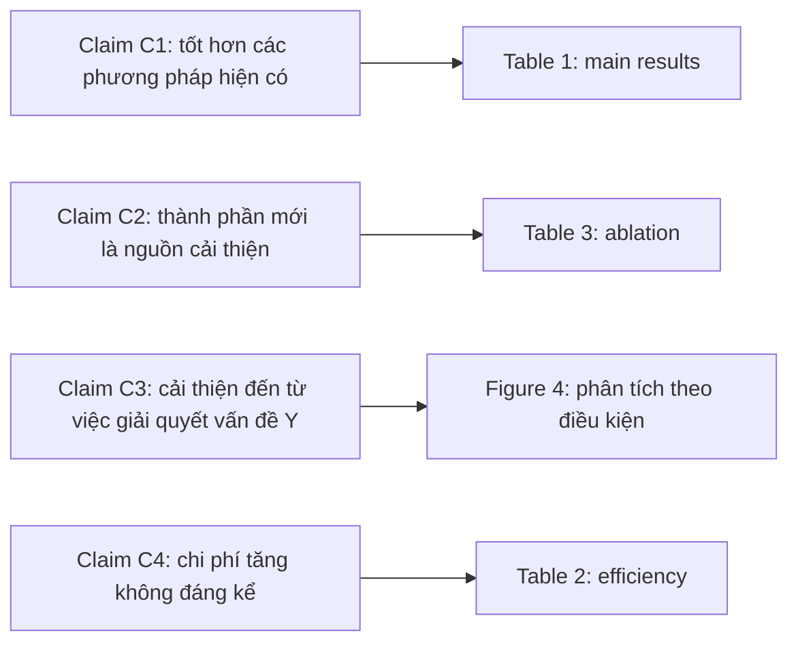

# Experiments

!!! abstract "Mục tiêu của bài"
    Sau bài này, người học có thể:

    - Tổ chức phần Experiments sao cho mỗi claim trong paper có một bằng chứng tương ứng.
    - Viết mục experimental setup đủ để tái hiện và đủ để reviewer tin rằng so sánh là công bằng.
    - Bình luận bảng kết quả bằng cách rút ra ý nghĩa thay vì đọc lại các con số.
    - Trình bày ablation dưới dạng bảng con và xây dựng các phân tích trả lời câu hỏi "vì sao".
    - Báo cáo độ bất định (mean ± std, error bar) và dùng kiểm định thống kê phù hợp.
    - Điều chỉnh phần thí nghiệm theo kỳ vọng của Computer Vision, NLP, Machine Learning, và khi tài nguyên tính toán hạn chế.

Trong một paper phương pháp điển hình, phần Experiments chiếm khoảng một phần ba thân bài và là nơi reviewer tìm lý do để từ chối. Lý do rất dễ hiểu: Introduction và Method chỉ là lời tuyên bố, còn Experiments là bằng chứng. Một ý tưởng hấp dẫn nhưng bằng chứng mỏng sẽ nhận những nhận xét quen thuộc như "the improvements are marginal", "the comparison is unfair", "the ablation does not isolate the contribution of X". Vì vậy, người viết nên tiếp cận phần này như một luật sư trình bày bằng chứng trước tòa: có tổ chức, đầy đủ, và dự đoán trước mọi phản biện có thể xảy ra.

Việc *thiết kế* thí nghiệm, tức chọn dataset, baseline và các ablation cần chạy, đã được bàn ở bài [Thiết kế thí nghiệm](../01-truoc-khi-viet/thi-nghiem.md) của Chương 1. Bài này tập trung vào việc *trình bày*: cùng một bộ kết quả, cách sắp xếp và bình luận có thể biến nó thành một lập luận thuyết phục hoặc một đống số liệu khó hiểu. Chúng ta sẽ đi qua cấu trúc chuẩn, từng mục con, vấn đề ý nghĩa thống kê, rồi những khác biệt giữa ba cộng đồng.

## Mỗi claim một bằng chứng

Trước khi viết dòng nào của phần Experiments, người viết nên quay lại danh sách contributions ở cuối Introduction và đặt từng claim cạnh bằng chứng của nó. Mỗi claim cần ít nhất một bảng hoặc hình trả lời trực tiếp, và ngược lại, mỗi bảng hoặc hình trong phần Experiments cần phục vụ ít nhất một claim. Sơ đồ dưới đây minh họa ánh xạ đó cho một paper phương pháp giả định.



Ánh xạ này làm lộ ra hai loại vấn đề. Một claim không có bằng chứng tương ứng thì hoặc phải bỏ đi, hoặc phải bổ sung thí nghiệm; để nguyên nó trong Introduction là mời reviewer viết "the claim in the introduction is not supported". Một thí nghiệm không phục vụ claim nào thì nên chuyển vào appendix hoặc bỏ hẳn, vì nó chiếm chỗ mà không làm lập luận mạnh lên. Bài tập ánh xạ này mất chưa tới một giờ nhưng thường cải thiện phần Experiments rõ rệt hơn nhiều giờ trau chuốt câu chữ.

## Cấu trúc chuẩn

Sau khi đã có ánh xạ claim–bằng chứng, các thí nghiệm được sắp xếp theo một trình tự mà reviewer ở cả ba cộng đồng đều quen thuộc.

```text
4. Experiments
   4.1 Experimental Setup
       Datasets · Evaluation metrics · Baselines · Implementation details
   4.2 Main Results          ← Table 1 (+ Table 2 nếu nhiều benchmark)
   4.3 Ablation Studies      ← Table 3 (a)(b)(c)...
   4.4 Analysis              ← hình/bảng giải thích "vì sao"
   4.5 Qualitative Results   ← Figure so sánh, ví dụ đầu ra
   (4.6 Generalization / Efficiency / Scaling)
```

Trình tự này đi từ câu hỏi rộng nhất tới câu hỏi sâu nhất. Đầu tiên, phương pháp có hoạt động không, so với những gì tốt nhất hiện có (main results)? Tiếp theo, thành phần nào tạo nên sự cải thiện (ablation)? Sau đó, sự cải thiện đến từ đâu, xảy ra trong điều kiện nào, có khớp với insight ban đầu không (analysis)? Cuối cùng, nó trông như thế nào trên các ví dụ cụ thể (qualitative)? Người đọc dừng ở mức nào cũng có được một kết luận trọn vẹn tương ứng với mức đó.

## Experimental setup

Mục setup có hai chức năng. Chức năng hiển nhiên là giúp người khác tái hiện kết quả. Chức năng ít được để ý hơn nhưng quan trọng không kém là thuyết phục reviewer rằng **so sánh là công bằng**: cùng dữ liệu, cùng backbone hoặc cùng quy mô mô hình, cùng ngân sách tính toán, cùng cách đánh giá. Nhiều nhận xét tiêu cực về kết quả thực chất bắt nguồn từ một mục setup mơ hồ khiến reviewer không chắc các con số có so sánh được với nhau hay không.

**Datasets.** Với mỗi dataset, cần nêu tên (kèm trích dẫn), split được dùng (train/val/test), kích thước, và quan trọng nhất là *lý do chọn*: dataset đó kiểm tra khía cạnh nào của claim. Một câu cho mỗi dataset thường là đủ trong thân bài, chi tiết chuyển vào appendix. Khi dùng nhiều dataset, một bảng thống kê ngắn tiết kiệm chỗ hơn nhiều so với liệt kê bằng văn xuôi.

**Evaluation metrics.** Nêu tên metric, trích dẫn định nghĩa, và nói rõ **biến thể** được dùng, vì cùng một tên có thể ứng với nhiều cách tính. Ở CV, AP có thể là AP trung bình trên các ngưỡng IoU từ 0.5 tới 0.95 hoặc AP tại ngưỡng 0.5; mIoU có thể đo ở một tỉ lệ hay nhiều tỉ lệ. Ở NLP, BLEU là ví dụ nổi tiếng về sự khác biệt do tokenization và cách tính, đến mức Post (2018) đề xuất công cụ sacreBLEU và khuyến nghị báo cáo kèm "signature" mô tả cấu hình tính điểm. Ở ML, cần nói rõ con số là độ chính xác tại checkpoint cuối cùng hay tại checkpoint tốt nhất trên tập validation; chọn checkpoint dựa trên tập test là một lỗi phương pháp nghiêm trọng.

**Baselines.** Các baseline nên được nhóm lại (ví dụ: các phương pháp cùng họ, các phương pháp mạnh nhất hiện tại, các biến thể đơn giản của chính phương pháp đề xuất) và lý do chọn mỗi nhóm cần được nêu. Khi con số của baseline được lấy từ paper gốc thay vì chạy lại, cần ghi rõ bằng một ký hiệu trong bảng (ví dụ $^\dagger$ cho kết quả chạy lại bằng code chính thức). Một điểm reviewer ML và NLP đặc biệt chú ý là **ngân sách tuning**: nếu phương pháp đề xuất được tinh chỉnh hyperparameter kỹ lưỡng còn baseline chạy với cấu hình mặc định, sự cải thiện có thể chỉ phản ánh chênh lệch về công sức tuning.

**Implementation details.** Backbone hoặc mô hình nền, pre-training, optimizer, learning rate và lịch giảm, batch size, số bước huấn luyện, phần cứng và thời gian huấn luyện. Thân bài có thể chỉ giữ một đoạn ngắn với những thông tin cần cho việc đánh giá so sánh, phần đầy đủ đặt trong appendix kèm một câu tham chiếu.

> *"We implement DepthX on top of the official codebase of [Baseline]. All models use a ResNet-50 backbone pre-trained on ImageNet and are trained for 24 epochs with AdamW (learning rate $2\times10^{-4}$, weight decay $10^{-4}$, batch size 16) on 8 GPUs, which takes about 14 hours. Baselines marked with $^\dagger$ are re-trained with the same schedule using their official code. Full hyperparameters are listed in Appendix B."*

Đoạn mẫu trên (với các con số giả định) cho thấy một mục implementation details gọn mà vẫn trả lời được hai câu hỏi chính của reviewer: cấu hình có chuẩn không, và baseline có được đối xử như phương pháp đề xuất không.

## Main results: bình luận bảng thay vì đọc lại bảng

Bảng kết quả chính (thường là Table 1) là nơi mắt reviewer dừng lại lâu nhất trong phần Experiments. Một sai lầm rất phổ biến là đoạn văn đi kèm chỉ đọc lại những gì bảng đã thể hiện: phương pháp A đạt bao nhiêu, phương pháp B đạt bao nhiêu, phương pháp đề xuất đạt bao nhiêu. Người đọc đã nhìn thấy các con số; điều họ cần từ văn bản là **ý nghĩa** của chúng: so sánh nào là quan trọng nhất, cải thiện lớn nhất nằm ở đâu, điều đó nói lên gì về insight của paper, và chỗ nào phương pháp chưa tốt.

<div class="bad" markdown>
**Chưa tốt:** *"Table 1 shows the results on COCO val. Method A achieves 38.2 AP and Method B achieves 40.1 AP. Our method achieves 41.9 AP, 61.2 AP50 and 26.1 AP_S. Our method also achieves 24 FPS."*
</div>

<div class="good" markdown>
**Tốt hơn:** *"Table 1 compares DepthX with state-of-the-art methods on COCO val. With the same ResNet-50 backbone, DepthX outperforms the strongest baseline, Method B [12], by **+1.8 AP**, with the largest gain on small objects (**+3.1 AP_S**). This is consistent with our motivation that small, distant objects suffer most from depth ambiguity (Sec. 3.3). Notably, the gain comes at almost no cost in speed (24 vs. 25 FPS of Method A)."*
</div>

Bản thứ hai không chứa nhiều con số hơn bản thứ nhất, nhưng mỗi con số được chọn có chủ đích và được đặt trong một lập luận. Câu đầu nói rõ so sánh trong điều kiện nào (cùng backbone). Câu thứ hai nêu mức cải thiện tổng thể và chỉ ra chỗ cải thiện lớn nhất. Câu thứ ba nối chỗ cải thiện lớn nhất với động lực ở Method, biến bảng kết quả thành bằng chứng cho insight chứ không chỉ cho thứ hạng. Câu cuối trả lời trước câu hỏi về chi phí.

Từ ví dụ này có thể rút ra một số nguyên tắc chung. Đoạn bình luận nên **mở bằng kết luận**, không mở bằng mô tả bảng. Hãy **chỉ ra chỗ thắng nhiều nhất và giải thích vì sao**, tốt nhất là bằng cách liên hệ với insight. Hãy **nói thật chỗ thua** và đưa ra lời giải thích hợp lý, chẳng hạn *"X achieves slightly higher AP_L, which we attribute to its larger input resolution (1333 vs. 800)."* Sự trung thực ở đây không làm yếu paper mà ngược lại tăng độ tin cậy cho mọi con số khác, vì reviewer thấy tác giả không che giấu. Trong bảng, các hàng nên được **nhóm theo điều kiện so sánh** (backbone, quy mô mô hình, lượng dữ liệu huấn luyện, có hay không dùng dữ liệu ngoài) bằng các đường `\midrule`, để mọi so sánh trực tiếp đều nằm trong cùng một nhóm. Cuối cùng, **mức độ khẳng định phải tương xứng với bằng chứng**: một cải thiện 0.3 điểm trên một dataset không đủ cho câu "consistently outperforms".

## Ablation studies

Sau khi main results cho thấy phương pháp hoạt động, câu hỏi tiếp theo của reviewer là: *thành phần nào tạo nên sự cải thiện?* Ablation trả lời câu hỏi đó bằng cách thay đổi từng thành phần một trong khi giữ nguyên mọi thứ khác. Lipton và Steinhardt, trong bài "Troubling Trends in Machine Learning Scholarship" (2018), liệt kê việc *không xác định được nguồn gốc của cải thiện thực nghiệm* là một trong những xu hướng đáng lo ngại của lĩnh vực: nhiều paper đề xuất nhiều thay đổi cùng lúc, nhưng cải thiện thực ra chỉ đến từ một thay đổi nhỏ, đôi khi là việc tuning tốt hơn. Một bộ ablation tốt là cách trực tiếp nhất để chứng minh paper không mắc lỗi đó.

Có hai cách thiết kế ablation bổ sung cho nhau. Cách **cộng dần** bắt đầu từ baseline và thêm từng thành phần, cho thấy mỗi thành phần đóng góp bao nhiêu. Cách **loại bỏ** bắt đầu từ mô hình đầy đủ và bỏ từng thành phần, cho thấy mỗi thành phần có cần thiết không khi các thành phần khác đã có mặt. Ngoài ra, các ablation về **lựa chọn thiết kế** (số lượng, kích thước, kiểu biểu diễn) cho thấy kết quả có nhạy với các lựa chọn đó không, và vì sao giá trị mặc định được chọn. Ablation nên được thực hiện trên tập validation, không phải tập test, để tránh việc chọn thiết kế dựa trên dữ liệu đánh giá cuối cùng.

Phong cách trình bày ablation gọn và được ưa chuộng ở CV, phổ biến từ các paper như Mask R-CNN và MAE, là **gom nhiều bảng con (a), (b), (c) vào một Table**, mỗi bảng con trả lời đúng một câu hỏi, cài đặt mặc định được tô nền xám để người đọc nhận ra ngay hàng nào tương ứng với mô hình trong Table 1. Phong cách này ngày càng phổ biến ở cả NLP và ML vì tiết kiệm chỗ và dễ đọc.

```text
Table 3. Ablations on COCO val (R50, 1× schedule). Default settings are marked in gray.

(a) Components          (b) Number of bins K      (c) Depth representation
 A  B  C | AP             K  | AP                    type           | AP
 -  -  - | 38.2           16 | 40.1                  scalar         | 38.9
 ✓  -  - | 39.6           32 | 40.6                  Gaussian       | 39.8
 ✓  ✓  - | 40.3         ▓64▓ | ▓40.9▓                ▓categorical▓  | ▓40.9▓
 ✓  ✓  ✓ | 40.9          128 | 40.8
```

Trong LaTeX, bố cục này có thể dựng bằng gói `subcaption`, với mỗi bảng con là một môi trường `subtable` và hàng mặc định tô màu bằng `\rowcolor`.

```latex
% Preamble: \usepackage{booktabs,subcaption,amssymb} \usepackage[table]{xcolor}
\begin{table*}[t]
\centering
\caption{\textbf{Ablations} on COCO val (R50, 1$\times$ schedule).
Default settings are marked in \colorbox{gray!15}{gray}.}
\label{tab:ablation}
\begin{subtable}[t]{0.32\linewidth}
  \centering
  \caption{Components}
  \begin{tabular}{cccc}
    \toprule
    A & B & C & AP \\
    \midrule
     &  &  & 38.2 \\
    \checkmark &  &  & 39.6 \\
    \checkmark & \checkmark &  & 40.3 \\
    \rowcolor{gray!15} \checkmark & \checkmark & \checkmark & 40.9 \\
    \bottomrule
  \end{tabular}
\end{subtable}\hfill
\begin{subtable}[t]{0.32\linewidth}
  \centering
  \caption{Number of bins $K$}
  \begin{tabular}{cc}
    \toprule
    $K$ & AP \\
    \midrule
    16 & 40.1 \\
    32 & 40.6 \\
    \rowcolor{gray!15} 64 & 40.9 \\
    128 & 40.8 \\
    \bottomrule
  \end{tabular}
\end{subtable}\hfill
\begin{subtable}[t]{0.32\linewidth}
  \centering
  \caption{Depth representation}
  \begin{tabular}{lc}
    \toprule
    Type & AP \\
    \midrule
    Scalar & 38.9 \\
    Gaussian & 39.8 \\
    \rowcolor{gray!15} Categorical & 40.9 \\
    \bottomrule
  \end{tabular}
\end{subtable}
\end{table*}
```

Bảng ablation không tự nói lên kết luận. Mỗi bảng con cần **một đến ba câu kết luận** trong văn bản, chẳng hạn *"(b) Performance saturates at K = 64; we use this value by default."* hay *"(c) The categorical representation outperforms the Gaussian one by 1.1 AP, supporting our hypothesis that depth ambiguity at long range is multi-modal (Sec. 3.3)."* Câu thứ hai đặc biệt có giá trị vì nó đóng vòng lập luận: câu hỏi được đặt ra ở đoạn Discussion của Method, và được trả lời bằng số liệu ở đây.

## Analysis

Main results và ablation cho thấy phương pháp *có* hiệu quả và *thành phần nào* tạo nên hiệu quả. Phần analysis trả lời câu hỏi sâu hơn: **vì sao** nó hiệu quả, và hiệu quả **trong điều kiện nào**. Đây thường là chỗ một paper chuyển từ mức "tốt" sang mức "xuất sắc", vì nó biến một kết quả thực nghiệm thành hiểu biết mà người đọc mang theo được sang bài toán khác.

Kiểu phân tích phổ biến nhất là **phân rã kết quả theo điều kiện**. Nếu insight của paper là "vật ở xa bị ảnh hưởng nhiều nhất bởi sự mơ hồ về độ sâu", thì một biểu đồ cải thiện theo khoảng cách, cho thấy cải thiện tăng dần khi vật ở xa hơn, là bằng chứng trực tiếp cho insight. Tương tự, một paper NLP về xử lý câu dài nên phân rã theo độ dài câu; một paper đa ngữ nên phân rã theo mức độ tài nguyên của ngôn ngữ; một paper ML về tính bền vững nên phân rã theo mức nhiễu.

Kiểu thứ hai là **phân tích lỗi** (error analysis): phân loại lỗi của baseline và của phương pháp đề xuất thành các nhóm, rồi cho thấy phương pháp giảm được nhóm lỗi nào. Kiểu thứ ba là **phân tích scaling**: hiệu năng thay đổi thế nào theo lượng dữ liệu, kích thước mô hình hay lượng tính toán; một phương pháp có lợi thế tăng dần theo quy mô thuyết phục hơn nhiều so với một phương pháp chỉ thắng ở một điểm. Kiểu thứ tư là **trực quan hóa** cơ chế bên trong (attention map, phân bố của đại lượng dự đoán, không gian đặc trưng), cần dùng thận trọng vì các hình như t-SNE dễ bị diễn giải quá mức.

Một loại phân tích thường bị bỏ quên nhưng reviewer rất hay đòi là **thí nghiệm kiểm soát** (sanity check, control experiment): cho thấy cải thiện không đến từ các yếu tố phụ như nhiều tham số hơn, huấn luyện lâu hơn hay dữ liệu nhiều hơn. Ví dụ, nếu module mới thêm 5% tham số, một baseline được nới rộng tới cùng số tham số sẽ trả lời trước câu hỏi "is the gain simply due to more parameters?". Những thí nghiệm này hiếm khi gây ấn tượng, nhưng thiếu chúng là một lỗ hổng mà reviewer có kinh nghiệm sẽ tìm ra.

Điều quan trọng nhất ở phần analysis là **mỗi phân tích phải gắn với một câu hỏi hoặc một claim**. Một loạt biểu đồ "thú vị" không liên quan tới lập luận chính chỉ làm loãng paper; trong trường hợp đó, appendix là nơi phù hợp hơn.

## Qualitative results

Kết quả định tính (qualitative results) cho người đọc thấy sự khác biệt mà con số khó truyền tải. Ở CV, đây thường là một lưới hình: các hàng là các ví dụ, các cột là các phương pháp trên **cùng một đầu vào**, vùng khác biệt được đánh dấu bằng khung màu hoặc phóng to. Ở NLP, đây thường là một bảng ví dụ với đầu vào, đầu ra của baseline và đầu ra của phương pháp đề xuất, phần sai được tô màu. Ở ML, đây có thể là mẫu sinh ra từ mô hình sinh, hoặc hàm học được trên một bài toán hai chiều.

Vấn đề tế nhị nhất của kết quả định tính là **cách chọn ví dụ**. Người đọc biết rằng tác giả có thể chọn những ví dụ đẹp nhất, nên một câu mô tả cách chọn (*"examples are randomly sampled from the test set"*, nếu đúng như vậy) làm tăng độ tin cậy rất nhiều. Nếu ví dụ được chọn có chủ đích để minh họa một hiện tượng, hãy nói rõ điều đó. Và bộ ví dụ nên có cả **failure cases**, ở đây hoặc trong mục Limitations hay appendix; việc chủ động cho thấy phương pháp thất bại ở đâu vừa trung thực vừa giúp người đọc hiểu giới hạn của phương pháp. Cách bố trí lưới hình và bảng ví dụ được bàn kỹ ở bài [Figures & Tables](figures-tables.md).

## Số liệu và ý nghĩa thống kê

Kết quả của mạng nơ-ron dao động giữa các lần chạy: khởi tạo ngẫu nhiên, thứ tự dữ liệu, data augmentation, thậm chí tính không tất định của một số phép toán trên GPU đều có thể làm con số thay đổi. Mức dao động này có thể cùng cỡ với mức cải thiện mà nhiều paper báo cáo. Khi đó, một con số duy nhất từ một lần chạy không đủ để khẳng định phương pháp A tốt hơn B; sự khác biệt có thể chỉ là may rủi. Vì vậy, các cộng đồng ngày càng đòi hỏi kết quả đi kèm một thước đo độ bất định.

Cách làm cơ bản nhất là chạy với nhiều seed (thường từ 3 tới 5, nhiều hơn nếu tài nguyên cho phép) và báo cáo **mean ± std**. Cần nói rõ ba điều: ký hiệu ± biểu thị gì (độ lệch chuẩn, sai số chuẩn hay khoảng tin cậy 95%, vì ba đại lượng này khác nhau đáng kể), bao nhiêu lần chạy, và yếu tố nào thay đổi giữa các lần chạy (seed khởi tạo, thứ tự dữ liệu, cách chia dữ liệu). Một quy tắc thực hành đơn giản: nếu mức cải thiện nhỏ hơn độ lệch chuẩn, nó không nên được trình bày như một claim. Trên biểu đồ, cùng thông tin đó được thể hiện bằng **error bar** hoặc vùng tô (error band) quanh đường trung bình.

Khi cần khẳng định một hệ thống tốt hơn hệ thống kia trên cùng một tập test, **kiểm định thống kê có cặp** (paired test) là công cụ phù hợp, vì hai hệ thống được đánh giá trên cùng các mẫu. Ở NLP, phương pháp phổ biến nhất là **paired bootstrap resampling**, được Koehn (2004) phổ biến cho đánh giá dịch máy: lấy mẫu lại tập test có hoàn lại nhiều lần, tính chênh lệch giữa hai hệ thống trên mỗi mẫu, và ước lượng tần suất hệ thống đề xuất không tốt hơn. Các lựa chọn khác gồm **permutation test** (còn gọi là approximate randomization) và **McNemar's test** cho bài toán phân loại. Bài "The Hitchhiker's Guide to Testing Statistical Significance in Natural Language Processing" của Dror và cộng sự (ACL 2018) là tài liệu hướng dẫn chọn kiểm định đáng đọc. Đoạn code dưới đây minh họa paired bootstrap cho một metric tính trung bình trên từng mẫu, như accuracy.

```python
import numpy as np

def paired_bootstrap(scores_a, scores_b, n_boot=10_000, seed=0):
    """Paired bootstrap for system A vs. B on the same test set.

    scores_a, scores_b: per-example scores (e.g., 0/1 correctness).
    Returns the observed difference, a 95% bootstrap interval of the
    difference, and the fraction of resamples where A is not better
    than B (a common one-sided estimate, following Koehn, 2004).
    """
    rng = np.random.default_rng(seed)
    a, b = np.asarray(scores_a, float), np.asarray(scores_b, float)
    n = len(a)
    deltas = np.empty(n_boot)
    for i in range(n_boot):
        idx = rng.integers(0, n, size=n)      # resample examples with replacement
        deltas[i] = a[idx].mean() - b[idx].mean()
    observed = a.mean() - b.mean()
    low, high = np.percentile(deltas, [2.5, 97.5])
    p_not_better = (deltas <= 0).mean()
    return observed, (low, high), p_not_better
```

Với các metric tính trên toàn bộ tập (corpus-level) như BLEU hay F1 tổng hợp, không thể lấy trung bình điểm từng câu; mỗi lần lấy mẫu lại phải tính lại metric trên tập con được lấy mẫu. Khi so sánh trên nhiều dataset hoặc nhiều cặp hệ thống cùng lúc, cũng cần lưu ý vấn đề so sánh bội (multiple comparisons): càng nhiều phép kiểm định, càng dễ có một kết quả "có ý nghĩa" do ngẫu nhiên.

!!! warning "Thận trọng với chữ *significantly*"
    Trong paper ML và NLP, *"significantly outperforms"* thường được hiểu là có ý nghĩa thống kê. Nếu chưa làm kiểm định, nên dùng *"substantially"*, *"considerably"* hoặc đơn giản là nêu mức chênh lệch. Một reviewer bắt gặp chữ *significantly* mà không thấy kiểm định nào có thể đặt câu hỏi về toàn bộ cách báo cáo kết quả.

Bên cạnh độ bất định, cách định dạng số liệu cũng ảnh hưởng tới độ tin cậy. Trong một cột, mọi con số nên có **cùng số chữ số thập phân**. Kết quả tốt nhất in đậm, tốt thứ hai gạch chân, và quy ước này được nêu trong caption. Chiều tốt của metric được đánh dấu bằng mũi tên (AP↑, FID↓, latency↓). Và **mọi con số trong văn bản phải khớp với bảng**; lỗi lệch số giữa văn bản và bảng xảy ra rất thường xuyên khi bảng được cập nhật ở phút chót. Cách phòng ngừa tốt nhất là sinh bảng tự động từ file kết quả bằng script (xem [LaTeX & Overleaf](../03-ky-thuat/latex.md)).

## Khác biệt giữa các cộng đồng

Bộ khung setup, main results, ablation, analysis, qualitative được dùng ở cả ba cộng đồng, nhưng mỗi cộng đồng có những kỳ vọng riêng về loại bằng chứng nào là thuyết phục. Một phần thí nghiệm đủ mạnh cho CVPR có thể bị chê ở NeurIPS vì thiếu error bar, và một phần thí nghiệm đủ cho NeurIPS có thể bị chê ở ACL vì chỉ có một ngôn ngữ.

### Computer Vision

Cộng đồng CV xoay quanh các **benchmark chuẩn**, và Table 1 so sánh với state of the art trên những benchmark đó gần như là bắt buộc. Reviewer CV nắm rất rõ các con số hàng đầu trên benchmark quen thuộc, nên một baseline yếu hay một so sánh khác cấu hình sẽ bị phát hiện nhanh. Bên cạnh độ chính xác, **hiệu quả tính toán** là một trục so sánh được coi trọng: số tham số, FLOPs, tốc độ (FPS hoặc latency) và bộ nhớ. Khi báo cáo tốc độ, cần nêu phần cứng, batch size và độ chính xác số học (FP32 hay FP16), vì các con số này phụ thuộc mạnh vào cấu hình đo. **Kết quả định tính** là thành phần không thể thiếu, và với các bài toán video, 3D hay sinh ảnh, video trong supplementary thường được reviewer xem rất kỹ. Khả năng **tổng quát hóa** sang dataset khác hoặc sang backbone khác cũng là một loại bằng chứng mạnh. Về thống kê, do chi phí huấn luyện lớn, nhiều paper CV chỉ báo cáo một lần chạy; tuy nhiên, khi cải thiện nhỏ hoặc dataset nhỏ, báo cáo nhiều lần chạy giúp tránh những câu hỏi khó trả lời trong rebuttal.

### NLP

Reviewer NLP thường muốn thấy phương pháp được kiểm chứng trên **nhiều dataset, nhiều tác vụ và, khi phù hợp, nhiều ngôn ngữ**. Một kết quả chỉ trên một dataset tiếng Anh dễ bị nhận xét là thiếu tính tổng quát. Bảng kết quả NLP vì thế thường có nhiều cột dataset kèm một cột trung bình, với kết quả chi tiết theo từng ngôn ngữ đặt trong appendix.

Với các tác vụ sinh văn bản, metric tự động thường không đủ, và **human evaluation** trở thành một phần quan trọng. Một human evaluation đáng tin phải có **giao thức** được mô tả đầy đủ: bao nhiêu người đánh giá, họ là ai và được tuyển thế nào, được trả công ra sao; bao nhiêu mẫu được đánh giá và chọn theo cách nào; thang đánh giá là gì (thang Likert hay so sánh từng cặp) và mỗi mức được định nghĩa thế nào; người đánh giá có biết đầu ra thuộc hệ thống nào không (nên giấu và xáo trộn thứ tự); độ đồng thuận giữa người đánh giá đạt bao nhiêu. Thiếu các thông tin này, reviewer khó tin vào kết quả, và Responsible NLP Research checklist của ARR cũng hỏi trực tiếp về việc sử dụng người tham gia.

**Phân tích lỗi bằng ví dụ** là một truyền thống mạnh của NLP: phân loại các lỗi thành nhóm, đếm số lượng mỗi nhóm trên một mẫu ngẫu nhiên, và minh họa mỗi nhóm bằng một ví dụ cụ thể. Kiểu phân tích này thường được đánh giá cao hơn một điểm cải thiện nhỏ trên leaderboard, vì nó cho người đọc hiểu biết về bài toán.

Khi đánh giá LLM, có hai vấn đề đặc thù. Vấn đề thứ nhất là **contamination**: dữ liệu test của các benchmark công khai có thể đã xuất hiện trong dữ liệu huấn luyện của mô hình, khiến kết quả bị thổi phồng. Các cách giảm thiểu gồm dùng dữ liệu được tạo sau thời điểm thu thập dữ liệu huấn luyện của mô hình, kiểm tra trùng lặp n-gram khi có quyền truy cập dữ liệu huấn luyện, đánh giá trên phiên bản biến đổi hoặc diễn đạt lại của dữ liệu test, và thảo luận thẳng thắn về rủi ro này trong Limitations. Vấn đề thứ hai là **độ nhạy với prompt**: kết quả có thể thay đổi đáng kể theo cách diễn đạt prompt hay thứ tự ví dụ few-shot, nên báo cáo kết quả trên vài template khác nhau (trung bình và khoảng dao động) thuyết phục hơn một con số từ một template được chọn kỹ.

### Machine Learning

Cộng đồng ML đặt nặng việc **cô lập hiện tượng**. Một thí nghiệm trên **dữ liệu tổng hợp hoặc bài toán đồ chơi** (toy problem), nơi chân lý đã biết và các yếu tố gây nhiễu được kiểm soát, thường được dùng để cho thấy phương pháp hoạt động đúng như lý thuyết dự đoán, trước khi chuyển sang benchmark thực. Đây không phải là thí nghiệm "yếu" mà là một loại bằng chứng khác: nó trả lời câu hỏi *cơ chế* mà benchmark thực khó trả lời.

Reviewer ML đặc biệt nhạy với **tính công bằng về tài nguyên**. Phương pháp đề xuất và baseline nên được so sánh với cùng số bước huấn luyện, cùng FLOPs hoặc cùng thời gian thực, và cùng ngân sách tuning hyperparameter. Một phương pháp tối ưu mới thắng baseline chỉ vì baseline dùng learning rate chưa tốt sẽ bị phát hiện. Với các phương pháp có tham vọng tổng quát, **biểu đồ scaling** (hiệu năng theo kích thước mô hình, lượng dữ liệu hoặc tính toán, thường trên trục log) cho thấy lợi thế có duy trì khi quy mô tăng hay không.

**Error bar gần như là yêu cầu bắt buộc.** NeurIPS Paper Checklist hỏi trực tiếp paper có báo cáo error bar hoặc thông tin về ý nghĩa thống kê hay không, và error bar được tính thế nào. Ở reinforcement learning, nơi phương sai giữa các lần chạy đặc biệt lớn, các nghiên cứu như "Deep Reinforcement Learning that Matters" (Henderson và cộng sự, AAAI 2018) và "Deep Reinforcement Learning at the Edge of the Statistical Precipice" (Agarwal và cộng sự, NeurIPS 2021) đã cho thấy kết luận có thể đảo ngược khi số seed quá ít, và khuyến nghị báo cáo khoảng tin cậy thay vì chỉ một con số trung bình.

## Khi tài nguyên hạn chế

Không phải nhóm nghiên cứu nào cũng có hàng trăm GPU, và điều đó không có nghĩa là không thể có paper ở hội nghị A\*. Điều cần làm là thiết kế và trình bày thí nghiệm sao cho claim vừa với bằng chứng mà tài nguyên cho phép, thay vì đưa ra claim lớn rồi để reviewer chỉ ra bằng chứng không đủ.

Chiến lược đầu tiên là **chọn benchmark vừa sức nhưng được công nhận**: một benchmark quy mô trung bình mà cộng đồng tin dùng tốt hơn nhiều so với một benchmark lớn chỉ chạy được một phần. Thứ hai, ablation và phân tích có thể thực hiện trên **thiết lập nhỏ hơn** (dataset con, mô hình nhỏ, lịch huấn luyện ngắn), miễn là điều này được nêu rõ và có ít nhất một kiểm tra cho thấy xu hướng giữ nguyên ở thiết lập chính. Thứ ba, khi phương pháp tiết kiệm tài nguyên, **hiệu quả có thể trở thành một đóng góp chính**: huấn luyện nhanh hơn, cần ít dữ liệu hơn, chạy được trên phần cứng phổ thông. Thứ tư, khi không thể chạy lại các baseline lớn, có thể dùng **con số được báo cáo** trong paper gốc, với ghi chú rõ ràng và cẩn thận để cấu hình đánh giá là giống nhau.

Ở NLP, một hướng đi thực tế là đánh giá trên **nhiều mô hình mở với kích thước nhỏ và trung bình thuộc các họ khác nhau**, thay vì chỉ một mô hình lớn; xu hướng nhất quán qua nhiều họ mô hình là bằng chứng tốt về tính tổng quát. Ở ML, thí nghiệm có kiểm soát trên dữ liệu tổng hợp kết hợp với benchmark quy mô vừa là một tổ hợp được chấp nhận rộng rãi. Ở mọi cộng đồng, **chiều sâu phân tích** có thể bù đắp một phần cho quy mô: một paper với phân tích kỹ lưỡng trên quy mô vừa phải thường thuyết phục hơn một paper chỉ có một bảng lớn. Cuối cùng, phạm vi của bằng chứng nên được nêu thẳng thắn trong Limitations, và tuyệt đối tránh claim về những quy mô chưa được kiểm chứng.

## Tóm tắt

Phần Experiments là bằng chứng cho mọi claim của paper, nên công việc đầu tiên là ánh xạ từng claim tới một bảng hoặc hình cụ thể. Cấu trúc chuẩn đi từ setup (đủ để tái hiện và để thấy so sánh công bằng), qua main results, ablation, analysis, tới kết quả định tính, tương ứng với các câu hỏi "có hiệu quả không", "thành phần nào tạo nên hiệu quả", "vì sao và khi nào", "trông như thế nào". Văn bản bình luận bảng phải rút ra ý nghĩa, chỉ ra chỗ thắng nhiều nhất, thừa nhận chỗ thua và nối kết quả với insight, không đọc lại con số. Ablation dạng bảng con, mỗi bảng trả lời một câu hỏi và có câu kết luận riêng, là cách trình bày gọn và hiệu quả. Độ bất định cần được báo cáo bằng mean ± std qua nhiều seed hoặc kiểm định có cặp như paired bootstrap, với mức độ khẳng định tương xứng. CV coi trọng benchmark, hiệu quả và kết quả định tính; NLP coi trọng nhiều dataset và ngôn ngữ, human evaluation có giao thức, phân tích lỗi và vấn đề contamination; ML coi trọng thí nghiệm có kiểm soát, so sánh cùng tài nguyên, scaling và error bar.

## Bài tập

1. **Ánh xạ claim–bằng chứng.** Viết ra danh sách contributions trong Introduction của một dự án đang thực hiện và vẽ ánh xạ từ mỗi claim tới bảng hoặc hình tương ứng. Đánh dấu các claim chưa có bằng chứng và các thí nghiệm không phục vụ claim nào, rồi quyết định bổ sung, chuyển vào appendix hay bỏ.
2. **Viết lại đoạn bình luận.** Lấy bảng kết quả chính trong bản nháp và viết đoạn bình luận theo các nguyên tắc trong bài: mở bằng kết luận, chỉ ra chỗ cải thiện lớn nhất và nối với insight, nêu ít nhất một chỗ phương pháp không thắng kèm lời giải thích. So sánh với đoạn cũ.
3. **Kiểm tra độ bất định.** Chọn một so sánh quan trọng trong paper, chạy lại với ít nhất ba seed (hoặc áp dụng paired bootstrap trên đầu ra từng mẫu nếu không thể chạy lại) và báo cáo mean ± std hoặc khoảng tin cậy. Xem lại mọi chỗ dùng từ *significantly* trong bản nháp.
4. **Thí nghiệm theo cộng đồng.** Giả sử paper được chuyển sang một cộng đồng khác với cộng đồng dự định ban đầu (ví dụ từ CVPR sang NeurIPS, hoặc từ NeurIPS sang ACL). Liệt kê ba thí nghiệm hoặc phân tích mà reviewer của cộng đồng mới có khả năng sẽ yêu cầu, và ước lượng chi phí để bổ sung chúng.
