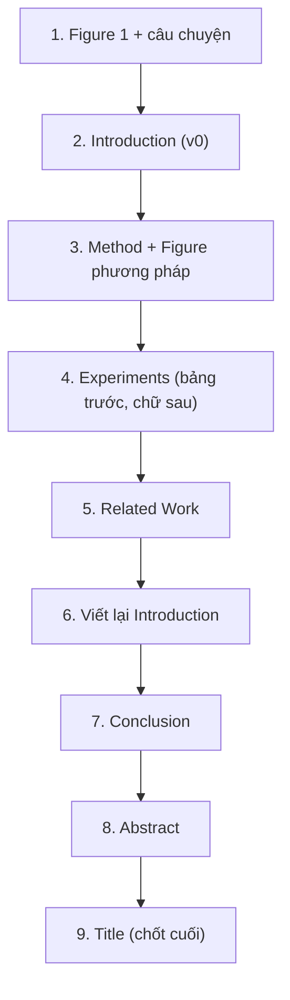

# 2. Viết từng phần

## Giải phẫu một paper CVPR 8 trang

| Phần | Độ dài điển hình (8 trang) | Vai trò |
|---|---|---|
| Title | 1 dòng | Lời mời đọc |
| Abstract | 150–250 từ | Toàn bộ câu chuyện thu nhỏ |
| **Figure 1 (teaser)** | ~1/3–1/2 cột hoặc full width trang 1 | "Nếu chỉ nhìn 1 hình" |
| 1. Introduction | ~1–1,5 trang | Thuyết phục: vấn đề, khoảng trống, insight, contributions |
| 2. Related Work | ~0,5–1 trang | Định vị |
| 3. Method | ~2–2,5 trang | Mô tả rõ ràng, tái hiện được |
| 4. Experiments | ~2,5–3 trang | Bằng chứng |
| 5. Conclusion (+ Limitations) | ~0,2–0,3 trang | Tổng kết, trung thực |
| References | không tính trang | |
| Supplementary | riêng (không giới hạn hoặc giới hạn mềm) | Chi tiết, thêm kết quả, video |

## Thứ tự viết khuyến nghị (KHÔNG phải thứ tự đọc)

Lý do: Intro v0 ép bạn nghĩ rõ câu chuyện; Abstract và Title cần biết chính xác kết quả nên viết cuối; Intro luôn phải viết lại sau khi có kết quả thật.

## Các trang trong chương

- [Title](title.md)
- [Abstract](abstract.md)
- [Introduction & Teaser](introduction.md)
- [Related Work](related-work.md)
- [Method](method.md)
- [Experiments](experiments.md)
- [Figures & Tables](figures-tables.md)
- [Conclusion, Limitations, Supplementary](conclusion-supp.md)
