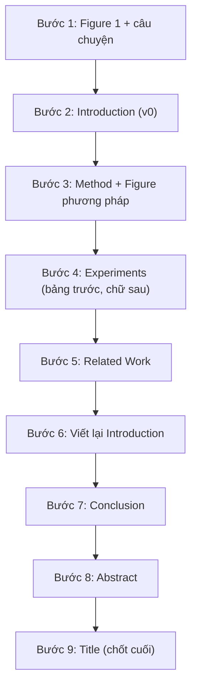

# 2. Viết từng phần

[Chương 1](../01-truoc-khi-viet/index.md) đã đưa người học đi qua những việc phải làm trước khi đặt bút: đọc tài liệu và nhìn ra khoảng trống, thẩm định ý tưởng và lập kế hoạch nghiên cứu, thiết kế rồi vận hành thực nghiệm, và cuối cùng là xây dựng câu chuyện của paper. Khi các việc đó đã xong, người viết có trong tay một câu chuyện một dòng, một danh sách claim và một bộ kết quả. Chương 2 giải quyết bước tiếp theo: biến những thứ ấy thành văn bản, từng phần một, sao cho mỗi phần làm đúng chức năng của nó trong mắt người đọc.

Lý do chia chương theo từng phần nằm ở cách một paper hội nghị thực sự được đọc. Gần như không ai đọc paper từ đầu đến cuối theo đúng thứ tự trang. Reviewer chọn bài để nhận chấm (giai đoạn *bidding*) dựa trên title và abstract; khi được phân công, họ thường đọc kỹ introduction và Figure 1 để hình thành ấn tượng, lướt qua bảng kết quả chính, rồi mới quay lại đọc method một cách chi tiết. Người đọc sau này, khi paper đã được công bố, còn đọc chọn lọc hơn nữa. Vì vậy, mỗi phần phải trả lời được một câu hỏi riêng của người đọc và, ở một mức độ nào đó, phải tự đứng được mà không cần các phần khác. Hiểu rõ chức năng của từng phần là điều kiện để viết phần đó cho đúng.

Trang này cung cấp bức tranh tổng thể: giải phẫu một paper hội nghị điển hình, khung trang của ba cộng đồng Computer Vision, NLP và Machine Learning, và thứ tự viết được khuyến nghị. Các bài tiếp theo đi theo thứ tự xuất hiện của các phần trong paper, nhưng như sẽ thấy ở dưới, thứ tự *viết* lại khác. Người học đang bắt đầu một paper mới nên đọc tuần tự cả chương; người học đã có bản nháp có thể đi thẳng tới bài về phần đang cần sửa. Mỗi bài đều có mục so sánh khác biệt giữa ba cộng đồng, vì cùng một phần (chẳng hạn abstract hay Figure 1) có thể mang những kỳ vọng rất khác nhau ở CVPR, ACL và NeurIPS.

## Giải phẫu một paper hội nghị điển hình

Phần lớn paper được chấp nhận ở các hội nghị A\* là *paper phương pháp* (method paper): đề xuất một cách làm mới và chứng minh bằng thực nghiệm, đôi khi kèm lý thuyết, rằng cách làm đó tốt hơn hoặc cho ta hiểu biết mới. Loại paper này, ở cả ba cộng đồng, có chung một bộ khung. Bộ khung đó không phải là luật thành văn mà là kết quả của một quá trình tiến hóa lâu dài: reviewer đã quen đọc theo trật tự này, nên một paper đi đúng trật tự giúp họ tìm thông tin nhanh và tập trung vào nội dung thay vì vào việc định hướng.

Bảng dưới đây lấy chuẩn một paper 8 trang hai cột, tức khung của CVPR/ICCV hoặc của một long paper ở ACL. Cột tỉ lệ giúp quy đổi sang các khung khác: một paper NeurIPS 9 trang một cột cũng phân bổ thân bài theo tỉ lệ gần tương tự, chỉ khác ở lượng chữ trên mỗi trang.

| Phần | Độ dài điển hình (8 trang hai cột) | Tỉ lệ thân bài | Câu hỏi của người đọc mà phần này trả lời |
|---|---|---|---|
| Title | 1 dòng, thường dưới 15 từ | — | Paper này nói về điều gì, có đáng mở ra không? |
| Abstract | 150–250 từ, một đoạn | — | Vấn đề, ý tưởng và kết quả chính là gì? |
| Figure 1 (teaser) | từ 1/3 cột tới nguyên chiều rộng trang 1 | — | Nếu chỉ nhìn một hình, người đọc thấy được gì? |
| Introduction | 1–1,5 trang | khoảng 12–18% | Vì sao vấn đề quan trọng, cách cũ thiếu gì, paper đóng góp gì? |
| Related Work | 0,5–1 trang | khoảng 6–12% | Paper đứng ở đâu so với các công trình đã có? |
| Method | 2–2,5 trang | khoảng 25–30% | Phương pháp làm chính xác điều gì, có tái hiện được không? |
| Experiments | 2,5–3 trang | khoảng 30–38% | Bằng chứng có đủ, có công bằng không? |
| Conclusion | 0,2–0,4 trang | khoảng 3–5% | Rốt cuộc paper chứng minh được điều gì? |
| Limitations | vài đoạn; ở ACL nằm ngoài giới hạn trang | — | Kết luận đúng trong phạm vi nào? |
| References | không tính vào giới hạn trang ở hầu hết hội nghị | — | Paper dựa trên những công trình nào? |
| Appendix / Supplementary | tùy hội nghị | — | Chi tiết để kiểm chứng, kết quả bổ sung, chứng minh |

Có ba điều đáng rút ra từ bảng này. Thứ nhất, Method và Experiments chiếm khoảng hai phần ba thân bài, nên đây là nơi tiêu tốn nhiều công sức viết nhất. Thế nhưng ấn tượng ban đầu của reviewer, thứ thường quyết định hướng của bài review, lại hình thành từ chưa đầy hai trang đầu: title, abstract, Figure 1 và introduction. Tỉ lệ số trang và tỉ lệ ảnh hưởng chênh lệch nhau rất xa. Hệ quả thực tế là người viết nên dành cho những phần mở đầu một lượng thời gian trau chuốt lớn hơn nhiều so với số trang mà chúng chiếm.

Thứ hai, trong paper thực nghiệm ở CV và NLP, phần Experiments thường dài hơn phần Method. Điều này phản ánh kỳ vọng của hai cộng đồng: một ý tưởng chỉ đáng tin khi được kiểm chứng trên nhiều benchmark, với ablation (thí nghiệm loại bỏ từng thành phần để đo đóng góp của nó) và phân tích đầy đủ. Ở paper ML thiên về lý thuyết, cán cân có thể đảo lại: phần phương pháp và các định lý chiếm phần lớn thân bài, còn thí nghiệm đóng vai trò minh họa và xác nhận.

Thứ ba, các con số trong bảng là khoảng điển hình chứ không phải định mức. Một paper giới thiệu dataset mới sẽ dành nhiều trang cho quy trình thu thập và phân tích dữ liệu; một paper phân tích (analysis paper) có thể gần như không có phần Method theo nghĩa thông thường. Bảng chỉ có ích như một điểm tham chiếu: khi một phần trong bản nháp lệch xa khỏi khoảng điển hình, người viết nên tự hỏi sự lệch đó có lý do chính đáng hay không.

## Khung trang của ba cộng đồng

Giới hạn trang không chỉ là một con số hành chính; nó định hình cách viết. Một paper 8 trang hai cột buộc người viết phải gói ghém chặt chẽ, mỗi hình phải xứng đáng với chỗ nó chiếm. Một paper 9 trang một cột kèm appendix không giới hạn cho phép đẩy chứng minh và thí nghiệm phụ ra phía sau, nhưng đòi hỏi thân bài phải tự đứng được, vì reviewer không có nghĩa vụ đọc appendix. Bảng sau tổng hợp khung trang điển hình lúc nộp bài ở những năm gần đây.

| Cộng đồng | Hội nghị | Thân bài lúc nộp (điển hình) | Định dạng | Phần bổ sung | Đặc điểm cần lưu ý |
|---|---|---|---|---|---|
| CV | CVPR, ICCV | 8 trang, không tính references | hai cột | supplementary nộp riêng (PDF, video, code) | không có trang Limitations riêng bắt buộc |
| CV | ECCV | khoảng 14 trang, không tính references | một cột, khổ Springer LNCS | supplementary nộp riêng | trang LNCS nhỏ, lượng chữ thực tế xấp xỉ một paper 8 trang hai cột |
| NLP | ACL, EMNLP, NAACL (qua ARR) | long paper 8 trang, short paper 4 trang | hai cột | appendix đặt sau references trong cùng PDF | mục Limitations bắt buộc, không tính vào giới hạn trang |
| ML | NeurIPS | khoảng 9 trang | một cột | appendix dài sau references, thường trong cùng PDF | Paper Checklist bắt buộc |
| ML | ICML | khoảng 8 trang | hai cột | appendix sau references | một số năm yêu cầu thêm Impact Statement |
| ML | ICLR | khoảng 9–10 trang (tùy năm) | một cột | appendix không giới hạn | review công khai trên OpenReview |

Ở **Computer Vision**, khung 8 trang hai cột của CVPR và ICCV đã ổn định qua nhiều năm. Vì supplementary là một file riêng, người viết CV có thói quen giữ trọn câu chuyện và các bằng chứng chính trong 8 trang, còn supplementary chứa chi tiết cài đặt, kết quả bổ sung và video. ECCV dùng định dạng LNCS của Springer: một cột, khổ trang nhỏ, khoảng 14 trang. Khi chuyển một paper từ CVPR sang ECCV hoặc ngược lại, bố cục hình và bảng gần như phải làm lại hoàn toàn, dù lượng nội dung tương đương.

Ở **NLP**, các hội nghị lớn nhận bài qua ACL Rolling Review (ARR), với hai loại bài: long paper 8 trang và short paper 4 trang. Short paper không phải là long paper bị cắt ngắn; đó là định dạng dành cho một đóng góp tập trung, chẳng hạn một phát hiện, một phân tích nhỏ hay một kỹ thuật đơn giản, và được đánh giá theo kỳ vọng tương ứng. Điểm khác biệt dễ thấy nhất của NLP là mục **Limitations bắt buộc**: bài thiếu mục này có thể bị loại ngay từ khâu kiểm tra định dạng (desk reject). Mục này nằm sau Conclusion và không tính vào giới hạn trang, nên người viết NLP không có lý do gì để viết nó qua loa.

Ở **Machine Learning**, NeurIPS và ICLR dùng định dạng một cột, còn ICML dùng hai cột; giới hạn thân bài dao động quanh 8–10 trang tùy hội nghị và tùy năm. Đặc trưng chung của cộng đồng là appendix rất dài, có khi dài hơn thân bài nhiều lần, chứa chứng minh đầy đủ, chi tiết thí nghiệm và kết quả mở rộng. Điều đó tạo ra một kỷ luật viết riêng: mọi claim quan trọng phải được phát biểu và hỗ trợ ở thân bài, appendix chỉ để kiểm chứng sâu hơn. Các checklist bắt buộc (như NeurIPS Paper Checklist) cũng buộc người viết khai báo rõ về giới hạn, khả năng tái hiện và tác động xã hội.

!!! warning "Luôn kiểm tra Call for Papers của năm nộp"
    Các con số trong bảng là điển hình cho những năm gần đây, không phải quy định cố định. Giới hạn trang, định dạng appendix, các mục bắt buộc (Limitations, Ethics Statement, Impact Statement, checklist) thay đổi theo từng năm và từng hội nghị. Trước khi bắt đầu dàn trang, người viết cần đọc kỹ Call for Papers và Author Guidelines của đúng năm nộp, và dùng đúng file template mà hội nghị cung cấp.

## Thứ tự viết khuyến nghị

Thứ tự các phần trong paper là thứ tự *đọc*, được thiết kế cho người đọc. Thứ tự *viết* hiệu quả lại đi theo logic khác: phần nào giúp làm rõ tư duy thì viết trước, phần nào cần thông tin chính xác về kết quả thì viết sau. Sơ đồ dưới đây là một thứ tự đã được nhiều nhóm nghiên cứu áp dụng thành công.

Bước đầu tiên là phác Figure 1 cùng với câu chuyện (bản pitch một trang ở bài [Xây "câu chuyện" của paper](../01-truoc-khi-viet/cau-chuyen.md)), vì đây là phép thử nhanh nhất cho độ rõ ràng của ý tưởng. Nếu người viết không hình dung được một hình duy nhất truyền tải thông điệp chính, nhiều khả năng câu chuyện vẫn còn mơ hồ. Với paper NLP hay ML, "Figure 1" có thể là một ví dụ đầu vào–đầu ra hoặc một sơ đồ ý tưởng thay vì một hình kết quả trực quan, nhưng phép thử vẫn như nhau.

Bước thứ hai là một bản Introduction thô (v0), viết từ rất sớm, có khi trước khi thí nghiệm hoàn tất. Bản này đóng vai trò như một bản cam kết: nó buộc người viết trình bày lập luận từ vấn đề tới đóng góp, qua đó lộ ra những mắt xích còn yếu. Danh sách contributions trong Intro v0 cũng chính là danh sách claim mà phần Experiments sẽ phải chứng minh; nếu nhóm đã lập ma trận claim–thí nghiệm khi [lập kế hoạch nghiên cứu](../01-truoc-khi-viet/ke-hoach.md) và [thiết kế thí nghiệm](../01-truoc-khi-viet/thi-nghiem.md), danh sách này gần như đã có sẵn.

Method được viết ở bước thứ ba vì đây là phần "an toàn" nhất: người viết đã biết chính xác những gì đã làm, và nên ghi lại khi các chi tiết còn tươi trong trí nhớ. Experiments đi sau, theo nguyên tắc bảng trước, chữ sau. Chữ trong phần thí nghiệm tồn tại để diễn giải bảng và hình; dựng khung bảng với các ô trống từ sớm còn giúp nhìn ra thí nghiệm nào đang thiếu.

Related Work được viết khi Method và Experiments đã rõ, vì chỉ khi đó người viết mới biết chính xác paper khác các công trình trước ở điểm nào, và mới viết được những câu phân biệt sắc nét. Việc thu thập, đọc tài liệu và xác định khoảng trống thì đã được làm từ Chương 1 (các bài [Đọc & lập bản đồ tài liệu](../01-truoc-khi-viet/literature.md) và [Tìm khoảng trống & nguồn ý tưởng](../01-truoc-khi-viet/tim-khoang-trong.md)); ở bước này, người viết chỉ tổ chức lại bản đồ tài liệu đó theo góc nhìn của paper.

Bước thứ sáu, viết lại Introduction, là bước hay bị bỏ qua nhất nhưng lại không thể thiếu. Kết quả thật gần như luôn khác với dự kiến lúc viết Intro v0: có claim mạnh hơn, có claim phải thu hẹp, có phát hiện bất ngờ đáng được đưa lên trang đầu. Intro phải khớp với bằng chứng thực có. Sau đó, Conclusion tóm lại điều đã được chứng minh, Abstract nén toàn bộ câu chuyện khi mọi con số đã chốt, và Title được chốt sau cùng, khi người viết đã biết chính xác paper nói gì.

Trên thực tế, thứ tự này cần một điều chỉnh nhỏ. Nhiều hội nghị (chẳng hạn CVPR, NeurIPS, ICLR) có hạn đăng ký abstract sớm hơn hạn nộp bài đầy đủ, thường khoảng một tuần, và reviewer bid dựa trên title cùng abstract đăng ký. Vì vậy, một phiên bản title và abstract đủ tốt phải sẵn sàng sớm hơn bước 8 và bước 9 trong sơ đồ; bản chốt cuối cùng được chỉnh lại trước hạn nộp trong phạm vi hệ thống cho phép. Một số loại paper cũng có biến thể riêng: paper ML lý thuyết thường bắt đầu bằng việc phát biểu chính xác các định lý, còn paper NLP nên ghi chép các giới hạn ngay trong lúc làm thí nghiệm để mục Limitations sau này được viết trung thực và cụ thể.

## Các bài trong chương

- [Title](title.md): các mẫu title phổ biến ở ba cộng đồng, cách đặt tên phương pháp và những lỗi cần tránh.
- [Abstract](abstract.md): khuôn 5–6 câu, phân tích abstract của ResNet và BERT, và cách viết lại một abstract yếu.
- [Introduction & Figure 1](introduction.md): cấu trúc Intro 5–6 đoạn như một lập luận, cách viết contributions và thiết kế teaser figure.
- [Related Work](related-work.md): dùng Related Work để định vị paper, cấu trúc đoạn có tiêu đề, câu phân biệt và cách xử lý concurrent work.
- [Method](method.md): khung cấu trúc từ problem formulation tới inference, khuôn Why–What–How cho từng thành phần, ký hiệu toán học, figure phương pháp, algorithm box và định lý, sao cho người đọc hiểu lý do của từng thiết kế và tái hiện được.
- [Experiments](experiments.md): ánh xạ mỗi claim tới một bằng chứng, trình bày setup, kết quả chính, ablation và phân tích, báo cáo độ bất định và kiểm định thống kê, và cách xoay xở khi tài nguyên hạn chế.
- [Figures & Tables](figures-tables.md): nguyên tắc "một hình, một thông điệp", caption tự đứng được, màu thân thiện với người mù màu, bảng booktabs và các quy ước template về hình và bảng.
- [Conclusion, Limitations, Appendix](conclusion-supp.md): viết Conclusion không lặp abstract, mục Limitations và ethics statement thực chất, tổ chức supplementary hoặc appendix, và ẩn danh code nộp kèm.
