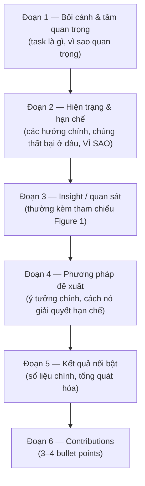

# Introduction & Figure 1

!!! abstract "Mục tiêu của bài"
    Sau bài này, người học có thể:

    - Hiểu introduction như một lập luận dẫn người đọc từ vấn đề tới đóng góp, thay vì một bài tổng quan.
    - Viết introduction theo cấu trúc 5–6 đoạn, biết chức năng của từng đoạn và phân biệt câu tốt với câu yếu.
    - Viết danh sách contributions gồm những claim kiểm chứng được.
    - Thiết kế Figure 1 (teaser) phù hợp với loại paper và với kỳ vọng của từng cộng đồng.
    - Nhận diện và sửa những lỗi introduction thường gặp ở người viết lần đầu.

Trong mọi phần của paper, introduction có ảnh hưởng lớn nhất tới quyết định của reviewer. Nhiều reviewer có kinh nghiệm thừa nhận rằng họ hình thành nhận định tổng thể sau khi đọc xong introduction, rồi đọc phần còn lại để *xác nhận hoặc bác bỏ* nhận định đó. Nếu introduction thuyết phục được họ rằng vấn đề quan trọng, cách làm hiện có thực sự thiếu sót và paper có một ý tưởng đáng giá, họ sẽ đọc phần method với thiện chí. Nếu introduction mơ hồ, họ sẽ đọc phần còn lại để tìm lý do từ chối.

Đi cùng với introduction là Figure 1, hình nằm ở trang đầu và thường là thứ đầu tiên mắt người đọc dừng lại khi mở PDF. Hai thành phần này cùng nhau tạo nên ấn tượng ban đầu về paper. Bài này trình bày cấu trúc 5–6 đoạn của một introduction, giảng giải chức năng của từng đoạn qua các ví dụ câu tốt và câu yếu, hướng dẫn cách viết contributions, phân tích các kiểu Figure 1 phổ biến, rồi tổng hợp những lỗi thường gặp và khác biệt giữa ba cộng đồng.

## Introduction là một lập luận

Điều quan trọng nhất cần nắm trước khi viết là bản chất của introduction. Introduction không phải là một bài tổng quan lĩnh vực, cũng không phải phần tóm tắt dài hơn của paper. Nó là một **lập luận**: một chuỗi các bước mà mỗi bước dựa vào bước trước, dẫn người đọc từ chỗ đồng ý rằng vấn đề quan trọng tới chỗ chấp nhận rằng paper có đóng góp đáng kể. Mỗi đoạn là một bước trong chuỗi đó, và nếu một đoạn không đóng góp vào chuỗi, nó không nên có mặt.

Chuỗi lập luận này chính là câu chuyện của paper đã được xây dựng ở bài [Xây "câu chuyện" của paper](../01-truoc-khi-viet/cau-chuyen.md): vấn đề, khoảng trống, insight, giải pháp và bằng chứng. Nó cũng có quan hệ chặt chẽ với abstract: có thể xem introduction là abstract được mở rộng, trong đó mỗi đơn vị chức năng của abstract trở thành một đoạn văn với dẫn chứng, ví dụ và trích dẫn. Nếu abstract và introduction của một paper không có cùng xương sống, ít nhất một trong hai cần được viết lại.

## Cấu trúc 5–6 đoạn

Một introduction điển hình ở CV và NLP dài khoảng 1–1,5 trang hai cột; ở ML, với định dạng một cột, nó thường dài 1,5–2 trang. Dù độ dài khác nhau, phần lớn introduction tốt đều có thể chia thành 5–6 đoạn theo sơ đồ sau.



Cần hiểu "đoạn" ở đây theo nghĩa chức năng. Một đoạn chức năng có thể được viết thành hai đoạn văn khi nội dung dày, chẳng hạn khi khoảng trống gồm hai hạn chế độc lập; hai đoạn chức năng cũng có thể được gộp, chẳng hạn insight và phương pháp trong một paper mà ý tưởng rất gọn. Điều không nên thay đổi là trình tự: mỗi đoạn trả lời một câu hỏi mà đoạn trước đã gợi ra trong đầu người đọc.

### Đoạn 1: Bối cảnh và tầm quan trọng

Đoạn mở đầu có nhiệm vụ đưa người đọc vào đúng bài toán, càng nhanh càng tốt. Thường chỉ cần 2–4 câu: bài toán là gì, vì sao nó quan trọng (ứng dụng, ý nghĩa khoa học), và có thể thêm một câu về điều kiện khiến nó khó. Người đọc là reviewer trong lĩnh vực, nên không cần thuyết phục họ rằng học sâu quan trọng hay rằng NLP là một lĩnh vực của trí tuệ nhân tạo.

<div class="bad" markdown>

- *"With the rapid development of deep learning, computer vision has made great progress in recent years."*
- *"Natural language processing (NLP) is an important field of artificial intelligence that has attracted increasing attention."*

</div>

Hai câu này có chung một vấn đề: chúng có thể mở đầu cho hàng nghìn paper khác mà không cần sửa chữ nào. Một câu như vậy không mang thông tin, và vì nằm ở vị trí đầu tiên, nó còn phát tín hiệu với reviewer rằng người viết chưa biết bắt đầu từ đâu.

<div class="good" markdown>

- *"Estimating the 3D location of objects from a single image is a key enabler for low-cost autonomous driving and robotics [3, 17, 25]."*
- *"Retrieval-augmented language models answer questions by conditioning on documents retrieved at inference time, which allows them to use knowledge that was unavailable during training [4, 11]."*
- *"Training neural networks with differential privacy requires clipping and noising per-example gradients, which substantially slows down convergence [2, 9]."*

</div>

Ba câu tốt, lần lượt từ CV, NLP và ML, đều nêu ngay bài toán cụ thể. Câu thứ nhất kèm ứng dụng; câu thứ hai kèm cơ chế và lợi ích; câu thứ ba kèm luôn khó khăn, chuẩn bị cho đoạn tiếp theo. Các trích dẫn ngay ở câu đầu cho thấy bài toán đã được cộng đồng công nhận.

### Đoạn 2: Hiện trạng và khoảng trống

Đây là đoạn quan trọng nhất của introduction, và cũng là đoạn bị viết yếu nhiều nhất. Nhiệm vụ của nó là mô tả các hướng tiếp cận chính hiện nay, rồi chỉ ra *chính xác* chúng thất bại ở đâu và *vì sao*. Khi đọc xong đoạn này, reviewer cần gật đầu: "Đúng, đây là một vấn đề có thật". Nếu đoạn này không thuyết phục, toàn bộ phần còn lại của paper sẽ trông như lời giải cho một vấn đề không ai cần giải.

Có ba kỹ thuật giúp đoạn này đạt mục tiêu. Kỹ thuật đầu tiên là **phân nhóm** các công trình hiện có theo hướng tiếp cận thay vì liệt kê từng paper, chẳng hạn "Existing approaches fall into two categories: (i) … and (ii) …". Liệt kê chi tiết là việc của Related Work; ở introduction, người đọc chỉ cần bức tranh lớn. Kỹ thuật thứ hai là nêu hạn chế một cách **cụ thể, có bằng chứng**: một con số, một hình, một ví dụ thất bại. Câu "As shown in Fig. 1(a), state-of-the-art methods lose over 40% accuracy when …" thuyết phục hơn nhiều so với "existing methods are not robust". Kỹ thuật thứ ba là **phê bình mà không chê bai**: dùng cấu trúc "While effective for X, these methods assume Y, which does not hold when Z." Cấu trúc này ghi nhận giá trị của công trình trước, rồi khoanh vùng chính xác điều kiện mà chúng không còn đúng. Cần nhớ rằng reviewer rất có thể là tác giả của chính các công trình đang được bàn tới.

Ví dụ sau, lấy từ một bài toán ML (học liên tục, continual learning), cho thấy sự khác biệt giữa một đoạn khoảng trống yếu và một đoạn tốt. Các con số trong bản tốt là hư cấu.

<div class="bad" markdown>

*"Many methods have been proposed for continual learning [1–20]. However, they still suffer from some limitations, such as catastrophic forgetting. Therefore, it is necessary to design a better method."*

</div>

<div class="good" markdown>

*"Existing continual learning methods fall into two families. Replay-based methods store a buffer of past examples [3, 8], which raises memory and privacy concerns. Regularization-based methods instead constrain parameters to stay close to previous solutions [5, 12]; while effective when consecutive tasks are similar, they implicitly assume that tasks share most of their features. We find that this assumption breaks down in realistic task sequences: as shown in Fig. 1(b), accuracy on the first task drops by more than half after only three dissimilar tasks."*

</div>

Bản yếu gom hai mươi trích dẫn vào một chỗ, nêu một hạn chế mà ai trong lĩnh vực cũng biết, và kết luận bằng một câu không có lập luận. Bản tốt phân thành hai nhóm, nêu hạn chế riêng của từng nhóm, chỉ ra giả định ngầm dẫn tới hạn chế, và đưa ra bằng chứng định lượng có tham chiếu tới Figure 1. Người đọc kết thúc đoạn này với một câu hỏi rõ ràng: vậy làm thế nào khi các tác vụ không giống nhau? Đó chính là câu hỏi mà đoạn tiếp theo sẽ trả lời.

### Đoạn 3: Insight

Đoạn thứ ba trình bày quan sát hoặc ý tưởng then chốt của paper, thường được mở bằng các cấu trúc như "In this work, we observe that …", "Our key insight is that …" hay "We argue that …". Đây là câu trả lời cho câu hỏi ngầm của reviewer: vì sao phương pháp sắp được giới thiệu không phải là một tổ hợp ngẫu nhiên các thành phần, mà có cơ sở để hoạt động.

Insight của ResNet là một ví dụ kinh điển: mạng sâu hơn có *training error* cao hơn mạng nông, nên vấn đề nằm ở tối ưu hóa chứ không phải overfitting. Insight của MAE là ảnh có độ dư thừa không gian cao hơn ngôn ngữ rất nhiều, nên phải che một tỉ lệ rất lớn các patch thì bài toán tái tạo mới đủ khó. Cả hai đều là phát biểu về *bản chất của vấn đề*, và phương pháp được suy ra từ đó. Đoạn insight thường tham chiếu tới Figure 1, vì một hình minh họa hiện tượng là bằng chứng mạnh nhất cho một quan sát.

Lỗi phổ biến ở đoạn này là nhầm lẫn giữa insight và phương pháp:

<div class="bad" markdown>

*"Our key insight is to use a graph neural network to aggregate information from retrieved documents."*

</div>

<div class="good" markdown>

*"Our key insight is that most factual errors of retrieval-augmented models arise not from missing evidence, but from conflicting evidence among the retrieved documents: in 70% of the errors we analyzed, the correct answer appears in at least one retrieved passage."* (số liệu hư cấu)

</div>

Câu thứ nhất mô tả một *lựa chọn kỹ thuật*, không phải một hiểu biết về bài toán; reviewer sẽ hỏi ngay "vì sao lại là graph neural network?". Câu thứ hai phát biểu một sự thật về bài toán, có bằng chứng, và từ đó một phương pháp xử lý xung đột giữa các tài liệu trở nên hợp lý. Một cách kiểm tra đơn giản: insight thật vẫn có giá trị ngay cả khi phương pháp cụ thể của paper bị thay bằng một phương pháp khác.

### Đoạn 4: Phương pháp

Đoạn thứ tư giới thiệu phương pháp ở **mức ý tưởng**: tên gọi, các thành phần chính và cách chúng phối hợp. Đoạn này không cần công thức, ký hiệu hay chi tiết kiến trúc; những thứ đó thuộc về phần Method. Điều đoạn này cần làm là **nối từng thành phần với từng hạn chế** đã nêu ở đoạn 2, để người đọc thấy mọi thiết kế đều có lý do.

Cấu trúc "To address (i), we …; to address (ii), we …" là một công cụ hữu ích cho mục đích này. Ví dụ, tiếp nối bài toán học liên tục ở trên: *"Based on this observation, we propose [Name], which decomposes each layer into shared and task-specific subspaces. Shared subspaces are regularized to preserve prior knowledge, while task-specific subspaces are allocated on demand when a new task is detected to be dissimilar, avoiding the need for a replay buffer."* Mỗi thành phần ở đây đáp lại một vấn đề cụ thể: không gian chung giữ kiến thức cũ, không gian riêng xử lý tác vụ khác biệt, và việc không dùng buffer đáp lại mối lo về bộ nhớ và quyền riêng tư.

Một dấu hiệu cho thấy đoạn này đang đi sai hướng là sự xuất hiện của nhiều thuật ngữ chưa được định nghĩa, tên module viết tắt, hoặc siêu tham số. Người đọc introduction chưa có bối cảnh để hiểu những chi tiết đó; chúng chỉ làm loãng thông điệp.

### Đoạn 5: Kết quả

Đoạn thứ năm tóm lược các kết quả nổi bật nhất: phương pháp đạt bao nhiêu trên benchmark chính, hơn phương pháp mạnh nhất trước đó bao nhiêu, và có tổng quát hóa sang bối cảnh khác hay không. Một cụm từ nổi tiếng thường gặp ở đây là "without bells and whistles", được Mask R-CNN dùng để nhấn mạnh rằng kết quả đạt được mà không cần các kỹ thuật phụ trợ.

Đoạn này nên chọn lọc chứ không liệt kê. Hai đến ba con số được chọn kỹ, mỗi con số chứng minh một claim, có sức thuyết phục hơn nhiều so với việc chép lại toàn bộ bảng kết quả. Nếu có một phát hiện phân tích đáng chú ý (chẳng hạn một ablation cho thấy insight là đúng), đây cũng là chỗ để nhắc tới nó. Mẫu câu: *"Without bells and whistles, [Name] achieves [number] on [benchmark], surpassing the previous best method by [margin]. It also transfers to [other setting] without modification, and our analysis confirms that the gains come mainly from [component tied to insight]."*

### Đoạn 6: Contributions

Introduction thường kết thúc bằng một danh sách 3–4 contributions. Danh sách này là thứ reviewer đọc lại khi viết phần tóm tắt và phần điểm mạnh trong review, và là thứ họ đối chiếu với phần thí nghiệm để kiểm tra xem paper có làm được những gì đã hứa hay không. Vì vậy, mỗi contribution phải là **một claim kiểm chứng được**, và tốt nhất là chỉ rõ nơi trong paper chứa bằng chứng cho claim đó.

```latex
In summary, our contributions are as follows:
\begin{itemize}
  \item We identify and analyze [phenomenon], showing that [finding]
        (Sec.~3.1).
  \item We propose [Name], which [does X] via [key technique]
        (Sec.~3.2--3.3).
  \item We demonstrate state-of-the-art results on [A, B, C], improving
        [metric] by [margin], with extensive ablations (Sec.~4).
\end{itemize}
```

Khuôn trên phân contributions thành ba loại: đóng góp về *hiểu biết* (một phát hiện, một phân tích), về *phương pháp*, và về *bằng chứng*. Tùy cộng đồng và loại paper, một contribution có thể có dạng khác. Paper NLP giới thiệu tài nguyên thường có một contribution như *"We release [Dataset], a benchmark of [N] examples in [K] languages annotated for [phenomenon], together with evaluation scripts (Sec.~3)."* Paper ML có kết quả lý thuyết thường có một contribution như *"We prove that [algorithm] converges at rate [rate] under [assumptions], matching the best known rate for [setting] (Theorem~1)."*

!!! warning "Contributions không phải danh sách module"
    Một lỗi rất phổ biến là liệt kê mỗi module thành một contribution: *"We propose module A. We propose module B. We propose loss C."* Danh sách như vậy khiến paper trông như phép cộng A + B + C, và reviewer sẽ hỏi đóng góp thực sự nằm ở đâu. Thay vào đó, nên gom các module thành một contribution về phương pháp, và dành các contribution còn lại cho hiểu biết mới và bằng chứng. Mỗi contribution cũng không nên chứa chữ "novel": tính mới phải được thể hiện qua nội dung, không phải qua tính từ.

## Figure 1: teaser của paper

Sau khi đã có cấu trúc cho phần chữ, cần bàn tới thành phần hình ảnh đi cùng introduction. Figure 1 thường được đặt ở đầu trang 1, bên cạnh hoặc ngay dưới abstract, đôi khi trải rộng hết chiều ngang trang ngay dưới title. Vị trí này khiến nó trở thành "quảng cáo" của paper: người đọc lướt PDF, kể cả reviewer, thường nhìn vào Figure 1 trước khi đọc bất kỳ câu nào của introduction.

Mức độ quan trọng của Figure 1 khác nhau giữa các cộng đồng. Ở **Computer Vision**, một teaser ở trang đầu gần như đã trở thành quy ước, vì kết quả của nhiều bài toán CV có thể *nhìn thấy* được và một hình tốt truyền tải điều đó nhanh hơn mọi đoạn văn. Ở **NLP**, Figure 1 không phải lúc nào cũng có mặt ở trang đầu; khi có, nó thường là một ví dụ minh họa đầu vào và đầu ra, hoặc một bảng ví dụ cho thấy hiện tượng mà paper nghiên cứu. Ở **Machine Learning**, Figure 1 thường là một sơ đồ ý tưởng hoặc một biểu đồ kết quả chính, chẳng hạn đường cong cho thấy phương pháp mở rộng tốt hơn theo quy mô. Đây là xu hướng chung, không phải quy tắc: một paper ML về mô hình sinh ảnh có thể dùng teaser kiểu CV, và một paper NLP đa phương thức có thể dùng hình kết quả trực quan.

### Các kiểu Figure 1

Các kiểu Figure 1 phổ biến có thể được phân loại theo thông điệp mà chúng truyền tải.

Kiểu thứ nhất **minh họa vấn đề hoặc hiện tượng**. Figure 1 của ResNet là ví dụ nổi tiếng nhất: nó không phải kiến trúc hay bảng kết quả, mà là đồ thị training error và test error trên CIFAR-10 của hai mạng "plain" 20 layer và 56 layer, cho thấy mạng sâu hơn tệ hơn ngay cả trên tập huấn luyện. Người đọc nhìn thấy vấn đề trước khi đọc về giải pháp, và giải pháp vì thế trở nên tất yếu. Kiểu này phù hợp nhất với paper xuất phát từ một quan sát.

Kiểu thứ hai **so sánh trực quan** kết quả của phương pháp với baseline trên những trường hợp khó, phổ biến ở các paper CV về segmentation, sinh ảnh hay dựng cảnh 3D. Kiểu thứ ba là **biểu đồ trade-off hoặc kết quả chính**, chẳng hạn độ chính xác theo chi phí tính toán, với phương pháp của paper nằm ở vùng tốt nhất; kiểu này phổ biến ở paper về hiệu năng trong CV và ở nhiều paper ML.

Kiểu thứ tư là **sơ đồ ý tưởng hoặc tổng quan pipeline**. Figure 1 của NeRF cho thấy quy trình từ tập ảnh đầu vào, qua việc tối ưu biểu diễn, tới việc render góc nhìn mới; Figure 1 của BERT là sơ đồ hai giai đoạn pre-training và fine-tuning. Kiểu này phù hợp khi ý tưởng có cấu trúc rõ ràng có thể vẽ thành vài khối.

Kiểu thứ năm là **ví dụ đầu vào–đầu ra hoặc bảng ví dụ**, rất phổ biến ở NLP. Figure 1 của CheckList trình bày một ma trận gồm các năng lực ngôn ngữ cần kiểm tra và các loại test, kèm những ví dụ cụ thể mà một mô hình phân tích cảm xúc thương mại xử lý sai. Chỉ cần nhìn hình, người đọc hiểu được cả phương pháp đánh giá lẫn lý do vì sao nó cần thiết.

Kiểu thứ sáu là **trình diễn kết quả** (showcase): một lưới kết quả đa dạng và ấn tượng, như các mặt nạ phân đoạn của Segment Anything hay các mẫu ảnh được sinh ra trong Figure 1 của DDPM. Kiểu này phù hợp khi chất lượng kết quả tự nó là thông điệp chính.

| Kiểu | Thông điệp | Ví dụ | Phổ biến ở |
|---|---|---|---|
| Minh họa vấn đề, hiện tượng | "Đây là vấn đề có thật" | ResNet | CV, ML |
| So sánh trực quan | "Phương pháp xử lý được ca khó" | paper segmentation, generation | CV |
| Trade-off, kết quả chính | "Phương pháp tốt hơn trên trục quan trọng" | paper về hiệu năng, scaling | CV, ML |
| Sơ đồ ý tưởng, pipeline | "Ý tưởng hoạt động như thế này" | NeRF, BERT | cả ba |
| Ví dụ đầu vào–đầu ra, bảng ví dụ | "Hiện tượng trông như thế này" | CheckList | NLP |
| Trình diễn kết quả | "Hãy nhìn chất lượng" | Segment Anything, DDPM | CV, ML (mô hình sinh) |

### Nguyên tắc thiết kế Figure 1

Dù chọn kiểu nào, một Figure 1 tốt đều tuân theo bốn nguyên tắc. Nguyên tắc đầu tiên là **hiểu được trong khoảng mười giây** mà không cần đọc paper. Nếu người xem cần đọc kỹ chú thích và tra cứu ký hiệu mới hiểu được hình, hình đó chưa làm tròn vai trò teaser.

Nguyên tắc thứ hai là **caption phải tự đứng được**, với câu đầu tiên phát biểu thông điệp, sau đó mới giải thích chi tiết. So sánh hai caption sau:

<div class="bad" markdown>

*"Figure 1. Comparison of our method and baselines."*

</div>

<div class="good" markdown>

*"Figure 1. Our method recovers thin structures that prior methods miss. Left: input image. Middle: the strongest baseline [12] breaks the bicycle spokes into disconnected fragments. Right: our result preserves them, as the predicted boundary map (inset) guides the decoder."*

</div>

Caption thứ nhất chỉ gọi tên nội dung hình; caption thứ hai nói cho người đọc biết cần nhìn vào đâu và rút ra điều gì.

Nguyên tắc thứ ba là **thông điệp của Figure 1 phải trùng với thông điệp của abstract**. Nếu abstract nói về khả năng xử lý vật thể xa mà Figure 1 lại khoe kết quả trên vật thể gần, người đọc nhận được hai thông điệp khác nhau. Nguyên tắc thứ tư là **làm sớm và sửa nhiều vòng**: như đã nêu ở trang giới thiệu chương, Figure 1 nên được phác tay từ những ngày đầu viết paper, vì việc thiết kế nó buộc người viết làm rõ câu chuyện.

!!! tip "Khi paper xuất phát từ một quan sát"
    Nếu paper bắt đầu từ một hiện tượng bất ngờ, hãy cân nhắc dùng Figure 1 để *chứng minh hiện tượng đó* thay vì khoe kết quả cuối cùng, theo cách ResNet đã làm. Một hiện tượng đáng ngạc nhiên thường thu hút reviewer hơn một bảng số, và nó khiến phương pháp của paper trông như câu trả lời tự nhiên.

## Những lỗi thường gặp

Phần lớn introduction yếu của người viết lần đầu không yếu vì thiếu ý tưởng, mà vì mắc một số lỗi lặp đi lặp lại. Nhận diện được những lỗi này giúp việc tự rà soát hiệu quả hơn nhiều.

Lỗi phổ biến nhất là **đoạn mở đầu quá dài và quá chung**, kể lịch sử lĩnh vực qua nhiều câu trước khi tới bài toán. Lỗi thứ hai là **liệt kê paper** theo kiểu "[1] proposed…, [2] proposed…, [3] proposed…", biến đoạn khoảng trống thành một bản Related Work thu nhỏ mà không có lập luận. Lỗi thứ ba, nghiêm trọng hơn, là **không nói vì sao phương pháp cũ thất bại**, chỉ khẳng định rằng chúng có hạn chế. Lỗi thứ tư là **nhảy thẳng vào phương pháp mà không có insight**, khiến phương pháp trông như một lựa chọn tùy ý. Lỗi thứ năm là **overclaim**: dùng các từ như "first", "solve" hay "universal" khi bằng chứng chưa đủ. Cụm "to our knowledge" có thể làm mềm một claim về tính mới, nhưng chỉ khi người viết thực sự đã tìm kiếm kỹ. Cuối cùng là lỗi **introduction không khớp với kết quả thật**, thường xảy ra khi Intro v0 được viết từ sớm mà không được viết lại sau khi có bảng kết quả cuối cùng.

| Lỗi | Cách sửa |
|---|---|
| Đoạn 1 quá dài, quá chung | Cắt còn 2–4 câu, vào bài toán ngay từ câu đầu |
| Liệt kê từng paper | Phân nhóm theo hướng tiếp cận, nêu hạn chế chung của từng nhóm |
| Không nói vì sao phương pháp cũ thất bại | Thêm phân tích hoặc bằng chứng (con số, ví dụ, Figure 1) |
| Không có insight | Thêm đoạn "we observe that…", phát biểu về bản chất bài toán |
| Phương pháp mô tả quá chi tiết | Bỏ ký hiệu và tên module viết tắt, giữ ở mức ý tưởng |
| Overclaim ("first", "solve") | Chỉ dùng khi chắc chắn; khoanh vùng claim theo bằng chứng |
| Contributions mơ hồ hoặc là danh sách module | Mỗi điểm là một claim kèm nơi chứng minh (Sec. x) |
| Thuật ngữ không nhất quán với abstract | Chốt một bảng thuật ngữ và dùng thống nhất |
| Intro không khớp kết quả | Viết lại Intro sau khi có bảng kết quả cuối cùng |

## Khác biệt giữa các cộng đồng

Cấu trúc 5–6 đoạn áp dụng được cho cả ba cộng đồng, nhưng mỗi cộng đồng có những kỳ vọng riêng về nội dung của từng đoạn và về vai trò của Figure 1.

### Computer Vision

Introduction CV thường ngắn gọn, dài khoảng 1–1,5 trang, và đi rất nhanh tới phương pháp. Bằng chứng trực quan được coi trọng: đoạn khoảng trống thường tham chiếu tới Figure 1 để cho thấy baseline thất bại ra sao. Teaser ở trang đầu gần như bắt buộc theo quy ước, và nhiều reviewer CV đánh giá mức độ chỉn chu của paper ngay từ hình này. Danh sách contributions dạng gạch đầu dòng là chuẩn mực. Vì CV phát triển rất nhanh và có nhiều preprint trên arXiv, các claim về tính mới ("the first to …") bị kiểm tra kỹ, nên cần thận trọng.

### NLP

Introduction NLP thường bắt đầu bằng bài toán và rất hay dùng một **ví dụ ngôn ngữ cụ thể** (một câu, một cặp câu hỏi–trả lời, một lỗi của mô hình) để minh họa hiện tượng, đôi khi ngay trong văn bản thay vì trong hình. Với paper phân tích và đánh giá, introduction có thể nêu tường minh các câu hỏi nghiên cứu (research questions) mà paper sẽ trả lời. Contributions về tài nguyên (dataset, benchmark, công cụ) được đánh giá cao. Vì mục Limitations là bắt buộc, introduction phải nhất quán với nó: một claim rộng ở introduction mà bị thu hẹp ở Limitations sẽ khiến reviewer thấy mâu thuẫn. Ngôn ngữ được nghiên cứu nên được nêu rõ ngay ở introduction.

### Machine Learning

Introduction ML thường dài hơn trong định dạng một cột và có thể bao gồm một phần phát biểu bài toán (problem setup) ngắn ngay trong introduction. Đóng góp lý thuyết thường được nêu dưới dạng một phát biểu không hình thức của định lý chính, kèm tham chiếu tới định lý chính xác trong thân bài. Reviewer ML đặc biệt chú ý tới mối quan hệ giữa claim và giả định: một claim về hội tụ hay tổng quát hóa phải đi kèm điều kiện mà nó đúng. Thí nghiệm thường được giới thiệu như sự xác nhận cho lý thuyết hoặc cho tính tổng quát của phương pháp trên nhiều miền. Figure 1, nếu có, thường là sơ đồ ý tưởng hoặc biểu đồ kết quả chính hơn là hình ảnh trực quan.

## Tóm tắt

Introduction là một lập luận, không phải một bài tổng quan: nó dẫn người đọc qua 5–6 bước, từ bối cảnh, khoảng trống, insight, phương pháp, kết quả tới contributions, và mỗi đoạn trả lời câu hỏi mà đoạn trước gợi ra. Đoạn khoảng trống là đoạn quan trọng nhất, cần phân nhóm công trình hiện có, nêu hạn chế cụ thể kèm bằng chứng và phê bình một cách tôn trọng. Insight là một phát biểu về bản chất bài toán, khác với một lựa chọn kỹ thuật. Contributions phải là những claim kiểm chứng được, không phải danh sách module. Figure 1 truyền tải cùng thông điệp với abstract, hiểu được trong vài giây, và mang hình thức khác nhau giữa các cộng đồng: teaser trực quan ở CV, ví dụ đầu vào–đầu ra ở NLP, sơ đồ ý tưởng hoặc biểu đồ kết quả chính ở ML.

## Bài tập

1. Viết introduction cho paper đang thực hiện theo đúng cấu trúc 5–6 đoạn. Sau đó, với mỗi đoạn, viết ra bằng một câu câu hỏi mà đoạn đó trả lời. Nếu hai đoạn trả lời cùng một câu hỏi, hoặc có đoạn không trả lời câu hỏi nào, hãy sửa lại cấu trúc.
2. Viết lại đoạn khoảng trống theo ba kỹ thuật đã học: phân nhóm các hướng tiếp cận, đưa ra ít nhất một bằng chứng định lượng cho hạn chế, và dùng cấu trúc "While effective for X, these methods assume Y, which does not hold when Z."
3. Kiểm tra từng contribution trong danh sách: nó có phải một claim kiểm chứng được không, và bằng chứng nằm ở mục nào trong paper? Đánh dấu những contribution chỉ là tên một module và gộp lại.
4. Phác tay ba phương án Figure 1 thuộc ba kiểu khác nhau đã học. Đưa cả ba cho hai đồng nghiệp xem trong mười giây mỗi hình, rồi hỏi họ paper đang nói điều gì. Chọn phương án có câu trả lời gần nhất với thông điệp của abstract, và viết caption cho nó với câu đầu là thông điệp chính.
