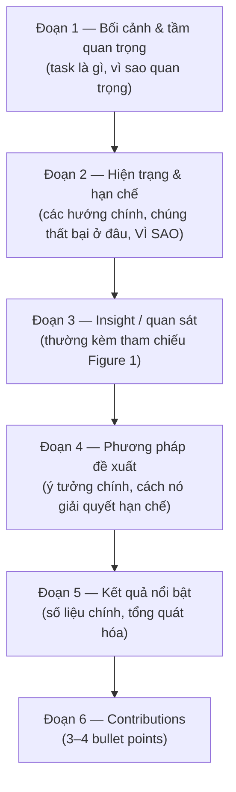

# Introduction & Teaser Figure

Introduction là phần **quan trọng nhất** của paper. Nhiều reviewer gần như quyết định điểm sau khi đọc xong Intro, rồi đọc phần còn lại để *xác nhận* quyết định đó.

## Cấu trúc Intro CV kinh điển (5–6 đoạn, ~1–1,5 trang)



### Đoạn 1 — Bối cảnh (2–4 câu)

Mục tiêu: đưa reviewer vào đúng bài toán **nhanh**. Không cần thuyết phục rằng "deep learning quan trọng".

- ✅ *"Estimating the 3D location of objects from a single image is a key enabler for low-cost autonomous driving and robotics [3, 17, 25]."*
- ❌ *"With the rapid development of deep learning, computer vision has made great progress in recent years."*

### Đoạn 2 — Hiện trạng & khoảng trống (quan trọng nhất)

Mô tả các hướng chính (không liệt kê từng paper — đó là việc của Related Work), và **chỉ ra chính xác chúng thất bại ở đâu, vì sao**. Đoạn này phải khiến reviewer gật đầu: *"Đúng, đây là vấn đề thật."*

Kỹ thuật:

- Phân nhóm: *"Existing approaches fall into two categories: (i) … and (ii) … ."*
- Nêu hạn chế cụ thể, tốt nhất có **bằng chứng** (con số, hình): *"As shown in Fig. 1(a), state-of-the-art methods lose over 40% accuracy when …"*
- Tránh chê bai: dùng *"while effective for X, these methods assume Y, which does not hold when Z."*

### Đoạn 3 — Insight

*"In this work, we observe that …"*, *"Our key insight is …"*, *"We argue that …"*. Đây là câu trả lời cho câu hỏi "tại sao phương pháp của bạn không phải ngẫu nhiên?". Thường **tham chiếu Figure 1**.

### Đoạn 4 — Phương pháp

Mô tả ở **mức ý tưởng**, không chi tiết công thức. Liên kết trực tiếp từng thành phần với hạn chế ở đoạn 2: *"To address (i), we …; to address (ii), we …"*.

### Đoạn 5 — Kết quả

Con số chính + tổng quát hóa: *"Without bells and whistles, [Name] achieves … on …, surpassing … by …. It also generalizes to …"*.

### Đoạn 6 — Contributions

Danh sách 3–4 điểm, **mỗi điểm là một claim kiểm chứng được**:

```latex
In summary, our contributions are as follows:
\begin{itemize}
  \item We identify and analyze [phenomenon], showing that [finding] (Sec.~3.1).
  \item We propose [Name], which [does X] via [key technique] (Sec.~3.2--3.3).
  \item We demonstrate state-of-the-art results on [A, B, C], improving
        [metric] by [margin], with extensive ablations (Sec.~4).
\end{itemize}
```

!!! warning "Contributions không phải danh sách module"
    ❌ *"We propose module A. We propose module B. We propose loss C."* — đọc như "A + B + C".
    ✅ Gom lại thành đóng góp về **hiểu biết**, **phương pháp**, **bằng chứng**.

## Teaser Figure (Figure 1)

Figure 1 đặt ở **đầu trang 1** (thường bên phải, cạnh abstract, hoặc full width dưới title). Đây là "quảng cáo" của paper. Các kiểu phổ biến:

| Kiểu | Nội dung | Ví dụ |
|---|---|---|
| **So sánh trực quan** | Kết quả baseline vs. của bạn trên ca khó | Paper segmentation, generation |
| **Minh họa vấn đề/insight** | Cho thấy hiện tượng bạn phát hiện | ResNet: đường training error của mạng 20 vs 56 layer |
| **Biểu đồ trade-off** | Accuracy vs. FLOPs/latency, bạn ở góc trên-trái | Paper efficient, Swin, ConvNeXt |
| **Tổng quan pipeline đơn giản** | Input → ý tưởng → output | NeRF (pipeline + kết quả) |
| **"Showcase" kết quả** | Lưới kết quả ấn tượng, đa dạng | SAM, ControlNet, các paper generation |

Nguyên tắc Figure 1:

1. **Hiểu được trong 10 giây** mà không cần đọc paper.
2. **Caption tự đứng được:** câu đầu là thông điệp ("*Our method recovers thin structures that prior methods miss.*"), sau đó mới giải thích chi tiết.
3. Thông điệp của Figure 1 = thông điệp của Abstract.
4. Làm **sớm** (phác tay từ tuần đầu), sửa nhiều vòng.

## Lỗi Intro hay gặp ở người viết lần đầu

| Lỗi | Sửa |
|---|---|
| Đoạn 1 quá dài, quá chung | Cắt còn 2–4 câu, vào bài toán ngay |
| Liệt kê paper ("[1] proposed…, [2] proposed…") | Phân nhóm theo hướng tiếp cận, nêu hạn chế chung |
| Không nói **vì sao** phương pháp cũ thất bại | Thêm phân tích/bằng chứng (con số, Figure 1) |
| Nhảy thẳng vào phương pháp, không có insight | Thêm đoạn "we observe…" |
| Overclaim ("first", "solve") | Chỉ dùng khi chắc chắn; dùng "to our knowledge" một cách có trách nhiệm |
| Contributions mơ hồ | Mỗi bullet = claim + nơi chứng minh (Sec. x) |
| Intro không khớp với kết quả thật | Viết lại Intro **sau khi** có bảng kết quả cuối cùng |
