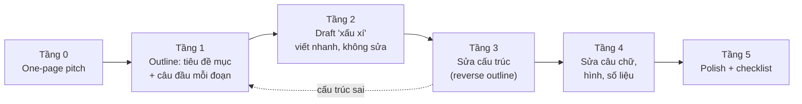

# Quy trình viết & tự review

!!! abstract "Mục tiêu của bài"
    Sau bài này, người học có thể:

    - Mô tả quy trình viết nhiều tầng, từ một trang tóm tắt ý tưởng tới bản hoàn thiện, và giải thích vì sao không nên sửa câu chữ khi cấu trúc chưa ổn.
    - Viết outline chi tiết dưới dạng câu chủ đề cho từng đoạn và dùng nó để trao đổi với người hướng dẫn trước khi viết thành văn.
    - Viết bản draft đầu tiên nhanh và trọn vẹn mà không bị kẹt bởi tâm lý cầu toàn.
    - Tự review paper bằng một form có cấu trúc, đóng vai reviewer của hội nghị mục tiêu, và biến từng điểm yếu tìm được thành một hành động sửa cụ thể.
    - Tổ chức internal review nhiều vòng với những người đọc khác nhau và tiếp nhận góp ý hiệu quả.
    - Duy trì kỷ luật viết hằng ngày trong những tuần trước deadline.

Hai bài trước đã bàn về công cụ (LaTeX) và chất liệu (tiếng Anh học thuật) của việc viết. Bài này bàn về quy trình: thứ tự các việc cần làm để đi từ một trang trắng tới một bản nộp hoàn chỉnh mà không lãng phí công sức. Người mới viết paper thường viết theo đường thẳng, bắt đầu từ Title, đi lần lượt qua Abstract, Introduction, cho tới Conclusion, và cố gắng làm mỗi câu thật hoàn hảo trước khi chuyển sang câu tiếp theo. Cách làm này có hai nhược điểm lớn. Thứ nhất, người viết dễ bị kẹt ở những trang đầu và tới gần deadline vẫn chưa có bản đầy đủ. Thứ hai, nhiều đoạn văn được đánh bóng kỹ lưỡng rồi cuối cùng bị xóa, vì đến khi viết xong phần Experiments, nhóm tác giả mới nhận ra câu chuyện trong Introduction cần thay đổi.

Những người viết có kinh nghiệm làm ngược lại: họ đi từ tổng thể tới chi tiết, chốt cấu trúc trước rồi mới chăm chút câu chữ, và để người khác đọc bản thảo từ sớm. Cách tiếp cận này giống với quy trình phát triển phần mềm, nơi thiết kế kiến trúc đi trước viết mã, và việc tối ưu hóa từng dòng mã chỉ có ý nghĩa khi kiến trúc đã ổn định. Phần còn lại của bài trình bày quy trình đó theo từng tầng, sau đó đi vào hai hoạt động kiểm tra chất lượng quan trọng nhất là tự review và internal review.

## Từ trang trắng đến bản nộp: các tầng viết

Quy trình được đề xuất gồm một tầng chuẩn bị (tầng 0) và năm tầng viết, sửa nối tiếp nhau. Mỗi tầng có một sản phẩm cụ thể và một câu hỏi cần trả lời trước khi chuyển sang tầng sau. Sơ đồ dưới đây tóm tắt toàn bộ quy trình.



Nguyên tắc quan trọng nhất của quy trình là **không sửa câu chữ (tầng 4) khi cấu trúc (tầng 3) còn sai**. Lý do nằm ở chi phí thay đổi: ở tầng 1, đổi thứ tự hai ý chỉ là đổi chỗ hai dòng; ở tầng 4, cùng thay đổi đó đòi hỏi viết lại các câu chuyển tiếp, sửa tham chiếu và cân chỉnh lại độ dài. Thời gian dành để đánh bóng một đoạn văn sắp bị xóa là thời gian mất trắng, và cảm giác tiếc công sức còn khiến người viết ngần ngại xóa đoạn đó dù biết nó không còn phù hợp. Mũi tên nét đứt trong sơ đồ thể hiện một thực tế: khi tầng 3 phát hiện câu chuyện có vấn đề, việc đúng đắn là quay về sửa outline chứ không vá víu trên văn bản.

| Tầng | Sản phẩm | Câu hỏi cần trả lời trước khi đi tiếp | Người đọc phù hợp |
|---|---|---|---|
| 0 | One-page pitch | Paper này nói gì, vì sao đáng quan tâm? | Người hướng dẫn |
| 1 | Outline: tiêu đề mục, câu chủ đề mỗi đoạn, kế hoạch bảng/hình | Lập luận có chặt chẽ không, mỗi claim có bằng chứng không? | Người hướng dẫn, đồng tác giả chính |
| 2 | Draft đầy đủ, chấp nhận câu vụng | Toàn bộ nội dung đã có mặt trên trang chưa? | Chỉ nhóm tác giả |
| 3 | Draft đã sửa cấu trúc | Thứ tự các ý và các đoạn đã hợp lý chưa? | Đồng tác giả, đồng nghiệp trong lab |
| 4 | Draft đã sửa câu chữ, hình và số liệu | Từng câu có rõ ràng, từng số có khớp không? | Người đọc ngoài dự án |
| 5 | Bản nộp | Đã đúng mọi quy định và checklist chưa? | "Mock reviewer" |

### Tầng 0: One-page pitch

Trước khi viết bất kỳ đoạn văn nào của paper, nhóm tác giả nên tóm tắt toàn bộ paper trong một trang. Trang này không phải Abstract; nó là một công cụ tư duy buộc người viết trả lời những câu hỏi mà bài [Xây "câu chuyện" của paper](../01-truoc-khi-viet/cau-chuyen.md) đã đặt ra: vấn đề là gì, các công trình hiện có hụt ở đâu, insight của nhóm là gì, và bằng chứng nào sẽ thuyết phục reviewer. Nếu không viết được trang này một cách mạch lạc, câu chuyện của paper chưa sẵn sàng, và viết tiếp chỉ là trì hoãn vấn đề.

```text
Working title:
Problem (1-2 sentences):
Why existing work falls short (the gap):
Key insight:
Method in one sentence:
Main evidence (which table or figure will show what):
Contributions (2-4 items):
Target venue and track:
Biggest risk (what a reviewer will attack first):
```

Mục cuối cùng thường bị bỏ qua nhưng lại có giá trị nhất. Việc gọi tên trước rủi ro lớn nhất, chẳng hạn "reviewer sẽ hỏi vì sao không so sánh với phương pháp Y" hay "kết quả chỉ trên tiếng Anh", giúp nhóm tác giả lên kế hoạch thí nghiệm bổ sung từ sớm thay vì chống chế trong rebuttal.

### Tầng 1: Outline chi tiết

Outline ở tầng này chi tiết hơn nhiều so với một danh sách tiêu đề mục: mỗi đoạn văn tương lai được đại diện bởi một câu chủ đề, kèm bằng chứng mà đoạn đó sẽ dùng. Cách làm thuận tiện nhất là viết outline ngay trong file `.tex` dưới dạng comment, để khi chuyển sang tầng 2, người viết chỉ việc viết văn bên dưới từng dòng. Ví dụ dưới đây là outline Introduction của một paper CV giả định về phát hiện vật thể 3D từ ảnh đơn:

```latex
% ===== 1_intro.tex (outline) =====
% P1: Monocular 3D detection matters for low-cost autonomous driving.
% P2: Existing methods regress depth deterministically -> fail at long range (Fig. 1a numbers).
% P3: Observation: most far-range errors come from depth; depth from one image is ambiguous.
% P4: We propose DepthX: predict a depth distribution + refine it with a height prior.
% P5: Results: gains on KITTI and nuScenes, largest at far range; plug-and-play (Tab. 1, Tab. 3).
% P6: Contributions (3 items).
```

Outline của các mục khác tuân theo cùng tinh thần. Với mục Experiments, outline nên là danh sách các bảng và hình, mỗi cái gắn với đúng một claim mà nó chứng minh; đây là cách kiểm tra trực tiếp nguyên tắc "mỗi claim có bằng chứng, mỗi bằng chứng phục vụ một claim" đã học trong bài [Thiết kế thí nghiệm](../01-truoc-khi-viet/thi-nghiem.md). Ví dụ với một paper NLP giả định:

```latex
% ===== 4_experiments.tex (outline) =====
% 4.1 Setup: 3 datasets, metrics, 4 baselines; implementation details -> appendix.
% 4.2 Main results -> Tab. 1. Claim C1: X outperforms all baselines on the 3 datasets.
% 4.3 Ablation     -> Tab. 2. Claim C2: both components are necessary.
% 4.4 Analysis     -> Fig. 3. Claim C3: gains grow with input length.
% 4.5 Examples     -> Tab. 3. Claim C4: X fixes errors on negation and coreference.
```

Outline nên được gửi cho người hướng dẫn **trước** khi viết thành văn. Sửa outline mất vài phút; sửa hai trang văn đã viết xong có thể mất vài giờ, chưa kể sự miễn cưỡng khi phải xóa những đoạn đã tốn nhiều công viết. Người hướng dẫn cũng dễ góp ý về lập luận khi chỉ phải đọc sáu dòng thay vì sáu đoạn.

### Tầng 2: Draft "xấu xí"

Tầng 2 có một mục tiêu duy nhất: đưa **toàn bộ** nội dung lên trang, từ đầu tới cuối, càng nhanh càng tốt. Bản draft được phép vụng về, lặp từ, sai ngữ pháp, có chỗ trống. Lý do của cách tiếp cận này là viết và sửa là hai hoạt động tư duy khác nhau: viết đòi hỏi tạo ra ý, còn sửa đòi hỏi phán xét ý. Khi cố làm cả hai cùng lúc, người viết liên tục tự ngắt mạch suy nghĩ của mình để sửa câu vừa viết, và kết quả là sau một buổi chỉ có một đoạn văn. Tâm lý cầu toàn là nguyên nhân phổ biến nhất khiến người mới bị kẹt ở trang đầu.

Một số kỹ thuật giúp viết draft nhanh. Đặt giới hạn thời gian cho từng mục, ví dụ hai giờ cho bản draft Related Work, và dừng khi hết giờ dù chưa hài lòng. Đánh dấu mọi chỗ còn thiếu bằng `\todo{}`, kể cả các con số chưa có: "*improves accuracy by \todo{X} points*". Khi bí một cách diễn đạt tiếng Anh, viết tạm ý đó bằng tiếng Việt trong một comment rồi đi tiếp; vấn đề câu chữ sẽ được giải quyết ở tầng 4. Không đọc lại những gì vừa viết trong cùng một phiên.

Về thứ tự các mục, không có quy tắc bắt buộc, nhưng nhiều nhóm bắt đầu với Method và Experiments, vì đó là những phần cụ thể nhất và người viết đã nắm rõ. Introduction nên được viết nháp sớm như một phép thử cho câu chuyện, rồi viết lại ở cuối khi mọi kết quả đã rõ. Abstract thường được viết sau cùng, dựa trên Introduction đã hoàn thiện. Chương [Viết từng phần](../02-viet-tung-phan/index.md) trình bày chi tiết cách viết từng mục.

### Tầng 3: Sửa cấu trúc

Khi đã có bản draft đầy đủ, người viết lần đầu tiên nhìn thấy paper như một tổng thể, và đây là lúc sửa những vấn đề lớn: thứ tự các mục, thứ tự các đoạn, những đoạn thừa và những mắt xích còn thiếu trong lập luận. Công cụ chính ở tầng này là reverse outline, đã được trình bày trong bài [Tiếng Anh học thuật](van-phong.md): trích câu chủ đề của từng đoạn ra một danh sách và đọc riêng danh sách đó. Bên cạnh reverse outline, nên lập một bảng đối chiếu claim và bằng chứng: liệt kê mọi claim trong Abstract và Introduction, rồi ghi bên cạnh bảng, hình hoặc định lý chứng minh từng claim. Claim không có bằng chứng phải được thu hẹp hoặc bỏ đi; bảng, hình không gắn với claim nào là ứng viên để chuyển sang appendix.

Tầng 3 là nơi phần lớn việc cắt bỏ diễn ra. Để việc cắt bớt đau đớn, nên giữ một file `cut.tex` chứa mọi đoạn văn bị loại. Những đoạn này hiếm khi được dùng lại trong paper, nhưng thường hữu ích cho appendix, cho rebuttal hoặc cho paper tiếp theo, và việc biết rằng chúng không mất đi giúp người viết mạnh tay hơn.

### Tầng 4: Sửa câu chữ, hình và số liệu

Chỉ khi cấu trúc đã ổn định, người viết mới chuyển sang từng câu. Cách làm hiệu quả là sửa theo từng lượt, mỗi lượt tập trung vào một loại vấn đề, thay vì cố bắt mọi lỗi trong một lần đọc. Một lượt cho độ dài câu và trật tự thông tin; một lượt cho thuật ngữ và ký hiệu; một lượt cho mạo từ, số nhiều và thì, dựa trên bảng lỗi thường gặp của người Việt; một lượt riêng cho số liệu, đối chiếu mọi con số trong văn bản với bảng và với kết quả gốc. Lượt số liệu thường bị xem nhẹ, nhưng một con số trong Abstract không khớp với Table 1 là lỗi mà reviewer nhận ra rất nhanh và nhớ rất lâu.

Hình và bảng cũng được hoàn thiện ở tầng này: kiểm tra chữ trong hình có đọc được ở kích thước in thật không, caption có tự đứng được không, màu sắc có phân biệt được khi in đen trắng hoặc với người mù màu không. Các nguyên tắc chi tiết nằm trong bài [Figures & Tables](../02-viet-tung-phan/figures-tables.md).

### Tầng 5: Polish và checklist

Tầng cuối cùng là kiểm tra tuân thủ và đánh bóng. Về tuân thủ, nhóm tác giả chạy các kiểm tra tự động trong bài [LaTeX & Overleaf](latex.md), rà ẩn danh, kiểm tra giới hạn trang và các mục bắt buộc của hội nghị, và đối chiếu với [Checklist tổng hợp](../phu-luc/checklist.md). Về đánh bóng, hai kỹ thuật đơn giản nhưng hiệu quả là in paper ra giấy để đọc, vì mắt nhận ra lỗi trên giấy tốt hơn trên màn hình, và đọc to các đoạn quan trọng như Abstract và đoạn đầu Introduction: câu nào khiến người đọc vấp khi đọc to thì cũng khiến reviewer vấp khi đọc thầm.

## Tự đóng vai reviewer

Mỗi paper sẽ được đánh giá bởi một vài reviewer mà nhóm tác giả không chọn được. Cách phòng thủ tốt nhất là đọc paper theo cách họ sẽ đọc, tìm ra những điểm yếu họ sẽ tìm, và sửa chúng trước khi nộp. Việc tự review có hiệu quả khi thỏa hai điều kiện. Thứ nhất, cần một khoảng cách: sau khi hoàn thành draft đầy đủ, để bản thảo "nguội" một hai ngày, làm việc khác, rồi mới đọc lại. Khoảng cách này giúp người viết quên bớt những gì định nói và nhìn thấy những gì thực sự được viết ra. Thứ hai, cần đọc theo đúng thứ tự của reviewer, như bài [Paper được đánh giá thế nào](../00-tong-quan/review-process.md) đã mô tả: Title, Abstract, hình đầu tiên, Introduction, bảng kết quả chính, rồi mới tới phần còn lại.

Trong lúc đọc, điền form dưới đây. Form được thiết kế để buộc người viết trả lời những câu hỏi mà reviewer sẽ trả lời trong bản review thật.

```markdown
## Self-review form

1. Tóm tắt paper trong ba câu, không nhìn bản thảo:
2. Các claim chính là gì? Bằng chứng cho từng claim nằm ở đâu (bảng, hình, định lý nào)?
3. Ba điểm mạnh nhất của paper:
4. Năm điểm yếu mà một reviewer khó tính sẽ nêu:
5. Baseline nào reviewer sẽ hỏi "vì sao không so sánh"?
6. Ablation hoặc phân tích nào còn thiếu?
7. Thông tin nào còn thiếu để người khác tái lập được kết quả?
8. Đoạn nào phải đọc hai lần mới hiểu?
9. Hạn chế nào chưa được thừa nhận trong paper?
10. Điểm sẽ cho nếu đóng vai reviewer (theo thang điểm của hội nghị mục tiêu) và độ tự tin:
11. Một câu mà reviewer có thể viết để biện minh cho quyết định reject:
```

Câu hỏi 1 kiểm tra xem paper có một thông điệp rõ ràng hay không: nếu chính tác giả không tóm tắt được trong ba câu, reviewer càng không. Câu hỏi 11 thường là câu khó trả lời nhất nhưng hữu ích nhất, vì nó buộc người viết diễn đạt điểm yếu chí mạng của paper bằng lời của người phản đối.

Giá trị của form nằm ở bước tiếp theo: với mỗi điểm yếu ở các câu 4 đến 9, nhóm tác giả chọn một trong ba cách xử lý. Cách thứ nhất là bổ sung bằng chứng, tức chạy thêm thí nghiệm hoặc thêm phân tích. Cách thứ hai là giải thích, khi điểm yếu thực ra đến từ việc paper trình bày chưa rõ. Cách thứ ba là thu hẹp claim, khi bằng chứng không thể bổ sung kịp. Lấy ví dụ một paper NLP chỉ đánh giá trên tiếng Anh: nhóm tác giả có thể thêm thí nghiệm trên một hai ngôn ngữ khác, có thể giải thích rõ vì sao phạm vi nghiên cứu là tiếng Anh, hoặc có thể sửa claim từ "*language models*" thành "*English language models*" và nêu điểm này trong mục Limitations. Cả ba cách đều tốt hơn việc để reviewer tự phát hiện.

## Khác biệt giữa các cộng đồng: mẫu review và checklist

Form ở trên là form chung. Để sát với thực tế hơn, nhóm tác giả nên lấy mẫu review và checklist chính thức của hội nghị mục tiêu, thường được công bố trên trang hướng dẫn reviewer, và dùng chúng làm phần bổ sung cho self-review. Mỗi cộng đồng có điểm nhấn riêng, và các mẫu này thay đổi theo năm, nên những mô tả dưới đây chỉ mang tính định hướng.

### Computer Vision

Mẫu review của CVPR, ICCV và ECCV trong những năm gần đây thường yêu cầu reviewer tóm tắt paper, nêu điểm mạnh, điểm yếu, cho một điểm tổng thể kèm lý giải. Trong thực tế, reviewer CV đặc biệt chú ý tới so sánh với các phương pháp mạnh nhất hiện có trên benchmark chuẩn, chất lượng của kết quả định tính và mức độ khác biệt so với các công trình gần đây. Khi tự review cho một paper CV, nên dành riêng một lượt để hỏi: hình định tính có thật sự cho thấy ưu thế không, hay chỉ chọn những ví dụ đẹp nhất?

### NLP

Mẫu review của ARR những năm gần đây tách đánh giá thành nhiều tiêu chí, chẳng hạn mức độ chắc chắn về phương pháp (*soundness*), mức độ thú vị của đóng góp (*excitement*) và đánh giá tổng thể, bên cạnh độ tự tin của reviewer. Ngoài ra, mọi bài nộp ARR phải kèm *Responsible NLP Research checklist*, với các câu hỏi về limitations, rủi ro tiềm tàng, giấy phép của dữ liệu và mô hình được sử dụng, thông tin về người gán nhãn, và việc dùng AI trợ lý. Vì checklist này được reviewer đọc, điền nó một cách nghiêm túc trong lúc tự review giúp phát hiện những thiếu sót mà form chung dễ bỏ qua.

### Machine Learning

NeurIPS, ICML và ICLR thường yêu cầu reviewer đánh giá riêng các khía cạnh như soundness, presentation (hay clarity) và contribution (hay significance), bên cạnh điểm tổng thể và độ tự tin. NeurIPS những năm gần đây còn có paper checklist nằm ngay trong PDF, hỏi về việc claim có khớp với kết quả không, limitations, giả thiết của các định lý, khả năng tái lập, thanh sai số và tài nguyên tính toán. Với ICLR, nơi review được công khai, một điểm yếu bị bỏ sót không chỉ ảnh hưởng tới quyết định mà còn lưu lại trước mắt cộng đồng. Khi tự review cho paper ML, nên rà riêng từng giả thiết và từng câu khẳng định có tính toán học.

## Internal review nhiều vòng

Tự review có một giới hạn cố hữu: tác giả biết quá nhiều về chính paper đang viết. Họ biết vì sao một bước được thiết kế như vậy, biết ký hiệu nào nghĩa là gì, biết thí nghiệm nào đã thử mà không đưa vào, nên vô thức lấp đầy những lỗ hổng mà người đọc thật sẽ rơi vào. Hiện tượng này đôi khi được gọi là "lời nguyền của sự hiểu biết". Cách duy nhất để vượt qua nó là để người khác đọc, và đọc nhiều vòng với những người đọc khác nhau, vì mỗi kiểu người đọc phát hiện một kiểu vấn đề.

Bảng dưới đây gợi ý một lịch internal review tính ngược từ deadline T. Các mốc thời gian chỉ mang tính tham khảo và cần điều chỉnh theo quy mô dự án.

| Vòng | Người đọc | Câu hỏi chính | Thời điểm gợi ý |
|---|---|---|---|
| 1 | Người hướng dẫn, đồng tác giả chính | Câu chuyện, claims, thí nghiệm còn thiếu | T − 4 tuần |
| 2 | Đồng nghiệp trong lab **không** tham gia dự án | Có hiểu không, đoạn nào khó theo? | T − 3 tuần |
| 3 | Người ở lĩnh vực lân cận | Introduction và hình đầu tiên có thuyết phục người ngoài không? | T − 2 tuần |
| 4 | "Mock reviewer" khó tính, từng review cho hội nghị mục tiêu | Điền mẫu review thật, cho điểm | T − 2 tuần |

Mỗi vòng có vai trò riêng. Vòng 1 diễn ra khi draft còn thô và tập trung vào những quyết định lớn, vì đây là thời điểm cuối cùng còn kịp bổ sung thí nghiệm. Vòng 2 dùng người đọc có cùng nền tảng chuyên môn nhưng không biết chi tiết dự án, gần nhất với hình dung về một reviewer. Vòng 3 kiểm tra xem paper có tiếp cận được người đọc rộng hơn không; điều này đặc biệt quan trọng với các hội nghị lớn, nơi area chair và một số reviewer có thể đến từ lĩnh vực lân cận. Vòng 4 là buổi "diễn tập", với một người đã từng review cho hội nghị mục tiêu, dùng đúng mẫu review của hội nghị và cho điểm thật.

Cách xin góp ý cũng quyết định chất lượng góp ý nhận được. Người đọc cần một bản PDF cố định thay vì đường dẫn tới project đang thay đổi, một hạn trả lời rõ ràng, và tốt nhất là hai ba câu hỏi cụ thể ("Đoạn 3 của Introduction có thuyết phục không?", "Mục 3.2 có đủ để cài đặt lại không?") thay vì một lời nhờ chung chung "đọc giúp paper". Khi nhận góp ý, người viết không nên tranh luận hay giải thích lại với người đọc: nếu họ hiểu sai, reviewer cũng sẽ hiểu sai, và vấn đề nằm ở paper. Nên gom góp ý của tất cả người đọc vào một danh sách, đánh dấu những điểm được nhiều người nêu, và ghi lại quyết định xử lý cho từng điểm.

!!! tip "Câu hỏi hữu ích nhất khi xin góp ý"
    Sau khi người đọc đọc xong, hãy đề nghị họ tóm tắt lại paper trong ba câu, không nhìn bản thảo. Nếu bản tóm tắt sai hoặc nhấn vào một ý phụ, vấn đề nằm ở paper chứ không ở người đọc, và đó là thông tin quý giá hơn mọi lời khen chung chung.

## Kỷ luật hằng ngày

Quy trình nhiều tầng chỉ vận hành khi có thời gian, và thời gian chỉ có khi việc viết được bắt đầu sớm và duy trì đều đặn. Kinh nghiệm chung của nhiều nhà nghiên cứu là viết một ít mỗi ngày, chẳng hạn một hai giờ vào buổi sáng khi đầu óc còn tỉnh táo, hiệu quả hơn nhiều so với viết dồn vào cuối tuần. Viết đều đặn giữ cho câu chuyện của paper luôn "nóng" trong đầu, và các ý tưởng thường tự đến vào những lúc không ngồi trước máy tính.

Có bốn thói quen giúp duy trì kỷ luật này. Thứ nhất, tách phiên viết khỏi phiên chạy thí nghiệm: khởi chạy các job trước, rồi viết trong lúc chờ, thay vì liên tục chuyển qua lại giữa việc theo dõi log và viết văn. Thứ hai, quản lý phiên bản cẩn thận: Overleaf lưu lịch sử chỉnh sửa và có thể đồng bộ với Git tùy loại tài khoản; trước mỗi lần sửa lớn, nên đặt nhãn cho phiên bản hiện tại để có thể quay lại. Thứ ba, giữ file `cut.tex` như đã nói ở tầng 3. Thứ tư, ghi một nhật ký viết ngắn ở cuối mỗi phiên: hôm nay đã làm gì, việc tiếp theo là gì; nhờ đó phiên sau bắt đầu ngay mà không mất thời gian nhớ lại.

Ở quy mô lớn hơn, nên lập kế hoạch ngược từ deadline. Bảng dưới đây là một ví dụ; lịch thực tế tùy dự án, và lộ trình đầy đủ của một paper được trình bày trong bài [Lộ trình thực hiện một paper](../00-tong-quan/lo-trinh.md).

| Thời điểm | Mốc cần đạt |
|---|---|
| T − 6 tuần | One-page pitch và outline toàn bài được người hướng dẫn duyệt; danh sách thí nghiệm được chốt |
| T − 4 tuần | Draft đầy đủ đầu tiên, các con số còn thiếu được đánh dấu bằng `\todo{}` |
| T − 2 tuần | Thí nghiệm chính hoàn tất; bắt đầu tầng 4; internal review vòng 3 và 4 |
| T − 1 tuần | Đóng băng thí nghiệm mới; chỉ sửa câu chữ, hình và bảng |
| T − 2 ngày | Bản gần cuối; chạy kiểm tra tự động; rà ẩn danh và checklist |
| T − 1 ngày | Nộp một bản hoàn chỉnh lên hệ thống; nếu còn thời gian, chỉ sửa những lỗi nhỏ |

Hai lưu ý thực tế đi kèm kế hoạch này. Nhiều hội nghị có hạn đăng ký paper hoặc nộp abstract sớm hơn hạn nộp bản đầy đủ khoảng một tuần, và bỏ lỡ hạn này đồng nghĩa với không được nộp. Ngoài ra, các hệ thống như OpenReview yêu cầu mọi đồng tác giả có hồ sơ trên hệ thống, và việc tạo, xác minh hồ sơ có thể mất vài ngày, nên cần làm từ sớm. Nộp một bản hoàn chỉnh trước deadline một ngày cũng là một cách bảo hiểm: hệ thống nộp bài thường quá tải trong những giờ cuối, và một bản đã nộp, dù chưa hoàn hảo, luôn tốt hơn một bản hoàn hảo không kịp nộp.

## Tóm tắt

Viết paper hiệu quả là đi từ tổng thể tới chi tiết qua các tầng: one-page pitch, outline chi tiết dưới dạng câu chủ đề, draft "xấu xí" viết nhanh và trọn vẹn, sửa cấu trúc bằng reverse outline và bảng đối chiếu claim–bằng chứng, sửa câu chữ theo từng lượt, rồi polish và kiểm tra tuân thủ. Nguyên tắc xuyên suốt là không đánh bóng câu chữ khi cấu trúc còn sai. Tự review bằng một form có cấu trúc, sau khi để bản thảo nguội và đọc theo thứ tự của reviewer, giúp phát hiện điểm yếu; mỗi điểm yếu được xử lý bằng cách bổ sung bằng chứng, giải thích rõ hơn hoặc thu hẹp claim. Internal review nhiều vòng với những người đọc khác nhau vượt qua giới hạn mà tự review không thể vượt qua, và kỷ luật viết hằng ngày cùng kế hoạch ngược từ deadline tạo ra thời gian để toàn bộ quy trình vận hành.

## Bài tập

1. Viết one-page pitch theo mẫu ở tầng 0 cho dự án nghiên cứu hiện tại. Gửi cho người hướng dẫn hoặc một đồng nghiệp và đề nghị họ chỉ ra mục nào chưa thuyết phục.
2. Viết outline chi tiết cho Introduction và Experiments dưới dạng comment trong file `.tex`. Với outline Experiments, kiểm tra rằng mỗi bảng, hình gắn với đúng một claim và mỗi claim trong Introduction đều có bằng chứng tương ứng.
3. Dành hai giờ viết draft "xấu xí" cho một mục bất kỳ mà không đọc lại. Ghi lại những chỗ đã phải đánh dấu `\todo{}` hoặc viết tạm bằng tiếng Việt, và nhận xét về tốc độ so với cách viết thường ngày.
4. Điền self-review form cho bản draft gần nhất (hoặc cho một paper đã đăng của nhóm), sau đó bổ sung bằng mẫu review và checklist chính thức của hội nghị mục tiêu. Với ba điểm yếu nghiêm trọng nhất, ghi rõ sẽ xử lý bằng cách nào trong ba cách đã học.
