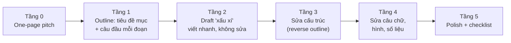

# Quy trình viết & tự review

## Từ trống trơn đến bản nộp: 5 tầng



**Quy tắc quan trọng nhất:** đừng sửa câu chữ (tầng 4) khi cấu trúc (tầng 3) còn sai. Bạn sẽ phí thời gian đánh bóng những đoạn sẽ bị xóa.

### Tầng 1 — Outline chi tiết

Trong `1_intro.tex`, viết trước dạng:

```latex
% P1: Monocular 3D detection matters for low-cost driving.
% P2: Existing methods regress depth deterministically -> fail at long range (Fig.1a numbers).
% P3: Observation: >60% far errors are depth; depth is inherently ambiguous.
% P4: We propose DepthX: depth distribution + height-prior refinement.
% P5: Results: +2.0 KITTI, +1.6 nuScenes, +6.1 far range; plug-and-play.
% P6: Contributions (3 bullets).
```

Gửi outline này cho advisor **trước** khi viết thành văn. Sửa outline mất 5 phút; sửa 2 trang văn mất 5 giờ.

### Tầng 2 — Draft xấu xí

Viết nhanh, chấp nhận câu vụng, để `\todo{}` cho chỗ chưa có số. Mục tiêu: có **toàn bộ** nội dung trên trang. Người mới hay mắc kẹt vì cố viết câu hoàn hảo ngay.

## Tự đóng vai reviewer (self-review)

Sau khi có draft đầy đủ, **để nguội 1–2 ngày**, in ra giấy, đọc như một reviewer khó tính. Điền form sau:

```markdown
## Self-review form
1. Tóm tắt paper trong 3 câu (không nhìn paper):
2. Claim chính là gì? Bằng chứng nằm ở đâu (Table/Fig nào)?
3. 3 điểm mạnh:
4. 5 điểm yếu một reviewer sẽ nêu:
5. Baseline nào reviewer sẽ hỏi "sao không so sánh"?
6. Ablation nào còn thiếu?
7. Đoạn nào tôi phải đọc 2 lần mới hiểu?
8. Điểm tôi sẽ cho (1–6) nếu là reviewer:
```

Rồi **sửa paper để vô hiệu hóa từng điểm yếu** ở mục 4–6 — bằng thí nghiệm, bằng giải thích, hoặc bằng cách thu hẹp claim.

## Internal review — xin người khác đọc

| Vòng | Người đọc | Hỏi gì | Thời điểm |
|---|---|---|---|
| 1 | Advisor / co-author chính | Câu chuyện, claims, thí nghiệm còn thiếu | T − 4 tuần |
| 2 | Người cùng lab, **không** tham gia dự án | Có hiểu không? Đoạn nào khó? | T − 3 tuần |
| 3 | Người ở lĩnh vực lân cận | Intro + Fig.1 có thuyết phục người ngoài? | T − 2 tuần |
| 4 | "Mock reviewer" khó tính | Điền form review thật, cho điểm | T − 2 tuần |

Mẹo: hỏi người đọc **"Hãy tóm tắt lại paper cho tôi"** — nếu họ tóm tắt sai, vấn đề nằm ở bạn.

## Kỷ luật hằng ngày

- **Viết mỗi ngày một ít** (ví dụ 1–2 giờ buổi sáng) hiệu quả hơn viết dồn cuối tuần.
- **Tách phiên viết và phiên chạy thí nghiệm.** Đặt job chạy, rồi viết trong lúc chờ.
- **Commit Overleaf** (Overleaf có history; hoặc liên kết Git) trước mỗi lần sửa lớn.
- Giữ **file `cut.tex`** chứa đoạn văn bị cắt — đỡ tiếc, và hữu ích cho supp/rebuttal.
