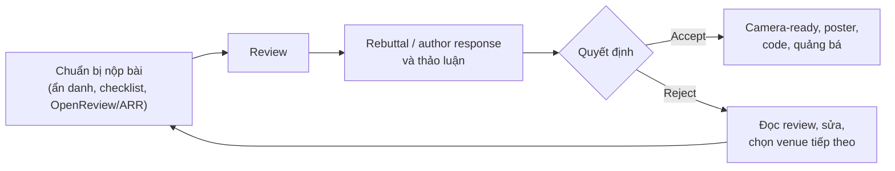

# 4. Nộp & sau khi nộp

Ba chương đầu của giáo trình tập trung vào việc tạo ra một bản thảo tốt: chọn ý tưởng, thiết kế thí nghiệm, xây câu chuyện, viết từng phần và trau chuốt văn phong. Tuy nhiên, khoảnh khắc nhóm tác giả bấm nút "Submit" chưa phải là điểm kết thúc. Từ lúc đó, paper bước vào một quy trình có luật lệ riêng: hệ thống nộp bài với các biểu mẫu bắt buộc, quy định ẩn danh của quy trình double-blind, giai đoạn phản hồi reviewer, các thủ tục sau khi được chấp nhận, và cả khả năng bị từ chối rồi phải nộp lại ở nơi khác. Đây là những giai đoạn mà một sơ suất nhỏ về thủ tục có thể xóa bỏ công sức của nhiều tháng, trong khi một phản hồi khéo léo có thể lật ngược một quyết định đang ở ranh giới.

Chương này được đặt sau phần viết vì các kỹ năng ở đây chỉ phát huy tác dụng khi đã có một bản thảo đáng giá; không rebuttal nào cứu được một paper thiếu bằng chứng cốt lõi. Ngược lại, chương này cũng là nơi khác biệt giữa ba cộng đồng thể hiện rõ nhất. Ở Computer Vision (CVPR, ICCV, ECCV), tác giả thường chỉ có một trang PDF để trả lời tất cả reviewer trong một lần duy nhất. Ở Machine Learning (NeurIPS, ICML, ICLR), phản hồi diễn ra dưới dạng các bình luận trên OpenReview và có thể kéo dài thành nhiều vòng thảo luận. Ở NLP, các hội nghị lớn như ACL, EMNLP, NAACL nhận paper qua ACL Rolling Review (ARR), nơi việc nhận review được tách khỏi việc chọn hội nghị. Vì vậy, mỗi bài trong chương trình bày nguyên tắc chung trước, sau đó chỉ ra cách áp dụng ở từng cộng đồng.

Sơ đồ dưới đây tóm tắt vòng đời của một submission sau khi bản thảo đã hoàn thành, đồng thời cho thấy mỗi bài trong chương phụ trách giai đoạn nào.

Về cách đọc, người học nên đọc bài "Chuẩn bị nộp bài" ít nhất một tháng trước deadline, vì một số việc như tạo profile OpenReview hay điền checklist cần thời gian và không thể làm vội trong đêm cuối. Hai bài về rebuttal và camera-ready có thể đọc lướt từ sớm để biết trước những gì sẽ xảy ra, rồi đọc kỹ khi tới giai đoạn tương ứng. Bài về việc bị reject cũng nên đọc trước khi có kết quả, bởi kế hoạch dự phòng tốt nhất luôn được chuẩn bị trong thời gian chờ đợi. Bối cảnh chung về quy trình review được trình bày ở [Paper được đánh giá thế nào](../00-tong-quan/review-process.md); các đặc thù sâu hơn của từng cộng đồng nằm ở [Chương 6](../06-cong-dong/index.md).

## Các bài trong chương

- [Chuẩn bị nộp bài](submission.md) — các lỗi dẫn tới desk reject và lý do chúng bị xử lý nghiêm, ẩn danh double-blind, chính sách preprint và dual submission, quy trình OpenReview và ARR, các checklist bắt buộc, kiểm tra cuối cùng và cách quy đổi giờ AoE.
- [Rebuttal & thảo luận](rebuttal.md) — viết phản hồi cho AC và meta-reviewer, so sánh ba cơ chế phản hồi của CV, ML và NLP, quy trình bảy ngày, mẫu rebuttal một trang và mẫu phản hồi trên OpenReview.
- [Camera-ready, poster, code](camera-ready.md) — hoàn thiện bản cuối, thực hiện cam kết trong rebuttal, thủ tục bản quyền và đăng ký, chuẩn bị poster, bài nói, phát hành code và quảng bá paper.
- [Khi bị reject](reject.md) — đọc review như dữ liệu, chuyển tín hiệu thành hành động, chọn venue tiếp theo giữa ba cộng đồng, chuyển template và quyết định khi nào cần thay đổi lớn.
