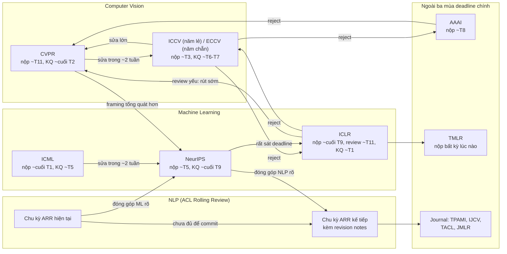

# Khi bị reject

!!! abstract "Mục tiêu của bài"
    Sau bài này, người học có thể:

    - Vượt qua phản ứng cảm xúc ban đầu và đọc review như dữ liệu về cách người đọc tiếp nhận paper.
    - Chuyển các tín hiệu thường gặp trong review thành hành động sửa đổi cụ thể.
    - Quyết định mức độ thay đổi cần thiết: sửa nhỏ, sửa lớn hay đổi hướng.
    - Chọn venue tiếp theo dựa trên thời gian, độ phù hợp với cộng đồng và định dạng, với các lộ trình nộp lại giữa CV, NLP và ML.
    - Chuẩn bị cho việc chuyển template và khả năng gặp lại reviewer cũ.

Ở các hội nghị A\*, tỉ lệ chấp nhận những năm gần đây thường dao động quanh mức 20–30%, nghĩa là phần lớn submission bị từ chối. Nói cách khác, **reject là kết quả mặc định** của một lần nộp bài, không phải một thất bại cá nhân bất thường. Nhiều paper có ảnh hưởng lớn trong lịch sử ngành từng bị reject ít nhất một lần trước khi được chấp nhận ở nơi khác, và hầu hết các nhà nghiên cứu thành danh đều có một danh sách dài những lần bị từ chối. Điều phân biệt nhóm nghiên cứu hiệu quả với nhóm khác không phải là chưa từng bị reject, mà là cách họ phản ứng sau đó.

Một lần reject chứa đựng một thứ có giá trị: những nhận xét chi tiết từ vài chuyên gia đã dành nhiều giờ đọc paper. Nếu biết cách đọc, những nhận xét này chỉ ra chính xác chỗ paper chưa thuyết phục được người đọc. Bài này trình bày quá trình từ lúc nhận kết quả tới lúc nộp lại: xử lý tâm lý trong những ngày đầu, phân tích review, quyết định mức độ thay đổi, chọn venue tiếp theo giữa ba cộng đồng, chuyển template, và chuẩn bị cho khả năng gặp lại reviewer cũ.

## Những ngày đầu: tách cảm xúc khỏi phân tích

Đọc một review tiêu cực về công trình đã tốn nhiều tháng là trải nghiệm khó chịu, và cảm giác bực bội, thất vọng hay bất công là hoàn toàn bình thường. Vấn đề không nằm ở cảm xúc, mà ở những quyết định được đưa ra trong lúc cảm xúc còn mạnh: một email gay gắt gửi chair, một bài đăng chỉ trích reviewer trên mạng xã hội, hay quyết định vội vàng bỏ dự án. Những hành động này hầu như không mang lại lợi ích và đôi khi gây hại lâu dài cho uy tín.

Cách tiếp cận được nhiều nhóm nghiên cứu áp dụng là đọc review và meta-review **một lần**, rồi tạm gác lại trong một tới hai ngày. Khi quay lại, người đọc cố gắng đặt mình vào vị trí của một người không quen với dự án và tự hỏi: nếu chỉ có trong tay bản PDF này, liệu có hiểu nhầm giống như reviewer không? Câu hỏi này chuyển trọng tâm từ "reviewer sai ở đâu" sang "paper chưa truyền đạt được điều gì", và đó là câu hỏi có thể hành động được. Với nghiên cứu sinh, buổi trao đổi với người hướng dẫn sau khoảng thời gian này thường hiệu quả hơn nhiều so với buổi họp ngay trong ngày nhận kết quả.

## Đọc review như dữ liệu

Sau khi cảm xúc đã lắng xuống, bước tiếp theo là phân tích review một cách có hệ thống. Nguyên tắc nền tảng là: mỗi review, kể cả review hời hợt hay sai lầm, đều là **dữ liệu về cách một người đọc thực tế tiếp nhận paper**. Reviewer là đại diện cho chính những người sẽ đọc paper sau khi công bố. Nếu một reviewer chuyên môn hiểu sai một điểm, nhiều người đọc khác cũng có thể hiểu sai.

Khi đọc, cần phân biệt mức độ quan trọng của các nguồn. **Meta-review** của AC là tài liệu quan trọng nhất, vì nó cho biết những điểm nào thực sự dẫn tới quyết định reject. Trong các review riêng lẻ, những ý kiến được **nhiều reviewer cùng nêu** là tín hiệu mạnh hơn hẳn ý kiến chỉ xuất hiện một lần. Mức độ tự tin (confidence) mà reviewer tự đánh giá cũng là một thông tin hữu ích, dù không nên coi review có confidence thấp là vô giá trị. Bảng dưới đây tổng hợp các tín hiệu thường gặp, ý nghĩa thực sự đằng sau chúng và hành động tương ứng.

| Tín hiệu trong review | Ý nghĩa thường gặp | Hành động |
|---|---|---|
| Nhiều reviewer hiểu sai cùng một điểm | Paper trình bày điểm đó chưa rõ | Viết lại phần đó, thêm hình minh họa hoặc ví dụ, đưa định nghĩa lên sớm hơn |
| "Limited novelty" | Insight chưa nổi bật trong Introduction, hoặc thực sự gần với công trình đã có | Viết lại Introduction quanh insight; thêm bảng hoặc đoạn so sánh trực tiếp với công trình gần nhất; thêm phân tích cho thấy khác biệt có ý nghĩa |
| "Missing comparison with X" | Một lỗ hổng thực sự trong thực nghiệm | Thêm thí nghiệm; nếu không so sánh được, giải thích rõ lý do trong paper |
| "Marginal gains" | Chưa cho thấy chỗ phương pháp thắng rõ rệt hoặc giá trị khác ngoài con số trung bình | Phân tích theo nhóm con (breakdown), thêm chỉ số hiệu quả tính toán, hoặc thay đổi framing |
| "Not convinced the results generalize" | Thực nghiệm hẹp so với claim | Thêm dataset, ngôn ngữ hay domain khác, hoặc thu hẹp claim cho khớp bằng chứng |
| Các review mâu thuẫn nhau | Paper chưa xác định rõ đối tượng người đọc và claim chính | Chọn rõ một câu chuyện chính, viết lại Abstract và Introduction tương ứng |
| Review hời hợt hoặc sai về sự thật | Có thể ngẫu nhiên, nhưng cũng có thể do paper khó tiếp cận | Không bỏ qua hoàn toàn; kiểm tra xem phần bị hiểu sai có dễ đọc không |
| "Better suited for another venue" | Paper đúng chất lượng nhưng sai cộng đồng | Cân nhắc chuyển cộng đồng và viết lại framing |

Hai tín hiệu trong bảng cần được giảng kỹ hơn vì chúng thường bị hiểu sai. Với "limited novelty", phản ứng tự nhiên là cho rằng reviewer không hiểu đóng góp. Tuy nhiên, trong nhiều trường hợp, đóng góp có thật nhưng bị chôn vùi ở giữa phần Method thay vì được nêu bật trong Introduction; reviewer đọc nhanh hai trang đầu và không thấy điều gì mới. Cách sửa khi đó là viết lại câu chuyện chứ không phải thêm thí nghiệm. Với "marginal gains", vấn đề thường không nằm ở con số mà ở việc paper không chỉ ra phương pháp có lợi thế lớn ở đâu. Một phương pháp chỉ cải thiện trung bình 0,5 điểm nhưng cải thiện 5 điểm trên các trường hợp khó, hay giảm một nửa chi phí tính toán, sẽ được nhìn nhận rất khác nếu những điều đó được trình bày rõ.

Một ví dụ minh họa cho cách chuyển review thành sửa đổi: giả sử hai reviewer của một paper NLP cùng hỏi liệu phương pháp có hoạt động với các ngôn ngữ khác tiếng Anh không. Đây là tín hiệu kép: thực nghiệm hẹp, và claim trong Abstract có thể đang quá rộng. Có hai hướng sửa hợp lệ. Hướng thứ nhất là bổ sung thí nghiệm trên vài ngôn ngữ đại diện cho các họ ngôn ngữ khác nhau, có thể bao gồm cả tiếng Việt như một ngôn ngữ ít tài nguyên hơn. Hướng thứ hai là giữ nguyên thực nghiệm nhưng thu hẹp claim thành "for English" và thảo luận giới hạn này một cách trung thực. Cả hai hướng đều tốt hơn việc nộp lại mà không thay đổi gì.

## Sửa nhỏ, sửa lớn hay đổi hướng

Sau khi phân tích, nhóm tác giả cần quyết định mức độ thay đổi. Quyết định này phụ thuộc vào bản chất của các mối lo chính, không phải vào số lượng ý kiến. Một paper có mười ý kiến nhỏ về trình bày có thể chỉ cần sửa trong một tuần, trong khi một paper chỉ có một mối lo về giả định cốt lõi lại có thể cần thiết kế lại thực nghiệm.

**Sửa nhỏ** phù hợp khi các mối lo chủ yếu về trình bày, khi các reviewer nhìn chung công nhận đóng góp, và khi paper đã ở gần ngưỡng accept, ví dụ điểm số borderline với một reviewer tiêu cực duy nhất. Trong trường hợp này, việc sửa trình bày, bổ sung một hoặc hai thí nghiệm được yêu cầu, rồi nộp lại tới venue gần nhất là chiến lược hợp lý.

**Sửa lớn** cần thiết khi mối lo chính là về bằng chứng: thiếu baseline quan trọng, thiếu dataset, kết quả không vững qua nhiều seed, hoặc khi đóng góp bị coi là gần với một công trình đã có. Sửa lớn thường đòi hỏi vài tuần tới vài tháng, và có thể khiến nhóm phải bỏ qua venue gần nhất để nộp vào venue tiếp theo với một phiên bản mạnh hơn hẳn.

**Đổi hướng** là lựa chọn cần cân nhắc khi paper bị reject hai tới ba lần với **cùng một phản hồi cốt lõi**. Đây là tín hiệu mạnh rằng vấn đề không nằm ở may rủi trong việc phân công reviewer, mà ở chính đóng góp hoặc cách định vị đóng góp. Đổi hướng có thể mang nhiều hình thức: bổ sung một đóng góp mới thực sự, thay đổi framing để nhắm tới một câu hỏi khác mà kết quả trả lời tốt hơn, chuyển sang một cộng đồng có "khẩu vị" phù hợp hơn, hoặc chọn một hình thức công bố khác như workshop, journal hay hội nghị chuyên ngành. Tiếp tục nộp lại cùng một nội dung với hy vọng gặp reviewer dễ tính hơn hiếm khi là chiến lược tốt, vừa tốn thời gian vừa làm chậm các dự án khác.

!!! tip "Chuẩn bị kế hoạch B trước khi có kết quả"
    Khoảng cách giữa ngày công bố kết quả của một hội nghị và deadline của hội nghị tiếp theo thường rất ngắn, có khi chỉ một tới hai tuần. Nhóm tác giả hiệu quả tận dụng thời gian chờ kết quả để chạy những thí nghiệm mà reviewer có khả năng hỏi, chuẩn bị sẵn bản chuyển template, và xác định trước venue dự phòng. Khi kết quả đến, phần lớn công việc đã sẵn sàng.

## Chọn venue tiếp theo

Khi đã biết cần sửa gì, câu hỏi tiếp theo là nộp ở đâu. Ba yếu tố cần cân nhắc là **thời gian** (deadline nào kịp với khối lượng sửa đổi), **độ phù hợp** (cộng đồng nào đánh giá cao loại đóng góp của paper), và **định dạng** (chi phí chuyển template và giới hạn trang). Ba yếu tố này đôi khi mâu thuẫn nhau: venue gần nhất chưa chắc là venue phù hợp nhất.

Sơ đồ dưới đây minh họa các lộ trình nộp lại thường gặp giữa ba cộng đồng và các lựa chọn không phụ thuộc mùa deadline. Các mốc thời gian chỉ là điển hình của những năm gần đây (T1 là tháng 1, T11 là tháng 11) và thay đổi theo từng năm; một số lộ trình rất sát nhau về thời gian, nên luôn phải kiểm tra lịch cụ thể và tuyệt đối tránh dual submission, tức là phải có kết quả hoặc rút paper khỏi nơi cũ trước khi nộp nơi mới.

Một số lộ trình trong sơ đồ cần được giải thích thêm. Lộ trình **CVPR sang ICCV hoặc ECCV** là phổ biến nhất ở CV, nhưng khoảng cách giữa kết quả CVPR và deadline của hội nghị kế tiếp chỉ khoảng hai tuần, nên chỉ phù hợp với sửa nhỏ, và còn đi kèm việc chuyển template nếu là ECCV. Lộ trình **ICML sang NeurIPS** có đặc điểm tương tự ở ML. Lộ trình **NeurIPS sang ICLR** rất sát nhau về thời gian: kết quả NeurIPS thường được công bố chỉ vài ngày trước deadline của ICLR, và abstract registration của ICLR có khi còn sớm hơn, nên nhóm tác giả cần chuẩn bị trước bản sửa.

Ở ICLR, review được công bố khoảng giữa tháng 11, trước khi có quyết định cuối cùng vài tháng. Nếu review rõ ràng không thuận lợi, nhiều nhóm chọn rút paper sớm để nộp sang CVPR (với paper thiên về vision) hoặc chuẩn bị cho ICML. Lựa chọn này đòi hỏi cân nhắc kỹ: deadline của CVPR thường rơi vào cùng thời điểm review ICLR được công bố, và việc rút paper phải hoàn tất trước khi nộp nơi mới.

Với NLP, lộ trình tự nhiên nhất là **nộp lại chu kỳ ARR kế tiếp** với revision notes. Một lựa chọn khác ít được chú ý là commit paper tới hội nghị kèm hy vọng được nhận vào **Findings**, khi review cho thấy paper vững về kỹ thuật nhưng chưa đủ hấp dẫn cho main conference. Paper NLP có đóng góp mang tính phương pháp học máy rõ rệt cũng có thể chuyển sang NeurIPS hay ICLR, và ngược lại, một paper ML có đóng góp chủ yếu cho xử lý ngôn ngữ có thể tìm được người đọc phù hợp hơn ở ARR.

**AAAI** là một lựa chọn phổ biến cho paper bị reject ở ICCV hoặc ECCV, vì deadline thường rơi vào tháng 8, sau khi có kết quả của hai hội nghị này. AAAI có quy trình review nhiều giai đoạn, và một phần paper có thể bị loại ngay ở giai đoạn đầu; đặc thù của AAAI và các hội nghị tổng quát khác được trình bày ở bài [AAAI / IJCAI / KDD / Journal](../06-cong-dong/khac.md).

### Lựa chọn không theo mùa deadline: TMLR và journal

Bên cạnh các hội nghị, có những lựa chọn không phụ thuộc vào mùa deadline. **TMLR** (Transactions on Machine Learning Research) là một tạp chí nhận bài liên tục, với tiêu chí đánh giá tập trung vào tính đúng đắn và sự rõ ràng của claim hơn là mức độ "gây chú ý". Đây là lựa chọn tốt cho paper vững chắc nhưng liên tục bị đánh giá là chưa đủ nổi bật ở các hội nghị lớn. Các **tạp chí** truyền thống như TPAMI và IJCV (CV), TACL (NLP), JMLR (ML) phù hợp với các phiên bản mở rộng, có phân tích sâu hơn; thời gian review thường dài hơn hội nghị nhưng cho phép nhiều vòng sửa đổi. Cách viết phản hồi cho tạp chí, vốn khác rebuttal hội nghị, được trình bày ở bài [AAAI / IJCAI / KDD / Journal](../06-cong-dong/khac.md).

## Chuyển template và chuyển cộng đồng

Đổi venue gần như luôn kéo theo đổi template, và chi phí của việc này thường bị đánh giá thấp. Chuyển giữa hai template hai cột có giới hạn trang tương tự, ví dụ từ CVPR sang AAAI, chủ yếu là điều chỉnh bố cục. Nhưng chuyển giữa template hai cột và một cột, ví dụ từ CVPR sang ECCV hay NeurIPS, đòi hỏi thiết kế lại gần như mọi hình và bảng, vì tỉ lệ khung thay đổi hoàn toàn. Bảng dưới đây tóm tắt định dạng điển hình của những năm gần đây; giới hạn chính xác cần được kiểm tra theo năm nộp.

| Venue | Bố cục | Giới hạn nội dung chính (điển hình) | Ghi chú khi chuyển tới |
|---|---|---|---|
| CVPR / ICCV | Hai cột | 8 trang, không tính references | Supp là file riêng |
| ECCV | Một cột (LNCS của Springer) | 14 trang, không tính references | Hình và bảng phải thiết kế lại |
| NeurIPS | Một cột | Khoảng 9 trang | Appendix và checklist cùng PDF |
| ICML | Hai cột | 8 trang | Impact Statement không tính trang |
| ICLR | Một cột | Khoảng 9–10 trang | Submission công khai trên OpenReview |
| ACL / EMNLP / NAACL (ARR) | Hai cột | 8 trang (long) hoặc 4 trang (short) | Limitations bắt buộc |
| AAAI | Hai cột | Khoảng 7 trang | Quy trình review nhiều giai đoạn |

Chuyển template chỉ là phần nổi. Khi chuyển cộng đồng, ví dụ từ CV sang ML hay từ ML sang NLP, điều quan trọng hơn là **viết lại framing** cho phù hợp với "khẩu vị" của cộng đồng mới. Một paper CVPR nhấn mạnh kết quả trên benchmark có thể bị reviewer NeurIPS đánh giá là "incremental" nếu không làm nổi bật nguyên lý tổng quát; một paper ML chỉ đánh giá trên dữ liệu tổng hợp có thể bị reviewer ARR hỏi về các ngôn ngữ và tác vụ thực tế. Quy trình chuyển đổi chi tiết được trình bày ở bài [Chuyển một paper giữa các cộng đồng](../06-cong-dong/chuyen-doi.md).

## Gặp lại reviewer cũ

Một thực tế mà nhiều người mới không lường trước là khả năng **gặp lại cùng reviewer** ở venue tiếp theo khá cao. Mỗi chủ đề hẹp chỉ có một số lượng chuyên gia nhất định, và họ thường review cho nhiều hội nghị trong cùng một năm. Một reviewer đã đọc paper ở CVPR có thể được giao lại chính paper đó ở ECCV; một reviewer ở NeurIPS có thể gặp lại nó ở ICLR. Nếu paper được nộp lại mà không thay đổi gì, reviewer sẽ nhận ra ngay, và đánh giá lần thứ hai thường còn khắt khe hơn lần đầu vì những mối lo cũ bị phớt lờ.

Ngoài ra, có những cơ chế khiến lịch sử của paper trở nên minh bạch. Ở ARR, khi nộp lại dưới dạng resubmission, review cũ đi kèm paper, và tác giả có thể đề nghị giữ reviewer cũ hoặc đổi reviewer mới kèm lý do; revision notes là nơi chứng minh các mối lo đã được giải quyết. Ở ICLR, trang OpenReview của paper bị reject, kèm toàn bộ review và thảo luận, thường vẫn công khai, nên reviewer ở hội nghị sau có thể tìm thấy. Một số hội nghị khác hỏi tác giả về lần nộp trước và cho phép, hoặc yêu cầu, đính kèm review cũ cùng mô tả thay đổi.

Những cơ chế này không nên được nhìn như một mối đe dọa, mà như một lý do nữa để thực sự tiếp thu review. Một paper đã sửa nghiêm túc theo review cũ có thể biến reviewer cũ thành người ủng hộ: họ thấy ý kiến của mình được lắng nghe và paper đã tốt hơn rõ rệt.

## Tóm tắt

Reject là kết quả mặc định ở các hội nghị A\*, và giá trị của nó nằm ở những nhận xét chi tiết từ người đọc chuyên môn. Sau một khoảng thời gian để cảm xúc lắng xuống, review cần được đọc như dữ liệu, ưu tiên meta-review và những ý kiến được nhiều reviewer cùng nêu, và mỗi tín hiệu được chuyển thành một hành động cụ thể. Mức độ thay đổi phụ thuộc vào bản chất của các mối lo: trình bày thì sửa nhỏ, bằng chứng thì sửa lớn, còn bị reject lặp lại với cùng phản hồi cốt lõi là tín hiệu cần đổi hướng. Việc chọn venue tiếp theo cân nhắc thời gian, độ phù hợp với cộng đồng và chi phí chuyển template, với nhiều lộ trình giữa CV, ML và NLP cũng như các lựa chọn không theo mùa như TMLR và journal. Cuối cùng, khả năng gặp lại reviewer cũ là lý do để mỗi lần nộp lại đều phải thể hiện sự tiếp thu thực sự.

## Bài tập

1. **Phân tích một bộ review.** Chọn một paper bị reject trên OpenReview (ICLR là nguồn dễ tìm nhất). Đọc toàn bộ review và meta-review, lập bảng tín hiệu và hành động theo mẫu trong bài, rồi viết một đoạn khoảng 200 từ đề xuất mức độ thay đổi (sửa nhỏ, sửa lớn hay đổi hướng) kèm lý do.
2. **Lập lộ trình nộp lại.** Với dự án hiện tại, giả định paper bị reject ở hội nghị mục tiêu. Dựa vào lịch deadline thực tế của năm tới, vẽ lại sơ đồ lộ trình nộp lại cho riêng dự án với ít nhất hai phương án, ghi rõ khoảng thời gian có để sửa ở mỗi phương án và những thí nghiệm nên chạy trước trong lúc chờ kết quả.
3. **Viết revision notes.** Giả định paper bị reject ở một chu kỳ ARR. Từ bảng ở bài tập 1 (hoặc từ review của chính dự án), viết revision notes bằng tiếng Anh: mỗi mối lo chính của review cũ, thay đổi tương ứng và vị trí của thay đổi trong paper mới.
4. **Thử chuyển template.** Lấy một bảng và một hình từ bản thảo hiện tại, chuyển từ template hai cột sang một template một cột (hoặc ngược lại). Ghi lại thời gian cần thiết và những thay đổi về thiết kế, để ước lượng chi phí chuyển toàn bộ paper.
