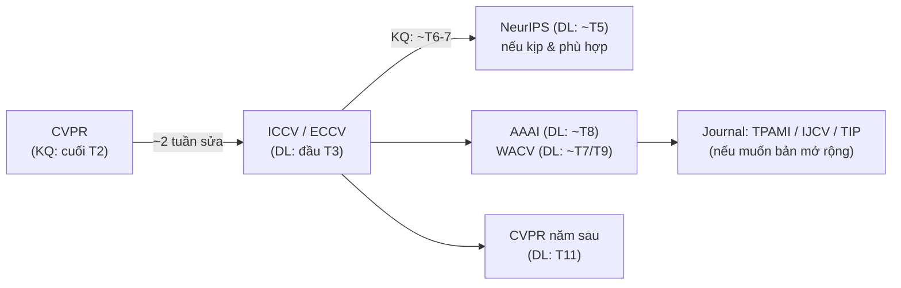

# Khi bị reject

Hầu hết các paper A\* nổi tiếng đều từng bị reject ít nhất một lần. Với tỉ lệ accept ~25%, **reject là trạng thái mặc định**, không phải thất bại cá nhân.

## 48 giờ đầu

- Đọc review và meta-review **một lần**, rồi đóng lại.
- Không viết email/tweet bực bội.
- Sau 1–2 ngày, đọc lại với tâm thế: *"Nếu tôi là người đọc không quen dự án, tôi có hiểu nhầm như họ không?"*

## Phân tích review

Mỗi review, dù tệ, đều là **dữ liệu về cách người đọc tiếp nhận paper của bạn**.

| Tín hiệu | Ý nghĩa thật | Hành động |
|---|---|---|
| Nhiều reviewer hiểu sai cùng một điểm | Paper viết chưa rõ | Viết lại phần đó, thêm hình |
| "Limited novelty" | Câu chuyện/insight chưa nổi bật, hoặc thật sự gần công trình khác | Viết lại Intro, thêm phân tích, bảng khác biệt |
| "Missing comparison with X" | Lỗ hổng thật | Thêm thí nghiệm |
| "Marginal gains" | Chưa cho thấy chỗ thắng lớn hoặc giá trị khác | Thêm breakdown, efficiency, hoặc đổi framing |
| Review mâu thuẫn nhau | Paper có thể chia rẽ — framing chưa rõ đối tượng | Xác định rõ đối tượng và claim |
| Review hời hợt / sai | Ngẫu nhiên — vẫn có thể do paper khó tiếp cận | Không bỏ qua hoàn toàn |

## Nộp lại: chọn venue tiếp theo

Lưu ý:

- Khoảng cách **CVPR reject → ICCV/ECCV deadline** chỉ khoảng 1–2 tuần. Hãy **chuẩn bị sẵn** kế hoạch B trong thời gian chờ kết quả (chạy thêm thí nghiệm reviewer có thể hỏi).
- Đổi venue = đổi template (CVPR ↔ ECCV LNCS) — dự trù thời gian.
- Có thể gặp lại **cùng reviewer** ở hội nghị sau. Nếu không sửa gì, họ sẽ nhận ra.
- Nếu bị reject 2–3 lần với cùng phản hồi cốt lõi, đó là **tín hiệu mạnh** cần thay đổi đáng kể (thêm đóng góp, đổi framing) — hoặc chuyển sang venue phù hợp hơn (workshop, journal, hội nghị chuyên ngành).
