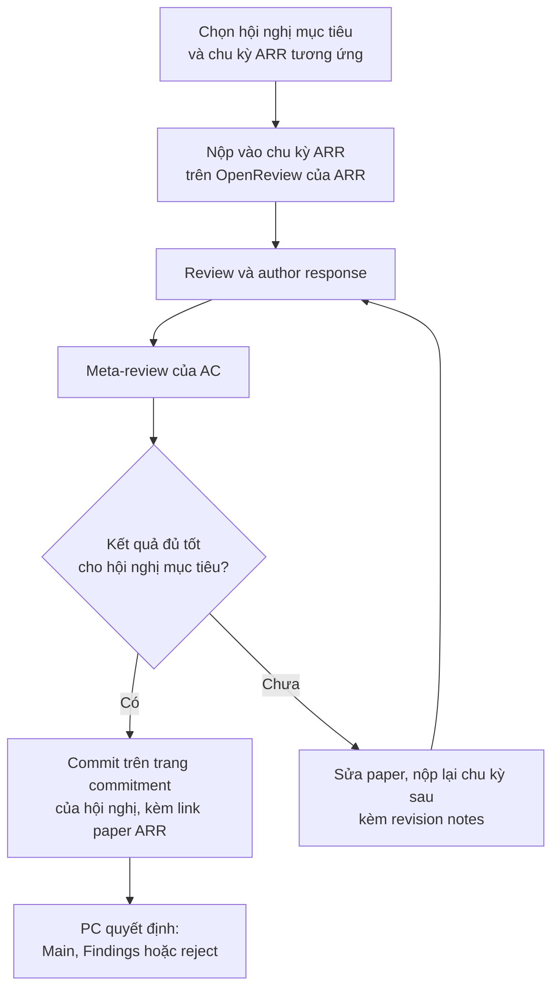

# Chuẩn bị nộp bài

!!! abstract "Mục tiêu của bài"
    Sau bài này, người học có thể:

    - Nhận diện các lỗi thủ tục dẫn tới desk reject và giải thích vì sao mỗi lỗi bị xử lý nghiêm.
    - Kiểm tra một bản thảo theo yêu cầu ẩn danh của quy trình double-blind, từ những dấu vết hiển nhiên tới những dấu vết tinh vi.
    - Phân biệt chính sách về preprint, dual submission và workshop có proceedings ở ba cộng đồng CV, NLP và ML.
    - Thực hiện đúng quy trình nộp trên OpenReview và ACL Rolling Review, kể cả các checklist và mục bắt buộc.
    - Lập kế hoạch kiểm tra trong 24 giờ cuối và quy đổi chính xác deadline theo giờ AoE.

Nhiều người coi việc nộp bài là một thao tác hành chính: tải file PDF lên, điền vài ô thông tin, bấm nút. Trên thực tế, mỗi năm các hội nghị lớn đều loại một số lượng không nhỏ paper mà không gửi cho reviewer nào đọc, chỉ vì vi phạm thủ tục. Hình thức loại này được gọi là **desk reject**. Nó đặc biệt đáng tiếc vì hai lý do. Thứ nhất, nhóm tác giả không nhận được review nào để học hỏi, nên công sức chuẩn bị gần như không để lại giá trị. Thứ hai, paper mất trọn một chu kỳ nộp bài, tức là thường từ ba tới sáu tháng chờ đợi tới deadline phù hợp tiếp theo.

Điều đáng nói là gần như mọi nguyên nhân dẫn tới desk reject đều phòng tránh được nếu người viết hiểu luật và có quy trình kiểm tra. Bài này đi theo trình tự thời gian của việc nộp bài. Trước hết, chúng ta xem xét các lỗi bị loại ngay và lý do đằng sau chúng. Tiếp theo là ba chủ đề liên quan tới tính công bằng của quy trình review: ẩn danh, preprint và dual submission. Sau đó, bài trình bày quy trình cụ thể trên OpenReview và ACL Rolling Review, các checklist bắt buộc của từng cộng đồng, và cuối cùng là đợt kiểm tra 24 giờ trước deadline cùng cách quy đổi giờ AoE.

## Desk reject: bị loại trước khi được đọc

Desk reject là quyết định loại paper do Program Chair (PC) hoặc Area Chair (AC) đưa ra mà không cần ý kiến của reviewer. Quyết định này có thể đến ngay sau deadline, hoặc đến muộn hơn, khi reviewer hay AC phát hiện vi phạm trong lúc đọc. Thoạt nhìn, nhiều quy định có vẻ khắt khe một cách không cần thiết; chẳng hạn, vì sao một dòng chữ tràn sang trang thứ chín lại đủ để loại cả một công trình? Câu trả lời nằm ở chỗ mỗi quy định bảo vệ một trong ba giá trị mà quy trình review dựa vào: **sự công bằng giữa các submission**, **tính toàn vẹn của cơ chế double-blind**, và **công sức có hạn của reviewer**. Khi hiểu quy định nào bảo vệ giá trị nào, người viết sẽ dễ nhớ và ít khi vi phạm hơn.

**Vượt giới hạn trang.** Giới hạn trang là ràng buộc chung mà mọi nhóm tác giả cùng phải chấp nhận. Thêm nửa trang đồng nghĩa với thêm một bảng ablation hay thêm một đoạn giải thích, tức là một lợi thế không công bằng so với các paper đã chịu cắt gọt. Với hàng nghìn submission, PC không thể thương lượng từng trường hợp, nên quy định được áp dụng một cách cơ học: vượt một dòng cũng là vượt. Phần được tính thường là toàn bộ nội dung chính, bao gồm hình và bảng; References thường không bị tính. Một số mục được loại trừ khỏi giới hạn theo quy định riêng của từng hội nghị, ví dụ mục Limitations ở các hội nghị dùng ARR, NeurIPS Paper Checklist, hay Impact Statement ở ICML, nhưng danh sách loại trừ thay đổi theo năm và phải đọc trong Call for Papers. Lỗi thường gặp nhất không phải là viết dài cố ý, mà là một hình float bị LaTeX đẩy sang trang sau trong lần biên dịch cuối cùng.

**Sửa template.** Thu hẹp lề, giảm cỡ chữ, giảm khoảng cách dòng hay đổi font caption đều là những cách "lấy thêm chỗ" khó nhận ra bằng mắt thường, và vì vậy bị coi là gian lận giới hạn trang. Các hội nghị lớn có công cụ kiểm tra định dạng tự động, còn reviewer có kinh nghiệm nhận ra một trang dày đặc bất thường ngay lập tức. Ranh giới giữa việc tinh chỉnh khoảng trắng hợp lý và việc lạm dụng không được quy định bằng con số cụ thể; khi phân vân, người viết nên chọn phương án an toàn là cắt bớt nội dung. Các kỹ thuật tiết kiệm chỗ hợp lệ được trình bày ở bài [LaTeX & Overleaf](../03-ky-thuat/latex.md).

**Lộ danh tính.** Ở các hội nghị double-blind, một paper để lộ tên tác giả có thể bị loại vì nó làm hỏng điều kiện đánh giá khách quan cho chính nó. Đây là chủ đề đủ phức tạp để có riêng một mục ở phần sau.

**Dual submission.** Nộp cùng một nội dung, hoặc nội dung chồng lấn đáng kể, tới hai nơi có peer review trong cùng thời gian là lãng phí công sức của hai nhóm reviewer, đồng thời mở ra khả năng một kết quả được công bố hai lần. Các cộng đồng phối hợp với nhau để phát hiện việc này, và hình thức xử lý thường là loại paper ở cả hai nơi.

**Thiếu abstract registration hoặc dùng abstract giữ chỗ.** Nhiều hội nghị, đặc biệt ở ML, yêu cầu đăng ký title và abstract khoảng một tuần trước deadline full paper. Thông tin này được dùng để phát hiện xung đột lợi ích, mở giai đoạn bidding (reviewer chọn paper muốn đọc) và phân công reviewer. Một abstract kiểu "To be updated" làm hỏng toàn bộ quá trình phân công, nên một số hội nghị ghi rõ rằng submission với abstract giữ chỗ có thể bị gỡ bỏ. Không đăng ký đúng hạn thì thường không thể nộp full paper.

**Thiếu checklist hoặc mục bắt buộc.** NeurIPS yêu cầu Paper Checklist đi kèm PDF; các hội nghị dùng ARR yêu cầu mục Limitations. Thiếu những phần này thường dẫn tới desk reject, vì chúng là điều kiện mà cộng đồng đặt ra cho mọi paper. Mục [Checklist và tuyên bố bắt buộc](#checklist-va-tuyen-bo-bat-buoc-theo-cong-ong) bên dưới trình bày chi tiết.

**Không hoàn thành nghĩa vụ review.** Số lượng submission tăng nhanh hơn nhiều so với số reviewer có kinh nghiệm, nên các hội nghị ngày càng áp dụng nguyên tắc có đi có lại: người nộp paper phải góp sức review. ARR yêu cầu tác giả đủ điều kiện tham gia review; NeurIPS và ICLR có các chính sách reviewing đối ứng; CVPR trong những năm gần đây đã tuyên bố có thể desk reject paper của những tác giả bị đánh giá là reviewer thiếu trách nhiệm nghiêm trọng. Mức độ áp dụng khác nhau theo năm, nhưng xu hướng chung là ngày càng chặt.

**Đạo văn và vi phạm đạo đức xuất bản.** Sao chép văn bản của người khác là vi phạm hiển nhiên. Ít người để ý hơn là việc **tự đạo văn**: dùng lại nguyên các đoạn văn từ paper cũ của chính nhóm mà không trích dẫn. Một hình thức vi phạm mới xuất hiện trong vài năm gần đây là chèn chỉ dẫn ẩn (chữ trắng, chữ cực nhỏ) nhằm điều khiển các mô hình ngôn ngữ lớn nếu reviewer dùng chúng để đọc paper, một dạng *prompt injection*. Một số hội nghị đã tuyên bố coi hành vi này là vi phạm đạo đức, với hậu quả có thể nặng hơn desk reject. Chính sách về việc dùng AI khi viết được trình bày ở bài [Dùng AI hỗ trợ (đúng luật)](../03-ky-thuat/ai-tools.md).

**Lạm dụng tài liệu bổ sung.** Ở nhiều hội nghị CV, deadline của supplementary material muộn hơn deadline paper khoảng một tuần. Khoảng thời gian này dành cho việc hoàn thiện video, kết quả bổ sung và chi tiết cài đặt, không phải để nộp một bản sửa của paper chính. Đặt vào supp một phiên bản "đã sửa lỗi" của bài chính có thể bị coi là vi phạm deadline. Ngoài ra, reviewer không có nghĩa vụ đọc supp, nên những lập luận cốt lõi luôn phải nằm trong paper chính.

Bảng dưới đây tổng hợp các lỗi vừa phân tích cùng biện pháp phòng ngừa tương ứng.

| Lỗi | Giá trị bị xâm phạm | Biện pháp phòng ngừa |
|---|---|---|
| Vượt giới hạn trang | Công bằng giữa các submission | Đếm trang trên chính file PDF sẽ nộp, sau lần biên dịch cuối |
| Sửa template | Công bằng | Không chạm vào lề, cỡ chữ, khoảng cách dòng; dùng template chính thức của năm nộp |
| Lộ danh tính | Toàn vẹn double-blind | Chạy checklist ẩn danh ở mục sau, kiểm tra cả metadata và supp |
| Dual submission | Công sức reviewer, tránh công bố kép | Rút paper khỏi nơi cũ trước khi nộp nơi mới; kiểm tra quy định về workshop |
| Thiếu abstract registration | Phân công reviewer | Ghi deadline đăng ký riêng, viết abstract thật từ lúc đăng ký |
| Thiếu checklist hoặc Limitations | Chuẩn mực cộng đồng | Soạn checklist song song với bản thảo, không để tới đêm cuối |
| Bỏ nghĩa vụ review | Công sức reviewer | Đăng ký reviewer đúng hạn, hoàn thành review được giao |
| Đạo văn, prompt injection | Đạo đức xuất bản | Trích dẫn cả paper cũ của nhóm; không chèn bất kỳ văn bản ẩn nào |
| Dùng supp để sửa paper | Công bằng về thời gian | Supp chỉ bổ sung, không thay thế nội dung chính |

## Ẩn danh trong quy trình double-blind

Trong quy trình **double-blind**, reviewer không biết tác giả là ai và tác giả không biết reviewer là ai. Mục đích là giảm thiên kiến: một paper đến từ phòng thí nghiệm nổi tiếng không được ưu ái chỉ vì tên tuổi, và một paper từ nhóm ít được biết tới không bị nghi ngờ chỉ vì xuất thân. Cần hiểu đúng yêu cầu ở đây. Trong thời đại arXiv, mạng xã hội và các bài nói ở hội thảo, việc khiến danh tính *không thể đoán ra* là bất khả thi. Điều hội nghị đòi hỏi là chính bản nộp không được tiết lộ danh tính, và tác giả không được chủ động khiến việc đoán trở nên dễ dàng.

Các dấu vết danh tính có thể chia thành ba mức, từ hiển nhiên tới tinh vi. Hiểu ba mức này giúp người viết kiểm tra có hệ thống thay vì chỉ nhìn qua phần tên tác giả.

**Mức thứ nhất là lộ trực tiếp:** tên, affiliation, email, lời cảm ơn và mã số tài trợ. Chế độ `review` của template đã ẩn khối tác giả, nhưng phần Acknowledgements do người viết tự thêm vào thì vẫn hiện nguyên. Đây là lỗi phổ biến nhất, vì nhóm tác giả thường viết lời cảm ơn từ sớm rồi quên mất. Một số template, như của NeurIPS, cung cấp môi trường riêng cho phần cảm ơn và tự động ẩn nó ở chế độ nộp bài; với các template khác, phần này phải được bỏ thủ công.

**Mức thứ hai là lộ gián tiếp** qua các chi tiết đi kèm: trích dẫn bản thân ở ngôi thứ nhất, đường link tới GitHub hay trang dự án của nhóm, metadata của file PDF, logo phòng thí nghiệm trong hình, tên người dùng trong ảnh chụp màn hình, giọng nói hay khuôn mặt tác giả trong video supp, đường dẫn tuyệt đối kiểu `/home/<tên-người-dùng>/` trong code, hay thư mục `.git` chứa tên và email của người commit.

**Mức thứ ba là lộ qua bối cảnh:** những câu văn chỉ một nhóm cụ thể mới có thể viết, ví dụ nhắc tới "bộ dữ liệu nội bộ của công ty X", "hệ thống đang phục vụ hàng triệu người dùng của chúng ta", hay một cụm máy tính có quy mô đặc trưng. Không phải lúc nào cũng tránh được hoàn toàn, nhưng có thể diễn đạt trung tính hơn: "a proprietary dataset", "a large-scale production system".

Trong các dấu vết trên, cách trích dẫn công trình cũ của chính nhóm là điểm cần giảng kỹ, vì người viết thường xử lý sai theo một trong hai hướng. Hướng sai thứ nhất là viết ở ngôi thứ nhất, khiến reviewer biết ngay tác giả là ai.

<div class="bad" markdown>
*"In our previous work [12], we proposed a token-pruning scheme for images; here we extend it to video."*
</div>

Hướng sai thứ hai là xóa hẳn trích dẫn tới paper cũ để che giấu. Cách này vừa thiếu trung thực, vì nó che đi mức độ mới thực sự của đóng góp, vừa phản tác dụng, vì reviewer am hiểu lĩnh vực sẽ nhận ra một thiếu sót bất thường. Cách đúng là trích dẫn ở ngôi thứ ba, như thể đó là công trình của một nhóm khác.

<div class="good" markdown>
*"Nguyen et al. [12] proposed a token-pruning scheme for images. We extend this idea to video, where temporal redundancy raises a different set of challenges."*
</div>

Với công trình của nhóm chưa được công bố mà paper hiện tại phụ thuộc vào, một số hội nghị cho phép trích dẫn dưới tên "Anonymous" và đính kèm bản ẩn danh của công trình đó trong supp để reviewer tham khảo. Cách làm cụ thể phải theo hướng dẫn của hội nghị năm nộp.

Với code và trang dự án, người viết có thể dùng dịch vụ tạo bản sao ẩn danh của repository, chẳng hạn anonymous.4open.science, hoặc đóng gói code thành file zip trong supp. Với PDF, metadata nên được đặt đúng ngay từ nguồn LaTeX thay vì sửa trên file đã biên dịch, vì nhiều công cụ sửa metadata chỉ ghi thêm bản cập nhật vào cuối file, còn thông tin cũ vẫn có thể khôi phục được.

```latex
% Trong preamble: đặt metadata ẩn danh cho bản nộp
\hypersetup{
  pdfauthor={Anonymous},
  pdftitle={Anonymous Submission},
  pdfsubject={},
  pdfkeywords={}
}
```

Sau khi biên dịch, một vài lệnh đơn giản giúp rà soát nhanh các dấu vết phổ biến. Các lệnh này không thay thế việc đọc lại bằng mắt, nhưng bắt được những lỗi dễ bỏ sót nhất.

```bash
# (1) Metadata của PDF: các trường Author/Creator không được chứa tên thật
pdfinfo main.pdf | grep -iE "author|creator|title|subject|keywords"

# (2) Nội dung chữ trong PDF: tìm các dấu vết danh tính thường gặp
pdftotext main.pdf - | grep -inE "github\.com|our (previous|prior) work|acknowledg|grant no"
pdftotext main.pdf - | grep -inE "[A-Za-z0-9._%+-]+@[A-Za-z0-9.-]+\.[a-z]{2,}"

# (3) Code nộp kèm: đường dẫn tuyệt đối, email, link theo dõi thí nghiệm
grep -rnE "/home/|/Users/|wandb\.ai/|@gmail" code/ \
  --include="*.py" --include="*.yaml" --include="*.json" --include="*.ipynb"
find code/ -name ".git" -o -name ".DS_Store"
```

Checklist dưới đây tổng hợp những điểm cần kiểm tra trước khi nộp.

- [ ] Không có tên tác giả, affiliation, email trong PDF; template ở chế độ review.
- [ ] Không có Acknowledgements, thông tin tài trợ hay mã số grant.
- [ ] Trích dẫn công trình cũ của nhóm ở ngôi thứ ba, không xóa trích dẫn.
- [ ] Link code và trang dự án là link ẩn danh, hoặc code được nộp dạng zip.
- [ ] Metadata PDF đã được đặt ẩn danh từ nguồn; hình nhúng không mang tên người tạo.
- [ ] Hình ảnh không có logo phòng thí nghiệm, watermark, tên người dùng.
- [ ] Code không còn `.git`, đường dẫn tuyệt đối, license ghi tên, link tới tài khoản theo dõi thí nghiệm.
- [ ] Video supp không có giọng nói hay khuôn mặt tác giả, không có logo.
- [ ] Không có câu văn chỉ rõ tổ chức của tác giả qua bối cảnh.

Mức độ nhạy cảm của ẩn danh cũng khác nhau giữa các cộng đồng. Ở CV, rủi ro lớn nằm ở supp: video kết quả, trang dự án và các demo thường được làm rất công phu, nên dễ mang theo logo hay tên miền của nhóm. Ở NLP, rủi ro hay gặp là các bộ dữ liệu mới được đăng sẵn trên Hugging Face dưới tên tổ chức, hoặc phần mô tả quy trình gán nhãn nêu rõ nơi tuyển annotator. Ở ML, đặc biệt là ICLR, submission được công khai trên OpenReview ngay trong lúc review, nên bất kỳ sơ suất nào cũng hiển thị cho toàn bộ cộng đồng chứ không chỉ cho vài reviewer.

## Preprint trên arXiv: được phép đến đâu?

Giữa khoa học mở và double-blind luôn tồn tại một sự giằng co. Đăng preprint lên arXiv giúp xác lập quyền ưu tiên về ý tưởng, nhận phản hồi sớm và đưa kết quả tới cộng đồng nhanh hơn chu kỳ review vốn kéo dài vài tháng. Nhưng một preprint có tên tác giả lại khiến danh tính dễ bị lộ trong lúc review. Mỗi cộng đồng giải quyết sự giằng co này theo cách riêng, và chính sách đã thay đổi nhiều lần trong những năm gần đây.

### Computer Vision

CVPR, ICCV và ECCV thường **cho phép** đăng preprint trước và trong thời gian review. Reviewer được hướng dẫn không chủ động tìm danh tính tác giả, và nếu vô tình biết thì không để điều đó ảnh hưởng tới đánh giá. Tuy vậy, một số năm có thêm quy định về việc quảng bá paper trên mạng xã hội trong thời gian review, hoặc về cách xử lý các công trình đồng thời (concurrent work) xuất hiện trên arXiv sát deadline. Các chi tiết này phải đọc trong hướng dẫn của năm nộp.

### Machine Learning

NeurIPS, ICML và ICLR nhìn chung cho phép preprint. Riêng ICLR, bản thân submission đã được công khai (ở dạng ẩn danh) trên OpenReview, nên câu hỏi về preprint ít gay gắt hơn. Một lưu ý thực hành là bản arXiv không nên ghi rằng paper đang được review ở hội nghị nào, vì điều đó tạo liên kết trực tiếp giữa preprint có tên tác giả và submission ẩn danh.

### NLP

Đây là cộng đồng có thay đổi đáng chú ý nhất. Trong nhiều năm, ACL áp dụng **anonymity period**: từ khoảng một tháng trước deadline cho tới khi có quyết định, tác giả không được đăng hay cập nhật preprint của paper đang nộp. Từ khoảng năm 2024, sau một quá trình thảo luận trong cộng đồng, ACL đã bãi bỏ quy định này, nên theo chính sách hiện hành tác giả có thể đăng preprint vào bất kỳ thời điểm nào; bản nộp lên ARR vẫn phải được ẩn danh đầy đủ. Vì chính sách vừa thay đổi và có thể còn được điều chỉnh, người viết nên kiểm tra Call for Papers của ARR và trang chính sách của ACL ở mỗi chu kỳ.

!!! warning "Preprint không thay thế được ẩn danh của bản nộp"
    Dù hội nghị cho phép arXiv, bản nộp vẫn không được trích dẫn hay link tới bản preprint theo cách cho thấy đó là công trình của chính tác giả. Preprint cũng không được coi là "công bố trước" theo nghĩa dual submission, nhưng nó công khai: nếu paper bị reject, phiên bản chưa hoàn thiện vẫn nằm trên mạng. Vì vậy, nếu quyết định đăng, nhóm tác giả nên đăng một phiên bản đã được trau chuốt, rồi cập nhật sau khi có kết quả.

Quyết định đăng preprint hay không là quyết định chiến lược của nhóm. Với lĩnh vực cạnh tranh nhanh như các mô hình ngôn ngữ lớn hay mô hình sinh ảnh, đăng sớm giúp tránh bị "đi trước" bởi một công trình tương tự. Với nhóm ít tên tuổi, preprint còn giúp công trình được biết tới bất kể kết quả review. Ngược lại, có ý kiến cho rằng preprint từ các phòng thí nghiệm lớn có thể tạo ấn tượng ban đầu cho reviewer; đây là lý do vài cộng đồng từng hạn chế preprint. Không có lựa chọn đúng cho mọi trường hợp; điều quan trọng là quyết định có cân nhắc và tuân thủ chính sách của năm nộp.

## Dual submission và workshop có proceedings

Sau ẩn danh và preprint, câu hỏi tiếp theo liên quan tới tính công bằng là: một nội dung có thể đồng thời ở bao nhiêu nơi? Nguyên tắc cốt lõi rất đơn giản: **không nộp cùng một paper, hay các paper chồng lấn đáng kể, tới hai nơi có peer review trong cùng một thời gian**. "Nơi có peer review" bao gồm cả hội nghị lẫn tạp chí. Một bản mở rộng đang được review ở tạp chí và một bản hội nghị đang chờ quyết định, nếu trùng nội dung cốt lõi, vẫn bị coi là dual submission. Tương tự, hai paper từ cùng một dự án nộp vào cùng một hội nghị mà chỉ khác nhau chút ít, một hiện tượng thường được gọi là "chia nhỏ" kết quả, cũng có thể bị xử lý theo quy định này.

Phức tạp hơn là câu hỏi một công trình đã xuất hiện ở đâu đó thì có còn được nộp vào hội nghị chính hay không. Câu trả lời phụ thuộc vào việc nơi xuất hiện trước có phải là **công bố chính thức** (archival) hay không. Một workshop có proceedings được xuất bản chính thức thì được coi là công bố; một workshop non-archival, chỉ đăng bài trên website để tiện thảo luận, thì thường không.

Mỗi cộng đồng có thói quen riêng về workshop. Ở CV, nhiều năm CVPR định nghĩa công bố trước là paper qua peer review dài hơn bốn trang (không tính references). Vì vậy, một paper workshop tám trang đăng trong proceedings của CVPR sẽ ngăn nội dung đó được nộp lại vào ICCV hay ECCV; nhóm tác giả muốn giữ cơ hội cho hội nghị chính nên chọn hình thức extended abstract ngắn hoặc track non-archival. Ở ML, phần lớn workshop đi kèm NeurIPS và ICML là non-archival và thường cho phép nộp những công trình đang được review ở nơi khác, nhưng vẫn phải đọc chính sách của cả workshop lẫn hội nghị chính. Ở NLP, nhiều workshop xuất bản paper trong ACL Anthology, tức là archival; một số workshop có track non-archival riêng. Thêm vào đó, paper đang được review ở ARR không được nộp đồng thời tới nơi khác; muốn chuyển, tác giả phải rút paper khỏi ARR trước.

| Hình thức xuất hiện trước | Thường bị coi là công bố trước? | Ghi chú |
|---|---|---|
| Preprint arXiv, technical report | Không | Vẫn phải tuân thủ quy định ẩn danh và quảng bá của năm nộp |
| Luận văn, luận án | Không | Thường được chấp nhận ở cả ba cộng đồng |
| Workshop non-archival | Thường không | Đọc kỹ chính sách của cả workshop và hội nghị chính |
| Workshop có proceedings, paper dài | Có | Ở CV, ngưỡng thường nhắc tới là hơn bốn trang |
| Paper hội nghị hoặc tạp chí đã accept | Có | Chỉ có thể nộp bản mở rộng đáng kể, theo quy định của nơi nhận |
| Paper đang review ở nơi khác | Vi phạm dual submission | Rút khỏi nơi cũ trước khi nộp nơi mới |

## Quy trình nộp trên OpenReview

Khi đã chắc chắn bản thảo hợp lệ về mặt nội dung, việc còn lại là thao tác trên hệ thống nộp bài. **OpenReview** là nền tảng được NeurIPS, ICML, ICLR và ARR sử dụng; những năm gần đây nhiều hội nghị CV cũng đã chuyển từ hệ thống CMT sang OpenReview. Điểm khác biệt quan trọng của OpenReview là nó xoay quanh **profile cá nhân**: mỗi tác giả và reviewer có một hồ sơ chứa lịch sử công tác, danh sách công trình và các mối quan hệ. Hồ sơ này được dùng để tự động phát hiện xung đột lợi ích và để ghép reviewer với paper phù hợp chuyên môn. Vì vậy, chất lượng profile ảnh hưởng trực tiếp tới chất lượng review mà paper nhận được.

Các bước dưới đây được trình bày theo thứ tự thời gian, kèm lý do của từng bước.

1. **Tạo profile cho mọi tác giả từ sớm.** Profile mới phải được kiểm duyệt; với email không thuộc tổ chức học thuật, quá trình này có thể kéo dài từ vài ngày tới khoảng hai tuần, và thường chậm hơn vào mùa deadline. Một đồng tác giả chưa có profile vào tuần cuối có thể khiến cả paper không nộp được. Một số hội nghị còn ghi rõ rằng profile thiếu thông tin có thể là lý do desk reject.
2. **Điền đầy đủ thông tin phục vụ phát hiện xung đột.** Email tổ chức (cả hiện tại và trước đây), lịch sử công tác có năm tháng, link DBLP và Google Scholar, các mối quan hệ như người hướng dẫn và cộng sự gần đây. Nếu thiếu, hệ thống có thể giao paper cho một đồng nghiệp cùng phòng thí nghiệm của tác giả; ngược lại, nếu tác giả là reviewer, danh sách công trình đầy đủ giúp hệ thống giao cho họ những paper đúng chuyên môn.
3. **Abstract registration.** Điền title, abstract, danh sách tác giả, lĩnh vực chủ đề và đôi khi một câu TL;DR. Abstract ở bước này phải là abstract thật, đủ để reviewer quyết định khi bidding. Cần đặc biệt lưu ý danh sách tác giả: một số hội nghị khóa danh sách ngay từ abstract registration, số khác khóa ở deadline full paper, và sau thời điểm khóa gần như không thể thêm người.
4. **Nộp PDF bản review.** Dùng template ở chế độ review, có số dòng (line numbers) để reviewer tham chiếu.
5. **Nộp supplementary material hoặc appendix.** Ở ML, appendix thường nằm cùng file PDF sau phần references; ở CV, supp thường là file riêng (PDF, zip, video) với deadline có thể muộn hơn; ở NLP, appendix nằm cùng PDF và các tài nguyên khác được nộp kèm theo hướng dẫn của ARR.
6. **Điền các form và checklist bắt buộc.** Gồm checklist của cộng đồng, đăng ký hoặc đề cử reviewer, khai báo việc dùng LLM, các câu hỏi về đạo đức nghiên cứu, và đôi khi sự đồng ý công khai review.
7. **Tải lại PDF từ hệ thống và mở ra kiểm tra.** Đây là bước nhanh nhất nhưng hay bị bỏ qua nhất. File trên hệ thống mới là file reviewer đọc; lỗi tải nhầm phiên bản cũ hay file bị lỗi font chỉ được phát hiện ở bước này.

### ACL Rolling Review

Với NLP, quy trình có thêm một tầng. ARR **tách việc nhận review khỏi việc chọn hội nghị**: paper được nộp vào một chu kỳ review chung, nhận review và meta-review, rồi tác giả mới quyết định "commit" (cam kết) paper cùng bộ review đó tới một hội nghị cụ thể. Mỗi năm có vài chu kỳ ARR, và mỗi hội nghị như ACL, EMNLP hay NAACL công bố chu kỳ nào kết thúc kịp deadline commit của mình. Do đó, việc đầu tiên là tính ngược: từ hội nghị mục tiêu, xác định chu kỳ ARR tương ứng và deadline nộp của chu kỳ đó.



Khi nộp vào ARR, form nộp bài trên OpenReview của ARR bao gồm Responsible NLP Checklist, thông tin đề cử reviewer từ nhóm tác giả, và một số câu hỏi về hội nghị dự định commit. Sau khi có review và meta-review, việc commit được thực hiện trên một trang commitment riêng của hội nghị, nơi tác giả cung cấp link tới paper trên ARR; thường có thể kèm một ghi chú ngắn gửi Senior Area Chair về meta-review. Tại thời điểm commit, tác giả không sửa được paper; bản được đánh giá chính là bản đã review. Nếu kết quả chưa đủ tốt, tác giả có thể sửa và nộp lại vào chu kỳ sau dưới dạng resubmission, kèm **revision notes** giải thích đã thay đổi gì, và có thể đề nghị giữ reviewer cũ hoặc đổi reviewer mới kèm lý do. Các chi tiết như số chu kỳ trong năm hay thời hạn của từng bước thay đổi khá thường xuyên, nên luôn cần đối chiếu với trang của ARR. Đặc thù của ARR được trình bày sâu hơn ở bài [Viết cho ACL / EMNLP / NAACL](../06-cong-dong/nlp.md).

## Checklist và tuyên bố bắt buộc theo cộng đồng

Trong khoảng một thập kỷ gần đây, các cộng đồng AI liên tục bổ sung những checklist và mục bắt buộc vào quy trình nộp bài. Động lực chính là những lo ngại về khả năng tái hiện kết quả (reproducibility), về các tác động xã hội của nghiên cứu, và về việc tác giả trình bày quá mức đóng góp của mình. Người mới thường coi checklist là thủ tục giấy tờ, nhưng cách nhìn đó dẫn tới hai sai lầm. Thứ nhất, reviewer thực sự đọc checklist, và một câu trả lời "Yes" không có căn cứ trong paper làm giảm độ tin cậy của toàn bộ submission. Thứ hai, checklist là bản tổng hợp những câu hỏi reviewer sẽ đặt ra; soạn nó từ khi viết bản nháp giúp phát hiện sớm những chỗ thiếu sót. Một điểm quan trọng nữa: trả lời "No" kèm lý giải trung thực là hoàn toàn chấp nhận được, và tốt hơn nhiều so với một câu "Yes" không có cơ sở.

### Machine Learning

**NeurIPS Paper Checklist** là ví dụ điển hình. Checklist được đặt ở cuối file PDF, sau references và appendix, không tính vào giới hạn trang, và việc thiếu checklist dẫn tới desk reject. Các câu hỏi bao quát: claim có phản ánh đúng đóng góp không, có nêu limitations không, giả thiết của lý thuyết, khả năng tái hiện, khả năng truy cập dữ liệu và code, chi tiết thí nghiệm, ý nghĩa thống kê, tài nguyên tính toán, đạo đức, tác động xã hội, license của tài sản sử dụng, dữ liệu về con người, và việc dùng LLM. Mỗi câu trả lời gồm lựa chọn Yes/No/NA cùng một dòng giải thích, lý tưởng nhất là chỉ tới mục cụ thể trong paper.

```latex
\item {\bf Claims}
    \item[] Question: Do the main claims made in the abstract and introduction
    accurately reflect the paper's contributions and scope?
    \item[] Answer: \answerYes{}
    \item[] Justification: The claims in Sec.~1 are supported by the results in
    Tables 1--3 (Sec.~5). The scope (decoder-only models up to 7B parameters,
    English-only benchmarks) is stated in Sec.~1 and discussed in Sec.~6.
```

Ví dụ trên cho thấy một câu trả lời tốt: không chỉ nói "Yes" mà chỉ ra bằng chứng nằm ở đâu, đồng thời nêu rõ phạm vi để tránh bị coi là claim quá rộng. ICML trong những năm gần đây yêu cầu một Impact Statement không tính vào giới hạn trang; ICLR khuyến khích các mục ethics statement và reproducibility statement, và đã bổ sung yêu cầu khai báo việc dùng LLM. Hướng dẫn chi tiết về cách viết cho các hội nghị ML nằm ở bài [Viết cho NeurIPS / ICML / ICLR](../06-cong-dong/ml.md).

### NLP

Các hội nghị dùng ARR có hai yêu cầu nổi bật. Thứ nhất là mục **Limitations** bắt buộc, đặt sau Conclusion và trước References, không tính vào giới hạn trang; paper thiếu mục này bị desk reject. Mục Limitations không phải nơi liệt kê "future work" một cách hình thức, mà là nơi tác giả nêu trung thực phạm vi áp dụng, các giả định và rủi ro; cách viết được trình bày ở bài [Conclusion, Limitations, Appendix](../02-viet-tung-phan/conclusion-supp.md). Thứ hai là **Responsible NLP Checklist**, điền trong form nộp bài, với các nhóm câu hỏi về artifact đã dùng và license của chúng, về thí nghiệm tính toán, về annotator và người tham gia nghiên cứu, và về việc dùng trợ lý AI. Ngoài ra, ethics statement là tùy chọn nhưng được khuyến khích, đặc biệt với paper giới thiệu bộ dữ liệu mới.

### Computer Vision

Các hội nghị CV theo truyền thống không có một checklist dài như NeurIPS, nhưng điều đó không có nghĩa là thủ tục đơn giản hơn. Form nộp bài của CVPR, ICCV và ECCV trong những năm gần đây thường yêu cầu đăng ký hoặc đề cử reviewer từ nhóm tác giả, khai báo xung đột lợi ích, cam kết tuân thủ chính sách dùng LLM, và các câu hỏi về dữ liệu có liên quan tới con người. Như đã nói ở mục desk reject, nghĩa vụ review ở CV đã trở thành điều kiện ràng buộc thực sự đối với submission. Bên cạnh đó, hội nghị thường công bố trước quy định về độ dài và nội dung của supp, cũng như quy định của rebuttal; đọc chúng ngay từ lúc nộp giúp tránh bất ngờ ở giai đoạn sau.

| Yêu cầu | Computer Vision | NLP (ARR) | Machine Learning |
|---|---|---|---|
| Checklist chính | Không có checklist dài; nhiều câu hỏi trong form nộp | Responsible NLP Checklist trong form | NeurIPS Paper Checklist trong PDF; các tuyên bố riêng ở ICML, ICLR |
| Mục bắt buộc trong paper | Theo hướng dẫn từng năm | Limitations, không tính trang | Theo hội nghị, ví dụ Impact Statement ở ICML |
| Nghĩa vụ review của tác giả | Đăng ký reviewer; có thể desk reject nếu review thiếu trách nhiệm | Tác giả đủ điều kiện phải tham gia review | Chính sách reviewing đối ứng ở nhiều hội nghị |
| Khai báo dùng LLM | Theo chính sách năm nộp | Có câu hỏi trong checklist | Ngày càng phổ biến |

## Kiểm tra cuối cùng 24 giờ trước deadline

Kinh nghiệm chung của cộng đồng là đừng bao giờ coi deadline là thời điểm hoàn thành. Trong vài giờ cuối, hệ thống nộp bài thường chậm do hàng chục nghìn người truy cập cùng lúc; một gói LaTeX được cập nhật có thể làm hỏng lần biên dịch cuối; một đồng tác giả ở múi giờ khác có thể chưa kịp đọc bản cuối. Vì vậy, mục tiêu hợp lý là có một phiên bản hoàn chỉnh trên hệ thống trước deadline khoảng 24 giờ, rồi tiếp tục cập nhật nếu còn thời gian. OpenReview và hầu hết các hệ thống khác cho phép thay file nhiều lần trước deadline, nên một bản nộp sớm chỉ có lợi, không có hại.

Một chi tiết kỹ thuật đáng chuẩn bị từ sớm là cơ chế bật tắt các ghi chú nội bộ. Trong quá trình viết, nhóm tác giả thường dùng macro để để lại nhận xét cho nhau; trước khi nộp, chỉ cần đổi một dòng là mọi ghi chú biến mất, thay vì phải xóa thủ công từng chỗ.

```latex
\newif\ifcomments
\commentstrue      % đổi thành \commentsfalse trước khi nộp
\ifcomments
  \newcommand{\authorA}[1]{\textcolor{blue}{[A: #1]}}
  \newcommand{\authorB}[1]{\textcolor{teal}{[B: #1]}}
  \newcommand{\advisor}[1]{\textcolor{red}{[Adv: #1]}}
\else
  \newcommand{\authorA}[1]{}
  \newcommand{\authorB}[1]{}
  \newcommand{\advisor}[1]{}
\fi
```

Song song với việc đọc lại, vài lệnh kiểm tra tự động giúp bắt những lỗi mà mắt người dễ bỏ qua khi đã quá quen với bản thảo.

```bash
# Tham chiếu và trích dẫn chưa xác định trong log biên dịch
grep -nE "undefined|Citation .* undefined|multiply defined" main.log

# Dấu vết còn sót trong PDF: "??", "[?]", ghi chú tạm, chữ giữ chỗ
pdftotext main.pdf - | grep -nE "\?\?|\[\?\]|TODO|TBD|XX\.X|Lorem"

# Số trang thực tế của file sẽ nộp
pdfinfo main.pdf | grep Pages
```

Checklist dưới đây tổng hợp đợt kiểm tra cuối cùng. Mỗi mục đều xuất phát từ một lỗi thường gặp đã được phân tích ở trên hoặc ở các chương trước.

- [ ] Biên dịch sạch, không còn `??`, `[?]` hay cảnh báo tham chiếu chưa xác định.
- [ ] Mọi ghi chú nội bộ đã tắt (`\commentsfalse`), không còn "TODO", "TBD", "XX".
- [ ] Số trang nằm trong giới hạn, đếm trên chính file PDF sẽ nộp.
- [ ] Mọi con số trong Abstract và Introduction khớp với bảng kết quả.
- [ ] Mọi hình và bảng được tham chiếu trong văn bản, đánh số theo thứ tự xuất hiện.
- [ ] References không trùng lặp, không thiếu venue hay năm; trích dẫn arXiv đã được cập nhật nếu paper đã được công bố chính thức.
- [ ] Đã chạy kiểm tra chính tả toàn bộ văn bản.
- [ ] Đã đọc to lần cuối Title, Abstract, caption của Figure 1 và danh sách contributions.
- [ ] Checklist ẩn danh ở mục trước đã hoàn thành cho cả paper và supp.
- [ ] Checklist hoặc mục bắt buộc của cộng đồng (NeurIPS Checklist, Limitations…) đã có.
- [ ] PDF đã được tải lên, tải về lại và mở kiểm tra.
- [ ] Mọi đồng tác giả đã xác nhận bản cuối và danh sách tác giả.

## Deadline AoE và cách quy đổi giờ

Phần lớn hội nghị AI đặt deadline theo giờ **AoE** (*Anywhere on Earth*), tương ứng múi giờ UTC−12. Ý nghĩa của AoE là deadline chỉ được coi là đã qua khi ở mọi nơi trên Trái Đất, ngày hôm đó đã kết thúc. Với người ở Việt Nam (UTC+7), chênh lệch là 19 giờ: deadline 23:59 AoE ngày D tương ứng 18:59 ngày D+1 theo giờ Việt Nam.

Hiểu sai AoE dẫn tới hai kiểu sai lầm ngược chiều nhau. Kiểu thứ nhất là coi deadline là nửa đêm ngày D theo giờ địa phương; cách hiểu này an toàn nhưng vô tình làm mất gần một ngày làm việc. Kiểu thứ hai nguy hiểm hơn là nghĩ rằng còn tới nửa đêm ngày D+1, trong khi hệ thống đã đóng từ chiều hôm đó. Cần lưu ý thêm rằng không phải deadline nào cũng dùng AoE; một số hội nghị dùng UTC hoặc giờ Thái Bình Dương của Mỹ, và các mốc như abstract registration, full paper, supplementary có thể khác nhau cả về ngày lẫn múi giờ. Cách an toàn nhất là quy đổi bằng công cụ thay vì tính nhẩm.

```bash
# Quy đổi 23:59 AoE (UTC-12) ngày 15/05 sang giờ Việt Nam
TZ="Asia/Ho_Chi_Minh" date -d "2025-05-15 23:59 -12:00"
# Kết quả: Fri May 16 18:59:00 +07 2025
```

!!! danger "Đừng trông chờ vào gia hạn"
    Các hội nghị lớn rất hiếm khi gia hạn deadline, và hệ thống đóng đúng giờ đã công bố. Một paper hoàn hảo được tải lên chậm một phút cũng không được xem xét. Nên ghi tất cả các mốc (abstract, full paper, supp, checklist) vào lịch chung của nhóm theo giờ địa phương đã quy đổi, kèm múi giờ gốc để đối chiếu.

## Khác biệt giữa các cộng đồng

Các mục trên đã lồng ghép nhiều khác biệt giữa ba cộng đồng. Bảng dưới đây gom chúng lại để người học có cái nhìn tổng thể khi chuẩn bị nộp cho một hội nghị cụ thể. Cần nhấn mạnh rằng đây là xu hướng điển hình của những năm gần đây; chi tiết luôn phải được kiểm tra trong Call for Papers và Author Guidelines của năm nộp.

| Khía cạnh | Computer Vision | NLP (ARR) | Machine Learning |
|---|---|---|---|
| Hệ thống nộp | OpenReview hoặc CMT, tùy hội nghị và năm | OpenReview của ARR, sau đó commit tới hội nghị | OpenReview |
| Preprint | Thường cho phép; có thể hạn chế quảng bá trong thời gian review | Anonymity period đã được bãi bỏ từ khoảng 2024 | Thường cho phép; ICLR công khai submission ẩn danh |
| Supp | File riêng, deadline thường muộn hơn khoảng một tuần | Appendix trong cùng PDF | Appendix trong cùng PDF, thường không giới hạn |
| Checklist | Câu hỏi trong form nộp | Responsible NLP Checklist, Limitations bắt buộc | NeurIPS Paper Checklist, các tuyên bố của ICML, ICLR |
| Workshop | Paper workshop dài có proceedings bị coi là công bố trước | Nhiều workshop archival trong ACL Anthology | Phần lớn workshop non-archival |
| Lộ trình sau review | Quyết định của hội nghị | Tác giả chọn commit hoặc nộp lại chu kỳ sau | Quyết định của hội nghị |

Từ bảng này có thể rút ra một nhận xét: CV và ML khác nhau chủ yếu ở hình thức (supp riêng hay appendix chung, checklist trong form hay trong PDF), còn NLP khác ở cấu trúc của cả quy trình, vì việc chọn hội nghị diễn ra sau khi đã có review. Nhóm tác giả lần đầu nộp vào ARR nên dành thời gian đọc kỹ hướng dẫn của ARR, thay vì giả định nó vận hành giống một hội nghị đơn lẻ.

## Tóm tắt

Desk reject là kết cục đáng tiếc nhất của một submission, vì paper mất trọn một chu kỳ mà không nhận được phản hồi nào, nhưng gần như mọi nguyên nhân đều phòng tránh được. Mỗi quy định nộp bài bảo vệ một trong ba giá trị: công bằng giữa các submission, tính toàn vẹn của double-blind, và công sức của reviewer. Ẩn danh cần được kiểm tra ở cả ba mức lộ trực tiếp, gián tiếp và qua bối cảnh, trong đó trích dẫn công trình cũ ở ngôi thứ ba là nguyên tắc quan trọng nhất. Chính sách preprint và workshop khác nhau đáng kể giữa ba cộng đồng, đặc biệt ACL đã bãi bỏ anonymity period từ khoảng năm 2024. Quy trình trên OpenReview cần bắt đầu từ việc tạo profile sớm, còn ARR đòi hỏi tính ngược từ hội nghị mục tiêu về chu kỳ review. Cuối cùng, một bản nộp hoàn chỉnh trước deadline 24 giờ, cùng việc quy đổi chính xác giờ AoE, giúp loại bỏ những rủi ro không đáng có trong những giờ cuối.

## Bài tập

1. **Kiểm toán ẩn danh.** Lấy bản thảo gần nhất của nhóm (hoặc một paper đã công bố của nhóm, giả định đang ở chế độ review) và rà soát theo ba mức lộ danh tính. Chạy các lệnh kiểm tra metadata và nội dung chữ ở trên, ghi lại mọi dấu vết tìm được và cách sửa từng dấu vết.
2. **Đọc Call for Papers.** Chọn ba hội nghị, mỗi cộng đồng một hội nghị (ví dụ CVPR, một chu kỳ ARR, NeurIPS), tìm Call for Papers của năm gần nhất và lập bảng so sánh: giới hạn trang, mục được loại trừ khỏi giới hạn, chính sách preprint, quy định về workshop, checklist bắt buộc, nghĩa vụ review của tác giả. Đánh dấu những điểm khác với bảng trong bài này.
3. **Lập lịch ngược.** Với hội nghị mục tiêu của dự án hiện tại, lập lịch tính ngược từ deadline: ngày mọi đồng tác giả phải có profile OpenReview, ngày abstract registration, ngày hoàn thành checklist, ngày có bản nộp hoàn chỉnh. Quy đổi tất cả sang giờ địa phương bằng lệnh `date` và ghi kèm múi giờ gốc.
4. **Soạn trước checklist.** Điền thử NeurIPS Paper Checklist hoặc Responsible NLP Checklist cho dự án hiện tại, kể cả khi không nhắm tới hội nghị đó. Liệt kê những câu hỏi mà câu trả lời trung thực là "No" và quyết định: bổ sung thí nghiệm hay thông tin để chuyển thành "Yes", hay viết lý giải cho câu trả lời "No".
