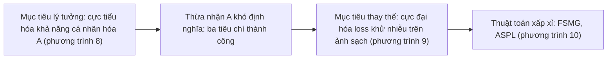
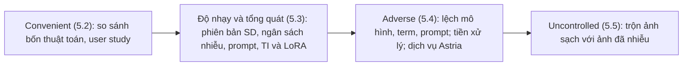

# Case study: Anti-DreamBooth (ICCV 2023)

!!! abstract "Mục tiêu của bài"
    Sau bài này, người học có thể:

    - Phân tích cách một paper phòng vệ (defense) dựng câu chuyện từ một mối đe dọa cụ thể đối với con người, và vì sao cách dựng ấy khác với một paper phương pháp tạo sinh.
    - Nhận ra chuỗi "mục tiêu lý tưởng, mục tiêu thay thế khả thi, thuật toán xấp xỉ" trong phần định nghĩa bài toán, và cách chuỗi này làm cho thiết kế phương pháp trở nên có lý do.
    - Đọc một thang thiết lập đánh giá từ dễ đến khó như một threat model, đồng thời chỉ ra những gì threat model ấy còn để ngỏ.
    - Đánh giá cách chọn và trình bày metric cho ảnh khuôn mặt khi "thành công" của paper là làm cho mô hình sinh ảnh thất bại.
    - Chỉ ra những chỗ ngôn từ chưa khớp với bằng chứng, đề xuất cách sửa, và rút ra bài học về Limitations và ethics cho các paper có khía cạnh Responsible AI.

Phần lớn case study Computer Vision trong chương này phân tích những paper làm cho mô hình mạnh hơn: sâu hơn, hiệu quả hơn, sinh ảnh đẹp hơn hay điều khiển được tốt hơn. Case study này phân tích một paper có mục tiêu ngược lại: làm cho một mô hình sinh ảnh *thất bại* một cách có chủ đích, để bảo vệ con người khỏi việc bị lạm dụng hình ảnh của chính họ.

**Anti-DreamBooth: Protecting Users from Personalized Text-to-Image Synthesis** có danh sách tác giả gồm Thanh Van Le, Hao Phung, Thuan Hoang Nguyen, Quan Dao, Ngoc N. Tran và Anh Tran. Theo trang đầu của paper, năm tác giả thuộc VinAI Research; Ngoc N. Tran thuộc Vanderbilt University, kèm ghi chú rằng công việc được thực hiện khi còn ở VinAI; bốn tác giả đầu được ghi là đóng góp ngang nhau. Paper được công bố tại ICCV 2023 (kỷ yếu, trang 2116–2127). Phân tích dưới đây dựa trên bản arXiv (mã 2303.15433), gồm cả các phụ lục A đến D; bản trong kỷ yếu ICCV có thể khác ở một số chi tiết. Mọi con số được nêu đều lấy từ phần văn bản và các bảng của bản arXiv này.

Paper này đặc biệt đáng học với người học Việt Nam vì ba lý do có thể kiểm chứng từ chính văn bản. Thứ nhất, đây là một paper ở hội nghị chính ICCV do một nhóm nghiên cứu của VinAI Research thực hiện, trên một chủ đề mà cộng đồng quốc tế rất quan tâm. Thứ hai, tài nguyên tính toán được nêu rõ và ở mức vừa phải: huấn luyện một mô hình DreamBooth mất 15 phút trên một GPU NVIDIA A100 40GB, tạo nhiễu bảo vệ mất 2 đến 5 phút; dữ liệu là hai bộ ảnh khuôn mặt công khai, mô hình nền là Stable Diffusion mã nguồn mở, và mã nguồn được công bố. Thứ ba, giá trị chính của paper nằm ở cách *đặt bài toán* và cách *thiết kế đánh giá*, hai thứ không đòi hỏi quy mô tính toán lớn. Đặt cạnh case study [SwiftBrush](swiftbrush.md), một paper phương pháp tạo sinh (CVPR 2024) cũng của VinAI Research và có chung hai tác giả Thuan Hoang Nguyen và Anh Tran, người học thấy rõ cùng một nền tảng kỹ thuật có thể dẫn tới hai kiểu đóng góp với hai cách viết rất khác nhau.

## Bối cảnh: khi năng lực cá nhân hóa trở thành rủi ro

Đến năm 2022–2023, các mô hình sinh ảnh từ văn bản dựa trên diffusion đã đạt chất lượng rất cao. Stable Diffusion, được xây chủ yếu trên [Latent Diffusion](mae-ldm.md#ldm), là mô hình lớn mã nguồn mở đầu tiên thuộc loại này, như chính paper ghi nhận trong phần Related Work. Song song đó là các kỹ thuật **cá nhân hóa** (personalization): Textual Inversion chỉ tối ưu một vector embedding văn bản đại diện cho đối tượng, còn DreamBooth fine-tune chính mô hình sinh ảnh từ vài ảnh tham chiếu, gắn một từ hiếm như "sks" với đối tượng đó. Các công cụ điều khiển như [ControlNet](sam-controlnet.md#controlnet) tăng thêm sức mạnh; Introduction của Anti-DreamBooth trích dẫn ControlNet như một yếu tố đưa năng lực của các mô hình này tới gần người dùng đại chúng hơn.

Hệ quả là chỉ với vài ảnh công khai trên mạng xã hội, bất kỳ ai cũng có thể tạo ảnh chân thực của một người cụ thể trong bối cảnh tùy ý. Trước đó, cộng đồng đã có hai dòng phòng vệ liên quan: **image cloaking** (thêm nhiễu khó nhận thấy vào ảnh trước khi đăng) để chống hệ thống nhận diện khuôn mặt trái phép, và các kỹ thuật phá hỏng việc chỉnh sửa ảnh của DeepFakes dựa trên GAN. Cùng thời điểm, hai công trình đồng thời là GLAZE và AdvDM nhắm tới việc chống bắt chước phong cách hội họa. Anti-DreamBooth đặt mình ở giao điểm còn trống: bảo vệ *con người* khỏi DreamBooth.

Về kiểu đóng góp, đây là một paper **phòng vệ**. Một vài thuật ngữ cần được làm rõ trước khi phân tích. *Nhiễu đối kháng* (adversarial perturbation) là một thay đổi nhỏ, có giới hạn độ lớn, được tối ưu để làm một mô hình hoạt động sai. *Mô hình thay thế* (surrogate model) là mô hình mà bên phòng vệ tự huấn luyện để mô phỏng mô hình thật của kẻ tấn công, vì không truy cập được mô hình thật. *Threat model* (mô hình đe dọa) là tập giả định về mục tiêu, năng lực và hiểu biết của kẻ tấn công cũng như của bên phòng vệ; các nhãn *white-box*, *gray-box*, *black-box* chỉ mức hiểu biết từ đầy đủ tới không có gì về hệ thống bên kia.

Reviewer đọc một paper phòng vệ với một bộ câu hỏi khác với paper phương pháp. Mối đe dọa có thật và có quan trọng không? Bên phòng vệ giả định biết những gì? Khi giả định bị phá vỡ, phòng vệ còn đứng vững không? Người được bảo vệ phải trả giá gì, chẳng hạn nhiễu có lộ ra trên ảnh không? Và phòng vệ thất bại ở đâu? Phần còn lại của case study đi theo đúng năm câu hỏi này, vì Anti-DreamBooth trả lời được phần lớn chúng, và những chỗ nó trả lời chưa trọn chính là nơi có nhiều bài học nhất.

## Câu chuyện một dòng

> DreamBooth cho phép bất kỳ ai, từ vài ảnh công khai, tạo ảnh giả chân thực của một người cụ thể; nhóm tác giả đề xuất bảo vệ người dùng một cách chủ động bằng cách thêm nhiễu đối kháng tinh vi vào ảnh trước khi đăng, sao cho mọi mô hình DreamBooth học từ những ảnh này đều sinh ra ảnh hỏng; vì mô hình cần phá lại được huấn luyện từ chính ảnh đã nhiễu và sinh ảnh qua nhiều bước khử nhiễu ngẫu nhiên, paper chuyển mục tiêu sang phá hàm mất mát khử nhiễu tại từng bước và luân phiên huấn luyện mô hình thay thế với học nhiễu (ASPL), rồi kiểm chứng qua một thang thiết lập từ dễ đến khó.

Câu chuyện có đủ năm mắt xích đã học ở bài [Xây "câu chuyện" của paper](../01-truoc-khi-viet/cau-chuyen.md), nhưng mỗi mắt xích mang một sắc thái riêng của paper phòng vệ. **Vấn đề** không phải là một khoảng cách hiệu năng mà là một thiệt hại tiềm tàng đối với con người. **Khoảng trống** là việc các phòng vệ cho DeepFakes dựa trên GAN không chuyển sang được, vì bài toán mới khác về bản chất. **Insight** gồm hai phần: thay vì tấn công toàn bộ quá trình sinh ảnh, hãy tấn công hàm mất mát huấn luyện tại từng bước khử nhiễu; và mô hình thay thế phải được huấn luyện trên dữ liệu đã nhiễu thì mới giống mô hình của kẻ tấn công. **Giải pháp** là hai thuật toán FSMG và ASPL cùng các biến thể. **Bằng chứng** là một thang thiết lập đi từ thuận lợi đến bất lợi.

Điểm khác biệt sâu nhất so với paper tạo sinh nằm ở chiều của thành công: kết quả "tốt" ở đây là mô hình của kẻ tấn công cho ra ảnh *tệ*. Sự đảo chiều này ảnh hưởng tới mọi thứ ở phía sau, từ cách định nghĩa bài toán tới cách chọn metric và cách đọc mũi tên trong bảng.

## Title và abstract

### Một title đặt tên theo đối thủ

Title theo mẫu "Tên: mô tả" đã phân tích ở bài [Title](../02-viet-tung-phan/title.md). Tên phương pháp "Anti-DreamBooth" định nghĩa chính nó qua đối thủ: chỉ cần đọc hai chữ, người đọc biết paper chống lại cái gì, và tận dụng được độ phổ biến của DreamBooth để được tìm thấy. Phần mô tả "Protecting Users from Personalized Text-to-Image Synthesis" làm hai việc mà cái tên không làm được: gọi tên **người được hưởng lợi** (users, tức con người chứ không phải mô hình) và gọi tên **lớp mối đe dọa** ở mức tổng quát (personalized text-to-image synthesis).

Sự kết hợp "tên cụ thể, mô tả tổng quát" này đáng học. Một cái tên gắn với một công cụ cụ thể dễ nhớ nhưng có nguy cơ cũ đi cùng công cụ đó; phần mô tả tổng quát giữ cho paper phù hợp ngay cả khi công cụ thay đổi. Phạm vi của phần mô tả cũng được bằng chứng ủng hộ, vì paper kiểm chứng thêm trên Textual Inversion, DreamBooth với LoRA và một dịch vụ thương mại. Khi đặt title cho một paper phòng vệ, người viết nên tự hỏi: title đã nói rõ *ai* được bảo vệ và *khỏi cái gì* chưa?

### Một abstract mạnh ở mối đe dọa, thiếu insight và con số

Abstract gồm chín câu, có thể diễn giải như sau:

| Câu | Chức năng | Nội dung (diễn giải) |
|---|---|---|
| 1 | Bối cảnh | Mô hình diffusion sinh ảnh từ văn bản là một cuộc cách mạng, ai cũng tạo được ảnh chân thực |
| 2 | Năng lực cá nhân hóa | Với DreamBooth, có thể sinh ảnh một người cụ thể chỉ từ vài ảnh tham chiếu |
| 3 | Mối đe dọa | Khi bị lạm dụng, công cụ này tạo tin giả hoặc nội dung gây hại nhắm vào cá nhân |
| 4 | Đề xuất | Nhóm tác giả khảo sát một hệ thống phòng vệ tên Anti-DreamBooth |
| 5 | Cơ chế | Thêm nhiễu tinh vi vào ảnh trước khi đăng để phá chất lượng sinh của mọi DreamBooth học từ ảnh đó |
| 6 | Phạm vi đánh giá | Nhiều thuật toán tối ưu nhiễu, hai bộ dữ liệu khuôn mặt, nhiều phiên bản mô hình |
| 7 | Kết quả | Dù DreamBooth và diffusion phức tạp, phương pháp bảo vệ hiệu quả |
| 8 | Độ bền | Hiệu quả vẫn đứng vững khi mô hình, prompt hoặc term bị lệch giữa huấn luyện và kiểm thử |
| 9 | Tài nguyên | Mã nguồn sẽ được công bố |

Abstract này mạnh ở ba điểm. Ba câu đầu dựng mối đe dọa theo một trình tự rất tự nhiên: năng lực chung, năng lực cá nhân hóa, rồi sự lạm dụng, với những thiệt hại cụ thể (tin giả, nội dung gây hại nhắm vào một nạn nhân). Câu 5 mô tả cơ chế phòng vệ bằng ngôn ngữ mà cả người ngoài ngành cũng hiểu: thêm nhiễu vào ảnh trước khi đăng. Và câu 8 báo trước rằng paper có đánh giá trong điều kiện bất lợi, đúng thứ reviewer của một paper phòng vệ muốn thấy.

Tuy vậy, so với khuôn ở bài [Abstract](../02-viet-tung-phan/abstract.md), abstract thiếu hai thứ. Thứ nhất là **insight**: câu 7 nói bài toán khó và phương pháp vẫn hiệu quả, nhưng không nói *bằng cách nào* vượt qua cái khó. Ý tưởng tấn công hàm mất mát tại từng bước khử nhiễu và ý tưởng luân phiên huấn luyện mô hình thay thế chỉ xuất hiện trong Introduction và Section 4. Thứ hai là **con số**: paper có những con số rất dễ hiểu, chẳng hạn trong user study, số ảnh chất lượng tốt trung bình (trên sáu ảnh) giảm từ 4,72 xuống 0,42. Ngoài ra, abstract không có nửa câu nào về giới hạn, trong khi với một paper phòng vệ, một lời nói rõ phạm vi lại làm tăng độ tin cậy.

Câu mở đầu cũng đáng một lưu ý về ngôn ngữ. Cụm "are nothing but a revolution" dùng "nothing but" theo nghĩa nhấn mạnh, nhưng trong tiếng Anh chuẩn, "nothing but" mang nghĩa "chỉ là"; thành ngữ khen ngợi tương ứng là "nothing short of". Một câu trung tính hơn như "have transformed image generation" vừa đúng ngữ pháp vừa tránh giọng phóng đại mà bài [Tiếng Anh học thuật](../03-ky-thuat/van-phong.md) khuyên tránh. Một phiên bản minh họa (không phải của nhóm tác giả), chỉ dùng thông tin có trong paper và có độ dài tương đương bản gốc:

*"Personalization methods such as DreamBooth let anyone fine-tune a text-to-image diffusion model on a few photos of a person and then generate realistic images of that person, which can be misused for fake news or harassment. We study a proactive defense, Anti-DreamBooth, that adds subtle adversarial noise to a user's photos before they are published, so that any DreamBooth model fine-tuned on them produces corrupted images. Because the attacker's generator is trained on the perturbed photos themselves and samples through many stochastic steps, we attack the per-step denoising loss and alternate between training a surrogate DreamBooth model and updating the noise (ASPL). On VGGFace2, ASPL raises the face-detection failure rate of generated images from 0.07 to 0.63, and in a user study it reduces the average number of good-quality images from 4.72 to 0.42 out of six. The defense remains effective when the attacker's base model, identifier term or training prompt differs from ours, but weakens when clean photos of the user are also available."*

Phiên bản này thêm insight, hai con số và một câu giới hạn, đổi lại bỏ đi câu bối cảnh chung và câu về mã nguồn. Đó là sự đánh đổi mà người viết nên cân nhắc: trong một abstract, câu bối cảnh chung thường là câu rẻ nhất để hy sinh.

## Introduction: từ năng lực đến mối đe dọa, từ mối đe dọa đến khó khăn kỹ thuật

Introduction gồm sáu đoạn, một hình (Figure 1) và một danh sách đóng góp viết liền trong đoạn văn. Có thể đọc nó như một lập luận đi qua hai bước chuyển: từ năng lực của công nghệ sang mối đe dọa mà năng lực ấy tạo ra, rồi từ mối đe dọa sang những khó khăn kỹ thuật khiến việc phòng vệ không tầm thường.

### Đoạn 1 và 2: năng lực của công cụ chính là nguồn gốc của rủi ro

Đoạn đầu ca ngợi mô hình diffusion: ảnh chân thực và đa dạng, kết hợp với mô hình ngôn ngữ để sinh ảnh từ văn bản, một bức tranh do máy tạo từng thắng một cuộc thi nghệ thuật, ảnh tổng hợp khó phân biệt với ảnh thật, và ControlNet đưa thêm khả năng điều khiển. Đoạn thứ hai giới thiệu cá nhân hóa bằng những ví dụ vô hại (tạo ảnh bản thân trong thế giới giả tưởng, tạo ảnh người thân làm quà), so sánh Textual Inversion với DreamBooth, và kết luận DreamBooth phổ biến hơn vì fine-tune cả mô hình nên chất lượng cá nhân hóa tốt hơn.

Một paper phòng vệ dành hai đoạn đầu để khen chính công nghệ mà nó sẽ chống lại, và đó là một lựa chọn có chủ đích. Mức độ rủi ro tỉ lệ với năng lực và khả năng tiếp cận, nên mỗi "điểm mạnh" ở hai đoạn này trở thành một tiền đề cho mối đe dọa ở đoạn sau: ảnh khó phân biệt với thật thì tin giả dễ được tin; chỉ cần vài ảnh thì bất kỳ ai có ảnh công khai đều có thể là nạn nhân; công cụ phổ biến thì bề mặt tấn công rộng. Đoạn thứ hai còn trả lời trước câu hỏi "vì sao tập trung vào DreamBooth mà không phải Textual Inversion?", một câu hỏi reviewer chắc chắn sẽ đặt ra.

Một chi tiết đáng chú ý là hai trích dẫn trong đoạn đầu là bài báo của NBC News và New York Times. Với một paper phòng vệ, bằng chứng rằng mối đe dọa có thật trong xã hội là một phần của lập luận, và báo chí là nguồn hợp lý cho loại bằng chứng này. Điều cần giữ là ranh giới: báo chí dùng để chứng minh *tầm quan trọng xã hội*, còn các claim kỹ thuật vẫn phải dựa vào tài liệu học thuật, đúng như cách paper làm.

### Đoạn 3: kịch bản lạm dụng và tính cấp bách

Đoạn thứ ba nêu hai kịch bản cụ thể: lan truyền tin giả bằng ảnh chân thực của một người nổi tiếng, điều có thể xếp vào DeepFakes (kèm trích dẫn một bài khảo sát), mà paper gọi là một trong những mối đe dọa tội phạm AI nghiêm trọng nhất; và tạo ảnh gây hại nhắm vào một người cụ thể, làm xáo trộn cuộc sống và danh tiếng của họ. Đoạn kết bằng một câu về tính cấp bách: mối đe dọa của DeepFakes dựa trên GAN đã được biết rõ, còn mối nguy từ DreamBooth chưa được cộng đồng nhận thức.

Hai kịch bản có nạn nhân và thiệt hại cụ thể, và việc nối chúng với khái niệm DeepFakes quen thuộc giúp reviewer xếp bài toán vào một bản đồ đã biết. Câu về tính cấp bách thì có thể viết chặt hơn ở hai điểm. Về ngữ pháp, "has yet to be aware by the community" nên là "has yet to be recognized by the community". Về nội dung, chính Section 2.4 ghi nhận hai công trình đồng thời (GLAZE và AdvDM) cũng nhằm bảo vệ trước mô hình cá nhân hóa, nên claim "cộng đồng chưa nhận thức" dễ bị phản biện. Một cách viết chính xác hơn là thu hẹp claim về đúng chỗ paper mới: "the risk to personal identity, as opposed to artistic style, has received little attention". Câu như vậy vừa an toàn hơn vừa làm sắc thêm định vị.

### Đoạn 4: ý tưởng phòng vệ và ba khác biệt với bài toán cũ

Đoạn thứ tư giới thiệu ý tưởng, lấy cảm hứng từ các nghiên cứu phòng chống DeepFakes: chủ động bảo vệ từng người dùng bằng cách tiêm nhiễu đối kháng tinh vi vào ảnh trước khi đăng, sao cho mọi mô hình DreamBooth huấn luyện trên ảnh đã nhiễu đều không tạo được ảnh đối tượng ở chất lượng chấp nhận được. Ngay sau đó, paper khẳng định Anti-DreamBooth có cùng mục tiêu với các kỹ thuật phá DeepFakes dựa trên GAN nhưng khác về bản chất, và nêu ba khác biệt bằng ba gạch đầu dòng:

1. Với GAN, bên phòng vệ tối ưu nhiễu cho một ảnh để nhắm vào một generator cố định; với Anti-DreamBooth, generator cần phá là *động và chưa biết*, vì nó được fine-tune từ chính những ảnh đã nhiễu.
2. Generator GAN tạo ảnh bằng một bước forward, nên gradient dễ tính; generator diffusion tạo ảnh qua một chuỗi bước khử nhiễu không tất định, khiến không thể tính gradient đầu–cuối để tối ưu.
3. Thiết lập phức tạp hơn vì có nhiều yếu tố: prompt khi huấn luyện và khi suy luận, cấu trúc mô hình, trọng số tiền huấn luyện, và nhiều thứ khác.

Đây là kỹ thuật "giải thích vì sao giải pháp cũ không dùng thẳng được", mà case study [Streaming ITN](streaming-itn.md) cũng phân tích. Không có ba gạch đầu dòng này, reviewer rất dễ tóm tắt paper thành "áp dụng image cloaking cho diffusion" và đánh giá nó là incremental. Có chúng, việc áp dụng trở thành một bài toán mới với ba khó khăn được gọi tên. Điều làm cho ba khó khăn này thuyết phục là cách phát biểu: mỗi khó khăn được nêu thành một *đặc điểm cấu trúc* của bài toán, chứ không phải một lời than phiền chung chung, nên người đọc có thể chờ xem phương pháp trả lời từng đặc điểm ra sao.

### Đoạn 5, đoạn 6 và danh sách đóng góp

Đoạn thứ năm mở bằng "Despite the complexity mentioned above" và nêu insight lần đầu tiên trong paper: thay vì nhắm vào toàn bộ quá trình sinh ảnh, có thể điều chỉnh quá trình học đối kháng để phá từng bước lấy mẫu của diffusion. Tiếp theo là tóm tắt kết quả: phá được các lần thử DreamBooth trong thiết lập có kiểm soát, nhất quán qua các mô hình và prompt, và vẫn hiệu quả trong điều kiện bất lợi. Đoạn cuối liệt kê bốn đóng góp, đánh số (1) đến (4) ngay trong câu: bàn về tác động tiêu cực và định nghĩa một bài toán mới, đề xuất bảo vệ chủ động bằng nhiễu đối kháng, thiết kế các thuật toán thích nghi với quá trình diffusion theo bước và DreamBooth dựa trên fine-tune, và đánh giá rộng trên hai benchmark khuôn mặt.

Đóng góp thứ nhất, "định nghĩa một bài toán mới", là một loại đóng góp hợp lệ và đặc biệt phổ biến ở các paper Responsible AI, với điều kiện paper thực sự định nghĩa bài toán một cách hình thức. Anti-DreamBooth làm đúng như vậy ở Section 3, nên claim này có bằng chứng.

Có một chỗ ngôn từ cần cân nhắc. Đoạn thứ năm viết rằng các thuật toán "successfully break all DreamBooth attempts in the controlled settings". Các bảng chỉ báo cáo giá trị trung bình trên 50 danh tính: chẳng hạn trong Table 1, tỉ lệ ảnh không phát hiện được khuôn mặt với ASPL là 0,63 trên VGGFace2 và 0,31 trên CelebA-HQ. Nghĩa là một phần đáng kể ảnh sinh ra vẫn có khuôn mặt phát hiện được; những ảnh đó vẫn có thể được tính là phòng vệ thành công nếu sai danh tính hoặc chất lượng kém, theo đúng tiêu chí mà paper đặt ra, nhưng người đọc không có cách nào kiểm chứng chữ "all" từ các con số trung bình. Có hai cách sửa: báo cáo tỉ lệ danh tính được bảo vệ (bao nhiêu trong 50 mô hình bị phá theo một ngưỡng nêu trước), hoặc làm mềm thành "substantially degrade all evaluated DreamBooth models".

### Figure 1: một hình kể kịch bản đe dọa

Theo caption, Figure 1 minh họa kịch bản: kẻ tấn công thu thập ảnh của người dùng để huấn luyện một generator cá nhân hóa cho mục đích xấu; Anti-DreamBooth thêm nhiễu khó nhận thấy vào ảnh trước khi đăng, khiến mọi generator cá nhân hóa huấn luyện trên những ảnh này không tạo được ảnh dùng được. Caption hai câu tự đứng được, đúng nguyên tắc ở bài [Figures & Tables](../02-viet-tung-phan/figures-tables.md).

Về loại hình, đây là Figure 1 kiểu "kịch bản bài toán" đã bàn ở bài [Introduction & Figure 1](../02-viet-tung-phan/introduction.md). Với một paper phòng vệ, Figure 1 cần cho thấy *cả hai thế giới*: thế giới không có phòng vệ, nơi thiệt hại xảy ra, và thế giới có phòng vệ, nơi thiệt hại bị chặn. Một hình chỉ vẽ kiến trúc phương pháp sẽ bỏ lỡ thông điệp quan trọng nhất, rằng có một con người cần được bảo vệ. Chữ "imperceptible" trong caption là một claim mà phần thí nghiệm sẽ phải đối chiếu; chúng ta sẽ quay lại điểm này ở phần ngân sách nhiễu.

### Khó khăn ở Introduction và câu trả lời trong paper

Đặt ba khó khăn của đoạn thứ tư cạnh phần còn lại của paper, có thể thấy mỗi khó khăn đều có một câu trả lời cụ thể:

| Khó khăn nêu ở Introduction | Câu trả lời trong paper |
|---|---|
| Generator động, chưa biết, được fine-tune từ chính ảnh đã nhiễu | Phát biểu bài toán dạng tối ưu hai cấp (phương trình 8 và 9); ASPL luân phiên huấn luyện mô hình thay thế trên ảnh đã nhiễu và học nhiễu (phương trình 10) |
| Lấy mẫu nhiều bước, không tất định, không tính được gradient đầu–cuối | Tấn công hàm mất mát khử nhiễu có điều kiện tại một timestep chọn ngẫu nhiên (Section 4.1) thay vì toàn bộ quá trình sinh |
| Nhiều yếu tố: prompt huấn luyện và suy luận, cấu trúc mô hình, trọng số tiền huấn luyện | Prompt suy luận chưa thấy, nhiều phiên bản Stable Diffusion, lệch mô hình, lệch term, lệch prompt (Section 5.3, 5.4) |

Bảng này cho thấy ba gạch đầu dòng không phải một danh sách khó khăn để tô đậm độ khó, mà là một bản hợp đồng: mỗi khó khăn được nêu ra đều được trả lời ở đâu đó trong paper. Đây là cách tự kiểm tra mà case study [ViP-VL](vip-vl.md) cũng đề xuất: nếu một khó khăn trong Introduction không có câu trả lời, reviewer sẽ nhận ra.

## Related Work: bốn dòng chảy và một ranh giới với công trình đồng thời

Mục Related Work có bốn tiểu mục: mô hình sinh ảnh từ văn bản, cá nhân hóa, tấn công đối kháng, và bảo vệ người dùng bằng image cloaking. Có thể đọc bốn tiểu mục như bốn dòng chảy hội tụ vào paper: thứ đang bị lạm dụng (mô hình sinh ảnh), công cụ của mối đe dọa (cá nhân hóa), vũ khí của bên phòng vệ (tấn công đối kháng), và dòng dõi trực tiếp của phương pháp (image cloaking).

Tiểu mục cuối được viết tốt nhất và quan trọng nhất. Nó chia image cloaking thành hai ứng dụng. Ứng dụng thứ nhất là chống nhận diện khuôn mặt trái phép: Fawkes dùng tấn công có mục tiêu để dịch chuyển danh tính trong không gian embedding và chuyển được sang các hệ thống hộp đen; Lowkey dùng ensemble nhiều mô hình thay thế và làm mượt Gaussian để tăng độ bền; AMT-GAN tạo nhiễu dưới dạng trang điểm; OPOM tối ưu mặt nạ riêng tư phổ quát theo từng người. Ứng dụng thứ hai là phá việc chỉnh sửa ảnh của DeepFakes dựa trên GAN, trong đó Huang và cộng sự luân phiên huấn luyện mô hình thay thế với một bộ sinh nhiễu. Điều đáng chú ý là những thành phần mà phần phương pháp dùng lại (tấn công có mục tiêu của Fawkes, ensemble của Lowkey, cách luân phiên của Huang và cộng sự) đều đã xuất hiện ở đây, và phần phương pháp ghi nhận lại nguồn gốc bằng những câu như "Inspired by [26]". Người đọc vì thế thấy rõ đâu là thành phần thừa hưởng, đâu là cách kết hợp mới.

Tiểu mục khép lại bằng hai công trình đồng thời, GLAZE và AdvDM, với cách phân biệt theo hai trục, đúng như bài [Related Work](../02-viet-tung-phan/related-work.md) khuyến nghị cho concurrent work. Trục **mục tiêu**: hai công trình kia chống bắt chước phong cách nghệ thuật, còn Anti-DreamBooth chống tạo ảnh giả hoặc gây hại về một người. Trục **thiết lập kỹ thuật**: GLAZE dùng hướng dẫn chuyển phong cách phức tạp khó thích nghi cho bối cảnh bảo vệ người dùng; AdvDM chỉ xét Textual Inversion, nơi generator cố định, khác với việc fine-tune của DreamBooth. Phân biệt theo cả mục tiêu lẫn kỹ thuật giúp paper không bị coi là "một biến thể nữa" của hai công trình kia.

Hai tiểu mục đầu thì nghiêng về tổng quan hơn là định vị. Đặc biệt, tiểu mục cá nhân hóa mở đầu bằng cá nhân hóa trong hệ gợi ý và federated learning, một nghĩa khác hẳn của chữ "personalization" và không phục vụ lập luận. Câu đó có thể cắt để dành chỗ cho một đoạn threat model hoặc một đoạn Limitations, hai thứ mà paper đang thiếu. Ngoài ra, tiểu mục tấn công đối kháng kết thúc bằng các công trình về gradient obfuscation và kỹ thuật expectation-over-transformation, tức chính dòng nghiên cứu cảnh báo rằng các phòng vệ cần được đánh giá trước kẻ tấn công biết về phòng vệ. Paper trích dẫn dòng nghiên cứu này nhưng không quay lại nó ở phần đánh giá; mục tiếp theo sẽ bàn vì sao đây là một cơ hội bị bỏ lỡ.

## Định nghĩa bài toán: phần làm nên một paper phòng vệ

### Một mục "Problem" đứng riêng trước phương pháp

Section 3 mang tên "Problem" và đứng riêng trước Section 4 về phương pháp. Nó gồm hai phần: Background (tấn công đối kháng với PGD, mô hình diffusion, mô hình diffusion có điều kiện văn bản, và hàm mất mát của DreamBooth với thành phần prior preservation) và Problem definition. Với một paper phương pháp thông thường, phần định nghĩa bài toán thường chỉ chiếm một đoạn trong mục Method. Với một paper định nghĩa bài toán mới, nhất là bài toán phòng vệ, nó là một đóng góp, và việc dành hẳn một mục cho nó báo hiệu điều đó với reviewer.

Phần Background khá dài so với mức quen thuộc của độc giả ICCV với PGD và diffusion, nhưng nó có chức năng rõ ràng: thiết lập ký hiệu được dùng lại ngay sau đó. Hàm mất mát DreamBooth ở phương trình (7) xuất hiện lại trong các phương trình (8), (9) và (10). Đây là cách dùng preliminaries đúng như bài [Method](../02-viet-tung-phan/method.md) mô tả: chỉ trình bày nền tảng nào sẽ được dùng tới.

### Từ mục tiêu lý tưởng đến mục tiêu khả thi

Phần Problem definition đi qua ba bước, và đây là đoạn lập luận chặt chẽ nhất của paper.

Bước thứ nhất là **mục tiêu lý tưởng**. Gọi $\mathcal{X}$ là tập ảnh của người cần bảo vệ. Mỗi ảnh được cộng nhiễu $\delta$ và chỉ ảnh đã nhiễu được đăng. Kẻ tấn công thu thập $N_{db}$ ảnh đã nhiễu và fine-tune generator theo DreamBooth để được bộ trọng số $\theta^*$. Bên phòng vệ muốn tìm tập nhiễu làm cực tiểu một hàm đánh giá khả năng cá nhân hóa $\mathcal{A}(\epsilon_{\theta^*}, \mathcal{X})$, đo cả chất lượng ảnh sinh lẫn độ đúng danh tính, với ràng buộc $\theta^*$ là nghiệm của bài toán fine-tune trên ảnh đã nhiễu và độ lớn nhiễu không vượt ngân sách $\eta$.

Bước thứ hai là **thừa nhận giới hạn của chính mục tiêu đó**. Paper viết rằng khó định nghĩa một hàm $\mathcal{A}$ thống nhất, rồi định nghĩa thành công theo ba tiêu chí: ảnh sinh ra có chất lượng tệ (nhiễu, mờ, méo, artifact rõ rệt), hoặc không có hay không nhận ra được người, hoặc sai danh tính. Ngay cả tiêu chí đầu cũng không có một metric chất lượng ảnh "tất cả trong một".

Bước thứ ba là **chuyển sang một mục tiêu thay thế tối ưu được**: cực đại hóa hàm mất mát khử nhiễu có điều kiện của mô hình $\theta^*$ trên ảnh *sạch*, trong đó $\theta^*$ được huấn luyện trên ảnh *đã nhiễu* (phương trình 9). Trực giác được nêu bằng một câu: khi mô hình DreamBooth overfit trên ảnh đối kháng, có thể đánh lừa để nó tái tạo ảnh sạch tệ hơn. Đây vẫn là một bài toán tối ưu hai cấp khó, và Section 4.2 đưa ra các thuật toán xấp xỉ nghiệm của nó.

Chuỗi ba bước này làm được ba việc. Nó cho thấy nhóm tác giả biết rõ điều họ thực sự muốn (hàm $\mathcal{A}$), thừa nhận trung thực rằng điều đó không tối ưu trực tiếp được, và biến mục tiêu thay thế thành một lựa chọn có lý do thay vì một công thức xuất hiện bất ngờ. Ba tiêu chí thành công còn có một giá trị thứ tư: chúng *định nghĩa trước* thế nào là thành công, và phần thí nghiệm sau đó gán mỗi tiêu chí một metric. Bài học chung là: hãy định nghĩa thành công trước khi trình bày kết quả, nhất là khi thành công có nghĩa là "một mô hình thất bại", vì có rất nhiều cách để thất bại.

Có hai chỗ trong phần này có thể chính xác hơn. Thứ nhất, paper gọi $\theta^*$ là "optimal hyper-parameters" (Section 3.2) và gọi $\theta_{\text{clean}}$ là "hyperparameters" (Section 4.2), trong khi đây là tham số (trọng số) của mô hình; hyperparameter là những thứ như learning rate hay số bước huấn luyện. Trong một paper mà cả hai loại đều quan trọng, sự lẫn lộn này dễ gây hiểu nhầm. Thứ hai, ràng buộc được viết với chuẩn $\ell_p$ tổng quát, còn phần thí nghiệm chỉ nêu ngân sách mặc định $\eta = 0{,}05$ và bước cập nhật $\alpha = 0{,}005$, không nói rõ $p$ nào được dùng và giá trị pixel được đo trên thang nào. Người đọc quen PGD có thể đoán từ phép cập nhật theo dấu của gradient ở phương trình (3), nhưng ý nghĩa của các mức ngân sách từ 0,01 tới 0,15 trong Table 3 phụ thuộc trực tiếp vào thang này, nên nửa câu trong phần thiết lập sẽ loại bỏ sự phỏng đoán.

### Thang thiết lập như một threat model

Phần cuối của Section 3.2 chia các thiết lập phòng vệ thành ba loại, "from easy to hard". Paper không dùng chữ "threat model", nhưng ba thiết lập này vận hành đúng như một threat model, được sắp xếp theo **mức hiểu biết của bên phòng vệ**:

| Thiết lập | Bên phòng vệ biết gì | Kẻ tấn công làm gì | Cách paper gọi | Nơi kiểm chứng |
|---|---|---|---|---|
| Convenient | Generator tiền huấn luyện, term huấn luyện (như "sks"), prompt huấn luyện | Fine-tune DreamBooth chỉ trên ảnh đã nhiễu, với cấu hình mặc định | "white-box" | Section 5.2, 5.3; Table 1, 2, 3, 7 |
| Adverse | Không biết generator, term hoặc prompt; dùng thành phần thay thế có thể lệch với thật | Đổi mô hình nền, đổi term (như "t@t"), đổi prompt huấn luyện; trong Section 5.4 còn có tiền xử lý ảnh và một dịch vụ thương mại | "gray-box" | Section 5.4; Table 4, 6, Phụ lục B |
| Uncontrolled | Không kiểm soát được mọi ảnh: một số ảnh sạch bị lộ | Trộn ảnh sạch với ảnh đã nhiễu để fine-tune | Không gán nhãn | Section 5.5; Table 5 |

Trục "bên phòng vệ biết gì" là trục đúng cho một phòng vệ kiểu image cloaking, vì bên phòng vệ phải hành động *trước* và *mù*: nhiễu được thêm vào lúc đăng ảnh, khi chưa biết ai sẽ tấn công và bằng công cụ gì.

Paper còn chủ động bảo vệ thiết lập dễ nhất khỏi lời chê "white-box là phi thực tế". Câu "While sounding restricted, it is practical" được theo sau bởi hai lý do: generator tiền huấn luyện phải chất lượng cao và mã nguồn mở, mà khi đó chỉ có Stable Diffusion với vài phiên bản; và người dùng thường dùng term và prompt mặc định trong mã của DreamBooth. Lý do thứ nhất kiểm chứng được. Lý do thứ hai là một claim thực nghiệm về hành vi người dùng nhưng không kèm bằng chứng; chỉ cần dẫn tới giá trị mặc định trong một bản cài đặt DreamBooth phổ biến là claim này chắc hơn hẳn.

Giá trị lớn nhất của thang này nằm ở bậc cuối. Thiết lập uncontrolled là nơi nhóm tác giả *dự đoán phương pháp sẽ gặp khó*, và họ định nghĩa nó ngay trong phần bài toán, trước khi có bất kỳ kết quả nào: paper viết rằng thiết lập này khá thử thách vì DreamBooth có thể học từ ảnh chưa nhiễu. Tự định nghĩa điều kiện thất bại của chính mình trước khi trình bày kết quả là một hành động hiếm thấy và tạo ra rất nhiều tin cậy.

### Điều threat model còn để ngỏ

Thang ba bậc được tổ chức quanh câu hỏi "bên phòng vệ biết gì về kẻ tấn công", nhưng không nói gì về câu hỏi ngược lại: **kẻ tấn công biết gì về phòng vệ**. Một reviewer từ cộng đồng bảo mật sẽ hỏi ngay: nếu kẻ tấn công biết ảnh có thể đã được bảo vệ bằng Anti-DreamBooth, họ có thể xử lý hoặc làm sạch ảnh trước khi fine-tune. Paper có trả lời một phần câu hỏi này: thử làm mờ Gaussian và nén JPEG (Table 6 và Table 8), thử công cụ làm sạch Adverse Cleaner (Figure 16, chỉ định tính), và thừa nhận ở Phụ lục D.4 rằng các phép xử lý này có thể chưa đại diện cho mọi kỹ thuật xóa bảo vệ. Nhưng những thí nghiệm ấy xuất hiện như một mục "Image preprocessing" trong thiết lập adverse, không phải như một bậc được định nghĩa trong threat model.

Như đã nói, Related Work có trích dẫn chính dòng nghiên cứu xác lập chuẩn mực này. Một đoạn ngắn mang tiêu đề "Threat model" trong Section 3.2 sẽ gom cả ba thiết lập lẫn các thí nghiệm tiền xử lý vào một bức tranh tường minh, và cho reviewer thấy những gì nằm ngoài phạm vi là do lựa chọn chứ không phải do bỏ sót.

!!! tip "Một đoạn threat model ngắn cho paper phòng vệ"
    Một khuôn đơn giản, mỗi câu trả lời một câu hỏi mà reviewer chắc chắn sẽ đặt ra:

    *"**Threat model.** The attacker's goal is to … The attacker can … (capabilities: data access, training procedure, compute). We assume the attacker does / does not know … (knowledge of the defense, including whether they may pre-process or purify inputs). The defender can … and knows … (knowledge of the attacker's model, prompts, settings). Out of scope: … ."*

    Câu về hiểu biết của kẻ tấn công đối với phòng vệ là câu hay bị bỏ quên nhất, và cũng là câu reviewer ML và bảo mật hỏi nhiều nhất.

## Phương pháp: hai thuật toán, hai tiền tố

Section 4 ngắn và rõ. Nó bắt đầu bằng hướng tổng thể (Section 4.1, đã phân tích ở trên), rồi trình bày hai thuật toán chính và hai cách mở rộng. Figure 2 minh họa cả hai thuật toán trong một hình, và caption của nó mô tả đủ luồng xử lý của từng thuật toán để người đọc hiểu mà không cần đọc văn bản.

### FSMG: chủ động gọi tên cách làm hiển nhiên

Thuật toán thứ nhất, **Fully-trained Surrogate Model Guidance (FSMG)**, đi theo hướng của phần lớn các phương pháp image cloaking trước đó: dùng một mô hình DreamBooth thay thế, fine-tune đầy đủ trên một tập nhỏ ảnh sạch $\mathcal{X}_A$, rồi dùng nó dẫn đường cho PGD tìm nhiễu làm cực đại hàm mất mát khử nhiễu. Paper nêu hai thuận lợi thực tế: tập $\mathcal{X}_A$ không cần chứa các ảnh cần bảo vệ và có thể cố định, nên mô hình thay thế chỉ cần học một lần. Kỳ vọng được phát biểu bằng một câu: mọi mô hình DreamBooth fine-tune từ ảnh đã nhiễu sẽ bị đẩy ra xa $\theta_{\text{clean}}$.

Paper dùng chữ "naively" khi giới thiệu FSMG, và đó là một cách đóng khung khéo léo. FSMG vừa là một baseline hợp lý, thừa hưởng trực tiếp từ tài liệu, vừa là bậc đệm để giới thiệu thuật toán thứ hai. Với một bài toán mới chưa có baseline nào, tự xây baseline "hiển nhiên" mạnh nhất từ tài liệu là cách duy nhất để chứng minh giá trị gia tăng của phương pháp chính, đúng với tinh thần so sánh công bằng ở bài [Thiết kế thí nghiệm](../01-truoc-khi-viet/thi-nghiem.md).

### ASPL: lý do trước, cơ chế sau

Thuật toán thứ hai, **Alternating Surrogate and Perturbation Learning (ASPL)**, được giới thiệu bằng đúng khuôn Why–What–How. *Why*: một mô hình thay thế huấn luyện đầy đủ trên ảnh sạch "may not be a good approximation" cho bài toán ở phương trình (9), vì mô hình thật của kẻ tấn công được huấn luyện trên ảnh *đã nhiễu*. *What*: kết hợp việc huấn luyện mô hình thay thế với việc học nhiễu theo kiểu luân phiên, lấy cảm hứng từ công trình của Huang và cộng sự. *How*: mô hình thay thế khởi tạo từ trọng số tiền huấn luyện; ở mỗi vòng lặp, một bản sao được fine-tune trên ảnh sạch $\mathcal{X}_A$, bản sao này được dùng để học nhiễu bằng PGD, rồi mô hình thay thế thật được cập nhật trên ảnh vừa nhiễu. Câu kết nêu lại lý do: nhờ chỉ được huấn luyện trên dữ liệu đã nhiễu, mô hình thay thế mô phỏng tốt hơn mô hình của kẻ tấn công.

Phương trình (10) trình bày một vòng lặp bằng bốn dòng có dạng gần như mã giả, kể cả lời gọi `clone()`. Lựa chọn này khiến thuật toán đọc được ngay cả với người không quen ký hiệu tối ưu hai cấp. Về mặt lập luận, ASPL có thể hiểu là một cách xấp xỉ bài toán con bên trong của phương trình (9), bám theo nghiệm của nó trong suốt quá trình tối ưu thay vì cố định từ đầu như FSMG. Hai thuật toán vì thế không phải hai ý tưởng rời rạc mà là hai mức xấp xỉ của cùng một bài toán, và sự khác biệt giữa chúng chính là điều Table 1 sẽ đo.

### Tiền tố T- và E-: đặt tên để kết hợp

Hai cách mở rộng được trình bày như những "plug-in". Cách thứ nhất là **tấn công có mục tiêu**: vì các nhiễu không mục tiêu có thể đẩy mô hình theo những hướng khác nhau và triệt tiêu lẫn nhau, paper đề xuất chọn một ảnh đích duy nhất, lấy cảm hứng từ Fawkes, và ký hiệu các biến thể bằng tiền tố "T-". Cách thứ hai là **ensemble** cho thiết lập adverse: dùng nhiều mô hình thay thế fine-tune từ các generator tiền huấn luyện khác nhau, ký hiệu bằng tiền tố "E-". Paper nói rõ một chi tiết cài đặt mà người đọc khó đoán: do giới hạn bộ nhớ, các mô hình được dùng lần lượt, xen kẽ, thay vì cùng lúc.

Lược đồ đặt tên "thuật toán gốc cộng tiền tố" (T-FSMG, T-ASPL, E-ASPL) cho phép người đọc giải mã bất kỳ biến thể nào mà không cần tra bảng, giống lược đồ ký hiệu $B/H/S$ trong case study [Streaming ITN](streaming-itn.md). Tên đầy đủ của hai thuật toán gốc cũng mô tả đúng cơ chế: "fully-trained surrogate" và "alternating surrogate and perturbation learning" chính là điểm khác biệt duy nhất giữa chúng.

### Tự nêu xấp xỉ của chính phương pháp

Cuối Section 4.1 có một câu nhỏ nhưng quan trọng: khác với tấn công đối kháng truyền thống, hàm mất mát chỉ được tính tại một timestep chọn ngẫu nhiên trong chuỗi khử nhiễu, và dù vậy, cách làm này vẫn phá được ảnh đầu ra (dẫn tới Section 5). Đây là câu trả lời trực tiếp cho khó khăn thứ hai trong Introduction, và việc tự nêu ra nó chặn trước câu hỏi "tấn công một bước ngẫu nhiên có đủ để phá cả chuỗi lấy mẫu không?". Câu này có thể mạnh hơn nữa nếu kèm một lập luận ngắn hoặc một thí nghiệm nhỏ giải thích *vì sao* nó đủ; hiện tại, bằng chứng duy nhất là kết quả cuối cùng ở Section 5.

## Thí nghiệm: đánh giá một phương pháp phòng vệ

Mục thí nghiệm được tổ chức bám đúng thang ở Section 3.2: thiết lập convenient (5.2), các phân tích bổ sung (5.3), thiết lập adverse (5.4) và thiết lập uncontrolled (5.5). Phần thân bài dùng VGGFace2 cho hầu hết phân tích, với một câu khoanh vùng rõ ràng ở đầu Section 5.4 ("Unless otherwise specified, all experiments will be conducted using ASPL with SD V2.1 and on the VGGFace2 dataset"), còn Phụ lục A lặp lại các thí nghiệm trên CelebA-HQ và bổ sung kết quả của FSMG (Table 10 đến Table 15). Cách phân công này rất đáng học: thân bài phục vụ lập luận, phụ lục phục vụ việc lặp lại kết quả trên bộ dữ liệu thứ hai.

### Thiết lập: tiêu chí trước, tên dataset sau

Phần chọn dữ liệu nêu bốn tiêu chí *trước khi* gọi tên bộ dữ liệu nào: nhiều danh tính có gán nhãn; mỗi danh tính đủ ảnh để tạo hai tập tham chiếu và bảo vệ; độ phân giải trung bình đến cao; ảnh đa dạng, chụp trong điều kiện tự nhiên. Chỉ sau đó paper mới chọn CelebA-HQ (30.000 ảnh $1024 \times 1024$, dùng một tập con có gán nhãn gồm 307 danh tính, mỗi danh tính ít nhất 15 ảnh) và VGGFace2 (khoảng 3,31 triệu ảnh của 9.131 danh tính, lọc lấy những danh tính có ít nhất 15 ảnh độ phân giải trên $500 \times 500$). Nêu tiêu chí trước khiến lựa chọn dữ liệu đọc như một hệ quả của yêu cầu bài toán, không phải một sự tiện tay.

Mỗi bộ dữ liệu lấy 50 danh tính; với mỗi danh tính, 12 ảnh đầu được chia thành ba tập bốn ảnh: tập ảnh sạch tham chiếu, tập ảnh cần bảo vệ, và một tập ảnh sạch bổ sung dành riêng cho thí nghiệm uncontrolled. Tập thứ ba cho thấy thiết lập khó nhất đã được lên kế hoạch ngay từ khâu chuẩn bị dữ liệu, trước khi có kết quả. Phần cấu hình nêu đủ để tái hiện: DreamBooth huấn luyện cả text encoder và UNet, batch size 2, learning rate $5 \times 10^{-7}$, 1000 bước, Stable Diffusion v2.1 làm mặc định, prompt huấn luyện "a photo of sks person" và prompt prior "a photo of person"; PGD chạy 100 vòng cho FSMG và 50 vòng cho ASPL. Thời gian chạy được báo cáo cho cả bên tấn công (15 phút mỗi mô hình) lẫn bên phòng vệ (2 và 5 phút). Con số thứ hai đặc biệt quan trọng với một phòng vệ hướng tới người dùng thật, vì nó trả lời câu hỏi "bảo vệ một người tốn bao nhiêu?".

### Metric cho ảnh khuôn mặt: bốn metric cho ba tiêu chí

Với mỗi mô hình DreamBooth và mỗi prompt kiểm thử, paper sinh 30 ảnh và đo bốn metric. *Face Detection Failure Rate* (FDFR) là tỉ lệ ảnh không phát hiện được khuôn mặt bằng bộ dò RetinaFace. *Identity Score Matching* (ISM) so embedding ArcFace của khuôn mặt phát hiện được với embedding trung bình của tập ảnh sạch của người đó. *SER-FQA* là metric chất lượng ảnh chuyên cho khuôn mặt, còn *BRISQUE* là metric chất lượng ảnh không tham chiếu kinh điển cho ảnh nói chung. Mọi bảng chính đều đo trên hai prompt: prompt dùng khi huấn luyện ("a photo of sks person") và một prompt chưa thấy ("a dslr portrait of sks person").

Đặt cạnh ba tiêu chí thành công ở Section 3.2, có thể thấy mỗi tiêu chí đều có metric tương ứng:

| Tiêu chí thành công (Section 3.2) | Metric | Chiều có lợi cho bên phòng vệ |
|---|---|---|
| Không có hoặc không nhận ra người | FDFR | Cao hơn |
| Sai danh tính | ISM | Thấp hơn |
| Chất lượng ảnh tệ, đo riêng cho khuôn mặt | SER-FQA | Thấp hơn |
| Chất lượng ảnh tệ, đo cho ảnh nói chung | BRISQUE | Cao hơn |

Sự tương ứng này là điểm mạnh lớn: định nghĩa thành công và cách đo thành công khớp nhau, và mọi metric đều là công cụ có sẵn của cộng đồng nhận diện khuôn mặt và đánh giá chất lượng ảnh, nên dễ tái hiện. Khối tám cột metric (hai prompt nhân bốn metric) lặp lại trong hầu hết các bảng, từ Table 1 đến Table 5 và từ Table 10 đến Table 15, nên người đọc chỉ cần học cách đọc bảng một lần.

Bốn chi tiết có thể chặt chẽ hơn:

1. **Quy ước mũi tên.** Trong một paper phòng vệ, mũi tên đảo ngược so với thói quen: BRISQUE cao, tức ảnh xấu, lại là "tốt". Caption của các bảng không nói quy ước này. Một câu như "arrows indicate the direction favorable to the defense" ở caption Table 1 giúp người lướt bảng không đọc ngược.
2. **"Distance" hay "similarity".** Văn bản mô tả ISM là "cosine distance", nhưng ISM có mũi tên xuống và giảm từ 0,63 khi không phòng vệ xuống 0,33 với ASPL trên VGGFace2. Ảnh của mô hình không bị phá giống người thật hơn, nên con số lớn hơn ở đó chỉ hợp lý nếu ISM là độ *tương đồng* cosine. Người đọc hiểu chữ "distance" theo nghĩa đen sẽ đọc ngược toàn bộ cột ISM.
3. **ISM phụ thuộc vào FDFR.** ISM chỉ tính trên những ảnh phát hiện được khuôn mặt. Khi FDFR cao, chẳng hạn 0,80 trong Table 2, ISM dựa trên một phần nhỏ số ảnh. Nói rõ cách tổng hợp ISM trong trường hợp này, hoặc báo cáo số ảnh đằng sau mỗi giá trị, sẽ làm rõ mối liên hệ giữa hai metric.
4. **Không có độ phân tán.** Các bảng chỉ báo cáo giá trị trung bình trên 50 danh tính, không có độ lệch chuẩn hay khoảng tin cậy. Với những chênh lệch nhỏ như 0,31 so với 0,34, người đọc không biết khác biệt có đáng kể không. Bài [Experiments](../02-viet-tung-phan/experiments.md) đã bàn chi tiết vì sao điều này quan trọng.

### Table 1: so sánh thuật toán như một ablation hai chiều

Bốn phương pháp trong Table 1 (FSMG, ASPL, T-FSMG, T-ASPL) tạo thành một lưới hai nhân hai: mô hình thay thế cố định hay luân phiên, nhân với không mục tiêu hay có mục tiêu. Nhờ vậy, Table 1 vừa là bảng kết quả chính vừa là bảng ablation cho hai câu hỏi thiết kế: luân phiên có giúp không, và tấn công có mục tiêu có giúp không. Trên VGGFace2 với prompt huấn luyện, không phòng vệ cho FDFR 0,07 và ISM 0,63; ASPL đạt 0,63 và 0,33; FSMG đạt 0,56 và 0,33; còn hai biến thể có mục tiêu gần như không khác không phòng vệ (FDFR 0,07, ISM 0,58 và 0,57). Paper kết luận ASPL tốt nhất và dùng nó cho mọi thí nghiệm tiếp theo, một cấu trúc "chọn người thắng rồi đào sâu" rất dễ theo dõi.

Hai điểm đáng học. Thứ nhất, paper **giữ kết quả âm trong bảng chính** thay vì lặng lẽ bỏ hai biến thể có mục tiêu. Thứ hai, ở Phụ lục A.1 và Table 9, paper **cho biến thể thua một cơ hội thứ hai công bằng**: thay vì chọn đích ngẫu nhiên, chọn đích có danh tính xa nhất hoặc nằm trong khoảng phân vị 50–75 (cấu hình của GLAZE). Kết quả vẫn yếu (FDFR 0,12, ISM 0,55 trên CelebA-HQ). Chính nỗ lực cứu biến thể thua làm cho kết luận "tấn công có mục tiêu không hiệu quả" trở nên đáng tin.

Ba điểm có thể làm tốt hơn:

- **Vòng lập luận về tấn công có mục tiêu chưa khép lại.** Section 4.2 đưa ra giả thuyết rằng nhiễu không mục tiêu có thể triệt tiêu lẫn nhau, và dùng nó để biện minh cho biến thể có mục tiêu. Kết quả không ủng hộ kỳ vọng rằng tấn công có mục tiêu sẽ khắc phục vấn đề này, nhưng Section 5.2 chỉ giải thích rằng nhiễu có mục tiêu, dù cho hướng dẫn nhất quán hơn, là "sub-optimal and ineffective", một câu gần như lặp lại kết quả. Một câu nói rõ rằng giả thuyết triệt tiêu chưa được kiểm chứng và không giải thích được kết quả, hoặc một phân tích nhỏ, sẽ khép lại vòng lập luận.
- **"As expected, ASPL defends better than FSMG" chỉ đúng hoàn toàn trên VGGFace2.** Trên CelebA-HQ, FSMG nhỉnh hơn ASPL ở FDFR (0,34 so với 0,31 với prompt huấn luyện; 0,35 so với 0,34 với prompt mới) và ở ISM (0,48 so với 0,50; 0,36 so với 0,39), còn ASPL nhỉnh hơn ở SER-FQA và BRISQUE. Chính cách in đậm trong Table 1 cho thấy điều này. Câu ở Phụ lục A.1, rằng ASPL tốt hơn FSMG "on most evaluation scores", chính xác hơn; thân bài có thể viết "ASPL is better on VGGFace2 and comparable on CelebA-HQ".
- **Claim "all" ở Introduction** cần được nối với một con số theo từng danh tính, như đã phân tích ở trên.

### User study: con số có giá trị, tên mục chưa khớp

Paper bổ sung một user study với 40 người tham gia. Với mỗi danh tính trong 50 danh tính của VGGFace2, hai mô hình DreamBooth được huấn luyện, một trên ảnh gốc và một trên ảnh đã nhiễu bằng ASPL; mỗi mô hình sinh sáu ảnh với prompt "A photo of sks person", và người tham gia nhập số ảnh có chất lượng tốt và số ảnh đúng danh tính. Kết quả trung bình: số ảnh chất lượng tốt giảm từ 4,72 xuống 0,42, số ảnh đúng danh tính giảm từ 3,70 xuống 1,16.

Đây là bằng chứng có giá trị vì nó đo trực tiếp hai tiêu chí thành công (chất lượng và danh tính) bằng phán đoán của con người, bổ sung cho các metric gián tiếp mà chính paper thừa nhận là không có metric nào "tất cả trong một". Tuy vậy, mục này mang tiêu đề "Qualitative Evaluation", trong khi nó tạo ra những con số; "User study" hoặc "Human evaluation" mô tả chính xác hơn. Đây là cùng bài học mà case study [Streaming ITN](streaming-itn.md) rút ra: tên của một thiết lập đánh giá là một claim. Như case study [ControlNet](sam-controlnet.md#controlnet) cũng nhấn mạnh, một user study cần nêu rõ giao thức; ở đây, người đọc muốn biết thêm người tham gia có được xem ảnh tham chiếu khi đánh giá danh tính hay không và được tuyển chọn thế nào. Chữ "significantly" trong câu kết quả cũng nên được thay bằng chính các con số, hoặc kèm một kiểm định thống kê.

### Mục "Ablation studies" thực chất là độ nhạy và tổng quát hóa

Section 5.3 mang tên "Ablation studies" và gồm bốn thí nghiệm: đổi phiên bản Stable Diffusion sang v1.4 và v1.5 (Table 2, chẳng hạn với v1.4, phòng vệ đưa FDFR lên 0,80 và ISM xuống 0,18); thay đổi ngân sách nhiễu (Table 3); thử thêm các prompt suy luận khác (Figure 3b, chỉ định tính); và thử với Textual Inversion và DreamBooth dùng LoRA (Table 7, chẳng hạn với Textual Inversion, ISM giảm từ 0,50 xuống 0,12; với LoRA, FDFR tăng từ 0,06 lên 0,64).

Bài [Thiết kế thí nghiệm](../01-truoc-khi-viet/thi-nghiem.md) phân biệt bốn kiểu ablation: cộng dồn, loại bỏ, thay thế và phân tích độ nhạy. Thí nghiệm ngân sách nhiễu là một phân tích độ nhạy, nên thuộc đúng họ ablation. Ba thí nghiệm còn lại thì khác: chúng không thêm, bỏ, thay hay quét thành phần nào của *phương pháp*, mà thay đổi *đối tượng bị phòng vệ* (phiên bản mô hình, prompt, kỹ thuật cá nhân hóa). Đó là kiểm chứng tổng quát hóa. Ablation theo nghĩa thành phần của paper nằm ở lưới hai nhân hai trong Table 1. Đổi tên mục thành "Sensitivity and generalization" không chỉ là chuyện chữ nghĩa: reviewer thường tìm mục "ablation" để trả lời câu hỏi "thành phần nào quan trọng", và khi phần lớn mục đó là các thí nghiệm tổng quát hóa, họ có thể kết luận nhầm rằng paper thiếu ablation.

Table 3 là bảng đáng học nhất của mục này, vì nó báo cáo **cả hai phía của sự đánh đổi** trong cùng một bảng: chất lượng của ảnh được bảo vệ (PSNR, LPIPS) đặt cạnh hiệu quả phòng vệ. Với $\eta = 0{,}03$, ảnh bảo vệ có PSNR 38,42 và LPIPS 0,12, và phòng vệ đã có hiệu quả (FDFR 0,44, ISM 0,38). Ở mức mặc định 0,05, PSNR là 34,56 và LPIPS là 0,21. Ở mức 0,15, phòng vệ mạnh nhất (FDFR 0,80, ISM 0,15) nhưng PSNR chỉ còn 25,97 và LPIPS lên 0,50. Paper kết luận đúng mực: ngân sách càng lớn thì phòng vệ càng tốt, "at the cost of the perturbation's stealthiness". Đây là phiên bản phòng vệ của nguyên tắc "định lượng cả cái giá", với một khác biệt quan trọng: cái giá ở đây do chính người được bảo vệ gánh, dưới dạng nhiễu nhìn thấy trên ảnh của họ.

Chính Table 3 cũng là lý do để rà lại ngôn từ ở những chỗ khác. Caption Figure 1 gọi nhiễu là "imperceptible", abstract gọi là "subtle", phần Conclusion đặt mục tiêu tương lai là cải thiện "imperceptibility", và Phụ lục C.1 nhận xét rằng khi ngân sách tăng, nhiễu lộ rõ hơn. Với LPIPS 0,21 ở mức mặc định, chữ "subtle" khớp với bằng chứng hơn chữ "imperceptible"; nếu muốn giữ "imperceptible", paper cần một thí nghiệm cảm nhận của con người trên chính ảnh được bảo vệ.

### Thiết lập adverse: lệch mô hình, lệch term, lệch prompt

Section 5.4 kiểm tra ba kiểu lệch giữa quá trình học nhiễu và quá trình fine-tune của kẻ tấn công, tất cả trong Table 4.

**Lệch mô hình.** Nhiễu học trên Stable Diffusion v1.4 được dùng để chống DreamBooth fine-tune từ v2.1 và v2.0. Với prompt huấn luyện, FDFR đạt 0,62 và 0,70, ISM đạt 0,31 và 0,27, tương đương kết quả trong Table 1. Phiên bản ensemble E-ASPL, kết hợp v1.4, v1.5 và v2.1, cải thiện thêm ở cả hai trường hợp (với v2.0: FDFR 0,79, ISM 0,24). Có một chi tiết người đọc cẩn thận sẽ để ý: ensemble *chứa* v2.1, nên kết quả trên v2.1 không còn là một phép thử lệch mô hình; chỉ kết quả trên v2.0 mới là phép thử trên mô hình chưa thấy. Paper viết rằng ensemble cải thiện "in both cases" mà không phân biệt hai trường hợp. Ghi rõ trong bảng mô hình kiểm thử nào nằm ngoài ensemble là một thay đổi nhỏ giúp người đọc đánh giá đúng bằng chứng.

**Lệch term.** Kẻ tấn công đổi term "sks" thành "t@t". FDFR giảm từ 0,63 xuống 0,34, còn ISM gần như giữ nguyên (0,30). Paper mô tả đây là ảnh hưởng "moderate" và nhấn mạnh ISM vẫn tốt. Cách đọc chính xác hơn là: khi term bị lệch, phòng vệ chuyển từ dạng "không còn khuôn mặt" sang dạng "sai danh tính", và điều này vẫn là thành công theo tiêu chí thứ ba của paper.

**Lệch prompt.** Kẻ tấn công huấn luyện DreamBooth với prompt "a dslr portrait of sks person". Khi suy luận bằng chính prompt đó, phòng vệ hiệu quả trên cả bốn metric (FDFR 0,49, BRISQUE 38,42). Nhưng khi suy luận bằng "a photo of sks person", ba trong bốn metric gần với mức không phòng vệ của Table 1 (FDFR 0,07, SER-FQA 0,69, BRISQUE 17,34), và chỉ ISM thấp rõ rệt (0,15). Thân bài chỉ viết rằng ASPL vẫn cho ISM thấp. Điều này nhất quán với tiêu chí thành công thứ ba, và Phụ lục C.2 thừa nhận rằng lệch prompt có thể làm phòng vệ biểu hiện bằng việc *đổi danh tính* trong ảnh sinh. Nói thẳng điều đó trong thân bài sẽ trung thực và rõ ràng hơn việc chỉ chọn metric thuận lợi.

Có một đối chứng còn thiếu ở cả ba kiểu lệch: **một hàng "không phòng vệ" cùng cấu hình**. Table 4 không có kết quả DreamBooth huấn luyện trên ảnh sạch với SD v2.0, với term "t@t", hay với prompt "a dslr portrait", nên người đọc chỉ có thể so với hàng không phòng vệ của Table 1, vốn có cấu hình khác. Với lệch prompt, câu hỏi này đặc biệt quan trọng: bao nhiêu phần của mức ISM 0,15 đến từ nhiễu, và bao nhiêu đến từ chính việc đổi prompt huấn luyện? Mỗi cấu hình bất lợi cần một đối chứng cùng điều kiện; đây là nguyên tắc so sánh công bằng cơ bản, và nó càng quan trọng khi thành công được đo bằng việc một con số *giảm*.

### Tiền xử lý ảnh: khi chữ "slightly" không khớp với bảng

Thí nghiệm tiền xử lý ở cuối Section 5.4 kiểm tra xem làm mờ Gaussian hay nén JPEG ảnh được bảo vệ có xóa được phòng vệ không. Văn bản viết rằng các phép xử lý này "slightly weakens the defense", nhưng tác động lên chất lượng ảnh sinh vẫn đáng kể, thể hiện qua BRISQUE cao, nên phòng vệ có độ bền "reasonable".

Đối chiếu với Table 6 (prompt huấn luyện), làm mờ nhẹ với kernel 3 giữ được phần lớn hiệu quả (FDFR 0,48, ISM 0,42). Nhưng từ kernel 5 trở lên và với JPEG chất lượng 10 đến 50, FDFR (0,07 đến 0,19) và SER-FQA (0,62 đến 0,73) trở về gần mức không phòng vệ (0,07 và 0,73), ISM ở mức 0,51 đến 0,59 so với 0,63; chỉ BRISQUE vẫn cao (30,29 đến 43,93). Với những con số này, chữ "slightly" khó đứng vững.

Lập luận dựa trên BRISQUE còn gặp hai vấn đề mà chính paper cung cấp dữ liệu để thấy. Thứ nhất, bảng không có hàng "không phòng vệ nhưng có tiền xử lý": một mô hình DreamBooth học từ ảnh sạch đã bị làm mờ hay nén mạnh có thể tự sinh ra ảnh kém chất lượng, và Phụ lục D.1 thừa nhận đúng điều đó khi viết rằng ở mức nén 30%, phần lớn artifact đối kháng đã bị xóa, nhưng chính ảnh huấn luyện chất lượng thấp do nén vẫn làm ảnh sinh suy giảm đáng kể. Nghĩa là BRISQUE cao có thể đến từ tiền xử lý chứ không từ nhiễu. Thứ hai, Table 8 trong phụ lục (prompt "a dslr portrait") cho thấy với JPEG chất lượng 10, 30 và 50, BRISQUE chỉ còn 10,57, 8,69 và 13,57, sát mức không phòng vệ 9,64, và FDFR (0,19, 0,20, 0,18) không cao hơn mức không phòng vệ 0,21. Lập luận "BRISQUE vẫn cao" vì thế chỉ đúng với prompt huấn luyện. Một câu viết khớp với bằng chứng có thể như sau:

*"Mild blur (K = 3) preserves most of the protection and light compression (Q = 70) preserves part of it, but stronger blur or compression removes most of the effect as measured by FDFR, ISM and SER-FQA (Tables 6 and 8). We report matched no-defense baselines with the same pre-processing and discuss robustness to purification as a limitation."*

Một chi tiết nhỏ: trong Table 6, mọi giá trị BRISQUE của các hàng có tiền xử lý đều được in đậm, kể cả những giá trị thấp hơn giá trị của hàng ASPL không tiền xử lý, và quy ước in đậm không được giải thích. Khi một bảng dùng in đậm khác với các bảng còn lại, caption cần nói rõ.

### Thử nghiệm với một dịch vụ thương mại

Mục "Real-world test" ngắn trong thân bài trỏ tới Phụ lục B, nơi paper thử phòng vệ với Astria, một dịch vụ cá nhân hóa thương mại dạng hộp đen. Hai cấu hình được thử: cấu hình khuyến nghị (SD v1.5 có bật dò khuôn mặt) và một cấu hình hoàn toàn khác. Nhiễu được tạo bằng ASPL với SD v2.1 và $\eta = 0{,}05$, với hai đối tượng, và kết quả là các ảnh định tính trong Figure 4 và Figure 5 với những prompt phức tạp.

Đây là thí nghiệm gần với triển khai thật nhất: bên phòng vệ không biết gì về quy trình bên trong của dịch vụ. Việc đưa nó vào là một quyết định đúng. Điều có thể làm tốt hơn là mức độ của bằng chứng so với mức độ của claim. Phụ lục B kết luận rằng điều này "highlights the robustness of our approach, which can defend against these services without requiring knowledge of their underlying configurations", trong khi bằng chứng là ảnh định tính của hai đối tượng. Tính bốn metric quen thuộc trên ảnh do Astria sinh ra sẽ biến một minh họa thành một bằng chứng định lượng. Ngoài ra, cấu hình thứ hai được gọi là "Progen 3.4 + Prism" trong văn bản nhưng "Protogen with Prism" trong caption Figure 5; với một tên sản phẩm, sự nhất quán là cần thiết để người khác lặp lại được thí nghiệm.

### Thiết lập uncontrolled: đi đến tận chỗ phương pháp thất bại

Section 5.5 giữ cố định bốn ảnh dùng để fine-tune và tăng dần số ảnh sạch từ một lên ba. Table 5 còn đặt thêm hai hàng làm mốc ở hai đầu: bốn ảnh nhiễu (thiết lập convenient) và bốn ảnh sạch (không phòng vệ). Kết quả suy giảm đều đặn: với ba ảnh nhiễu và một ảnh sạch, FDFR 0,50 và ISM 0,43; với hai và hai, FDFR 0,29 và ISM 0,53; với một ảnh nhiễu và ba ảnh sạch, FDFR 0,08 và ISM 0,61, gần như không khác mức không phòng vệ (0,07 và 0,63).

Thiết kế bảng có hai hàng mốc ở hai đầu cho người đọc thấy *toàn bộ đường cong suy giảm*, từ hiệu quả đầy đủ tới không hiệu quả. Rất ít paper tự trình bày rõ đến vậy nơi phương pháp của mình thất bại. Văn bản tóm tắt rằng phòng vệ "still effective when half of the images are perturbed"; với FDFR 0,29 so với 0,07 và ISM 0,53 so với 0,63, chữ "partially effective" sẽ chính xác hơn.

Câu cuối của mục thì nên được viết lại. Paper viết rằng các thiết lập uncontrolled có thể được ngăn chặn nếu hệ thống trở nên phổ biến và được mọi mạng xã hội sử dụng với sự hỗ trợ của nhà làm luật. Câu này biến một giới hạn kỹ thuật thành một giả định về sự phổ cập và pháp luật, và reviewer có thể đọc nó như một cách né tránh. Một phiên bản minh họa thẳng thắn hơn: *"Protection degrades when clean photos are available to the attacker; since many users already have unprotected photos online, Anti-DreamBooth is most useful for newly published images, and handling leaked clean photos remains an open problem."* Câu thứ hai trong ví dụ là một suy luận logic từ chính thiết lập của paper, không phải một kết quả của paper, và người viết nên giữ ranh giới đó rõ ràng.

## Limitations, kết luận và khía cạnh Responsible AI

### Hạn chế có, nhưng nằm rải rác

Phần Conclusion gồm bốn câu tóm tắt và một câu về hướng tương lai: cải thiện độ khó nhận thấy và độ bền của nhiễu, và chinh phục các thiết lập uncontrolled. Paper không có mục Limitations riêng. Các hạn chế thực ra đều được nói tới, nhưng nằm rải rác: ở Section 5.5 (ảnh sạch bị lộ), ở Table 3 (đánh đổi với độ khó nhận thấy), ở Phụ lục C.2 (lệch prompt làm đổi danh tính thay vì tạo artifact), ở Phụ lục D.4 (các phép tiền xử lý đã thử chưa đại diện cho mọi kỹ thuật). Người chỉ đọc thân bài sẽ gặp câu kết "Our defense is effective, even in adverse conditions" mà không thấy bức tranh đầy đủ.

Như bài [Conclusion, Limitations, Appendix](../02-viet-tung-phan/conclusion-supp.md) đã phân tích, gom các hạn chế vào một đoạn có tiêu đề giúp tác giả *định khung* chúng thay vì để reviewer tự phát hiện. Một đoạn minh họa (không phải của nhóm tác giả), chỉ dùng thông tin có trong paper:

*"**Limitations.** Anti-DreamBooth assumes that the protected user controls all published photos; its effect decreases as clean photos are mixed into the attacker's training set and largely disappears with three clean photos out of four (Table 5). Strong Gaussian blur or JPEG compression removes most of the protection as measured by face detection, identity and face-quality scores (Tables 6 and 8), and beyond the pre-processing and cleaning tools tested here, we have not evaluated attackers who adapt to the defense. Under prompt mismatch, protection mainly takes the form of identity change rather than visible artifacts. Stronger protection requires larger, more visible perturbations (Table 3). Finally, our evaluation covers face images from two datasets and, apart from one commercial service, models of the Stable Diffusion family."*

Mỗi câu trong đoạn trên có một nguồn trong paper, và không câu nào làm sụp đổ claim chính: phòng vệ vẫn hiệu quả trong phạm vi được nêu rõ. Đây là đúng loại Limitations mà reviewer đánh giá cao.

### Ethics và sự tin cậy quá mức

Toàn bộ động lực của paper là một vấn đề xã hội, nhưng paper không có ethics statement hay broader impact statement. Như bài [Conclusion, Limitations, Appendix](../02-viet-tung-phan/conclusion-supp.md) đã phân tích, ở CV ethics statement thường không bắt buộc nhưng trở nên cần thiết khi bài toán nhạy cảm, và một paper làm việc với ảnh khuôn mặt người thật về chủ đề deepfake thuộc đúng trường hợp đó. Những câu hỏi mà một ethics statement ngắn có thể trả lời đều nảy ra từ chính nội dung paper: nguồn gốc và sự đồng ý liên quan tới ảnh của hai đối tượng trong thử nghiệm Astria; cách tuyển chọn và sự đồng ý của 40 người tham gia user study; và quan trọng nhất, phạm vi bảo vệ mà người dùng và nền tảng nên hiểu đúng trước khi dựa vào nó.

Câu hỏi cuối cùng dẫn tới bài học quan trọng nhất của case study này.

!!! warning "Với paper phòng vệ, overclaim có cái giá xã hội"
    Trong một paper phương pháp, một claim quá mức chủ yếu làm mất lòng tin của reviewer. Trong một paper phòng vệ, một claim quá mức có thể khiến người dùng tin vào một sự bảo vệ không đứng vững trong điều kiện thật, một dạng "false sense of security". Những cụm như "guaranteeing user protection regardless of the term mismatching" (Phụ lục A.2) hay "can defend against these services without requiring knowledge of their underlying configurations" (Phụ lục B) nên được hiệu chỉnh thành những phát biểu có phạm vi, chẳng hạn "in our experiments" hay "substantially reduces", và nên đi kèm một đoạn Limitations nêu rõ khi nào sự bảo vệ suy yếu. Chữ "guarantee" chỉ nên dùng khi có một bảo đảm hình thức.

### Văn phong và đọc soát

Văn phong chung của paper rõ ràng và trực tiếp. Các kịch bản được mô tả bằng câu cụ thể, các thuật toán được đặt tên mô tả đúng cơ chế, và các bảng giữ một khuôn nhất quán. Các phụ lục ghi rõ khi đối tượng trong hình minh họa được chọn ngẫu nhiên (chẳng hạn caption Figure 10 đến Figure 12 viết "We test with two random subjects"), một thực hành nhỏ giúp tránh nghi ngờ về việc chọn ví dụ đẹp.

Bản arXiv còn một số lỗi nhỏ mà một vòng đọc soát cuối có thể bắt được: thành ngữ "nothing but a revolution" ở abstract; "has yet to be aware by the community" ở Introduction; "hyper-parameters" cho trọng số mô hình ở Section 3.2 và 4.2; "cosine distance" cho một độ tương đồng ở Section 5.1; trích dẫn lặp "[53, 53, 61]" ở Section 4.2; paper DALL-E 2 xuất hiện hai lần trong danh mục tài liệu tham khảo ([42] và [43]); "APSL" thay cho ASPL và "VGGFaces2" ở Phụ lục A; "Qualative" trong caption Figure 8; và hai cách viết tên mô hình ở Phụ lục B. Từng lỗi đều nhỏ, nhưng độ tin cậy của một paper phòng vệ dựa nhiều vào sự chính xác, nên đây là lý do để áp dụng quy trình đọc soát ở bài [Quy trình viết & tự review](../03-ky-thuat/quy-trinh-viet.md).

## Bài học cho người viết

**Với paper phòng vệ, định nghĩa bài toán và threat model là một đóng góp.** Anti-DreamBooth dành hẳn một mục cho bài toán, định nghĩa thành công bằng ba tiêu chí trước khi có kết quả, và xếp các thiết lập theo mức hiểu biết của bên phòng vệ. Người viết paper phòng vệ nên làm điều tương tự, và bổ sung điều paper còn thiếu: một đoạn tường minh về những gì kẻ tấn công biết về phòng vệ.

**Đi từ mục tiêu lý tưởng tới mục tiêu khả thi, và nói rõ chỗ xấp xỉ.** Chuỗi phương trình (8), ba tiêu chí, phương trình (9), rồi phương trình (10) biến một công thức tối ưu thành một lựa chọn có lý do. Câu về việc chỉ tính loss tại một timestep ngẫu nhiên là ví dụ về việc tự nêu xấp xỉ trước khi reviewer hỏi.

**Biến "vì sao giải pháp cũ không dùng được" thành một danh sách khó khăn, rồi trả lời từng khó khăn.** Ba gạch đầu dòng so sánh với DeepFakes dựa trên GAN là thứ ngăn paper bị coi là incremental, và chúng thuyết phục vì mỗi khó khăn đều có câu trả lời ở phần sau.

**Xếp thí nghiệm thành một thang từ dễ đến khó, và đi đến tận chỗ phương pháp thất bại.** Table 5, với hai hàng mốc ở hai đầu, cho thấy toàn bộ đường cong suy giảm. Một paper phòng vệ chỉ có kết quả ở thiết lập thuận lợi sẽ khó thuyết phục; một paper cho thấy rõ ranh giới hiệu quả của mình thì đáng tin hơn nhiều.

**Mỗi thiết lập bất lợi cần một đối chứng "không phòng vệ" cùng điều kiện.** Khi thành công được đo bằng việc một con số giảm, người đọc cần biết con số đó giảm *so với cái gì*. Các hàng đối chứng còn thiếu ở Table 4 và Table 6 là thay đổi có giá trị nhất mà paper có thể bổ sung.

**Hiệu chỉnh ngôn từ kỹ hơn bình thường, vì người dùng có thể tin vào nó.** "All", "slightly", "imperceptible", "guaranteeing" đều là những chữ cần được đối chiếu với bảng. Với paper phòng vệ, sự chính xác của ngôn từ là một phần của trách nhiệm xã hội, không chỉ của phong cách.

**Gọi đúng tên loại thí nghiệm và đúng tên metric.** Ablation đo đóng góp của thành phần, còn kiểm chứng tổng quát hóa đo phạm vi áp dụng; user study tạo ra con số không phải là "qualitative"; độ tương đồng không phải khoảng cách. Mỗi cái tên là một chỉ dẫn cho người đọc tìm đúng bằng chứng.

### Áp dụng sang các cộng đồng khác

Trong **NLP**, cấu trúc của Anti-DreamBooth chuyển gần như nguyên vẹn sang các paper phòng vệ trước prompt injection, jailbreak hay suy luận thành viên, và sang các paper về watermark cho văn bản sinh. Cách tổ chức đánh giá theo nhiều tình huống, mỗi tình huống trả lời một claim, cũng là tinh thần của case study [CheckList](checklist-acl2020.md). Với ACL Rolling Review, mục Limitations là bắt buộc và Responsible NLP checklist hỏi trực tiếp về rủi ro và người tham gia, nên đoạn Limitations và ethics statement đề xuất ở trên không còn là tùy chọn (xem [Viết cho ACL / EMNLP / NAACL](../06-cong-dong/nlp.md)).

Trong **Machine Learning**, cộng đồng robustness đối kháng có chuẩn mực rất chặt về việc đánh giá phòng vệ trước kẻ tấn công biết về phòng vệ, tức chính dòng nghiên cứu mà Anti-DreamBooth trích dẫn ở Related Work. Một paper phòng vệ nộp NeurIPS hay ICLR gần như chắc chắn sẽ bị hỏi về điều này, và Paper Checklist của NeurIPS còn hỏi về các biện pháp bảo vệ và tác động xã hội (xem [Viết cho NeurIPS / ICML / ICLR](../06-cong-dong/ml.md)).

Trong **Computer Vision**, các bài toán như che giấu danh tính, chống nhận diện trái phép hay phát hiện deepfake đều có thể dùng lại khuôn "tiêu chí thành công, metric tương ứng, thang thiết lập". Khi làm việc với ảnh khuôn mặt người thật, một ethics statement ngắn gần như là cần thiết, và các hình định tính nên được chọn có hệ thống, như các phụ lục của paper đã làm. Người học quan tâm tới mảng này có thể đọc tiếp chương [Chuyên đề AI Security](../07-ai-security/index.md), nơi giáo trình phân tích thêm các paper tấn công và phòng vệ.

## Tóm tắt

Anti-DreamBooth là một ví dụ về cách viết một paper phòng vệ có khía cạnh Responsible AI ở một hội nghị CV hàng đầu. Paper dựng mối đe dọa từ chính năng lực của công nghệ, gọi tên ba khác biệt khiến các phòng vệ cũ cho DeepFakes không dùng thẳng được, rồi dành hẳn một mục để định nghĩa bài toán: từ mục tiêu lý tưởng, qua ba tiêu chí thành công, tới một mục tiêu thay thế tối ưu được, cùng một thang thiết lập convenient, adverse và uncontrolled vận hành như một threat model. Phần phương pháp trình bày FSMG như cách làm hiển nhiên và ASPL như câu trả lời có lý do, với lược đồ tiền tố T- và E- dễ kết hợp. Phần thí nghiệm gán mỗi tiêu chí thành công một metric, dùng lưới hai nhân hai làm ablation, giữ và kiểm tra lại kết quả âm, định lượng cái giá về độ khó nhận thấy, và đi tới tận chỗ phương pháp thất bại. Những điểm có thể làm tốt hơn tập trung vào sự khớp nhau giữa ngôn từ và bằng chứng: chữ "all", "slightly", "imperceptible" và "guaranteeing"; các hàng đối chứng không phòng vệ còn thiếu trong thiết lập bất lợi và tiền xử lý; tên gọi "Ablation studies" và "Qualitative Evaluation"; threat model chưa nói tới hiểu biết của kẻ tấn công về phòng vệ; và các hạn chế nằm rải rác thay vì được gom vào một đoạn Limitations. Với paper phòng vệ, những sửa đổi này không chỉ làm paper mạnh hơn trước reviewer mà còn giúp người dùng hiểu đúng phạm vi của sự bảo vệ.

## Bài tập

1. Viết lại abstract của Anti-DreamBooth theo khuôn ở bài [Abstract](../02-viet-tung-phan/abstract.md), bổ sung insight, hai con số và một câu giới hạn, chỉ dùng thông tin có trong paper. So sánh với phiên bản minh họa trong bài này và giải thích lựa chọn khác nhau, nếu có.
2. Viết một đoạn "Threat model" cho Anti-DreamBooth theo khuôn trong khung gợi ý, nêu rõ hiểu biết của kẻ tấn công về phòng vệ và những gì nằm ngoài phạm vi. Sau đó viết một đoạn tương tự cho một dự án phòng vệ, robustness hay đánh giá an toàn mà người học đang làm.
3. Thiết kế lại Table 4 và Table 6 với các hàng đối chứng "không phòng vệ" còn thiếu. Liệt kê từng cấu hình cần thêm và câu hỏi mà nó trả lời, rồi dùng các con số trong paper (15 phút cho mỗi mô hình DreamBooth trên một GPU A100, 50 danh tính mỗi bộ dữ liệu) để ước lượng tổng số giờ GPU cần bổ sung.
4. Lấy một bảng kết quả trong bản thảo hiện tại. Gạch dưới mọi tính từ và trạng từ đánh giá trong đoạn bình luận bảng (chẳng hạn "all", "slightly", "significantly", "robust"). Với mỗi từ, kiểm tra xem các con số có ủng hộ nó không; nếu không, thay bằng con số hoặc một phát biểu có phạm vi.
5. Phân loại mọi thí nghiệm trong bản thảo hiện tại thành ablation (cộng dồn, loại bỏ, thay thế, độ nhạy), kiểm chứng tổng quát hóa, kiểm tra độ bền hoặc đánh giá của con người, rồi đặt lại tên các mục cho khớp với loại thí nghiệm.
6. Viết một mục Limitations và một ethics statement ngắn cho dự án hiện tại theo cách bài này đã làm cho Anti-DreamBooth: mỗi câu trỏ tới một bằng chứng hoặc một quyết định cụ thể trong paper, và không câu nào là lời khẳng định khuôn sáo.
