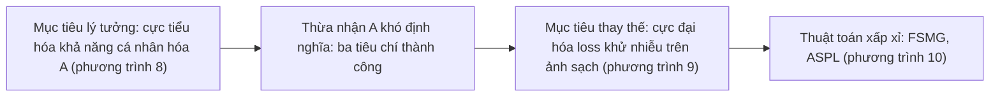

# Case study: Anti-DreamBooth (ICCV 2023)

!!! abstract "Mục tiêu của bài"
    Sau bài này, người học có thể:

    - Phân tích cách một paper phòng vệ (defense) dựng câu chuyện từ một mối đe dọa cụ thể đối với con người, và vì sao cách dựng ấy khác với một paper phương pháp tạo sinh.
    - Nhận ra chuỗi "mục tiêu lý tưởng, mục tiêu thay thế khả thi, thuật toán xấp xỉ" trong phần định nghĩa bài toán.
    - Đọc một thang thiết lập đánh giá từ dễ đến khó như một threat model, và chỉ ra những gì threat model ấy còn để ngỏ.
    - Đánh giá cách chọn và trình bày metric cho ảnh khuôn mặt khi "thành công" của paper là làm cho mô hình sinh ảnh thất bại.
    - Chỉ ra những chỗ ngôn từ chưa khớp với bằng chứng, đề xuất cách sửa, và rút ra bài học về Limitations và ethics cho paper có khía cạnh Responsible AI.

Phần lớn case study Computer Vision trong chương này phân tích những paper làm cho mô hình mạnh hơn. Case study này phân tích một paper có mục tiêu ngược lại: làm cho một mô hình sinh ảnh *thất bại* một cách có chủ đích, để bảo vệ con người khỏi việc bị lạm dụng hình ảnh của chính họ.

**Anti-DreamBooth: Protecting Users from Personalized Text-to-Image Synthesis** có danh sách tác giả gồm Thanh Van Le, Hao Phung, Thuan Hoang Nguyen, Quan Dao, Ngoc N. Tran và Anh Tran. Theo trang đầu của paper, năm tác giả thuộc VinAI Research; Ngoc N. Tran thuộc Vanderbilt University, kèm ghi chú rằng công việc được thực hiện khi còn ở VinAI; bốn tác giả đầu đóng góp ngang nhau. Paper được công bố tại ICCV 2023 (kỷ yếu, trang 2116–2127). Phân tích dưới đây dựa trên bản arXiv (mã 2303.15433), gồm cả các phụ lục A đến D; bản trong kỷ yếu ICCV có thể khác ở một số chi tiết. Mọi con số đều lấy từ văn bản và các bảng của bản arXiv này.

Paper đặc biệt đáng học với người học Việt Nam vì những lý do kiểm chứng được từ chính văn bản. Đây là một paper ở hội nghị chính ICCV của một nhóm nghiên cứu thuộc VinAI Research. Tài nguyên tính toán được nêu rõ và ở mức vừa phải: huấn luyện một mô hình DreamBooth mất 15 phút trên một GPU A100 40GB, tạo nhiễu bảo vệ mất 2 đến 5 phút, dữ liệu là hai bộ ảnh khuôn mặt công khai, mô hình nền là Stable Diffusion mã nguồn mở. Giá trị chính của paper nằm ở cách *đặt bài toán* và *thiết kế đánh giá*, hai thứ không đòi hỏi quy mô tính toán lớn. Đặt cạnh case study [SwiftBrush](swiftbrush.md), một paper phương pháp tạo sinh (CVPR 2024) cũng của VinAI Research và có chung hai tác giả Thuan Hoang Nguyen và Anh Tran, người học thấy rõ cùng một nền tảng kỹ thuật có thể dẫn tới hai kiểu đóng góp với hai cách viết khác nhau.

## Bối cảnh: khi năng lực cá nhân hóa trở thành rủi ro

Đến năm 2022–2023, Stable Diffusion, được xây chủ yếu trên [Latent Diffusion](mae-ldm.md#ldm), là mô hình sinh ảnh từ văn bản cỡ lớn mã nguồn mở đầu tiên, như paper ghi nhận. Đi kèm là các kỹ thuật **cá nhân hóa** (personalization): Textual Inversion chỉ tối ưu một embedding văn bản, còn DreamBooth fine-tune chính mô hình từ vài ảnh tham chiếu, gắn một từ hiếm như "sks" với đối tượng. Introduction của paper còn trích dẫn [ControlNet](sam-controlnet.md#controlnet) như một yếu tố đưa sức mạnh của các mô hình này tới gần người dùng đại chúng. Chỉ với vài ảnh công khai, bất kỳ ai cũng có thể tạo ảnh chân thực của một người cụ thể.

Trước đó đã có hai dòng phòng vệ liên quan: **image cloaking** (thêm nhiễu khó nhận thấy vào ảnh trước khi đăng) để chống nhận diện khuôn mặt trái phép, và các kỹ thuật phá DeepFakes dựa trên GAN; hai công trình đồng thời, GLAZE và AdvDM, chống bắt chước phong cách hội họa. Anti-DreamBooth nhắm vào chỗ còn trống: bảo vệ *con người* khỏi DreamBooth.

Vài thuật ngữ cần làm rõ. *Nhiễu đối kháng* (adversarial perturbation) là một thay đổi nhỏ, có giới hạn độ lớn, được tối ưu để làm mô hình hoạt động sai. *Mô hình thay thế* (surrogate model) là mô hình bên phòng vệ tự huấn luyện để mô phỏng mô hình của kẻ tấn công. *Threat model* là tập giả định về mục tiêu, năng lực và hiểu biết của kẻ tấn công và của bên phòng vệ; *white-box*, *gray-box*, *black-box* chỉ mức hiểu biết từ đầy đủ tới không có gì. Reviewer đọc paper phòng vệ với những câu hỏi riêng: mối đe dọa có thật không, bên phòng vệ giả định biết gì, phòng vệ có đứng vững khi giả định bị phá vỡ không, người được bảo vệ trả giá gì, và phòng vệ thất bại ở đâu.

## Câu chuyện một dòng

> DreamBooth cho phép bất kỳ ai, từ vài ảnh công khai, tạo ảnh giả chân thực của một người; nhóm tác giả đề xuất thêm nhiễu đối kháng tinh vi vào ảnh trước khi đăng để mọi mô hình DreamBooth học từ chúng đều sinh ảnh hỏng; vì mô hình cần phá được huấn luyện từ chính ảnh đã nhiễu và sinh ảnh qua nhiều bước ngẫu nhiên, paper chuyển sang phá hàm mất mát khử nhiễu tại từng bước và luân phiên huấn luyện mô hình thay thế với học nhiễu (ASPL), rồi kiểm chứng qua một thang thiết lập từ dễ đến khó.

Câu chuyện có đủ năm mắt xích ở bài [Xây "câu chuyện" của paper](../01-truoc-khi-viet/cau-chuyen.md), nhưng mang sắc thái của paper phòng vệ. **Vấn đề** là một thiệt hại tiềm tàng với con người, không phải một khoảng cách hiệu năng. **Khoảng trống** là việc phòng vệ cho DeepFakes dựa trên GAN không chuyển sang được. **Insight** gồm hai phần: tấn công hàm mất mát tại từng bước thay vì cả quá trình sinh, và mô hình thay thế phải học trên ảnh đã nhiễu mới giống mô hình của kẻ tấn công. Khác biệt sâu nhất so với paper tạo sinh nằm ở chiều của thành công: kết quả "tốt" là mô hình của kẻ tấn công cho ra ảnh *tệ*, và sự đảo chiều này chi phối từ cách định nghĩa bài toán tới cách đọc mũi tên trong bảng.

## Title và abstract

Title theo mẫu "Tên: mô tả" ở bài [Title](../02-viet-tung-phan/title.md). Tên "Anti-DreamBooth" định nghĩa phương pháp qua đối thủ, nên người đọc biết ngay paper chống lại cái gì. Phần mô tả làm hai việc mà cái tên không làm được: gọi tên **người được hưởng lợi** (users) và **lớp mối đe dọa** ở mức tổng quát (personalized text-to-image synthesis). Tên cụ thể giúp nhớ; mô tả tổng quát giữ cho paper không cũ đi cùng một công cụ, và phạm vi ấy có bằng chứng, vì paper thử thêm Textual Inversion, DreamBooth với LoRA và một dịch vụ thương mại. Title của một paper phòng vệ nên nói rõ *ai* được bảo vệ và *khỏi cái gì*.

Abstract gồm chín câu, đi từ bối cảnh và năng lực cá nhân hóa, qua mối đe dọa (tin giả, nội dung gây hại nhắm vào một cá nhân), đề xuất và cơ chế (thêm nhiễu tinh vi trước khi đăng), phạm vi đánh giá, kết quả và độ bền khi mô hình, prompt hoặc term bị lệch, tới mã nguồn. Abstract mạnh ở chỗ dựng mối đe dọa theo trình tự tự nhiên, mô tả cơ chế bằng ngôn ngữ người ngoài ngành cũng hiểu, và báo trước có đánh giá trong điều kiện bất lợi. Nhưng so với khuôn ở bài [Abstract](../02-viet-tung-phan/abstract.md), nó thiếu **insight** (câu kết quả nói bài toán khó và phương pháp vẫn hiệu quả, nhưng không nói *bằng cách nào*), thiếu **con số**, và không có nửa câu nào về giới hạn. Câu mở đầu "are nothing but a revolution" còn dễ bị hiểu ngược, vì "nothing but" nghĩa là "chỉ là" (thành ngữ khen ngợi là "nothing short of"); một câu trung tính như "have transformed image generation" tránh được cả hai vấn đề (xem [Tiếng Anh học thuật](../03-ky-thuat/van-phong.md)). Một phiên bản minh họa (không phải của nhóm tác giả), chỉ dùng thông tin có trong paper:

*"Personalization methods such as DreamBooth let anyone fine-tune a text-to-image diffusion model on a few photos of a person and generate realistic images of that person, which can be misused for fake news or harassment. We study a proactive defense, Anti-DreamBooth, that adds subtle adversarial noise to a user's photos before they are published, so that any DreamBooth model fine-tuned on them produces corrupted images. Because the attacker's generator is trained on the perturbed photos themselves and samples through many stochastic steps, we attack the per-step denoising loss and alternate between training a surrogate DreamBooth model and updating the noise (ASPL). On VGGFace2, ASPL raises the face-detection failure rate of generated images from 0.07 to 0.63, and in a user study it reduces the average number of good-quality images from 4.72 to 0.42 out of six. The defense remains effective when the attacker's base model, identifier term or training prompt differs from ours, but weakens when clean photos of the user are also available."*

Phiên bản này thêm insight, hai con số và một câu giới hạn, đổi lại bỏ câu bối cảnh chung và câu về mã nguồn, vốn là những câu rẻ nhất để hy sinh trong một abstract.

## Introduction: từ năng lực đến mối đe dọa, từ mối đe dọa đến khó khăn

Introduction gồm sáu đoạn và Figure 1, với lập luận đi qua hai bước chuyển: từ năng lực của công nghệ sang mối đe dọa, rồi từ mối đe dọa sang những khó khăn khiến việc phòng vệ không tầm thường.

### Đoạn 1 đến 3: năng lực của công cụ chính là nguồn gốc của rủi ro

Hai đoạn đầu ca ngợi chính công nghệ mà paper sẽ chống lại: ảnh chân thực, khó phân biệt với ảnh thật, ControlNet thêm khả năng điều khiển, rồi cá nhân hóa và lý do DreamBooth phổ biến hơn Textual Inversion. Lựa chọn này có chủ đích: rủi ro tỉ lệ với năng lực và khả năng tiếp cận, nên mỗi "điểm mạnh" trở thành một tiền đề của mối đe dọa. Trong số các trích dẫn ở đoạn đầu có bài báo của NBC News và New York Times; với paper phòng vệ, báo chí là nguồn hợp lý để chứng minh *tầm quan trọng xã hội*, miễn là các claim kỹ thuật vẫn dựa vào tài liệu học thuật.

Đoạn ba nêu hai kịch bản có nạn nhân cụ thể: tin giả bằng ảnh người nổi tiếng, xếp vào DeepFakes, và ảnh gây hại nhắm vào một người. Câu kết về tính cấp bách có thể chặt hơn. Về ngữ pháp, "has yet to be aware by the community" nên là "has yet to be recognized by the community". Về nội dung, chính Section 2.4 ghi nhận hai công trình đồng thời cũng bảo vệ trước mô hình cá nhân hóa, nên claim "cộng đồng chưa nhận thức" dễ bị phản biện; thu hẹp về đúng chỗ mới, chẳng hạn "the risk to personal identity, as opposed to artistic style, has received little attention", vừa an toàn vừa làm sắc định vị.

### Đoạn 4: ba khác biệt với bài toán cũ

Đoạn bốn nêu ý tưởng (chủ động tiêm nhiễu đối kháng vào ảnh trước khi đăng), rồi khẳng định Anti-DreamBooth cùng mục tiêu với phòng vệ cho DeepFakes dựa trên GAN nhưng khác bản chất, qua ba gạch đầu dòng:

1. Với GAN, nhiễu nhắm vào một generator cố định; ở đây generator *động và chưa biết*, vì nó được fine-tune từ chính ảnh đã nhiễu.
2. GAN sinh ảnh bằng một bước forward; diffusion sinh ảnh qua chuỗi bước khử nhiễu không tất định, không tính được gradient đầu–cuối.
3. Có nhiều yếu tố hơn: prompt khi huấn luyện và suy luận, cấu trúc mô hình, trọng số tiền huấn luyện.

Đây là kỹ thuật "giải thích vì sao giải pháp cũ không dùng thẳng được" mà case study [Streaming ITN](streaming-itn.md) cũng phân tích. Không có ba gạch đầu dòng, reviewer dễ tóm tắt paper thành "áp dụng image cloaking cho diffusion". Chúng thuyết phục vì mỗi khó khăn là một *đặc điểm cấu trúc* của bài toán và đều có câu trả lời ở phần sau, đúng kiểu tự kiểm tra mà case study [ViP-VL](vip-vl.md) đề xuất:

| Khó khăn nêu ở Introduction | Câu trả lời trong paper |
|---|---|
| Generator động, fine-tune từ ảnh đã nhiễu | Bài toán hai cấp (phương trình 8, 9); ASPL luân phiên huấn luyện mô hình thay thế trên ảnh đã nhiễu (phương trình 10) |
| Không tính được gradient qua chuỗi lấy mẫu | Tấn công hàm mất mát tại một timestep ngẫu nhiên (Section 4.1) |
| Nhiều yếu tố: prompt, cấu trúc, trọng số | Prompt chưa thấy, nhiều phiên bản Stable Diffusion, lệch mô hình, term, prompt (Section 5.3, 5.4) |

### Đoạn 5, đoạn 6 và Figure 1

Đoạn năm nêu insight lần đầu tiên (phá từng bước lấy mẫu thay vì cả quá trình sinh), và đoạn sáu liệt kê bốn đóng góp, mở đầu bằng việc định nghĩa một bài toán mới, một loại đóng góp hợp lệ ở paper Responsible AI khi bài toán được định nghĩa hình thức, như Section 3 làm. Một chỗ ngôn từ cần cân nhắc: đoạn năm viết các thuật toán "successfully break all DreamBooth attempts in the controlled settings", trong khi các bảng chỉ báo cáo trung bình trên 50 danh tính, và trong Table 1, tỉ lệ ảnh không phát hiện được khuôn mặt với ASPL là 0,63 trên VGGFace2, 0,31 trên CelebA-HQ. Ảnh còn khuôn mặt vẫn có thể tính là thành công nếu sai danh tính hoặc chất lượng kém, nhưng chữ "all" không kiểm chứng được từ số trung bình; một tỉ lệ danh tính được bảo vệ theo ngưỡng nêu trước, hoặc cụm "substantially degrade", sẽ khớp với bằng chứng hơn.

Theo caption, Figure 1 kể kịch bản: kẻ tấn công thu thập ảnh người dùng để huấn luyện generator cá nhân hóa; Anti-DreamBooth thêm nhiễu vào ảnh trước khi đăng, khiến generator không tạo được ảnh dùng được. Đây là kiểu Figure 1 "kịch bản bài toán" ở bài [Introduction & Figure 1](../02-viet-tung-phan/introduction.md); với paper phòng vệ, nó cần cho thấy *cả hai thế giới*, có và không có phòng vệ. Chữ "imperceptible" trong caption là một claim mà phần thí nghiệm sẽ phải đối chiếu.

## Related Work: bốn dòng chảy và một ranh giới với công trình đồng thời

Bốn tiểu mục (mô hình sinh ảnh, cá nhân hóa, tấn công đối kháng, image cloaking) có thể đọc như: thứ bị lạm dụng, công cụ của mối đe dọa, vũ khí của bên phòng vệ, và dòng dõi trực tiếp của phương pháp. Tiểu mục cuối được viết tốt nhất. Nó chia image cloaking thành chống nhận diện khuôn mặt (Fawkes với tấn công có mục tiêu, Lowkey với ensemble và làm mượt Gaussian) và phá DeepFakes dựa trên GAN (Huang và cộng sự luân phiên huấn luyện mô hình thay thế với bộ sinh nhiễu). Những thành phần mà phần phương pháp dùng lại đều đã xuất hiện ở đây và được ghi nhận lại bằng những câu như "Inspired by [26]", nên người đọc thấy rõ đâu là phần thừa hưởng. Tiểu mục khép lại bằng GLAZE và AdvDM, phân biệt theo hai trục như bài [Related Work](../02-viet-tung-phan/related-work.md) khuyến nghị cho concurrent work: **mục tiêu** (phong cách nghệ thuật, so với ảnh giả về một người) và **thiết lập kỹ thuật** (AdvDM chỉ xét Textual Inversion với generator cố định, khác việc fine-tune của DreamBooth).

Hai tiểu mục đầu nghiêng về tổng quan hơn định vị; câu mở đầu về cá nhân hóa trong hệ gợi ý và federated learning dùng một nghĩa khác của "personalization" và có thể cắt. Tiểu mục tấn công đối kháng kết thúc bằng các công trình về gradient obfuscation và expectation-over-transformation, chính dòng nghiên cứu nhấn mạnh rằng phòng vệ cần được đánh giá trước kẻ tấn công biết về phòng vệ, nhưng paper không quay lại dòng này ở phần đánh giá.

## Định nghĩa bài toán: phần làm nên một paper phòng vệ

Section 3, mang tên "Problem", đứng riêng trước phương pháp. Phần Background khá dài so với mức quen thuộc của độc giả ICCV, nhưng có chức năng rõ: hàm mất mát DreamBooth ở phương trình (7) được dùng lại trong các phương trình (8), (9), (10), đúng cách dùng preliminaries ở bài [Method](../02-viet-tung-phan/method.md).

### Từ mục tiêu lý tưởng đến mục tiêu khả thi

Phần Problem definition (Section 3.2), nối sang hướng tổng thể ở Section 4.1, đi qua ba bước; đây là đoạn lập luận chặt chẽ nhất của paper.

Bước thứ nhất là **mục tiêu lý tưởng**: kẻ tấn công fine-tune DreamBooth trên $N_{db}$ ảnh đã nhiễu để được trọng số $\theta^*$, và bên phòng vệ muốn tìm nhiễu làm cực tiểu một hàm $\mathcal{A}$ đo chất lượng ảnh sinh và độ đúng danh tính, với ràng buộc độ lớn nhiễu không vượt ngân sách $\eta$. Bước thứ hai là **thừa nhận giới hạn**: khó định nghĩa một $\mathcal{A}$ thống nhất, nên paper coi phòng vệ thành công khi ảnh sinh thỏa một trong ba tiêu chí: chất lượng tệ, không có hoặc không nhận ra người, hoặc sai danh tính. Bước thứ ba là **mục tiêu thay thế**: cực đại hóa hàm mất mát khử nhiễu của $\theta^*$ trên ảnh *sạch*, trong đó $\theta^*$ học trên ảnh *đã nhiễu*, với trực giác rằng mô hình overfit trên ảnh đối kháng sẽ tái tạo ảnh sạch kém hơn.

Chuỗi này cho thấy nhóm tác giả biết điều họ thực sự muốn, thừa nhận điều đó không tối ưu trực tiếp được, và biến mục tiêu thay thế thành một lựa chọn có lý do. Ba tiêu chí còn *định nghĩa trước* thế nào là thành công, điều càng cần thiết khi thành công nghĩa là "một mô hình thất bại", vì có rất nhiều cách để thất bại.

Hai chỗ có thể chính xác hơn. Paper gọi $\theta^*$ và $\theta_{\text{clean}}$ là "hyper-parameters" (Section 3.2 và 4.2), trong khi đây là trọng số mô hình. Và ràng buộc được viết với chuẩn $\ell_p$ tổng quát, còn phần thí nghiệm chỉ nêu $\eta = 0{,}05$, không nói rõ $p$ nào và thang giá trị pixel nào, trong khi ý nghĩa của các mức ngân sách trong Table 3 phụ thuộc trực tiếp vào thang này.

### Thang thiết lập như một threat model

Cuối Section 3.2, paper chia các thiết lập "from easy to hard". Paper không dùng chữ "threat model", nhưng ba thiết lập vận hành đúng như một threat model, sắp theo **mức hiểu biết của bên phòng vệ**:

| Thiết lập | Bên phòng vệ biết gì | Kẻ tấn công làm gì | Nhãn | Kiểm chứng |
|---|---|---|---|---|
| Convenient | Generator, term (như "sks"), prompt huấn luyện | Fine-tune chỉ trên ảnh đã nhiễu, cấu hình mặc định | "white-box" | Section 5.2, 5.3 |
| Adverse | Không biết generator, term hoặc prompt | Đổi mô hình nền, term ("t@t"), prompt; thêm tiền xử lý ảnh, dịch vụ thương mại | "gray-box" | Section 5.4, Phụ lục B |
| Uncontrolled | Một số ảnh sạch bị lộ | Trộn ảnh sạch với ảnh đã nhiễu | Không gán | Section 5.5 |

Trục "bên phòng vệ biết gì" là trục đúng cho image cloaking, vì bên phòng vệ phải hành động *trước* và *mù*. Paper còn bảo vệ thiết lập dễ nhất khỏi lời chê "white-box là phi thực tế" bằng câu "While sounding restricted, it is practical" và hai lý do: chỉ Stable Diffusion là mô hình chất lượng cao mã nguồn mở, và người dùng thường giữ term và prompt mặc định trong mã DreamBooth. Lý do thứ hai là một claim về hành vi người dùng chưa có bằng chứng; dẫn tới giá trị mặc định của một bản cài đặt phổ biến là đủ làm nó chắc hơn. Giá trị lớn nhất nằm ở bậc cuối: nhóm tác giả tự định nghĩa thiết lập mà họ dự đoán phương pháp sẽ gặp khó, trước mọi kết quả.

Điều thang này còn để ngỏ là chiều ngược lại: **kẻ tấn công biết gì về phòng vệ**. Reviewer từ cộng đồng bảo mật sẽ hỏi ngay về kẻ tấn công làm sạch ảnh trước khi fine-tune. Paper trả lời một phần (làm mờ Gaussian và nén JPEG ở Table 6 và Table 8, công cụ Adverse Cleaner ở Figure 16, chỉ định tính) và thừa nhận ở Phụ lục D.4 rằng các phép xử lý này chưa đại diện cho mọi kỹ thuật xóa bảo vệ, nhưng chúng chỉ là một mục con của thiết lập adverse. Một đoạn "Threat model" ngắn sẽ gom tất cả vào một bức tranh tường minh, cho thấy những gì nằm ngoài phạm vi là do lựa chọn chứ không phải do bỏ sót.

!!! tip "Một đoạn threat model ngắn cho paper phòng vệ"
    *"**Threat model.** The attacker's goal is to … The attacker can … (data access, training procedure, compute). We assume the attacker does / does not know … (knowledge of the defense, including whether they may pre-process or purify inputs). The defender can … and knows … . Out of scope: … ."*

    Câu về hiểu biết của kẻ tấn công đối với phòng vệ là câu hay bị bỏ quên nhất, và cũng là câu reviewer ML và bảo mật hỏi nhiều nhất.

## Phương pháp: hai thuật toán, hai tiền tố

**Fully-trained Surrogate Model Guidance (FSMG)** đi theo hướng của phần lớn phương pháp cloaking trước: dùng một mô hình DreamBooth thay thế fine-tune đầy đủ trên một tập nhỏ ảnh sạch, rồi dùng PGD tìm nhiễu làm cực đại hàm mất mát của nó. Paper dùng chữ "naively" khi giới thiệu, một cách đóng khung khéo: FSMG vừa là baseline hợp lý thừa hưởng từ tài liệu, vừa là bậc đệm cho thuật toán chính. Với một bài toán mới chưa có baseline, tự xây baseline "hiển nhiên" mạnh nhất là cách chứng minh giá trị gia tăng, đúng tinh thần so sánh công bằng ở bài [Thiết kế thí nghiệm](../01-truoc-khi-viet/thi-nghiem.md).

**Alternating Surrogate and Perturbation Learning (ASPL)** được giới thiệu theo khuôn Why–What–How. *Why*: mô hình thay thế học trên ảnh sạch "may not be a good approximation", vì mô hình của kẻ tấn công học trên ảnh *đã nhiễu*. *What*: luân phiên huấn luyện mô hình thay thế với học nhiễu, lấy cảm hứng từ Huang và cộng sự. *How*: mỗi vòng, một bản sao được fine-tune trên ảnh sạch và dùng để học nhiễu bằng PGD, rồi mô hình thay thế thật được cập nhật trên ảnh vừa nhiễu. Phương trình (10) viết một vòng lặp bằng bốn dòng gần như mã giả, kể cả lời gọi `clone()`, và caption Figure 2 mô tả đủ luồng của cả hai thuật toán. Về lập luận, FSMG và ASPL là hai mức xấp xỉ của cùng bài toán hai cấp: một cố định bài toán con bên trong từ đầu, một bám theo nghiệm của nó. Sự khác biệt ấy chính là điều Table 1 đo.

Hai cách mở rộng được trình bày như plug-in: tiền tố "T-" cho tấn công có mục tiêu, với động lực rằng nhiễu không mục tiêu có thể triệt tiêu lẫn nhau, và tiền tố "E-" cho ensemble nhiều mô hình thay thế từ các generator khác nhau. Lược đồ "thuật toán gốc cộng tiền tố" (T-FSMG, T-ASPL, E-ASPL) cho phép giải mã mọi biến thể mà không cần tra bảng, giống lược đồ $B/H/S$ trong case study Streaming ITN. Cuối cùng, Section 4.1 tự nêu một xấp xỉ quan trọng: hàm mất mát chỉ được tính tại một timestep ngẫu nhiên, và dù vậy vẫn phá được ảnh đầu ra. Câu này chặn trước câu hỏi "tấn công một bước có đủ không?", dù sẽ mạnh hơn nếu kèm một lập luận giải thích *vì sao* đủ.

## Thí nghiệm: đánh giá một phương pháp phòng vệ

Mục thí nghiệm bám đúng thang ở Section 3.2: convenient (5.2), các phân tích bổ sung (5.3), adverse (5.4), uncontrolled (5.5). Thân bài dùng VGGFace2 cho hầu hết phân tích, còn Phụ lục A lặp lại trên CelebA-HQ và bổ sung kết quả FSMG: thân bài phục vụ lập luận, phụ lục phục vụ việc lặp lại.

### Thiết lập và metric: bốn metric cho ba tiêu chí

Phần chọn dữ liệu nêu bốn tiêu chí *trước khi* gọi tên bộ dữ liệu, rồi mới chọn CelebA-HQ và VGGFace2, mỗi bộ 50 danh tính. Mười hai ảnh đầu của mỗi người được chia thành ba tập bốn ảnh, trong đó tập thứ ba dành riêng cho thí nghiệm uncontrolled: thiết lập khó nhất đã được lên kế hoạch từ khâu chuẩn bị dữ liệu. Thời gian được báo cáo cho cả bên tấn công lẫn bên phòng vệ, trả lời câu hỏi thực tế "bảo vệ một người tốn bao nhiêu?". Với mỗi mô hình, paper sinh 30 ảnh cho mỗi prompt, gồm prompt huấn luyện "a photo of sks person" và prompt chưa thấy "a dslr portrait of sks person". Mỗi tiêu chí thành công có một metric:

| Tiêu chí thành công | Metric | Chiều có lợi cho phòng vệ |
|---|---|---|
| Không có hoặc không nhận ra người | FDFR: tỉ lệ ảnh không phát hiện được mặt (RetinaFace) | Cao hơn |
| Sai danh tính | ISM: so embedding ArcFace với embedding trung bình của ảnh sạch | Thấp hơn |
| Chất lượng tệ, riêng cho mặt | SER-FQA | Thấp hơn |
| Chất lượng tệ, ảnh nói chung | BRISQUE | Cao hơn |

Định nghĩa thành công và cách đo khớp nhau, các metric là công cụ có sẵn nên dễ tái hiện, và khối tám cột (hai prompt nhân bốn metric) lặp lại trong hầu hết các bảng. Bốn chi tiết có thể chặt hơn. Mũi tên đảo so với thói quen (BRISQUE cao, tức ảnh xấu, lại là "tốt"), nên caption Table 1 nên nói rõ "arrows indicate the direction favorable to the defense". Văn bản gọi ISM là "cosine distance", nhưng ISM giảm từ 0,63 (không phòng vệ) xuống 0,33 (ASPL) trên VGGFace2, điều chỉ hợp lý nếu ISM là độ *tương đồng* cosine. ISM chỉ tính trên ảnh phát hiện được mặt, nên khi FDFR là 0,80 như trong Table 2, nó dựa trên một phần nhỏ số ảnh. Và các bảng chỉ báo cáo trung bình, không có độ lệch chuẩn, nên với chênh lệch như 0,31 so với 0,34, người đọc không biết khác biệt có đáng kể không (xem [Experiments](../02-viet-tung-phan/experiments.md)).

### Table 1: so sánh thuật toán như một ablation hai chiều

Bốn phương pháp FSMG, ASPL, T-FSMG, T-ASPL tạo thành lưới hai nhân hai: mô hình thay thế cố định hay luân phiên, nhân với không mục tiêu hay có mục tiêu, nên Table 1 vừa là bảng kết quả chính vừa là ablation cho hai câu hỏi thiết kế. Trên VGGFace2 với prompt huấn luyện, không phòng vệ cho FDFR 0,07 và ISM 0,63; ASPL đạt 0,63 và 0,33; FSMG đạt 0,56 và 0,33; hai biến thể có mục tiêu gần như không khác không phòng vệ. Đáng học là paper **giữ kết quả âm trong bảng chính**, và ở Phụ lục A.1 cùng Table 9, **cho biến thể thua một cơ hội thứ hai** bằng cách chọn ảnh đích có danh tính xa nhất hoặc trong khoảng phân vị 50–75 (cấu hình của GLAZE); kết quả vẫn yếu, và chính nỗ lực ấy làm kết luận đáng tin.

Hai điểm có thể làm tốt hơn. Vòng lập luận về tấn công có mục tiêu chưa khép: Section 4.2 dùng giả thuyết triệt tiêu để biện minh, kết quả không ủng hộ kỳ vọng đó, nhưng Section 5.2 chỉ viết nhiễu có mục tiêu là "sub-optimal and ineffective", gần như lặp lại kết quả. Và câu "As expected, ASPL defends better than FSMG" chỉ đúng hoàn toàn trên VGGFace2: trên CelebA-HQ, FSMG nhỉnh hơn ở FDFR (0,34 so với 0,31 với prompt huấn luyện) và ISM (0,48 so với 0,50); câu ở Phụ lục A.1, ASPL tốt hơn "on most evaluation scores", chính xác hơn.

### User study, ngân sách nhiễu và tên gọi của các mục

User study có 40 người tham gia: với mỗi danh tính trong 50 danh tính của VGGFace2, hai mô hình DreamBooth (ảnh gốc và ảnh đã nhiễu bằng ASPL) mỗi mô hình sinh sáu ảnh, và người tham gia đếm số ảnh chất lượng tốt và số ảnh đúng danh tính. Số ảnh tốt trung bình giảm từ 4,72 xuống 0,42, số ảnh đúng danh tính từ 3,70 xuống 1,16, một bằng chứng đo trực tiếp hai tiêu chí thành công bằng phán đoán con người. Nhưng mục mang tiêu đề "Qualitative Evaluation" trong khi tạo ra con số; "User study" chính xác hơn, đúng bài học "tên của một thiết lập đánh giá là một claim" ở case study Streaming ITN. Như case study [ControlNet](sam-controlnet.md#controlnet) nhấn mạnh, user study cũng cần nêu rõ giao thức, chẳng hạn người tham gia có được xem ảnh tham chiếu khi đánh giá danh tính không.

Section 5.3 mang tên "Ablation studies" và gồm bốn thí nghiệm: phiên bản SD v1.4 và v1.5 (Table 2), ngân sách nhiễu (Table 3), các prompt suy luận khác (chỉ định tính), và Textual Inversion cùng DreamBooth dùng LoRA (Table 7). Theo cách phân loại ở bài [Thiết kế thí nghiệm](../01-truoc-khi-viet/thi-nghiem.md), thí nghiệm ngân sách nhiễu là phân tích độ nhạy, thuộc họ ablation; ba thí nghiệm còn lại không đụng tới thành phần nào của *phương pháp* mà thay đổi *đối tượng bị phòng vệ*, tức là kiểm chứng tổng quát hóa. Tên "Sensitivity and generalization" sẽ giúp reviewer tìm ablation theo nghĩa thành phần ở đúng chỗ của nó, là Table 1.

Table 3 đáng học vì báo cáo **cả hai phía của sự đánh đổi**: chất lượng ảnh được bảo vệ (PSNR, LPIPS) cạnh hiệu quả phòng vệ. Với $\eta = 0{,}03$, LPIPS 0,12 và phòng vệ đã có hiệu quả (FDFR 0,44); ở mức mặc định 0,05, LPIPS 0,21; ở 0,15, phòng vệ mạnh nhất (FDFR 0,80) nhưng LPIPS lên 0,50. Đây là phiên bản phòng vệ của nguyên tắc "định lượng cả cái giá", với cái giá do chính người được bảo vệ gánh. Bảng này cũng là lý do để rà lại ngôn từ: caption Figure 1 gọi nhiễu là "imperceptible", abstract gọi là "subtle", Conclusion đặt mục tiêu cải thiện "imperceptibility". Với LPIPS 0,21 ở mức mặc định, "subtle" khớp với bằng chứng hơn; giữ "imperceptible" thì cần một thí nghiệm cảm nhận của con người.

### Thiết lập adverse: ba kiểu lệch và một đối chứng còn thiếu

**Lệch mô hình.** Nhiễu học trên SD v1.4 chống DreamBooth từ v2.1 và v2.0 cho FDFR 0,62 và 0,70, tương đương Table 1; ensemble E-ASPL (v1.4, v1.5, v2.1) cải thiện thêm. Người đọc cẩn thận sẽ thấy ensemble *chứa* v2.1, nên chỉ kết quả trên v2.0 mới là phép thử trên mô hình chưa thấy, trong khi paper viết ensemble cải thiện "in both cases" mà không phân biệt. **Lệch term.** Đổi "sks" thành "t@t" làm FDFR giảm từ 0,63 xuống 0,34 nhưng ISM gần như giữ nguyên (0,30): phòng vệ chuyển từ dạng "không còn khuôn mặt" sang dạng "sai danh tính". **Lệch prompt.** Khi kẻ tấn công huấn luyện với "a dslr portrait of sks person" rồi suy luận bằng "a photo of sks person", ba metric gần mức không phòng vệ của Table 1 (FDFR 0,07, SER-FQA 0,69, BRISQUE 17,34), chỉ ISM thấp rõ (0,15). Thân bài chỉ nhắc ISM, còn Phụ lục C.2 thừa nhận phòng vệ khi đó có thể biểu hiện bằng việc *đổi danh tính*; nói thẳng điều này trong thân bài sẽ trung thực hơn.

Cả ba kiểu lệch đều thiếu **một hàng "không phòng vệ" cùng cấu hình** (ảnh sạch với SD v2.0, với term "t@t", với prompt "a dslr portrait"), nên người đọc chỉ so được với hàng không phòng vệ của Table 1, vốn có cấu hình khác, và không thể biết bao nhiêu phần của mức ISM 0,15 đến từ nhiễu, bao nhiêu từ chính việc đổi prompt. Khi thành công được đo bằng việc một con số *giảm*, người đọc cần biết nó giảm so với cái gì.

### Tiền xử lý ảnh: khi chữ "slightly" không khớp với bảng

Văn bản viết rằng làm mờ Gaussian hay nén JPEG "slightly weakens the defense", nhưng BRISQUE vẫn cao nên phòng vệ có độ bền "reasonable". Trong Table 6 (prompt huấn luyện), làm mờ với kernel 3 giữ phần lớn hiệu quả (FDFR 0,48), nhưng từ kernel 5 trở lên và với JPEG chất lượng 10 đến 50, FDFR (0,07 đến 0,19) và SER-FQA (0,62 đến 0,73) trở về gần mức không phòng vệ (0,07 và 0,73); chỉ BRISQUE còn cao.

Lập luận dựa trên BRISQUE còn gặp hai vấn đề mà chính paper cung cấp dữ liệu để thấy. Bảng không có hàng "không phòng vệ nhưng có tiền xử lý", trong khi Phụ lục D.1 viết rằng ở mức nén 30%, phần lớn artifact đối kháng đã bị xóa nhưng chính ảnh huấn luyện chất lượng thấp do nén vẫn làm ảnh sinh suy giảm đáng kể: BRISQUE cao có thể đến từ tiền xử lý chứ không từ nhiễu. Và Table 8 trong phụ lục (prompt "a dslr portrait") cho thấy với JPEG chất lượng 10, 30, 50, BRISQUE chỉ còn 10,57, 8,69, 13,57, sát mức không phòng vệ 9,64. Một câu khớp với bằng chứng có thể như sau:

*"Mild blur (K = 3) preserves most of the protection and light compression (Q = 70) preserves part of it, but stronger blur or compression removes most of the effect as measured by FDFR, ISM and SER-FQA (Tables 6 and 8). We report matched no-defense baselines with the same pre-processing and discuss robustness to purification as a limitation."*

### Dịch vụ thương mại và thiết lập uncontrolled

Phụ lục B thử phòng vệ với Astria, một dịch vụ cá nhân hóa thương mại dạng hộp đen, với nhiễu tạo bằng ASPL trên SD v2.1. Đây là thí nghiệm gần triển khai thật nhất và việc đưa nó vào là đúng, nhưng bằng chứng là ảnh định tính của hai đối tượng, trong khi kết luận khẳng định phương pháp "can defend against these services without requiring knowledge of their underlying configurations". Tính bốn metric quen thuộc trên ảnh Astria sẽ biến minh họa thành bằng chứng.

Section 5.5 giữ cố định bốn ảnh fine-tune và tăng dần số ảnh sạch, với hai hàng mốc ở hai đầu trong Table 5. Kết quả suy giảm đều: FDFR 0,50 với một ảnh sạch, 0,29 với hai, 0,08 với ba (ISM 0,61), gần như không khác mức không phòng vệ (0,07 và 0,63). Thiết kế có mốc ở hai đầu cho thấy *toàn bộ đường cong suy giảm*, và rất ít paper tự trình bày rõ đến vậy nơi phương pháp thất bại. Hai câu tóm tắt thì nên viết lại: "still effective when half of the images are perturbed" nên là "partially effective"; còn câu cuối, cho rằng thiết lập này có thể được ngăn chặn nếu mọi mạng xã hội dùng hệ thống với sự hỗ trợ của nhà làm luật, biến một giới hạn kỹ thuật thành một giả định về phổ cập và pháp luật, trong khi phát biểu nó như một bài toán mở sẽ thẳng thắn hơn.

## Limitations, ethics và văn phong

Conclusion gồm bốn câu tóm tắt và một câu hướng tương lai. Paper không có mục Limitations; các hạn chế được nói tới nhưng nằm rải rác ở Section 5.5, Table 3, Phụ lục C.2 và D.4, nên người chỉ đọc thân bài gặp câu kết "Our defense is effective, even in adverse conditions" mà không thấy bức tranh đầy đủ. Như bài [Conclusion, Limitations, Appendix](../02-viet-tung-phan/conclusion-supp.md) đã phân tích, gom hạn chế vào một đoạn giúp tác giả *định khung* chúng. Một đoạn minh họa (không phải của nhóm tác giả), mỗi câu có nguồn trong paper:

*"**Limitations.** Anti-DreamBooth assumes that the protected user controls all published photos; its effect decreases as clean photos are mixed into the attacker's training set and largely disappears with three clean photos out of four (Table 5). Strong Gaussian blur or JPEG compression removes most of the protection as measured by face detection, identity and face-quality scores (Tables 6 and 8), and beyond the pre-processing and cleaning tools tested here, we have not evaluated attackers who adapt to the defense. Under prompt mismatch, protection mainly takes the form of identity change rather than visible artifacts. Stronger protection requires larger, more visible perturbations (Table 3)."*

Paper cũng không có ethics statement, dù ở CV phần này trở nên cần thiết khi bài toán nhạy cảm như ảnh khuôn mặt người thật và deepfake. Các câu hỏi cần trả lời nảy ra từ chính nội dung paper: nguồn gốc và sự đồng ý liên quan tới ảnh của hai đối tượng trong thử nghiệm Astria, cách tuyển chọn người tham gia user study, và phạm vi bảo vệ mà người dùng cần hiểu đúng trước khi dựa vào nó.

!!! warning "Với paper phòng vệ, overclaim có cái giá xã hội"
    Trong paper phương pháp, một claim quá mức chủ yếu làm mất lòng tin của reviewer. Trong paper phòng vệ, nó có thể khiến người dùng tin vào một sự bảo vệ không đứng vững trong điều kiện thật, một dạng "false sense of security". Những cụm như "guaranteeing user protection regardless of the term mismatching" (Phụ lục A.2) nên được hiệu chỉnh thành phát biểu có phạm vi ("in our experiments", "substantially reduces") và đi kèm một đoạn Limitations. Chữ "guarantee" chỉ nên dùng khi có bảo đảm hình thức.

Văn phong chung của paper rõ và trực tiếp: kịch bản được mô tả bằng câu cụ thể, thuật toán được đặt tên đúng cơ chế, bảng giữ một khuôn nhất quán, và caption của một số hình phụ lục ghi rõ đối tượng được chọn ngẫu nhiên ("We test with two random subjects"). Bản arXiv còn vài lỗi nhỏ mà một vòng đọc soát có thể bắt được, như trích dẫn lặp "[53, 53, 61]", paper DALL-E 2 xuất hiện hai lần trong tài liệu tham khảo ([42] và [43]), hay cấu hình Astria thứ hai được gọi là "Progen 3.4 + Prism" trong văn bản nhưng "Protogen with Prism" trong caption Figure 5. Từng lỗi đều nhỏ, nhưng độ tin cậy của paper phòng vệ dựa nhiều vào sự chính xác (xem [Quy trình viết & tự review](../03-ky-thuat/quy-trinh-viet.md)).

## Bài học cho người viết

**Với paper phòng vệ, định nghĩa bài toán và threat model là một đóng góp.** Dành hẳn một mục cho bài toán, định nghĩa thành công trước khi có kết quả, sắp các thiết lập theo mức hiểu biết của bên phòng vệ, và nói rõ kẻ tấn công biết gì về phòng vệ.

**Đi từ mục tiêu lý tưởng tới mục tiêu khả thi, và tự nêu chỗ xấp xỉ.** Chuỗi phương trình (8), ba tiêu chí, phương trình (9), rồi (10) biến một công thức tối ưu thành một lựa chọn có lý do.

**Biến "vì sao giải pháp cũ không dùng được" thành danh sách khó khăn, rồi trả lời từng khó khăn.** Ba gạch đầu dòng so với GAN chỉ thuyết phục vì mỗi khó khăn có câu trả lời ở phần sau.

**Đi đến tận chỗ phương pháp thất bại, và đặt đối chứng cùng điều kiện cho mọi thiết lập bất lợi.** Table 5 với hai hàng mốc là mẫu mực; các hàng "không phòng vệ" còn thiếu ở Table 4 và Table 6 là bổ sung giá trị nhất mà paper có thể làm.

**Hiệu chỉnh ngôn từ kỹ hơn bình thường, và gọi đúng tên mọi thứ.** "All", "slightly", "imperceptible", "guaranteeing" cần được đối chiếu với bảng; ablation khác kiểm chứng tổng quát hóa, user study không phải "qualitative", độ tương đồng không phải khoảng cách.

### Nối với các bài kỹ năng

Phần lớn phân tích trong bài này là một bài tập đọc như reviewer: đối chiếu từng claim với đúng bảng chứng minh nó, và tìm hàng đối chứng còn thiếu. Kỹ năng ấy được giảng có hệ thống ở bài [Đọc paper như một reviewer](../01-truoc-khi-viet/doc-nhu-reviewer.md), và nên được áp dụng cho chính bản thảo của người học trước khi nộp. Hai tình huống của Chương 7 gắn trực tiếp với paper này: tự xây baseline "hiển nhiên" mạnh nhất khi bài toán mới chưa có baseline (như FSMG) ở bài [Bài toán, dữ liệu và phạm vi](../07-tinh-huong-kho/bai-toan-va-pham-vi.md), và những từ ngữ thổi phồng như "all" hay "guarantee" ở bài [Ghép ý tưởng và "độn" đóng góp](../07-tinh-huong-kho/ghep-va-don.md). Ranh giới giữa đóng khung kết quả một cách hợp lệ và phóng đại, vốn đặc biệt quan trọng với paper phòng vệ, được bàn ở bài [Ranh giới trung thực](../07-tinh-huong-kho/ranh-gioi-trung-thuc.md).

### Áp dụng sang các cộng đồng khác

Trong **NLP**, cấu trúc này chuyển gần như nguyên vẹn sang các paper phòng vệ trước prompt injection hay jailbreak; tổ chức đánh giá theo nhiều tình huống, mỗi tình huống trả lời một claim, cũng là tinh thần của case study [CheckList](checklist-acl2020.md), và với ARR, mục Limitations là bắt buộc (xem [Viết cho ACL / EMNLP / NAACL](../06-cong-dong/nlp.md)). Trong **Machine Learning**, cộng đồng robustness đối kháng có chuẩn mực chặt về đánh giá phòng vệ trước kẻ tấn công biết về phòng vệ, chính dòng nghiên cứu mà Anti-DreamBooth trích dẫn, và Paper Checklist của NeurIPS hỏi về biện pháp bảo vệ và tác động xã hội (xem [Viết cho NeurIPS / ICML / ICLR](../06-cong-dong/ml.md)). Trong **Computer Vision**, các bài toán che giấu danh tính hay phát hiện deepfake dùng lại được khuôn "tiêu chí thành công, metric tương ứng, thang thiết lập". Chương [Chuyên đề AI Security](../09-ai-security/index.md) phân tích thêm các paper tấn công và phòng vệ.

## Tóm tắt

Anti-DreamBooth cho thấy cách viết một paper phòng vệ có khía cạnh Responsible AI ở một hội nghị CV hàng đầu. Paper dựng mối đe dọa từ chính năng lực của công nghệ, gọi tên ba khác biệt khiến phòng vệ cũ không dùng thẳng được, rồi dành hẳn một mục để định nghĩa bài toán, từ mục tiêu lý tưởng qua ba tiêu chí thành công tới một mục tiêu thay thế, cùng một thang thiết lập vận hành như một threat model. Thí nghiệm gán mỗi tiêu chí một metric, dùng lưới hai nhân hai làm ablation, giữ kết quả âm, định lượng cái giá về độ khó nhận thấy, và đi tới tận chỗ phương pháp thất bại. Những điểm có thể làm tốt hơn gồm sự khớp giữa ngôn từ và bằng chứng, các hàng đối chứng còn thiếu, tên gọi của một số mục và metric, threat model chưa nói tới hiểu biết của kẻ tấn công về phòng vệ, và các hạn chế nằm rải rác thay vì được gom vào một đoạn Limitations. Với paper phòng vệ, những sửa đổi ấy còn giúp người dùng hiểu đúng phạm vi của sự bảo vệ.

## Bài tập

1. Viết lại abstract của Anti-DreamBooth theo khuôn ở bài [Abstract](../02-viet-tung-phan/abstract.md), bổ sung insight, hai con số và một câu giới hạn, chỉ dùng thông tin có trong paper; so sánh với phiên bản minh họa.
2. Viết một đoạn "Threat model" cho Anti-DreamBooth theo khuôn trong khung gợi ý, rồi viết đoạn tương tự cho một dự án phòng vệ hay robustness của người học.
3. Thiết kế lại Table 4 và Table 6 với các hàng đối chứng "không phòng vệ" còn thiếu, nêu câu hỏi mà mỗi hàng trả lời, rồi dùng các con số trong paper (15 phút cho mỗi mô hình DreamBooth trên một GPU A100, 50 danh tính) để ước lượng số giờ GPU cần bổ sung.
4. Gạch dưới mọi tính từ và trạng từ đánh giá ("all", "slightly", "significantly", "robust"…) trong đoạn bình luận một bảng của bản thảo hiện tại; với mỗi từ, kiểm tra con số có ủng hộ không, nếu không thì thay bằng con số hoặc một phát biểu có phạm vi.
5. Phân loại mọi thí nghiệm trong bản thảo thành ablation (cộng dồn, loại bỏ, thay thế, độ nhạy), kiểm chứng tổng quát hóa, kiểm tra độ bền hoặc đánh giá của con người, rồi đặt lại tên các mục cho khớp.
6. Viết một mục Limitations và một ethics statement ngắn cho dự án hiện tại, trong đó mỗi câu trỏ tới một bằng chứng hoặc một quyết định cụ thể.
