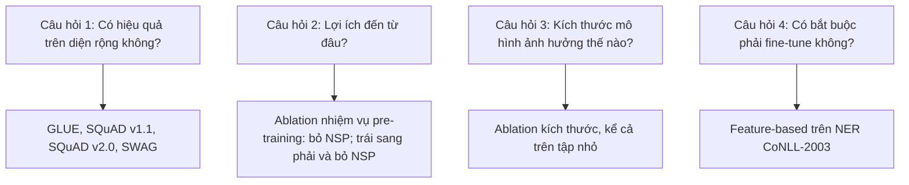

# Case study: BERT (NAACL 2019)

!!! abstract "Mục tiêu của bài"
    Sau bài này, người học có thể:

    - Giải thích cách BERT định vị đóng góp so với hai công trình gần nhất là OpenAI GPT và ELMo, và vì sao việc định vị theo một trục duy nhất lại có sức thuyết phục.
    - Nhận ra chuỗi lập luận "hạn chế chung, giải pháp trực tiếp, tác dụng phụ và cách khắc phục" xuyên suốt Introduction và Method.
    - Đọc các bảng kết quả và ablation của BERT như một loạt câu trả lời cho những câu hỏi mà reviewer NLP chắc chắn sẽ đặt ra.
    - Vận dụng kỹ thuật thiết kế baseline có kiểm soát, biến lập luận thành dự báo kiểm chứng được và đặt tên cho khái niệm vào paper của chính người học.

Paper **"BERT: Pre-training of Deep Bidirectional Transformers for Language Understanding"** của Jacob Devlin, Ming-Wei Chang, Kenton Lee và Kristina Toutanova (Google AI Language) được trình bày tại NAACL 2019 và nhận giải Best Long Paper. Đây là một trong những paper có ảnh hưởng lớn nhất trong lịch sử NLP: nó định hình mô thức "pre-train trên văn bản không gán nhãn, rồi fine-tune cho từng tác vụ" mà rất nhiều hệ thống NLP những năm sau đó đi theo.

Người học không cần đọc BERT để biết BERT hoạt động thế nào, vì kiến thức đó đã có trong hầu hết giáo trình deep learning. Lý do đưa BERT vào chương này nằm ở chỗ khác: paper là một ví dụ mẫu mực về **định vị so với công trình gần nhất** (positioning). Khi BERT ra đời, ý tưởng pre-train một language model rồi chuyển sang tác vụ đích không còn mới; hai công trình rất gần là ELMo và OpenAI GPT vừa xuất hiện trước đó không lâu. Trong hoàn cảnh ấy, một paper rất dễ bị reviewer đánh giá là *incremental*, tức chỉ cải tiến nhỏ lẻ trên nền có sẵn. BERT tránh được nhận xét đó nhờ chỉ ra chính xác một hạn chế chung của các công trình trước, rồi xây toàn bộ paper quanh việc gỡ bỏ hạn chế ấy. Trong bài này, chúng ta sẽ lần theo cách nhóm tác giả làm điều đó, từ câu đầu tiên của Introduction tới bảng ablation cuối cùng.

## Bối cảnh ra đời

Năm 2018 là năm bùng nổ của học chuyển giao (transfer learning) trong NLP. Trước đó, cách phổ biến để đưa tri thức từ văn bản không gán nhãn vào một tác vụ là dùng word embedding tĩnh như word2vec hay GloVe: mỗi từ ứng với một vector cố định, bất kể từ đó xuất hiện trong ngữ cảnh nào. Bước tiến của năm 2018 là các biểu diễn *theo ngữ cảnh* (contextual representations) lấy ra từ một language model đã được pre-train trên lượng lớn văn bản, nhờ đó cùng một từ có thể mang biểu diễn khác nhau trong những câu khác nhau.

Hai công trình tiêu biểu khi đó đại diện cho hai cách sử dụng biểu diễn pre-train. **ELMo** đi theo hướng *feature-based*: huấn luyện language model, trích các vector đặc trưng từ đó rồi đưa vào một kiến trúc được thiết kế riêng cho từng tác vụ. ELMo dùng hai LSTM độc lập, một đọc câu từ trái sang phải và một đọc từ phải sang trái, rồi nối biểu diễn của chúng lại. **OpenAI GPT** đi theo hướng *fine-tuning*: pre-train một Transformer (xem [case study Transformer](transformer.md)) như một language model trái sang phải, rồi fine-tune toàn bộ mô hình trên tác vụ đích với rất ít tham số bổ sung.

Điểm chung của hai công trình, và cũng là điểm mà BERT khai thác, là cả hai đều dựa trên mục tiêu language model truyền thống: đoán token tiếp theo từ các token đứng trước nó. Mục tiêu này về bản chất là *một chiều*. ELMo có nhìn cả hai hướng, nhưng mỗi hướng được huấn luyện riêng và chỉ được ghép lại ở đầu ra, nên paper BERT gọi đó là một sự kết hợp "nông" (shallow). Câu hỏi bỏ ngỏ khi ấy là liệu có cách nào pre-train một mô hình mà *mọi layer* đều đồng thời nhìn thấy cả ngữ cảnh bên trái lẫn bên phải hay không.

Cũng cần lưu ý yếu tố thời gian. BERT được đưa lên arXiv vào tháng 10 năm 2018, kèm mã nguồn và mô hình đã pre-train, nhiều tháng trước khi hội nghị diễn ra; cộng đồng đã dùng BERT rộng rãi trước khi paper được trình bày chính thức. Với một đóng góp dạng mô hình nền, việc công bố mã và trọng số quyết định tầm ảnh hưởng không kém bản thân paper (xem [Camera-ready, poster, code](../04-nop-va-sau-nop/camera-ready.md)). Tuy vậy, người viết luôn phải kiểm tra chính sách về tiền công bố (preprint) và ẩn danh của hội nghị trong năm nộp, vì các chính sách này thay đổi theo thời gian.

## Câu chuyện một dòng

> Các language model pre-train hiện có đều một chiều, và điều đó giới hạn chất lượng biểu diễn, đặc biệt với các tác vụ mức token như hỏi đáp. Bằng cách che ngẫu nhiên một phần token rồi yêu cầu mô hình đoán lại (masked language model), ta pre-train được một Transformer hai chiều sâu; cùng một kiến trúc đó, chỉ thêm một lớp đầu ra khi fine-tune, đạt state-of-the-art trên 11 tác vụ.

Câu chuyện này có bốn mảnh ghép, và mỗi mảnh đều làm một việc cụ thể. Mảnh thứ nhất nêu một *hạn chế chung* của mọi công trình gần nhất, nên reviewer không thể phản bác rằng "đã có người làm rồi". Mảnh thứ hai chỉ ra *nơi hạn chế gây hại nhiều nhất* (các tác vụ mức token), tức là một dự báo có thể kiểm chứng. Mảnh thứ ba là một *giải pháp nhắm thẳng* vào hạn chế, không phải một tập hợp mẹo. Mảnh thứ tư kết hợp hai lợi ích: sự *đơn giản* (một kiến trúc cho mọi tác vụ) và sức *mạnh* (11 tác vụ). Cặp lợi ích này xuất hiện ngay trong abstract dưới cụm từ "conceptually simple and empirically powerful", và phần còn lại của paper lần lượt chứng minh từng vế.

## Phân tích câu chuyện và cấu trúc paper

### Introduction: dựng một trục so sánh duy nhất

Introduction của BERT ngắn và đi theo một mạch rất rõ. Đoạn đầu khẳng định pre-train language model đã chứng tỏ hiệu quả cho cả tác vụ mức câu (như suy luận ngôn ngữ tự nhiên, nhận diện câu đồng nghĩa) lẫn tác vụ mức token (như nhận diện thực thể có tên, hỏi đáp). Đoạn tiếp theo phân loại các cách áp dụng biểu diễn pre-train thành hai chiến lược, feature-based và fine-tuning, đồng thời chỉ ra rằng cả hai đều dùng chung một hàm mục tiêu một chiều khi pre-train. Đến đây, người đọc đã có trong tay một tấm bản đồ gồm hai trục: *cách dùng* biểu diễn và *hướng* của ngữ cảnh.

Đoạn thứ ba là đoạn then chốt. Nhóm tác giả lập luận rằng hạn chế lớn nhất của các kỹ thuật hiện có là tính một chiều: với GPT, mỗi token trong self-attention chỉ được nhìn các token đứng trước. Điều này chưa tối ưu với tác vụ mức câu, và có thể gây hại nghiêm trọng với tác vụ mức token như hỏi đáp, nơi ngữ cảnh ở cả hai phía đều quan trọng. Có thể hình dung lý do bằng một ví dụ: để quyết định một từ có phải là điểm bắt đầu của câu trả lời hay không, mô hình cần biết cả những gì đứng trước từ đó lẫn những gì đứng sau. Một biểu diễn chỉ "nhìn về phía trước" sẽ thiếu một nửa thông tin. Hai đoạn cuối giới thiệu giải pháp (masked language model và next sentence prediction) và liệt kê đóng góp: chứng minh tầm quan trọng của pre-train hai chiều, cho thấy biểu diễn pre-train làm giảm nhu cầu thiết kế kiến trúc riêng cho từng tác vụ, và đẩy state-of-the-art trên 11 tác vụ, kèm mã nguồn công bố.

Cái hay của cách mở bài này là BERT không cạnh tranh với GPT và ELMo trên mọi phương diện. Nó chọn đúng *một trục* (hướng của ngữ cảnh) và đặt cả hai đối thủ lên trục đó, sao cho vị trí của BERT hiện ra như một ô còn trống. Bảng dưới đây tổng hợp lại tấm bản đồ ấy.

| Công trình | Hướng ngữ cảnh khi pre-train | Cách dùng cho tác vụ đích |
|---|---|---|
| ELMo | Hai LSTM một chiều độc lập, nối ở đầu ra ("nông") | Feature-based |
| OpenAI GPT | Trái sang phải | Fine-tuning |
| BERT | Hai chiều ở mọi layer ("sâu") | Fine-tuning, và như ablation cho thấy, cả feature-based |

Người học có thể đối chiếu với kỹ thuật vẽ bản đồ vị trí ở bài [Đọc và lập bản đồ tài liệu](../01-truoc-khi-viet/literature.md): một trục so sánh được chọn khéo sẽ làm cho đóng góp hiện ra như điều tất yếu, thay vì như một cải tiến tùy ý. Điều quan trọng là trục này phải thật sự có ý nghĩa đối với kết quả, và BERT sẽ chứng minh điều đó bằng ablation.

### Method: giải pháp, tác dụng phụ và cách khắc phục

Phần Method của BERT là một ví dụ đẹp về cách trình bày một chuỗi quyết định thiết kế, mỗi quyết định có lý do của nó. Câu hỏi đầu tiên mà một người đọc tinh ý sẽ đặt ra là: nếu hai chiều tốt hơn, sao không huấn luyện thẳng một language model hai chiều? Paper trả lời trước câu hỏi này. Trong một mô hình nhiều layer mà mỗi vị trí được nhìn cả hai phía, từ cần đoán có thể gián tiếp "nhìn thấy chính nó" qua các layer, và bài toán dự đoán trở nên tầm thường. Vì vậy mục tiêu language model truyền thống không thể dùng trực tiếp.

Giải pháp là **masked language model** (MLM): che ngẫu nhiên khoảng 15% token của đầu vào và yêu cầu mô hình đoán lại đúng những token bị che, dựa trên toàn bộ ngữ cảnh còn lại. Paper gắn ý tưởng này với dạng bài tập điền vào chỗ trống quen thuộc trong tâm lý học ngôn ngữ (Cloze task), một cách giúp người đọc nắm ý tưởng tức thì. Nhưng giải pháp lại sinh ra một tác dụng phụ: token đặc biệt `[MASK]` xuất hiện dày đặc khi pre-train nhưng không bao giờ xuất hiện khi fine-tune, gây ra sự lệch pha giữa hai giai đoạn. Nhóm tác giả không né tránh vấn đề này mà nêu thẳng và đưa ra cách khắc phục: trong số các vị trí được chọn để dự đoán, 80% được thay bằng `[MASK]`, 10% được thay bằng một token ngẫu nhiên, và 10% giữ nguyên. Vì mô hình không biết vị trí nào bị thay thế và vị trí nào được giữ nguyên, nó buộc phải duy trì một biểu diễn ngữ cảnh tốt cho mọi token.

Thành phần thứ hai là **next sentence prediction** (NSP). Lý do được nêu rõ: nhiều tác vụ quan trọng như hỏi đáp và suy luận ngôn ngữ tự nhiên đòi hỏi hiểu quan hệ giữa hai câu, điều mà language modeling không trực tiếp nắm bắt. Nhiệm vụ được thiết kế đơn giản: cho hai câu A và B, mô hình đoán xem B có thực sự là câu đi sau A trong văn bản gốc hay chỉ là một câu ngẫu nhiên (mỗi trường hợp chiếm một nửa dữ liệu).

Thành phần thứ ba là **một kiến trúc thống nhất** cho cả pre-train lẫn fine-tune. Đầu vào có thể là một câu hoặc một cặp câu, được đóng gói bằng token `[CLS]` ở đầu và `[SEP]` ở giữa, cộng thêm segment embedding để phân biệt hai câu. Khi fine-tune, biểu diễn của `[CLS]` dùng cho tác vụ phân loại, còn biểu diễn của từng token dùng cho tác vụ mức token. Nhờ vậy, chuyển sang một tác vụ mới chỉ cần thay lớp đầu ra, và chi phí fine-tune nhỏ hơn rất nhiều so với pre-train.

Cuối cùng, paper giới thiệu hai cỡ mô hình: BERT-Base (12 layer, kích thước ẩn 768, 12 attention head, khoảng 110 triệu tham số) và BERT-Large (24 layer, kích thước ẩn 1024, 16 head, khoảng 340 triệu tham số). Chi tiết đáng chú ý là BERT-Base được chọn có cùng kích thước với OpenAI GPT *để phục vụ so sánh*. Đây là một quyết định thiết kế thí nghiệm được đặt ngay trong phần Method: nhờ nó, khi BERT-Base thắng GPT, reviewer không thể quy chiến thắng ấy cho việc mô hình lớn hơn.

| Bước | BERT làm gì | Bài học cho người viết |
|---|---|---|
| Hạn chế | Language model một chiều không cho mọi layer nhìn cả hai phía | Nêu một hạn chế *chung* của mọi đối thủ gần nhất |
| Rào cản | Language model hai chiều "ngây thơ" để từ cần đoán tự nhìn thấy chính nó | Trả lời trước câu hỏi "sao không làm cách hiển nhiên?" |
| Giải pháp | Masked language model, gắn với hình ảnh bài tập điền từ | Một giải pháp nhắm thẳng vào hạn chế, có hình ảnh dễ nhớ |
| Tác dụng phụ | Lệch pha vì `[MASK]` không có khi fine-tune; khắc phục bằng tỉ lệ 80/10/10 | Tự nêu và tự xử lý điểm yếu của chính thiết kế |
| Bổ sung | Next sentence prediction cho các tác vụ cần quan hệ giữa hai câu | Mỗi thành phần gắn với một nhu cầu cụ thể |
| Thống nhất | Một kiến trúc, chỉ thay lớp đầu ra | Biến sự đơn giản thành một claim |
| Kiểm soát | BERT-Base cùng kích thước GPT | Thiết kế để so sánh công bằng ngay từ Method |

### Bố cục tổng thể

Bố cục của paper khá kinh điển: Introduction; Related Work; một mục mô tả BERT (pre-training và fine-tuning); Experiments trên GLUE, SQuAD v1.1, SQuAD v2.0 và SWAG; một mục **Ablation Studies** riêng; Conclusion; và phụ lục chứa chi tiết huấn luyện, so sánh kiến trúc và các ablation bổ sung. Có hai điểm đáng học. Thứ nhất, Related Work được tổ chức theo đúng hai chiến lược đã nêu ở Introduction (các cách tiếp cận feature-based và các cách tiếp cận fine-tuning), cộng với một nhóm về học chuyển giao từ dữ liệu có giám sát. Related Work vì thế không phải danh sách paper mà là phần củng cố tấm bản đồ định vị (xem [Related Work](../02-viet-tung-phan/related-work.md)). Thứ hai, ablation được nâng lên thành một mục cấp cao, ngang hàng với Experiments, phát đi tín hiệu rằng nhóm tác giả coi việc giải thích *vì sao* phương pháp hoạt động quan trọng ngang với việc cho thấy *rằng* nó hoạt động.

## Figure và Table then chốt

### Figure 1: một kiến trúc cho mọi tác vụ

Figure 1 của BERT đặt cạnh nhau hai giai đoạn: bên trái là pre-train với hai nhiệm vụ MLM và NSP trên cặp câu không gán nhãn; bên phải là fine-tune cho một vài tác vụ khác nhau (như hỏi đáp trên SQuAD hay suy luận trên MNLI), tất cả dùng chung một khối kiến trúc và được khởi tạo từ cùng một bộ tham số pre-train. Hình không trình bày kết quả, cũng không trình bày hiện tượng. Nó trình bày một *khái niệm*: cùng một mô hình, thay đổi tối thiểu, áp dụng cho mọi tác vụ.

So sánh với Figure 1 của [ResNet](resnet.md), vốn là một biểu đồ hiện tượng, sẽ thấy hai paper chọn hai loại teaser khác nhau, nhưng theo cùng một nguyên tắc: Figure 1 mang claim quan trọng nhất của paper. Với ResNet, đó là hiện tượng degradation; với BERT, đó là vế "conceptually simple", tức sự thống nhất giữa pre-train và fine-tune. Người học có thể đọc thêm về các loại teaser ở bài [Introduction và Figure 1](../02-viet-tung-phan/introduction.md).

### Hình so sánh kiến trúc trong phụ lục

Phụ lục của BERT có một hình đặt cạnh nhau ba kiến trúc BERT, OpenAI GPT và ELMo, với các mũi tên cho thấy thông tin chảy theo hướng nào. Ở BERT, mỗi layer nhìn được cả hai phía; ở GPT, chỉ phía trái; ở ELMo, hai chuỗi một chiều độc lập chỉ gặp nhau ở đầu ra. Đây chính là phiên bản trực quan của bảng định vị ở trên. Trong phần chính, paper diễn đạt so sánh này bằng lời; hình được đặt ở phụ lục, có lẽ vì giới hạn trang. Nhiều paper sau này chọn đưa loại hình "so sánh với công trình gần nhất" lên phần chính, thậm chí làm Figure 1, vì nó giúp reviewer nắm khác biệt chỉ trong vài giây. Đây là một lựa chọn mà người viết nên cân nhắc khi khác biệt với công trình gần nhất là then chốt và có thể vẽ được.

### Các bảng kết quả chính

Bảng GLUE đặt BERT-Base và BERT-Large cạnh state-of-the-art trước đó, một hệ thống dựa trên ELMo và OpenAI GPT, trên từng tác vụ con và điểm trung bình. Vì BERT-Base có cùng kích thước với GPT, người đọc có thể so sánh trực tiếp hai dòng này và thấy rằng BERT-Base đã vượt GPT; BERT-Large tiếp tục cải thiện thêm. Các bảng SQuAD trình bày kết quả trên tập dev và tập test, so với các hệ thống trên bảng xếp hạng. Bốn con số được nêu trong abstract, mỗi con số đều kèm mức cải thiện *tuyệt đối*:

| Benchmark | Kết quả của BERT | Mức cải thiện tuyệt đối so với SOTA trước đó |
|---|---|---|
| GLUE (điểm tổng) | 80.5 | +7.7 |
| MultiNLI (accuracy) | 86.7 | +4.6 |
| SQuAD v1.1 (test F1) | 93.2 | +1.5 |
| SQuAD v2.0 (test F1) | 83.1 | +5.1 |

Việc ghi rõ "absolute improvement" là một chi tiết nhỏ nhưng quan trọng. Một mức tăng "7.7%" có thể được hiểu là tương đối hoặc tuyệt đối; viết rõ giúp loại bỏ sự mơ hồ mà reviewer khó tính sẽ bắt bẻ (xem thêm [Abstract](../02-viet-tung-phan/abstract.md)).

## Thí nghiệm như một chuỗi lập luận

Phần thực nghiệm của BERT có thể đọc như một chuỗi câu hỏi, mỗi câu được trả lời bởi một nhóm thí nghiệm. Thứ tự của chuỗi câu hỏi không ngẫu nhiên: nó đi từ "có hiệu quả không" tới "hiệu quả đến từ đâu" và "có phụ thuộc vào điều kiện nào không", đúng thứ tự mà một reviewer hoài nghi sẽ hỏi.

**Câu hỏi thứ nhất: phương pháp có hiệu quả trên diện rộng không?** Bộ benchmark được chọn bao phủ cả tác vụ mức câu (GLUE, gồm nhiều tác vụ phân loại câu và cặp câu), tác vụ mức token (SQuAD v1.1, trích một đoạn trả lời trong văn bản), một biến thể khó hơn có câu hỏi không có đáp án (SQuAD v2.0), và một tác vụ suy luận thông thường (SWAG). Sự bao phủ này khớp với claim ở Introduction: nếu paper nói pre-train hai chiều quan trọng cho cả tác vụ mức câu và mức token, thì bằng chứng phải có mặt ở cả hai loại.

**Câu hỏi thứ hai: lợi ích đến từ đâu?** Đây là câu hỏi mà mọi reviewer sẽ đặt ra, vì BERT khác GPT ở nhiều điểm cùng lúc: mục tiêu pre-train, nhiệm vụ NSP, dữ liệu, chi tiết huấn luyện. Để tách bạch, nhóm tác giả giữ nguyên dữ liệu, cách fine-tune và hyperparameter của BERT-Base, rồi chỉ thay đổi nhiệm vụ pre-train: một biến thể bỏ NSP, và một biến thể vừa bỏ NSP vừa chuyển sang language model trái sang phải (về cơ bản là một mô hình kiểu GPT nhưng huấn luyện trong cùng điều kiện với BERT). Kết quả cho thấy bỏ NSP làm giảm hiệu năng trên một số tác vụ cần quan hệ giữa hai câu, còn chuyển sang trái sang phải làm giảm hiệu năng trên mọi tác vụ, rõ rệt nhất ở SQuAD. Đây là khoảnh khắc đẹp nhất của paper: dự báo trong Introduction rằng tính một chiều "có thể gây hại nghiêm trọng" cho tác vụ mức token như hỏi đáp được kiểm chứng đúng ở tác vụ đó. Nhóm tác giả còn thử thêm một BiLSTM lên trên mô hình trái sang phải để bù ngữ cảnh bên phải, và cho thấy cách vá này cải thiện SQuAD phần nào nhưng vẫn kém xa mô hình hai chiều. Bên cạnh đó, paper lập luận bằng lời về phương án kiểu ELMo (huấn luyện riêng hai mô hình trái sang phải và phải sang trái rồi ghép lại): tốn gấp đôi chi phí, không tự nhiên cho hỏi đáp, và về nguyên tắc kém linh hoạt hơn một mô hình hai chiều sâu.

**Câu hỏi thứ ba: kích thước mô hình ảnh hưởng thế nào?** Ablation về số layer, kích thước ẩn và số head cho thấy mô hình lớn hơn tốt hơn một cách nhất quán, kể cả trên các tập dữ liệu rất nhỏ như MRPC. Kết quả này không hiển nhiên vào thời điểm đó, vì trực giác phổ biến là mô hình lớn dễ overfit trên dữ liệu ít. Paper diễn giải rằng khi mô hình đã được pre-train đầy đủ, việc mở rộng kích thước có thể mang lại lợi ích ngay cả cho tác vụ có rất ít dữ liệu gán nhãn.

**Câu hỏi thứ tư: có bắt buộc phải fine-tune không?** Thí nghiệm này hướng tới "sân nhà" của ELMo. Nhóm tác giả dùng BERT như một bộ trích đặc trưng, không fine-tune, rồi đưa đặc trưng vào một mô hình nhận diện thực thể có tên (NER) trên CoNLL-2003. Cách kết hợp đặc trưng tốt nhất cho kết quả chỉ kém fine-tuning toàn bộ một khoảng nhỏ. Kết luận là BERT hiệu quả cho cả hai chiến lược. Về mặt lập luận, đây là bước khép lại tấm bản đồ: BERT không chỉ thắng GPT trên trục fine-tuning, mà còn cạnh tranh được trên trục feature-based của ELMo. Phụ lục bổ sung thêm các phân tích chi tiết, chẳng hạn ảnh hưởng của số bước pre-train và của các tỉ lệ che token khác nhau, để trả lời những câu hỏi phụ mà một reviewer kỹ tính có thể đặt ra.

Nhìn tổng thể, mỗi nhóm thí nghiệm loại trừ một giải thích thay thế. Nếu có ai nghi ngờ lợi ích đến từ dữ liệu hay chi tiết huấn luyện, ablation nhiệm vụ pre-train trả lời. Nếu có ai nghi ngờ lợi ích chỉ đến từ kích thước, so sánh BERT-Base với GPT trả lời. Nếu có ai cho rằng BERT chỉ hợp với fine-tuning, thí nghiệm feature-based trả lời. Đây là đúng tinh thần thiết kế thí nghiệm theo claim ở bài [Thiết kế thí nghiệm](../01-truoc-khi-viet/thi-nghiem.md).

## Văn phong

Văn phong của BERT có ba đặc điểm đáng học. Đặc điểm thứ nhất là **đặt tên cho mọi khái niệm then chốt**: "masked language model", "next sentence prediction", "feature-based" và "fine-tuning". Khi một khái niệm có tên, người đọc nhớ nó dễ hơn, reviewer nhắc lại nó dễ hơn khi viết review, và các paper sau trích dẫn nó dễ hơn. Ngay cả việc phân loại hai chiến lược feature-based và fine-tuning, vốn không phải phát minh của BERT, cũng được paper gọi tên rõ ràng để làm nền cho lập luận.

Đặc điểm thứ hai là **giọng điệu chính xác và công bằng với công trình trước**. Paper mô tả GPT và ELMo bằng cơ chế ("trái sang phải", "nối nông hai mô hình một chiều"), không bằng tính từ đánh giá. Đây là điều đặc biệt quan trọng ở NLP, nơi tác giả của chính các công trình được so sánh rất có thể nằm trong số reviewer. Phê bình một công trình bằng cách mô tả chính xác giới hạn của nó thuyết phục hơn nhiều so với gọi nó là "yếu" hay "thất bại".

Đặc điểm thứ ba là **claim kép được chứng minh bằng hai loại bằng chứng**. Cụm "conceptually simple and empirically powerful" trong abstract không phải lời quảng cáo suông: vế "simple" được đỡ bằng Figure 1 và phần mô tả kiến trúc thống nhất; vế "powerful" được đỡ bằng các bảng kết quả. Người viết có thể dùng kỹ thuật này khi paper có hai điểm mạnh khác bản chất, miễn là mỗi vế đều có bằng chứng tương ứng.

## Bài học cho người viết

### Định vị theo một trục, so với đúng đối thủ

Bài học lớn nhất từ BERT là đóng góp được xác định *tương đối* so với một hoặc hai công trình gần nhất, theo một trục có ý nghĩa. Khi người viết cảm thấy công trình đang làm "gần giống" một paper vừa công bố, phản xạ thường gặp là liệt kê thật nhiều điểm khác biệt nhỏ. BERT làm ngược lại: chọn một khác biệt duy nhất, đủ căn bản, rồi chứng minh rằng chính khác biệt ấy tạo ra kết quả. Cách làm này vừa giúp câu chuyện gọn, vừa biến các thí nghiệm ablation thành bằng chứng trực tiếp cho đóng góp.

### Biến lập luận thành dự báo kiểm chứng được

Introduction của BERT không chỉ nói "một chiều là hạn chế" mà còn nói hạn chế ấy gây hại *nhiều nhất ở đâu*. Câu nói đó biến một nhận định thành một dự báo, và ablation kiểm chứng đúng dự báo đó. Khi viết Introduction, người viết nên tự hỏi: nếu insight của paper là đúng, thì nó dự báo điều gì cụ thể mà ta có thể đo được? Một dự báo được kiểm chứng thuyết phục hơn nhiều so với một con số SOTA đơn thuần.

### Baseline có kiểm soát ngay từ khâu thiết kế

Quyết định cho BERT-Base cùng kích thước với GPT được đưa ra *trước* khi chạy thí nghiệm, không phải sau. Đây là điểm khác biệt giữa một paper "thắng nhờ to hơn" và một paper "thắng nhờ ý tưởng". Người viết nên xác định ngay từ đầu những yếu tố gây nhiễu mà reviewer sẽ nghi ngờ (kích thước, dữ liệu, compute, hyperparameter) và thiết kế ít nhất một cấu hình so sánh giữ cố định các yếu tố đó.

### Thừa nhận và xử lý tác dụng phụ của chính thiết kế

Tỉ lệ 80/10/10 là một chi tiết kỹ thuật nhỏ, nhưng cách paper trình bày nó dạy một bài học lớn: nếu thiết kế của người viết sinh ra một vấn đề mới, hãy là người đầu tiên nêu vấn đề đó và cho thấy cách xử lý. Reviewer phát hiện ra một vấn đề mà tác giả không nhắc tới sẽ nghi ngờ cả paper; reviewer đọc thấy tác giả đã tự nêu và tự xử lý sẽ tin tưởng hơn vào phần còn lại.

### Áp dụng sang các cộng đồng khác

Bài học định vị của BERT không chỉ dành cho NLP. Ở **Computer Vision**, paper MAE (xem [case study MAE và Latent Diffusion](mae-ldm.md)) đưa ý tưởng che và tái tạo sang ảnh, và đặt câu hỏi tường minh vì sao ý tưởng này ở thị giác lại khác ở ngôn ngữ; đó là một cách định vị xuyên cộng đồng, lấy chính BERT làm điểm tham chiếu. Với một paper CV thông thường, trục định vị thường được thể hiện bằng một bảng so sánh tính chất ở Related Work hoặc một hình so sánh kiến trúc. Ở **Machine Learning**, nguyên tắc "cùng kích thước để so sánh" tương ứng với kỳ vọng mạnh của reviewer về so sánh trong cùng ngân sách tính toán (xem [Viết cho NeurIPS / ICML / ICLR](../06-cong-dong/ml.md)). Còn ở chính **NLP** ngày nay, khi các mô hình nền ngày càng lớn, câu hỏi "lợi ích đến từ ý tưởng hay từ quy mô" còn gay gắt hơn thời BERT, nên một baseline có kiểm soát càng có giá trị (xem [Viết cho ACL / EMNLP / NAACL](../06-cong-dong/nlp.md)).

### Nối với các bài kỹ năng

Mỗi bài học trên tương ứng với một kỹ năng đã được giảng riêng ở các chương trước. Trục định vị "một chiều hay hai chiều" là kết quả của việc chỉ ra một giả định ngầm mà mọi công trình gần nhất cùng chia sẻ, một trong những nguồn khoảng trống được hệ thống hóa ở bài [Tìm khoảng trống & nguồn ý tưởng](../01-truoc-khi-viet/tim-khoang-trong.md); cách vẽ trục ấy thành bản đồ vị trí có ở bài [Đọc và lập bản đồ tài liệu](../01-truoc-khi-viet/literature.md). Quyết định cho BERT-Base cùng cỡ GPT là một mục điển hình trong ma trận thí nghiệm của bài [Lập kế hoạch nghiên cứu](../01-truoc-khi-viet/ke-hoach.md): yếu tố gây nhiễu được nhận diện và khóa lại từ trước khi chạy. Ở phía viết, đoạn "hạn chế có dự báo" là một biến thể của đoạn khoảng trống trong bài [Introduction & Figure 1](../02-viet-tung-phan/introduction.md). Cuối cùng, nỗi lo bị coi là incremental và câu hỏi "thắng nhờ ý tưởng hay nhờ quy mô" được mổ xẻ thành các tình huống cụ thể ở Chương 7, đặc biệt Tình huống 17 trong bài [Khi con số không đẹp](../07-tinh-huong-kho/con-so-khong-dep.md) và các tình huống về novelty trong bài [Khi novelty và hiệu quả lệch pha](../07-tinh-huong-kho/novelty-va-hieu-qua.md).

## Tóm tắt

BERT là bài học về cách biến một đóng góp có nguy cơ bị coi là incremental thành một đóng góp mang tính nền tảng. Paper chọn một trục định vị duy nhất, hướng của ngữ cảnh, và đặt hai công trình gần nhất lên trục đó để vị trí của BERT hiện ra như một ô còn trống. Introduction biến lập luận thành một dự báo cụ thể (tính một chiều gây hại nhất cho tác vụ mức token), và ablation kiểm chứng đúng dự báo đó. Method trình bày chuỗi quyết định thiết kế kèm lý do, kể cả việc tự nêu và xử lý tác dụng phụ của masked language model. Thực nghiệm được tổ chức như một chuỗi câu hỏi, mỗi nhóm thí nghiệm loại trừ một giải thích thay thế, với BERT-Base được thiết kế cùng kích thước GPT để so sánh công bằng. Cuối cùng, văn phong gọi tên mọi khái niệm then chốt và giữ giọng chính xác, công bằng với công trình trước.

## Bài tập

1. **Vẽ trục định vị.** Chọn hai công trình gần nhất với dự án của người học. Tìm một trục duy nhất mà trên đó cả hai cùng có một hạn chế chung, rồi viết một bảng ba dòng theo mẫu bảng định vị của BERT. Nếu không tìm được trục nào như vậy, hãy ghi lại điều đó: có thể đóng góp chưa đủ rõ.
2. **Viết đoạn "hạn chế" có dự báo.** Viết một đoạn Introduction (tiếng Anh, 4–6 câu) nêu hạn chế chung của các công trình gần nhất, chỉ ra trường hợp mà hạn chế đó gây hại nhiều nhất, và dự báo thí nghiệm nào sẽ cho thấy điều này.
3. **Thiết kế baseline có kiểm soát.** Liệt kê mọi yếu tố mà phương pháp của người học khác baseline mạnh nhất (kích thước, dữ liệu, compute, hyperparameter, kiến trúc). Thiết kế một cấu hình chỉ khác baseline ở đúng yếu tố là đóng góp chính, giống cách BERT-Base được thiết kế để so với GPT.
4. **Tìm tác dụng phụ.** Với thiết kế chính trong dự án, viết ra ít nhất một vấn đề mới mà chính thiết kế ấy sinh ra (tương tự sự lệch pha của `[MASK]`), và một câu tiếng Anh nêu vấn đề kèm cách xử lý để đưa vào phần Method.
