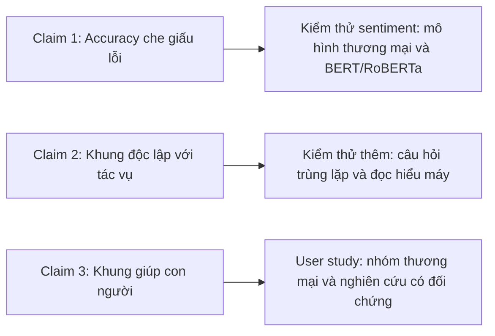

# Case study: CheckList (ACL 2020)

!!! abstract "Mục tiêu của bài"
    Sau bài này, người học có thể:

    - Nhận ra rằng một **phương pháp luận đánh giá** (evaluation methodology), không đi kèm mô hình mới, vẫn có thể là một đóng góp ở tầm Best Paper, và hiểu điều kiện để nó thuyết phục.
    - Giải thích vai trò của ma trận "năng lực × loại test" như xương sống tổ chức toàn bộ paper, từ phần trình bày phương pháp đến các bảng kết quả.
    - Phân biệt ba loại test MFT, INV, DIR và lý do mỗi loại tồn tại.
    - Chọn đúng loại bằng chứng cho từng loại claim, đặc biệt là khi claim nói về con người (dùng user study).

Paper **"Beyond Accuracy: Behavioral Testing of NLP Models with CheckList"** của Marco Tulio Ribeiro, Tongshuang Wu, Carlos Guestrin và Sameer Singh nhận giải Best Paper tại ACL 2020. Điều làm paper này đặc biệt là nó không đề xuất mô hình nào, cũng không đẩy state-of-the-art trên benchmark nào. Đóng góp của nó là một *cách đánh giá* mô hình: một khung khái niệm, một bộ công cụ, và bằng chứng rằng khung ấy giúp con người tìm ra những lỗi mà độ chính xác trên tập kiểm tra không phát hiện được.

Với người viết lần đầu, đây là một case study quan trọng vì hai lý do. Thứ nhất, nhiều nghiên cứu sinh mặc định rằng paper ở hội nghị A\* phải là paper phương pháp "thắng baseline", và vì thế bỏ qua những đóng góp có giá trị thuộc dạng khác: đánh giá, phân tích, tài nguyên. CheckList cho thấy loại đóng góp ấy hoàn toàn có thể đứng ở vị trí cao nhất. Thứ hai, chính vì không có con số SOTA để dựa vào, một paper phương pháp luận phải xây dựng sức thuyết phục bằng những cách khác, và CheckList làm điều đó rất bài bản. Trong bài này, chúng ta sẽ xem paper tổ chức lập luận thế nào khi "kết quả" không phải là một con số cao hơn.

## Bối cảnh ra đời

Cách đánh giá chuẩn trong học máy là chia dữ liệu thành tập huấn luyện, tập validation và tập kiểm tra (held-out), rồi báo cáo độ chính xác trên tập kiểm tra. Cách làm này có hai nhược điểm đã được biết đến từ lâu. Nhược điểm thứ nhất là tập kiểm tra thường được thu thập cùng cách với tập huấn luyện, nên mang cùng các thiên lệch (bias); một mô hình khai thác những thiên lệch ấy có thể đạt điểm cao mà không thực sự có năng lực tương ứng. Nhược điểm thứ hai là một con số tổng hợp không cho biết mô hình làm được gì và không làm được gì: hai mô hình cùng 92% accuracy có thể thất bại ở những loại đầu vào hoàn toàn khác nhau. Nói gọn lại, độ chính xác trên held-out set thường *đánh giá quá cao* năng lực thực của mô hình.

Vào khoảng 2019–2020, vấn đề này càng nổi bật vì các mô hình pre-train như BERT (xem [case study BERT](bert.md)) liên tục đẩy điểm benchmark lên cao, có khi sát hoặc vượt mức tham chiếu của con người trên một số tác vụ. Cộng đồng NLP đã có nhiều nỗ lực đánh giá bổ sung: tập thử thách (challenge sets) cho từng hiện tượng, ví dụ đối kháng (adversarial examples), kiểm tra độ bền với nhiễu, các công cụ phân tích lỗi. Nhưng các nỗ lực này thường rời rạc, gắn với một tác vụ hoặc một hiện tượng cụ thể, và đòi hỏi nhiều công sức để xây dựng lại cho tác vụ mới.

Điểm xuất phát của CheckList là nhìn sang một ngành khác: kỹ nghệ phần mềm. Trong phần mềm, không ai đánh giá chất lượng một chương trình chỉ bằng một con số "tỉ lệ đúng trên một tập đầu vào ngẫu nhiên". Kỹ sư viết các test có chủ đích, mỗi test kiểm tra một hành vi cụ thể; đặc biệt, *behavioral testing* (hay black-box testing) kiểm tra hành vi đầu vào–đầu ra mà không cần biết cấu trúc bên trong. CheckList mang tư duy này vào NLP, với một khung độc lập với tác vụ (task-agnostic) và công cụ giúp sinh test nhanh.

## Câu chuyện một dòng

> Độ chính xác trên tập held-out che giấu những gì mô hình thực sự không làm được. Mượn behavioral testing từ kỹ nghệ phần mềm, CheckList tổ chức việc kiểm thử thành một ma trận "năng lực ngôn ngữ × loại test", kèm công cụ sinh test quy mô lớn; áp dụng cho cả mô hình thương mại lẫn mô hình nghiên cứu mạnh nhất, nó phát hiện nhiều lỗi nghiêm trọng, và giúp người thực hành tìm ra nhiều lỗi hơn hẳn so với khi không dùng.

Câu chuyện này có cấu trúc khác với một paper phương pháp. Không có "phương pháp X thắng baseline Y". Thay vào đó là ba claim nối tiếp: *vấn đề có thật* (độ chính xác đánh giá quá cao), *khung đề xuất áp dụng được rộng rãi* (độc lập với tác vụ, có công cụ), và *khung ấy hữu ích với con người* (tìm được nhiều lỗi hơn). Mỗi claim cần một loại bằng chứng riêng, và như chúng ta sẽ thấy, paper cung cấp đủ cả ba.

## Phân tích câu chuyện và cấu trúc paper

### Title: nêu khoảng trống trước, giải pháp sau

Title "Beyond Accuracy: Behavioral Testing of NLP Models with CheckList" đi theo khuôn hai vế. Vế đầu, "Beyond Accuracy", nêu khoảng trống: độ chính xác là chưa đủ. Vế sau nêu giải pháp và tên công cụ. Người đọc chỉ cần đọc title đã biết paper phản bác điều gì và đề xuất điều gì. Khuôn "Beyond X: Y" có hiệu quả khi X là một thực hành phổ biến mà nhiều người đã ngầm cảm thấy chưa đủ; nó đặt paper vào vị thế trả lời một mối lo chung. Người học có thể xem thêm các khuôn title ở bài [Title](../02-viet-tung-phan/title.md).

### Introduction: từ một mối lo chung tới một khung cụ thể

Introduction đi theo một mạch rõ ràng. Đầu tiên là vấn đề: đánh giá bằng held-out accuracy là chuẩn mực nhưng có những giới hạn nêu ở trên. Tiếp theo là hiện trạng: các phương pháp đánh giá bổ sung đã có nhưng tập trung vào những khía cạnh riêng lẻ, chưa có một khung tổng quát. Sau đó là nguồn cảm hứng: kỹ nghệ phần mềm đã có truyền thống kiểm thử hành vi, tách việc kiểm thử khỏi việc cài đặt. Cuối cùng là đóng góp: một phương pháp luận, một công cụ, và bằng chứng qua ứng dụng và user study.

Việc mượn khái niệm từ ngành khác là một nước đi lập luận khéo. Nó làm cho đề xuất có vẻ *hiển nhiên khi đã được nói ra*: kỹ sư phần mềm không ai chỉ đo một con số tổng, vậy tại sao người làm NLP lại làm thế? Đồng thời, nó cung cấp sẵn một bộ từ vựng (test case, bug, unit test) mà người đọc đã quen, giúp ý tưởng được nắm bắt nhanh.

### Phần phương pháp: ma trận năng lực × loại test

Trái tim của paper là một ma trận hai chiều. Chiều thứ nhất là các **năng lực ngôn ngữ** (linguistic capabilities) mà một mô hình cần có, chẳng hạn: từ vựng và từ loại (Vocabulary+POS), quan hệ phân loại như đồng nghĩa và trái nghĩa (Taxonomy), độ bền với các thay đổi không liên quan như lỗi chính tả (Robustness), thực thể có tên (NER), tính công bằng (Fairness), hiểu thời gian (Temporal), phủ định (Negation), đồng tham chiếu (Coreference), vai nghĩa (SRL, semantic role labeling) và logic (Logic). Các năng lực này được chọn sao cho áp dụng được cho nhiều tác vụ; mỗi tác vụ cụ thể hóa chúng theo cách riêng.

Chiều thứ hai là ba **loại test**, và đây là phần thiết kế tinh tế nhất. Để hiểu, hãy lấy tác vụ phân tích cảm xúc (sentiment analysis) làm ví dụ. Các câu tiếng Anh trong bảng dưới đây do giáo trình tự đặt để minh họa, không trích từ paper.

| Loại test | Ý tưởng | Ví dụ minh họa (sentiment) | Cần nhãn không? |
|---|---|---|---|
| **MFT** (Minimum Functionality Test) | Giống unit test: một tập ví dụ đơn giản, có nhãn mong đợi, nhắm vào một năng lực | "The food was not good." phải được dự đoán là tiêu cực (năng lực phủ định) | Có, nhưng sinh tự động từ template |
| **INV** (Invariance test) | Áp một nhiễu loạn *không được* làm đổi dự đoán | Đổi "I flew to Chicago and loved it" thành "I flew to Dallas and loved it": cảm xúc phải giữ nguyên | Không |
| **DIR** (Directional Expectation test) | Áp một nhiễu loạn mà ta biết dự đoán *phải đổi theo hướng nào* | Thêm "The staff was rude." vào cuối một nhận xét: độ tin cậy vào nhãn tích cực không được tăng | Không |

Lý do cần đủ ba loại nằm ở cột cuối. MFT cho phép kiểm tra trực tiếp một năng lực, nhưng cần biết nhãn đúng của từng ví dụ; điều này khả thi vì ví dụ được sinh từ template có kiểm soát. INV và DIR không cần biết nhãn đúng, chỉ cần biết *quan hệ* giữa dự đoán trước và sau nhiễu loạn. Nhờ vậy, chúng có thể áp dụng lên dữ liệu thật không gán nhãn với số lượng lớn. Ba loại test bổ sung cho nhau: một loại kiểm tra năng lực cơ bản trên đầu vào đơn giản, hai loại kiểm tra tính nhất quán trên đầu vào thực tế.

Mỗi ô của ma trận là một câu hỏi cụ thể: "mô hình có xử lý phủ định ở mức tối thiểu không?" (Negation × MFT), "mô hình có bất biến với việc đổi tên địa danh không?" (NER × INV), và cứ thế. Ma trận biến câu hỏi mơ hồ "mô hình có hiểu ngôn ngữ không?" thành một danh sách các câu hỏi có thể kiểm tra được. Người viết có thể nhận ra đây chính là kỹ thuật chia nhỏ một claim lớn thành các claim kiểm chứng được, ở bài [Xây "câu chuyện" của paper](../01-truoc-khi-viet/cau-chuyen.md), nhưng được áp dụng cho chính đối tượng nghiên cứu.

### Công cụ: hạ chi phí viết test

Một khung khái niệm hay nhưng tốn công áp dụng sẽ ít người dùng. Vì vậy paper dành một phần để trình bày công cụ hỗ trợ sinh test quy mô lớn. Cơ chế chính là **template**: người dùng viết một mẫu câu có chỗ trống, ví dụ `I {negation} {pos_verb} the {thing}.`, rồi điền các chỗ trống từ danh sách từ để sinh ra hàng trăm ví dụ. Để không phải tự nghĩ ra danh sách từ, công cụ dùng một **masked language model** gợi ý các từ phù hợp cho chỗ trống; người dùng chỉ cần chọn những gợi ý đúng ý. Công cụ còn có các bộ từ vựng dựng sẵn và các hàm nhiễu loạn thông dụng (đổi tên, thêm lỗi chính tả, thêm câu phủ định). Mã nguồn được công bố để cộng đồng sử dụng.

Chi tiết dùng masked language model để gợi ý từ có một ý nghĩa lập luận: nó cho thấy chính các mô hình pre-train, đối tượng bị kiểm thử, có thể được tận dụng để giảm công sức kiểm thử. Quan trọng hơn, phần công cụ trả lời trước một phản biện mà reviewer chắc chắn sẽ nêu với một paper phương pháp luận: "ý tưởng hay, nhưng ai sẽ bỏ công áp dụng nó?"

### Bố cục tổng thể

Bố cục của paper bám sát ba claim. Sau Introduction là phần trình bày CheckList (năng lực, loại test, công cụ sinh test). Tiếp theo là phần kiểm thử các mô hình mạnh trên ba tác vụ. Sau đó là phần đánh giá với người dùng. Cuối cùng là Related Work và Conclusion. Không có phần "Method" và "Experiments" theo nghĩa thông thường; thay vào đó là "khung đề xuất", "áp dụng khung", và "kiểm chứng khung với con người". Đây là bài học về việc để cấu trúc paper đi theo loại đóng góp, thay vì ép mọi paper vào một khuôn.

## Figure và Table then chốt

### Hình mở đầu: ma trận như bản đồ của paper

Hình đầu tiên của paper trình bày chính cái ma trận năng lực × loại test, minh họa bằng các test cụ thể trên một mô hình sentiment thương mại: mỗi loại test có vài ví dụ đầu vào, dự đoán của mô hình và cho thấy dự đoán nào sai. Hình này làm cùng lúc ba việc. Nó giới thiệu khung khái niệm; nó cho thấy khung được dùng thế nào; và nó trình bày ngay một kết quả gây chú ý, rằng một sản phẩm thương mại thất bại ở những câu rất đơn giản. Người đọc chỉ nhìn hình đầu đã nắm được gần như toàn bộ câu chuyện.

So với Figure 1 của một paper phương pháp, vốn thường là sơ đồ kiến trúc hoặc biểu đồ kết quả, đây là loại teaser "ví dụ cụ thể": những câu tiếng Anh ngắn mà mô hình đoán sai. Với người đọc NLP, một ví dụ ngôn ngữ cụ thể có sức nặng lớn, vì ai cũng tự kiểm tra được ngay trong đầu rằng mô hình đã sai.

### Các bảng kết quả: ma trận lặp lại ở mọi nơi

Các bảng kết quả cho từng tác vụ được tổ chức theo đúng ma trận: mỗi dòng là một test, gắn với một năng lực và một loại test; các cột là tỉ lệ thất bại (failure rate) của từng mô hình được kiểm tra; bên cạnh là ví dụ minh họa một trường hợp thất bại. Vì người đọc đã quen với ma trận từ hình đầu, họ đọc được mọi bảng mà không cần giải thích lại.

Đây chính là ý nghĩa của cụm "một hình hoặc bảng làm xương sống paper". Cùng một cấu trúc xuất hiện ở phần trình bày phương pháp, ở hình mở đầu, ở các bảng kết quả, và ở hướng dẫn cho người dùng trong user study. Mỗi lần xuất hiện, nó củng cố khung khái niệm trong đầu người đọc. Một paper có một cấu trúc trung tâm như vậy dễ đọc, dễ nhớ và dễ được nhắc lại khi reviewer tóm tắt paper cho area chair.

## Thí nghiệm như một chuỗi lập luận

Vì đóng góp là phương pháp luận, "thí nghiệm" của CheckList không nhằm cho thấy một con số cao hơn, mà nhằm trả lời ba câu hỏi tương ứng với ba claim.

**Câu hỏi thứ nhất: CheckList có phát hiện được những lỗi mà độ chính xác che giấu không?** Paper áp dụng CheckList cho tác vụ phân tích cảm xúc, trên hai nhóm mô hình: các mô hình thương mại của những công ty công nghệ lớn, và các mô hình nghiên cứu mạnh là BERT và RoBERTa đã fine-tune. Việc chọn cả hai nhóm là có chủ đích. Nếu chỉ kiểm thử mô hình yếu, reviewer sẽ nói lỗi chỉ là do mô hình kém. Kiểm thử sản phẩm thương mại cho thấy vấn đề tồn tại ngay cả ở những hệ thống đã được đầu tư lớn; kiểm thử mô hình nghiên cứu mạnh cho thấy vấn đề tồn tại ngay cả ở state-of-the-art. Kết quả là nhiều test đơn giản, đặc biệt ở những năng lực như phủ định, có tỉ lệ thất bại cao.

**Câu hỏi thứ hai: khung có thật sự độc lập với tác vụ không?** Một claim "task-agnostic" không thể được chứng minh chỉ bằng một tác vụ. Paper áp dụng cùng ma trận cho hai tác vụ khác hẳn: phát hiện câu hỏi trùng lặp (duplicate question detection, trên Quora Question Pairs) và đọc hiểu máy (machine comprehension). Cùng các năng lực được cụ thể hóa lại cho từng tác vụ; ví dụ, với tác vụ câu hỏi trùng lặp, một test INV có thể kiểm tra rằng đổi tên người ở cả hai câu hỏi không làm thay đổi kết luận. Ở cả hai tác vụ, CheckList tiếp tục phát hiện nhiều lỗi nghiêm trọng.

**Câu hỏi thứ ba: CheckList có giúp *con người* tìm lỗi tốt hơn không?** Đây là câu hỏi mà nhiều paper phương pháp luận bỏ qua, và cũng là chỗ CheckList vượt lên. Các phát hiện ở hai câu hỏi trên do chính nhóm tác giả thực hiện; mà nhóm tác giả là chuyên gia, hiểu khung do chính họ đề xuất hơn ai hết, và có động cơ để tìm ra lỗi. Claim "khung giúp người thực hành" chỉ được chứng minh khi những người khác dùng nó. Paper cung cấp hai bằng chứng. Thứ nhất, một nhóm phát triển một mô hình sentiment thương mại, vốn đã được kiểm thử kỹ, dùng CheckList trong một buổi làm việc và vẫn tìm ra nhiều lỗi mới. Thứ hai, một user study có đối chứng cho thấy người dùng CheckList tạo được số test khoảng gấp đôi và tìm ra số lỗi gần gấp ba so với người không dùng.

Bài học lớn ở đây là **loại bằng chứng phải khớp với loại claim**. Claim về mô hình được chứng minh bằng thí nghiệm trên mô hình. Claim về tính tổng quát được chứng minh bằng nhiều tác vụ. Claim về con người được chứng minh bằng nghiên cứu trên con người. Một paper phương pháp luận chỉ có hai loại bằng chứng đầu sẽ để hở một sườn mà reviewer có thể tấn công: "khung này hữu ích với tác giả, nhưng có hữu ích với người khác không?"

Cũng cần ghi nhận một điểm về phương pháp luận nói chung, dù không phải là kết luận riêng của paper: như mọi bộ test phần mềm, một bộ test hành vi có thể chỉ ra *sự hiện diện* của lỗi, nhưng việc vượt qua các test không chứng minh mô hình không còn lỗi. Một paper đánh giá trung thực nên nói rõ phạm vi những gì bộ test đó có thể và không thể kết luận.

## Văn phong

Văn phong của CheckList có ba điểm đáng chú ý. Điểm thứ nhất là **nhập khẩu từ vựng có chủ đích**: các từ "bug", "test case", "behavioral testing" được dùng nhất quán, khiến phép so sánh với kỹ nghệ phần mềm trở nên cụ thể chứ không chỉ là ẩn dụ. Ba loại test được đặt tên và viết tắt (MFT, INV, DIR) ngay từ đầu, và các tên này được dùng xuyên suốt trong bảng biểu.

Điểm thứ hai là **ví dụ có mặt ở khắp nơi**. Hầu như mỗi khẳng định về một năng lực đều đi kèm một câu cụ thể mà mô hình đoán sai. Đây là đặc trưng của văn phong NLP mạnh: người đọc không phải tin vào một con số tỉ lệ thất bại trừu tượng, mà tự thấy được mô hình sai ở đâu và sai như thế nào.

Điểm thứ ba là **giọng điệu điềm tĩnh khi nói về sản phẩm thương mại**. Paper trình bày lỗi của các mô hình thương mại như những phát hiện, không như một cuộc tấn công. Giọng điệu này quan trọng vì mục tiêu của paper là thuyết phục người thực hành, kể cả chính các nhóm phát triển sản phẩm, áp dụng khung; một giọng điệu chế giễu sẽ đẩy họ ra xa.

## Bài học cho người viết

### Phương pháp luận đánh giá là một đóng góp hợp lệ, nhưng có điều kiện

CheckList cho thấy một paper không có mô hình mới vẫn có thể là đóng góp hàng đầu. Tuy nhiên, các điều kiện để nó thuyết phục cũng rất rõ. Khung phải *tổng quát* (áp dụng được cho nhiều tác vụ, không phải một tập thử thách cho một hiện tượng). Khung phải *thực tế* (có công cụ hạ chi phí áp dụng). Khung phải được *chứng minh* (phát hiện lỗi thật ở mô hình mạnh). Và khung phải được *kiểm chứng với người dùng* (không chỉ hữu ích với tác giả). Một paper đánh giá thiếu một trong bốn điều kiện này thường bị reviewer chê là "chỉ là một tập dữ liệu nữa" hoặc "ý tưởng hay nhưng chưa được kiểm chứng".

### Một cấu trúc trung tâm làm xương sống

Ma trận năng lực × loại test xuất hiện từ hình đầu tới bảng cuối. Người viết nên tự hỏi: paper đang viết có một cấu trúc trung tâm như vậy không? Đó có thể là một bảng phân loại, một ma trận, một sơ đồ quy trình, hay một hệ thống ký hiệu. Khi có, hãy dùng nó nhất quán ở mọi phần: khi giới thiệu phương pháp, khi tổ chức thí nghiệm, khi trình bày kết quả. Nhờ đó, người đọc luôn định vị được từng phần trong mạch lập luận.

### Kiểm thử đối thủ mạnh nhất

Paper chọn kiểm thử sản phẩm thương mại và state-of-the-art nghiên cứu, không chọn mô hình dễ bị chỉ ra lỗi. Với paper đánh giá, đây là điều kiện bắt buộc: lỗi tìm thấy ở mô hình yếu không chứng minh được gì về vấn đề chung. Nguyên tắc này cũng chính là nguyên tắc "so với baseline mạnh nhất" trong paper phương pháp, chỉ được áp dụng theo chiều ngược lại.

### Công bố công cụ để tạo tác động

Với một paper phương pháp luận, tác động không đo bằng việc người khác vượt qua con số của paper, mà bằng việc người khác *dùng* khung. Công bố mã nguồn và làm cho công cụ dễ dùng là một phần của đóng góp, không phải việc phụ sau khi paper được nhận (xem [Camera-ready, poster, code](../04-nop-va-sau-nop/camera-ready.md)).

### Áp dụng sang các cộng đồng khác

Ở chính **NLP**, CheckList thuộc dòng paper đánh giá và tài nguyên, một dòng được hệ sinh thái ARR trân trọng, nhất là khi kèm phân tích sâu và quan tâm tới các ngôn ngữ ít tài nguyên (xem [Viết cho ACL / EMNLP / NAACL](../06-cong-dong/nlp.md) và dự án NLP hư cấu ở bài [Thực hành](worked-example.md)). Ở **Computer Vision**, tư duy "năng lực × loại test" chuyển đổi khá tự nhiên. Chẳng hạn, với một detector, các năng lực có thể là vật nhỏ, vật bị che khuất, điều kiện ánh sáng; một test kiểu MFT dùng các cảnh tổng hợp đơn giản có nhãn chắc chắn; một test kiểu INV kiểm tra rằng đổi màu nền không làm đổi kết quả; một test kiểu DIR kiểm tra rằng tăng mức che khuất không làm độ tin cậy tăng lên. Ở **Machine Learning**, các paper đánh giá và benchmark thường được nộp vào track riêng như Datasets & Benchmarks của NeurIPS, nơi reviewer đặc biệt quan tâm tới tính tổng quát, tài liệu hóa và khả năng duy trì của bộ đánh giá (xem [Viết cho NeurIPS / ICML / ICLR](../06-cong-dong/ml.md)).

### Nối với các bài kỹ năng

Nước đi khởi đầu của CheckList, mượn behavioral testing từ kỹ nghệ phần mềm, là một ví dụ mẫu của phương pháp chuyển giao giữa các lĩnh vực ở bài [Tìm khoảng trống & nguồn ý tưởng](../01-truoc-khi-viet/tim-khoang-trong.md); còn việc phương pháp luận đánh giá được thừa nhận như một kiểu đóng góp riêng đã được bàn ở bài [Thẩm định ý tưởng](../01-truoc-khi-viet/y-tuong.md). Nguyên tắc "loại bằng chứng phải khớp với loại claim" là câu hỏi trung tâm khi đọc một paper với con mắt phản biện, được luyện có hệ thống ở bài [Đọc paper như một reviewer](../01-truoc-khi-viet/doc-nhu-reviewer.md), và cũng là khuôn tổ chức phần thực nghiệm ở bài [Experiments](../02-viet-tung-phan/experiments.md). Nhìn từ phía ngược lại, CheckList cho thấy một con số đẹp trên benchmark có thể che giấu năng lực thật; Tình huống 22 trong bài [Khi câu chuyện và bằng chứng không khớp](../07-tinh-huong-kho/cau-chuyen-va-bang-chung.md) bàn cách xử lý khi chính dự án của người học phát hiện mức cải thiện đến từ thiên lệch của benchmark, và bài [Bài toán, dữ liệu và phạm vi](../07-tinh-huong-kho/bai-toan-va-pham-vi.md) bàn những tình huống khó của một đóng góp không đi kèm phương pháp mới, chẳng hạn khi bài toán chưa có baseline để so sánh.

## Tóm tắt

CheckList là ví dụ về một đóng góp phương pháp luận đánh giá đạt tầm Best Paper. Paper bắt đầu từ một mối lo chung, rằng độ chính xác trên tập held-out đánh giá quá cao năng lực mô hình, và mượn tư duy behavioral testing từ kỹ nghệ phần mềm để giải quyết. Xương sống của paper là ma trận năng lực ngôn ngữ × loại test (MFT, INV, DIR), xuất hiện nhất quán từ hình mở đầu đến mọi bảng kết quả. Paper xây dựng sức thuyết phục bằng ba loại bằng chứng khớp với ba claim: kiểm thử mô hình thương mại và mô hình nghiên cứu mạnh để chứng minh vấn đề có thật, áp dụng cho ba tác vụ để chứng minh tính tổng quát, và user study để chứng minh khung hữu ích với con người. Công cụ sinh test bằng template và gợi ý từ masked language model, cùng mã nguồn công bố, hạ chi phí áp dụng và tạo tác động.

## Bài tập

1. **Dựng ma trận cho mô hình của người học.** Chọn một mô hình hoặc hệ thống trong dự án hiện tại. Liệt kê 5–8 năng lực mà nó cần có, rồi với ít nhất sáu ô của ma trận năng lực × (MFT, INV, DIR), viết một ví dụ test cụ thể.
2. **Viết test không cần nhãn.** Thiết kế hai test INV và hai test DIR cho tác vụ của người học. Giải thích vì sao mỗi nhiễu loạn không được làm đổi dự đoán (với INV) hoặc phải làm dự đoán đổi theo một hướng xác định (với DIR).
3. **Khớp bằng chứng với claim.** Liệt kê các claim của paper đang viết và ghi bên cạnh loại bằng chứng mỗi claim cần (thí nghiệm trên mô hình, nhiều tác vụ hoặc dataset, phân tích lý thuyết, nghiên cứu trên người). Nếu có claim nói về con người mà chưa có bằng chứng trên người, hãy phác thảo một user study nhỏ có đối chứng hoặc sửa lại claim cho vừa với bằng chứng hiện có.
4. **Tìm cấu trúc trung tâm.** Viết một đoạn ngắn mô tả cấu trúc trung tâm (bảng, ma trận, sơ đồ) có thể làm xương sống cho paper của người học, và chỉ ra nó sẽ xuất hiện ở những phần nào của paper.
