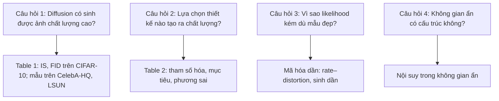

# Case study: DDPM (NeurIPS 2020)

!!! abstract "Mục tiêu của bài"
    Sau bài này, người học có thể:

    - Giải thích vì sao việc chứng minh một lớp mô hình đã có (diffusion models, 2015) có thể làm được điều chưa ai thấy là một đóng góp lớn, và cách paper ghi nhận công trình gốc một cách sòng phẳng.
    - Phân tích cách một lựa chọn tham số hóa (dự đoán nhiễu thay vì dự đoán trung bình) làm lộ ra mối liên hệ với lý thuyết sẵn có, và vì sao kết nối ấy tự nó là một đóng góp.
    - Đọc bảng ablation của DDPM như bằng chứng cho từng quyết định thiết kế, kể cả những cấu hình thất bại.
    - Học cách trình bày trung thực một điểm yếu (log-likelihood không cạnh tranh) và biến nó thành một phân tích có giá trị.

Paper **"Denoising Diffusion Probabilistic Models"** của Jonathan Ho, Ajay Jain và Pieter Abbeel (UC Berkeley) được công bố tại NeurIPS 2020. Paper cho thấy diffusion model có thể sinh ảnh với chất lượng ngang hoặc vượt các họ mô hình sinh tốt nhất khi đó, và mở ra làn sóng diffusion trong mô hình sinh. Nhiều hệ thống sinh ảnh về sau, trong đó có Latent Diffusion (xem [case study MAE và Latent Diffusion](mae-ldm.md)), được xây dựng trực tiếp trên nền DDPM.

Điều khiến DDPM đáng nghiên cứu dưới góc độ viết paper là loại đóng góp của nó. Paper không phát minh ra diffusion model; ý tưởng đã có từ năm 2015. Đóng góp của DDPM gồm ba phần khác bản chất: một *minh chứng thực nghiệm* rằng lớp mô hình này làm được điều chưa ai thấy; một *kết nối lý thuyết* với một hướng nghiên cứu khác; và một *mục tiêu huấn luyện đơn giản hóa* rút ra từ kết nối đó. Bên cạnh đó, paper xử lý điểm yếu của chính nó một cách mẫu mực. Chúng ta sẽ phân tích từng phần, và xem chúng được sắp xếp thế nào để tạo thành một câu chuyện thuyết phục.

## Bối cảnh ra đời

Vào khoảng năm 2020, mô hình sinh ảnh có nhiều họ, mỗi họ có thế mạnh và điểm yếu riêng. GAN cho ảnh chất lượng cao nhưng huấn luyện kém ổn định và không cung cấp likelihood. Các mô hình tự hồi quy như PixelCNN cho log-likelihood tốt nhưng sinh mẫu chậm. VAE và normalizing flow là các mô hình dựa trên likelihood (likelihood-based) với những đánh đổi riêng về chất lượng mẫu. Bên cạnh đó, các mô hình dựa trên score (score-based generative models), tiêu biểu là công trình của Song và Ermon năm 2019, học gradient của log mật độ dữ liệu ở nhiều mức nhiễu (denoising score matching) và sinh mẫu bằng annealed Langevin dynamics, đã bắt đầu cho thấy kết quả đáng chú ý.

**Diffusion probabilistic model** được Sohl-Dickstein và cộng sự đề xuất năm 2015, lấy cảm hứng từ nhiệt động lực học không cân bằng. Ý tưởng là định nghĩa một quá trình *thuận* (forward process) cố định, từng bước thêm nhiễu Gauss vào dữ liệu cho tới khi chỉ còn nhiễu, rồi học một quá trình *ngược* (reverse process) khử nhiễu từng bước để sinh dữ liệu. Mô hình dễ định nghĩa và huấn luyện hiệu quả, nhưng như DDPM nêu trong Introduction, theo hiểu biết của nhóm tác giả thì chưa có minh chứng nào cho thấy nó sinh được mẫu chất lượng cao.

Như vậy, khi DDPM ra đời, có hai dòng nghiên cứu song song: diffusion model với khung biến phân (variational) và likelihood, và score-based model với score matching và Langevin dynamics. Một trong những đóng góp lớn nhất của DDPM là cho thấy hai dòng này gặp nhau.

## Câu chuyện một dòng

> Diffusion model đã có từ năm 2015 nhưng chưa từng được chứng minh là sinh được ảnh chất lượng cao; với cách tham số hóa dự đoán nhiễu, ta thấy chúng tương đương với denoising score matching ở nhiều mức nhiễu khi huấn luyện và với annealed Langevin dynamics khi lấy mẫu, từ đó rút ra một mục tiêu huấn luyện đơn giản cho chất lượng mẫu hàng đầu, dù log-likelihood chưa cạnh tranh, điều mà paper giải thích qua góc nhìn nén mất mát dần.

Câu chuyện này dài hơn các câu chuyện một dòng thông thường vì nó chứa ba đóng góp và một điểm yếu được thừa nhận. Tuy vậy, các mảnh ghép nối với nhau một cách tự nhiên. Kết nối lý thuyết giải thích *vì sao* cách tham số hóa mới hoạt động; mục tiêu đơn giản hóa là *hệ quả* của kết nối; chất lượng mẫu là *bằng chứng*; và phân tích nén mất mát *giải thích* điểm yếu thay vì chỉ thừa nhận nó.

## Phân tích câu chuyện và cấu trúc paper

### Introduction: kết quả trước, cơ chế sau

Introduction của DDPM mở bằng bối cảnh các họ mô hình sinh, rồi giới thiệu diffusion model như một chuỗi Markov được tham số hóa, huấn luyện bằng suy luận biến phân để sinh ra mẫu khớp với dữ liệu sau một số bước hữu hạn. Ngay sau đó, paper nêu claim chính: diffusion model có khả năng sinh mẫu chất lượng cao, đôi khi tốt hơn các kết quả đã công bố của các họ mô hình khác. Tiếp theo là claim lý thuyết về cách tham số hóa và mối liên hệ với score matching và Langevin dynamics. Cuối cùng, paper chủ động nêu điểm yếu: dù mẫu có chất lượng cao, log-likelihood không cạnh tranh với các mô hình likelihood-based khác, và giới thiệu luôn cách diễn giải: phần lớn độ dài mã hóa không mất mát (lossless codelength) của mô hình được dùng để mô tả những chi tiết ảnh không thể nhận thấy bằng mắt.

Thứ tự này đáng chú ý. Paper không giấu điểm yếu tới phần thực nghiệm, cũng không đặt nó ở Limitations cuối bài. Nó được nêu ngay trong Introduction, cùng với cách diễn giải. Reviewer đọc tới bảng kết quả và thấy log-likelihood kém sẽ không ngạc nhiên, vì đã được báo trước và đã được cung cấp một khung để hiểu.

### Background: đặt nền toán học gọn gàng

Mục Background trình bày hai quá trình. Quá trình thuận thêm nhiễu Gauss theo một lịch phương sai $\beta_1, \dots, \beta_T$:

$$
q(x_t \mid x_{t-1}) = \mathcal{N}\big(x_t;\ \sqrt{1-\beta_t}\, x_{t-1},\ \beta_t I\big).
$$

Một tính chất then chốt là có thể lấy mẫu $x_t$ trực tiếp từ $x_0$ ở bất kỳ bước $t$ nào bằng công thức dạng đóng. Đặt $\alpha_t = 1 - \beta_t$ và $\bar\alpha_t = \prod_{s=1}^{t} \alpha_s$, ta có

$$
q(x_t \mid x_0) = \mathcal{N}\big(x_t;\ \sqrt{\bar\alpha_t}\, x_0,\ (1-\bar\alpha_t) I\big).
$$

Quá trình ngược là một chuỗi Markov với các bước chuyển Gauss được học, $p_\theta(x_{t-1} \mid x_t)$. Huấn luyện tối ưu một chặn biến phân (variational bound) của negative log-likelihood, có thể viết lại thành tổng các số hạng KL giữa các phân phối Gauss, tính được dạng đóng nhờ phân phối hậu nghiệm $q(x_{t-1} \mid x_t, x_0)$ cũng là Gauss. Background được viết gọn, chỉ chứa những gì cần cho phần tiếp theo; đây là ví dụ về cách viết mục Preliminaries hiệu quả (xem bài [Method](../02-viet-tung-phan/method.md)).

### Phần cốt lõi: từ tham số hóa tới kết nối lý thuyết

Mục thứ ba của paper, nối diffusion model với denoising autoencoder, là trái tim của đóng góp. Paper đi qua từng lựa chọn thiết kế theo thứ tự các số hạng trong chặn biến phân. Lịch phương sai của quá trình thuận được cố định thành hằng số, nên số hạng tương ứng không cần học. Phương sai của quá trình ngược cũng được cố định thành hằng số theo bước $t$ thay vì học.

Lựa chọn quan trọng nhất là cách tham số hóa trung bình của quá trình ngược. Cách hiển nhiên là cho mạng neural dự đoán trực tiếp trung bình của phân phối hậu nghiệm, ký hiệu $\tilde\mu_t$. DDPM đề xuất một cách khác: viết $x_t$ theo $x_0$ và nhiễu $\varepsilon$, rồi cho mạng neural $\varepsilon_\theta(x_t, t)$ dự đoán chính *nhiễu* đã được thêm vào. Khi thay cách tham số hóa này vào chặn biến phân, hai điều lộ ra. Thứ nhất, mục tiêu huấn luyện trở thành một dạng denoising score matching trên nhiều mức nhiễu, đánh chỉ số bằng $t$. Thứ hai, thủ tục lấy mẫu trở nên giống annealed Langevin dynamics, với $\varepsilon_\theta$ đóng vai trò gradient đã học của mật độ dữ liệu.

Đây là ý nghĩa của câu "kết nối với lý thuyết có sẵn là một đóng góp". Trước DDPM, diffusion model và score-based model được nghiên cứu như hai hướng riêng. Sau DDPM, người ta biết rằng với một cách tham số hóa phù hợp, chúng là hai góc nhìn về cùng một thứ. Kết nối này có ba giá trị. Nó *giải thích* vì sao cách tham số hóa mới hoạt động tốt, thay vì chỉ cho thấy rằng nó hoạt động. Nó *nhập khẩu* trực giác và kỹ thuật từ hướng nghiên cứu kia. Và nó *mở đường* cho các công trình sau tiếp tục hợp nhất hai khung; chẳng hạn, công trình về score-based modeling qua phương trình vi phân ngẫu nhiên của Song và cộng sự tại ICLR 2021 đã xây dựng một khung chung bao gồm cả hai.

### Mục tiêu đơn giản hóa L_simple

Từ cách tham số hóa dự đoán nhiễu, mỗi số hạng của chặn biến phân trở thành một sai số bình phương giữa nhiễu thật và nhiễu dự đoán, nhân với một trọng số phụ thuộc $t$. DDPM đề xuất bỏ trọng số đó, được một mục tiêu đơn giản:

$$
L_{\text{simple}}(\theta) = \mathbb{E}_{t,\, x_0,\, \varepsilon}\Big[ \big\| \varepsilon - \varepsilon_\theta\big(\sqrt{\bar\alpha_t}\, x_0 + \sqrt{1-\bar\alpha_t}\, \varepsilon,\ t\big) \big\|^2 \Big],
$$

trong đó $t$ được lấy đều từ $1$ tới $T$. Paper giải thích ý nghĩa của việc bỏ trọng số: $L_{\text{simple}}$ là một dạng chặn biến phân *có trọng số khác*, giảm nhấn mạnh các số hạng ứng với $t$ nhỏ, nơi nhiễu ít và việc khử nhiễu dễ, để mạng tập trung vào các bước khử nhiễu khó hơn ở $t$ lớn. Kết quả thực nghiệm cho thấy mục tiêu này cho chất lượng mẫu tốt hơn chặn biến phân thật.

Điểm đáng học là paper không chỉ nói "we drop the weighting and it works better". Nó giải thích việc bỏ trọng số *tương đương với gì* trong khung lý thuyết, và *vì sao* điều đó có thể có lợi cho chất lượng mẫu. Một thay đổi trông như mẹo kỹ thuật được đặt vào một khung diễn giải.

### Bố cục tổng thể

Bố cục của DDPM gồm: Introduction; Background; mục về diffusion model và denoising autoencoder (lựa chọn thiết kế, tham số hóa, mục tiêu đơn giản hóa); Experiments (chất lượng mẫu, ablation tham số hóa và mục tiêu, mã hóa dần, nội suy); Related Work; Conclusion; và phần Broader Impact mà NeurIPS 2020 yêu cầu mọi paper phải có. Phụ lục chứa chứng minh chi tiết, chi tiết kiến trúc và nhiều mẫu sinh bổ sung. Về kiến trúc, paper dùng một mạng U-Net, và bước thời gian $t$ được đưa vào mạng bằng positional embedding dạng sinusoid giống Transformer (xem [case study Transformer](transformer.md)), một ví dụ nhỏ về cách các ý tưởng lan truyền giữa các bài toán.

## Figure và Table then chốt

### Figure 1: để mẫu sinh tự nói

Với một paper mô hình sinh, teaser hiển nhiên nhất là mẫu sinh. Figure 1 của DDPM trình bày ảnh sinh trên CelebA-HQ độ phân giải 256×256 và trên CIFAR-10 không điều kiện. Không có sơ đồ, không có biểu đồ: chất lượng mẫu là claim chính, và mẫu là bằng chứng trực tiếp nhất. Người đọc có thể tự đánh giá trong vài giây.

### Figure 2: cả mô hình trong một dòng

Figure 2 là mô hình đồ thị có hướng của diffusion: một chuỗi từ $x_T$ (nhiễu thuần) qua các $x_t$ tới $x_0$ (dữ liệu), với mũi tên theo một hướng là quá trình ngược $p_\theta(x_{t-1} \mid x_t)$ và theo hướng kia là quá trình thuận $q(x_t \mid x_{t-1})$. Hình rất nhỏ nhưng chứa toàn bộ cấu trúc mô hình. Người đọc nắm được ý tưởng trước khi gặp bất kỳ công thức nào.

### Algorithm 1 và Algorithm 2: sự đơn giản hiện ra trước mắt

Paper đặt cạnh nhau hai khung thuật toán: huấn luyện và lấy mẫu. Khung huấn luyện chỉ có vài dòng: lấy một ảnh, lấy một bước $t$ ngẫu nhiên, lấy nhiễu, cập nhật gradient của $L_{\text{simple}}$. Khung lấy mẫu cũng chỉ vài dòng: bắt đầu từ nhiễu, lặp khử nhiễu từ $T$ về $1$. Hai khung này làm cho sự đơn giản trở thành điều *nhìn thấy được*, không chỉ là lời khẳng định. Người đọc thấy ngay rằng huấn luyện diffusion model không khó hơn huấn luyện một mạng khử nhiễu thông thường. Bài học này tương tự như Algorithm 1 của Adam (xem [case study Adam](adam.md)).

### Table 1: điểm mạnh và điểm yếu trên cùng một bảng

Table 1 so sánh DDPM với nhiều mô hình khác trên CIFAR-10 theo ba chỉ số: Inception Score (IS), FID, và negative log-likelihood đo bằng bits/dim. Với mục tiêu $L_{\text{simple}}$, DDPM đạt Inception Score 9.46 và FID 3.17 trong thiết lập không điều kiện, những con số hàng đầu khi đó. Cột log-likelihood thì cho thấy DDPM kém các mô hình likelihood-based khác.

Đặt cả hai trên cùng một bảng là một lựa chọn trung thực có chủ ý. Paper hoàn toàn có thể chỉ báo cáo IS và FID, và đưa log-likelihood vào phụ lục. Thay vào đó, người đọc thấy ngay cả điểm mạnh lẫn điểm yếu, và đã được Introduction chuẩn bị để hiểu điểm yếu đó. Trên LSUN độ phân giải 256×256, paper báo cáo chất lượng mẫu tương đương ProgressiveGAN, một trong những GAN mạnh khi đó.

### Table 2: ablation về tham số hóa và mục tiêu

Table 2 là bảng ablation trung tâm. Nó so sánh hai cách tham số hóa (dự đoán trung bình $\tilde\mu$ và dự đoán nhiễu $\varepsilon$) kết hợp với các mục tiêu khác nhau (chặn biến phân thật, sai số bình phương không trọng số) và các lựa chọn phương sai (cố định hoặc học được). Kết quả cho thấy một bức tranh rõ ràng. Dự đoán $\tilde\mu$ chỉ hoạt động khi huấn luyện với chặn biến phân thật, và không hoạt động tốt với sai số bình phương không trọng số. Dự đoán $\varepsilon$ cho kết quả tương đương dự đoán $\tilde\mu$ khi dùng chặn biến phân với phương sai cố định, và tốt hơn hẳn khi dùng $L_{\text{simple}}$. Học phương sai dẫn tới huấn luyện kém ổn định và chất lượng mẫu kém hơn so với phương sai cố định.

Điều đáng học ở bảng này là nó báo cáo cả những cấu hình *thất bại*: một số ô trong bảng để trống (đánh dấu bằng gạch ngang) vì cấu hình tương ứng huấn luyện không ổn định hoặc cho kết quả quá kém. Một bảng chỉ có những cấu hình thành công cho người đọc biết phương pháp hoạt động; một bảng có cả những cấu hình thất bại cho người đọc biết *vì sao* phương pháp được thiết kế như vậy. Mỗi lựa chọn trong phương pháp cuối cùng (dự đoán $\varepsilon$, dùng $L_{\text{simple}}$, phương sai cố định) đều được biện minh bằng một hàng so sánh trong bảng.

## Thí nghiệm như một chuỗi lập luận

Phần thực nghiệm của DDPM trả lời bốn câu hỏi, theo thứ tự từ claim chính tới các phân tích sâu hơn.

**Câu hỏi thứ nhất: diffusion model có sinh được ảnh chất lượng cao không?** Đây là claim chính, và Table 1 cùng các hình mẫu sinh trả lời. Việc dùng nhiều dataset (CIFAR-10 độ phân giải thấp, CelebA-HQ và LSUN độ phân giải 256×256) cho thấy kết quả không phụ thuộc vào một thiết lập. Paper cũng báo cáo log-likelihood trên cả tập huấn luyện và tập kiểm tra, và chênh lệch nhỏ giữa hai con số cho thấy mô hình không overfit, chặn trước câu hỏi "mẫu đẹp có phải do mô hình ghi nhớ dữ liệu?".

**Câu hỏi thứ hai: lựa chọn thiết kế nào tạo ra chất lượng?** Table 2 trả lời, như đã phân tích. Đây là bằng chứng cho đóng góp thứ hai và thứ ba: cách tham số hóa và mục tiêu đơn giản hóa không phải chi tiết phụ mà là nguyên nhân của chất lượng.

**Câu hỏi thứ ba: vì sao log-likelihood kém dù mẫu đẹp?** Đây là phần thú vị nhất về mặt viết. Thay vì dừng lại ở việc thừa nhận điểm yếu, paper phân tích nó qua góc nhìn mã hóa dần (progressive coding). Quá trình ngược có thể xem như một quá trình giải nén mất mát dần (progressive lossy decompression): ở mỗi bước, mô hình nhận thêm một lượng thông tin (rate) và ảnh tái tạo tiến gần ảnh gốc hơn (distortion giảm). Biểu đồ rate–distortion cho thấy phần lớn độ méo giảm rất nhanh khi rate còn thấp, còn phần lớn số bit được dùng cho những chi tiết không thể nhận thấy. Nói cách khác, mô hình rất giỏi ở những gì mắt người quan tâm, và log-likelihood kém vì nó "trả giá" cho những chi tiết mắt người không thấy. Paper còn cho thấy quá trình sinh dần: các đặc trưng tổng thể của ảnh xuất hiện trước, chi tiết xuất hiện sau. Paper cũng chỉ ra rằng có thể xem quá trình này như một dạng tổng quát hóa của giải mã tự hồi quy.

**Câu hỏi thứ tư: không gian ẩn có cấu trúc không?** Thí nghiệm nội suy giữa hai ảnh thông qua không gian ẩn cho thấy các ảnh trung gian hợp lý, gợi ý rằng mô hình học được một biểu diễn có cấu trúc.

Chuỗi này cho thấy một mô hình mẫu về cách xử lý điểm yếu: câu hỏi thứ ba không chỉ thừa nhận điểm yếu mà biến nó thành một hiểu biết mới về mô hình. Về sau, chính góc nhìn rate–distortion này trở thành động lực cho Latent Diffusion: nếu phần lớn số bit dùng cho chi tiết không nhận thấy được, hãy nén ảnh vào một không gian ẩn trước rồi mới chạy diffusion.

## Văn phong

Văn phong của DDPM có ba đặc điểm. Đặc điểm thứ nhất là **toán học dày đặc nhưng luôn dẫn tới thuật toán**. Mọi phép biến đổi trong phần cốt lõi đều kết thúc ở một quyết định cụ thể: cố định phương sai, dự đoán nhiễu, bỏ trọng số. Người đọc không bị lạc trong toán vì luôn biết phép biến đổi đang dẫn tới đâu.

Đặc điểm thứ hai là **đặt tên gọn cho các đối tượng then chốt**: "forward process", "reverse process", $L_{\text{simple}}$. Ký hiệu $L_{\text{simple}}$ đặc biệt hiệu quả: nó vừa là tên, vừa là mô tả, và được nhắc lại trong bảng và văn bản mà không cần giải thích lại.

Đặc điểm thứ ba là **giọng điệu thận trọng và sòng phẳng**. Paper ghi nhận rõ ràng rằng diffusion model là của Sohl-Dickstein và cộng sự, dùng các cụm thận trọng như "theo hiểu biết của nhóm tác giả" khi khẳng định chưa ai làm được điều gì, và nói thẳng rằng log-likelihood "không cạnh tranh". Sự thận trọng này không làm paper yếu đi; nó làm cho những khẳng định mạnh (chất lượng mẫu hàng đầu) trở nên đáng tin hơn.

## Bài học cho người viết

### Làm sống lại một ý tưởng cũ là một đóng góp, nếu ghi nhận sòng phẳng

DDPM cho thấy một paper có thể đóng góp lớn mà không phát minh ra lớp mô hình mới: chứng minh rằng một ý tưởng đã có làm được điều chưa ai thấy. Điều kiện là ghi nhận công trình gốc một cách rõ ràng, và nêu chính xác điều gì là mới. Người viết thường lo rằng thừa nhận "ý tưởng này đã có" sẽ làm giảm novelty. Thực tế ngược lại: reviewer biết công trình gốc, và một paper né tránh nó sẽ bị nghi ngờ; một paper ghi nhận nó và chỉ rõ đóng góp mới sẽ được tin tưởng.

### Kết nối với lý thuyết sẵn có là một đóng góp

Cho thấy hai khung tưởng như khác nhau thực ra là một là loại đóng góp có giá trị lâu dài, vì nó thay đổi cách cộng đồng nghĩ về cả hai. Khi phát hiện phương pháp đang đề xuất tương đương hoặc gần với một khung đã biết, người viết không nên giấu đi vì sợ mất novelty, mà nên trình bày kết nối đó một cách tường minh. Kết nối giải thích vì sao phương pháp hoạt động, và thường mở ra những cải tiến tiếp theo.

### Ablation phải bao gồm lựa chọn tham số hóa và cả những cấu hình thất bại

Table 2 của DDPM không chỉ bỏ từng thành phần, mà so sánh các *cách tham số hóa* khác nhau của cùng một mô hình. Đây là loại ablation thường bị bỏ qua: người viết thử vài cách tham số hóa trong quá trình nghiên cứu, chọn cách tốt nhất, và chỉ báo cáo cách đó. Báo cáo cả những cách đã thử, kể cả những cách thất bại, biến kinh nghiệm thử nghiệm thành bằng chứng cho thiết kế (xem [Experiments](../02-viet-tung-phan/experiments.md)).

### Trung thực về điểm yếu, và biến nó thành phân tích

Thay vì giấu log-likelihood kém, DDPM nêu nó ngay trong Introduction, đặt nó trên cùng bảng với điểm mạnh, và dành một phần thực nghiệm để giải thích nó. Một điểm yếu được giải thích tốt có thể trở thành một trong những đóng góp có giá trị nhất của paper, như góc nhìn rate–distortion của DDPM đã trở thành nền tảng cho Latent Diffusion. Người học có thể xem thêm cách viết phần giới hạn ở bài [Conclusion, Limitations, Appendix](../02-viet-tung-phan/conclusion-supp.md).

### Áp dụng sang các cộng đồng khác

Ở **Computer Vision**, Latent Diffusion tiếp nối trực tiếp lập luận rate–distortion của DDPM để biện minh cho việc chạy diffusion trong không gian ẩn; đây là ví dụ về cách một phân tích điểm yếu trong một paper ML trở thành động lực cho một paper CV (xem [case study MAE và Latent Diffusion](mae-ldm.md)). Với paper CV đề xuất một mô hình sinh hoặc một kiến trúc mới, bài học "báo cáo cả chỉ số mà phương pháp kém" áp dụng trực tiếp, chẳng hạn khi phương pháp tốt về chất lượng nhưng chậm hơn. Ở **NLP**, khi đề xuất một mục tiêu huấn luyện hay một thuật toán giải mã, người viết nên tìm kết nối với các khung đã biết và trung thực về các đánh đổi giữa chỉ số, chẳng hạn giữa perplexity và đánh giá của con người (xem [Viết cho ACL / EMNLP / NAACL](../06-cong-dong/nlp.md)). Ở **Machine Learning**, kết nối lý thuyết là thứ reviewer đặc biệt trân trọng, và yêu cầu về Broader Impact hay các checklist tương tự những năm gần đây buộc người viết suy nghĩ về tác động xã hội của mô hình sinh (xem [Viết cho NeurIPS / ICML / ICLR](../06-cong-dong/ml.md)).

### Nối với các bài kỹ năng

Việc làm sống lại một lớp mô hình bị bỏ ngỏ từ năm 2015 thuộc nhóm phương pháp tìm ý tưởng bằng cách quay lại một hướng cũ với năng lực mới, được trình bày ở bài [Tìm khoảng trống & nguồn ý tưởng](../01-truoc-khi-viet/tim-khoang-trong.md); còn việc tìm kiếm novelty nghiêm túc để ghi nhận đúng công trình gốc có ở bài [Thẩm định ý tưởng](../01-truoc-khi-viet/y-tuong.md). Table 2 với những ô trống là kết quả của thói quen ghi lại cả các run thất bại, một phần của bài [Vận hành thực nghiệm](../01-truoc-khi-viet/thuc-thi.md), và của cách thiết kế ablation theo lựa chọn tham số hóa ở bài [Thiết kế thí nghiệm](../01-truoc-khi-viet/thi-nghiem.md). Ở phía viết, cách nêu điểm yếu ngay trong Introduction là một biến thể của khuôn Introduction ở bài [Introduction & Figure 1](../02-viet-tung-phan/introduction.md). Chương 7 có hai tình huống gần với DDPM: Tình huống 4 trong bài [Khi novelty và hiệu quả lệch pha](../07-tinh-huong-kho/novelty-va-hieu-qua.md), khi ý tưởng hóa ra đã có từ nhiều năm trước, và Tình huống 15 trong bài [Khi con số không đẹp](../07-tinh-huong-kho/con-so-khong-dep.md), khi metric tự động và đánh giá của con người nói hai điều khác nhau, một dạng xung đột gần với cặp chất lượng mẫu và log-likelihood của DDPM.

## Tóm tắt

DDPM là ví dụ về một paper có đóng góp lớn mà không phát minh ra lớp mô hình mới. Xây dựng trên diffusion probabilistic model của Sohl-Dickstein và cộng sự năm 2015, paper đóng góp ba điều: minh chứng rằng diffusion model sinh được ảnh chất lượng cao (Inception Score 9.46 và FID 3.17 trên CIFAR-10 không điều kiện, chất lượng tương đương ProgressiveGAN trên LSUN 256×256); một cách tham số hóa dự đoán nhiễu làm lộ ra mối liên hệ với denoising score matching và annealed Langevin dynamics; và mục tiêu đơn giản hóa $L_{\text{simple}}$, được diễn giải như một chặn biến phân có trọng số khác. Table 2 biện minh cho từng lựa chọn thiết kế bằng cách so sánh các cách tham số hóa, mục tiêu và phương sai, kể cả những cấu hình thất bại. Paper trung thực về log-likelihood không cạnh tranh, nêu ngay từ Introduction, và biến điểm yếu thành một phân tích có giá trị qua góc nhìn giải nén mất mát dần và rate–distortion.

## Bài tập

1. **Tìm kết nối lý thuyết.** Với phương pháp trong dự án của người học, liệt kê ít nhất hai khung lý thuyết hoặc phương pháp đã biết mà nó có thể tương đương hoặc gần với (một loại estimator, một dạng regularization, một thuật toán kinh điển). Với mỗi khung, viết một đoạn ngắn giải thích mối liên hệ, và đánh giá xem kết nối nào đáng trình bày trong paper.
2. **Thiết kế ablation tham số hóa.** Liệt kê các cách tham số hóa khác nhau mà phương pháp của người học có thể dùng (dự đoán đầu ra trực tiếp hay dự đoán phần dư, học hay cố định một đại lượng). Phác thảo một bảng theo khuôn Table 2 của DDPM, có chỗ cho cả những cấu hình thất bại.
3. **Viết đoạn trung thực về điểm yếu.** Chọn một chỉ số mà phương pháp của người học kém baseline. Viết một đoạn tiếng Anh (3–5 câu) cho Introduction, nêu điểm yếu đó cùng một cách diễn giải, và đề xuất một thí nghiệm phân tích để kiểm chứng cách diễn giải ấy.
4. **Kiểm tra cách ghi nhận công trình gốc.** Nếu phương pháp của người học xây dựng trên một ý tưởng đã có, hãy viết một câu tiếng Anh ghi nhận công trình gốc và một câu nêu chính xác điều gì là mới, theo tinh thần sòng phẳng của DDPM.
