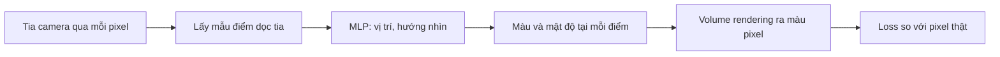

# Case study: NeRF (ECCV 2020)

!!! abstract "Mục tiêu của bài"
    Sau bài này, người học có thể:

    - Phân tích cách title và tên gọi của NeRF đóng gói toàn bộ đóng góp trong một dòng.
    - Viết danh sách contribution sao cho mỗi contribution ứng với một dòng trong bảng ablation.
    - Trình bày một kỹ thuật cổ điển như điểm mạnh của phương pháp mới thay vì che giấu nó.
    - Lập kế hoạch bằng chứng trực quan (hình, video, project page) và lựa chọn benchmark, metric phù hợp cho một bài toán có tính thị giác cao.

**NeRF: Representing Scenes as Neural Radiance Fields for View Synthesis** của Ben Mildenhall, Pratul Srinivasan, Matthew Tancik, Jonathan Barron, Ravi Ramamoorthi và Ren Ng được trình bày dạng oral tại ECCV 2020 và nhận giải Best Paper Honorable Mention. Bài toán của paper là view synthesis (tổng hợp góc nhìn mới): cho một tập ảnh chụp một cảnh từ nhiều góc với vị trí camera đã biết, hãy tạo ra ảnh của cảnh đó nhìn từ những góc chưa từng được chụp.

Ít paper nào có ảnh hưởng nhanh như NeRF: chỉ trong vài năm, tên gọi của phương pháp đã trở thành tên của cả một hướng nghiên cứu, với hàng loạt công trình mang hậu tố "-NeRF". Với người học viết, NeRF đáng chú ý vì nó là một paper về biểu diễn (representation), kiểu đóng góp vốn khó thuyết phục: người đọc phải tin rằng một cách mô tả dữ liệu mới thực sự tốt hơn các cách đã có, trong khi giá trị của nó thường chỉ lộ rõ khi nhìn bằng mắt. Bài này phân tích cách NeRF giải quyết thách thức đó bằng một title rõ ràng, một danh sách contribution có thể kiểm chứng, một cách nhìn thẳng thắn về kỹ thuật cũ và một hệ thống bằng chứng trực quan được lên kế hoạch kỹ lưỡng.

## Bối cảnh ra đời

Trước NeRF, các phương pháp view synthesis có thể chia thành hai họ chính. Họ thứ nhất dùng biểu diễn rời rạc như lưới đa giác (mesh), lưới voxel hay multiplane image (một chồng các lớp ảnh bán trong suốt đặt ở nhiều độ sâu), trong đó LLFF là một phương pháp mạnh cho cảnh chụp từ phía trước. Các biểu diễn này cho chất lượng tốt nhưng chi phí lưu trữ tăng rất nhanh theo độ phân giải. Họ thứ hai dùng biểu diễn liên tục bằng mạng neural, chẳng hạn các MLP ánh xạ tọa độ 3D thành mức chiếm chỗ (occupancy) hoặc khoảng cách có dấu tới bề mặt, hay Scene Representation Networks (SRN). Các biểu diễn này gọn nhẹ nhưng thời đó mới chỉ thành công với hình học đơn giản, và ảnh render thường bị mờ, chưa sánh được với họ rời rạc.

Khoảng trống mà NeRF nhắm tới vì thế rất rõ: một biểu diễn neural liên tục, gọn nhẹ, mà vẫn đạt chất lượng ảnh chân thực trên những cảnh thật có hình học và vật liệu phức tạp. Thêm vào đó, phương pháp chỉ cần ảnh RGB với vị trí camera đã biết (có thể ước lượng bằng các công cụ structure-from-motion), không cần dữ liệu 3D hay giám sát bổ sung. Một khoảng trống được phát biểu rõ bằng hai họ phương pháp, mỗi họ có một ưu điểm và một nhược điểm, là cách định vị rất hiệu quả: người đọc lập tức hiểu đóng góp mới hứa hẹn "có cả hai ưu điểm".

## Câu chuyện một dòng

> Biểu diễn một cảnh như một hàm liên tục năm chiều, ánh xạ vị trí 3D và hướng nhìn thành mật độ thể tích và màu, tham số hóa bằng một MLP và tối ưu trực tiếp từ ảnh nhiều góc thông qua volume rendering khả vi; nhờ đó tổng hợp được góc nhìn mới với chất lượng vượt xa các phương pháp trước.

Câu chuyện này đáng chú ý ở chỗ nó gần như là một mô tả kỹ thuật, nhưng mỗi cụm từ lại mang một phần của lập luận. "Hàm liên tục" đối lập với biểu diễn rời rạc tốn bộ nhớ. "Hướng nhìn" báo hiệu khả năng mô tả hiệu ứng phụ thuộc góc nhìn như phản xạ. "Volume rendering khả vi" giải thích vì sao chỉ cần ảnh là đủ để tối ưu. Khi một câu chuyện một dòng được viết tốt, người đọc có thể suy ra phần lớn cấu trúc của paper chỉ từ câu đó.

## Phân tích câu chuyện và cấu trúc

### Title như một abstract thu nhỏ

Title *"NeRF: Representing Scenes as Neural Radiance Fields for View Synthesis"* gồm ba phần, mỗi phần trả lời một câu hỏi. Tên gọi (NeRF) ngắn, dễ đọc, dễ nhớ. Phần giữa nói cái gì là mới: biểu diễn cảnh bằng neural radiance field. Phần cuối nói để làm gì: view synthesis. So sánh với một title giả định như "A Novel Neural Approach for High-Quality View Synthesis", có thể thấy ngay sự khác biệt: title giả định chỉ nói phương pháp "mới" và "chất lượng cao", hai điều mà mọi paper đều tự nhận, còn title thật nói chính xác điểm mới nằm ở đâu.

Tên gọi cũng là một phần của chiến lược. Một từ viết tắt dễ phát âm, gợi đúng khái niệm (Neural Radiance Field), giúp paper được nhắc tới trong các cuộc trò chuyện, trong slide và trong title của các paper khác. Các nguyên tắc đặt title và tên phương pháp được trình bày chi tiết ở bài [Title](../02-viet-tung-phan/title.md).

### Kỹ thuật cũ đặt đúng chỗ

Volume rendering là một kỹ thuật đồ họa cổ điển, đã có từ nhiều thập kỷ trước. NeRF không giấu điều đó; ngược lại, paper nhấn mạnh rằng chính vì volume rendering tự nhiên khả vi, chỉ cần một tập ảnh với vị trí camera đã biết là đủ để tối ưu biểu diễn. Điểm mới không nằm ở từng mảnh riêng lẻ (MLP, volume rendering, positional encoding đều có tiền lệ) mà ở việc kết hợp chúng đúng chỗ, cùng với lời giải thích rõ ràng vì sao sự kết hợp đó phù hợp với bài toán.

Cách trình bày này hiệu quả vì reviewer trong lĩnh vực đồ họa và thị giác đều biết volume rendering. Nếu paper cố trình bày nó như một phát minh mới, reviewer sẽ mất lòng tin; nếu paper bỏ qua nguồn gốc của nó, reviewer sẽ nghi ngờ tác giả không nắm vững tài liệu. Bằng cách gọi đúng tên kỹ thuật cổ điển và giải thích vai trò của nó, NeRF biến một điểm có thể bị tấn công thành một điểm mạnh: phương pháp được xây trên nền tảng vững chắc và có cơ sở vật lý.

### Contributions mỗi cái ablate được

Introduction của NeRF kết thúc bằng một danh sách đóng góp kỹ thuật, có thể diễn giải thành ba ý:

1. Một cách biểu diễn cảnh liên tục với hình học và vật liệu phức tạp dưới dạng **neural radiance field năm chiều**, tham số hóa bằng một MLP đơn giản.
2. Một thủ tục **rendering khả vi** dựa trên volume rendering cổ điển, dùng để tối ưu biểu diễn từ ảnh RGB thông thường, kèm chiến lược **hierarchical sampling** (lấy mẫu phân cấp) để dồn khả năng biểu diễn của MLP vào những vùng có nội dung nhìn thấy được.
3. Một **positional encoding** ánh xạ mỗi tọa độ đầu vào lên một không gian nhiều chiều hơn, giúp biểu diễn được các chi tiết tần số cao.

Phần phương pháp được tổ chức gần như bám theo danh sách này: trước hết là biểu diễn, rồi đến volume rendering, rồi đến các kỹ thuật giúp tối ưu (positional encoding và hierarchical sampling). Quan trọng hơn, trong phần thí nghiệm có một bảng ablation loại bỏ lần lượt từng thành phần: không positional encoding, không phụ thuộc hướng nhìn, không hierarchical sampling, cùng với các biến thể về số ảnh đầu vào và số tần số trong positional encoding. Mỗi contribution vì thế có một dòng bằng chứng riêng.

!!! tip "Phép thử cho một contribution"
    Hãy viết contribution sao cho mỗi cái có thể bị loại bỏ trong một dòng ablation. Nếu một "contribution" không thể ablate được, cần tự hỏi: hoặc nó không thực sự là contribution, hoặc nó thuộc kiểu đóng góp khác (một dataset, một phân tích, một benchmark) và cần một loại bằng chứng khác tương ứng.

### Giải thích lý do của từng lựa chọn kiến trúc

Một chi tiết nhỏ nhưng đáng học trong phần phương pháp là cách NeRF giải thích ràng buộc kiến trúc. Mật độ thể tích chỉ được dự đoán từ vị trí, còn màu được dự đoán từ cả vị trí lẫn hướng nhìn. Paper nói rõ lý do: ràng buộc này khuyến khích biểu diễn nhất quán giữa các góc nhìn, vì hình học của cảnh không nên thay đổi khi người quan sát di chuyển, trong khi màu có thể thay đổi do phản xạ. Đây đúng là khuôn "tại sao, cái gì, như thế nào" của bài [Method](../02-viet-tung-phan/method.md): mỗi lựa chọn kiến trúc đi kèm một lý do mà người đọc có thể tự kiểm chứng bằng trực giác vật lý.

### Trung thực về chi phí, đồng thời chỉ ra lợi thế

NeRF thừa nhận một nhược điểm rõ ràng: tối ưu cho mỗi cảnh mất nhiều thời gian, và việc render cũng chậm vì phải truy vấn MLP tại rất nhiều điểm dọc mỗi tia. Paper không giấu điều đó. Đồng thời, paper chỉ ra một lợi thế đối ứng: trọng số của mạng chiếm dung lượng nhỏ hơn rất nhiều so với lưới voxel mà phương pháp như LLFF cần lưu. Cách trình bày trade-off này là một bài học về sự trung thực có chiến lược. Reviewer sẽ phát hiện chi phí tính toán dù paper có nói hay không; nói trước, kèm bối cảnh và lợi thế đối ứng, khiến người đọc đánh giá công bằng hơn và tin tưởng phần còn lại của paper nhiều hơn.

## Figure 1 và hệ thống hình ảnh

Figure 1 của NeRF là một hình tổng quan: một tập ảnh đầu vào, bước tối ưu NeRF, và các góc nhìn mới được render. Người đọc hiểu bài toán và đầu ra trong khoảng mười giây. Điều đáng chú ý là Figure 1 trả lời câu hỏi "paper làm được gì" chứ không trả lời "paper làm bằng cách nào". Phần "bằng cách nào" được dành cho hình pipeline ngay sau đó, vốn trình bày bốn bước nối tiếp nhau. Sơ đồ dưới đây diễn giải luồng của hình pipeline ấy.

Việc tách "làm được gì" và "làm thế nào" thành hai hình riêng là một lựa chọn có chủ đích. Một Figure 1 cố gắng nói cả hai thường quá tải; người đọc lướt chỉ cần biết bài toán và kết quả, còn người đọc kỹ sẽ tìm tới hình pipeline khi đọc phần phương pháp.

Bên cạnh đó, paper có một hình minh họa hiệu ứng phụ thuộc góc nhìn: cùng một điểm trong cảnh có màu khác nhau khi nhìn từ các hướng khác nhau. Hình này biện minh trực quan cho việc đưa hướng nhìn vào đầu vào, tức là cho chiều thứ tư và thứ năm của biểu diễn. Các hình so sánh định tính với SRN, Neural Volumes và LLFF đều có ô phóng to vào những chi tiết mảnh như cấu trúc dạng dây, họa tiết và bề mặt phản xạ, đúng những nơi mà khác biệt giữa các phương pháp lộ rõ nhất. Một hình so sánh không có phóng to buộc người đọc tự tìm khác biệt, và thường họ sẽ không tìm thấy.

Cuối cùng, và có lẽ quan trọng nhất, là video trong supplementary material cùng project page. Với bài toán view synthesis, tính nhất quán giữa các góc nhìn và các hiệu ứng phụ thuộc hướng nhìn chỉ thực sự hiện ra khi camera chuyển động; một ảnh tĩnh không thể truyền tải điều đó. Video vì thế không phải phần phụ mà là bằng chứng gốc, và paper nói điều đó ngay từ câu cuối của abstract: kết quả view synthesis nên được xem dưới dạng video, nên người đọc được đề nghị xem video trong supplementary. Project page của NeRF, với video và các so sánh trực quan, đã trở thành chuẩn mực mà cả cộng đồng làm theo. Cách chuẩn bị project page, video và code khi paper được nhận có ở bài [Camera-ready, poster, code](../04-nop-va-sau-nop/camera-ready.md).

!!! warning "Lên kế hoạch bằng chứng trực quan từ sớm"
    Nếu bài toán có tính thị giác cao (video, 3D, sinh ảnh), video và hình so sánh cần được lên kế hoạch ngay khi thiết kế thí nghiệm, không phải vài ngày trước deadline. Cần quyết định trước những cảnh nào sẽ được render, quỹ đạo camera nào, vùng nào sẽ được phóng to, và đảm bảo tất cả baseline đều có kết quả trên đúng những cảnh đó.

## Thí nghiệm như một chuỗi lập luận

Thiết kế thí nghiệm của NeRF đi theo một trật tự hợp lý, mỗi lựa chọn trả lời một câu hỏi mà reviewer có thể đặt ra.

Câu hỏi đầu tiên là phương pháp có tốt hơn trên những benchmark đã được công nhận hay không. Paper dùng một tập cảnh tổng hợp có sẵn từ công trình trước, gồm các vật thể có hình học tương đối đơn giản và bề mặt khuếch tán (Diffuse Synthetic 360°), để so sánh công bằng trên một mặt bằng chung.

Câu hỏi thứ hai là phương pháp có thể hiện được thế mạnh ở những trường hợp khó hay không. Benchmark cũ quá đơn giản để làm lộ ưu thế của việc mô hình hóa hình học phức tạp và vật liệu không khuếch tán (non-Lambertian, tức bề mặt mà màu thay đổi theo góc nhìn, như kim loại hay bề mặt bóng). Vì vậy tác giả tạo một tập dữ liệu mới, Realistic Synthetic 360°, gồm các vật thể có hình học phức tạp và vật liệu chân thực. Điểm quan trọng là tập dữ liệu mới được dùng bên cạnh, chứ không thay thế, benchmark cũ. Tạo dataset mới chỉ để khoe kết quả sẽ khiến reviewer nghi ngờ; tạo dataset mới khi benchmark cũ không đủ khó, đồng thời vẫn báo cáo trên benchmark cũ, là cách làm thuyết phục.

Câu hỏi thứ ba là phương pháp có dùng được với dữ liệu thật hay không. Paper thử nghiệm trên các cảnh thật chụp từ phía trước bằng thiết bị cầm tay (Real Forward-Facing), loại dữ liệu mà LLFF vốn được thiết kế cho, nên đây cũng là một phép thử trên "sân nhà" của baseline mạnh nhất.

Về metric, paper dùng đồng thời PSNR, SSIM và LPIPS. PSNR đo sai khác ở mức pixel, SSIM đo độ tương đồng về cấu trúc, còn LPIPS là một metric cảm nhận (perceptual) dựa trên đặc trưng của mạng học sâu, gần với đánh giá của mắt người hơn. Mỗi metric có điểm mù riêng; dùng cả ba giúp kết quả không phụ thuộc vào một cách đo duy nhất. Việc dùng nhiều metric cũng có nghĩa là phải chấp nhận khi chúng không đồng thuận. Trên Real Forward-Facing, NeRF tốt hơn LLFF về PSNR và SSIM nhưng LLFF có LPIPS tốt hơn một chút. Paper không giấu ô thua này: caption của Table 1 ghi nhận nó và chỉ người đọc tới video, nơi NeRF nhất quán hơn giữa các góc nhìn và ít artifact hơn. Đây là cách xử lý mẫu mực khi metric và cảm nhận của con người nói hai điều khác nhau: báo cáo đủ, thừa nhận đúng chỗ, rồi đưa ra loại bằng chứng phù hợp hơn với khía cạnh mà metric bỏ sót. Về baseline, ba phương pháp được chọn (SRN, Neural Volumes, LLFF) đại diện cho ba hướng tiếp cận khác nhau: biểu diễn neural liên tục, biểu diễn voxel có học, và multiplane image. Chọn baseline theo họ phương pháp, thay vì chỉ chọn những phương pháp dễ chạy, giúp so sánh bao quát được toàn cảnh lĩnh vực.

Sau kết quả chính là bảng ablation đã phân tích ở trên, nối mỗi contribution với một dòng bằng chứng, kèm các thí nghiệm về độ nhạy: số ảnh đầu vào và số tần số trong positional encoding. Những thí nghiệm độ nhạy này trả lời trước câu hỏi "phương pháp có còn tốt khi điều kiện kém đi không" và "vì sao chọn giá trị này". Cuối cùng là phần thảo luận chi phí và dung lượng đã nhắc tới.

| Câu hỏi của reviewer | Lựa chọn thí nghiệm |
|---|---|
| Có tốt hơn trên benchmark đã công nhận? | Diffuse Synthetic 360° từ công trình trước |
| Có thể hiện thế mạnh ở trường hợp khó? | Dataset mới Realistic Synthetic 360° |
| Có dùng được với dữ liệu thật? | Real Forward-Facing, sân nhà của LLFF |
| Kết quả có phụ thuộc cách đo? | PSNR, SSIM và LPIPS |
| Khi các metric không đồng thuận thì sao? | Ghi nhận ô LPIPS thua LLFF trong caption, dẫn người đọc tới video |
| So sánh có bao quát? | Ba baseline đại diện cho ba họ phương pháp |
| Mỗi contribution có cần thiết? | Ablation loại bỏ từng thành phần |
| Lựa chọn có nhạy với điều kiện? | Thay đổi số ảnh, số tần số |
| Chi phí thế nào? | Thảo luận thời gian tối ưu và dung lượng |

## Văn phong

Phần phương pháp của NeRF là một ví dụ tốt về cách dẫn dắt người đọc qua toán học. Paper bắt đầu từ định nghĩa hàm liên tục, đi tới tích phân volume rendering cho màu của một tia, rồi tới phép xấp xỉ rời rạc bằng cầu phương (quadrature) với lấy mẫu phân tầng. Mỗi công thức xuất hiện sau một câu giải thích vì sao cần nó, và ký hiệu được giữ nhất quán từ đầu tới cuối. Người đọc không quen với đồ họa vẫn theo kịp, vì mỗi bước đều có động lực rõ ràng.

Văn phong của paper cũng rất cụ thể. Thay vì nói chung chung rằng biểu diễn "giàu thông tin", paper định nghĩa chính xác đầu vào (vị trí ba chiều và hướng nhìn hai chiều) và đầu ra (mật độ và màu RGB). Caption của các hình đủ chi tiết để đọc độc lập. Và cũng như ResNet, paper đặt tên cho các khái niệm then chốt (neural radiance field, positional encoding, hierarchical volume sampling), giúp người đọc nhớ và giúp các công trình sau tham chiếu chính xác.

## Bài học cho người viết

Bài học trung tâm của NeRF là mối liên kết chặt giữa lời hứa và bằng chứng. Title hứa một biểu diễn mới cho một bài toán cụ thể; danh sách contribution chia lời hứa đó thành ba phần kiểm chứng được; phần phương pháp bám theo danh sách; bảng ablation cung cấp một dòng bằng chứng cho mỗi phần. Bài học thứ hai là kỹ thuật cũ không phải điều đáng giấu: gọi đúng tên và giải thích vì sao nó phù hợp làm tăng độ tin cậy. Bài học thứ ba là bằng chứng phải ở dạng phù hợp với bản chất của bài toán; với view synthesis, đó là video. Bài học thứ tư là tạo benchmark mới khi cần, nhưng luôn giữ benchmark cũ để so sánh công bằng.

Các bài học này chuyển sang NLP và Machine Learning một cách tự nhiên. Nguyên tắc "mỗi contribution một dòng ablation" là chuẩn mực ở cả ba cộng đồng; một paper NLP đề xuất một cách biểu diễn mới hay một chiến lược decoding mới cũng cần cho thấy mỗi thành phần đóng góp bao nhiêu. Việc mượn kỹ thuật cổ điển, từ truy hồi thông tin, thống kê hay ngôn ngữ học trong NLP, hoặc từ xử lý tín hiệu và tối ưu hóa trong ML, đều thuyết phục hơn khi được gọi đúng tên và được giải thích vì sao phù hợp. Bằng chứng "dạng phù hợp" ở NLP thường là các ví dụ định tính được chọn có hệ thống, bảng phân tích lỗi, hoặc một bản demo tương tác; ở ML, đó có thể là code tái hiện được và các thí nghiệm trên dữ liệu đồ chơi (toy data) trực quan hóa hành vi của phương pháp. Cuối cùng, việc tạo một tập kiểm tra khó hơn khi benchmark hiện có đã bão hòa rất phổ biến ở NLP, và lời khuyên vẫn như cũ: dùng nó bên cạnh, chứ không thay thế, benchmark chuẩn.

Những bài học này nối trực tiếp với các bài kỹ năng của giáo trình. Cách viết danh sách contribution sao cho mỗi mục có một bằng chứng được trình bày ở bài [Introduction & Figure 1](../02-viet-tung-phan/introduction.md), còn việc lên trước ma trận thí nghiệm, bộ benchmark và các bằng chứng trực quan cần chuẩn bị thuộc về bài [Lập kế hoạch nghiên cứu](../01-truoc-khi-viet/ke-hoach.md) và bài [Thiết kế thí nghiệm](../01-truoc-khi-viet/thi-nghiem.md). Việc kết hợp đúng chỗ những kỹ thuật có sẵn từ một lĩnh vực lân cận (ở đây là đồ họa) là một trong các nguồn ý tưởng được bàn ở bài [Tìm khoảng trống & nguồn ý tưởng](../01-truoc-khi-viet/tim-khoang-trong.md). Hai điểm mà NeRF xử lý thẳng thắn cũng là hai tình huống của Chương 7: phương pháp tốt hơn nhưng tốn kém hơn (thời gian tối ưu cho mỗi cảnh) ở bài [Bài toán, dữ liệu và phạm vi](../07-tinh-huong-kho/bai-toan-va-pham-vi.md), và metric lệch với đánh giá bằng mắt (ô LPIPS thua LLFF) ở bài [Khi con số không đẹp](../07-tinh-huong-kho/con-so-khong-dep.md).

## Tóm tắt

NeRF là ví dụ mẫu mực về cách viết một paper đề xuất biểu diễn mới. Title đóng gói tên gọi, điểm mới và ứng dụng trong một dòng; danh sách ba contribution được phản chiếu trong cấu trúc phần phương pháp và trong bảng ablation. Paper gọi đúng tên kỹ thuật cổ điển volume rendering và biến nó thành điểm mạnh, giải thích lý do của từng ràng buộc kiến trúc, và trung thực về chi phí tính toán trong khi chỉ ra lợi thế về dung lượng. Hệ thống hình ảnh tách rõ "làm được gì" và "làm thế nào", các hình so sánh có phóng to vào chi tiết khó, và video cùng project page đóng vai trò bằng chứng gốc. Chuỗi thí nghiệm đi từ benchmark cũ, qua dataset mới khó hơn, tới dữ liệu thật, với ba metric bổ sung cho nhau và ba baseline đại diện cho ba họ phương pháp; ô duy nhất mà một baseline thắng được báo cáo và giải thích thay vì bị lược đi.

## Bài tập

1. Viết lại danh sách contribution của dự án hiện tại sao cho mỗi contribution tương ứng với một dòng trong bảng ablation. Đánh dấu contribution nào không ablate được và xác định loại bằng chứng thay thế cho nó.
2. Viết ba phiên bản title cho dự án theo khuôn "Tên: cái gì mới cho bài toán gì", rồi so sánh với title hiện tại theo các tiêu chí ở bài [Title](../02-viet-tung-phan/title.md).
3. Liệt kê các kỹ thuật có sẵn mà phương pháp sử dụng. Với mỗi kỹ thuật, viết một câu gọi đúng tên và nguồn gốc của nó, và một câu giải thích vì sao nó phù hợp với bài toán đang xét.
4. Nếu bài toán có tính trực quan (video, 3D, sinh ảnh, hay cả demo tương tác cho NLP), lập kế hoạch cho bằng chứng trực quan ngay từ bây giờ: những ví dụ nào, so sánh với baseline nào, vùng nào cần phóng to, và trình bày ở đâu (thân bài, supplementary, project page).
