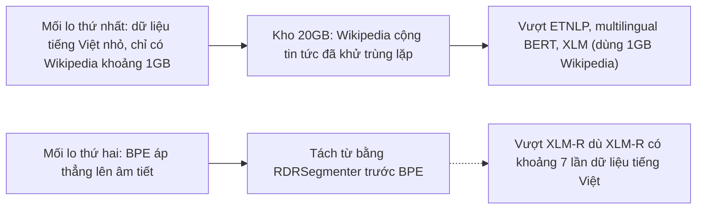

# Case study: PhoBERT (Findings of EMNLP 2020)

!!! abstract "Mục tiêu của bài"
    Sau bài này, người học có thể:

    - Phân tích cách một paper ngắn biện minh cho việc xây một mô hình đơn ngữ (monolingual) khi đã có mô hình đa ngữ (multilingual) mạnh, bằng hai lập luận gắn với đặc điểm của tiếng Việt.
    - Nhận ra cấu trúc "hai mối lo, hai lựa chọn thiết kế, hai đoạn thảo luận" nối Introduction với phần phương pháp và phần Discussion.
    - Đánh giá cách một claim "first" được bảo chứng bằng định ngữ chính xác và một chú thích xử lý phản ví dụ gần nhất, cùng rủi ro khi định ngữ không được giữ nhất quán.
    - Phân biệt bằng chứng trực tiếp với bằng chứng gián tiếp khi kết quả có nhiều yếu tố gây nhiễu (confounder), và đề xuất cách thu hẹp claim hoặc bổ sung thí nghiệm.
    - Vận dụng các bài học về paper tài nguyên cho một ngôn ngữ cụ thể vào dự án của người học, ở cả ba cộng đồng NLP, CV và ML.

Các case study [ViP-VL](vip-vl.md) và [Streaming ITN](streaming-itn.md) phân tích paper tiếng Việt gần đây của cộng đồng xử lý tiếng nói; [EDWARD-NMT](edward-nmt.md) phân tích một paper Findings of EMNLP 2026. Bài này lùi lại sáu năm với một paper NLP tiếng Việt đã trở thành nền tảng cho rất nhiều công trình sau nó: **PhoBERT: Pre-trained language models for Vietnamese**, của Dat Quoc Nguyen (VinAI Research, Việt Nam) và Anh Tuan Nguyen (NVIDIA, Hoa Kỳ; theo chú thích của paper, phần việc của tác giả thứ hai được thực hiện khi thực tập tại VinAI Research). Paper được công bố trong *Findings of the Association for Computational Linguistics: EMNLP 2020*, chiếm sáu trang kỷ yếu kể cả tài liệu tham khảo. Phân tích dựa trên toàn văn bản arXiv (mã 2003.00744); bản in trong Findings có thể khác ở một vài chi tiết. Các con số chỉ được nêu khi chúng xuất hiện trong văn bản của paper.

Paper đặc biệt đáng học với người học Việt Nam vì những lý do kiểm chứng được từ chính văn bản: tác giả đầu làm việc tại một phòng nghiên cứu ở Việt Nam; động lực trung tâm đến từ một hiểu biết về tiếng Việt (khoảng trắng phân tách âm tiết chứ không phân tách từ) chứ không từ một thủ thuật mô hình; tài nguyên tính toán được nêu cụ thể là bốn GPU V100; và chuỗi đánh giá dựa vào tài nguyên của cộng đồng NLP tiếng Việt (các bộ dữ liệu VLSP, treebank VnDT, bộ công cụ VnCoreNLP). Một paper vài trang, không có kiến trúc mới, đã tạo ra mô hình mà bài [Viết cho ACL / EMNLP / NAACL](../06-cong-dong/nlp.md) của giáo trình này khuyên đưa vào baseline của mọi paper tài nguyên tiếng Việt.

## Bối cảnh: đơn ngữ hay đa ngữ

Như đoạn mở đầu của paper tóm tắt, khi mô hình kiểu BERT (xem [case study BERT](bert.md)) lan ra ngoài tiếng Anh, một ngôn ngữ khác có hai con đường: huấn luyện lại một mô hình riêng theo kiến trúc BERT, như cho tiếng Trung, tiếng Hà Lan (BERTje) hay tiếng Pháp (CamemBERT), hoặc dùng thẳng một mô hình đa ngữ như multilingual BERT, XLM hay XLM-R. XLM-R, được paper gọi là mô hình đa ngữ tốt nhất thời điểm đó, học từ một kho 2,5TB chứa 137GB văn bản tiếng Việt, nhiều hơn những gì một nhóm nhỏ có thể thu thập. Một paper đề xuất mô hình đơn ngữ vì thế phải trả lời câu hỏi mà reviewer chắc chắn sẽ đặt ra: vì sao không dùng XLM-R?

Bối cảnh của cộng đồng NLP tiếng Việt giúp hiểu cách paper chọn tác vụ. Như tên nhiều công trình trong danh mục tài liệu tham khảo cho thấy (chẳng hạn "From word segmentation to POS tagging for Vietnamese"), các hệ thống tiếng Việt trước PhoBERT thường bắt đầu bằng bước tách từ (word segmentation) rồi mới tới gán nhãn từ loại, nhận diện thực thể hay phân tích cú pháp, và các bộ dữ liệu chuẩn cho những tác vụ này có sẵn ranh giới từ. Đơn vị phân tích quen thuộc của cộng đồng là *từ*, không phải *âm tiết*, và PhoBERT khai thác đúng điểm này.

Về nơi công bố, Findings of ACL: EMNLP 2020 là tập Findings đầu tiên, ra đời như một tuyển tập đi kèm EMNLP 2020 cho những paper được đánh giá là vững chắc nhưng không được chọn vào hội nghị chính (xem bài [NLP: ACL, EMNLP, NAACL](../00-tong-quan/he-sinh-thai-nlp.md)). Năm 2020 cũng là trước khi ACL Rolling Review ra đời và trước khi mục Limitations trở thành bắt buộc; bối cảnh này cần được nhớ khi đọc phần cuối paper.

## Câu chuyện một dòng

> Các mô hình ngôn ngữ dùng được cho tiếng Việt hoặc chỉ học từ khoảng 1GB Wikipedia, hoặc (như XLM-R) có nhiều dữ liệu hơn nhưng áp BPE thẳng lên âm tiết, trong khi khoảng trắng tiếng Việt phân tách âm tiết chứ không phân tách từ; nhóm tác giả tiền huấn luyện hai mô hình theo công thức RoBERTa trên 20GB văn bản **đã tách từ**, vượt XLM-R và lập kết quả tốt nhất trên bốn tác vụ tiếng Việt, rồi công bố mô hình cho cộng đồng.

Câu chuyện có đủ năm mắt xích ở bài [Xây "câu chuyện" của paper](../01-truoc-khi-viet/cau-chuyen.md): vấn đề (tiếng Việt chưa có mô hình tiền huấn luyện đủ tốt), khoảng trống (dữ liệu nhỏ; nhầm lẫn âm tiết với từ), insight (một quan sát ngôn ngữ học chứ không phải một quan sát về mô hình), giải pháp (cố ý không mới về kiến trúc: kiến trúc BERT, quy trình RoBERTa, cộng một kho dữ liệu lớn hơn và một bước tách từ) và bằng chứng (bốn tác vụ, với đối thủ chính là mô hình đa ngữ mạnh nhất). Theo cách phân loại đóng góp của ARR những năm gần đây, đây là đóng góp thuộc nhóm mô hình công khai, kèm một nghiên cứu so sánh; như bài [Viết cho ACL / EMNLP / NAACL](../06-cong-dong/nlp.md) phân tích, nó cần được đánh giá bằng câu hỏi "tài nguyên có lấp một khoảng trống thật không", chứ không phải "phương pháp mới ở đâu".

## Title và abstract

### Một title chung, cũng là một cụm từ khóa tìm kiếm

Title theo mẫu "Tên: mô tả" ở bài [Title](../02-viet-tung-phan/title.md). Tên PhoBERT theo quy ước "tiền tố gợi ngôn ngữ cộng BERT", cùng họ với CamemBERT và BERTje mà paper trích dẫn, nên người đọc nhận ra ngay "một BERT cho tiếng Việt" (paper không giải thích tiền tố "Pho"). Phần mô tả rất chung và không gợi ý hai lựa chọn làm nên khác biệt (đơn ngữ, mức từ); một phiên bản như "PhoBERT: Word-level Monolingual Language Models for Vietnamese" sẽ đưa insight lên title. Tuy vậy, title chung có ưu điểm thực tế với một paper tài nguyên: nó trùng gần như nguyên văn với cụm từ mà người làm NLP tiếng Việt sẽ tìm kiếm, và chữ "Vietnamese" đáp ứng tinh thần Bender Rule (luôn gọi tên ngôn ngữ được nghiên cứu).

### Abstract bốn câu: nói "cái gì" mà chưa nói "vì sao"

| Câu | Chức năng | Nội dung (diễn giải) |
|---|---|---|
| 1 | Giới thiệu, claim tính mới | PhoBERT với hai phiên bản base và large, các mô hình đơn ngữ quy mô lớn, công khai *đầu tiên* cho tiếng Việt |
| 2 | Kết quả | Vượt nhất quán XLM-R và cải thiện state-of-the-art trên POS tagging, dependency parsing, NER và NLI |
| 3 | Tác động | Công bố PhoBERT để thúc đẩy nghiên cứu và ứng dụng NLP tiếng Việt |
| 4 | Truy cập | Đường dẫn tới kho mã trên GitHub |

Abstract mạnh ở ba điểm: gọi tên chính xác đối thủ (XLM-R) thay vì một cụm mơ hồ như "existing models", liệt kê đủ bốn tác vụ, và kết bằng đường dẫn tới mô hình. Nhưng so với khuôn ở bài [Abstract](../02-viet-tung-phan/abstract.md), nó thiếu phần *vì sao*: người chỉ đọc abstract không biết hai mối lo, không biết kho 20GB đã tách từ, nên không hiểu vì sao một mô hình đơn ngữ lại thắng một mô hình đa ngữ thấy nhiều văn bản tiếng Việt hơn; câu kết quả cũng không có con số nào. Đây cũng là chỗ hụt của ViP-VL: insight hay nhất chỉ xuất hiện ở Introduction. Một phiên bản minh họa (không phải của nhóm tác giả, chỉ dùng thông tin trong paper):

*"Existing language models for Vietnamese are either pre-trained on the small (1GB) Vietnamese Wikipedia or, like the multilingual XLM-R, apply BPE directly to syllables, although white space in written Vietnamese separates syllables rather than words. We present PhoBERT, the first public large-scale monolingual language models for Vietnamese, pre-trained with the RoBERTa procedure on a 20GB word-segmented corpus. On POS tagging, dependency parsing, NER and NLI, PhoBERT outperforms XLM-R, whose pre-training data contain about seven times more Vietnamese text, and sets new state-of-the-art results, e.g., improving parsing scores by about 4 points over the previous best. We release PhoBERT for use with fairseq and transformers."*

Phiên bản này dài hơn gần một nửa, nhưng mỗi mệnh đề thêm vào trả lời một câu hỏi reviewer sẽ đặt ra. Chi tiết "XLM-R thấy nhiều văn bản tiếng Việt hơn khoảng bảy lần" đặc biệt đáng giá: nó biến kết quả thành một điều đáng ngạc nhiên cần giải thích, và lời giải thích đã nằm sẵn ở câu đầu.

## Introduction: hai mối lo, hai lựa chọn thiết kế

Introduction gồm bốn đoạn, trong đó đoạn thứ hai được viết thành hai gạch đầu dòng, cộng một danh sách đóng góp bốn ý. Paper không có mục Related Work riêng; như ở ViP-VL, trong một paper ngắn, mỗi đoạn tổng quan phải phục vụ trực tiếp lập luận.

### Đoạn 1: hai con đường cho các ngôn ngữ ngoài tiếng Anh

Đoạn đầu làm ba việc trong ba câu: nêu thành công của BERT, thu hẹp rằng thành công ấy phần lớn giới hạn ở tiếng Anh, rồi vẽ bản đồ hai nhánh (mô hình riêng cho từng ngôn ngữ, hoặc mô hình đa ngữ), mỗi nhánh một nhóm trích dẫn, giống cách [BERT](bert.md) chia công trình trước thành feature-based và fine-tuning. Sau một câu, người đọc biết paper đi theo nhánh nào và phải cạnh tranh với nhánh nào; việc phán xét được dành cho đoạn sau, khi đặc điểm của tiếng Việt được đưa vào.

### Đoạn 2, ý thứ nhất: mối lo về dữ liệu

Đoạn thứ hai mở bằng "In terms of Vietnamese language modeling, to the best of our knowledge, there are two main concerns as follows", rồi trình bày hai mối lo theo một thứ tự cố định mà phần phương pháp về sau gọi lại đúng số thứ tự ("the first concern", "the second concern"). Mối lo thứ nhất được lập luận theo ba bước: Wikipedia tiếng Việt là dữ liệu duy nhất từng dùng cho mô hình đơn ngữ, và là dữ liệu tiếng Việt duy nhất trong mọi mô hình đa ngữ *trừ XLM-R*; dữ liệu ấy không đại diện cho cách dùng ngôn ngữ nói chung và nhỏ (khoảng 1GB khi chưa nén); và theo RoBERTa, thêm dữ liệu cải thiện đáng kể chất lượng mô hình.

Chi tiết đáng học nhất là cụm "except XLM-R": nhóm tác giả tự nêu ngoại lệ quan trọng nhất cho lập luận của chính paper. Hệ quả là mối lo thứ nhất chỉ đủ để vượt các mô hình học từ Wikipedia, không giải thích được một chiến thắng trước XLM-R. Cấu trúc lập luận vì thế rất rõ: mối lo về dữ liệu loại các đối thủ yếu, mối lo về âm tiết và từ phải gánh phần so sánh với đối thủ mạnh nhất.

### Đoạn 2, ý thứ hai: một ví dụ một dòng thay cho Figure 1

Mối lo thứ hai là trái tim của paper: mọi mô hình BERT công khai, đơn ngữ lẫn đa ngữ, không phân biệt âm tiết với từ, vì khoảng trắng trong chữ viết tiếng Việt cũng phân tách các âm tiết cấu thành một từ. Paper minh họa bằng một câu tiếng Việt nghĩa là "I am a researcher": sáu âm tiết nhưng chỉ bốn từ, vì ba âm tiết "nghiên cứu viên" hợp thành một từ, viết thành nghiên_cứu_viên sau khi tách từ. Một chú thích cho thấy hiện tượng không cá biệt: theo một nghiên cứu được trích dẫn, 85% kiểu từ (word type) tiếng Việt gồm ít nhất hai âm tiết.

Đây là mẫu mực về cách giải thích đặc điểm ngôn ngữ cho reviewer không biết ngôn ngữ đó: một câu như "Vietnamese is an isolating language" không đủ để họ hiểu vì sao BPE bị ảnh hưởng, còn một câu ví dụ có bản dịch, có đếm âm tiết và đếm từ, cộng một con số có nguồn, làm được trong ba dòng. PhoBERT không có hình nào, và ví dụ này đóng vai trò mà ở nhiều paper thuộc về Figure 1: đưa người đọc tới insight trong vài giây. Nó cũng là đặc điểm thứ ba trong danh sách ở mục [Cơ hội cho tài nguyên tiếng Việt và ngôn ngữ ít tài nguyên](../06-cong-dong/nlp.md#co-hoi-cho-tai-nguyen-tieng-viet-va-ngon-ngu-it-tai-nguyen): khai thác một đặc điểm riêng của tiếng Việt và cho thấy nó ảnh hưởng thế nào tới mô hình.

### Đoạn 3: một giả thuyết được rào đón đúng mức

Đoạn thứ ba nối đặc điểm ngôn ngữ với mô hình: không tách từ, các mô hình hiện có áp thẳng BPE lên dữ liệu mức âm tiết. Câu kết phát biểu giả thuyết: "Intuitively, for word-level Vietnamese NLP tasks, those models pre-trained on syllable-level data might not perform as good as language models pre-trained on word-level data." Ba chỗ rào đón đều đúng mức: "Intuitively" báo hiệu một trực giác, "for word-level Vietnamese NLP tasks" giới hạn phạm vi vào loại tác vụ có lý do áp dụng, "might not" là động từ khuyết thiếu mềm. Một giả thuyết hẹp như vậy khó bị phản bác và cho reviewer biết paper cần loại bằng chứng nào; như sẽ thấy, điểm yếu nằm ở chỗ phần Discussion nói mạnh hơn nó. (Cho lượt đọc soát: "as good as" nên là "as well as".)

### Đoạn 4 và danh sách đóng góp

Đoạn cuối mở bằng "To handle the two concerns above", nối thẳng giải pháp với hai mối lo, rồi nêu bốn tác vụ với một phân loại đáng chú ý: POS tagging, dependency parsing và NER là các tác vụ mức từ thông dụng, còn NLI là tác vụ hiểu ngôn ngữ "có thể được phát biểu ở mức âm tiết hoặc mức từ". Việc chọn tác vụ vì thế được dẫn dắt bởi giả thuyết, không phải bởi những benchmark sẵn có. Danh sách đóng góp gồm bốn ý: (i) các mô hình đơn ngữ quy mô lớn *đầu tiên* cho tiếng Việt; (ii) kết quả tốt nhất trên bốn tác vụ; (iii) theo hiểu biết của nhóm tác giả, bộ thí nghiệm *đầu tiên* so sánh mô hình đơn ngữ với XLM-R trên bốn tác vụ của một ngôn ngữ cụ thể; (iv) công bố mô hình, dùng được với `fairseq` và `transformers`.

Ý (iii) là một nước đi đáng học: một bảng so sánh với XLM-R, vốn chỉ là phần đánh giá thông thường, được nâng lên thành đóng góp khoa học độc lập, câu trả lời cho câu hỏi "đơn ngữ hay đa ngữ" mà cộng đồng đang quan tâm; paper vì thế không chỉ "huấn luyện một mô hình" mà còn "trả lời một câu hỏi". Ý (iv) nêu tên hai thư viện, tức nói rõ người dùng tốn bao nhiêu công để dùng mô hình.

Tuy vậy, ý (iii) cũng là nơi claim vượt phạm vi bằng chứng rõ nhất. Cụm "convincingly confirming that dedicated language-specific models still outperform multilingual ones" là kết luận về mô hình chuyên biệt *nói chung*, trong khi bằng chứng đến từ một ngôn ngữ. Theo tinh thần Bender Rule, cách viết chính xác hơn chỉ cần thêm hai chữ: "...still outperform multilingual ones *for Vietnamese*". Bỏ chữ "convincingly" cũng không làm câu yếu đi, vì con số trong bảng đã đủ thuyết phục.

## Định vị và claim "first"

Thiếu Related Work không có nghĩa là thiếu định vị. PhoBERT định vị ở ba lớp: **bản đồ hai nhánh** ở đầu Introduction; **công trình tiếng Việt gần nhất**, ETNLP, xử lý trong một chú thích; và **các hệ thống tốt nhất của từng tác vụ**, định vị ngay trong các bảng kết quả kèm trích dẫn, thay được cả một mục tổng quan theo tác vụ. Một chi tiết nên được đưa lên phần chính: theo chú thích cuối cùng, CamemBERT, công trình gần nhất về câu hỏi "đơn ngữ hay đa ngữ", chỉ so sánh với XLM-R trên NLI tiếng Pháp. Đây là lý do ý (iii) được dùng chữ "first", nhưng thông tin nằm ở chú thích thứ bảy, xa danh sách đóng góp; nửa câu "unlike CamemBERT, which compares with XLM-R on French NLI only" trong chính ý đóng góp sẽ làm claim tự đứng được.

Chữ *first* (in nghiêng) xuất hiện ở abstract, hai ý đóng góp, Introduction và Conclusion. Chú thích thứ hai đối mặt trực tiếp với phản ví dụ gần nhất: nó thừa nhận ETNLP *đã* tách từ trước khi áp BPE lên Wikipedia tiếng Việt, nhưng chỉ ra ETNLP không công bố mô hình BERT nào, chỉ công bố 15 nghìn word embedding dựa trên BERT chuyên cho NER. Cách viết này vừa trung thực (ghi nhận điều công trình trước đã làm) vừa chính xác (chỉ ra đúng điều nó chưa làm), và giải thích vì sao mối lo thứ hai dùng định ngữ "publicly released": thiếu định ngữ ấy, ETNLP sẽ là phản ví dụ. Claim "first" vì thế được giữ bởi ba định ngữ:

| Định ngữ | Loại phản ví dụ nào | Bằng chứng trong paper |
|---|---|---|
| *public* | ETNLP, có tách từ nhưng không công bố mô hình | Chú thích thứ hai |
| *large-scale* | Các mô hình đơn ngữ học từ khoảng 1GB Wikipedia | Mối lo thứ nhất; kho 20GB ở Section 2 |
| *monolingual* | XLM-R, có 137GB tiếng Việt nhưng là mô hình đa ngữ | Đoạn mở đầu và phần Discussion |

Điểm có thể chặt hơn là **sự nhất quán của định ngữ**. "Public" có ở abstract, nhưng ý đóng góp (i), câu giải pháp ở Introduction và Conclusion chỉ viết "the first large-scale monolingual", trong khi chính chữ "public" là chữ loại ETNLP; người chỉ đọc danh sách đóng góp có thể không thấy vì sao ETNLP không làm claim sai. Ngoài ra, "large-scale" là tính từ tương đối; neo nó vào con số ("20GB, compared with the 1GB used by previous monolingual models") biến tính từ thành sự kiện kiểm chứng được. Khi claim "first" phụ thuộc vào một định ngữ, định ngữ phải đi theo claim ở *mọi* vị trí, như case study [Streaming ITN](streaming-itn.md) cũng đã chỉ ra.

## Phương pháp: một công thức có sẵn, hai lựa chọn có lý do

Section 2 tên là "PhoBERT", chỉ gồm một câu dẫn và ba đoạn ngắn mở bằng tiêu đề in đậm đầu dòng: *Architecture*, *Pre-training data*, *Optimization*. Khi đóng góp không nằm ở kiến trúc, viết dài về kiến trúc chỉ làm loãng thông điệp.

### Nói rõ phần nào mượn, phần nào khác

Đoạn *Architecture* chỉ có hai câu: PhoBERT dùng đúng kiến trúc BERT-base và BERT-large, với quy trình tiền huấn luyện dựa trên RoBERTa. Paper không mô tả lại Transformer hay hàm mất mát, đúng cách trình bày một thành phần mượn nguyên vẹn mà bài [Method](../02-viet-tung-phan/method.md) khuyên: gọi tên, trích dẫn, chuyển sang phần mới. Lựa chọn này còn có lợi cho thí nghiệm: hai cỡ mô hình được ghép cặp tự nhiên với XLM-R-base và XLM-R-large, giống cách BERT chọn BERT-Base cùng cỡ OpenAI GPT, và như phần kết quả chỉ ra, PhoBERT còn ít tham số hơn XLM-R ở cả hai cỡ.

Ở đoạn *Pre-training data*, cụm "Different from RoBERTa, we then apply fastBPE" đánh dấu tường minh một điểm lệch khỏi công thức gốc, rất có giá trị với người tái hiện. Chỗ có thể rõ hơn là paper không nói RoBERTa làm gì ở bước này, nên người đọc không quen RoBERTa không biết điểm khác nằm ở loại BPE hay ở việc BPE được áp lên văn bản đã tách từ; nửa câu giải thích là đủ.

### Mỗi lựa chọn dữ liệu trỏ về một mối lo

Câu về kho dữ liệu bắt đầu bằng "To handle the first concern mentioned in Section 1", câu về tách từ bắt đầu bằng "To solve the second concern". Kho 20GB gồm khoảng 1GB Wikipedia và khoảng 19GB tin tức (sau khi loại bài tương tự và trùng lặp khỏi một kho 50GB); RDRSegmenter trong VnCoreNLP tách từ và tách câu, cho khoảng 145 triệu câu; fastBPE dùng bộ từ vựng 64 nghìn subword. Nhờ hai cụm mở đầu ấy, người đọc không phải hỏi một lựa chọn tồn tại để làm gì, một phiên bản thu nhỏ của ánh xạ "hạn chế và thành phần, một–một" ở [EDWARD-NMT](edward-nmt.md) với chi phí chỉ vài chữ. Lựa chọn tách từ còn **khớp đơn vị tiền huấn luyện với đơn vị phân tích quen thuộc của cộng đồng**: ba trong bốn bộ dữ liệu đánh giá có sẵn ranh giới từ chuẩn, và các baseline đều làm việc trên từ.

### Cho thấy phép tính, công khai tài nguyên tính toán

Đoạn *Optimization* viết con số suy ra kèm phép tính ngay trong câu: $145\text{M} \times 24{,}4 / 256 \approx 13{,}8\text{M}$ khối câu, rồi $13{,}8\text{M} \times 40 / 1024 \approx 540\text{K}$ bước cho PhoBERT-base (1,08 triệu bước cho bản large với batch 512), đúng bài học "khi một con số được suy ra, hãy cho thấy phép suy ra" ở case study [ViP-VL](vip-vl.md). Paper cũng công khai tài nguyên tính toán: bốn GPU V100 16GB, ba tuần tiền huấn luyện cho base và năm tuần cho large, cùng learning rate và warmup. Những con số này phục vụ tái hiện, và phục vụ cả các nhóm muốn làm điều tương tự cho ngôn ngữ khác và cần ước lượng chi phí.

Vài chi tiết bị lược có thể bổ sung với chi phí rất nhỏ: tiêu chí "removing similar articles and duplication" không được định nghĩa (phương pháp và ngưỡng nào), bộ từ vựng 64 nghìn subword không có lý do lựa chọn, và vì toàn bộ lập luận dựa vào bước tách từ, một câu về độ chính xác của RDRSegmenter sẽ giúp người đọc ước lượng lỗi tách từ có thể lan truyền thế nào.

## Thí nghiệm: chọn tác vụ, chọn baseline, trình bày gọn

### Tác vụ và setup bám theo công trình trước

Table 1 trình bày thống kê bốn bộ dữ liệu trong bốn dòng. Với ba tác vụ mức từ, paper đi theo đúng setup của VnCoreNLP (VLSP 2013 cho POS tagging, treebank VnDT v1.1, VLSP 2016 cho NER). Với NLI, paper dùng tập validation và test tiếng Việt xây dựng thủ công của XNLI, tập train là bản dịch máy, và văn bản được tách bằng RDRSegmenter vì khác với ba bộ kia, nó không có ranh giới từ chuẩn. Bám theo setup cũ là điều kiện để so sánh với "previous highest reported results" có nghĩa; caption Table 2 còn nêu một chi tiết người làm parsing sẽ hỏi ngay: metric được tính trên mọi token, kể cả dấu câu.

Tổ hợp ba tác vụ mức từ cộng NLI khớp với giả thuyết của paper. Mặt trái là phạm vi của claim tổng quát: abstract nói cải thiện trên "multiple Vietnamese-specific NLP tasks", nhưng chỉ một tác vụ là tác vụ hiểu câu, với tập train dịch máy; cách an toàn là giữ claim trong phạm vi bốn tác vụ đã đánh giá.

Phần fine-tuning gọn và đủ: một lớp tuyến tính trên subword đầu tiên của mỗi từ cho POS và NER (một chú thích cho biết lấy trung bình các subword cho kết quả thấp hơn một chút trong thí nghiệm sơ bộ, trả lời trước câu hỏi "sao lại chọn subword đầu?"), một bản cài đặt lại của Biaffine parser cho parsing, AdamW với learning rate cố định $10^{-5}$, dừng sớm trên validation, và mỗi con số là trung bình năm lần chạy với seed khác nhau.

### Baseline: đúng đối thủ, và đối xử rộng rãi với đối thủ

Baseline gồm các hệ thống tốt nhất đã công bố cho từng tác vụ và XLM-R ở cả hai cỡ. Với NLI, kết quả XLM-R lấy từ paper gốc; với ba tác vụ mức từ, nhóm tác giả tự fine-tune XLM-R và ghi rõ "(our result)". Chi tiết đáng học nhất nằm ở chú thích thứ sáu: khi fine-tune XLM-R, nhóm tác giả dò lưới learning rate trong {5e-6, 1e-5, 2e-5, 4e-5} và batch size trong {16, 32} trên validation, trong khi PhoBERT dùng một learning rate cố định. **Baseline được dò siêu tham số rộng hơn mô hình đề xuất**, một bất đối xứng có lợi cho độ tin cậy: nếu có thiên lệch, nó nghiêng về phía đối thủ. Bài [Thiết kế thí nghiệm](../01-truoc-khi-viet/thi-nghiem.md) nhấn mạnh rằng baseline được tune kém là lý do phổ biến khiến reviewer nghi ngờ kết quả; PhoBERT chặn trước nghi ngờ đó.

Điểm có thể làm tốt hơn là *vị trí* của thông tin này. Cách fine-tune XLM-R không nằm trong phần *Fine-tuning* của Section 3 mà ở đoạn cuối phần Discussion và trong chú thích, tức là sau khi người đọc đã thấy các con số "(our result)" trong Table 2 và Table 3. Chuyển hai câu này lên phần setup, kèm một câu nói thẳng hệ quả ("XLM-R thus receives a larger hyperparameter search than PhoBERT"), sẽ biến một điểm mạnh đang nằm khuất thành một điểm mạnh hiển hiện.

### Hai bảng, bốn tác vụ, và nguồn gốc của từng con số

Kết quả chính nằm trong hai bảng, mỗi bảng ghép hai tác vụ (Table 2 cho POS tagging và parsing, Table 3 cho NER và NLI), một cách tiết kiệm chỗ hữu ích cho paper ngắn (xem [Figures & Tables](../02-viet-tung-phan/figures-tables.md)). Tiêu đề cột ghi rõ "(word-level)" hay "(syllable- or word-level)", nhắc người đọc về giả thuyết trung tâm ngay khi nhìn con số. Nổi bật hơn là **sự minh bạch về nguồn gốc**: kết quả lấy từ tài liệu được đánh dấu bằng các ký hiệu (♣, ★, ♦, ♠, ■) mà caption giải thích là do paper nào báo cáo, còn kết quả tự chạy ghi "(our result)".

Caption Table 3 còn tự nêu rằng XLM-R đạt kết quả NLI tiếng Việt cao hơn các con số trong bảng khi fine-tune trên cả 15 tập train của XNLI (TRANSLATE-TRAIN-ALL: 79,5% cho base, 83,4% cho large, con số sau cao hơn 80,0% của PhoBERT-large), rồi giải thích vì sao chúng có thể không so sánh được: PhoBERT chỉ dùng dữ liệu train tiếng Việt. Tự nhắc tới con số mà reviewer quen XLM-R có thể đã biết biến một phản biện tiềm năng thành bằng chứng về sự cẩn thận. Chỗ có thể chặt hơn là để sự khoanh vùng này đi theo claim lên abstract, nơi cụm "consistently outperforms XLM-R" không kèm điều kiện nào; vài chữ như "under the same fine-tuning data" là đủ.

### Đọc kết quả, và một so sánh chưa được nêu

Phần *Main results* dành cho mỗi tác vụ một đoạn ngắn, so với hệ thống tốt nhất trước đó bằng một con số: cao hơn 0,8 điểm ở POS tagging; tăng khoảng 4 điểm cho Biaffine parser (lên LAS 78,8% và UAS 85,2%); cao hơn hơn 2 điểm F1 so với các hệ thống dùng embedding ETNLP ở NER; và vượt XLM-R ở NLI với ít tham số hơn (135 triệu so với 250 triệu ở cỡ base, 370 triệu so với 560 triệu ở cỡ large). Các con số trong văn bản khớp với bảng (75,0 và 81,2 của baseline là 74,99 và 81,19 làm tròn), và ngôn từ quy công chính xác: với parsing, hệ thống thực sự là Biaffine parser dùng PhoBERT, nên paper viết "PhoBERT helps boost the Biaffine parser" chứ không viết "PhoBERT achieves".

Các bảng còn chứa một so sánh mạnh hơn mà văn bản không nêu. Trên cả ba tác vụ mức từ, PhoBERT-base (135 triệu tham số) đã vượt XLM-R-large (560 triệu): 96,7 so với 96,3 ở POS tagging, 78,77/85,22 so với 75,87/82,70 ở parsing, 93,6 so với 92,8 ở NER; trên NLI thì ngược lại, 78,5 so với 79,7. Mẫu hình này *phù hợp* với giả thuyết rằng tác vụ mức từ hưởng lợi nhiều nhất từ tiền huấn luyện mức từ. Nó không chứng minh giả thuyết, vì còn nhiều yếu tố khác, nhưng là kiểu "dự báo kiểm chứng được" mà case study [BERT](bert.md) phân tích, và một câu nêu nó thận trọng sẽ làm phần kết quả mạnh hơn mà không cần thêm thí nghiệm.

### Discussion: quay lại hai mối lo

Phần Discussion gồm ba đoạn khép vòng lập luận mở ra ở Introduction. Đoạn thứ nhất xử lý một kết quả bất lợi: PhoBERT-large kém base khoảng 0,9 điểm ở parsing. Paper không né mà đưa ra giải thích có trích dẫn, mở bằng "One possible reason" (tầng cuối có thể không phải tầng mã hóa cú pháp tốt nhất), kèm hướng nghiên cứu cụ thể là đánh giá parsing từ từng tầng. Giải thích này sẽ mạnh hơn nếu nêu rằng XLM-R cũng có cùng hiện tượng (75,87/82,70 cho large so với 76,46/83,10 cho base), và nếu nói rõ trọng số PhoBERT có được cập nhật cùng parser hay chỉ dùng như bộ trích đặc trưng, vì danh sách tác vụ được fine-tune bằng `transformers` chỉ gồm POS, NER và NLI.

Đoạn thứ hai trả lời **mối lo thứ nhất**: thêm dữ liệu cải thiện mô hình, nên PhoBERT với 20GB vượt ETNLP trên NER, và vượt multilingual BERT cùng XLM trên NLI, những mô hình dùng 1GB Wikipedia. Đoạn thứ ba trả lời **mối lo thứ hai** và là đoạn lập luận khéo nhất paper: XLM-R dùng 137GB văn bản tiếng Việt, khoảng bảy lần kho của PhoBERT ($137/20 \approx 7$), vậy mà vẫn thua trên ba tác vụ mức từ. Đây là cách **loại một yếu tố gây nhiễu theo chiều ngược**: đối thủ có *nhiều* dữ liệu hơn mà vẫn thua, nên chiến thắng không thể quy cho lượng dữ liệu. Paper nhắc lại khác biệt về tách từ rồi kết luận kết quả này "reconfirms that the dedicated language-specific models still outperform the multilingual ones".

Mũi tên nét liền và nét đứt trong sơ đồ không ngẫu nhiên, và mục tiếp theo giải thích vì sao.

### Chỗ bằng chứng mỏng hơn claim

Với mối lo thứ nhất, bằng chứng trực tiếp ở mức đủ dùng; với mối lo thứ hai, bằng chứng là gián tiếp. Phép so sánh với XLM-R loại được *lượng dữ liệu*, nhưng hai mô hình còn khác nhau ở tính đơn ngữ, đơn vị (từ hay âm tiết), nguồn và miền dữ liệu, bộ từ vựng subword, và chiến thắng có thể đến từ bất kỳ tổ hợp nào. Introduction rào đón cẩn thận ("Intuitively... might not"), còn Discussion nhắc khác biệt về tách từ rồi kết luận về *mô hình chuyên biệt cho ngôn ngữ* nói chung; người đọc khó xác định chiến thắng được quy cho tách từ hay cho tính đơn ngữ, và cả hai chưa được tách riêng bằng thí nghiệm. Đây là chỗ đối lập với [ViP-VL](vip-vl.md), paper tự cung cấp một thí nghiệm cố định dữ liệu để tách đóng góp kiến trúc khỏi đóng góp dữ liệu.

Có hai cách sửa. Cách thứ nhất là ablation: tiền huấn luyện một PhoBERT-base mức âm tiết trên cùng kho 20GB với cùng cấu hình, chỉ thay đổi đơn vị; với ba tuần cho mỗi mô hình base, một phiên bản rút gọn áp dụng như nhau cho hai biến thể vẫn cho so sánh có kiểm soát. Cách thứ hai, khi thiếu tài nguyên, là giữ ngôn từ của Discussion ở mức của Introduction ("is consistent with our hypothesis that word-level pre-training benefits word-level tasks") và ghi việc tách riêng hai yếu tố thành một giới hạn. Bảng dưới tổng hợp quan hệ claim và bằng chứng, theo cách bài [Introduction & Figure 1](../02-viet-tung-phan/introduction.md) khuyên người viết tự lập trước khi nộp:

| Claim | Bằng chứng trong paper | Nhận xét |
|---|---|---|
| Mô hình đơn ngữ quy mô lớn, công khai đầu tiên cho tiếng Việt | Mối lo thứ nhất; chú thích về ETNLP | Bảo chứng tốt; định ngữ "public" cần có ở mọi vị trí |
| Kết quả tốt nhất trên bốn tác vụ | Table 2, Table 3, cùng setup với công trình trước | Trực tiếp |
| Vượt XLM-R trên cả bốn tác vụ | XLM-R chạy lại với dò lưới cho ba tác vụ; số NLI từ paper gốc | Mạnh; biên NLI ở cỡ large là 0,3 điểm, chưa có độ lệch chuẩn |
| Tiền huấn luyện mức từ có lợi cho tác vụ mức từ | Suy ra từ việc XLM-R có nhiều dữ liệu hơn mà vẫn thua | Gián tiếp; chưa tách khỏi yếu tố đơn ngữ |
| Mô hình chuyên biệt vẫn vượt mô hình đa ngữ | Một ngôn ngữ | Cần thu hẹp thành "for Vietnamese" |

### Những câu hỏi reviewer ngày nay có thể đặt ra

Đọc paper năm 2020 bằng con mắt reviewer ARR hôm nay là bài tập hữu ích, miễn là nhớ rằng các kỳ vọng dưới đây khi đó chưa phổ biến. Thứ nhất là **độ biến thiên**: paper lấy trung bình năm lần chạy, điều nhiều paper cùng thời không làm, nhưng không báo cáo độ lệch chuẩn, trong khi ở NLI cỡ large PhoBERT chỉ hơn XLM-R 0,3 điểm; vì năm lần chạy đã có, thêm độ lệch chuẩn gần như không tốn gì (xem cách [Streaming ITN](streaming-itn.md) báo cáo khoảng tin cậy). Thứ hai là **sự phụ thuộc vào bộ tách từ khi triển khai**: ba tác vụ mức từ dùng ranh giới từ chuẩn, nên chưa đo được ảnh hưởng của lỗi tách từ tự động; paper có bằng chứng một phần ở NLI (văn bản được tách tự động và PhoBERT vẫn thắng ở cùng cỡ), và một câu chỉ ra điều này sẽ trả lời trước một câu hỏi rất thực tế. Thứ ba là **chồng lấn dữ liệu**: kho tiền huấn luyện lấy từ nhiều trang tin tức, và paper không nói liệu văn bản các tập test có thể đã xuất hiện trong đó hay không, mối lo về contamination ở bài [Experiments](../02-viet-tung-phan/experiments.md).

## Công bố mô hình và tác động

Với paper tài nguyên, việc công bố là một nửa đóng góp. PhoBERT nhắc tới nó ở abstract, ý đóng góp thứ tư và Conclusion, và nêu cụ thể hai thư viện `fairseq` và `transformers`; một mô hình nạp được bằng vài dòng trong thư viện phổ biến có nhiều người dùng hơn hẳn một mô hình chỉ chạy với mã riêng (xem [Camera-ready, poster, code](../04-nop-va-sau-nop/camera-ready.md)). Metadata trang paper trên Hugging Face tại thời điểm biên soạn cho thấy kho mã GitHub có hơn 800 sao, mô hình `vinai/phobert-base` có hơn một trăm nghìn lượt tải theo thống kê của Hub, và hơn một trăm Space được liên kết với paper. Các con số thay đổi liên tục, nhưng minh họa rằng tác động của paper tài nguyên được đo bằng việc người khác xây được gì trên nó.

Danh mục tài liệu tham khảo cũng cho thấy chuỗi công trình mà PhoBERT đứng trên: RDRSegmenter, VnCoreNLP, treebank VnDT, các hệ thống jPTDP-v2 và jointWPD đều là công trình trước có tác giả đầu tham gia, và đều được trích dẫn như mọi công trình khác. Đây là chiến lược đã thấy ở hai case study Interspeech: một dòng nghiên cứu tích lũy công cụ và benchmark qua nhiều năm, nhờ đó một paper ngắn có thể đánh giá trên bốn tác vụ với setup chuẩn và baseline đầy đủ.

## Limitations, kết luận và văn phong

PhoBERT không có mục Limitations, và điều này cần được đọc đúng bối cảnh: năm 2020 các hội nghị NLP chưa yêu cầu mục này; yêu cầu bắt buộc của các hội nghị dùng ARR chỉ xuất hiện vài năm sau. Paper vẫn tự nói ra một số giới hạn: kết quả bản large kém bản base ở parsing kèm hướng nghiên cứu để giải thích, và sự khoanh vùng trong caption Table 3. Câu hỏi hữu ích cho người học là: nếu nộp qua ARR hôm nay, mục Limitations sẽ gồm những gì? Một phiên bản minh họa, chỉ dùng thông tin trong paper:

*"Limitations. Our evidence that word-level pre-training is beneficial is indirect: PhoBERT and XLM-R differ not only in segmentation but also in being monolingual vs. multilingual and in their pre-training corpora, and we do not train a syllable-level counterpart to isolate the effect of segmentation. PhoBERT requires the same word segmenter at inference time; three of our four benchmarks provide gold word segmentation, so the effect of automatic segmentation errors is measured only on NLI. Our pre-training data consist of Wikipedia and news articles and may not represent other genres. Finally, only one of our four tasks is a sentence-level understanding task, and its training set is machine-translated."*

Đoạn này không làm paper yếu đi: mỗi câu nêu một điều reviewer cẩn thận có thể tự phát hiện, và việc nói trước cho thấy nhóm tác giả hiểu rõ phạm vi kết luận (xem [Conclusion, Limitations, Appendix](../02-viet-tung-phan/conclusion-supp.md)). Đặt cạnh mục Limitations ba đoạn của [EDWARD-NMT](edward-nmt.md), người học thấy rõ kỳ vọng của cộng đồng đã thay đổi sau sáu năm. Conclusion ba câu nhắc lại mô hình, kết quả và việc công bố, hợp lý khi Discussion đã làm phần phân tích; hướng nghiên cứu duy nhất (đánh giá parsing theo từng tầng) chỉ nằm ở Discussion, và một câu nhắc lại sẽ cho Conclusion thêm một vai trò ngoài tóm tắt.

Văn phong ngắn, trực tiếp và giàu con số, với các rào đón ("to the best of our knowledge", "intuitively", "one possible reason") đặt đúng chỗ. Bảy chú thích đánh số làm thành một **lớp phòng thủ**: một con số thống kê, một phản ví dụ cho claim tính mới, nguồn dữ liệu, bằng chứng cho một lựa chọn thiết kế, cấu hình baseline, phạm vi của công trình gần nhất, tức là trả lời sẵn các câu hỏi reviewer có thể đặt mà không làm đứt mạch chính. Rủi ro, như đã thấy với cấu hình XLM-R và với CamemBERT, là một vài chi tiết đủ quan trọng để thuộc về phần chính lại bị đẩy xuống chú thích.

Ba chỗ có thể trau chuốt: các cụm đánh giá như "It is clear that", "convincingly confirming", "not surprising" có thể bỏ mà không mất thông tin (xem [Tiếng Anh học thuật](../03-ky-thuat/van-phong.md)); cụm "the recent best pre-trained multilingual model" gắn với thời điểm viết, trong khi "the strong multilingual model XLM-R" giữ giá trị lâu hơn cho một paper được trích dẫn nhiều năm; và các lỗi nhỏ như "as good as" hay "it also is" là kiểu lỗi mà lượt đọc soát ngữ pháp ở bài [Quy trình viết & tự review](../03-ky-thuat/quy-trinh-viet.md) bắt được dễ dàng.

## Bài học cho người viết

**Một đặc điểm ngôn ngữ, diễn đạt bằng một ví dụ một dòng, có thể là toàn bộ động lực của paper.** PhoBERT không có kiến trúc mới; lý do tồn tại của nó là quan sát rằng khoảng trắng tiếng Việt phân tách âm tiết chứ không phân tách từ. Người làm việc với một ngôn ngữ hay miền dữ liệu đặc thù nên tự hỏi: đặc điểm nào mà mô hình tổng quát đang bỏ qua, và có giải thích được nó cho reviewer ngoài ngành trong ba dòng không?

**Claim "first" cần định ngữ chính xác, nhất quán ở mọi vị trí, và một chú thích xử lý phản ví dụ gần nhất.** Chú thích về ETNLP là mẫu mực, nhưng định ngữ "public" chỉ có ở abstract. Trước khi nộp, hãy tìm mọi "first", "novel", "the only" trong bản thảo và kiểm tra mỗi lần đều mang đủ định ngữ.

**Mỗi mối lo trong Introduction nên trỏ tới một lựa chọn thiết kế và một bằng chứng, và người viết nên biết mắt xích nào chỉ có bằng chứng gián tiếp.** Khi chưa có thí nghiệm có kiểm soát, hãy giữ ngôn từ ở mức "consistent with" và ghi mắt xích ấy vào Limitations.

**Chọn đối thủ mạnh nhất, đối xử rộng rãi với nó, và nói điều đó ở phần setup.** Chạy lại XLM-R với dò siêu tham số rộng hơn mô hình đề xuất và ghi rõ con số nào tự chạy là những lựa chọn tăng độ tin cậy nhiều nhất; chúng nên nằm ở nơi người đọc gặp trước khi gặp con số.

**Phạm vi kết luận phải khớp phạm vi bằng chứng, và hãy tận dụng hết bằng chứng đang có.** Một ngôn ngữ cho phép kết luận về ngôn ngữ đó, và "for Vietnamese" chỉ dài hai chữ. Ngược lại, các bảng của PhoBERT chứa những mẫu hình ủng hộ giả thuyết mà văn bản chưa nêu; trước khi viết xong phần kết quả, hãy đọc lại bảng như một reviewer.

**Với paper tài nguyên, sự dễ dùng là một phần của đóng góp.** Thư viện nạp được mô hình, chi phí tiền huấn luyện và phép tính của các con số suy ra giúp người khác dùng lại và nhân rộng công trình.

### Áp dụng sang các cộng đồng khác

Trong **NLP**, khuôn của PhoBERT chuyển trực tiếp sang mọi ngôn ngữ có đặc điểm chữ viết hay hình thái làm tokenizer chung hoạt động kém, và câu hỏi "đơn ngữ hay đa ngữ" nay được đặt lại thành "mô hình riêng hay LLM đa ngữ"; nộp qua ARR hôm nay, một paper như vậy cần thêm ablation tách yếu tố gây nhiễu, độ lệch chuẩn, một câu về chồng lấn dữ liệu, mục Limitations và Responsible NLP Checklist. Trong **Computer Vision**, câu hỏi tương tự là có nên tiền huấn luyện riêng cho một miền ảnh (y tế, vệ tinh, tài liệu) thay vì dùng foundation model chung; lập luận "chỉ ra đặc điểm dữ liệu mà mô hình chung bỏ qua, rồi cho thấy mô hình chung có nhiều dữ liệu hơn vẫn thua" dùng được ngay, với điều kiện có ablation tách đặc điểm ấy khỏi các khác biệt khác. Trong **Machine Learning**, bài học chính là về confounder: khi claim rằng một lựa chọn tokenization, inductive bias hay tiền xử lý là nguyên nhân của cải thiện, reviewer NeurIPS hay ICLR sẽ đòi một so sánh chỉ thay đổi đúng yếu tố đó. Trong cộng đồng **speech**, [ViP-VL](vip-vl.md) kể một câu chuyện rất gần và bổ sung đúng mảnh PhoBERT còn thiếu: một thí nghiệm có kiểm soát tách đóng góp phương pháp khỏi đóng góp dữ liệu.

## Tóm tắt

PhoBERT cho thấy một paper ngắn, không đề xuất kiến trúc mới, có thể biện minh cho sự tồn tại của nó như thế nào. Introduction dựng quanh hai mối lo gắn với tiếng Việt, minh họa mối lo về âm tiết và từ bằng một câu ví dụ thay cho Figure 1, rồi nối mỗi mối lo với một lựa chọn dữ liệu ở Section 2 và một đoạn ở Discussion. Claim "first" được bảo chứng bằng ba định ngữ và một chú thích trung thực về ETNLP; XLM-R được chạy lại với dò siêu tham số rộng hơn mô hình đề xuất; hai bảng gọn ghi rõ nguồn gốc mọi con số; phần phương pháp cho thấy phép tính và công khai tài nguyên tính toán; mô hình được công bố cho hai thư viện phổ biến. Những chỗ có thể viết chặt hơn gồm abstract thiếu phần "vì sao", định ngữ "public" không đi theo claim "first" ở mọi vị trí, bằng chứng gián tiếp cho tiền huấn luyện mức từ trong khi Discussion kết luận mạnh hơn Introduction, cấu hình fine-tune XLM-R nằm ngoài phần setup, và kết luận về mô hình chuyên biệt nói chung cần thu hẹp về tiếng Việt. Việc thiếu Limitations phản ánh chuẩn mực năm 2020, nhưng viết thử mục ấy theo chuẩn hôm nay là bài tập giá trị cho mọi paper tài nguyên.

## Bài tập

1. Viết lại abstract của PhoBERT thành năm đến sáu câu theo khuôn ở bài [Abstract](../02-viet-tung-phan/abstract.md), đưa vào hai mối lo và ít nhất hai con số, chỉ dùng thông tin trong paper. So sánh với phiên bản minh họa trong bài và quyết định câu nào bị cắt nếu phải giữ bốn câu.
2. Tìm mọi claim dạng "first", "novel", "the only" trong bản thảo của dự án hiện tại. Với mỗi claim, lập bảng như bảng định ngữ của PhoBERT (định ngữ nào loại phản ví dụ nào, bằng chứng ở đâu) và kiểm tra định ngữ có nhất quán ở abstract, Introduction, danh sách đóng góp và Conclusion không. Viết một chú thích theo kiểu chú thích về ETNLP cho phản ví dụ gần nhất.
3. Thiết kế ablation tách tách từ khỏi tính đơn ngữ cho PhoBERT: biến thể nào cần huấn luyện, yếu tố nào được cố định, yếu tố nào vẫn chưa kiểm soát, và nếu chỉ có một phần mười ngân sách thì rút gọn ở đâu. Sau đó liệt kê mọi khác biệt giữa hệ thống đề xuất và baseline chính trong dự án hiện tại, xếp mỗi khác biệt vào nhóm "có lợi" hay "chưa kiểm soát".
4. Viết một mục Limitations khoảng 150 đến 200 từ tiếng Anh cho PhoBERT theo chuẩn ARR hiện nay mà không nhìn lại phiên bản minh họa, chỉ dùng thông tin trong paper; đối chiếu, rồi viết mục Limitations cho dự án hiện tại theo cùng cách.
5. Nếu dự án hiện tại làm việc với một ngôn ngữ hay miền dữ liệu đặc thù, lập bảng ba cột "mối lo trong Introduction, lựa chọn thiết kế, bằng chứng" theo sơ đồ của PhoBERT. Đánh dấu mắt xích chỉ có bằng chứng gián tiếp và viết lại câu kết luận tương ứng sao cho ngôn từ khớp mức độ bằng chứng.
6. Đọc lại các bảng kết quả trong bản thảo hiện tại với câu hỏi "còn mẫu hình nào ủng hộ giả thuyết mà văn bản chưa nói ra?", như phép so sánh PhoBERT-base với XLM-R-large. Viết một đến hai câu thận trọng nêu mẫu hình đó.
