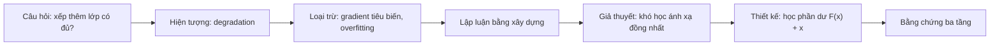

# Case study: ResNet (CVPR 2016)

!!! abstract "Mục tiêu của bài"
    Sau bài này, người học có thể:

    - Trình bày câu chuyện của ResNet như một chuỗi lập luận đi từ quan sát, qua việc loại trừ các giải thích thay thế, tới một thiết kế được suy ra từ giả thuyết.
    - Giải thích vì sao một biểu đồ hiện tượng, chứ không phải bảng kết quả SOTA, lại là lựa chọn Figure 1 hiệu quả cho một paper xuất phát từ quan sát.
    - Nhận diện cấu trúc "đối chứng có kiểm soát" trong chuỗi thí nghiệm và dùng nó để thiết kế thí nghiệm cho dự án riêng.
    - Chuyển các bài học của ResNet sang paper thuộc cộng đồng NLP hoặc Machine Learning.

**Deep Residual Learning for Image Recognition** của Kaiming He, Xiangyu Zhang, Shaoqing Ren và Jian Sun (Microsoft Research) nhận giải Best Paper tại CVPR 2016 và là một trong những paper được trích dẫn nhiều nhất trong lịch sử khoa học. Ngày nay, residual connection (kết nối tắt cộng đầu vào của một khối lớp vào đầu ra của khối đó) có mặt trong gần như mọi kiến trúc học sâu, từ mạng tích chập tới Transformer, đến mức người ta dễ quên rằng ý tưởng này từng cần được thuyết phục.

Chính vì ý tưởng cuối cùng rất đơn giản, ResNet là một ví dụ tuyệt vời để học cách viết. Nếu paper chỉ nói rằng thêm skip connection thì mạng tốt hơn, nó sẽ đọc như một mẹo kỹ thuật, và reviewer hoàn toàn có quyền hỏi vì sao mẹo đó hiệu quả và liệu nó có tổng quát hay không. ResNet tránh được điều đó bằng một chuỗi lập luận chặt chẽ: bắt đầu từ một hiện tượng đáng ngạc nhiên, lần lượt loại trừ các giải thích hiển nhiên, phát biểu một giả thuyết, rồi để thiết kế phương pháp hiện ra như hệ quả của giả thuyết ấy. Bài này đọc ResNet theo đúng chuỗi lập luận đó, và ở mỗi bước đặt câu hỏi: vì sao cách viết này hiệu quả, và người viết ở cộng đồng khác có thể học được gì?

## Bối cảnh ra đời

Giai đoạn 2012–2015 chứng kiến một xu hướng rõ ràng trong nhận dạng ảnh: các mạng đạt kết quả tốt nhất ở cuộc thi ImageNet (ILSVRC) ngày càng sâu hơn, từ AlexNet tới VGG và GoogLeNet. Độ sâu được xem là chìa khóa của chất lượng biểu diễn. Trở ngại lớn được biết tới khi tăng độ sâu là vanishing/exploding gradient, tức gradient tiêu biến hoặc bùng nổ khi lan truyền ngược qua nhiều lớp. Đến năm 2015, trở ngại này phần lớn đã được giải quyết nhờ các phương pháp khởi tạo chuẩn hóa và Batch Normalization. Cùng thời điểm, Highway Networks cũng đề xuất dùng kết nối tắt có cổng (gate) để huấn luyện mạng rất sâu.

Bối cảnh này quyết định cách ResNet phải được viết. Người đọc năm 2016 đã có sẵn một lời giải thích quen thuộc cho mọi khó khăn của mạng sâu, và đã biết tới ý tưởng kết nối tắt. Muốn thuyết phục, paper phải cho thấy có một vấn đề mà lời giải thích quen thuộc không bao quát được, đồng thời chỉ ra chính xác thiết kế mới khác Highway Networks ở điểm nào. ResNet được công bố trên arXiv vào cuối năm 2015, cùng thời điểm hệ thống dựa trên nó giành vị trí thứ nhất ở nhiều hạng mục của ILSVRC 2015 và COCO 2015 (phân loại, phát hiện và định vị trên ImageNet; phát hiện và phân đoạn trên COCO), rồi được trình bày tại CVPR 2016.

## Câu chuyện một dòng

> Mạng sâu hơn lại huấn luyện kém hơn, và nguyên nhân không phải overfitting mà là khó khăn trong tối ưu hóa; nếu để các lớp học phần dư so với ánh xạ đồng nhất thay vì học trực tiếp ánh xạ mong muốn, việc tối ưu trở nên dễ dàng, nhờ đó có thể huấn luyện mạng 152 lớp và giành chiến thắng ở ILSVRC cùng COCO 2015.

Câu này chứa đủ các mắt xích của một câu chuyện hoàn chỉnh như đã phân tích ở bài [Xây "câu chuyện" của paper](../01-truoc-khi-viet/cau-chuyen.md): một hiện tượng (mạng sâu hơn huấn luyện kém hơn), một chẩn đoán (vấn đề nằm ở tối ưu hóa), một giải pháp suy ra từ chẩn đoán (học phần dư), và bằng chứng (152 lớp, thắng hai cuộc thi lớn). Điều đáng chú ý là vế phủ định "không phải overfitting" có vai trò ngang với vế khẳng định. Chính vế phủ định này chuyển vấn đề từ một địa hạt quen thuộc (regularization, dữ liệu) sang một địa hạt ít được chú ý hơn (tối ưu hóa), và nhờ thế mở ra chỗ cho một giải pháp mới. Một câu chuyện mạnh thường không chỉ nói vấn đề là gì mà còn nói vấn đề không phải là gì.

## Phân tích câu chuyện và cấu trúc

Introduction của ResNet có thể đọc như một cuộc đối thoại với một người đọc hoài nghi, trong đó mỗi đoạn trả lời câu hỏi mà đoạn trước gợi ra. Phần này lần lượt phân tích các bước của cuộc đối thoại ấy.

### Mở bằng một câu hỏi mà ai cũng muốn biết câu trả lời

Đoạn mở đầu nhắc lại những bằng chứng cho thấy độ sâu quan trọng, rồi đặt một câu hỏi tu từ, đại ý: học một mạng tốt hơn có dễ như việc xếp thêm lớp hay không (*"Is learning better networks as easy as stacking more layers?"*). Câu hỏi này hiệu quả vì nó chạm đúng vào điều mà mọi người làm học sâu thời đó đều từng nghĩ tới. Thay vì mở bằng một câu kiểu "We propose a new architecture…", paper đặt người đọc vào vị trí người đi tìm câu trả lời, và phần còn lại của Introduction trở thành lời giải đáp. Người đọc theo dõi một cuộc điều tra chứ không nghe một lời quảng cáo.

### Chủ động loại trừ giải thích mà reviewer sẽ nghĩ tới

Ngay sau câu hỏi, paper nêu trở ngại quen thuộc là vanishing/exploding gradient và thừa nhận rằng nó đã phần lớn được giải quyết bằng khởi tạo chuẩn hóa cùng các lớp chuẩn hóa trung gian. Rồi paper đưa ra điểm bất ngờ: dù mạng sâu đã hội tụ được, khi độ sâu tăng, độ chính xác bão hòa rồi giảm nhanh. Paper đặt cho hiện tượng này một cái tên, *degradation problem*, và nhấn mạnh rằng nó không do overfitting gây ra, vì thêm lớp làm tăng cả training error chứ không riêng test error.

Đây là một nước đi tinh tế. Khi thấy một mạng sâu hoạt động kém, phản xạ đầu tiên của reviewer sẽ là "gradient tiêu biến" hoặc "overfitting". Paper đóng cả hai cánh cửa ấy trước khi reviewer kịp mở. Về sau, ở phần thí nghiệm trên ImageNet, paper còn bổ sung bằng chứng đo đạc: mạng plain (mạng xếp chồng thông thường, không có kết nối tắt) được huấn luyện với Batch Normalization có tín hiệu lan truyền xuôi với phương sai khác không và gradient lan truyền ngược có độ lớn bình thường. Như vậy giải thích "gradient tiêu biến" bị loại trừ không chỉ bằng lời lẽ mà bằng số liệu.

### Lập luận bằng xây dựng

Bước tiếp theo là lập luận then chốt của paper. Xét một mạng nông và một mạng sâu hơn được tạo ra bằng cách thêm lớp vào mạng nông. Tồn tại một nghiệm "bằng xây dựng" (by construction) cho mạng sâu: các lớp thêm vào là ánh xạ đồng nhất, các lớp còn lại sao chép từ mạng nông. Nghiệm này có training error bằng mạng nông, nên về nguyên tắc mạng sâu không thể huấn luyện kém hơn. Việc thực tế nó kém hơn cho thấy bộ tối ưu (solver) gặp khó khăn trong việc tìm ra những nghiệm như vậy, cụ thể là khó xấp xỉ ánh xạ đồng nhất bằng một chồng lớp phi tuyến.

Từ chẩn đoán đó, giải pháp gần như tự hiện ra. Thay vì để một khối lớp học trực tiếp ánh xạ mong muốn $\mathcal{H}(x)$, hãy để nó học phần dư $\mathcal{F}(x) = \mathcal{H}(x) - x$, và ánh xạ ban đầu trở thành $\mathcal{F}(x) + x$. Nếu ánh xạ đồng nhất là tối ưu, việc đẩy phần dư về không dễ hơn nhiều so với việc khớp một ánh xạ đồng nhất bằng các lớp phi tuyến.

Sức thuyết phục của lập luận này nằm ở chỗ nó không cần lý thuyết phức tạp: bất kỳ người đọc nào cũng có thể tự kiểm tra trong đầu. Đồng thời, paper rất cẩn thận về mức độ khẳng định: đây là một giả thuyết (*"we hypothesize"*), không phải một định lý, và phần thí nghiệm sẽ kiểm chứng nó. Sự phân biệt rạch ròi giữa điều đã được chứng minh và điều mới được giả định khiến người đọc tin tưởng hơn chứ không kém đi.

### Giải pháp đơn giản, và sự đơn giản phục vụ lập luận

Khối residual được minh họa trong Figure 2 của paper: hai lớp trọng số và một đường tắt đồng nhất cộng đầu vào vào đầu ra. Paper nhấn mạnh rằng shortcut đồng nhất không thêm tham số và gần như không thêm chi phí tính toán. Chi tiết này không chỉ là một ưu điểm về hiệu năng; nó còn là điều kiện để so sánh công bằng giữa mạng plain và mạng residual có cùng số tham số, cùng độ sâu và cùng chi phí. Nói cách khác, thiết kế đơn giản cho phép dựng một thí nghiệm đối chứng sạch, và chính thí nghiệm đối chứng sạch là thứ biến giả thuyết thành bằng chứng.

### Định vị sắc nét so với công trình gần nhất

Trong phần Related Work, paper đối chiếu trực tiếp với Highway Networks, công trình gần nhất về mặt ý tưởng. Shortcut của Highway Networks có cổng phụ thuộc dữ liệu và có tham số; khi cổng đóng, các lớp trở thành phi residual. Ngược lại, shortcut của ResNet là đồng nhất, không tham số và không bao giờ đóng, nên thông tin luôn đi qua và các lớp luôn học phần dư. Paper cũng chỉ ra rằng Highway Networks chưa cho thấy cải thiện độ chính xác khi độ sâu tăng lên rất lớn (trên một trăm lớp). Cách định vị này hiệu quả vì nó cụ thể: không chỉ nói "khác", mà nói khác ở cơ chế nào và hệ quả thực nghiệm của sự khác biệt đó là gì.

Sơ đồ và bảng dưới đây tổng hợp chuỗi lập luận vừa phân tích.

| Bước | ResNet làm gì | Vì sao hiệu quả |
|---|---|---|
| Câu hỏi mở đầu | Độ sâu quan trọng; vậy xếp thêm lớp có đủ không? | Đặt người đọc vào vị trí người tìm câu trả lời |
| Loại trừ giải thích cũ | Gradient tiêu biến đã phần lớn được giải quyết; hiện tượng mới không phải overfitting | Đóng trước những phản biện hiển nhiên nhất |
| Đặt tên hiện tượng | *Degradation problem* | Biến quan sát thành khái niệm dễ nhớ, dễ trích dẫn |
| Lập luận thiết kế | Nghiệm bằng xây dựng → solver khó học ánh xạ đồng nhất → học phần dư | Thiết kế là hệ quả logic, không phải mẹo |
| Giải pháp | Shortcut đồng nhất, không thêm tham số | Đơn giản, và cho phép đối chứng công bằng |
| Định vị | So sánh cơ chế với Highway Networks | Điểm mới được nêu bằng cơ chế cụ thể |
| Bằng chứng | ImageNet, CIFAR-10, PASCAL VOC, COCO | Ba tầng: xác nhận insight, hiệu năng, tổng quát hóa |

## Figure 1: một biểu đồ hiện tượng

Figure 1 của ResNet không phải sơ đồ kiến trúc, cũng không phải bảng kết quả, mà là hai biểu đồ đường: training error (bên trái) và test error (bên phải) theo số vòng lặp trên CIFAR-10, cho một mạng plain 20 lớp và một mạng plain 56 lớp. Ở cả hai biểu đồ, mạng 56 lớp đều có lỗi cao hơn. Người đọc chỉ cần vài giây để thấy vấn đề, và khi đã thấy vấn đề, giải pháp ở trang sau trở nên gần như tất yếu.

Có ba quyết định thiết kế đáng phân tích trong hình này. Thứ nhất, hình trình bày vấn đề chứ không trình bày giải pháp. Với một paper xuất phát từ quan sát, một hiện tượng đáng ngạc nhiên lôi cuốn người đọc mạnh hơn một con số SOTA, vì nó gợi ra câu hỏi "tại sao", và câu hỏi ấy kéo người đọc đi tiếp. Thứ hai, việc đặt training error cạnh test error là một chi tiết mang tính lập luận. Nếu chỉ có test error, người đọc sẽ nghĩ ngay tới overfitting; chính panel training error tự nó bác bỏ giải thích đó. Hình không chỉ minh họa mà còn tham gia vào lập luận. Thứ ba, hình dùng CIFAR-10, một tập dữ liệu nhỏ và rẻ nhưng đủ để làm lộ hiện tượng; quy mô lớn hơn (ImageNet) được để dành cho phần thí nghiệm, nơi hiện tượng vừa được tái hiện vừa được giải quyết.

Cần nhấn mạnh rằng lựa chọn này không phải công thức cho mọi paper. Khi đóng góp chính là một năng lực mới mà người đọc cần nhìn thấy, như tổng hợp góc nhìn mới ở [NeRF](nerf.md) hay điều khiển sinh ảnh ở [ControlNet](sam-controlnet.md#controlnet), một Figure 1 trưng bày kết quả thường phù hợp hơn. Nguyên tắc chung, như đã trình bày ở bài [Introduction & Figure 1](../02-viet-tung-phan/introduction.md), là Figure 1 phải mang thông điệp quan trọng nhất của paper; với ResNet, thông điệp quan trọng nhất chính là bản thân vấn đề.

!!! tip "Gợi ý áp dụng"
    Nếu paper xuất phát từ một quan sát, hãy phác hai phiên bản Figure 1: một phiên bản chứng minh quan sát và một phiên bản khoe kết quả. Đưa cả hai cho một đồng nghiệp chưa biết dự án và hỏi họ hiểu được gì sau mười giây. Phiên bản khiến người xem tự hỏi "tại sao lại như vậy?" thường là phiên bản tốt hơn.

## Thí nghiệm như một chuỗi lập luận

Phần thí nghiệm của ResNet không phải một tập hợp bảng số rời rạc. Mỗi thí nghiệm trả lời một câu hỏi, và thứ tự của chúng gần trùng với thứ tự mà một reviewer hoài nghi sẽ đặt câu hỏi. Đọc phần này như một chuỗi lập luận giúp thấy rõ nguyên tắc [thiết kế thí nghiệm theo claim](../01-truoc-khi-viet/thi-nghiem.md) vận hành ra sao trong một paper thật.

Câu hỏi đầu tiên là liệu hiện tượng degradation có tồn tại ở quy mô lớn hay chỉ là đặc thù của một tập dữ liệu nhỏ. Paper so sánh mạng plain 18 lớp và 34 lớp trên ImageNet, cho thấy mạng 34 lớp có training error cao hơn trong suốt quá trình huấn luyện, kèm phân tích tín hiệu xuôi và gradient ngược đã nhắc ở trên để khẳng định đây không phải gradient tiêu biến.

Câu hỏi thứ hai là liệu residual learning có thực sự giải quyết vấn đề. Paper huấn luyện ResNet 18 lớp và 34 lớp với cấu hình giống hệt mạng plain tương ứng, chỉ thêm shortcut. Tình thế đảo ngược: ResNet-34 tốt hơn ResNet-18 và tốt hơn hẳn plain-34. Vì khác biệt duy nhất giữa hai họ mạng là shortcut, đây là một đối chứng có kiểm soát theo đúng nghĩa. Paper còn ghi nhận một chi tiết rất trung thực: ở độ sâu 18 lớp, khi mạng chưa quá sâu, plain và residual đạt độ chính xác tương đương, chỉ khác ở chỗ ResNet hội tụ nhanh hơn ở giai đoạn đầu. Thay vì phóng đại, paper chỉ ra chính xác lợi ích nằm ở đâu ở từng độ sâu.

Câu hỏi thứ ba là liệu cải thiện có đến từ tham số tăng thêm hay không. Paper so sánh ba phương án shortcut: đồng nhất với zero-padding khi cần tăng số chiều, projection chỉ khi tăng số chiều, và projection cho mọi shortcut. Projection chỉ tốt hơn chút ít, cho thấy nó không phải yếu tố thiết yếu để giải quyết degradation; shortcut đồng nhất, không tham số, là đủ. Kết luận này đồng thời biện minh cho thiết kế bottleneck ở bước sau, vốn cần shortcut không tham số để giữ chi phí thấp.

Câu hỏi thứ tư là liệu có thể đi sâu hơn nữa. Với khối bottleneck (ba lớp 1×1, 3×3 và 1×1), paper xây ResNet 50, 101 và 152 lớp với chi phí hợp lý, và độ chính xác tiếp tục tăng theo độ sâu mà không còn thấy hiện tượng degradation.

Câu hỏi thứ năm là liệu giả thuyết "phần dư gần với không" có được dữ liệu ủng hộ. Trên CIFAR-10, paper huấn luyện mạng tới 110 lớp, rồi tới 1202 lớp, và phân tích độ lớn đáp ứng (độ lệch chuẩn của đầu ra) của từng lớp. Các hàm residual nhìn chung có đáp ứng nhỏ hơn so với mạng plain, phù hợp với giả thuyết ban đầu. Với mạng 1202 lớp, paper thẳng thắn báo cáo rằng dù training error vẫn rất thấp, test error lại kém mạng 110 lớp, cho rằng nguyên nhân là overfitting vì mô hình quá lớn so với một tập dữ liệu nhỏ, và để ngỏ vấn đề cho nghiên cứu sau. Việc báo cáo cả trường hợp chưa thành công làm tăng chứ không làm giảm độ tin cậy của toàn bộ paper.

Câu hỏi cuối cùng là liệu biểu diễn học được có giá trị ngoài bài toán phân loại. Thay backbone trong hệ thống phát hiện đối tượng bằng ResNet mang lại cải thiện rõ rệt trên PASCAL VOC và COCO, cho thấy lợi ích của độ sâu chuyển giao được sang tác vụ khác.

Bảng sau tổng hợp chuỗi lập luận ấy.

| Câu hỏi của người đọc | Thí nghiệm trả lời | Vai trò |
|---|---|---|
| Degradation có thật ở quy mô lớn? | Plain-18 và plain-34 trên ImageNet, kèm phân tích gradient | Xác nhận hiện tượng, loại trừ gradient tiêu biến |
| Residual learning có giải quyết được? | ResNet-18/34 so với plain-18/34, cùng cấu hình | Đối chứng có kiểm soát |
| Có phải nhờ tham số thêm? | Ba phương án shortcut | Loại trừ giải thích thay thế |
| Có đi sâu hơn được không? | Bottleneck, 50/101/152 lớp | Đạt kết quả tốt nhất |
| Giả thuyết có được ủng hộ? | Đáp ứng của từng lớp trên CIFAR-10; thử 1202 lớp | Kiểm chứng cơ chế, nêu giới hạn |
| Có tổng quát hóa? | Phát hiện đối tượng trên PASCAL VOC và COCO | Mở rộng phạm vi giá trị |

Có thể thấy bằng chứng được xếp theo ba tầng: tầng xác nhận insight (hiện tượng có thật và cơ chế đúng như giả thuyết), tầng hiệu năng (đạt kết quả tốt nhất), và tầng tổng quát hóa (giá trị vượt ra ngoài bài toán gốc). Một paper chỉ có tầng thứ hai sẽ bị hỏi "tại sao nó hoạt động"; một paper chỉ có tầng thứ nhất sẽ bị hỏi "nó có ích gì". ResNet có đủ cả ba, và đó là một trong những lý do khiến paper gần như không có kẽ hở để phản biện.

## Văn phong

Câu văn của ResNet ngắn, chắc và ít tính từ. Paper hầu như không dùng những từ tự đánh giá như "novel" hay "remarkable"; sức nặng đến từ lập luận và số liệu. Đây là điều đáng học với người viết lần đầu, vốn hay bù đắp sự thiếu tự tin bằng tính từ, trong khi reviewer có kinh nghiệm thường đọc tính từ như một tín hiệu cần kiểm tra lại claim.

Đặc điểm thứ hai là cách đặt tên. Paper đặt tên rõ ràng cho hiện tượng (*degradation problem*), cho cách tiếp cận (*residual learning*) và cho cơ chế (*identity mapping by shortcuts*). Đặt tên cho một hiện tượng có hai tác dụng: người đọc nhớ nó như một khái niệm, và các paper sau có thể trích dẫn nó bằng chính cái tên ấy. Một quan sát không có tên dễ bị quên; một quan sát có tên dễ trở thành điểm xuất phát cho cả một hướng nghiên cứu.

Đặc điểm thứ ba là sự tiết chế về toán. Công thức cốt lõi chỉ là một phép cộng, $y = \mathcal{F}(x, \{W_i\}) + x$, và paper không cố khoác cho nó một lớp hình thức phức tạp hơn mức cần thiết. Đặc điểm thứ tư là mức độ khẳng định được hiệu chỉnh: điều gì là giả thuyết thì gọi là giả thuyết, điều gì là phỏng đoán (chẳng hạn về việc mạng plain sâu có thể có tốc độ hội tụ cực chậm) thì gọi là phỏng đoán và để ngỏ cho nghiên cứu sau. Các chỉ dẫn chi tiết về cách hiệu chỉnh mức độ khẳng định trong tiếng Anh học thuật có ở bài [Tiếng Anh học thuật](../03-ky-thuat/van-phong.md).

## Bài học cho người viết

Bài học lớn nhất từ ResNet là một phương pháp đơn giản trở nên thuyết phục khi nó được trình bày như hệ quả của một chẩn đoán. Khuôn lập luận gồm bốn bước: nêu hiện tượng, loại trừ các giải thích hiển nhiên, phát biểu giả thuyết, suy ra thiết kế từ giả thuyết. Khuôn này buộc người viết phải hiểu vì sao phương pháp hoạt động trước khi viết, và khi người viết thực sự hiểu, người đọc cũng sẽ hiểu. Bài học thứ hai là thí nghiệm nên được thiết kế như những đối chứng có kiểm soát, trong đó chỉ một yếu tố thay đổi, và nên được sắp theo trật tự câu hỏi của người đọc. Bài học thứ ba là trung thực về giới hạn, như trường hợp mạng 1202 lớp, không làm yếu paper mà làm tăng độ tin cậy cho mọi kết quả còn lại.

Những bài học này không giới hạn ở Computer Vision. Ở NLP, một paper phân tích có thể mở bằng một hiện tượng phản trực giác, chẳng hạn hiệu năng của mô hình giảm mạnh khi một điều kiện tưởng như vô hại thay đổi, trình bày hiện tượng bằng một biểu đồ đơn giản, loại trừ các giải thích tầm thường (rò rỉ dữ liệu, khác biệt tokenization, độ dài đầu vào), rồi mới đề xuất giải pháp. Ở Machine Learning, đặc biệt trong các paper về tối ưu hóa và độ ổn định huấn luyện, việc vẽ training loss bên cạnh test loss là cách chuẩn mực để chứng minh vấn đề nằm ở tối ưu chứ không ở tổng quát hóa; còn lập luận "tồn tại một nghiệm trong lớp mô hình, vậy thất bại phải đến từ quá trình tìm nghiệm" là dạng lập luận rất quen thuộc với reviewer ML. Nguyên tắc đối chứng có kiểm soát, tức là giữ nguyên số tham số, dữ liệu và chi phí, chỉ thay đổi một thành phần, là ngôn ngữ chung của cả ba cộng đồng.

## Tóm tắt

ResNet cho thấy một ý tưởng đơn giản có thể trở thành đóng góp lớn khi được đặt trong một chuỗi lập luận chặt chẽ. Paper mở bằng một câu hỏi ai cũng quan tâm, chủ động loại trừ các giải thích quen thuộc, đặt tên cho hiện tượng mới và dùng một lập luận bằng xây dựng để suy ra thiết kế residual. Figure 1 chứng minh vấn đề thay vì khoe kết quả, và việc đặt training error cạnh test error giúp chính hình ảnh tham gia vào lập luận. Phần thí nghiệm được sắp như một chuỗi câu hỏi, với các đối chứng có kiểm soát và bằng chứng ở ba tầng: xác nhận insight, hiệu năng và tổng quát hóa. Văn phong tiết chế, cách đặt tên rõ ràng và mức độ khẳng định được hiệu chỉnh cẩn thận góp phần làm nên độ tin cậy của toàn bộ paper.

## Bài tập

1. Viết lại đoạn insight trong bản thảo của dự án hiện tại theo khuôn ResNet: hiện tượng, loại trừ giải thích hiển nhiên, giả thuyết, thiết kế suy ra từ giả thuyết. Mỗi bước không quá hai câu.
2. Liệt kê ít nhất hai giải thích thay thế mà reviewer có thể đưa ra cho kết quả chính của dự án. Với mỗi giải thích, xác định thí nghiệm hoặc phân tích nào loại trừ nó, và vị trí đặt kết quả đó trong paper (Introduction, Experiments hay appendix).
3. Thiết kế một thí nghiệm đối chứng có kiểm soát theo kiểu plain-34 so với ResNet-34 cho phương pháp của dự án: liệt kê các yếu tố được giữ nguyên và yếu tố duy nhất thay đổi.
4. Phác hai phiên bản Figure 1 (hiện tượng và kết quả) cho dự án, thử với một đồng nghiệp theo gợi ý ở mục Figure 1, rồi ghi lại phản hồi và lựa chọn cuối cùng kèm lý do.
