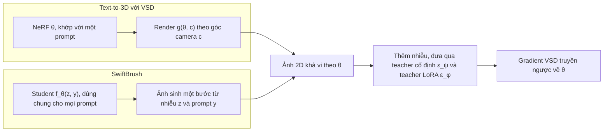

# Case study: SwiftBrush (CVPR 2024)

!!! abstract "Mục tiêu của bài"
    Sau bài này, người học có thể:

    - Phân tích cách một paper CVPR chọn một trục định vị duy nhất (quá trình distillation có cần ảnh huấn luyện hay không) và giữ trục đó xuyên suốt abstract, Introduction, Related Work và bảng kết quả.
    - Nhận ra kỹ thuật chuyển một công cụ từ bài toán lân cận (text-to-3D) sang bài toán đích (text-to-image) bằng cách chỉ ra "điểm tiếp xúc" giữa hàm mất mát và đối tượng được tối ưu.
    - Đánh giá tính công bằng của một bảng so sánh khi các baseline khác nhau về số bước suy luận, dữ liệu huấn luyện, teacher và nguồn gốc con số.
    - Đọc đúng một ablation được trình bày bằng đường cong huấn luyện giai đoạn đầu, kể cả những giới hạn của nó.
    - Chỉ ra những chỗ cách viết có thể chặt chẽ hơn (claim về tính mới, vị trí của số liệu hiệu quả, hệ ký hiệu trong bảng, giao thức user study) và đề xuất cách sửa cụ thể.

Phần lớn các case study về Computer Vision trong chương này là những paper đã trở thành kinh điển. Case study này xét một paper gần đây hơn, có quy mô tài nguyên khiêm tốn hơn, nhưng được chấp nhận tại CVPR 2024 trong một chủ đề cạnh tranh gay gắt là tăng tốc mô hình sinh ảnh từ văn bản:

**SwiftBrush: One-Step Text-to-Image Diffusion Model with Variational Score Distillation**, của Thuan Hoang Nguyen và Anh Tran. Theo trang dự án và kho mã chính thức, hai tác giả thuộc VinAI Research (Việt Nam). Paper được công bố tại CVPR 2024. Phân tích dưới đây dựa trên bản arXiv 2312.05239 (phiên bản v7, dạng HTML); bản trong kỷ yếu CVPR có thể khác ở một số chi tiết. Bản văn bản được dùng không hiển thị khối thông tin tác giả, hình teaser và phần số liệu bên trong các bảng (chỉ có caption). Vì vậy, bài này chỉ nêu những con số xuất hiện trong phần văn bản của paper và không bình luận về nội dung cụ thể của hình teaser.

Paper đáng chú ý với người học Việt Nam vì những lý do có thể kiểm chứng ngay trong văn bản. Đây là một paper hai tác giả từ một phòng nghiên cứu trong nước, được đặt cạnh các phương pháp mà chính paper gọi là state-of-the-art trong cùng một bảng kết quả. Công thức huấn luyện chính chỉ cần một teacher công khai (Stable Diffusion v2.1) và một tập caption, không cần tập ảnh nào. Phần phụ lục ước tính chi phí chưng cất vào khoảng 4,11 ngày GPU A100 (cách tính con số này được bàn thêm ở phần thí nghiệm), trong khi Introduction dẫn lại rằng một phương pháp đối thủ cần ít nhất 108 ngày GPU A100. Mã nguồn được công bố trên GitHub. Nói cách khác, đóng góp của paper đến từ một cách nhìn lại bài toán chứ không đến từ quy mô dữ liệu hay tính toán, và đó là một mô hình nghiên cứu khả thi với các nhóm có tài nguyên hạn chế. Người học có thể đọc thêm case study [Anti-DreamBooth](anti-dreambooth.md), một paper khác của VinAI Research về mô hình khuếch tán text-to-image.

## Bối cảnh: cuộc đua giảm số bước lấy mẫu

Mô hình khuếch tán (diffusion model) sinh ảnh bằng cách khử nhiễu dần qua nhiều bước, như đã phân tích ở case study [DDPM](ddpm.md). Latent Diffusion Model và phiên bản công khai của nó là Stable Diffusion (xem case study [LDM](mae-ldm.md#ldm)) chuyển quá trình này vào một không gian ẩn nhỏ hơn để giảm chi phí, nhưng vẫn cần hàng chục bước suy luận cho mỗi ảnh. Mỗi bước là một lượt chạy qua mạng UNet lớn, nên thời gian sinh ảnh tăng theo số bước. Introduction của SwiftBrush gọi đây là một trở ngại đáng kể khi đưa mô hình lên thiết bị của người dùng.

Hướng tăng tốc mà paper chọn là distillation theo bước thời gian (time-step distillation): giữ nguyên kiến trúc mạng, huấn luyện một mô hình học trò (student) bắt chước mô hình thầy (teacher) nhưng với ít bước hơn. Theo phần tổng quan của paper, tới cuối năm 2023 đã có vài phương pháp đưa số bước xuống còn một: Guided Distillation chưng cất qua hai giai đoạn, Latent Consistency Model (LCM) ép tính nhất quán của các điểm trên quỹ đạo ODE, InstaFlow dùng kỹ thuật "reflow" để làm thẳng quỹ đạo lấy mẫu trước khi chưng cất, và BOOT, một công trình đồng thời, chưng cất mà không cần ảnh. Paper đánh giá các phương pháp này theo ba tiêu chí: chất lượng ảnh khi chỉ dùng một bước, độ phức tạp và chi phí huấn luyện, và việc có cần một lượng lớn cặp văn bản–ảnh hay không.

Mảnh ghép thứ hai của bối cảnh đến từ một bài toán khác: sinh vật thể 3D từ văn bản (text-to-3D). Các phương pháp như DreamFusion tối ưu một NeRF (xem case study [NeRF](nerf.md)) sao cho ảnh render từ các góc nhìn được một mô hình text-to-image 2D đã huấn luyện sẵn "chấm điểm" là khớp với prompt, thông qua một hàm mất mát gọi là Score Distillation Sampling (SDS). Toàn bộ quá trình không cần dữ liệu 3D nào. SDS có những nhược điểm đã được ghi nhận như màu quá bão hòa, ảnh quá mịn và kém đa dạng. ProlificDreamer khắc phục bằng Variational Score Distillation (VSD), trong đó có thêm một teacher thứ hai, là một bản tinh chỉnh bằng LoRA (Low-Rank Adaptation, tinh chỉnh mô hình bằng các ma trận hạng thấp) của chính mô hình diffusion, liên tục học phân phối của những ảnh đang được render. SwiftBrush ra đời ở giao điểm của hai mạch nghiên cứu này.

Tại CVPR, reviewer quen đánh giá mô hình sinh ảnh qua cả số liệu (FID, CLIP score) lẫn so sánh hình ảnh trực quan. Một paper về distillation một bước vì thế phải thuyết phục ở cả hai mặt: con số phải cạnh tranh, và ảnh phải nhìn thấy được là tốt. Cách SwiftBrush phân bổ bằng chứng giữa hai mặt này, đặc biệt ở chỗ nó không thắng về con số, là một trong những điểm đáng học nhất của paper.

## Câu chuyện một dòng

> Các phương pháp distillation một bước cho text-to-image hoặc cho ảnh mờ, hoặc cần quy trình nhiều giai đoạn tốn kém, và đều dựa vào nhiều cặp văn bản–ảnh; nhóm tác giả nhận ra rằng hàm mất mát VSD của text-to-3D chỉ chạm tới đối tượng được tối ưu thông qua một ảnh 2D, nên có thể thay NeRF bằng một generator một bước, từ đó chưng cất Stable Diffusion thành mô hình một bước mà **không cần một ảnh huấn luyện nào**.

Câu chuyện có bốn mắt xích: khoảng trống (ba điểm yếu của các phương pháp hiện có), công cụ mượn từ lĩnh vực lân cận (VSD), lý do công cụ chuyển được (điểm tiếp xúc giữa hàm mất mát và đối tượng được tối ưu chỉ là một ảnh 2D), và hệ quả (quá trình chưng cất không cần ảnh). Đây là cấu trúc năm mắt xích đã học ở bài [Xây "câu chuyện" của paper](../01-truoc-khi-viet/cau-chuyen.md), với insight nằm ở mắt xích thứ ba.

Đặt cạnh case study [Streaming ITN](streaming-itn.md) sẽ thấy một khác biệt thú vị về lối lập luận. Paper Streaming ITN mượn read–write policy của dịch máy đồng thời, rồi dành phần lớn sức thuyết phục để chỉ ra vì sao công cụ ấy **chưa vừa** với bài toán mới. SwiftBrush làm điều ngược lại: nó lập luận rằng công cụ **vừa gần như nguyên vẹn**, và biến sự đơn giản thành điểm mạnh ("In spite of its simplicity", như abstract viết). Lối lập luận này có một rủi ro rõ ràng: reviewer có thể xem paper như một phép cộng "A áp dụng cho B". Khi tính mới nằm ở một phép chuyển đơn giản, gánh nặng chứng minh dồn vào hai việc: giải thích vì sao phép chuyển hợp lệ, và cho thấy những sửa đổi nhỏ đi kèm thực sự cần thiết. Phần còn lại của bài sẽ xem paper làm hai việc ấy tốt tới đâu.

## Title và abstract

### Title: một cái tên gợi hình, một mô tả, một kỹ thuật

Title theo mẫu "Tên: mô tả" đã phân tích ở bài [Title](../02-viet-tung-phan/title.md). Tên "SwiftBrush" gợi cùng lúc tốc độ (*swift*) và hội họa (*brush*), dễ nhớ và khớp với mục tiêu của paper. Phần mô tả nêu đối tượng (*One-Step Text-to-Image Diffusion Model*) và kỹ thuật (*with Variational Score Distillation*). Việc gọi tên VSD ngay trong title có tác dụng tương tự chữ "Simultaneous" trong title của Streaming ITN: người đọc thuộc cộng đồng text-to-3D nhận ra ngay cây cầu khái niệm mà paper bắc qua.

Điểm đáng cân nhắc là thuộc tính được abstract đặt ở trung tâm, tức tính chất *image-free*, lại vắng mặt trong title. Người lướt chương trình hội nghị thấy "one-step", một thuộc tính chung của InstaFlow, BOOT và nhiều công trình khác, thấy "VSD", nhưng không thấy điều phân biệt SwiftBrush với các phương pháp một bước còn lại. Có thể cân nhắc các phương án như "SwiftBrush: Image-Free One-Step Text-to-Image Distillation via Variational Score Distillation" (lặp chữ *Distillation*) hoặc "SwiftBrush: Distilling Text-to-Image Diffusion Models into One Step without Training Images" (mất cây cầu tới cộng đồng 3D vì không gọi tên VSD). Mỗi phương án đánh đổi một điều. Bài học không nằm ở việc chọn phương án nào, mà ở thao tác kiểm tra: liệt kê hai hoặc ba thuộc tính phân biệt paper với đối thủ gần nhất, rồi xem title đang mang thuộc tính nào và bỏ sót thuộc tính nào.

### Abstract: bảy câu, một câu gánh quá nhiều

Abstract gồm bảy câu, khoảng hai trăm từ, và bám khá sát khuôn ở bài [Abstract](../02-viet-tung-phan/abstract.md):

| Câu | Chức năng | Nội dung (diễn giải) |
|---|---|---|
| 1 | Bối cảnh, vấn đề | Mô hình diffusion text-to-image sinh ảnh tốt nhưng quá trình lấy mẫu lặp lại chậm |
| 2 | Hướng giải quyết chung | Distillation là một trong những hướng tăng tốc hiệu quả nhất |
| 3 | Khoảng trống | Các phương pháp trước không giữ được chất lượng và cần nhiều ảnh huấn luyện, ảnh thật hoặc ảnh do teacher sinh ra |
| 4 | Đóng góp | Một sơ đồ distillation không cần ảnh, tên là SwiftBrush |
| 5 | Cơ chế và nguồn cảm hứng | Text-to-3D thu được NeRF mà không cần dữ liệu 3D nhờ một hàm mất mát đặc biệt; paper dùng lại hàm mất mát đó để chưng cất teacher nhiều bước thành student một bước |
| 6 | Định vị | Một trong những generator một bước đầu tiên đạt chất lượng tương đương Stable Diffusion mà không dùng ảnh huấn luyện |
| 7 | Kết quả | FID 16,67 và CLIP score 0,29 trên COCO-30K, cạnh tranh hoặc vượt các phương pháp distillation hiện có |

Abstract có bốn điểm mạnh đáng học. Thứ nhất, câu khoảng trống được phát biểu bằng một phân loại chính xác: ảnh huấn luyện có thể "from real data or synthetically generated by the teacher model". Cụm này chặn trước một phản biện dễ đoán, rằng một số phương pháp chỉ dùng ảnh do teacher sinh ra nên đâu cần dữ liệu thật; theo cách phân loại của paper, những phương pháp ấy vẫn phụ thuộc vào ảnh. Thứ hai, câu cơ chế dựng một phép song song rất tự nhiên: text-to-3D có được NeRF mà không cần dữ liệu 3D, vậy text-to-image có thể có student mà không cần ảnh. Thứ ba, cụm "In spite of its simplicity" biến sự đơn giản thành một ưu điểm thay vì một điểm yếu cần che giấu. Thứ tư, abstract có con số cụ thể.

Tuy vậy, có bốn chỗ có thể viết tốt hơn. Câu 5 dài khoảng 67 từ và gánh cả phép so sánh, cơ chế lẫn kết quả; người đọc phải giữ trong đầu một mệnh đề phụ "in which…" khá dài trước khi tới mệnh đề chính. Câu này cũng gọi hàm mất mát là "a specialized loss" mà không nêu tên VSD, trong khi title đã nêu; người đọc vì thế không nối được hai chỗ. Hai con số FID và CLIP score được đưa ra mà không có điểm tham chiếu, nên với người ngoài chuyên ngành hẹp, "FID 16,67" chưa nói lên điều gì; cụm "competitive results or even substantially surpassing" lại quá chung. Cuối cùng, dù tốc độ và chi phí là động lực của cả paper, abstract không có con số nào về hiệu quả, chẳng hạn thời gian suy luận khoảng 110 ms mỗi ảnh mà phụ lục báo cáo.

Một phiên bản minh họa (không phải của nhóm tác giả) cho phần giữa và cuối abstract có thể như sau:

*"… We present SwiftBrush, an image-free distillation scheme that requires only text prompts. Text-to-3D methods such as ProlificDreamer obtain a NeRF from a 2D diffusion prior without any 3D data via Variational Score Distillation (VSD). We observe that VSD interacts with the NeRF only through its rendered images, and therefore replace the NeRF with a one-step text-to-image student. Distilled from Stable Diffusion without a single training image, SwiftBrush reaches an FID of 16.67 and a CLIP score of 0.29 on COCO-30K, competitive with image-dependent methods in FID, while obtaining the best HPSv2 scores among one-step methods and being preferred over InstaFlow in a user study. Generating an image takes about 110 ms on an A100 GPU."*

Phiên bản này tách câu cơ chế thành hai câu, gọi tên VSD, phát biểu insight ("interacts with the NeRF only through its rendered images") ngay trong abstract, và nói rõ kết quả mạnh ở đâu và chỉ cạnh tranh ở đâu. Mọi thông tin trong đó đều có trong văn bản của paper.

## Introduction: bốn đoạn và một lời hứa về hình ảnh

Introduction gồm bốn đoạn, không có danh sách đóng góp tường minh, và kết thúc bằng việc dẫn người đọc tới hình teaser. Đọc từng đoạn sẽ thấy rõ cả mạch lập luận lẫn những chỗ mạch ấy có thể chặt hơn.

### Đoạn 1: mở rộng trước khi thu hẹp

Đoạn đầu mở bằng thành công của mô hình diffusion trong nhiều tác vụ sinh (ảnh, video, 3D, âm thanh, văn bản), mỗi tác vụ kèm trích dẫn, rồi chuyển sang mô hình text-to-image và các kỹ thuật bổ sung khả năng điều khiển như ControlNet (xem case study [ControlNet](sam-controlnet.md#controlnet)) và DreamBooth. Chỉ ở hai câu cuối, đoạn văn mới nêu vấn đề: tốc độ suy luận chậm do bản chất lặp của quá trình lấy mẫu, gây khó khăn khi triển khai trên thiết bị người dùng.

Việc nhắc tới ControlNet và DreamBooth có một giá trị cấu trúc: mục Discussion ở cuối paper quay lại đúng hai kỹ thuật này như một hướng tích hợp trong tương lai, tạo thành một cặp mở–đóng. Nhưng ba câu đầu của đoạn mang tính chung chung, có thể đặt vào gần như bất kỳ paper diffusion nào. Như bài [Introduction & Figure 1](../02-viet-tung-phan/introduction.md) đã phân tích, reviewer đọc nhiều paper cùng chủ đề trong một đợt review thường lướt qua những câu mở đầu kiểu này. Một câu mở đi thẳng vào vấn đề, chẳng hạn *"Text-to-image diffusion models require tens of network evaluations per image, which hinders their deployment on consumer devices"*, đưa người đọc tới điểm nghẽn ngay từ dòng đầu, và phần liệt kê thành công của diffusion có thể rút gọn thành một mệnh đề phụ.

### Đoạn 2: khảo sát đối thủ, mỗi đối thủ một điểm yếu

Đoạn thứ hai khẳng định time-step distillation là hướng hiệu quả nhất, rồi điểm qua từng đối thủ kèm một điểm yếu cụ thể: Guided Distillation phức tạp và tốn kém, cần ít nhất 108 ngày GPU A100; LCM gộp hai giai đoạn làm một nhưng kết quả một bước bị mờ; InstaFlow được thừa nhận là vượt trội so với framework diffusion gốc trong distillation một bước, nhưng cần một lịch huấn luyện bốn giai đoạn tốn kém. Cách trình bày "mỗi đối thủ một điểm yếu, có con số khi có thể" dựng lên một ô trống rõ ràng cho phương pháp mới, và việc thừa nhận ưu thế của InstaFlow khiến phần phê bình đáng tin hơn.

Điểm cần bàn là vị trí của trục định vị quan trọng nhất. Câu cuối của đoạn mới nêu rằng hiệu quả của các phương pháp này phụ thuộc nhiều vào một lượng lớn cặp văn bản–ảnh, và câu ấy mở đầu bằng "Also, it is noteworthy that…", như một ý phụ thêm vào. Trong abstract, sự phụ thuộc vào ảnh là khoảng trống chính; trong Introduction, nó trở thành một nhận xét cuối đoạn. Lý do được đưa ra cũng khá mỏng: dữ liệu như vậy không phải lúc nào cũng dễ tiếp cận. Khi một thuộc tính là trục phân biệt paper với mọi đối thủ, nó xứng đáng có một câu riêng, một lý do cụ thể có trích dẫn, và một câu hỏi nghiên cứu được phát biểu rõ:

*"More fundamentally, all of these methods are image-dependent: they require large collections of text-image pairs, either real or synthesized by the teacher, which [concrete reason, with citation]. This raises a question: can a one-step student be distilled from text prompts alone?"*

Câu hỏi nghiên cứu ở cuối có tác dụng dẫn thẳng sang đoạn thứ ba, nơi paper trả lời rằng có thể, nhờ một ý tưởng mượn từ text-to-3D.

### Đoạn 3: insight, và một claim cần hiệu chỉnh

Đoạn thứ ba là trái tim của Introduction. Nó giải thích rằng text-to-3D tạo được NeRF chất lượng cao mà không cần dữ liệu 3D, vì một mô hình text-to-image 2D đóng vai trò đánh giá ảnh render từ NeRF có thực tế hay không, "akin to the discriminator in GANs". Phép so sánh với discriminator của GAN là một lựa chọn khéo: người đọc có nền tảng GAN nắm được cơ chế ngay lập tức, và nó nối với câu định vị trong Related Work rằng mục tiêu của paper là kết hợp tốc độ của GAN với chất lượng của diffusion.

Tuy vậy, đoạn này cũng chứa một claim mạnh: SwiftBrush là một quá trình distillation "conceptually novel", "uniquely capable of operating without 2D image supervision". Khi đọc tới Related Work, người đọc gặp hai thông tin đi ngược với chữ *uniquely*: BOOT, một công trình đồng thời, cũng chưng cất mà không cần ảnh, và paper tự viết "our approach is similarly image-free"; Score GAN và Diff-Instruct cũng dùng một hàm mất mát giống VSD để chưng cất mô hình diffusion thành generator một bước. Một reviewer đọc kỹ cả hai mục sẽ thấy sự thiếu nhất quán này. Abstract dùng cụm "one of the first", một mức khẳng định đã được hiệu chỉnh tốt hơn. Cách sửa là để Introduction dùng đúng mức khẳng định của abstract và nói luôn điểm khác biệt với công trình đồng thời:

*"Together with the concurrent BOOT, SwiftBrush is among the first image-free one-step distillation methods for large-scale text-to-image models. Unlike BOOT, which learns a time-conditioned model to predict the teacher's output at any time step, SwiftBrush directly optimizes a one-step student with VSD, resulting in a simpler design."*

Phiên bản này không làm yếu đóng góp; nó chỉ đặt đóng góp vào đúng phạm vi mà Related Work của chính paper cho phép.

### Đoạn 4: kết quả, chữ "first time" và hình teaser

Đoạn cuối báo cáo FID và CLIP score trên MS COCO 2014 với 30.000 ảnh, rồi khẳng định đây là lần đầu tiên một mô hình một bước được chưng cất vượt các phương pháp trước đó mà không dùng một ảnh huấn luyện nào. Có hai chi tiết cần chỉnh. Con số FID ở đây được viết là 16,6, trong khi abstract ghi 16,67; khác biệt nhỏ, nhưng cùng một con số nên được viết giống nhau ở mọi nơi để người đọc không phải tự hỏi đó có phải hai kết quả khác nhau. Quan trọng hơn, cụm "outperforms the previous approaches" có phạm vi mơ hồ. Nếu "previous approaches" bao gồm cả các phương pháp cần ảnh, claim này mâu thuẫn với chính phần kết quả, nơi paper thừa nhận InstaFlow đạt FID tốt hơn. Một phát biểu chính xác hơn sẽ tách hai nhóm: vượt phương pháp image-free trước đó, và cạnh tranh với các phương pháp cần ảnh.

Câu cuối của Introduction dẫn người đọc tới một hình teaser trình bày các ảnh do mô hình chưng cất sinh ra. Trong bản HTML được dùng để phân tích, tham chiếu tới hình này hiển thị dưới dạng nhãn chưa được phân giải ("LABEL:fig:teaser") và hình không xuất hiện, nên bài này không bình luận về nội dung cụ thể của hình; người đọc nên đối chiếu bản PDF. Có hai bài học tổng quát. Thứ nhất, với một paper về mô hình sinh tại CVPR, teaser là bằng chứng đầu tiên mà reviewer nhìn thấy; như case study [ControlNet](sam-controlnet.md#controlnet) cho thấy, một hình "trưng bày năng lực" có thể gánh cả câu chuyện. Với một paper mà luận điểm là *nhanh* và *không cần ảnh*, một teaser có thêm một hàng so sánh (Stable Diffusion một bước, Stable Diffusion nhiều bước, SwiftBrush) kèm thời gian suy luận sẽ truyền tải cả hai luận điểm chứ không chỉ chất lượng ảnh. Thứ hai, ngày càng nhiều người đọc paper qua bản HTML của arXiv; người viết nên mở bản HTML của chính paper sau khi đăng để phát hiện các tham chiếu hỏng như vậy.

### Thiếu một danh sách đóng góp

Introduction của SwiftBrush không kết bằng danh sách đóng góp, một quy ước phổ biến trong các paper CVPR. Người đọc phải tự suy ra đóng góp từ đoạn 3 và đoạn 4. Một danh sách ba gạch đầu dòng, mỗi dòng ứng với một nhóm mục trong paper, sẽ giúp reviewer kiểm tra từng claim với bằng chứng của nó:

- *An image-free distillation scheme that turns a multi-step text-to-image diffusion model into a one-step generator using only text prompts.*
- *A re-purposing of Variational Score Distillation from text-to-3D, replacing the NeRF with a one-step student, together with an x₀ re-parameterization of the student whose necessity we verify by ablation.*
- *Evaluation on COCO-30K and HPSv2 and a user study against InstaFlow, together with training cost and inference time measurements.*

## Related Work: ba cộng đồng, ba câu định vị

Mục Related Work gồm ba đoạn, ứng với đúng ba cộng đồng mà paper bắc cầu: sinh ảnh từ văn bản, sinh 3D từ văn bản, và knowledge distillation. Cách tổ chức theo cộng đồng thay vì theo thời gian giúp người đọc từ mỗi nền tảng tìm thấy phần quen thuộc với mình, đúng như bài [Related Work](../02-viet-tung-phan/related-work.md) khuyến nghị. Điểm đáng học hơn là mỗi đoạn đều kết bằng một câu định vị.

Đoạn về text-to-image đi từ GAN cho miền hẹp, qua mô hình tự hồi quy như DALL-E, tới diffusion và Stable Diffusion, rồi nhắc sự trở lại của GAN với StyleGAN-T và GigaGAN. Đoạn văn nêu sự đánh đổi giữa hai họ: GAN rất nhanh nhưng khó mở rộng và bị mode collapse, diffusion mở rộng tốt nhưng lấy mẫu lâu. Câu kết đặt mục tiêu của paper là kết hợp tốc độ của GAN với chất lượng của diffusion. Câu này nâng câu chuyện lên một tầng cao hơn "thêm một phương pháp distillation": SwiftBrush được đặt vào cuộc tranh luận lâu dài giữa hai họ mô hình sinh.

Đoạn về text-to-3D kể dòng phát triển từ Dream Fields, qua DreamFusion và Score Jacobian Chaining, tới Magic3D và ProlificDreamer, rồi nói thẳng: "Influenced by the latter work, our method adapts the same technique". Sự thẳng thắn về nguồn gốc ý tưởng là một điểm cộng; reviewer không phải tự phát hiện rằng VSD đến từ đâu. Đoạn về distillation phân loại các phương pháp trước thành hai nhóm, nhóm thừa hưởng hạn chế "image-dependent in training" (LCM, InstaFlow, Guided Distillation) và nhóm image-free với BOOT là công trình đồng thời, rồi định vị SwiftBrush trong nhóm sau với kết quả tốt hơn và thiết kế đơn giản hơn. Nhờ đoạn này, trục định vị của abstract trở thành một phân loại tường minh, và như sẽ thấy ở phần thí nghiệm, đoạn văn giới thiệu Table 1 cũng dùng lại đúng phân loại ấy khi nói rằng bảng so sánh với các phương pháp distillation "both image-dependent and image-free".

Chỗ yếu nhất của mục này nằm ở một câu duy nhất, câu kết đoạn text-to-3D: Score GAN và Diff-Instruct "use a VSD-like loss to distill a pretrained diffusion model to a one-step generator". Xét về cơ chế, đây là hai công trình gần SwiftBrush nhất, gần hơn cả BOOT. Thế nhưng chúng chỉ được nhắc trong một câu mở bằng "Similarly", không có câu nào nói SwiftBrush khác chúng ở đâu, và phần văn bản của mục thí nghiệm cũng như phụ lục không bàn tới kết quả của chúng (người đọc nên đối chiếu nội dung Table 1 trong bản PDF). Một reviewer quen với Diff-Instruct gần như chắc chắn sẽ hỏi "vậy điểm mới là gì?". Đây là đoạn định vị đáng được viết kỹ nhất, theo một khuôn như:

*"Closest to our work, Score GAN [6] and Diff-Instruct [24] also distill a pretrained diffusion model into a one-step generator with a VSD-like objective. They [setting, scale and teacher of their experiments]; in contrast, SwiftBrush [the specific difference]. We further compare with them in [Section / Table]."*

Các ô trong ngoặc vuông phải được điền bằng thông tin kiểm chứng được từ các paper đó. Nếu không tìm được khác biệt thực chất, đó là một tín hiệu về tính mới cần được xử lý trước khi nộp, không phải sau khi nhận review.

## Phương pháp: chứng minh rằng công cụ chuyển được

Mục phương pháp gồm hai phần: Section 3.1 trình bày kiến thức nền (diffusion, text-to-image diffusion, SDS, VSD), Section 3.2 trình bày SwiftBrush qua ba đoạn có tiêu đề (Motivation, Design Space, Student Parameterization), kèm Figure 1 và Algorithm 1. Mục khá ngắn, và độ ngắn ấy phù hợp với luận điểm "đơn giản" của paper. Phần này rút ra bốn kỹ thuật viết đáng chú ý.

### Kiến thức nền có định hướng

Section 3.1 không trình bày diffusion một cách bách khoa mà dừng ở đúng những gì phần sau cần: phương trình thêm nhiễu (Eq. 1), hàm mất mát khử nhiễu (Eq. 2 và Eq. 3), gradient của SDS (Eq. 4) và của VSD (Eq. 5), cùng hàm mất mát cho teacher LoRA (Eq. 6). Hai chi tiết cho thấy phần này được viết có chủ đích, đúng tinh thần bài [Method](../02-viet-tung-phan/method.md).

Chi tiết thứ nhất là một câu chuyển tiếp ở cuối đoạn SDS: những suy giảm chất lượng của SDS cũng xuất hiện nếu áp dụng SDS một cách ngây thơ vào framework của paper, như Section 4.3 sẽ cho thấy. Ngay từ phần kiến thức nền, paper đã đặt ra câu hỏi mà ablation sẽ trả lời, nên khi người đọc tới Section 4.3, thí nghiệm "SDS" không còn là một cấu hình tùy ý mà là lời giữ hứa.

Chi tiết thứ hai là cách dùng ký hiệu. Trong Eq. 4 và Eq. 5, $\theta$ là tham số của NeRF và $g(\theta, c)$ là ảnh render ở góc camera $c$. Ở Section 3.2, $\theta$ trở thành tham số của student $f_\theta(z, y)$. Việc giữ nguyên ký hiệu cho "thứ được tối ưu" khiến phép thay thế hiện ra ngay trên mặt công thức: dòng 10 của Algorithm 1 chính là Eq. 5 với $\partial g(\theta, c)/\partial \theta$ được thay bằng $\partial \hat{x}_0/\partial \theta$. Một điểm nhỏ cần thống nhất: hàm trọng số được ký hiệu $w(t)$ trong Eq. 4 và Eq. 5 nhưng là $\omega(t)$ trong Algorithm 1.

### Đoạn Motivation: chỉ ra điểm tiếp xúc

Đoạn Motivation chỉ có ba câu nhưng gánh toàn bộ lý do vì sao ý tưởng chuyển được. Lập luận như sau: SDS và VSD được thiết kế cho text-to-3D, nhưng chúng chỉ gắn với mục tiêu đó một cách lỏng lẻo, "loosely connect to that goal via the rendered image". Thật vậy, trong Eq. 5, NeRF chỉ xuất hiện qua ảnh $g(\theta, c)$ và đạo hàm của ảnh ấy theo $\theta$; hai teacher chỉ nhìn thấy những ảnh 2D đã thêm nhiễu. Hàm mất mát không quan tâm ảnh được tạo ra bằng cách nào, miễn là quá trình tạo ảnh khả vi theo tham số. Vì vậy có thể thay bộ render NeRF bằng bất kỳ hàm nào sinh ra ảnh 2D, và lựa chọn của paper là một generator text-to-image một bước.

Đây là một kỹ thuật lập luận có thể dùng lại: khi mượn một công cụ, hãy xác định **giao diện** giữa công cụ và đối tượng nó tác động. Nếu giao diện ở bài toán đích có cùng kiểu với bài toán gốc (ở đây là một ảnh 2D khả vi), phép chuyển là hợp lý; việc còn lại là liệt kê những gì khác đi. Sơ đồ dưới đây tóm tắt phép thay thế:

Đoạn Design Space sau đó liệt kê những gì thay đổi, có thể tổng hợp như sau:

| Thành phần | Text-to-3D với VSD (ProlificDreamer) | SwiftBrush |
|---|---|---|
| Đối tượng được tối ưu | Một NeRF, khớp riêng với một prompt do người dùng đưa vào | Một student $f_\theta(z, y)$ tổng quát cho mọi prompt |
| Đầu vào sinh ảnh | Góc camera $c$ | Nhiễu Gauss $z$ và prompt $y$ |
| Teacher thứ hai | Bản LoRA của teacher, thêm các lớp điều kiện theo góc camera | Bản LoRA của teacher, bỏ điều kiện camera |
| Khởi tạo | Teacher LoRA khởi tạo từ teacher gốc | Cả teacher LoRA và student đều khởi tạo từ teacher gốc |
| Lịch cập nhật | Xen kẽ teacher LoRA và NeRF | Xen kẽ teacher LoRA và student, teacher gốc đóng băng |

Ngoài ra, paper dùng classifier-free guidance cho cả hai teacher. Mỗi thay đổi được nêu cùng lý do ngắn gọn khi cần, chẳng hạn điều kiện camera bị bỏ vì "unnecessary in our case".

Có một chỗ paper có thể đi xa hơn. Paper có nêu, trong một mệnh đề phụ, khác biệt lớn nhất giữa hai bài toán: NeRF được tối ưu riêng cho một prompt, còn student phải tổng quát cho mọi prompt và mọi nhiễu đầu vào. Nhưng paper không bàn hệ quả của khác biệt này. Theo mô tả của chính paper, teacher LoRA phải liên tục thích nghi với phân phối đầu ra hiện tại của đối tượng được tối ưu; khi đối tượng là một generator dùng cho mọi prompt, phân phối ấy phong phú hơn nhiều so với tập ảnh render của một vật thể. Kết quả ablation ở Section 4.3, nơi teacher LoRA hạng 4 dẫn tới mode collapse còn hạng 64 thì ổn định, có thể được đọc là phù hợp với nhận xét này. Đây là một cách diễn giải gợi ý, không phải điều paper khẳng định. Nếu nhóm tác giả phát biểu nó như một giả thuyết và dùng ablation làm bằng chứng, lựa chọn hạng 64 sẽ trở thành một thiết kế có lý do thay vì một siêu tham số được tinh chỉnh, và câu hỏi "đây chỉ là A áp dụng cho B?" sẽ có thêm một câu trả lời.

### Tham số hóa student: một chi tiết nhỏ được biện minh đủ ba lớp

Đoạn Student Parameterization xử lý một vấn đề kỹ thuật: Stable Diffusion được thiết kế để dự đoán nhiễu $\epsilon$, trong khi student cần xuất ra ảnh sạch $x_0$. Dùng thẳng đầu ra của mạng tiền huấn luyện làm đầu ra của student sẽ tạo ra một khoảng cách lớn giữa điều student phải học và điều mạng vốn làm. Paper tham số hóa lại đầu ra:

$$
f_\theta(z, y) = \frac{z - \sigma_T\, \epsilon_\theta(z, T, y)}{\alpha_T}
$$

và giải thích rằng đây chính là Eq. 1 khi đặt $t = T$, $x_t = z$, tức là biến đầu ra dự đoán nhiễu thành dạng "predicted $x_0$".

Một chi tiết nhỏ như vậy được biện minh qua đủ ba lớp: **lý do** (khoảng cách giữa dự đoán nhiễu và dự đoán ảnh), **dẫn xuất** (suy ra từ một phương trình đã có), và **bằng chứng thực nghiệm** (cấu hình "No Parameterization" ở Section 4.3 chỉ sinh ra ảnh nhiễu). Paper cũng trung thực khi dùng chữ "empirically" hai lần, thừa nhận đây là một lựa chọn kỹ thuật được kiểm chứng bằng thực nghiệm chứ không phải một kết quả lý thuyết. Với lối lập luận "đơn giản là điểm mạnh" của paper, chính những chi tiết như thế này là bằng chứng cho thấy phép chuyển không hoàn toàn hiển nhiên: thiếu nó, quá trình huấn luyện thất bại.

### Figure 1 và Algorithm 1

Trong bản arXiv được phân tích, Figure 1 là hình tổng quan hệ thống. Caption tự đứng được: nó mô tả đầu vào của student (prompt và nhiễu), việc thêm nhiễu vào đầu ra, hai teacher nhận ảnh nhiễu cùng prompt và bước thời gian để tính gradient VSD truyền về student, việc teacher LoRA được cập nhật bằng hàm mất mát diffusion, và việc hai luồng cập nhật luân phiên. Người chỉ đọc caption đã nắm được toàn bộ vòng huấn luyện, đúng yêu cầu ở bài [Figures & Tables](../02-viet-tung-phan/figures-tables.md).

Điểm cần cải thiện là caption phân biệt hai luồng cập nhật chỉ bằng màu (luồng xanh lá cho teacher LoRA, luồng đỏ cho student). Đỏ và xanh lá lại là cặp màu khó phân biệt nhất với dạng mù màu phổ biến nhất, và cũng mất nghĩa khi in đen trắng. Thêm nét liền và nét đứt, hoặc nhãn chữ trên mũi tên, sẽ giải quyết vấn đề mà không tốn thêm chỗ. Caption cũng viết "LORA" trong khi phần còn lại của paper viết "LoRA".

Algorithm 1 có giá trị riêng. Dòng *Require* liệt kê teacher, teacher LoRA, student, hai learning rate, hàm trọng số, lịch nhiễu và một **tập prompt**, không có tập ảnh nào. Chính pseudo-code trở thành bằng chứng cho tính chất image-free. Thuật toán cũng nêu rõ những chi tiết dễ bị bỏ qua trong văn xuôi, chẳng hạn bước thời gian cho cập nhật student được lấy mẫu trong khoảng $\mathcal{U}(0.02T, 0.98T)$, còn cho cập nhật teacher LoRA thì trong $\mathcal{U}(0, T)$. Đây là kiểu chi tiết giúp người khác tái hiện được kết quả.

## Thí nghiệm: so sánh công bằng khi đối thủ dùng nhiều tài nguyên hơn

!!! note "Giới hạn của nguồn văn bản"
    Bản văn bản được dùng chứa caption của Table 1 tới Table 4 nhưng không chứa các con số bên trong bảng. Các nhận xét dưới đây dựa trên những gì phần văn bản và caption khẳng định; khi cần con số cụ thể của từng baseline, người đọc nên tra bản PDF.

### Thiết lập: metric quen thuộc và giao thức có trích dẫn

Paper đánh giá trên hai benchmark zero-shot (mô hình không được huấn luyện trên dữ liệu của benchmark). Trên COCO 2014, paper tính FID (Fréchet Inception Distance, khoảng cách giữa phân phối đặc trưng của ảnh sinh và ảnh thật; càng thấp càng tốt) và CLIP score (mức khớp giữa ảnh và văn bản đo bằng mô hình CLIP; càng cao càng tốt) trên một tập con 30.000 mẫu của tập validation, với backbone ViT-G/14 cho CLIP score. Paper ghi rõ đây là giao thức quy ước và trích dẫn bốn công trình đã dùng nó, một tín hiệu rằng các con số có thể so sánh với tài liệu. Benchmark thứ hai là HPSv2 (Human Preference Score v2), một mô hình được huấn luyện để dự đoán sở thích của con người, đánh giá trên bốn phong cách: anime, concept-art, tranh vẽ và ảnh chụp.

Phần Implementation Details liệt kê gần như đủ mọi siêu tham số: guidance scale 4,5 cho cả hai teacher; teacher LoRA với learning rate 1e-3, hạng 64 và alpha 108; student với learning rate 1e-6 và EMA ở mỗi iteration; Adam, batch size 64 (16 mỗi GPU), khoảng 65.000 iteration. Tập prompt gồm 4 triệu caption lấy từ bộ dữ liệu JourneyDB, sau khi loại trùng còn 1,38 triệu. Chi tiết loại trùng cho thấy sự cẩn thận, và việc nêu rõ nguồn prompt là cần thiết với một paper mà luận điểm chính là "chỉ cần prompt".

### Ba nguồn số liệu, và một hệ ký hiệu chưa nhất quán

Paper dùng ba cách lấy số liệu cho baseline: lấy con số đã báo cáo trong paper gốc khi có thể, tự sinh ảnh bằng checkpoint công khai (với InstaFlow và LCM), và tự cài đặt lại (với BOOT). Các bảng đánh dấu nguồn của từng con số bằng ký hiệu. Đây là một thực hành minh bạch đáng học: người đọc biết con số nào do nhóm tác giả tự đo.

Vấn đề là hệ ký hiệu đổi nghĩa giữa các bảng và hình. Trong caption của Table 1, † nghĩa là số lấy từ paper gốc, § là số đo bằng checkpoint công khai, ‡ là số từ bản cài đặt lại, còn ∗ là số "using the pretrained models", một mô tả gần như trùng với § khiến người đọc khó phân biệt hai ký hiệu chỉ từ caption. Trong Table 2, † lại nghĩa là đo bằng checkpoint công khai, còn ∗ là số lấy từ paper của HPSv2. Trong Table 3, † là số từ paper gốc và ∗ là số đo bằng mã chính thức. Trong Figure 3, SD∗ là Stable Diffusion 25 bước và SD† là Stable Diffusion một bước. Như vậy ký hiệu † mang ba nghĩa khác nhau trong cùng một paper. Cách sửa đơn giản nhất là thay ký hiệu bằng một cột "Source" ghi chữ (*reported*, *official checkpoint*, *our re-impl.*) và ghi số bước trực tiếp vào tên cấu hình, chẳng hạn "SD (25 steps)".

Một khoảng trống nhỏ nữa: khi chép con số từ paper khác, giao thức đo phải trùng khớp. Văn bản không nói rõ các con số lấy từ paper gốc có dùng cùng backbone CLIP ViT-G/14 và cùng cách chọn 30.000 mẫu hay không. Một câu xác nhận, hoặc một ghi chú khi giao thức khác, sẽ đóng lại câu hỏi này.

### Công bằng theo ba trục: số bước, teacher và dữ liệu

Bài [Thiết kế thí nghiệm](../01-truoc-khi-viet/thi-nghiem.md) nhấn mạnh rằng so sánh công bằng đòi hỏi kiểm soát mọi yếu tố ngoài đóng góp. Với distillation, có ba yếu tố dễ làm lệch so sánh, và SwiftBrush xử lý mỗi yếu tố theo một cách khác nhau.

**Số bước suy luận** được xử lý tốt nhất. Caption của Table 1 nói rõ số in đậm và gạch chân là tốt nhất và tốt nhì *trong các mô hình một bước*; Stable Diffusion 25 bước có mặt như một mốc tham chiếu chứ không tham gia xếp hạng. Figure 3 còn đi xa hơn khi đặt cả Stable Diffusion 25 bước lẫn Stable Diffusion một bước cạnh các phương pháp chưng cất. Hai cột này kẹp kết quả giữa một trần (teacher chạy đủ bước) và một sàn (teacher bị ép chạy một bước, tức là không chưng cất), cho người đọc thấy distillation đã lấy lại được bao nhiêu chất lượng.

**Teacher** được kiểm soát một phần. SwiftBrush và bản cài đặt lại của BOOT cùng dùng Stable Diffusion v2.1, nên so sánh giữa hai phương pháp image-free là có kiểm soát. Cái giá là BOOT bị tách khỏi thiết lập gốc của nó (DeepFloyd IF), và paper trung thực thừa nhận kết quả mờ của BOOT có thể do khác teacher. Với InstaFlow và LCM, văn bản không nói checkpoint công khai của họ được chưng cất từ teacher nào, nên người đọc khó tách tác động của teacher khỏi tác động của phương pháp. Một cột "Teacher" trong Table 1 sẽ giải quyết điều này.

**Dữ liệu huấn luyện** là trục mà sự bất cân xứng có lợi cho đối thủ: SwiftBrush chỉ dùng caption, còn các phương pháp image-dependent dùng cặp văn bản–ảnh. Paper khai thác điều này đúng cách khi mở phần kết quả bằng cụm "Despite being trained with only text captions". Khi một sự bất cân xứng đi ngược với phương pháp của mình, nói rõ nó ra làm kết quả thuyết phục hơn. Một cột "Training data" trong bảng sẽ khiến điều này hiện ra chỉ với một cái liếc mắt.

Có một chi tiết về giọng văn trong phần này. Paper viết rằng nhóm tác giả "compelled to re-implement BOOT" vì BOOT không cung cấp số liệu cho mô hình text-to-image và mã nguồn "remains entirely closed". Thông tin là chính đáng, nhưng giọng văn mang tính tranh luận. Một câu trung tính như *"Since neither text-to-image metrics nor code are publicly available for BOOT, we re-implement it following the original paper"* truyền đạt cùng nội dung mà không làm người đọc phân tâm khỏi kết quả.

### Khi không thắng ở metric chính

Phần định lượng thừa nhận thẳng rằng SwiftBrush cải thiện chất lượng một bước so với các phương pháp khác, "with exceptions of InstaFlow and Stable Diffusion (25 sampling steps) in FID score". Thua teacher 25 bước là điều được chờ đợi; thua InstaFlow ở FID là điều paper cần xử lý. Paper đưa ra ba câu trả lời: InstaFlow phức tạp hơn nhiều vì cần bốn giai đoạn chưng cất; trên HPSv2, SwiftBrush đạt điểm tốt nhất ở cả bốn phong cách trong số các phương pháp được so sánh và chỉ kém nhẹ teacher; và trong một user study với 400 người dùng trên 30 prompt ngẫu nhiên, SwiftBrush được chọn nhiều hơn InstaFlow về cả chất lượng ảnh lẫn độ khớp với văn bản.

Cách phân bổ bằng chứng này rất đáng học. User study không so với mọi baseline mà nhắm đúng vào đối thủ đã thắng ở FID; bằng chứng bổ sung được đặt đúng chỗ người đọc còn nghi ngờ. Việc nói rõ "trừ InstaFlow" ngay trong văn bản, thay vì để người đọc tự phát hiện trong bảng, cũng làm tăng độ tin cậy cho những claim còn lại.

Tuy vậy, cả ba câu trả lời đều có thể chặt chẽ hơn. Câu trả lời thứ nhất dựa vào cụm "Instaflow is so complex", một tính từ chủ quan ở đúng chỗ đã có số liệu: Table 3 ở phụ lục so sánh thời gian huấn luyện. Một câu như *"InstaFlow attains a lower FID but requires a four-stage pipeline and [N] A100 GPU days (Table 3), whereas SwiftBrush is trained end-to-end"* biến một lời khẳng định thành một phép so sánh kiểm chứng được. Câu trả lời thứ ba cần một giao thức đầy đủ hơn. Caption của Figure 2 chỉ cho biết số người tham gia, số prompt và hai tiêu chí; văn bản không nói 30 prompt được chọn ngẫu nhiên từ nguồn nào, vị trí hai ảnh có được hoán đổi ngẫu nhiên không, mỗi người đánh giá bao nhiêu cặp, có lựa chọn "ngang nhau" không, và chênh lệch có ý nghĩa thống kê hay không. Đây là những câu hỏi reviewer thường đặt cho mọi đánh giá bằng người, như bài [Experiments](../02-viet-tung-phan/experiments.md) đã bàn; một đoạn ngắn trong phụ lục là đủ để trả lời. Cuối cùng, chính sự thừa nhận "trừ InstaFlow" ở đây là lý do claim "first time… outperforms the previous approaches" ở Introduction cần được thu hẹp phạm vi như đã đề xuất.

### So sánh định tính và mẫu không chọn lọc

Figure 3 xếp ảnh theo lưới: mỗi hàng dùng một prompt, mỗi cột là một mô hình (LCM, BOOT, InstaFlow, SwiftBrush, Stable Diffusion 25 bước, Stable Diffusion một bước). Văn bản đọc hình giúp người đọc: LCM cho ảnh mờ và quá mịn; BOOT khớp prompt nhưng độ chân thực chưa cao; InstaFlow có chất lượng tốt nhưng xử lý kém các prompt phức tạp hoặc bất thường, như ở ảnh thứ ba và thứ năm của cột thứ ba, và đôi khi cho kết quả thiếu thực tế ngay cả với prompt đơn giản, như ở ảnh thứ tư của cột ấy.

Việc chỉ đích danh từng ô trong lưới là một thực hành tốt, vì nó cho reviewer kiểm chứng nhận xét thay vì phải tin một lời khen chung chung. Nhưng tham chiếu theo vị trí ("ảnh thứ ba của cột thứ ba") vừa bắt người đọc đếm, vừa dễ sai khi bố cục thay đổi ở bản camera-ready. Đánh dấu trực tiếp các ô cần chú ý bằng khung hoặc nhãn chữ trong hình, rồi tham chiếu theo nhãn, sẽ chắc chắn hơn.

Phụ lục có bốn hình đáng giá là Figure 7 tới Figure 10, trình bày các mẫu không chọn lọc (uncurated) của SwiftBrush, InstaFlow, BOOT và LCM. Mẫu không chọn lọc là câu trả lời tốt nhất cho nghi ngờ "ảnh trong paper đã được chọn kỹ", một nghi ngờ thường trực với mọi paper về mô hình sinh. Tuy nhiên, trong bản được phân tích, không có chỗ nào trong văn bản tham chiếu tới bốn hình này. Một câu như *"Uncurated samples of all one-step methods are provided in Figs. 7–10 of the supplementary material"* ở cuối phần định tính sẽ bảo đảm reviewer biết chúng tồn tại. Bằng chứng không được dẫn tới thường là bằng chứng không được nhìn thấy.

### Ablation: đọc đường cong huấn luyện giai đoạn đầu

Section 4.3 so sánh bốn cấu hình: Full (đầy đủ), No Parameterization (bỏ tham số hóa lại student), Small-Rank LoRA (teacher LoRA hạng 4) và SDS (bỏ teacher LoRA, chỉ dùng SDS). Mỗi cấu hình bỏ đi đúng một thành phần mà phần phương pháp đã giới thiệu, và cấu hình SDS giữ lời hứa ở Section 3.1. Cả bốn được huấn luyện 10.000 iteration với cùng siêu tham số, rồi đánh giá FID và CLIP score trên một tập con 5.000 ảnh của COCO 2014. Figure 4 vẽ đường cong theo iteration, Figure 5 cho ảnh minh họa với hai prompt, và Figure 13 ở phụ lục cho ảnh của cả bốn cấu hình sau mỗi 2.000 iteration.

Kết quả được đọc rõ ràng. Không có teacher LoRA, ảnh khớp prompt nhưng quá bão hòa và thiếu thực tế, và đường cong gần như phẳng. Teacher LoRA hạng 4 ban đầu cho kết quả khá, nhưng FID xấu đi từ khoảng 8.000 bước, dẫn tới mode collapse. Không tham số hóa lại, student chỉ sinh ảnh nhiễu và kém nhất suốt quá trình. Kết quả thứ hai minh họa giá trị riêng của việc trình bày ablation bằng đường cong: nếu chỉ báo cáo một con số ở cuối, hiện tượng "tốt lên rồi sụp đổ" sẽ bị che mất; đường cong cho thấy cả một kiểu thất bại.

Thiết kế này cũng có những giới hạn mà người viết nên ý thức. Thứ nhất, 10.000 iteration chỉ là một phần nhỏ của khoảng 65.000 iteration huấn luyện chính. Paper nói rõ ngân sách và mục đích ("to observe their training dynamics at the early phase"), điều đáng ghi nhận, nhưng không giải thích vì sao thứ hạng ở giai đoạn đầu phản ánh thứ hạng cuối cùng. Với cấu hình hạng 4, sự sụp đổ xảy ra ngay trong cửa sổ quan sát nên kết luận vững; với cấu hình SDS, một reviewer có thể hỏi liệu nó chỉ hội tụ chậm hơn. Ít nhất một con số ở cuối quá trình huấn luyện đầy đủ cho cấu hình SDS sẽ đóng lại câu hỏi này. Thứ hai, hạng LoRA chỉ được so ở hai giá trị 4 và 64, nên người đọc không biết 64 là một ngưỡng cần thiết hay chỉ là giá trị được chọn. Thứ ba, không có ablation cho những lựa chọn gắn trực tiếp với luận điểm chính, đặc biệt là quy mô tập prompt: với một phương pháp "chỉ cần prompt", câu hỏi tự nhiên là cần bao nhiêu prompt, và 1,38 triệu caption từ JourneyDB có phải là điều kiện cần hay không. Thứ tư, văn bản gọi tên các đường cong bằng màu ("flat red curve", "green curves", "orange curve"), lặp lại vấn đề đã nêu ở Figure 1; gọi theo tên cấu hình trong chú giải sẽ dễ theo dõi hơn.

### Nội suy: claim nhỏ cần bằng chứng tương xứng

Đoạn cuối của Section 4.3, có tiêu đề "Interpolating Latent", giữ nguyên nhiễu đầu vào và thay đổi prompt theo một khuôn mẫu ("A DSLR photo of a {animal} {action}"). Phụ lục bổ sung nội suy tuyến tính trên embedding của văn bản (Figure 11) và nội suy cầu trên nhiễu đầu vào (Figure 12). Paper nhận xét rằng student "seemingly features enhanced control and editability compared to the teacher model" nhờ bản chất một bước.

Chữ "seemingly" cho thấy nhóm tác giả đã hiệu chỉnh mức khẳng định, một thói quen tốt. Nhưng một claim so sánh với teacher cần kết quả của teacher đặt cạnh, trong khi caption của Figure 6, 11 và 12 chỉ mô tả đầu ra của SwiftBrush. Có hai cách nhất quán: thêm một hàng kết quả của teacher với cùng nhiễu và cùng prompt, hoặc bỏ vế so sánh và chỉ mô tả điều hình cho thấy. Ngoài ra, tiêu đề "Interpolating Latent" chưa khớp với nội dung của Figure 6, vốn giữ nguyên nhiễu và thay prompt; phép nội suy trên nhiễu thực sự nằm ở Figure 12. Đặt tên một thí nghiệm theo đúng điều nó kiểm tra là một thói quen nhỏ nhưng giúp người đọc không phải đối chiếu lại.

### Phụ lục: những con số hiệu quả lẽ ra thuộc về phần chính

Section 6 ở phụ lục chứa những con số quan trọng nhất cho luận điểm "nhanh và dễ huấn luyện". Về chi phí huấn luyện: trên một GPU A100 40GB, batch size tối đa là 16 và đạt khoảng 15.825 iteration mỗi ngày; với 65.000 lượt cập nhật, việc chưng cất cần khoảng 65.000/15.825 ≈ 4,11 ngày GPU A100. Bản cài đặt lại của BOOT hội tụ sau khoảng 100.000 iteration (so với 500.000 theo paper gốc), tương đương khoảng 5,56 ngày GPU. Về tốc độ suy luận với batch size 1: UNet một bước mất 25 ms, text encoder 80 ms, VAE 5 ms, tổng 110 ms; BOOT mất 115 ms do UNet có thêm lớp. Section 8 bổ sung kết quả trên CIFAR-10 32×32 và ImageNet 64×64 có điều kiện lớp với teacher EDM, nơi SwiftBrush ngang Consistency Distillation dùng LPIPS và vượt các phương pháp còn lại.

Có ba nhận xét về cách dùng những con số này. Nhận xét thứ nhất là sự **bất cân xứng về vị trí**. Introduction dùng con số 108 ngày GPU A100 của Guided Distillation làm luận cứ, abstract và Introduction hứa một quá trình huấn luyện "more approachable", nhưng chi phí và tốc độ của chính SwiftBrush chỉ xuất hiện ở phụ lục, và Table 3 không được tham chiếu từ phần chính. Như bài [Conclusion, Limitations, Appendix](../02-viet-tung-phan/conclusion-supp.md) đã nhấn mạnh, phụ lục dùng để bổ sung chi tiết, không dùng để chứa bằng chứng cho claim chính. Một câu trong Section 4.2, hoặc tốt hơn là đưa Table 3 vào phần chính, sẽ đặt con số 4,11 ngay cạnh con số 108.

Nhận xét thứ hai liên quan tới **cách tính ngày GPU**. Implementation Details ghi batch size 64 với 16 mẫu mỗi GPU, tức mỗi iteration dùng nhiều GPU. Phép tính ở phụ lục, 65.000 chia cho 15.825 iteration mỗi ngày, lại khớp với kịch bản một GPU chạy batch 16. Nếu 65.000 iteration với batch 64 được chia trên bốn GPU chạy song song, mỗi GPU với thông lượng như đã nêu, thì tổng số ngày GPU sẽ vào khoảng gấp bốn. Người đọc khó đối chiếu hai đoạn này chỉ từ văn bản; có thể con số thông lượng được hiểu theo một cách khác mà paper chưa nói rõ. Con số 5,56 ngày GPU của BOOT, cũng được tính "with a batch size of 16 per GPU", gặp cùng câu hỏi. Cách sửa là báo cáo tách bạch ba đại lượng: số GPU, thời gian thực (wall-clock) và tổng số ngày GPU. Với một paper lấy chi phí thấp làm luận điểm, sự rõ ràng ở đây đặc biệt quan trọng.

Nhận xét thứ ba là một **insight chưa được khai thác**. Trong 110 ms, text encoder chiếm 80 ms, còn UNet chỉ 25 ms. Sau khi chưng cất xuống một bước, UNet không còn là điểm nghẽn; text encoder mới là thành phần chậm nhất. Paper báo cáo các con số nhưng không bình luận. Một câu nhận xét như vậy sẽ biến một bảng số liệu thành một phát hiện, và mở ra một hướng nghiên cứu tiếp theo có cơ sở. Tương tự, kết quả trên CIFAR-10 và ImageNet 64×64 là bằng chứng cho thấy phương pháp không gắn riêng với Stable Diffusion, nhưng phần chính không nhắc tới nó.

## Limitations, kết luận và văn phong

### Một mục Discussion ngắn nhưng thẳng thắn

Section 5 có tên "Conclusion and Discussion". Phần kết luận gồm ba câu: nhắc lại sơ đồ distillation không cần ảnh lấy cảm hứng từ text-to-3D, khẳng định hiệu quả, và bày tỏ hy vọng giảm chi phí suy luận. Phần Discussion nêu hai hạn chế và ba hướng tiếp theo: SwiftBrush "inevitably" cho chất lượng thấp hơn teacher nhiều bước; thiết kế hiện tại chỉ hỗ trợ một bước, chưa hỗ trợ sinh vài bước như LCM để đánh đổi tính toán lấy chất lượng; các hướng tương lai gồm mở rộng sang vài bước, huấn luyện chỉ với một teacher cho các tình huống thiếu tài nguyên, và tích hợp với DreamBooth, ControlNet hay InstructPix2Pix.

Phần này có ba điểm tốt. Hạn chế đầu tiên được nói thẳng, không né tránh. Mỗi hạn chế đi kèm một hướng giải quyết. Và việc quay lại DreamBooth cùng ControlNet khép vòng với đoạn mở đầu của Introduction. Hướng "chỉ một teacher" cũng gợi ra một chi phí của thiết kế hiện tại, vốn cần tới hai teacher khi huấn luyện.

Mục này có thể đầy đủ hơn với những hạn chế mà chính paper đã cung cấp bằng chứng. Ablation cho thấy quá trình chưng cất nhạy với hạng của teacher LoRA, một sự mong manh đáng được liệt kê. Ghi chú về BOOT cho thấy kết quả có thể thay đổi theo teacher, trong khi SwiftBrush chỉ được kiểm chứng với Stable Diffusion v2.1 cho bài toán text-to-image. VSD được giới thiệu một phần để khắc phục sự kém đa dạng của SDS, nhưng phần chính không báo cáo một thước đo riêng cho độ đa dạng. Hai hoặc ba câu như vậy không làm yếu paper; chúng cho reviewer thấy nhóm tác giả hiểu rõ phạm vi bằng chứng của mình. Khác với ACL Rolling Review, nơi mục Limitations là bắt buộc, CVPR những năm gần đây thường không bắt buộc một mục riêng; người viết nên kiểm tra Author Guidelines của năm nộp.

### Văn phong: tính từ mạnh, giọng tranh luận và những lỗi soát bản

Văn phong của paper nhìn chung rõ ràng, nhưng có ba nhóm vấn đề đáng rút kinh nghiệm. Nhóm thứ nhất là **tính từ tăng cường**: chữ "remarkable" hoặc "Remarkably" xuất hiện bảy lần trong abstract và phần thân, bên cạnh "exceptional quality" và "so complex". Như bài [Tiếng Anh học thuật](../03-ky-thuat/van-phong.md) đã phân tích, mỗi tính từ như vậy là một claim không kèm bằng chứng; cách tốt nhất là thay bằng một con số hoặc xóa đi. Nhóm thứ hai là **giọng tranh luận** ở các cụm như "compelled" và "entirely closed" đã bàn ở trên.

Nhóm thứ ba là **lỗi soát bản** còn sót trong bản arXiv v7: "they lacks behind", "can be easily scale up", "unable to to create", "t is uniformly samples"; prompt "An DSLR photo" trong văn bản và caption của Figure 5 và Figure 13; tên baseline được viết lúc "Instaflow" (sáu lần trong phần thân) lúc "InstaFlow" (năm lần); "LORA" trong caption của Figure 1. Từng lỗi đều nhỏ, nhưng gộp lại chúng gây cảm giác vội vàng và kéo sự chú ý của reviewer khỏi nội dung. Bản trong kỷ yếu CVPR có thể đã sửa một số lỗi. Bài [Quy trình viết & tự review](../03-ky-thuat/quy-trinh-viet.md) gợi ý một lượt soát cuối chuyên để tìm mọi biến thể chính tả của tên phương pháp và baseline; đây là thao tác chỉ mất vài phút với chức năng tìm kiếm của trình soạn thảo.

## Bài học cho người viết

**Chọn một trục định vị và để nó xuất hiện ở mọi tầng.** Tính chất image-free có mặt trong abstract, trong phân loại của Related Work, trong đoạn văn giới thiệu Table 1, và trong dòng *Require* của Algorithm 1. Chỗ duy nhất trục này yếu đi là Introduction, nơi nó chỉ là một nhận xét cuối đoạn, và title, nơi nó vắng mặt. Với mỗi paper, hãy kiểm tra trục định vị ở từng tầng như vậy.

**Khi mượn công cụ, chỉ ra điểm tiếp xúc, rồi chứng minh rằng các sửa đổi là cần thiết.** Đoạn Motivation ba câu giải thích vì sao VSD chuyển được: nó chỉ chạm tới NeRF qua một ảnh 2D. Ablation về tham số hóa lại student và hạng LoRA cho thấy phép chuyển không hoàn toàn hiển nhiên. Paper mạnh nhất khi có cả hai vế; nó sẽ mạnh hơn nữa nếu bàn thêm khác biệt giữa tối ưu cho một prompt và tối ưu cho mọi prompt.

**Hiệu chỉnh claim về tính mới một lần, rồi dùng đúng phiên bản đó ở mọi nơi.** "One of the first" ở abstract, "uniquely capable" ở Introduction và "similarly image-free" ở Related Work là ba mức khẳng định khác nhau cho cùng một điều. Reviewer đọc cả ba sẽ chọn mức thấp nhất, nên người viết nên tự chọn trước và viết nhất quán.

**Bằng chứng cho claim chính phải nằm ở phần chính.** Khi tốc độ và chi phí là luận điểm, thời gian suy luận và số ngày GPU không nên chỉ nằm trong phụ lục, đặc biệt khi Introduction đã dùng con số chi phí của đối thủ làm luận cứ. Và mọi con số chi phí cần được báo cáo đủ rõ (số GPU, thời gian thực, tổng ngày GPU) để người đọc đối chiếu được.

**Phân bổ bằng chứng theo chỗ người đọc nghi ngờ, và mô tả đủ giao thức.** User study nhắm đúng đối thủ thắng ở FID là một lựa chọn sắc sảo. Giá trị của nó tăng lên nhiều nếu kèm giao thức: nguồn prompt, ngẫu nhiên hóa, số phán đoán, kiểm định thống kê.

**Một bảng so sánh công bằng nói rõ nguồn số liệu, teacher, số bước và dữ liệu.** Đánh dấu nguồn số liệu là thực hành tốt, nhưng ký hiệu phải nhất quán giữa các bảng. Các cột "Source", "Teacher", "Steps", "Training data" biến những thông tin đang nằm rải rác trong văn bản thành thứ người đọc thấy ngay.

**Ablation dạng đường cong cần nêu ngân sách và gọi tên bằng chữ.** Đường cong cho thấy những kiểu thất bại mà một con số cuối cùng che mất, như mode collapse của LoRA hạng 4. Nhưng khi ngân sách ngắn hơn huấn luyện chính, cần ít nhất một điểm kiểm chứng ở cuối; và đường cong nên được gọi theo tên cấu hình chứ không theo màu.

### Áp dụng sang các cộng đồng khác

Trong **NLP**, trục "có cần dữ liệu có nhãn hay không" có vai trò tương tự trục image-free, chẳng hạn trong các công trình chưng cất mô hình ngôn ngữ lớn chỉ từ prompt. Một paper như SwiftBrush nộp ACL hay EMNLP sẽ cần mở rộng mục Discussion thành một mục Limitations đầy đủ theo yêu cầu của ARR, và đánh giá bằng người sẽ phải kèm các thông tin như số người đánh giá, cách tuyển chọn và mức đồng thuận, như bài [Viết cho ACL / EMNLP / NAACL](../06-cong-dong/nlp.md) đã trình bày. Trong **Machine Learning**, reviewer NeurIPS hay ICLR sẽ tập trung vào câu hỏi vì sao VSD vẫn hoạt động khi đối tượng được tối ưu là một generator dùng cho mọi đầu vào thay vì một vật thể duy nhất, và đòi hỏi phân biệt chính xác với Diff-Instruct và Score GAN, có thí nghiệm đi kèm; các kết quả trên CIFAR-10 và ImageNet 64×64, vốn là benchmark chuẩn của cộng đồng này, nên được đưa vào phần chính (xem [Viết cho NeurIPS / ICML / ICLR](../06-cong-dong/ml.md)). Trong **Computer Vision**, SwiftBrush đã đáp ứng phần lớn kỳ vọng quen thuộc: so sánh trực quan theo lưới, mẫu không chọn lọc, user study và hình teaser; các bài học còn lại là về những chi tiết trình bày như tham chiếu theo nhãn thay vì theo vị trí, và không để màu sắc là cách duy nhất phân biệt các thành phần trong hình.

## Tóm tắt

SwiftBrush dựng câu chuyện trên một trục định vị rõ ràng: các phương pháp distillation một bước cho text-to-image đều cần nhiều cặp văn bản–ảnh, còn SwiftBrush chỉ cần prompt. Insight của paper là hàm mất mát VSD của text-to-3D chỉ chạm tới NeRF qua ảnh 2D render ra, nên có thể thay NeRF bằng một student một bước. Đoạn Motivation ngắn gọn giải thích vì sao phép chuyển hợp lệ, còn phần tham số hóa lại student được biện minh đủ ba lớp lý do, dẫn xuất và ablation. Phần thí nghiệm kiểm soát tốt số bước suy luận, đánh dấu minh bạch nguồn số liệu, thừa nhận thẳng việc thua InstaFlow ở FID và đặt user study đúng vào chỗ đó, còn ablation bằng đường cong làm lộ ra kiểu thất bại mode collapse của LoRA hạng thấp. Những chỗ có thể viết tốt hơn gồm: claim về tính mới không nhất quán giữa abstract, Introduction và Related Work; hai công trình gần nhất về cơ chế (Score GAN, Diff-Instruct) chỉ được nhắc trong một câu; hệ ký hiệu nguồn số liệu đổi nghĩa giữa các bảng; giao thức user study chưa đủ chi tiết; số liệu chi phí và tốc độ chỉ nằm ở phụ lục và cách tính ngày GPU khó đối chiếu; cùng một số tính từ mạnh và lỗi soát bản. Tất cả đều là bài học về sự khớp nhau giữa claim, bằng chứng và vị trí đặt bằng chứng trong paper.

## Bài tập

1. Viết lại câu thứ năm trong abstract của SwiftBrush (khoảng 67 từ) thành hai câu, gọi tên VSD và phát biểu insight về điểm tiếp xúc. Sau đó thêm một con số về hiệu quả lấy từ phụ lục. So sánh độ dài abstract mới với bản gốc và quyết định câu nào có thể rút gọn để bù lại.
2. Xác định trục định vị của dự án hiện tại (thuộc tính phân biệt nó với đối thủ gần nhất). Kiểm tra trục đó có mặt ở title, abstract, câu cuối của mỗi đoạn Related Work, và trong một cột của bảng kết quả chính hay không. Với mỗi chỗ vắng mặt, viết một câu bổ sung.
3. Chọn một kỹ thuật trong dự án được mượn từ lĩnh vực khác. Viết một đoạn theo khuôn đoạn Motivation của SwiftBrush: kỹ thuật tác động tới đối tượng qua giao diện nào, giao diện ấy ở bài toán mới có cùng kiểu không, những gì phải thay đổi, và ablation nào chứng minh rằng thay đổi đó là cần thiết.
4. Lấy bảng so sánh chính trong bản thảo và thêm bốn cột: "Source" (số tự đo, số chép, số từ bản cài đặt lại), "Teacher/backbone", "Training data", "Inference cost". Liệt kê những ô không điền được; mỗi ô như vậy là một câu hỏi reviewer có thể đặt ra.
5. Thiết kế giao thức cho một user study trong dự án: nguồn và cách chọn mẫu, cách ngẫu nhiên hóa vị trí, câu hỏi nguyên văn, số phán đoán mỗi người, cách xử lý lựa chọn "ngang nhau", và kiểm định thống kê. Viết giao thức thành một đoạn văn dùng được cho phụ lục.
6. Rà soát bản thảo hiện tại theo ba lượt: tìm mọi tính từ tăng cường (remarkable, exceptional, significantly…) và thay bằng con số hoặc xóa; tìm mọi biến thể chính tả của tên phương pháp và baseline; kiểm tra mọi con số xuất hiện nhiều lần (abstract, Introduction, bảng) có được viết giống nhau không.
