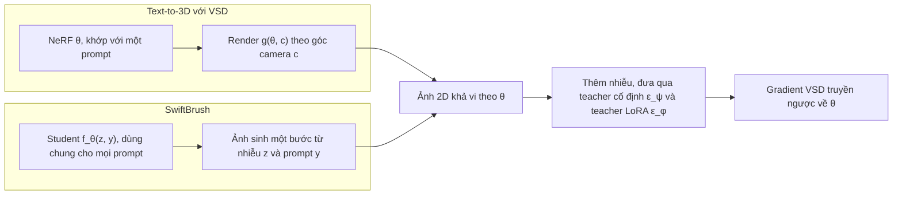

# Case study: SwiftBrush (CVPR 2024)

!!! abstract "Mục tiêu của bài"
    Sau bài này, người học có thể:

    - Phân tích cách một paper CVPR chọn một trục định vị duy nhất (quá trình distillation có cần ảnh huấn luyện hay không) và giữ trục đó xuyên suốt abstract, Introduction, Related Work và phần thí nghiệm.
    - Nhận ra kỹ thuật chuyển một công cụ từ bài toán lân cận (text-to-3D) sang bài toán đích (text-to-image) bằng cách chỉ ra "điểm tiếp xúc" giữa hàm mất mát và đối tượng được tối ưu.
    - Đánh giá tính công bằng của một bảng so sánh khi các baseline khác nhau về số bước suy luận, teacher, dữ liệu huấn luyện và nguồn gốc con số.
    - Đọc đúng một ablation trình bày bằng đường cong huấn luyện giai đoạn đầu, kể cả giới hạn của nó.
    - Chỉ ra những chỗ có thể viết chặt chẽ hơn (claim về tính mới, vị trí của số liệu hiệu quả, hệ ký hiệu trong bảng, giao thức user study) và đề xuất cách sửa cụ thể.

Phần lớn các case study về Computer Vision trong chương này là những paper đã thành kinh điển. Case study này xét một paper gần đây, có quy mô tài nguyên khiêm tốn hơn nhiều, nhưng được chấp nhận tại CVPR 2024 trong một chủ đề cạnh tranh gay gắt là tăng tốc mô hình sinh ảnh từ văn bản:

**SwiftBrush: One-Step Text-to-Image Diffusion Model with Variational Score Distillation**, của Thuan Hoang Nguyen và Anh Tran. Theo trang dự án và kho mã chính thức, hai tác giả thuộc VinAI Research (Việt Nam). Phân tích dưới đây dựa trên bản arXiv 2312.05239 (phiên bản v7, dạng HTML); bản trong kỷ yếu CVPR có thể khác ở một số chi tiết. Bản văn bản được dùng không hiển thị khối thông tin tác giả, hình teaser và các con số bên trong bảng (chỉ có caption), nên bài này chỉ nêu những con số xuất hiện trong phần văn bản của paper.

Paper là một ví dụ giá trị cho người học Việt Nam vì những lý do kiểm chứng được ngay trong văn bản. Đây là một paper hai tác giả từ một phòng nghiên cứu trong nước, được đặt cạnh các phương pháp mà chính paper gọi là state-of-the-art. Công thức huấn luyện chỉ cần một teacher công khai (Stable Diffusion v2.1) và một tập caption, không cần tập ảnh nào; phụ lục ước tính chi phí chưng cất khoảng 4,11 ngày GPU A100 (cách tính được bàn ở phần thí nghiệm), trong khi Introduction dẫn lại rằng một phương pháp đối thủ cần ít nhất 108 ngày GPU A100. Mã nguồn được công bố trên GitHub. Đóng góp của paper đến từ một cách nhìn lại bài toán chứ không từ quy mô dữ liệu hay tính toán, một mô hình nghiên cứu khả thi với các nhóm có tài nguyên hạn chế. Người học có thể đọc thêm case study [Anti-DreamBooth](anti-dreambooth.md), một paper khác của VinAI Research về mô hình khuếch tán text-to-image.

## Bối cảnh: cuộc đua giảm số bước lấy mẫu

Mô hình khuếch tán (diffusion model) sinh ảnh bằng cách khử nhiễu dần qua nhiều bước, như đã phân tích ở case study [DDPM](ddpm.md). Stable Diffusion, phiên bản công khai của Latent Diffusion Model (xem case study [LDM](mae-ldm.md#ldm)), chuyển quá trình này vào không gian ẩn để giảm chi phí nhưng vẫn cần hàng chục bước cho mỗi ảnh, mỗi bước là một lượt chạy qua mạng UNet lớn. Hướng tăng tốc mà paper chọn là distillation theo bước thời gian (time-step distillation): giữ nguyên kiến trúc, huấn luyện một mô hình học trò (student) bắt chước mô hình thầy (teacher) với ít bước hơn. Theo phần tổng quan của paper, tới cuối năm 2023 đã có vài phương pháp đưa số bước xuống một: Guided Distillation chưng cất qua hai giai đoạn, Latent Consistency Model (LCM) ép tính nhất quán của các điểm trên quỹ đạo ODE, InstaFlow dùng kỹ thuật "reflow" làm thẳng quỹ đạo lấy mẫu trước khi chưng cất, và BOOT, một công trình đồng thời, chưng cất mà không cần ảnh.

Mảnh ghép thứ hai đến từ bài toán sinh vật thể 3D từ văn bản (text-to-3D). DreamFusion tối ưu một NeRF (xem case study [NeRF](nerf.md)) sao cho ảnh render từ các góc nhìn được một mô hình text-to-image 2D "chấm điểm" là khớp với prompt, qua hàm mất mát Score Distillation Sampling (SDS), mà không cần dữ liệu 3D nào. SDS hay gây màu quá bão hòa, ảnh quá mịn và kém đa dạng. ProlificDreamer khắc phục bằng Variational Score Distillation (VSD), thêm một teacher thứ hai là một bản tinh chỉnh bằng LoRA (Low-Rank Adaptation, tinh chỉnh bằng các ma trận hạng thấp) của mô hình diffusion, liên tục học phân phối của những ảnh đang được render. SwiftBrush ra đời ở giao điểm của hai mạch này.

Tại CVPR, reviewer quen đánh giá mô hình sinh qua cả số liệu (FID, CLIP score) lẫn so sánh trực quan. Cách SwiftBrush phân bổ bằng chứng giữa hai mặt ấy, đặc biệt ở chỗ nó không thắng về con số, là một trong những điểm đáng học nhất của paper.

## Câu chuyện một dòng

> Các phương pháp distillation một bước cho text-to-image hoặc cho ảnh mờ, hoặc cần quy trình nhiều giai đoạn tốn kém, và đều dựa vào nhiều cặp văn bản–ảnh; nhóm tác giả nhận ra rằng hàm mất mát VSD của text-to-3D chỉ chạm tới đối tượng được tối ưu thông qua một ảnh 2D, nên có thể thay NeRF bằng một generator một bước, từ đó chưng cất Stable Diffusion thành mô hình một bước mà **không cần một ảnh huấn luyện nào**.

Câu chuyện có đủ các mắt xích đã học ở bài [Xây "câu chuyện" của paper](../01-truoc-khi-viet/cau-chuyen.md): khoảng trống (ba điểm yếu của các phương pháp hiện có), công cụ mượn từ lĩnh vực lân cận (VSD), insight về lý do công cụ chuyển được (điểm tiếp xúc chỉ là một ảnh 2D), và hệ quả (chưng cất không cần ảnh).

Đặt cạnh case study [Streaming ITN](streaming-itn.md) sẽ thấy một khác biệt về lối lập luận. Paper Streaming ITN mượn read–write policy của dịch máy đồng thời rồi dồn sức chỉ ra vì sao công cụ ấy **chưa vừa** với bài toán mới. SwiftBrush làm điều ngược lại: nó lập luận rằng công cụ **vừa gần như nguyên vẹn**, và biến sự đơn giản thành điểm mạnh ("In spite of its simplicity", như abstract viết). Lối lập luận này có một rủi ro rõ ràng: reviewer có thể xem paper như phép cộng "A áp dụng cho B". Khi tính mới nằm ở một phép chuyển đơn giản, gánh nặng chứng minh dồn vào hai việc: giải thích vì sao phép chuyển hợp lệ, và cho thấy những sửa đổi nhỏ đi kèm thực sự cần thiết.

## Title và abstract

### Title: tên gợi hình, mô tả và kỹ thuật

Title theo mẫu "Tên: mô tả" đã phân tích ở bài [Title](../02-viet-tung-phan/title.md). "SwiftBrush" gợi cùng lúc tốc độ (*swift*) và hội họa (*brush*), dễ nhớ và khớp với mục tiêu. Phần mô tả nêu đối tượng (*One-Step Text-to-Image Diffusion Model*) và kỹ thuật (*Variational Score Distillation*); việc gọi tên VSD giúp người đọc thuộc cộng đồng text-to-3D nhận ra ngay cây cầu khái niệm.

Điều đáng cân nhắc là thuộc tính được abstract đặt ở trung tâm, tính chất *image-free*, lại vắng mặt trong title. "One-step" là thuộc tính chung của InstaFlow, BOOT và nhiều công trình khác, nên người lướt chương trình hội nghị không thấy điều phân biệt SwiftBrush với đối thủ. Một phương án như "SwiftBrush: Distilling Text-to-Image Diffusion Models into One Step without Training Images" nêu được tính chất ấy nhưng mất cây cầu tới cộng đồng 3D. Bài học nằm ở thao tác kiểm tra: liệt kê hai hoặc ba thuộc tính phân biệt paper với đối thủ gần nhất, rồi xem title đang mang thuộc tính nào và bỏ sót thuộc tính nào.

### Abstract: bảy câu, một câu gánh quá nhiều

Abstract gồm bảy câu, khoảng hai trăm từ, và bám khá sát khuôn ở bài [Abstract](../02-viet-tung-phan/abstract.md):

| Câu | Chức năng | Nội dung (diễn giải) |
|---|---|---|
| 1 | Bối cảnh, vấn đề | Diffusion text-to-image sinh ảnh tốt nhưng lấy mẫu lặp lại chậm |
| 2 | Hướng chung | Distillation là một trong những hướng tăng tốc hiệu quả nhất |
| 3 | Khoảng trống | Các phương pháp trước không giữ được chất lượng và cần nhiều ảnh, thật hoặc do teacher sinh ra |
| 4 | Đóng góp | Một sơ đồ distillation không cần ảnh, tên là SwiftBrush |
| 5 | Cơ chế | Text-to-3D thu được NeRF không cần dữ liệu 3D nhờ một hàm mất mát đặc biệt; paper dùng lại hàm đó để chưng cất teacher nhiều bước thành student một bước |
| 6 | Định vị | Một trong những generator một bước đầu tiên đạt chất lượng tương đương Stable Diffusion mà không dùng ảnh huấn luyện |
| 7 | Kết quả | FID 16,67 và CLIP score 0,29 trên COCO-30K, cạnh tranh hoặc vượt các phương pháp distillation hiện có |

Abstract có ba điểm mạnh. Câu khoảng trống dùng một phân loại chính xác: ảnh huấn luyện có thể "from real data or synthetically generated by the teacher model", nhờ vậy các phương pháp chỉ dùng ảnh do teacher sinh ra vẫn được xếp vào nhóm phụ thuộc vào ảnh. Câu cơ chế dựng một phép song song tự nhiên: text-to-3D có NeRF mà không cần dữ liệu 3D, vậy text-to-image có thể có student mà không cần ảnh. Và cụm "In spite of its simplicity" biến sự đơn giản thành ưu điểm.

Có bốn chỗ có thể tốt hơn. Câu 5 dài khoảng 67 từ, gánh cả phép so sánh, cơ chế lẫn kết quả, và người đọc phải giữ một mệnh đề phụ "in which…" khá dài trước khi tới mệnh đề chính. Câu này gọi hàm mất mát là "a specialized loss" mà không nêu tên VSD, dù title đã nêu. Hai con số FID và CLIP score không có điểm tham chiếu, còn cụm "competitive results or even substantially surpassing" quá chung. Cuối cùng, dù tốc độ là động lực của cả paper, abstract không có con số nào về hiệu quả, chẳng hạn thời gian suy luận khoảng 110 ms mỗi ảnh mà phụ lục báo cáo. Một phiên bản minh họa (không phải của nhóm tác giả), chỉ dùng thông tin có trong paper:

*"… Text-to-3D methods such as ProlificDreamer obtain a NeRF from a 2D diffusion prior without any 3D data via Variational Score Distillation (VSD). We observe that VSD interacts with the NeRF only through its rendered images, and therefore replace the NeRF with a one-step text-to-image student. Distilled from Stable Diffusion without a single training image, SwiftBrush reaches an FID of 16.67 and a CLIP score of 0.29 on COCO-30K, competitive with image-dependent methods in FID, while obtaining the best HPSv2 scores among one-step methods and being preferred over InstaFlow in a user study. Generating an image takes about 110 ms on an A100 GPU."*

## Introduction: bốn đoạn, một trục định vị đến muộn

Introduction gồm bốn đoạn, không có danh sách đóng góp tường minh, và kết thúc bằng việc dẫn tới hình teaser.

### Đoạn 1: mở rộng trước khi thu hẹp

Đoạn đầu mở bằng thành công của diffusion trong nhiều tác vụ sinh (ảnh, video, 3D, âm thanh, văn bản), chuyển sang text-to-image và các kỹ thuật bổ sung khả năng điều khiển như ControlNet (xem case study [ControlNet](sam-controlnet.md#controlnet)) và DreamBooth. Chỉ ở hai câu cuối, vấn đề mới xuất hiện: tốc độ suy luận chậm do bản chất lặp của quá trình lấy mẫu, gây khó khăn khi triển khai trên thiết bị người dùng. Việc nhắc tới ControlNet và DreamBooth có giá trị cấu trúc, vì mục Discussion quay lại đúng hai kỹ thuật này như hướng tích hợp trong tương lai. Nhưng ba câu đầu có thể đặt vào gần như bất kỳ paper diffusion nào, và như bài [Introduction & Figure 1](../02-viet-tung-phan/introduction.md) đã phân tích, reviewer đọc nhiều paper cùng chủ đề thường lướt qua những câu như vậy. Một câu mở đi thẳng vào điểm nghẽn, chẳng hạn *"Text-to-image diffusion models require tens of network evaluations per image, which hinders their deployment on consumer devices"*, sẽ hiệu quả hơn.

### Đoạn 2: mỗi đối thủ một điểm yếu, và một trục định vị đến muộn

Đoạn thứ hai khẳng định time-step distillation là hướng hiệu quả nhất, rồi điểm qua từng đối thủ kèm một điểm yếu cụ thể: Guided Distillation phức tạp và cần ít nhất 108 ngày GPU A100; LCM cho kết quả một bước bị mờ; InstaFlow được thừa nhận là vượt trội so với framework diffusion gốc trong distillation một bước nhưng cần lịch huấn luyện bốn giai đoạn tốn kém. Cách trình bày "mỗi đối thủ một điểm yếu, có con số khi có thể" dựng lên một ô trống rõ ràng, và việc thừa nhận ưu thế của InstaFlow làm phần phê bình đáng tin hơn.

Vấn đề là vị trí của trục định vị quan trọng nhất. Chỉ câu cuối của đoạn mới nêu rằng các phương pháp này phụ thuộc nhiều vào cặp văn bản–ảnh, và câu ấy mở bằng "Also, it is noteworthy that…", như một ý phụ. Trong abstract, sự phụ thuộc vào ảnh là khoảng trống chính; trong Introduction, nó thành một nhận xét cuối đoạn, với lý do khá mỏng là dữ liệu như vậy không phải lúc nào cũng dễ tiếp cận. Một thuộc tính phân biệt paper với mọi đối thủ xứng đáng có một câu riêng, một lý do cụ thể có trích dẫn và một câu hỏi nghiên cứu:

*"More fundamentally, all of these methods are image-dependent: they require large collections of text-image pairs, either real or synthesized by the teacher, which [concrete reason, with citation]. Can a one-step student be distilled from text prompts alone?"*

### Đoạn 3: insight, và một claim cần hiệu chỉnh

Đoạn thứ ba là trái tim của Introduction. Nó giải thích rằng text-to-3D tạo được NeRF mà không cần dữ liệu 3D vì một mô hình text-to-image 2D đánh giá ảnh render có thực tế hay không, "akin to the discriminator in GANs". Phép so sánh với discriminator là một lựa chọn khéo: người có nền tảng GAN nắm được cơ chế ngay, và nó nối với câu định vị trong Related Work rằng mục tiêu của paper là kết hợp tốc độ của GAN với chất lượng của diffusion.

Đoạn này cũng chứa một claim mạnh: SwiftBrush là quá trình distillation "conceptually novel", "uniquely capable of operating without 2D image supervision". Tới Related Work, người đọc gặp hai thông tin đi ngược chữ *uniquely*: BOOT cũng chưng cất mà không cần ảnh (paper tự viết "our approach is similarly image-free"), và Score GAN cùng Diff-Instruct cũng dùng một hàm mất mát giống VSD để chưng cất mô hình diffusion thành generator một bước. Abstract dùng cụm "one of the first", một mức khẳng định đã được hiệu chỉnh tốt hơn. Cách sửa là để Introduction dùng đúng mức ấy và nói luôn điểm khác với công trình đồng thời, dựa trên chính mô tả về BOOT trong Related Work:

*"Together with the concurrent BOOT, SwiftBrush is among the first image-free one-step distillation methods for large-scale text-to-image models. Unlike BOOT, which learns a time-conditioned model to predict the teacher's output at any time step, SwiftBrush directly optimizes a one-step student with VSD, resulting in a simpler design."*

### Đoạn 4: chữ "first time" và hình teaser

Đoạn cuối báo cáo FID và CLIP score trên MS COCO 2014 với 30.000 ảnh, rồi khẳng định đây là lần đầu một mô hình một bước được chưng cất vượt các phương pháp trước mà không dùng một ảnh huấn luyện nào. Có hai chi tiết cần chỉnh. FID ở đây được viết là 16,6, trong khi abstract ghi 16,67; cùng một con số nên được viết giống nhau ở mọi nơi. Quan trọng hơn, cụm "outperforms the previous approaches" có phạm vi mơ hồ: nếu nó bao gồm cả các phương pháp cần ảnh, claim mâu thuẫn với phần kết quả, nơi paper thừa nhận InstaFlow đạt FID tốt hơn. Phát biểu chính xác hơn sẽ tách hai nhóm: vượt phương pháp image-free trước đó, và cạnh tranh với các phương pháp cần ảnh.

Câu cuối dẫn tới một hình teaser trình bày ảnh do mô hình chưng cất sinh ra. Trong bản HTML được phân tích, tham chiếu này hiển thị thành nhãn chưa phân giải ("LABEL:fig:teaser") và hình không xuất hiện, nên bài này không bình luận về nội dung của hình; người đọc nên đối chiếu bản PDF. Có hai bài học tổng quát. Thứ nhất, với paper về mô hình sinh tại CVPR, teaser là bằng chứng đầu tiên reviewer nhìn thấy, và như case study [ControlNet](sam-controlnet.md#controlnet) cho thấy, một hình trưng bày năng lực có thể gánh cả câu chuyện; với luận điểm *nhanh* và *không cần ảnh*, một hàng so sánh (Stable Diffusion một bước, nhiều bước, SwiftBrush) kèm thời gian suy luận sẽ truyền tải cả hai. Thứ hai, ngày càng nhiều người đọc paper qua bản HTML của arXiv, nên người viết nên mở bản HTML của chính paper để phát hiện tham chiếu hỏng.

Cuối cùng, Introduction không kết bằng danh sách đóng góp, một quy ước phổ biến ở CVPR. Ba gạch đầu dòng ứng với ba nhóm mục, gồm sơ đồ distillation chỉ cần prompt, phép chuyển VSD kèm tham số hóa lại student được kiểm chứng bằng ablation, và bộ đánh giá trên COCO-30K, HPSv2, user study cùng số liệu chi phí, sẽ giúp reviewer đối chiếu từng claim với bằng chứng của nó.

## Related Work: ba cộng đồng, ba câu định vị

Mục Related Work gồm ba đoạn, ứng với ba cộng đồng mà paper bắc cầu: sinh ảnh từ văn bản, sinh 3D từ văn bản, và knowledge distillation. Tổ chức theo cộng đồng giúp người đọc từ mỗi nền tảng tìm được phần quen thuộc, đúng như bài [Related Work](../02-viet-tung-phan/related-work.md) khuyến nghị, và mỗi đoạn đều kết bằng một câu định vị.

Đoạn về text-to-image nêu sự đánh đổi giữa GAN (nhanh nhưng khó mở rộng, bị mode collapse) và diffusion (mở rộng tốt nhưng lấy mẫu lâu), rồi đặt mục tiêu kết hợp tốc độ của GAN với chất lượng của diffusion, nâng câu chuyện lên trên mức "thêm một phương pháp distillation". Đoạn về text-to-3D kể dòng phát triển từ Dream Fields tới ProlificDreamer và nói thẳng "Influenced by the latter work, our method adapts the same technique"; sự thẳng thắn về nguồn gốc ý tưởng là một điểm cộng. Đoạn về distillation chia các phương pháp trước thành nhóm thừa hưởng hạn chế "image-dependent in training" (LCM, InstaFlow, Guided Distillation) và nhóm image-free với BOOT, rồi xếp SwiftBrush vào nhóm sau. Trục định vị của abstract nhờ vậy trở thành một phân loại tường minh, và đoạn giới thiệu Table 1 dùng lại đúng phân loại ấy khi nói rằng bảng so sánh với các phương pháp distillation "both image-dependent and image-free".

Chỗ yếu nhất nằm ở câu kết đoạn text-to-3D: Score GAN và Diff-Instruct "use a VSD-like loss to distill a pretrained diffusion model to a one-step generator". Về cơ chế, đây là hai công trình gần SwiftBrush nhất, gần hơn cả BOOT. Thế nhưng chúng chỉ được nhắc trong một câu mở bằng "Similarly", không câu nào nói SwiftBrush khác chúng ở đâu, và phần văn bản của mục thí nghiệm lẫn phụ lục không bàn tới kết quả của chúng (người đọc nên đối chiếu Table 1 trong bản PDF). Một reviewer quen với Diff-Instruct gần như chắc chắn sẽ hỏi "điểm mới là gì?". Đoạn định vị này đáng được viết kỹ nhất:

*"Closest to our work, Score GAN [6] and Diff-Instruct [24] also distill a pretrained diffusion model into a one-step generator with a VSD-like objective. They [setting, scale and teacher of their experiments]; in contrast, SwiftBrush [the specific difference]. We further compare with them in [Section / Table]."*

Các ô trong ngoặc vuông phải được điền bằng thông tin kiểm chứng được từ các paper đó. Nếu không tìm được khác biệt thực chất, đó là tín hiệu về tính mới cần xử lý trước khi nộp, không phải sau khi nhận review.

## Phương pháp: chứng minh rằng công cụ chuyển được

Section 3.1 trình bày kiến thức nền (diffusion, text-to-image diffusion, SDS, VSD); Section 3.2 trình bày SwiftBrush qua ba đoạn có tiêu đề (Motivation, Design Space, Student Parameterization), kèm Figure 1 và Algorithm 1. Độ ngắn của mục phù hợp với luận điểm "đơn giản" của paper, và có bốn kỹ thuật viết đáng chú ý.

### Kiến thức nền có định hướng

Section 3.1 dừng ở đúng những gì phần sau cần, theo tinh thần bài [Method](../02-viet-tung-phan/method.md). Cuối đoạn SDS có một câu chuyển tiếp: các suy giảm chất lượng của SDS cũng xuất hiện nếu áp dụng SDS một cách ngây thơ vào framework của paper, như Section 4.3 sẽ cho thấy. Câu hỏi của ablation vì thế đã được đặt ra ngay từ phần nền, và cấu hình "SDS" ở Section 4.3 trở thành lời giữ hứa.

Ký hiệu cũng được chọn có chủ đích. Trong Eq. 4 và Eq. 5, $\theta$ là tham số của NeRF và $g(\theta, c)$ là ảnh render ở góc camera $c$; ở Section 3.2, $\theta$ trở thành tham số của student $f_\theta(z, y)$. Giữ nguyên ký hiệu cho "thứ được tối ưu" khiến phép thay thế hiện ra trên mặt công thức: dòng 10 của Algorithm 1 chính là Eq. 5 với $\partial g(\theta, c)/\partial \theta$ được thay bằng $\partial \hat{x}_0/\partial \theta$. Một điểm nhỏ cần thống nhất: hàm trọng số là $w(t)$ trong Eq. 4–5 nhưng là $\omega(t)$ trong Algorithm 1.

### Đoạn Motivation: chỉ ra điểm tiếp xúc

Đoạn Motivation chỉ có ba câu nhưng gánh toàn bộ lý do vì sao ý tưởng chuyển được. SDS và VSD được thiết kế cho text-to-3D, nhưng chúng chỉ gắn với mục tiêu ấy một cách lỏng lẻo, "loosely connect to that goal via the rendered image". Thật vậy, trong Eq. 5, NeRF chỉ xuất hiện qua ảnh $g(\theta, c)$ và đạo hàm của ảnh theo $\theta$; hai teacher chỉ nhìn thấy ảnh 2D đã thêm nhiễu. Hàm mất mát không quan tâm ảnh được tạo ra bằng cách nào, miễn là quá trình tạo ảnh khả vi theo tham số, nên có thể thay bộ render bằng một generator text-to-image một bước.

Đây là một kỹ thuật lập luận dùng lại được: khi mượn một công cụ, hãy xác định **giao diện** giữa công cụ và đối tượng nó tác động. Nếu giao diện ở bài toán đích cùng kiểu với bài toán gốc (ở đây là một ảnh 2D khả vi), phép chuyển là hợp lý, và việc còn lại là liệt kê những gì khác đi.

Đoạn Design Space liệt kê những gì thay đổi, có thể tổng hợp như sau:

| Thành phần | Text-to-3D với VSD (ProlificDreamer) | SwiftBrush |
|---|---|---|
| Đối tượng được tối ưu | Một NeRF, khớp riêng với một prompt | Một student $f_\theta(z, y)$ tổng quát cho mọi prompt |
| Đầu vào sinh ảnh | Góc camera $c$ | Nhiễu Gauss $z$ và prompt $y$ |
| Teacher thứ hai | Bản LoRA của teacher, thêm các lớp điều kiện theo góc camera | Bản LoRA của teacher, bỏ điều kiện camera |
| Khởi tạo | Teacher LoRA khởi tạo từ teacher gốc | Cả teacher LoRA và student đều khởi tạo từ teacher gốc |
| Lịch cập nhật | Xen kẽ teacher LoRA và NeRF | Xen kẽ teacher LoRA và student, teacher gốc đóng băng |

Ngoài ra, paper dùng classifier-free guidance cho cả hai teacher, và mỗi thay đổi có lý do ngắn gọn khi cần (điều kiện camera bị bỏ vì "unnecessary in our case").

Paper có thể đi xa hơn ở một điểm. Nó nêu, trong một mệnh đề phụ, khác biệt lớn nhất giữa hai bài toán, NeRF được tối ưu cho một prompt còn student phải tổng quát cho mọi prompt, nhưng không bàn hệ quả. Theo mô tả của chính paper, teacher LoRA phải liên tục thích nghi với phân phối đầu ra hiện tại của đối tượng được tối ưu; khi đối tượng là một generator cho mọi prompt, phân phối ấy phong phú hơn nhiều so với tập ảnh render của một vật thể. Kết quả ablation ở Section 4.3, nơi LoRA hạng 4 dẫn tới mode collapse còn hạng 64 thì ổn định, có thể được đọc là phù hợp với nhận xét này. Đây là một cách diễn giải gợi ý, không phải điều paper khẳng định; nếu được phát biểu thành giả thuyết với ablation làm bằng chứng, lựa chọn hạng 64 sẽ trở thành một thiết kế có lý do thay vì một siêu tham số, và câu hỏi "chỉ là A áp dụng cho B?" có thêm một câu trả lời.

### Tham số hóa student: một chi tiết nhỏ được biện minh đủ ba lớp

Stable Diffusion được thiết kế để dự đoán nhiễu $\epsilon$, trong khi student cần xuất ra ảnh sạch $x_0$; dùng thẳng đầu ra của mạng làm đầu ra của student tạo ra một khoảng cách lớn giữa điều student phải học và điều mạng vốn làm. Paper tham số hóa lại:

$$
f_\theta(z, y) = \frac{z - \sigma_T\, \epsilon_\theta(z, T, y)}{\alpha_T}
$$

và chỉ ra rằng đây chính là Eq. 1 khi đặt $t = T$, $x_t = z$. Chi tiết nhỏ này được biện minh qua đủ ba lớp: **lý do** (khoảng cách giữa dự đoán nhiễu và dự đoán ảnh), **dẫn xuất** (suy ra từ một phương trình đã có), và **bằng chứng** (cấu hình "No Parameterization" ở Section 4.3 chỉ sinh ra ảnh nhiễu). Paper cũng trung thực khi dùng chữ "empirically", thừa nhận đây là một lựa chọn kỹ thuật được kiểm chứng bằng thực nghiệm. Với lối lập luận "đơn giản là điểm mạnh", chính những chi tiết như thế cho thấy phép chuyển không hoàn toàn hiển nhiên: thiếu nó, huấn luyện thất bại.

### Figure 1 và Algorithm 1

Trong bản arXiv được phân tích, Figure 1 là hình tổng quan hệ thống với caption tự đứng được: student nhận prompt và nhiễu, đầu ra được thêm nhiễu rồi đưa qua hai teacher để tính gradient VSD truyền về student, teacher LoRA được cập nhật bằng hàm mất mát diffusion, hai luồng cập nhật luân phiên. Người chỉ đọc caption đã nắm được toàn bộ vòng huấn luyện, đúng yêu cầu ở bài [Figures & Tables](../02-viet-tung-phan/figures-tables.md). Điểm cần cải thiện là hai luồng chỉ được phân biệt bằng màu (xanh lá cho teacher LoRA, đỏ cho student), đúng cặp màu khó phân biệt nhất với dạng mù màu phổ biến nhất và mất nghĩa khi in đen trắng; thêm nét liền và nét đứt, hoặc nhãn chữ, sẽ giải quyết mà không tốn chỗ.

Algorithm 1 có một giá trị riêng: dòng *Require* liệt kê teacher, teacher LoRA, student, hai learning rate, hàm trọng số, lịch nhiễu và một **tập prompt**, không có tập ảnh nào. Chính pseudo-code trở thành bằng chứng cho tính chất image-free. Thuật toán còn nêu những chi tiết dễ bị bỏ sót trong văn xuôi, như bước thời gian cho cập nhật student lấy trong $\mathcal{U}(0.02T, 0.98T)$ còn cho teacher LoRA thì trong $\mathcal{U}(0, T)$.

## Thí nghiệm: so sánh công bằng khi đối thủ dùng nhiều tài nguyên hơn

!!! note "Giới hạn của nguồn văn bản"
    Bản văn bản được dùng chứa caption của Table 1 tới Table 4 nhưng không chứa các con số bên trong bảng. Các nhận xét dưới đây dựa trên những gì phần văn bản và caption khẳng định; khi cần con số của từng baseline, người đọc nên tra bản PDF.

### Thiết lập và nguồn số liệu

Paper đánh giá zero-shot trên hai benchmark. Trên COCO 2014, paper tính FID (Fréchet Inception Distance, khoảng cách giữa phân phối đặc trưng của ảnh sinh và ảnh thật, càng thấp càng tốt) và CLIP score (mức khớp ảnh–văn bản, càng cao càng tốt) trên 30.000 mẫu của tập validation với backbone ViT-G/14, theo một giao thức được trích dẫn từ bốn công trình trước. Benchmark thứ hai là HPSv2, một mô hình dự đoán sở thích của con người, đánh giá trên bốn phong cách ảnh. Implementation Details liệt kê gần như đủ siêu tham số, và tập prompt được mô tả rõ: 4 triệu caption từ JourneyDB, sau khi loại trùng còn 1,38 triệu, một chi tiết cần thiết với paper có luận điểm "chỉ cần prompt".

Số liệu baseline đến từ ba nguồn: con số báo cáo trong paper gốc, ảnh tự sinh bằng checkpoint công khai (InstaFlow, LCM) và bản cài đặt lại (BOOT). Các bảng đánh dấu nguồn bằng ký hiệu, một thực hành minh bạch đáng học, nhưng ký hiệu đổi nghĩa giữa các bảng. Trong Table 1, † là số từ paper gốc, § là số đo bằng checkpoint công khai, còn ∗ được mô tả là "using the pretrained models", gần như trùng với §. Trong Table 2, † lại là số đo bằng checkpoint công khai; trong Table 3, † trở về nghĩa số từ paper gốc; trong Figure 3, SD† là Stable Diffusion một bước. Một cột "Source" ghi chữ (*reported*, *official checkpoint*, *our re-impl.*) và số bước ghi thẳng vào tên cấu hình sẽ loại bỏ sự nhầm lẫn. Văn bản cũng không nói các con số chép từ paper gốc có dùng cùng backbone CLIP ViT-G/14 hay không; một câu xác nhận là đủ.

### Công bằng theo ba trục: số bước, teacher và dữ liệu

Bài [Thiết kế thí nghiệm](../01-truoc-khi-viet/thi-nghiem.md) nhấn mạnh rằng so sánh công bằng đòi hỏi kiểm soát mọi yếu tố ngoài đóng góp. Với distillation có ba yếu tố như vậy, và paper xử lý mỗi yếu tố một cách.

**Số bước suy luận** được xử lý tốt nhất. Caption Table 1 nói rõ số in đậm và gạch chân chỉ xếp hạng *trong các mô hình một bước*; Stable Diffusion 25 bước chỉ là mốc tham chiếu. Figure 3 đặt cả Stable Diffusion 25 bước lẫn một bước cạnh các phương pháp chưng cất, kẹp kết quả giữa một trần và một sàn, cho thấy distillation lấy lại được bao nhiêu chất lượng.

**Teacher** được kiểm soát một phần. SwiftBrush và bản cài đặt lại của BOOT cùng dùng Stable Diffusion v2.1, nên so sánh giữa hai phương pháp image-free có kiểm soát; đổi lại, BOOT bị tách khỏi thiết lập gốc (DeepFloyd IF), và paper trung thực thừa nhận kết quả mờ của BOOT có thể do khác teacher. Với InstaFlow và LCM, văn bản không nói checkpoint được chưng cất từ teacher nào, nên người đọc khó tách tác động của teacher khỏi tác động của phương pháp.

**Dữ liệu huấn luyện** là trục mà sự bất cân xứng có lợi cho đối thủ, và paper khai thác điều đó đúng cách khi mở phần kết quả bằng "Despite being trained with only text captions". Hai cột "Teacher" và "Training data" trong Table 1 sẽ khiến hai trục sau hiện ra chỉ với một cái liếc mắt.

### Khi không thắng ở metric chính

Phần định lượng thừa nhận thẳng rằng SwiftBrush tốt hơn các phương pháp khác "with exceptions of InstaFlow and Stable Diffusion (25 sampling steps) in FID score", rồi đưa ra ba câu trả lời: InstaFlow cần bốn giai đoạn chưng cất; trên HPSv2, SwiftBrush đạt điểm tốt nhất ở cả bốn khía cạnh trong số các phương pháp được so sánh; và trong một user study với 400 người trên 30 prompt ngẫu nhiên, SwiftBrush được chọn nhiều hơn InstaFlow về cả chất lượng ảnh lẫn độ khớp văn bản. User study không so với mọi baseline mà nhắm đúng đối thủ đã thắng ở FID: bằng chứng bổ sung được đặt đúng chỗ người đọc còn nghi ngờ.

Hai câu trả lời có thể chặt hơn. Cụm "Instaflow is so complex" là một tính từ chủ quan ở đúng chỗ đã có số liệu, vì Table 3 so sánh thời gian huấn luyện; câu *"InstaFlow attains a lower FID but requires a four-stage pipeline and [N] A100 GPU days (Table 3)"* biến lời khẳng định thành phép so sánh kiểm chứng được. User study cần giao thức đầy đủ hơn: văn bản không nói 30 prompt lấy từ đâu, vị trí hai ảnh có được hoán đổi ngẫu nhiên không, mỗi người đánh giá bao nhiêu cặp, và chênh lệch có ý nghĩa thống kê hay không, những câu hỏi reviewer thường đặt cho mọi đánh giá bằng người (xem bài [Experiments](../02-viet-tung-phan/experiments.md)).

### So sánh định tính và mẫu không chọn lọc

Figure 3 xếp ảnh theo lưới, mỗi hàng một prompt, mỗi cột một mô hình, và văn bản chỉ đích danh từng ô, chẳng hạn InstaFlow xử lý kém prompt phức tạp ở ảnh thứ ba và thứ năm của cột thứ ba. Chỉ đích danh cho reviewer kiểm chứng thay vì phải tin một lời khen chung; nhưng tham chiếu theo vị trí bắt người đọc đếm và dễ sai khi bố cục đổi ở bản camera-ready, nên đánh dấu các ô ấy bằng khung hoặc nhãn trong hình sẽ chắc chắn hơn.

Phụ lục có Figure 7 tới Figure 10 trình bày mẫu không chọn lọc (uncurated) của SwiftBrush, InstaFlow, BOOT và LCM, câu trả lời tốt nhất cho nghi ngờ "ảnh đã được chọn kỹ". Tuy nhiên, không chỗ nào trong văn bản tham chiếu tới bốn hình này. Bằng chứng không được dẫn tới thường là bằng chứng không được nhìn thấy.

### Ablation: đọc đường cong huấn luyện giai đoạn đầu

Section 4.3 so sánh bốn cấu hình, mỗi cấu hình bỏ đúng một thành phần: Full, No Parameterization, Small-Rank LoRA (hạng 4) và SDS (bỏ teacher LoRA). Cả bốn được huấn luyện 10.000 iteration và đánh giá trên 5.000 ảnh COCO; Figure 4 vẽ đường cong FID và CLIP score. Không có teacher LoRA, ảnh quá bão hòa và đường cong gần như phẳng; không tham số hóa lại, student chỉ sinh ảnh nhiễu; còn LoRA hạng 4 ban đầu cho kết quả khá nhưng FID xấu đi từ khoảng 8.000 bước, dẫn tới mode collapse. Kết quả cuối minh họa giá trị riêng của đường cong: một con số cuối cùng sẽ che mất hiện tượng "tốt lên rồi sụp đổ".

Thiết kế này có bốn giới hạn. Ngân sách 10.000 iteration chỉ là một phần của khoảng 65.000 iteration huấn luyện chính; paper nói rõ mục đích "to observe their training dynamics at the early phase" nhưng không giải thích vì sao thứ hạng giai đoạn đầu phản ánh thứ hạng cuối, và một con số ở cuối huấn luyện đầy đủ cho cấu hình SDS sẽ trả lời câu hỏi này. Hạng LoRA chỉ được so ở 4 và 64, nên người đọc không biết 64 là ngưỡng cần thiết hay chỉ là giá trị được chọn. Không có ablation cho lựa chọn gắn trực tiếp với luận điểm chính: một phương pháp "chỉ cần prompt" cần bao nhiêu prompt? Và văn bản gọi tên đường cong bằng màu ("flat red curve", "green curves"), lặp lại vấn đề của Figure 1.

Đoạn "Interpolating Latent" cuối Section 4.3 nhận xét rằng student "seemingly features enhanced control and editability compared to the teacher model". Chữ "seemingly" cho thấy mức khẳng định đã được hiệu chỉnh, nhưng một claim so sánh với teacher cần kết quả của teacher đặt cạnh, trong khi caption của Figure 6, 11 và 12 chỉ mô tả đầu ra của SwiftBrush.

### Phụ lục: những con số hiệu quả lẽ ra thuộc về phần chính

Section 6 ở phụ lục chứa những con số quan trọng nhất cho luận điểm "nhanh và dễ huấn luyện". Trên một GPU A100 40GB với batch size tối đa 16, huấn luyện đạt khoảng 15.825 iteration mỗi ngày, nên 65.000 lượt cập nhật cần khoảng 4,11 ngày GPU. Thời gian suy luận với batch size 1 là 110 ms, gồm UNet 25 ms, text encoder 80 ms và VAE 5 ms. Section 8 bổ sung kết quả trên CIFAR-10 và ImageNet 64×64 với teacher EDM.

Có ba nhận xét. Thứ nhất, **vị trí bất cân xứng**: Introduction dùng con số 108 ngày GPU của Guided Distillation làm luận cứ, nhưng chi phí và tốc độ của chính SwiftBrush chỉ nằm ở phụ lục, và Table 3 không được tham chiếu từ phần chính. Như bài [Conclusion, Limitations, Appendix](../02-viet-tung-phan/conclusion-supp.md) nhấn mạnh, phụ lục bổ sung chi tiết chứ không chứa bằng chứng cho claim chính. Thứ hai, **cách tính ngày GPU khó đối chiếu**: Implementation Details ghi batch size 64 với 16 mẫu mỗi GPU, tức mỗi iteration dùng nhiều GPU, còn phép tính 65.000/15.825 lại khớp với kịch bản một GPU chạy batch 16. Nếu batch 64 được chia trên bốn GPU với thông lượng như đã nêu, tổng số ngày GPU sẽ vào khoảng gấp bốn. Báo cáo tách bạch số GPU, thời gian thực và tổng số ngày GPU sẽ xóa nghi vấn, điều đặc biệt quan trọng với một paper lấy chi phí thấp làm luận điểm. Thứ ba, **một insight chưa được khai thác**: text encoder chiếm 80 trong 110 ms, nghĩa là sau khi chưng cất xuống một bước, UNet không còn là điểm nghẽn. Một câu nhận xét như vậy sẽ biến bảng số liệu thành một phát hiện. Tương tự, kết quả trên CIFAR-10 và ImageNet cho thấy phương pháp không gắn riêng với Stable Diffusion, nhưng phần chính không nhắc tới.

## Limitations, kết luận và văn phong

Section 5 có tên "Conclusion and Discussion". Phần kết luận gồm ba câu tóm tắt đóng góp. Phần Discussion nêu hai hạn chế: SwiftBrush "inevitably" cho chất lượng thấp hơn teacher nhiều bước, và thiết kế hiện tại chỉ hỗ trợ một bước, chưa hỗ trợ sinh vài bước như LCM. Ba hướng tiếp theo là mở rộng sang vài bước để đánh đổi tính toán lấy chất lượng, huấn luyện chỉ với một teacher cho tình huống thiếu tài nguyên, và tích hợp với DreamBooth, ControlNet hay InstructPix2Pix. Hạn chế đầu tiên được nói thẳng, mỗi hạn chế có hướng giải quyết, và việc quay lại DreamBooth cùng ControlNet khép vòng với Introduction.

Mục này có thể đầy đủ hơn với những hạn chế mà chính paper đã cung cấp bằng chứng: quá trình chưng cất nhạy với hạng của teacher LoRA; ghi chú về BOOT cho thấy kết quả có thể thay đổi theo teacher, trong khi SwiftBrush chỉ được kiểm chứng với Stable Diffusion v2.1 cho text-to-image; và VSD được giới thiệu một phần để khắc phục sự kém đa dạng của SDS, nhưng phần chính không báo cáo một thước đo riêng cho độ đa dạng. Vài câu như vậy cho reviewer thấy nhóm tác giả nắm rõ phạm vi bằng chứng. Khác với ACL Rolling Review, nơi mục Limitations là bắt buộc, CVPR những năm gần đây thường không bắt buộc một mục riêng; người viết nên kiểm tra Author Guidelines của năm nộp.

Về văn phong, có ba nhóm vấn đề đáng rút kinh nghiệm. Nhóm thứ nhất là **tính từ tăng cường**: "remarkable" hoặc "Remarkably" xuất hiện bảy lần trong abstract và phần thân, bên cạnh "exceptional quality" và "so complex"; như bài [Tiếng Anh học thuật](../03-ky-thuat/van-phong.md) phân tích, mỗi tính từ như vậy là một claim không kèm bằng chứng. Nhóm thứ hai là **giọng tranh luận**: paper viết rằng nhóm tác giả "compelled to re-implement BOOT" vì mã nguồn "remains entirely closed"; thông tin chính đáng, nhưng một câu trung tính như *"Since neither text-to-image metrics nor code are publicly available for BOOT, we re-implement it following the original paper"* giữ sự chú ý của người đọc ở nội dung. Nhóm thứ ba là **lỗi soát bản** còn sót trong bản arXiv v7: "they lacks behind", "can be easily scale up", "unable to to create", prompt "An DSLR photo" trong Figure 5 và Figure 13, tên baseline lúc "Instaflow" (sáu lần trong phần chính) lúc "InstaFlow" (năm lần), "LORA" trong caption Figure 1. Từng lỗi đều nhỏ, nhưng gộp lại chúng gây cảm giác vội vàng; bản trong kỷ yếu có thể đã sửa một số lỗi. Bài [Quy trình viết & tự review](../03-ky-thuat/quy-trinh-viet.md) gợi ý một lượt soát cuối chuyên để tìm biến thể chính tả của tên phương pháp và baseline, việc chỉ mất vài phút.

## Bài học cho người viết

**Chọn một trục định vị và để nó xuất hiện ở mọi tầng.** Tính chất image-free có mặt trong abstract, trong phân loại của Related Work, trong đoạn giới thiệu Table 1 và trong dòng *Require* của Algorithm 1. Nó yếu đi ở Introduction, nơi chỉ là một nhận xét cuối đoạn, và vắng mặt ở title. Mỗi paper nên được kiểm tra trục định vị ở từng tầng như vậy.

**Khi mượn công cụ, chỉ ra điểm tiếp xúc, rồi chứng minh các sửa đổi là cần thiết.** Đoạn Motivation giải thích vì sao VSD chuyển được; ablation về tham số hóa lại và hạng LoRA cho thấy phép chuyển không hoàn toàn hiển nhiên. Paper mạnh nhất khi có cả hai vế, và sẽ mạnh hơn nữa nếu bàn khác biệt giữa tối ưu cho một prompt và cho mọi prompt.

**Hiệu chỉnh claim về tính mới một lần, rồi dùng đúng phiên bản đó ở mọi nơi.** "One of the first", "uniquely capable" và "similarly image-free" là ba mức khẳng định cho cùng một điều. Reviewer đọc cả ba sẽ chọn mức thấp nhất, nên người viết nên tự chọn trước.

**Bằng chứng cho claim chính phải nằm ở phần chính, và phải đối chiếu được.** Khi tốc độ và chi phí là luận điểm, thời gian suy luận và số ngày GPU không nên chỉ nằm trong phụ lục, và cần được báo cáo đủ rõ (số GPU, thời gian thực, tổng ngày GPU).

**Phân bổ bằng chứng theo chỗ người đọc nghi ngờ, kèm đủ giao thức.** User study nhắm đúng đối thủ thắng ở FID là một lựa chọn sắc sảo; giá trị của nó tăng lên nhiều nếu kèm nguồn prompt, cách ngẫu nhiên hóa và kiểm định thống kê.

**Bảng so sánh nói rõ nguồn số liệu, teacher, số bước và dữ liệu; ablation dạng đường cong nêu ngân sách và gọi tên bằng chữ.** Ký hiệu nguồn phải nhất quán giữa các bảng, và các cột "Source", "Teacher", "Training data" biến thông tin rải rác thành thứ người đọc thấy ngay.

### Áp dụng sang các cộng đồng khác

Trong **NLP**, trục "có cần dữ liệu có nhãn hay không" đóng vai trò tương tự trục image-free, chẳng hạn trong các công trình chưng cất mô hình ngôn ngữ chỉ từ prompt. Nộp ACL hay EMNLP, một paper như SwiftBrush cần mở rộng Discussion thành mục Limitations đầy đủ theo yêu cầu của ARR, và đánh giá bằng người phải kèm số người đánh giá, cách tuyển chọn và mức đồng thuận (xem [Viết cho ACL / EMNLP / NAACL](../06-cong-dong/nlp.md)). Trong **Machine Learning**, reviewer NeurIPS hay ICLR sẽ tập trung vào câu hỏi vì sao VSD vẫn hoạt động khi đối tượng được tối ưu là một generator cho mọi đầu vào, và đòi hỏi phân biệt chính xác với Diff-Instruct và Score GAN bằng thí nghiệm; kết quả trên CIFAR-10 và ImageNet 64×64, vốn là benchmark chuẩn của cộng đồng này, nên được đưa vào phần chính (xem [Viết cho NeurIPS / ICML / ICLR](../06-cong-dong/ml.md)). Trong **Computer Vision**, SwiftBrush đã đáp ứng phần lớn kỳ vọng quen thuộc (so sánh trực quan theo lưới, mẫu không chọn lọc, user study, teaser); bài học còn lại nằm ở các chi tiết trình bày như tham chiếu theo nhãn thay vì theo vị trí, và không để màu sắc là cách duy nhất phân biệt thành phần trong hình.

## Tóm tắt

SwiftBrush dựng câu chuyện trên một trục định vị rõ ràng: các phương pháp distillation một bước đều cần nhiều cặp văn bản–ảnh, còn SwiftBrush chỉ cần prompt. Insight của paper là VSD chỉ chạm tới NeRF qua ảnh 2D render ra, nên có thể thay NeRF bằng một student một bước; đoạn Motivation giải thích vì sao phép chuyển hợp lệ, còn tham số hóa lại student được biện minh đủ ba lớp lý do, dẫn xuất và ablation. Phần thí nghiệm kiểm soát tốt số bước suy luận, đánh dấu minh bạch nguồn số liệu, thừa nhận việc thua InstaFlow ở FID và đặt user study đúng vào chỗ đó, còn ablation bằng đường cong làm lộ kiểu thất bại mode collapse. Những chỗ có thể viết tốt hơn gồm claim về tính mới không nhất quán giữa các mục, hai công trình gần nhất về cơ chế chỉ được nhắc trong một câu, hệ ký hiệu nguồn số liệu đổi nghĩa giữa các bảng, giao thức user study chưa đủ chi tiết, số liệu chi phí nằm ở phụ lục với cách tính ngày GPU khó đối chiếu, cùng một số tính từ mạnh và lỗi soát bản. Tất cả đều là bài học về sự khớp nhau giữa claim, bằng chứng và vị trí đặt bằng chứng.

## Bài tập

1. Viết lại câu thứ năm trong abstract của SwiftBrush (khoảng 67 từ) thành hai câu, gọi tên VSD, phát biểu insight về điểm tiếp xúc và thêm một con số về hiệu quả lấy từ phụ lục. Câu nào trong abstract có thể rút gọn để bù lại độ dài?
2. Xác định trục định vị của dự án hiện tại. Kiểm tra trục đó có mặt ở title, abstract, câu cuối của mỗi đoạn Related Work và trong một cột của bảng kết quả chính hay không; với mỗi chỗ vắng mặt, viết một câu bổ sung.
3. Chọn một kỹ thuật trong dự án được mượn từ lĩnh vực khác và viết một đoạn theo khuôn đoạn Motivation: kỹ thuật tác động tới đối tượng qua giao diện nào, giao diện ấy ở bài toán mới có cùng kiểu không, những gì phải thay đổi, và ablation nào chứng minh thay đổi đó là cần thiết.
4. Thêm vào bảng so sánh chính của bản thảo bốn cột "Source", "Teacher/backbone", "Training data" và "Inference cost". Liệt kê những ô không điền được; mỗi ô như vậy là một câu hỏi reviewer có thể đặt ra.
5. Thiết kế giao thức cho một user study trong dự án (nguồn và cách chọn mẫu, ngẫu nhiên hóa vị trí, câu hỏi nguyên văn, số phán đoán mỗi người, cách xử lý lựa chọn "ngang nhau", kiểm định thống kê) và viết thành một đoạn dùng được cho phụ lục.
6. Rà soát bản thảo qua ba lượt: thay mọi tính từ tăng cường bằng con số hoặc xóa đi; tìm mọi biến thể chính tả của tên phương pháp và baseline; kiểm tra mọi con số xuất hiện nhiều lần (abstract, Introduction, bảng) có được viết giống nhau không.
