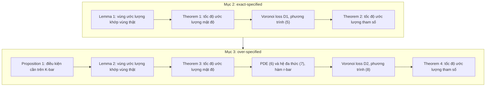

# Case study: Top-K Sparse Softmax Gating MoE (ICLR 2024)

!!! abstract "Mục tiêu của bài"
    Sau bài này, người học có thể:

    - Phân tích cách một paper lý thuyết thống kê biện minh cho chỗ đứng của nó tại một hội nghị deep learning: mở đầu từ thực hành của cộng đồng và khép lại bằng những hệ quả cho chính thực hành đó.
    - Nhận ra cấu trúc của một Introduction lý thuyết: problem setup, các giả định có tên, đoạn "vì sao khó", danh sách đóng góp kèm bảng tóm tắt kết quả và ý tưởng chứng minh.
    - Đánh giá cách phát biểu định lý, mệnh đề và bổ đề sao cho người không chuyên vẫn nắm được thông điệp, và nhận ra những chỗ ký hiệu dày đặc làm giảm khả năng tiếp cận.
    - Thiết kế một mô phỏng minh họa định lý đo đúng đại lượng gây bất ngờ nhất, kể cả mô phỏng cho một kết quả âm.
    - Kiểm tra xem các hệ quả thực tiễn mà paper rút ra có được phát biểu đúng tầm với các định lý hay không, và đề xuất cách viết lại khi cần.

Các case study trước trong nhóm Machine Learning đều có ít nhiều lý thuyết. [Adam](adam.md) có một phân tích hội tụ, [DDPM](ddpm.md) nối mô hình với score matching và Langevin dynamics. Nhưng ở cả hai, đóng góp chính vẫn là một thuật toán hay một mô hình được kiểm chứng bằng thực nghiệm. Bài này phân tích một kiểu paper khác hẳn: toàn bộ đóng góp là định lý, còn thực nghiệm chỉ gồm vài mô phỏng nằm trong phụ lục. Đây là kiểu paper mà nhiều người học nghĩ rằng chỉ hợp với tạp chí thống kê, trong khi trên thực tế nó vẫn có chỗ đứng ở NeurIPS, ICML và ICLR nếu được viết đúng cách.

**Statistical Perspective of Top-K Sparse Softmax Gating Mixture of Experts** có bốn tác giả theo thứ tự Huy Nguyen, Pedram Akbarian, Fanqi Yan và Nhat Ho, đều thuộc The University of Texas at Austin (lần lượt ở các khoa Statistics and Data Sciences, Electrical and Computer Engineering, Computer Science và Statistics and Data Sciences). Paper được nhận tại ICLR 2024 và được trình bày dưới dạng poster. Phân tích dưới đây dựa trên bản arXiv (mã 2309.13850); bản trong kỷ yếu có thể khác ở một số chi tiết. Bản toàn văn được dùng để phân tích kết thúc ở phần mở đầu của Appendix E, nên bài này không bàn tới các kết quả chi tiết trong phần còn lại của phụ lục đó.

Với người học Việt Nam, paper đáng chú ý vì hai lý do có thể kiểm chứng ngay từ văn bản. Thứ nhất, toàn bộ bằng chứng gồm các chứng minh và một mô phỏng nhỏ trên dữ liệu tổng hợp với đầu vào một chiều và cỡ mẫu tối đa $10^5$, được giải bằng thuật toán EM; không có thí nghiệm nào đòi hỏi cụm GPU. Đó là minh chứng rằng con đường lý thuyết vẫn dẫn tới một hội nghị hàng đầu của deep learning, miễn là câu hỏi được chọn gắn với thực hành của cộng đồng. Thứ hai, paper là một mắt xích trong một chuỗi nghiên cứu: danh mục tài liệu tham khảo cho thấy các công trình trước về MoE với gating không phụ thuộc đầu vào (JMLR 2022), softmax gating (NeurIPS 2023) và Gaussian gating (AISTATS 2024) có chung tác giả với paper này. Cách dựng một chuỗi paper, mỗi paper giải một biến thể khó hơn của cùng một câu hỏi, là chiến lược mà các nhóm nhỏ có thể học theo.

## Bối cảnh: MoE top-K và một câu hỏi lý thuyết còn bỏ ngỏ

Mixture of Experts (MoE) là một ý tưởng thống kê có từ đầu thập niên 1990 (paper trích Jacobs và cộng sự, 1991; Jordan và Jacobs, 1994): thay vì một mô hình duy nhất, dùng nhiều "expert", mỗi expert là một mô hình con, và một hàm gating quyết định trọng số của từng expert theo đầu vào. Trong bản cổ điển, hàm gating là softmax, nên mọi expert đều tham gia với trọng số dương. Biến thể được dùng trong các mô hình lớn hiện nay là **top-K sparse softmax gating**: với mỗi đầu vào, chỉ $K$ expert có điểm cao nhất được kích hoạt, các expert còn lại có trọng số bằng 0. Nhờ đó, số tham số của mô hình có thể tăng rất nhiều mà chi phí tính toán cho mỗi đầu vào gần như không đổi. Case study [EDWARD-NMT](edward-nmt.md) cho thấy cơ chế này được dùng thế nào trong một bài toán ứng dụng cụ thể là dịch máy, kèm những vấn đề rất thực tế khi triển khai.

Câu hỏi mà paper đặt ra thuộc về thống kê. Giả sử dữ liệu thực sự được sinh ra từ một MoE top-K với các tham số chưa biết. Khi ước lượng mô hình bằng phương pháp hợp lý cực đại (maximum likelihood estimation, MLE) từ $n$ mẫu, sai số giảm nhanh tới đâu khi $n$ tăng? Paper tách câu hỏi thành hai tầng. Tầng thứ nhất là **ước lượng mật độ** (density estimation): mô hình học được có tái tạo đúng phân phối có điều kiện của $Y$ theo $X$ hay không. Tầng thứ hai là **ước lượng tham số** (parameter estimation): từng tham số của gating và của từng expert có được khôi phục đúng hay không. Hai tầng này có thể cho kết quả rất khác nhau, và chính sự khác nhau đó là thông điệp chính của paper.

Để đọc được paper, người học cần thêm ba khái niệm. **Tốc độ tham số** (parametric rate) là tốc độ $n^{-1/2}$, tốc độ tốt nhất thường gặp: muốn sai số giảm một nửa, cần gấp bốn lần dữ liệu. Một tốc độ như $n^{-1/12}$ thì chậm hơn rất nhiều: muốn sai số giảm một nửa, cần gấp $2^{12} = 4096$ lần dữ liệu. **Exact-specified** là thiết lập khi số expert thật $k_*$ đã biết; **over-specified** là khi $k_*$ chưa biết và người dùng chọn một số expert $k > k_*$, tình huống rất gần với thực hành vì người làm deep learning hiếm khi biết "đúng" cần bao nhiêu expert. Cuối cùng, **Voronoi cell** là tập các expert ước lượng nằm gần một expert thật nhất; trong thiết lập over-specified, một expert thật có thể được xấp xỉ bởi nhiều expert ước lượng, và kích thước các cell này quyết định tốc độ hội tụ.

| Thuật ngữ trong paper | Cách hiểu nhanh |
|---|---|
| Mixing measure $G$ | Một cách viết gọn toàn bộ tham số: danh sách các expert, mỗi expert kèm trọng số và tham số gating |
| Exact-specified | Biết đúng số expert thật $k_*$ |
| Over-specified | Chọn dư expert, $k > k_*$ |
| Voronoi cell $\mathcal{C}_j$ | Nhóm các expert ước lượng "bám" vào expert thật thứ $j$ |
| Parametric rate, $\tilde{\mathcal{O}}(n^{-1/2})$ | Tốc độ tốt nhất thường gặp, có thể kèm thừa số logarit |
| Hellinger distance $h$ | Một khoảng cách giữa hai phân phối, dùng để đo sai số ước lượng mật độ |

Việc paper được nộp ở ICLR đặt ra một thử thách viết đặc biệt. Phần lớn người đọc ở ICLR huấn luyện mô hình chứ không chứng minh định lý. Paper phải cùng lúc thuyết phục họ rằng một kết quả về Gaussian MoE với expert tuyến tính có ý nghĩa với người huấn luyện mô hình hàng tỷ tham số, trình bày kết quả sao cho họ nắm được thông điệp mà không cần đọc chứng minh, và vẫn thỏa mãn reviewer lý thuyết bằng các chứng minh đầy đủ. Những kỳ vọng này đã được trình bày ở bài [Viết cho NeurIPS / ICML / ICLR](../06-cong-dong/ml.md); paper là một ví dụ để xem chúng được đáp ứng tới đâu.

## Câu chuyện một dòng

> Top-K sparse softmax gating được dùng rộng rãi để mở rộng các mô hình deep learning nhưng chưa có lý thuyết, vì hàm gating chia không gian đầu vào thành nhiều vùng có hành vi khác nhau; bằng cách chứng minh rằng các vùng của mô hình ước lượng khớp với các vùng của mô hình thật và xây dựng các hàm mất mát Voronoi mới, paper cho thấy khi biết số expert thì cả mật độ lẫn tham số đều hội tụ với tốc độ tham số, còn khi chọn dư expert thì mật độ vẫn hội tụ nhanh với điều kiện số expert được kích hoạt đạt tới một ngưỡng, nhưng nhiều tham số hội tụ chậm hẳn; từ đó paper rút ra các lời khuyên cho người dùng MoE.

Câu chuyện có năm nhịp rõ ràng, khớp với khung đã học ở bài [Xây "câu chuyện" của paper](../01-truoc-khi-viet/cau-chuyen.md). Nhịp đầu là **khoảng trống giữa thực hành và hiểu biết**: một công cụ phổ biến nhưng chưa được giải thích. Nhịp thứ hai là **lý do khó**: cấu trúc chia vùng của top-K, chứ không phải chỉ "chưa ai làm". Nhịp thứ ba là **công cụ mới**: các bổ đề về sự khớp vùng và các hàm mất mát Voronoi. Nhịp thứ tư là **một kết quả hai mặt**: tin tốt ở tầng mật độ, tin xấu ở tầng tham số. Nhịp cuối là **trở về thực hành** qua Mục 4 "Practical Implications".

Nhịp thứ tư đáng học nhất. Một paper lý thuyết chỉ nói "phương pháp X hội tụ" thường để lại ít ấn tượng, vì người dùng đã thấy X chạy tốt trên thực tế. Một paper nói "X hội tụ tốt ở tầng này nhưng chậm hẳn ở tầng kia, và đây là điều kiện để nó hội tụ" cho người đọc một điều mới mà thực nghiệm khó tự phát hiện. Kết quả hai mặt cũng làm cho paper đáng tin hơn: nó cho thấy phân tích không được thiết kế để chỉ xác nhận điều cộng đồng muốn nghe.

## Title và abstract

### Một title nêu lăng kính và đối tượng

Title gồm mười từ và làm đúng hai việc: nêu **lăng kính** (*Statistical Perspective*) và gọi tên **đối tượng** bằng đúng thuật ngữ mà cộng đồng deep learning dùng (*Top-K Sparse Softmax Gating Mixture of Experts*). Việc dùng nguyên cụm "top-K sparse softmax gating" thay vì một tên gọi thống kê là một lựa chọn tốt: người làm MoE lướt chương trình hội nghị sẽ nhận ra ngay đối tượng quen thuộc của họ, còn chữ "Statistical" báo trước rằng đây không phải một paper về kiến trúc hay hệ thống.

Title không nêu phát hiện. Như bài [Title](../02-viet-tung-phan/title.md) đã phân tích, title dạng khẳng định thường mạnh hơn, nhưng ở đây thông điệp có hai mặt (mật độ hội tụ nhanh, tham số có thể hội tụ chậm), nên một title khẳng định một chiều dễ gây hiểu lầm. Title mô tả là lựa chọn an toàn và hợp lý. Một chi tiết nhỏ về ngôn ngữ: trong tiếng Anh học thuật, cụm "a statistical perspective *on*" thường gặp hơn "perspective *of*"; đây là chuyện phong cách, nhưng title là dòng được đọc nhiều nhất của paper, nên đáng được rà soát kỹ nhất.

### Abstract: tám câu, có câu "vì sao khó"

Abstract gồm tám câu, có thể diễn giải như sau:

| Câu | Chức năng | Nội dung (diễn giải) |
|---|---|---|
| 1 | Bối cảnh | MoE top-K được dùng rộng rãi để mở rộng mô hình deep learning mà không tăng chi phí tính toán |
| 2 | Khoảng trống | Hiểu biết lý thuyết về hàm gating này vẫn là bài toán mở |
| 3 | Vì sao khó | Hàm gating chia không gian đầu vào thành nhiều vùng có hành vi khác nhau |
| 4 | Cách tiếp cận | Tập trung vào Gaussian MoE, xét tác động của gating lên ước lượng mật độ và tham số |
| 5 | Công cụ | Các hàm mất mát mới giữa các tham số, nắm bắt hành vi khác nhau của từng vùng |
| 6 | Kết quả 1 | Khi biết $k_*$: cả hai tốc độ đều là tốc độ tham số |
| 7 | Kết quả 2 | Khi over-specified: số expert được chọn phải vượt tổng cardinality của một số Voronoi cell |
| 8 | Kết quả 3 | Mật độ vẫn hội tụ với tốc độ tham số, nhưng tham số hội tụ chậm hẳn vì tương tác giữa gating và expert |

So với khuôn ở bài [Abstract](../02-viet-tung-phan/abstract.md), abstract này có một điểm mạnh hiếm thấy: **câu thứ ba giải thích vì sao bài toán khó**. Ở paper lý thuyết, câu này đặc biệt quan trọng. Nếu không có nó, reviewer dễ nghĩ rằng kết quả chỉ là một mở rộng thường lệ của các kết quả đã có cho softmax gating. Câu "vì sao khó" biến câu hỏi "đã có kết quả cho softmax, sao không áp dụng luôn?" thành một câu hỏi có câu trả lời. Ba câu kết quả cũng được viết ở mức trừu tượng vừa phải: dùng chữ "parametric" thay vì công thức, và nêu nguyên nhân của tốc độ chậm (tương tác giữa gating và expert) thay vì chỉ nêu hiện tượng.

Abstract có ba chỗ có thể dễ tiếp cận hơn, tất cả đều nằm ở câu thứ bảy, câu mang thông điệp thực tiễn quan trọng nhất. Thứ nhất, cụm "the total cardinality of a certain number of Voronoi cells associated with the true parameters" gần như không đọc được với người làm deep learning, vì Voronoi cell chưa được định nghĩa và "a certain number" không cho biết là bao nhiêu. Thứ hai, câu này nói số expert được chọn "must exceed" ngưỡng, và danh sách đóng góp cũng viết "greater than", trong khi Proposition 1 và đoạn văn dẫn tới nó ở Mục 3 phát biểu điều kiện cần dưới dạng $\bar K \ge$ ngưỡng, tức "ít nhất bằng" chứ không phải "lớn hơn hẳn". Với một paper lý thuyết, sự khác nhau giữa $>$ và $\ge$ là sự khác nhau về nội dung. Thứ ba, abstract không phân biệt số expert $K$ của mô hình thật với số expert $\bar K$ được kích hoạt trong mô hình ước lượng, một ký hiệu chỉ xuất hiện ở Mục 3; người đọc abstract dễ hiểu nhầm rằng điều kiện áp lên chính $K$.

Ngoài ra, chữ "substantially slow" ở câu cuối có thể được làm cụ thể bằng ví dụ mà chính paper đưa ra sau Theorem 4. Một phiên bản minh họa (không phải của nhóm tác giả) cho hai câu cuối có thể như sau:

*"When $k_*$ is unknown and the model is over-specified with $k > k_*$ experts, the density estimator converges only if the number of experts activated in the fitted model, $\bar K$, is at least the largest number of fitted experts that jointly approximate $K$ true experts. Under this condition the density rate remains parametric, whereas parameters approximated by several fitted experts are estimated much more slowly, e.g., at rate $\tilde{\mathcal{O}}(n^{-1/12})$ for some gating and expert parameters when three fitted experts approximate the same true expert."*

Phiên bản này dài hơn, nhưng nó bỏ được khái niệm Voronoi cell khỏi abstract mà vẫn giữ đúng nội dung, sửa $>$ thành $\ge$, và cho người đọc một con số để cảm nhận "chậm" là chậm tới đâu. Abstract cũng có thể thêm nửa câu về các hệ quả thực tiễn ở Mục 4, vì đó là phần trả lời trực tiếp câu hỏi "người huấn luyện MoE được gì từ paper này?".

## Introduction: từ thực hành tới một bài toán thống kê chính xác

Introduction gồm ba đoạn văn xuôi, tiếp theo là bảy khối có tiêu đề in đậm đặt đầu dòng (run-in heading): *Problem setup*, *Universal assumptions*, *Challenge discussion*, *Contributions*, *High-level proof ideas*, *Organization* và *Notations*, cùng Figure 1 và Table 1. Paper không có mục Background hay Related Work riêng; toàn bộ định vị và toàn bộ thiết lập bài toán đều nằm trong Introduction. Đây là cấu trúc phổ biến của paper lý thuyết thống kê, và nó có một lợi ích lớn: đến hết trang thứ hai, người đọc đã biết chính xác mô hình, giả định, khó khăn và kết quả.

### Đoạn 1: từ danh sách ứng dụng tới một câu hỏi thống kê

Đoạn mở đầu đi một quãng đường dài trong vài câu. Nó bắt đầu từ nguồn gốc thống kê của MoE, chuyển sang biến thể top-K sparse với các trích dẫn tới Shazeer và cộng sự (2017) và Fedus và cộng sự (2022), gọi tên lợi ích theo ngôn ngữ của deep learning (*conditional computation*, tăng dung lượng mô hình mà không tăng tương ứng chi phí tính toán), rồi liệt kê ứng dụng ở xử lý ngôn ngữ tự nhiên, nhận dạng tiếng nói, thị giác máy tính, học đa tác vụ và một số lĩnh vực khác. Câu khoảng trống được rào đón đúng mức ("to the best of our knowledge"), và câu cuối nêu chính xác lăng kính: phân tích hội tụ của MLE trong Gaussian MoE với top-K sparse softmax gating.

Danh sách ứng dụng trải rộng nhiều cộng đồng làm một việc quan trọng: nó nói với reviewer ICLR rằng đối tượng của paper là đối tượng của họ. Tuy vậy, cây cầu giữa thực hành và lý thuyết ở đoạn này mới chỉ được xây bằng trích dẫn. Paper chưa nói, ngay ở đoạn đầu, rằng người huấn luyện MoE có những câu hỏi nào mà lý thuyết có thể giúp trả lời. Những câu hỏi ấy có mặt trong paper, một phần ở *Challenge discussion* (số expert tối thiểu cần chọn để mật độ hội tụ) và đầy đủ hơn ở Mục 4, nhưng nếu được nêu sớm, chúng sẽ biến Mục 4 thành phần "trả nợ" cho một lời hứa ở trang đầu. Một câu như sau có thể đặt ngay trước câu nêu mục tiêu:

*"Practitioners face questions that theory can inform: does activating only $K$ experts per input slow down learning compared with dense gating, and how many experts must be activated when the total number of experts is chosen larger than necessary?"*

### Đoạn 2 và 3: định vị bằng một nấc thang, rồi báo trước khó khăn

Đoạn thứ hai là phần Related Work thu nhỏ, sẽ được phân tích kỹ ở mục định vị bên dưới. Đoạn thứ ba chỉ có hai câu nhưng làm một việc chuyển ý rất gọn: phân tích cho top-K "becomes substantially challenging" do cấu trúc phức tạp hơn của hàm gating, và để hiểu khó khăn đó, cần xem phát biểu hình thức của mô hình. Câu chuyển ý này cho thấy một nguyên tắc: trong paper lý thuyết, khó khăn kỹ thuật thường chỉ giải thích được sau khi mô hình đã được viết ra, nên thứ tự "báo trước khó khăn, viết mô hình, rồi giải thích khó khăn" là hợp lý.

### Problem setup ngay trong Introduction

Khối *Problem setup* viết ra mật độ có điều kiện của mô hình thật, phương trình (1), trong đó mỗi expert là một mật độ Gaussian với trung bình tuyến tính theo $X$, và trọng số của nó là softmax sau phép TopK. Hàm TopK được định nghĩa hình thức (giữ giá trị nếu nằm trong $K$ phần tử lớn nhất, gán $-\infty$ nếu không), rồi được **diễn đạt lại bằng lời** ngay sau đó: trước khi áp softmax, chỉ giữ $K$ giá trị lớn nhất và đặt các giá trị còn lại bằng $-\infty$ để trọng số của chúng triệt tiêu. Thói quen "công thức, rồi một câu bằng lời" là một trong những kỹ thuật hữu ích nhất cho khả năng tiếp cận, và paper áp dụng nó nhất quán ở nhiều chỗ.

Khối này cũng định nghĩa MLE, phương trình (2), và hai thiết lập: exact-specified (tối đa hóa trên tập các mixing measure có đúng $k_*$ thành phần) và over-specified (tối đa hóa trên tập có tối đa $k$ thành phần, $k > k_*$). Mỗi thiết lập được gọi tên bằng chữ in nghiêng và đi kèm một câu giải thích nghĩa thực tế ("when the true number of experts $k_*$ is known"). Nhờ vậy, hai thuật ngữ sẽ được dùng xuyên suốt paper được neo vào trực giác ngay từ lần đầu xuất hiện.

Có một câu trong khối này đáng được viết thận trọng hơn. Paper nói expert tuyến tính chỉ được chọn để trình bày cho đơn giản, và với kỹ thuật chứng minh tương tự, kết quả có thể mở rộng cho các hàm expert tổng quát, "including deep neural networks". Đây là một claim mạnh đối với người đọc ICLR, nhưng trong phần văn bản đã đọc, không có kết quả hình thức nào cho expert là mạng nơ-ron; Appendix E mở rộng theo một hướng khác, là thay họ phân phối Gaussian bằng các họ location-scale khác. Một reviewer lý thuyết có thể hỏi những điều kiện nào trên mạng nơ-ron là cần thiết. Một cách viết an toàn hơn là nêu điều kiện kỹ thuật mà chứng minh cần (chẳng hạn tính khả vi và tính độc lập tuyến tính của các đạo hàm), hoặc hạ claim xuống thành một hướng mở rộng tiềm năng.

### Bốn giả định, mỗi giả định một cái tên và một lý do

Khối *Universal assumptions* là một mẫu mực về cách trình bày giả định. Bốn giả định được đánh số từ (U.1) tới (U.4), mỗi giả định có một **tên in đậm nói lên mục đích** (*Convergence of MLE*, *Identifiability*, *Distinct Experts*, *Input-dependent Gating Functions*) và một câu giải thích điều gì xảy ra nếu bỏ nó. Giả định (U.2), chuẩn hóa tham số gating của expert cuối cùng về 0, đi kèm hệ quả: không có nó thì hai mixing measure khác nhau có thể cho cùng một mật độ, dẫn tới các hàm mất mát phức tạp không cần thiết; tính khả xác định (identifiability) dưới giả định này được chứng minh ở Appendix C. Giả định (U.4) yêu cầu ít nhất một tham số gating khác 0, và câu giải thích chỉ ra rằng nếu không, mô hình suy biến về trường hợp gating không phụ thuộc đầu vào, vốn đã được nghiên cứu trước đó.

Cách trình bày này đáp ứng đúng điều mà bài [Viết cho NeurIPS / ICML / ICLR](../06-cong-dong/ml.md) khuyên: giả định được phát biểu tường minh, đánh số, tách khỏi định lý và kèm một câu về vai trò của nó. Cái tên của mỗi giả định còn có một lợi ích phụ: khi đọc chứng minh trong phụ lục, người đọc biết ngay một bước đang dùng giả định nào.

Điều mà khối này chưa làm là bàn về **khoảng cách giữa các giả định và thực hành**. Giả định lớn nhất của paper, rằng dữ liệu thực sự được sinh ra từ một Gaussian MoE top-K, không nằm trong danh sách U.1–U.4 mà ngầm định trong toàn bộ problem setup; nó chỉ được thừa nhận rõ ràng ở Mục 5, khi paper bàn về thiết lập misspecified. Tương tự, việc paper phân tích MLE chứ không phải quá trình huấn luyện bằng gradient của MoE trong thực tế chỉ được nhắc tới ở phần hướng phát triển (nơi paper nói EM được dùng để xấp xỉ MLE). Một câu đặt ngay sau bốn giả định sẽ cho reviewer thấy nhóm tác giả ý thức được phạm vi của kết quả từ sớm:

*"Our analysis assumes that the data are generated from a top-K sparse softmax gating Gaussian MoE and studies the MLE itself; the misspecified setting and the algorithm used to compute the MLE are discussed in Section 5."*

### Challenge discussion và Figure 1: cho thấy vì sao khó

Khối *Challenge discussion* nêu hai khó khăn được đánh số (1) và (2). Khó khăn thứ nhất: hàm gating chia không gian đầu vào thành nhiều vùng, và có thể xảy ra sự **lệch vùng** giữa mô hình ước lượng và mô hình thật, tức là với cùng một đầu vào, hai mô hình chọn hai bộ top-$K$ expert khác nhau. Khó khăn thứ hai: trong thiết lập over-specified, một expert thật có thể được xấp xỉ bởi ít nhất hai expert ước lượng, nên chỉ chọn $K$ expert tốt nhất trong mô hình ước lượng là không đủ; câu kết của khối nêu thẳng câu hỏi thực tiễn: cần chọn tối thiểu bao nhiêu expert để mật độ hội tụ.

Figure 1 minh họa khó khăn thứ nhất. Theo caption, hình đặt cạnh nhau hai cách chia không gian đầu vào, của mô hình ước lượng (trái) và của mô hình thật (phải), trong trường hợp $k_* = 3$ và $K = 1$; mỗi vùng được gán nhãn theo expert đứng đầu. Caption giải thích đủ để đọc độc lập: các vùng tương ứng phải khớp nhau thì mật độ ước lượng mới hội tụ về mật độ thật, và câu cuối caption trỏ thẳng tới kết quả trả lời khó khăn này ("Lemma 1 reads that this property holds when the sample size $n$ is sufficiently large"). Một caption vừa nêu hiện tượng, vừa nêu điều kiện cần, vừa trỏ tới bổ đề giải quyết nó là cách dùng hình rất hiệu quả trong paper lý thuyết, nơi hình thường bị coi là thứ yếu. Bài [Figures & Tables](../02-viet-tung-phan/figures-tables.md) nhấn mạnh rằng caption nên tự đứng được; Figure 1 của paper này còn làm thêm một việc là nối hình với cấu trúc lập luận.

### Contributions và Table 1: "Figure 1" của một paper lý thuyết

Khối *Contributions* chia đóng góp theo hai thiết lập, mỗi thiết lập một đoạn đánh số. Mỗi đoạn có cùng một khuôn: tốc độ ước lượng mật độ, hàm mất mát mới được thiết kế (Voronoi metric $\mathcal{D}_1$ ở phương trình (5), $\mathcal{D}_2$ ở phương trình (8)), cận dưới nối mật độ với hàm mất mát, và hệ quả cho tốc độ ước lượng từng tham số. Mỗi claim đều có địa chỉ: một phương trình hoặc một định lý. Đây là sự ánh xạ một–một giữa claim và bằng chứng mà bài [Introduction & Figure 1](../02-viet-tung-phan/introduction.md) khuyến nghị.

Table 1 tóm tắt toàn bộ kết quả trong hai dòng. Dòng exact-specified ghi tốc độ $n^{-1/2}$ cho mật độ và cho mọi nhóm tham số. Dòng over-specified ghi $n^{-1/2}$ cho mật độ và cho trọng số $\exp(\beta_{0j}^*)$, nhưng $n^{-1/2\bar r(|\mathcal{C}_j|)}$ cho $\beta_{1j}^*, b_j^*$ và $n^{-1/\bar r(|\mathcal{C}_j|)}$ cho $a_j^*, \sigma_j^*$. Caption giải thích hàm $\bar r(\cdot)$ và đưa ngay hai giá trị cụ thể: $\bar r = 4$ khi cell có hai phần tử, $\bar r = 6$ khi có ba.

Với một paper lý thuyết, bảng tóm tắt kết quả đóng vai trò của Figure 1 trong một paper thực nghiệm: đó là thứ một reviewer lướt sẽ nhìn để quyết định paper nói gì. Bảng này làm tốt việc đó vì nó **so sánh hai thiết lập trên cùng các cột**, nên người đọc thấy ngay chỗ khác nhau (hai cột cuối của dòng thứ hai). Hai giá trị cụ thể của $\bar r$ trong caption cũng quan trọng: không có chúng, người đọc chỉ thấy một hàm trừu tượng; có chúng, người đọc tính được ngay rằng hai expert ước lượng bám vào một expert thật cho tốc độ $n^{-1/8}$ với $\beta_1$ và $b$.

### High-level proof ideas, Organization và Notations

Khối *High-level proof ideas* tóm tắt chiến lược chứng minh trong bốn câu: chứng minh các vùng đầu vào của mô hình thật và mô hình ước lượng khớp nhau (Lemma 1, Lemma 2); dùng các kết quả cơ bản về ước lượng mật độ cho M-estimator của van de Geer (2000) để có tốc độ mật độ (Theorem 1, Theorem 3); rồi phân tách hiệu hai mật độ thành tổ hợp của các số hạng độc lập tuyến tính, để khi mật độ hội tụ thì các hệ số cũng hội tụ, cho ra tốc độ tham số (Theorem 2, Theorem 4). Khối này làm rõ một điều mà reviewer lý thuyết luôn muốn biết: **phần nào là công cụ đã có** (kết quả của van de Geer) và **phần nào là mới** (sự khớp vùng, các hàm mất mát Voronoi cho top-K).

Hai khối cuối ngắn. *Organization* cho biết mỗi mục làm gì và báo trước rằng chứng minh, thí nghiệm số và kết quả bổ sung nằm trong phụ lục. *Notations* gom các quy ước dùng chung: ký hiệu $[n]$, đa chỉ số, khoảng cách Total Variation và Hellinger, các ký hiệu $\mathcal{O}$, $\lesssim$, $\tilde{\mathcal{O}}$. Đặt một khối ký hiệu ở cuối Introduction là thói quen tốt; vấn đề, như sẽ thấy ở mục sau, là số ký hiệu riêng của paper lớn hơn nhiều so với những gì khối này bao quát.

## Định vị: một nấc thang trong chuỗi nghiên cứu về gating

Paper không có mục Related Work riêng. Toàn bộ định vị lý thuyết nằm trong đoạn thứ hai của Introduction, và đoạn này được tổ chức theo một trục duy nhất: **loại hàm gating**. Mỗi công trình trước được giới thiệu bằng loại gating nó nghiên cứu, hiện tượng nó phát hiện và công cụ nó dùng:

| Loại gating | Công trình được trích | Điều paper ghi nhận |
|---|---|---|
| Không phụ thuộc đầu vào | Ho và cộng sự (2022) | Dùng hàm mất mát Wasserstein tổng quát; tương tác giữa các tham số expert làm tốc độ chậm dần khi số expert dư tăng |
| Softmax | Nguyen và cộng sự (2023) | Gating phụ thuộc đầu vào sinh thêm tương tác giữa tham số gating và tham số expert; dùng Voronoi loss; tốc độ phụ thuộc vào tính giải được của hệ phương trình đa thức |
| Gaussian | Nguyen và cộng sự (2024) | Tương tự, với Voronoi loss riêng |
| Top-K sparse softmax | Paper này | Thêm cấu trúc chia vùng đầu vào; cần chứng minh sự khớp vùng và thêm phép lấy max theo vùng vào Voronoi loss |

Cách định vị theo nấc thang này có ba ưu điểm. Thứ nhất, nó làm tính mới hiển nhiên: người đọc thấy ngay paper đứng ở nấc nào và nấc đó khác nấc trước ở đâu. Thứ hai, nó cho phép paper **mượn có ghi nhận** các kết quả trung gian: các giá trị $\bar r(2) = 4$, $\bar r(3) = 6$ và giả thuyết $\bar r(m) = 2m$ được nói rõ là của Nguyen và cộng sự (2023), còn Voronoi cell được trích từ Manole và Ho (2022). Thứ ba, nấc thang tạo ra một **điểm so sánh** cho hệ quả thực tiễn đầu tiên ở Mục 4: vì đã có kết quả cho softmax gating dày đặc, paper có thể nói gating thưa không làm chậm tốc độ ước lượng so với gating dày đặc. Các công trình trước có chung tác giả với paper này đều được trích ở ngôi thứ ba như mọi công trình khác, đúng với quy tắc ẩn danh ở bài [Chuẩn bị nộp bài](../04-nop-va-sau-nop/submission.md).

Điểm có thể bổ sung nằm ở phía deep learning của bức tranh. Các công trình MoE thực nghiệm chỉ xuất hiện như một danh sách trích dẫn ở đoạn đầu, và Introduction không nhắc tới các hướng phân tích lý thuyết MoE khác ngoài chuỗi nghiên cứu về ước lượng tham số, chẳng hạn các phân tích về động học huấn luyện hay về router trong mạng sâu. Reviewer ICLR làm lý thuyết deep learning có thể muốn biết quan hệ giữa góc nhìn thống kê của paper và các góc nhìn đó. Một đoạn ngắn, dù chỉ ba bốn câu, phân biệt "paper này hỏi gì" với "các hướng khác hỏi gì" sẽ giúp paper được đánh giá đúng phạm vi, như bài [Related Work](../02-viet-tung-phan/related-work.md) đã phân tích về việc định vị theo trục câu hỏi.

## Phần lý thuyết: cách phát biểu và diễn giải kết quả

Với paper này, phần lý thuyết đóng vai trò của mục Method trong một paper thực nghiệm: đó là nơi đóng góp được trình bày. Mục này không đi qua từng chứng minh mà rút ra những kỹ thuật viết giúp người không chuyên vẫn theo được mạch.

### Hai mục song song, một khuôn lặp lại

Mục 2 (exact-specified) và Mục 3 (over-specified) có cấu trúc song song. Mỗi mục bắt đầu bằng việc chia không gian đầu vào thành các vùng theo bộ top-$K$ expert, chứng minh một bổ đề về sự khớp vùng, rút ra tốc độ ước lượng mật độ, định nghĩa một Voronoi loss, rồi chứng minh tốc độ ước lượng tham số qua một cận dưới Hellinger. Mục 3 chèn thêm hai bước mà Mục 2 không cần: một mệnh đề về điều kiện cần trên $\bar K$, và một phân tích về tương tác giữa các tham số dẫn tới hệ phương trình đa thức.

Cấu trúc song song giúp người đọc học khuôn một lần ở Mục 2, nơi mọi thứ đơn giản hơn, rồi ở Mục 3 chỉ cần chú ý vào những bước mới. Paper khai thác điều này bằng các câu chuyển ý như "Inspired by the result of Lemma 1, we continue to present in Lemma 2…" hay câu mở đầu Mục 3 nói rõ đây là cùng phân tích như Mục 2 nhưng cho thiết lập over-specified. Với một paper có hai thiết lập hoặc hai chế độ, cách tổ chức "trường hợp dễ trước, trường hợp khó sau, cùng một khuôn" là lựa chọn rất đáng học.

### Khuôn bốn nhịp cho mỗi kết quả

Mỗi kết quả chính được trình bày theo bốn nhịp. Nhịp đầu là phát biểu hình thức, in nghiêng, với tên gọi trong ngoặc (*Density estimation rate*, *Parameter estimation rate*). Nhịp thứ hai là một câu con trỏ đặt ngay sau phát biểu: "Proof of Theorem 1 can be found in Appendix A.1." Nhịp thứ ba là một đoạn diễn giải bằng lời: định lý vừa nói gì, dưới dạng tốc độ $\tilde{\mathcal{O}}(n^{-1/2})$ dễ nhớ thay vì dạng xác suất trong phát biểu. Nhịp cuối nối kết quả với bước tiếp theo, chẳng hạn sau Theorem 1, paper nói tốc độ này "plays a critical role" trong việc thiết lập tốc độ tham số, và báo trước cận dưới cần chứng minh.

Phát biểu hình thức của các định lý có dạng "xác suất để sai số vượt $C\sqrt{\log(n)/n}$ không quá một bội của $n^{-c}$". Với người không chuyên, dạng này khó đọc; nhịp diễn giải giải quyết điều đó bằng cách dịch ngay sang $\tilde{\mathcal{O}}(n^{-1/2})$. Các phát biểu cũng nói rõ hằng số phụ thuộc vào gì (vào $\Omega$ và $K$; với Theorem 2 và Theorem 4 còn vào $G_*$), một chi tiết mà reviewer lý thuyết thường kiểm tra. Bài [Method](../02-viet-tung-phan/method.md) mô tả khuôn "định lý tự đứng được, rồi một đoạn trực giác"; paper này là một ví dụ áp dụng đều đặn khuôn đó.

Nhịp diễn giải đạt mức tốt nhất ở các nhận xét sau Theorem 4. Nhận xét (i) nói các tham số chỉ được xấp xỉ bởi một expert ước lượng vẫn giữ tốc độ $\tilde{\mathcal{O}}(n^{-1/2})$. Nhận xét (ii) nói các tham số được xấp xỉ bởi nhiều expert có tốc độ chậm dần khi cell lớn lên, và đưa một ví dụ bằng số: khi một expert thật có ba expert ước lượng bám vào, $\bar r = 6$, nên $\beta_{1j}^*, b_j^*$ có tốc độ $\tilde{\mathcal{O}}(n^{-1/12})$ và $a_j^*, \sigma_j^*$ có tốc độ $\tilde{\mathcal{O}}(n^{-1/6})$. Một ví dụ bằng số như vậy biến một công thức có lũy thừa lồng nhau thành một điều người đọc cảm nhận được.

Điểm có thể làm tốt hơn là phác thảo chứng minh. Ngoài khối *High-level proof ideas* trong Introduction, phần chính không có phác thảo nào đặt cạnh từng định lý. Trong khi đó, phụ lục tổ chức chứng minh cận dưới của Theorem 2 thành ba bước có tên rõ ràng (*Taylor expansion*, *Non-vanishing coefficients*, *Fatou's contradiction*) và dùng lại khung ba bước này cho Theorem 4. Ba câu trong phần chính, mỗi câu gọi tên một bước và nói nó làm gì, sẽ cho người đọc phần chính một bản đồ của phần khó nhất trong paper với chi phí chưa tới một đoạn văn. Proposition 1, kết quả mà câu thông điệp thực tiễn của abstract dựa vào, cũng chỉ có trực giác một nửa: khối *Challenge discussion* và đoạn mở đầu Mục 3 giải thích vì sao chọn đúng $K$ expert là không đủ (một expert thật có thể được nhiều expert ước lượng bám vào), nhưng không giải thích vì sao ngưỡng lại chính là tổng kích thước các cell. Một câu như "if fewer experts are activated than the fitted experts that approximate the active true experts, some true expert necessarily loses part of its weight in some input region" sẽ giúp người đọc tin vào kết quả trước khi mở phụ lục.

### Proposition 1: một kết quả âm thành thông điệp thực tiễn

Proposition 1 phát biểu rằng nếu $\bar K$ nhỏ hơn giá trị lớn nhất, lấy trên mọi bộ $K$ expert thật, của tổng kích thước các Voronoi cell tương ứng, thì khoảng cách Hellinger kỳ vọng giữa mọi mô hình ước lượng và mô hình thật bị chặn dưới bởi một số dương. Nói cách khác, dù có bao nhiêu dữ liệu, mật độ ước lượng cũng không hội tụ. Đây là một **kết quả âm**, và với người dùng, nó có lẽ là kết quả hữu ích nhất của paper: nó nói khi nào một cấu hình chắc chắn không hoạt động.

Paper xử lý kết quả này khá tốt về mặt cấu trúc: đoạn văn trước mệnh đề gọi nó là "an interesting phenomenon" và phát biểu điều kiện bằng lời, đoạn sau mệnh đề nói rõ phần còn lại của Mục 3 chỉ xét chế độ thỏa điều kiện. Tuy vậy, có hai chỗ người đọc có thể vấp. Thứ nhất, ngưỡng được viết qua các Voronoi cell, mà theo phương trình (4), cell phụ thuộc vào mixing measure $G$ được xét; trong khi đó mệnh đề lấy infimum trên toàn bộ $G$. Người đọc khó xác định các cell trong điều kiện thuộc về mixing measure nào; chứng minh ở Appendix B.3 làm việc với các cell của một dãy mixing measure tiến dần về $G_*$, nhưng phát biểu trong phần chính không nói điều đó. Thứ hai, người dùng không biết trước cấu trúc cell, nên ngưỡng chưa phải một con số tính được.

Chỗ thứ hai có thể được giải quyết bằng chính lập luận đếm mà Mục 4 dùng: khi $n$ đủ lớn, mỗi expert thật được ít nhất một expert ước lượng bám vào, nên tổng kích thước của bất kỳ $K$ cell nào không vượt quá $k - (k_* - K)$. Từ đó, chọn $\bar K = K + k - k_*$ luôn đủ để thỏa điều kiện của Proposition 1. Kiểm tra nhanh với mô phỏng của paper ($k_* = 2$, $k = 3$, $K = 1$): công thức cho $\bar K = 2$, đúng giá trị mà Appendix D.3 chọn. Một câu như vậy (không có trong paper) biến một điều kiện trừu tượng thành một quy tắc người dùng áp dụng được ngay, đúng loại "dịch kết quả sang ngôn ngữ người dùng" mà một paper lý thuyết ở hội nghị deep learning nên làm.

### Voronoi loss và PDE: gọi tên tương tác bằng một phương trình

Hai Voronoi loss là công cụ trung tâm của paper, và cách paper giới thiệu chúng đáng học. Trước khi viết $\mathcal{D}_1$, paper nói rõ vì sao cần nó: nếu chứng minh được cận dưới "khoảng cách Hellinger kỳ vọng $\gtrsim \mathcal{D}_1$", thì tốc độ mật độ ở Theorem 1 sẽ chuyển thành tốc độ tham số. Sau khi viết, paper giải thích thành phần lạ nhất của công thức: phép lấy max trên các bộ $K$ expert "helps capture the behaviors of all input regions separated by the top-K sparse softmax gating function". Thứ tự "cần gì, định nghĩa, rồi giải thích thành phần không hiển nhiên" chính là khuôn Why–What–How ở bài [Method](../02-viet-tung-phan/method.md), áp dụng cho một hàm mất mát lý thuyết.

Với $\mathcal{D}_2$, paper đi xa hơn một bước. Thay vì chỉ nói có "an intrinsic interaction" giữa gating và expert, paper viết tương tác đó thành hai phương trình đạo hàm riêng (6): một phương trình nối đạo hàm hỗn hợp theo tham số gating $\beta_1$ và bias $b$ với đạo hàm theo hệ số $a$ của expert, một phương trình nối đạo hàm theo phương sai $\sigma$ với đạo hàm bậc hai theo $b$. Paper giải thích hệ quả: các số hạng đạo hàm có dạng này phụ thuộc tuyến tính, nên phải gộp hệ số của chúng, và việc gộp này dẫn tới hệ phương trình đa thức (7) mà tính giải được của nó quyết định $\bar r$. Gọi tên một hiện tượng trừu tượng bằng một đẳng thức chính xác là cách làm cho chữ "interaction" có nội dung kiểm tra được.

Điều còn thiếu là một câu trực giác cho người không chuyên. Người làm deep learning đọc (6) khó tự suy ra vì sao phụ thuộc tuyến tính lại làm chậm tốc độ. Một cách hiểu (không phải của paper) có thể được viết như sau:

*"Intuitively, (6) says that a small change in the expert slope $a$ affects the density in the same way as a joint second-order change in the gating parameter $\beta_1$ and the expert bias $b$, and a change in the variance $\sigma$ acts like a second-order change in $b$. When several fitted experts approximate one true expert, such changes can compensate each other, so the data pin down each parameter only at a slower rate."*

Câu này không thay thế được chứng minh, nhưng nó cho người đọc phần chính một hình ảnh để giữ trong đầu khi nhìn vào cột cuối của Table 1.

### Ký hiệu dày đặc: cái giá và cách giảm

Paper dùng một hệ ký hiệu rất dày. Chỉ riêng các số nguyên đã có $k_*$ (số expert thật), $k$ (số expert tối đa của mô hình ước lượng), $k'$ (số thành phần của một mixing measure cụ thể), $K$ (số expert được chọn trong mô hình thật), $\bar K$ (số expert được chọn trong mô hình ước lượng), $q$ và $\bar q$ (số cách chọn bộ top-$K$ và top-$\bar K$). Bên cạnh đó là các vùng $\mathcal{X}^*_\ell$, $\mathcal{X}_\ell$, $\bar{\mathcal{X}}_{\bar\ell}$, các cell $\mathcal{C}_j$, hai loss $\mathcal{D}_1$, $\mathcal{D}_2$, hàm $\bar r$, tập chỉ số $\mathcal{J}_{\eta_1,\eta_2}$ và năm nhóm biến $z$ của hệ đa thức. Cụm danh từ dài "top-K sparse softmax gating Gaussian MoE" cũng lặp lại hơn chục lần trong phần chính.

Paper có những thói quen tốt giúp giảm gánh nặng: mọi ký hiệu mới đều được định nghĩa ngay khi xuất hiện (các hiệu $\Delta\beta_{1i\ell_j}$, $\Delta a_{i\ell_j}$… được định nghĩa ngay sau phương trình (5)), các công thức quan trọng đều đi kèm một câu bằng lời, và khối *Notations* gom các quy ước chung. Tuy vậy, năm chữ $k_*$, $k$, $k'$, $K$, $\bar K$ chỉ khác nhau ở chữ hoa, dấu sao và dấu gạch ngang là một nguồn nhầm lẫn thực sự, nhất là khi "top-K" trong title lại là tên của cơ chế chứ không phải một con số cụ thể. Một số quy ước của thống kê cũng xa lạ với người đọc ICLR: $\sigma$ ở đây là **phương sai** chứ không phải độ lệch chuẩn (paper ghi rõ "with mean $\mu$ and variance $\sigma$", nhưng chỉ một lần), và mixing measure được giải thích là "a linear combination of $k_*$ Dirac measures", một câu chính xác nhưng không giúp người làm deep learning hình dung. Một câu như "$G_*$ simply collects the weights and parameters of all experts in a single object" sẽ hữu ích hơn ở lần đầu.

Cách giảm chi phí ký hiệu đã được trình bày ở bài [Method](../02-viet-tung-phan/method.md): với hơn mười lăm ký hiệu, một bảng ký hiệu ở đầu phụ lục là gần như bắt buộc; với các đại lượng dễ nhầm, nên chọn chữ khác hẳn nhau hoặc nhắc lại nghĩa khi dùng lại sau một quãng dài; với các cụm danh từ dài lặp lại, một tên gọi tắt được định nghĩa một lần sẽ làm văn bản nhẹ hơn nhiều. Dùng macro LaTeX cho mọi ký hiệu (xem [LaTeX & Overleaf](../03-ky-thuat/latex.md)) còn giúp tránh hiện tượng ký hiệu trôi dạt giữa phần chính và phụ lục, một rủi ro rất thật ở paper có hàng chục trang chứng minh.

## Bằng chứng: chứng minh trong phụ lục và mô phỏng minh họa

### Phụ lục chứng minh như một hệ thống

Phụ lục mở bằng một đoạn liệt kê: Appendix A chứng minh các kết quả exact-specified, Appendix B các kết quả over-specified, Appendix C tính khả xác định, Appendix D các thí nghiệm số, Appendix E các kết quả cho họ phân phối khác. Mỗi tiểu mục lại mở bằng một câu nói nó chứng minh gì. Các bổ đề mượn từ tài liệu được ghi rõ nguồn ngay trong tên, chẳng hạn Lemma 4 được đánh dấu là Theorem 7.4 của van de Geer (2000), nên reviewer biết ngay bước nào là chuẩn và bước nào cần kiểm tra kỹ. Khung ba bước của chứng minh cận dưới được gọi tên trong Appendix A và được tái sử dụng tường minh trong Appendix B ("we reuse the three-step framework in Appendix A"). Đây là cách viết phụ lục cho người tra cứu mà bài [Viết cho NeurIPS / ICML / ICLR](../06-cong-dong/ml.md) mô tả.

Appendix E còn có một chi tiết định vị tinh tế. Nó định nghĩa khái niệm *strong identifiability* và nêu rằng họ phân phối Student's t và Laplace thỏa mãn khái niệm này còn họ Gaussian location-scale thì không. Điều đó giúp người đọc hiểu vì sao phần chính chọn Gaussian: đó là trường hợp có thêm tương tác giữa các tham số của chính mật độ Gaussian, tức là phương trình thứ hai trong (6), và cũng là trường hợp quen thuộc nhất.

Với paper có hàng chục trang chứng minh, việc giữ tham chiếu chéo nhất quán là một thách thức riêng. Trong bản arXiv đã đọc, đoạn mở đầu Appendix B nói nó chứng minh "Theorem B.1 and Theorem 4", trong khi tiểu mục B.1 có tiêu đề là chứng minh của Theorem 3. Một lỗi nhỏ như vậy không ảnh hưởng tới nội dung, nhưng nó nhắc người viết rằng mọi tham chiếu nên được tạo bằng `\ref` hoặc `\cref` chứ không gõ tay, và rằng phần chứng minh cần được đọc soát với cùng sự cẩn thận như phần chính. Bài học từ case study [Adam](adam.md) về một chứng minh có lỗi tồn tại nhiều năm cho thấy reviewer và cộng đồng ML đọc phụ lục nghiêm túc hơn người viết thường nghĩ.

### Mô phỏng: đúng tinh thần toy experiment

Appendix D chứa toàn bộ phần thực nghiệm. Thiết lập được mô tả đủ để tái hiện: mô hình thật có $k_* = 2$ expert với các tham số được ghi cụ thể, $X$ lấy mẫu từ phân phối đều trên $[0, 1]$, và mọi thí nghiệm dùng $K = 1$ (Figure 2 minh họa quan hệ giữa $X$ và $Y$ cho cả $K = 1$ và $K = 2$). MLE được tính bằng một biến thể EM dùng coordinate gradient descent ở bước M, vì tham số gating không có công thức cập nhật dạng đóng, với ngưỡng hội tụ $10^{-6}$ và tối đa 2000 vòng lặp. Thiết lập exact-specified dùng 40 lần sinh mẫu cho mỗi cấu hình, trên 200 cỡ mẫu từ $10^2$ tới $10^5$; thiết lập over-specified dùng 40 lần sinh mẫu trên 100 cỡ mẫu trong cùng khoảng, với $\bar K = 2$. Figure 3 vẽ trên thang log-log, có error bar bằng hai độ lệch chuẩn thực nghiệm và một đường hồi quy bình phương tối thiểu.

Thiết kế này đáp ứng gần như mọi tiêu chí của một toy experiment tốt ở bài [Viết cho NeurIPS / ICML / ICLR](../06-cong-dong/ml.md). Ground truth được biết, nên có thể đo trực tiếp Voronoi loss giữa MLE và mô hình thật. Biến điều khiển là cỡ mẫu $n$, và thang log-log biến tốc độ hội tụ thành độ dốc của một đường thẳng, nên người đọc kiểm tra định lý bằng mắt. Error bar được nói rõ ý nghĩa. Lựa chọn khởi tạo cũng đáng chú ý: các expert được phân ngẫu nhiên vào các Voronoi cell, rồi tham số được khởi tạo gần giá trị thật với phương sai nhỏ. Lựa chọn này cô lập câu hỏi thống kê (MLE hội tụ nhanh tới đâu) khỏi câu hỏi tối ưu (EM có tìm được MLE từ một khởi tạo bất kỳ không), và paper thừa nhận rằng sự hội tụ toàn cục của EM cho MoE top-K vẫn chưa được hiểu rõ. Paper cũng trung thực khi lưu ý rằng cỡ mẫu phải đủ lớn thì tốc độ thực nghiệm mới khớp với tốc độ lý thuyết của Theorem 4.

### Mô phỏng có thể đo đúng điều gây bất ngờ nhất

Có bốn chỗ mà phần mô phỏng có thể phục vụ thông điệp của paper tốt hơn.

Thứ nhất, **mô phỏng chỉ nằm trong phụ lục**, và phần chính chỉ nhắc tới nó ở khối *Organization*. Với người đọc ICLR, một hình nhỏ hoặc một câu sau Theorem 2 kiểu "Appendix D confirms the $n^{-1/2}$ rate empirically (Figure 3)" sẽ neo lý thuyết vào một bằng chứng trực quan ngay trong phần họ chắc chắn đọc.

Thứ hai, **mô phỏng đo Voronoi loss, mà theo Theorem 2 và Theorem 4, đại lượng này có tốc độ $n^{-1/2}$ ở cả hai thiết lập.** Vì vậy, hai hình con của Figure 3 về bản chất kiểm tra cùng một tốc độ. Điều gây bất ngờ nhất của paper, rằng trong thiết lập over-specified nhiều tham số hội tụ chậm hẳn, không được vẽ trực tiếp. Với cấu hình của paper ($k = 3$, $k_* = 2$), một expert thật có hai expert ước lượng bám vào, $\bar r(2) = 4$, nên Table 1 dự đoán sai số của $\beta_1$ và $b$ ở expert đó giảm theo $n^{-1/8}$, còn của $a$ và $\sigma$ theo $n^{-1/4}$. Vẽ sai số của từng tham số này trên cùng thang log-log, cạnh sai số của expert chỉ có một thành phần bám vào, sẽ cho người đọc **thấy** sự chênh lệch tốc độ thay vì chỉ đọc về nó.

Thứ ba, **kết quả âm không được minh họa.** Proposition 1 là nguồn của thông điệp thực tiễn "số expert được kích hoạt phải đạt tới một ngưỡng". Một mô phỏng với $\bar K = 1$ trong cùng thiết lập over-specified, cho thấy khoảng cách mật độ không giảm khi $n$ tăng, là bằng chứng rẻ nhất và thuyết phục nhất cho thông điệp đó. Bài [Thiết kế thí nghiệm](../01-truoc-khi-viet/thi-nghiem.md) nhấn mạnh rằng một thí nghiệm cho thấy điều gì *thất bại* khi điều kiện bị vi phạm thường có sức nặng hơn một thí nghiệm nữa cho thấy điều gì thành công.

Thứ tư, **cách diễn đạt kết quả.** Văn bản của D.2 nói Figure 3a cho thấy tốc độ "perfectly matches" tốc độ lý thuyết, trong khi văn bản của D.3 không trỏ tới hình tương ứng và không nêu rõ điều quan sát được, và caption của Figure 3 chỉ mô tả error bar cho thiết lập exact-specified. Một câu báo cáo độ dốc của đường hồi quy cho từng hình (nếu hình có ghi độ dốc, chỉ cần đưa con số ấy vào văn bản) chính xác hơn "perfectly matches" và cho người đọc một con số để so sánh với $-0{,}5$.

## Mục 4: hệ quả thực tiễn, cây cầu trở lại với deep learning

Mục 4 "Practical Implications" là phần biến một paper thống kê thành một paper cho ICLR. Mục này nêu ba hệ quả, mỗi hệ quả có một tiêu đề in đậm và một đoạn lập luận nối về một kết quả cụ thể của paper.

Hệ quả thứ nhất, *No trade-off between model capacity and model performance*, dùng một kỹ thuật tu từ hiệu quả: **nêu kỳ vọng ngây thơ rồi lật nó**. Paper viết rằng vì gating thưa không liên tục và chỉ kích hoạt một phần expert, người ta sẽ kỳ vọng tốc độ ước lượng tham số chậm hơn so với softmax gating dày đặc; nhưng theo lý thuyết, tốc độ dưới hai mô hình là như nhau ở cả hai thiết lập. Kết luận được viết cẩn thận ở câu cuối đoạn: gating top-K cho phép tăng dung lượng mô hình mà không hy sinh chi phí tính toán cũng như tốc độ hội tụ của ước lượng tham số và mật độ.

Hệ quả thứ hai, *Favourable gating function*, lập luận rằng với top-1 gating, giá trị gating chỉ là 0 hoặc 1, nên tương tác qua phương trình đạo hàm riêng thứ nhất trong (6) không còn xảy ra, giúp cải thiện tốc độ ước lượng tham số. Paper dùng động từ rào đón đúng mức: điều này "partially accounts for" hiệu quả của top-1 gating trong Switch Transformer. Hệ quả thứ ba, *True/ Minimal number of experts*, dùng một lập luận đếm: khi $n$ đủ lớn, mỗi cell có ít nhất một phần tử, nên cell lớn nhất có tối đa $\hat k_n - k_* + 1$ phần tử, và tốc độ tệ nhất là $\tilde{\mathcal{O}}(n^{-1/2\bar r(\hat k_n - k_* + 1)})$. Từ đó paper khuyên số expert ước lượng không nên quá lớn so với số expert thật. Đây là một mẫu tốt về việc dịch một định lý thành một lời khuyên định lượng.

Ba hệ quả có mức độ chặt chẽ khác nhau, và cách viết nên phản ánh điều đó. **Tiêu đề của hệ quả thứ nhất hứa nhiều hơn những gì định lý chứng minh.** Các định lý nói về tốc độ ước lượng trong một Gaussian MoE được giả định là đúng mô hình, còn "model performance" trong ngôn ngữ deep learning thường được hiểu là độ chính xác trên tác vụ. Phần thân của đoạn viết đúng tầm (nó nói về tốc độ hội tụ), nhưng người đọc lướt chỉ đọc tiêu đề. Một tiêu đề như *"Sparsity does not slow down estimation relative to dense softmax gating"* nói đúng điều được chứng minh. **Hệ quả thứ hai là một lập luận định tính** và không đi kèm định lý nào trong phần chính. Người đọc cẩn thận cũng có thể hỏi lập luận này khớp thế nào với Proposition 1: với $K = 1$, điều kiện của mệnh đề đòi $\bar K$ không nhỏ hơn kích thước cell lớn nhất, nên khi một expert thật có hai expert ước lượng bám vào, mô hình ước lượng không thể dùng top-1 mà vẫn có mật độ hội tụ. Một câu nói rõ phạm vi áp dụng, hoặc đánh dấu rõ đây là một nhận xét heuristic, sẽ chặn trước câu hỏi đó.

!!! warning "Hệ quả thực tiễn phải đúng tầm với định lý"
    Ở paper lý thuyết nộp hội nghị deep learning, mục hệ quả thực tiễn là nơi dễ phóng đại nhất, vì đó là nơi tác giả muốn chứng minh sự liên quan. Một quy tắc đơn giản: với mỗi hệ quả, ghi rõ nó dựa trên định lý nào, dưới giả định nào; tiêu đề của hệ quả chỉ được dùng những từ mà định lý đó cho phép. Nếu hệ quả là suy luận ngoài định lý, gọi nó là "remark" hay "intuition" và dùng động từ rào đón.

## Limitations, kết luận và văn phong

Paper không có mục Limitations riêng. Vai trò đó được Mục 5 "Conclusion and Future Directions" đảm nhận, và được đảm nhận khá tốt. Sau một đoạn tóm tắt, mục này nêu ba hướng phát triển, mỗi hướng gồm vấn đề, lý do nó khó và một hướng tiếp cận có trích dẫn. Hướng thứ nhất là ước lượng số expert thật và số expert cần chọn, với gợi ý gộp các tham số ước lượng gần nhau hoặc phạt log-likelihood. Hướng thứ hai là thiết lập misspecified, khi dữ liệu không được sinh ra từ mô hình; paper giải thích vì sao các phân tích hiện có không áp dụng được (không gian tham số không lồi). Hướng thứ ba là đảm bảo thống kê cho EM, thuật toán dùng để xấp xỉ MLE. Hướng thứ hai thực chất là thừa nhận hạn chế lớn nhất của paper, và việc paper nói thẳng "which can be violated in real-world settings" là một dấu hiệu trung thực đáng ghi nhận. Như đã bàn ở trên, điểm có thể cải thiện là đưa một câu về hạn chế này lên Introduction, để reviewer không phải đợi tới trang cuối mới thấy nhóm tác giả ý thức được nó; bài [Conclusion, Limitations, Appendix](../02-viet-tung-phan/conclusion-supp.md) giải thích vì sao những câu như vậy thường làm tăng chứ không giảm độ tin cậy.

Về văn phong, paper dùng giọng "we" nhất quán và có những cụm chuyển ý chuẩn của văn bản toán học ("Following from…", "Given the above results…", "A few remarks on this theorem are in order"). Các claim về tính mới được rào đón bằng "to the best of our knowledge", và hệ quả thứ hai dùng "partially". Ngược lại, một số tính từ cường điệu có thể được thay bằng nội dung: "significantly slow" xuất hiện nhiều lần và có thể được thay bằng chính con số tốc độ; "of great importance" có thể bỏ mà câu không mất gì. Bản arXiv đã đọc cũng còn vài lỗi ngữ pháp nhỏ, chẳng hạn "an univariate" hay "challenges comes"; chúng không ảnh hưởng tới nội dung, nhưng với một paper mà mỗi ký hiệu đều phải chính xác, một vòng đọc soát ngôn ngữ cuối cùng (xem [Tiếng Anh học thuật](../03-ky-thuat/van-phong.md)) là khoản đầu tư rẻ.

## Bài học cho người viết

**Bắt đầu từ thực hành của cộng đồng đích, và kết thúc bằng hệ quả cho chính thực hành đó.** Paper mở đầu bằng danh sách ứng dụng của MoE top-K và khép lại bằng ba lời khuyên cho người dùng MoE. Hai đầu này là thứ biến một kết quả thống kê thành một paper ICLR. Người viết lý thuyết nên tự hỏi: nếu bỏ hết định lý, trang đầu và mục hệ quả có còn nói với người làm thực nghiệm một điều đáng nghe không?

**Giải thích vì sao khó trước khi phát biểu kết quả.** Câu thứ ba của abstract, khối *Challenge discussion* và Figure 1 cùng trả lời câu hỏi "sao không áp dụng luôn kết quả cũ?". Ở paper lý thuyết, đoạn "vì sao khó" có vai trò giống đoạn "vì sao cách sửa hiển nhiên không dùng được" ở paper thực nghiệm: nó biến đóng góp từ một mở rộng thường lệ thành một bước cần thiết.

**Mỗi giả định một cái tên và một câu "nếu bỏ thì sao".** Bốn giả định U.1–U.4 cho thấy cách trình bày giả định dễ kiểm tra nhất. Bước tiếp theo, mà paper này còn có thể làm tốt hơn, là nói thẳng giả định nào xa thực tế nhất ngay tại chỗ, thay vì để tới phần kết luận.

**Một bảng tóm tắt kết quả là Figure 1 của paper lý thuyết.** Table 1 cho người đọc lướt toàn bộ thông điệp trong hai dòng, và hai giá trị cụ thể của $\bar r$ trong caption giúp người đọc tự tính ra tốc độ. Mỗi kết quả trừu tượng nên có ít nhất một ví dụ bằng số, như nhận xét $n^{-1/12}$ sau Theorem 4.

**Biến kết quả âm thành một quy tắc tính được.** Proposition 1 là kết quả có giá trị thực tiễn cao nhất, nhưng ngưỡng của nó được viết qua những đại lượng người dùng không biết trước. Một dòng hệ quả như $\bar K = K + k - k_*$ là đủ là cầu nối còn thiếu giữa mệnh đề và người dùng.

**Mô phỏng nên đo đúng điều gây bất ngờ nhất, và minh họa cả điều thất bại.** Một mô phỏng chỉ xác nhận tốc độ của hàm mất mát tổng hợp bỏ lỡ thông điệp đắt giá nhất (tốc độ chậm của từng tham số) và bằng chứng rẻ nhất (mật độ không hội tụ khi $\bar K$ quá nhỏ).

**Hệ quả thực tiễn chỉ được nói đúng điều định lý cho phép.** Tiêu đề "No trade-off between model capacity and model performance" cho thấy ranh giới mỏng giữa việc dịch kết quả sang ngôn ngữ người dùng và việc phóng đại nó. Từ ngữ trong tiêu đề phải khớp với đại lượng mà định lý đo.

### Áp dụng sang các cộng đồng khác

Trong **Machine Learning**, các bài học trên áp dụng trực tiếp cho mọi paper lý thuyết nộp NeurIPS, ICML hay ICLR, và cả cho các paper phương pháp có một mục lý thuyết: khuôn bốn nhịp cho mỗi định lý, giả định có tên, bảng tóm tắt kết quả và mô phỏng log-log có error bar là những thứ reviewer lý thuyết tìm kiếm đầu tiên. Trong **NLP**, paper thuần lý thuyết hiếm gặp ở ACL hay EMNLP, nhưng các paper phân tích, chẳng hạn giải thích vì sao một kỹ thuật như MoE trong dịch máy (xem [EDWARD-NMT](edward-nmt.md)) hoạt động hay thất bại, cần đúng cấu trúc "vì sao khó, phát biểu chính xác, hệ quả cho người dùng"; mục hệ quả thực tiễn còn tương ứng tự nhiên với mục Limitations mà ARR yêu cầu. Trong **Computer Vision**, khi một paper đưa vào một mệnh đề về loss hay về tính bất biến của một module, khuôn "phát biểu, con trỏ tới chứng minh, một câu bằng lời, một ví dụ bằng số" giúp reviewer CV, vốn ít đọc chứng minh, vẫn nắm được vì sao mệnh đề quan trọng; và bài học về việc tiêu đề phải đúng tầm với bằng chứng áp dụng cho mọi claim về "hiệu quả" hay "tổng quát".

## Tóm tắt

Paper về top-K sparse softmax gating MoE là một ví dụ về cách viết một paper lý thuyết thống kê cho hội nghị deep learning. Paper mở đầu từ thực hành của cộng đồng MoE, giải thích vì sao bài toán khó ngay trong abstract, đặt toàn bộ problem setup, bốn giả định có tên, đoạn "vì sao khó" kèm Figure 1, danh sách đóng góp kèm Table 1 và ý tưởng chứng minh vào Introduction, và định vị bằng một nấc thang các loại hàm gating trong một chuỗi nghiên cứu. Phần lý thuyết tổ chức hai thiết lập theo cùng một khuôn, trình bày mỗi kết quả theo bốn nhịp, gọi tên tương tác giữa gating và expert bằng một phương trình chính xác, và khép lại bằng ba hệ quả thực tiễn. Những điểm có thể làm tốt hơn gồm: câu thông điệp thực tiễn trong abstract khó đọc và lệch nhẹ với phát biểu $\ge$ của Proposition 1; hệ ký hiệu có nhiều chữ dễ nhầm và thiếu bảng tổng hợp; phần chính thiếu phác thảo chứng minh và trực giác cho các kết quả khó nhất; mô phỏng chỉ đo hàm mất mát tổng hợp, không minh họa tốc độ chậm của từng tham số và kết quả âm; tiêu đề của hệ quả thực tiễn đầu tiên hứa nhiều hơn định lý. Tất cả đều là bài học về khả năng tiếp cận và về sự khớp nhau giữa ngôn từ và kết quả, hai điều quyết định một paper lý thuyết được cộng đồng deep learning đọc hay bỏ qua.

## Bài tập

1. Viết lại câu thứ bảy trong abstract của paper cho người đọc deep learning: không dùng khái niệm Voronoi cell, phân biệt rõ $K$ và $\bar K$, và dùng đúng quan hệ $\ge$ của Proposition 1. So sánh với phiên bản minh họa trong bài và giải thích lựa chọn của mình.
2. Chọn một kết quả lý thuyết trong dự án hiện tại (hoặc một mệnh đề trong một paper đang đọc) và viết nó theo khuôn bốn nhịp: phát biểu hình thức, câu con trỏ tới chứng minh, đoạn diễn giải bằng lời, và một ví dụ bằng số theo kiểu "$\bar r = 6$ cho tốc độ $n^{-1/12}$".
3. Viết một đoạn "Challenge discussion" cho dự án hiện tại: vì sao kết quả hoặc kỹ thuật gần nhất không áp dụng trực tiếp được. Phác thảo một hình kiểu Figure 1 minh họa khó khăn đó, và viết caption sao cho nó trỏ tới kết quả giải quyết khó khăn.
4. Thiết kế lại Appendix D: với $k_* = 2$, $k = 3$, $K = 1$, nêu các đại lượng cần vẽ để thấy được tốc độ $n^{-1/8}$ và $n^{-1/4}$ dự đoán bởi Table 1, độ dốc kỳ vọng trên thang log-log, và một mô phỏng với $\bar K = 1$ minh họa Proposition 1. Viết caption cho từng hình.
5. Lập bảng ký hiệu cho paper này (hoặc cho bản thảo hiện tại): liệt kê mọi ký hiệu, nghĩa và nơi định nghĩa lần đầu; đánh dấu các cặp dễ nhầm và đề xuất cách đổi.
6. Với mỗi hệ quả trong Mục 4 của paper, ghi rõ nó dựa trên định lý hay mệnh đề nào và dưới giả định nào, rồi viết lại tiêu đề sao cho chỉ dùng những từ mà kết quả đó cho phép. Làm tương tự cho mọi câu "practical implication" hay "insight" trong bản thảo hiện tại.
