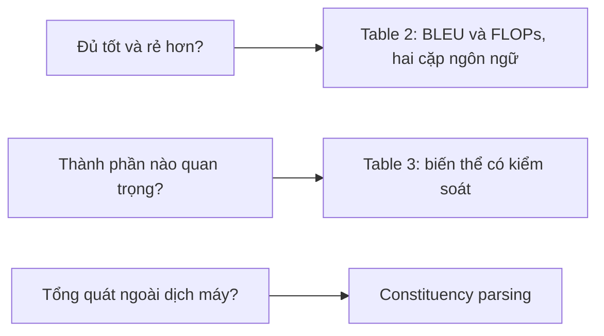

# Case study: Transformer (NeurIPS 2017)

!!! abstract "Mục tiêu của bài"
    Sau bài này, người học có thể:

    - Phân tích cách một title táo bạo như "Attention Is All You Need" được đỡ bằng bằng chứng, và khi nào một title như vậy là rủi ro.
    - Giải thích cách mục "Why Self-Attention" biện minh cho một lựa chọn kiến trúc bằng các tiêu chí tường minh, đo được, thay vì chỉ bằng kết quả.
    - Đọc Table 2 và Table 3 như hai loại bằng chứng khác nhau: so sánh chất lượng kèm chi phí, và khảo sát có hệ thống các biến thể thiết kế.
    - Áp dụng kỹ thuật "mỗi lựa chọn thiết kế đi kèm một lý do" khi viết phần Method của chính người học.

Paper **"Attention Is All You Need"** của Ashish Vaswani và cộng sự, nhóm tác giả chủ yếu đến từ Google Brain và Google Research, được công bố tại hội nghị NIPS 2017 (hội nghị đổi tên thành NeurIPS từ năm 2018). Paper đề xuất kiến trúc Transformer, chỉ dựa trên cơ chế attention, bỏ hẳn recurrence và convolution. Ảnh hưởng của nó vượt xa bài toán dịch máy ban đầu: Transformer trở thành kiến trúc nền của BERT (xem [case study BERT](bert.md)), của các mô hình ngôn ngữ lớn, và của nhiều mô hình thị giác sau này.

Với người học viết paper, Transformer là một ca đáng nghiên cứu vì paper rất ngắn gọn mà vẫn đầy đủ lập luận. Nó cho thấy bốn kỹ thuật mà người viết nào cũng có thể học: một title khẳng định táo bạo nhưng được chứng minh; một mục riêng biện minh cho thiết kế bằng tiêu chí rõ ràng; cách báo cáo chất lượng đi kèm chi phí; và một bảng khảo sát biến thể có hệ thống. Chúng ta sẽ xem xét lần lượt từng kỹ thuật, đặt trong bối cảnh lập luận chung của paper.

## Bối cảnh ra đời

Năm 2017, các mô hình chuyển đổi chuỗi (sequence transduction), mà tiêu biểu là dịch máy, chủ yếu dựa trên kiến trúc encoder–decoder dùng mạng hồi quy như LSTM hoặc GRU. Cơ chế attention đã trở thành một thành phần quan trọng, cho phép decoder "nhìn lại" các vị trí phù hợp trong câu nguồn, nhưng attention vẫn được dùng *kèm theo* mạng hồi quy chứ chưa thay thế nó.

Hạn chế cốt lõi của mạng hồi quy là tính tuần tự: trạng thái ở vị trí $t$ phụ thuộc vào trạng thái ở vị trí $t-1$, nên các phép tính trong một chuỗi không thể song song hóa. Khi chuỗi dài, điều này trở thành nút thắt về thời gian huấn luyện. Một số công trình đã thay recurrence bằng convolution để tăng khả năng song song, nhưng khi đó số phép tính cần để nối hai vị trí xa nhau lại tăng theo khoảng cách giữa chúng, khiến việc học các phụ thuộc xa trở nên khó hơn.

Trong bối cảnh ấy, câu hỏi mà Transformer đặt ra rất rõ: nếu attention đã có thể nối trực tiếp hai vị trí bất kỳ, liệu có cần đến recurrence hay convolution nữa không? Câu trả lời của paper là không, và toàn bộ paper được xây dựng để chứng minh câu trả lời đó.

## Câu chuyện một dòng

> Recurrence buộc tính toán phải tuần tự và làm đường đi giữa hai vị trí xa nhau dài ra; một kiến trúc chỉ dựa trên attention cho phép song song hóa hoàn toàn, nối mọi cặp vị trí bằng một số bước không đổi, và vừa dịch tốt hơn state-of-the-art vừa huấn luyện với chi phí chỉ bằng một phần nhỏ.

Câu chuyện có hai vế lợi ích, chất lượng và chi phí, và vế chi phí không phải phụ. Vì động lực ban đầu là khả năng song song hóa, paper phải chứng minh rằng lợi thế đó hiện thực hóa thành chi phí huấn luyện thấp hơn, chứ không chỉ là một lập luận trên giấy. Đây là lý do Table 2 báo cáo cả BLEU lẫn chi phí huấn luyện, như chúng ta sẽ thấy ở dưới.

## Phân tích câu chuyện và cấu trúc paper

### Title: một khẳng định táo bạo, dễ nhớ

"Attention Is All You Need" không mô tả phương pháp theo kiểu thông thường ("A Novel Attention-Based Architecture for Neural Machine Translation"). Nó là một *khẳng định*: attention là đủ, không cần gì khác. Title dạng khẳng định có ưu điểm lớn: dễ nhớ, dễ nhắc lại, và nói luôn kết luận của paper. Nhưng nó cũng là một cam kết: nếu nội dung không chứng minh được khẳng định, reviewer sẽ dùng chính title để phản bác.

Title của Transformer an toàn vì khẳng định được chứng minh trực tiếp: mô hình không có recurrence, không có convolution, và vẫn đạt state-of-the-art. Người viết muốn dùng title dạng khẳng định cần tự hỏi: khẳng định trong title có được chứng minh *trọn vẹn* bởi thí nghiệm không, hay chỉ đúng trong một số điều kiện? Nếu chỉ đúng một phần, title mô tả sẽ an toàn hơn (xem bài [Title](../02-viet-tung-phan/title.md)).

### Introduction và Background: ngắn, tập trung vào một hạn chế

Introduction của Transformer chỉ dài vài đoạn. Đoạn đầu xác lập rằng mạng hồi quy là phương pháp chủ đạo cho mô hình hóa chuỗi. Đoạn hai chỉ ra hạn chế về tính tuần tự. Đoạn ba nhắc rằng attention đã trở thành thành phần quan trọng nhưng thường đi kèm mạng hồi quy. Đoạn cuối giới thiệu Transformer như một kiến trúc từ bỏ recurrence và hoàn toàn dựa vào attention, nhấn mạnh rằng nó cho phép song song hóa nhiều hơn và đạt chất lượng dịch state-of-the-art chỉ sau khoảng mười hai giờ huấn luyện trên tám GPU P100.

Mục Background tiếp nối bằng cách định vị so với các mô hình dùng convolution: ở các mô hình đó, số phép tính để liên hệ hai vị trí tăng theo khoảng cách, tuyến tính với một số mô hình và theo logarit với số khác. Transformer giảm con số này về một hằng số. Điều đáng chú ý là ngay tại đây, paper thừa nhận một cái giá: việc lấy trung bình có trọng số theo attention làm giảm "độ phân giải hiệu dụng", và nói rõ rằng multi-head attention được thiết kế để bù lại. Một điểm yếu được nêu ra cùng lúc với cách khắc phục, ngay trong phần mở đầu, giúp reviewer không phải tự phát hiện ra nó.

### Model Architecture: mỗi thành phần một lý do

Phần mô tả kiến trúc đi theo trật tự của Figure 1: các khối encoder và decoder xếp chồng, cơ chế attention, mạng feed-forward theo từng vị trí, embedding và softmax, và positional encoding. Bản thân các công thức rất ít; công thức trung tâm là scaled dot-product attention:

$$
\mathrm{Attention}(Q, K, V) = \mathrm{softmax}\!\left(\frac{QK^\top}{\sqrt{d_k}}\right) V .
$$

Điều làm phần này đáng học không phải công thức, mà là cách gần như mọi lựa chọn đều được kèm một lý do ngắn gọn.

- **Vì sao chia cho $\sqrt{d_k}$?** Paper giải thích rằng khi $d_k$ lớn, tích vô hướng có độ lớn lớn, đẩy softmax vào vùng có gradient cực nhỏ. Một chú thích còn đưa ra lập luận phương sai: nếu các thành phần của query và key độc lập, có trung bình 0 và phương sai 1, thì tích vô hướng của chúng có phương sai $d_k$. Chỉ một câu và một chú thích, nhưng hệ số tỉ lệ không còn là một con số "ma thuật".
- **Vì sao nhiều head?** Một head duy nhất lấy trung bình mọi thứ vào một biểu diễn; nhiều head cho phép mô hình đồng thời chú ý tới thông tin từ các không gian biểu diễn con khác nhau ở các vị trí khác nhau. Lý do này nối thẳng với cái giá về độ phân giải đã thừa nhận ở Background.
- **Vì sao che (mask) trong decoder?** Để giữ tính tự hồi quy: vị trí đang sinh không được nhìn các vị trí phía sau.
- **Vì sao positional encoding dạng sinusoid?** Vì mô hình không có recurrence hay convolution, nó cần một cách để biết thứ tự token. Paper nêu giả thuyết rằng dạng sinusoid giúp mô hình dễ học cách chú ý theo vị trí tương đối, vì mã hóa của vị trí $pos + k$ có thể biểu diễn như một hàm tuyến tính của mã hóa vị trí $pos$, và có thể giúp ngoại suy sang chuỗi dài hơn chuỗi lúc huấn luyện. Paper cũng nói rõ đã thử phương án positional embedding học được và thấy kết quả gần như tương đương, rồi giải thích vì sao vẫn chọn sinusoid.

Cấu hình cơ sở cũng được nêu rõ: 6 layer cho encoder và 6 cho decoder, kích thước mô hình 512, 8 head, kích thước feed-forward 2048. Người đọc có thể tái hiện mô hình chỉ từ phần này và phần Training.

### Why Self-Attention: biện minh bằng tiêu chí

Mục 4 của paper, "Why Self-Attention", là phần đáng học nhất về mặt viết. Hầu hết paper phương pháp biện minh cho thiết kế bằng kết quả: "chúng tôi chọn X vì X cho kết quả tốt hơn". Transformer làm thêm một bước: trước khi trình bày kết quả, nó nêu ba tiêu chí mà một layer mô hình hóa chuỗi nên được đánh giá theo, rồi so sánh self-attention với các lựa chọn thay thế trên từng tiêu chí. Ba tiêu chí là: tổng độ phức tạp tính toán mỗi layer; lượng tính toán có thể song song hóa, đo bằng số thao tác tuần tự tối thiểu; và độ dài đường đi giữa hai vị trí xa nhau trong mạng, vì đường đi càng ngắn thì phụ thuộc xa càng dễ học.

Table 1 tóm tắt so sánh này. Bảng dưới đây trình bày lại nội dung của nó, với $n$ là độ dài chuỗi, $d$ là kích thước biểu diễn, $k$ là kích thước kernel convolution và $r$ là kích thước vùng lân cận trong self-attention có giới hạn.

| Loại layer | Độ phức tạp mỗi layer | Số thao tác tuần tự | Độ dài đường đi tối đa |
|---|---|---|---|
| Self-attention | $O(n^2 \cdot d)$ | $O(1)$ | $O(1)$ |
| Recurrent | $O(n \cdot d^2)$ | $O(n)$ | $O(n)$ |
| Convolutional | $O(k \cdot n \cdot d^2)$ | $O(1)$ | $O(\log_k n)$ |
| Self-attention có giới hạn | $O(r \cdot n \cdot d)$ | $O(1)$ | $O(n/r)$ |

Phần văn xuôi đi kèm bảng phân tích từng cột. Self-attention thắng tuyệt đối ở hai cột cuối. Ở cột đầu, nó nhanh hơn recurrent khi $n < d$, điều thường xảy ra với biểu diễn câu trong dịch máy dùng word-piece hoặc byte-pair encoding. Paper không giấu điểm yếu: với chuỗi rất dài, chi phí $n^2$ trở thành vấn đề, và dòng cuối của bảng là một phương án (self-attention giới hạn trong vùng lân cận kích thước $r$) đổi lại đường đi dài hơn. Paper còn nêu một lợi ích phụ: attention có thể cho ra mô hình dễ diễn giải hơn, và phụ lục trình bày một số trực quan hóa attention cho thấy các head dường như học được những hành vi liên quan tới cấu trúc cú pháp và ngữ nghĩa của câu.

Cái hay của mục này là nó biến một lựa chọn kiến trúc thành một lập luận có thể kiểm tra. Reviewer có thể không đồng ý với kết luận, nhưng họ thấy rõ tiêu chí nào được dùng và so sánh được thực hiện thế nào. Điều thú vị là chính cột độ phức tạp $O(n^2 \cdot d)$ mà paper trung thực đưa vào bảng về sau trở thành điểm xuất phát của cả một hướng nghiên cứu về attention hiệu quả. Một điểm yếu được nêu rõ ràng không làm paper yếu đi; nó còn mở đường cho các công trình tiếp theo.

### Training, Results, Conclusion

Mục Training trình bày dữ liệu (WMT 2014 Anh–Đức và Anh–Pháp), phần cứng và lịch huấn luyện (tám GPU P100; mô hình cơ sở huấn luyện khoảng mười hai giờ, mô hình lớn khoảng ba ngày rưỡi), optimizer (Adam, xem [case study Adam](adam.md), với một lịch learning rate tăng tuyến tính trong 4000 bước warmup đầu rồi giảm tỉ lệ nghịch với căn bậc hai của số bước), và các kỹ thuật regularization (dropout, label smoothing). Ở phần label smoothing, paper ghi nhận một đánh đổi: kỹ thuật này làm perplexity xấu đi vì mô hình học cách bớt chắc chắn, nhưng cải thiện accuracy và BLEU. Báo cáo một đánh đổi như vậy thay vì chỉ nêu mặt có lợi là một dấu hiệu của sự trung thực khoa học.

Mục Results gồm ba phần: dịch máy, các biến thể mô hình, và English constituency parsing. Conclusion ngắn, tóm tắt kết quả và nêu hướng tương lai: mở rộng sang các dạng dữ liệu khác như ảnh, âm thanh và video, nghiên cứu attention cục bộ cho đầu vào lớn, và giảm tính tuần tự của quá trình sinh. Mã nguồn được công bố. Một chi tiết nhỏ nhưng đáng chú ý là chú thích ở trang đầu mô tả cụ thể đóng góp của từng tác giả; ở những paper có nhiều tác giả cùng đóng góp lớn, một mô tả như vậy giúp minh bạch hóa vai trò.

## Figure và Table then chốt

### Figure 1: sơ đồ kiến trúc trở thành biểu tượng

Figure 1 trình bày toàn bộ kiến trúc: encoder bên trái, decoder bên phải, mỗi bên là một khối lặp $N$ lần, bên trong gồm multi-head attention, feed-forward, các kết nối residual kèm chuẩn hóa ("Add & Norm"), embedding cộng positional encoding ở đầu vào và linear cộng softmax ở đầu ra. Hình này về sau xuất hiện trong vô số bài giảng và paper khác.

Có ba lý do khiến nó hiệu quả. Thứ nhất, nó *tự đủ*: người đọc có thể hiểu luồng dữ liệu mà không cần đọc văn bản. Thứ hai, mỗi khối trên hình tương ứng với một mục con trong phần Model Architecture, nên hình đóng vai trò như mục lục trực quan cho phần Method. Thứ ba, các chi tiết lặp lại được gom lại bằng ký hiệu "$N\times$", giúp hình gọn mà không mất thông tin. Figure 2 bổ sung bằng cách phóng to hai khối then chốt, scaled dot-product attention và multi-head attention. Người học có thể đối chiếu với các nguyên tắc vẽ hình phương pháp ở bài [Method](../02-viet-tung-phan/method.md) và [Figures & Tables](../02-viet-tung-phan/figures-tables.md).

### Table 2: chất lượng đi kèm chi phí

Table 2 so sánh Transformer với các hệ thống tốt nhất khi đó trên hai cặp ngôn ngữ, với hai nhóm cột: BLEU và chi phí huấn luyện ước tính bằng FLOPs. Kết quả chính: trên WMT 2014 Anh–Đức, mô hình lớn đạt 28.4 BLEU, cao hơn kết quả tốt nhất đã công bố, kể cả các ensemble, hơn 2 BLEU; trên Anh–Pháp, mô hình lớn đạt 41.8 BLEU với một mô hình đơn, sau ba ngày rưỡi huấn luyện trên tám GPU. Ngay cả mô hình cơ sở đã vượt các mô hình và ensemble được công bố trước đó trên Anh–Đức, với chi phí huấn luyện chỉ bằng một phần nhỏ.

Việc đặt cột chi phí cạnh cột chất lượng có ý nghĩa lập luận rõ ràng. Động lực của paper là khả năng song song hóa; nếu chỉ báo cáo BLEU, claim về hiệu quả huấn luyện sẽ chỉ là lời khẳng định. Table 2 biến claim đó thành con số, và cho phép người đọc thấy Transformer thắng *trên cả hai trục cùng lúc*.

### Table 3: khảo sát biến thể có hệ thống

Table 3 là một mẫu mực về ablation. Mỗi dòng là một biến thể của mô hình cơ sở, chỉ thay đổi một yếu tố, đánh giá trên tập dev của Anh–Đức bằng perplexity và BLEU, kèm số tham số. Các dòng được gom thành nhóm theo câu hỏi:

- Số head và kích thước key/value: một head duy nhất kém hơn rõ rệt so với cấu hình tốt nhất, nhưng quá nhiều head cũng làm chất lượng giảm.
- Giảm kích thước key: làm chất lượng giảm, gợi ý rằng việc xác định mức độ tương thích giữa query và key không đơn giản.
- Kích thước mô hình: mô hình lớn hơn tốt hơn.
- Dropout: rất hữu ích để tránh overfitting.
- Positional embedding học được thay cho sinusoid: kết quả gần như tương đương.

Mỗi nhóm trả lời một câu hỏi "nếu thay đổi X thì sao?" mà reviewer có thể đặt ra. Dòng đầu là mô hình cơ sở làm mốc, các dòng sau chỉ ghi giá trị khác mốc, nên bảng rất dễ đọc dù chứa nhiều cấu hình. Người học có thể áp dụng khuôn này cho ablation của mình (xem [Experiments](../02-viet-tung-phan/experiments.md)).

## Thí nghiệm như một chuỗi lập luận

Thí nghiệm của Transformer trả lời ba câu hỏi theo thứ tự.

**Câu hỏi thứ nhất: kiến trúc chỉ dựa trên attention có đủ tốt không, và có rẻ hơn không?** Table 2 trả lời trên hai cặp ngôn ngữ với hai trục chất lượng và chi phí. Hai cặp ngôn ngữ có quy mô dữ liệu khác nhau, nên kết quả không phụ thuộc vào một thiết lập duy nhất.

**Câu hỏi thứ hai: thành phần nào quan trọng?** Table 3 trả lời bằng các biến thể có kiểm soát. Thí nghiệm này cũng kiểm chứng ngược lại các lý do thiết kế đã nêu ở Method: lập luận rằng nhiều head giúp bù sự mất độ phân giải được kiểm chứng bằng nhóm biến thể về số head; giả thuyết về positional encoding được kiểm chứng bằng phương án học được.

**Câu hỏi thứ ba: kiến trúc có tổng quát hóa ra ngoài dịch máy không?** Một reviewer có thể nghi ngờ rằng Transformer chỉ phù hợp với dịch máy, nơi nó được thiết kế. Paper trả lời bằng English constituency parsing, một tác vụ có ràng buộc cấu trúc mạnh và đầu ra dài hơn đáng kể so với đầu vào, nơi các mô hình chuỗi sang chuỗi hồi quy từng gặp khó khăn khi dữ liệu ít. Thí nghiệm được thực hiện cả trong chế độ chỉ dùng dữ liệu có nhãn hạn chế lẫn chế độ bán giám sát, và Transformer đạt kết quả tốt đáng ngạc nhiên dù hầu như không được tinh chỉnh riêng cho tác vụ.

Chuỗi này ngắn hơn nhiều so với phần thực nghiệm của các paper ngày nay, nhưng mỗi mắt xích đều cần thiết: bỏ Table 2 thì không có claim chính, bỏ Table 3 thì không biết vì sao, bỏ parsing thì claim về một kiến trúc tổng quát chỉ đứng trên một tác vụ.

## Văn phong

Văn phong của Transformer có thể tóm lại bằng một chữ: *nén*. Paper ngắn, mỗi đoạn mang một ý, mỗi câu mang thông tin. Introduction chỉ vài đoạn; mỗi lựa chọn thiết kế chỉ được biện minh bằng một hai câu. Sự ngắn gọn này có được vì paper chọn đúng điều cần nói: lý do của từng lựa chọn, không phải lịch sử các lựa chọn đã thử.

Các thành phần được **đặt tên** rõ ràng và viết hoa như danh từ riêng: Transformer, Scaled Dot-Product Attention, Multi-Head Attention. Khi người đọc gặp lại các tên này ở hình, ở bảng và ở văn bản, họ biết ngay đó là cùng một thứ. Paper cũng dùng **con số cụ thể** ở những chỗ mà một paper kém hơn sẽ dùng tính từ: không phải "huấn luyện nhanh hơn nhiều" mà là "mười hai giờ trên tám GPU P100"; không phải "tốt hơn đáng kể" mà là "hơn 2 BLEU, kể cả so với ensemble".

Tuy nhiên, người học cũng nên nhận ra rằng sự ngắn gọn có giá của nó. Một số chi tiết triển khai được trình bày rất cô đọng, và nhiều người đọc phải tham khảo mã nguồn để tái hiện chính xác. Với paper của người học, đặc biệt là khi nộp tới các cộng đồng coi trọng khả năng tái hiện, các chi tiết như vậy nên được bổ sung trong appendix hoặc supplementary.

## Bài học cho người viết

### Biện minh thiết kế bằng tiêu chí, không chỉ bằng kết quả

Mục "Why Self-Attention" cho thấy một cách biện minh mạnh hơn "nó cho kết quả tốt": nêu tiêu chí, so sánh các lựa chọn trên từng tiêu chí, thừa nhận chỗ lựa chọn của mình kém. Khi đề xuất một module mới, người viết có thể làm tương tự: một bảng nhỏ so sánh module với các lựa chọn thay thế về độ phức tạp, phạm vi tiếp nhận thông tin, số tham số, hay bất kỳ tính chất nào liên quan tới vấn đề. Một bảng như vậy giúp reviewer hiểu thiết kế *trước khi* xem kết quả, và làm cho kết quả trở nên dễ tin hơn.

### Báo cáo cái giá cùng với lợi ích

Nếu động lực của paper liên quan tới hiệu quả (tốc độ, bộ nhớ, chi phí huấn luyện), hãy báo cáo hiệu quả bằng con số đặt cạnh chất lượng. Nếu một kỹ thuật cải thiện một chỉ số nhưng làm xấu một chỉ số khác, như label smoothing với perplexity, hãy nói ra. Reviewer tin tưởng một paper biết rõ những đánh đổi của chính nó hơn một paper chỉ trình bày mặt tốt.

### Một bảng biến thể, nhiều câu hỏi

Table 3 cho thấy cách trả lời nhiều câu hỏi "nếu thay đổi X thì sao?" trong một bảng gọn: một dòng mốc, các dòng biến thể nhóm theo câu hỏi, chỉ ghi giá trị khác mốc. Khuôn này đặc biệt hữu ích khi giới hạn trang chặt.

### Tổng quát hóa để chặn câu hỏi "chỉ hợp với tác vụ này?"

Một thí nghiệm nhỏ trên tác vụ thứ hai, khác bản chất với tác vụ chính, có giá trị lập luận lớn hơn nhiều so với kích thước của nó. Nó chuyển paper từ "một phương pháp cho tác vụ X" thành "một phương pháp tổng quát, minh họa trên X và Y".

### Áp dụng sang các cộng đồng khác

Ở **Computer Vision**, khi đề xuất một module mới (một loại attention, một khối kết hợp đặc trưng), một bảng so sánh tính chất theo kiểu Table 1 giúp biện minh thiết kế trước khi xem kết quả; nhiều paper CV đặt bảng này ở Related Work hoặc Method (xem [Related Work](../02-viet-tung-phan/related-work.md)). Ở **NLP**, Transformer chỉ báo cáo BLEU, chuẩn mực của dịch máy khi đó; chuẩn mực ngày nay ở các hội nghị NLP thường kỳ vọng thêm nhiều chỉ số tự động khác nhau, kiểm định thống kê, và đôi khi đánh giá của con người, nên người viết không nên coi việc chỉ báo cáo một chỉ số là khuôn mẫu cho paper hiện tại (xem [Viết cho ACL / EMNLP / NAACL](../06-cong-dong/nlp.md)). Ở **Machine Learning**, kiểu biện minh bằng tiêu chí và phân tích độ phức tạp rất hợp khẩu vị reviewer, những người thường hỏi "vì sao phương pháp hoạt động" trước khi hỏi "nó tốt hơn bao nhiêu" (xem [Viết cho NeurIPS / ICML / ICLR](../06-cong-dong/ml.md)).

## Tóm tắt

"Attention Is All You Need" là bài học về sự ngắn gọn có lập luận. Title là một khẳng định táo bạo, an toàn vì được chứng minh trọn vẹn. Introduction tập trung vào một hạn chế duy nhất của mạng hồi quy là tính tuần tự, và Background thừa nhận ngay cái giá của giải pháp cùng cách khắc phục. Phần kiến trúc kèm theo mỗi lựa chọn một lý do ngắn, từ hệ số $\sqrt{d_k}$ đến positional encoding dạng sinusoid. Mục "Why Self-Attention" và Table 1 biện minh cho thiết kế bằng ba tiêu chí tường minh, kể cả chỉ ra điểm yếu $O(n^2)$. Table 2 đặt chất lượng cạnh chi phí để hiện thực hóa claim về hiệu quả; Table 3 khảo sát biến thể có hệ thống; thí nghiệm parsing chặn câu hỏi về tính tổng quát.

## Bài tập

1. **Viết một mục "Why X" cho thiết kế của người học.** Chọn thành phần chính trong phương pháp của người học. Nêu 2–3 tiêu chí đánh giá thành phần đó, rồi lập một bảng so sánh nó với ít nhất hai lựa chọn thay thế trên từng tiêu chí, kể cả tiêu chí mà thành phần của người học kém hơn.
2. **Gắn lý do cho từng lựa chọn.** Liệt kê mọi lựa chọn thiết kế trong phần Method của người học (hệ số, hàm kích hoạt, cách chuẩn hóa, cấu trúc nhánh). Với mỗi lựa chọn, viết một câu tiếng Anh giải thích vì sao. Lựa chọn nào không có lý do thì cần một ablation hoặc cần được ghi rõ là lựa chọn theo kinh nghiệm.
3. **Thiết kế một Table 3.** Phác thảo một bảng biến thể theo khuôn của Transformer cho dự án của người học: một dòng mốc, các nhóm biến thể theo câu hỏi, mỗi dòng chỉ thay một yếu tố.
4. **Thử một title dạng khẳng định.** Viết hai title cho paper của người học, một dạng mô tả và một dạng khẳng định. Với title dạng khẳng định, liệt kê những thí nghiệm cần có để khẳng định ấy được chứng minh trọn vẹn, và quyết định title nào phù hợp hơn với bằng chứng hiện có.
