# Thực hành: một paper từ con số 0

!!! abstract "Mục tiêu của bài"
    Sau bài này, người học có thể:

    - Theo dõi trọn vòng đời một paper, từ ý tưởng thô tới review và rebuttal, qua một dự án hư cấu, và thấy các chương trước ghép lại thành một quy trình liền mạch.
    - Áp dụng các công cụ chính của giáo trình (thẩm định ý tưởng, one-page pitch, bảng claim–thí nghiệm, khuôn abstract, internal review, rebuttal) vào một trường hợp cụ thể.
    - Phân biệt phần nào của quy trình là chung cho mọi cộng đồng và phần nào thay đổi khi chuyển sang NLP hoặc Machine Learning.
    - Lập một kế hoạch tương tự cho dự án nghiên cứu của chính người học.

Các chương trước dạy từng kỹ năng riêng lẻ: đọc tài liệu, tìm khoảng trống, thẩm định ý tưởng, lập kế hoạch, thiết kế và vận hành thực nghiệm, xây câu chuyện, viết từng phần, sửa bài, nộp bài và rebuttal. Các case study trong chương này lại phân tích những paper đã hoàn thành, nơi người đọc chỉ thấy sản phẩm cuối cùng chứ không thấy con đường dẫn tới nó. Bài thực hành này lấp khoảng trống giữa hai thứ đó: nó đi qua toàn bộ quy trình với một dự án cụ thể, cho thấy mỗi kỹ năng được dùng vào lúc nào, và các quyết định ở giai đoạn trước ảnh hưởng tới giai đoạn sau ra sao.

Dự án chính thuộc Computer Vision: phát hiện vật thể nhỏ trong ảnh chụp từ drone, với một phương pháp hư cấu tên là DenseQ. Ở mỗi giai đoạn, bài viết chỉ ra chương nào của giáo trình đang được áp dụng, để người học có thể quay lại đọc kỹ hơn khi cần. Sau khi đi hết vòng đời của DenseQ, bài chuyển sang hai dự án hư cấu song song, một ở NLP và một ở Machine Learning, để cho thấy cùng một bộ khung quy trình thay đổi thế nào khi cộng đồng, loại đóng góp và kỳ vọng của reviewer thay đổi. DenseQ đi theo một con đường tương đối suôn sẻ, với trọng tâm là quy trình; phần đối xứng là bài [Thực hành: ba dự án đi qua ngõ cụt](../07-tinh-huong-kho/thuc-hanh.md) ở Chương 7, nơi ba dự án giả định gặp những tình huống trớ trêu và trọng tâm là cách ra khỏi ngõ cụt.

!!! note "Đây là ví dụ hư cấu"
    Tên phương pháp (DenseQ, ViNumBench, RatioWarm), mọi con số, kết quả, phản hồi của người hướng dẫn và nhận xét của reviewer trong bài đều là **giả định để minh họa**, không phải kết quả nghiên cứu thật. VisDrone là một benchmark có thật về ảnh drone, nhưng mọi kết quả trên nó trong bài này đều là giả định.

Sơ đồ dưới đây tóm tắt tám giai đoạn của dự án. Mốc thời gian theo tuần là điển hình cho một paper đầu tay kéo dài khoảng sáu tháng, tương tự lộ trình ở bài [Lộ trình thực hiện một paper](../00-tong-quan/lo-trinh.md); dự án thực tế có thể nhanh hoặc chậm hơn.

```mermaid
flowchart LR
  G1["Giai đoạn 1: Ý tưởng và insight"] --> G2["Giai đoạn 2: One-page pitch"]
  G2 --> G3["Giai đoạn 3: Outline Intro và Figure 1"]
  G3 --> G4["Giai đoạn 4: Thí nghiệm theo claim"]
  G4 --> G5["Giai đoạn 5: Bản nháp đầy đủ"]
  G5 --> G6["Giai đoạn 6: Internal review"]
  G6 --> G7["Giai đoạn 7: Hoàn thiện và nộp"]
  G7 --> G8["Giai đoạn 8: Review và rebuttal"]
```



## Giai đoạn 1 (khoảng tuần 1–4): từ ý tưởng thô tới insight

Dự án bắt đầu, như phần lớn dự án khác, bằng một ý tưởng thô: "Các detector hiện tại hoạt động kém với vật thể nhỏ trong ảnh drone. Thử thêm một module attention xem sao." Ý tưởng này không sai, nhưng nó thuộc dạng "A + B": ghép một kỹ thuật đã biết (attention) vào một bài toán đã biết (vật thể nhỏ). Như bài [Thẩm định ý tưởng](../01-truoc-khi-viet/y-tuong.md) đã phân tích, vấn đề của dạng ý tưởng này không nằm ở việc nó có cho kết quả hay không, mà ở chỗ không có gì giải thích *vì sao* nó nên cho kết quả. Một paper xây trên nền như vậy rất dễ bị reviewer đánh giá là incremental, kể cả khi con số đẹp.

Vì thế, thay vì cài đặt module ngay, nhóm tác giả bắt đầu bằng việc *chẩn đoán*, áp dụng phương pháp phân tích failure case ở bài [Tìm khoảng trống & nguồn ý tưởng](../01-truoc-khi-viet/tim-khoang-trong.md). Họ chạy detector mạnh nhất có thể tiếp cận trên VisDrone, một benchmark phổ biến về ảnh drone, và phân tích lỗi một cách có hệ thống. Lỗi được chia thành bốn loại: bỏ sót vật thể (miss, tức false negative), định vị kém, phân loại sai lớp, và báo nhầm nền là vật thể (background false positive). Mỗi loại lại được chia nhỏ theo kích thước vật thể.

Kết quả phân tích (hư cấu) cho thấy một bức tranh rõ ràng. Với các vật thể nhỏ hơn 16×16 pixel, khoảng 70% lỗi là bỏ sót, và phần lớn vật thể bị bỏ sót *không có anchor hay query nào đủ gần* sau bước đề xuất ban đầu. Nói cách khác, vấn đề không nằm ở khâu phân loại mà ở khâu *phân bổ đề xuất*: các đề xuất tập trung vào vùng có vật thể lớn, nổi bật, còn vùng có vật nhỏ thì gần như không được "nhìn tới". Một module attention, dù tốt đến đâu, cũng không giúp được một vật thể mà không có đề xuất nào phủ tới.

Từ quan sát này, nhóm tác giả rút ra insight: *vật thể nhỏ trong ảnh drone phân bố rất không đều trong không gian; chúng tụ thành cụm, như xe trên đường hay người ở quảng trường. Cách phân bổ đề xuất đồng đều hoặc dựa trên độ nổi bật bỏ lỡ chính những cụm này.* Insight dẫn thẳng tới một ý tưởng phương pháp: trước tiên dự đoán một bản đồ mật độ (density map) thô, rồi phân bổ query hoặc đề xuất theo mật độ dự đoán. Tên tạm của phương pháp là DenseQ.

Trước khi đầu tư nhiều tháng, nhóm tác giả làm thêm hai việc kiểm tra. Việc thứ nhất là kiểm tra novelty bằng cách tìm kiếm tài liệu theo nhiều tầng như bài [Đọc và lập bản đồ tài liệu](../01-truoc-khi-viet/literature.md) hướng dẫn. Kết quả cho thấy bản đồ mật độ đã được dùng cho ảnh aerial, nhưng chủ yếu để *cắt ảnh* (crop) ra các vùng dày đặc rồi chạy lại detector trên từng vùng. Điều này không giết chết ý tưởng, nhưng xác định rõ khác biệt mà paper phải chứng minh: DenseQ phân bổ query trong *một lượt forward duy nhất*, không cắt ảnh, nên phải rẻ hơn đáng kể. Việc thứ hai là một thí nghiệm pilot dạng "oracle": thay bản đồ mật độ dự đoán bằng bản đồ mật độ tính từ nhãn thật, rồi xem recall của vật thể nhỏ tăng bao nhiêu. Nếu ngay cả oracle cũng không cải thiện đáng kể, ý tưởng không đáng theo đuổi. Trong kịch bản hư cấu này, oracle cải thiện recall rõ rệt, nên dự án đi tiếp.

Điều làm giai đoạn này thành công là phân tích lỗi đã biến một nhận định mơ hồ ("vật nhỏ thì khó") thành một phát biểu cụ thể, đo được ("70% lỗi là bỏ sót do thiếu đề xuất"). Phát biểu ấy về sau sẽ trở thành claim đầu tiên của paper và nửa phải của Figure 1. Đây chính là sự khác biệt giữa "câu chuyện yếu" và "câu chuyện mạnh" ở bài [Xây "câu chuyện" của paper](../01-truoc-khi-viet/cau-chuyen.md): phân tích không chỉ định hướng nghiên cứu mà còn là một phần của bằng chứng.

## Giai đoạn 2 (tuần 5): one-page pitch

Khi đã có insight và tín hiệu pilot, nhóm tác giả viết một trang pitch theo khung ở bài [Xây "câu chuyện" của paper](../01-truoc-khi-viet/cau-chuyen.md) và gửi cho người hướng dẫn cùng các đồng tác giả. Việc viết pitch ở thời điểm này, trước khi chạy thí nghiệm đầy đủ, có lý do rõ ràng: một trang giấy buộc người viết phải trả lời những câu hỏi khó (insight là gì, claim nào kiểm chứng được, rủi ro lớn nhất ở đâu) khi việc thay đổi hướng còn rẻ. Một lỗ hổng phát hiện ở tuần thứ năm tốn vài ngày để sửa; cùng lỗ hổng đó phát hiện qua review tốn nhiều tháng.

```markdown
## Tiêu đề tạm
DenseQ: Density-Guided Query Allocation for Tiny Object Detection in Aerial Images

## 1. Một câu (elevator pitch)
"Most failures on tiny objects in aerial images are misses caused by proposals
that never reach the objects; allocating detection queries according to a
predicted object density recovers these misses at almost no extra cost."

## 2. Vấn đề và vì sao quan trọng
Giám sát giao thông, tìm kiếm cứu nạn bằng drone; vật thể nhỏ hơn 16×16 px
chiếm tỉ lệ lớn trong các benchmark ảnh aerial.

## 3. Các phương pháp hiện tại và chỗ thất bại
Detector kiểu DETR hoặc two-stage chọn query/đề xuất theo top-k score, nên
thiên về vật lớn, nổi bật. Phương pháp crop/zoom có cải thiện nhưng cần nhiều
lượt forward, tốn compute.

## 4. Insight then chốt
Vật nhỏ tụ thành cụm; đề xuất cần được phân bổ theo mật độ, không theo độ nổi bật.

## 5. Phương pháp
Một density head nhẹ dự đoán bản đồ mật độ thô; query được lấy mẫu theo mật độ;
phần tinh chỉnh giữ nguyên như detector gốc. Chỉ một lượt forward.

## 6. Claims
C1. Khoảng 70% lỗi trên vật nhỏ là bỏ sót do thiếu đề xuất (phân tích lỗi).
C2. DenseQ cải thiện AP_tiny trên VisDrone và một benchmark aerial thứ hai.
C3. Chi phí thêm dưới 5% FLOPs, rẻ hơn nhiều so với phương pháp crop.
C4. Plug-and-play với ít nhất hai detector khác nhau.

## 7. Thí nghiệm cho từng claim
Phân tích lỗi; bảng chính trên hai benchmark; ablation (phân bổ theo mật độ,
đồng đều, top-k; số query; loss của density head); FLOPs/FPS; hai detector.

## 8. Figure 1
Trái: heatmap vị trí đề xuất của baseline và của DenseQ trên cùng một ảnh.
Phải: biểu đồ cột tỉ lệ bỏ sót theo kích thước vật thể.

## 9. Rủi ro lớn nhất
Reviewer yêu cầu so sánh với phương pháp crop/zoom và với các phương pháp
cắt ảnh theo mật độ đã có; có thể cho rằng novelty hạn chế.
```

Mỗi mục của pitch làm một việc cụ thể. Câu pitch ở mục 1 được viết bằng tiếng Anh ngay từ đầu, vì về sau nó sẽ trở thành xương sống của abstract và đoạn cuối Introduction. Mục 4 chỉ có một câu; nếu không viết được câu này, dự án chưa sẵn sàng để đi tiếp. Mục 6 chứa bốn claim, mỗi claim đều kiểm chứng được bằng một con số hoặc một phép so sánh, không có claim nào kiểu "phương pháp mạnh mẽ".

Mục 9 có lẽ là mục có giá trị nhất. Khi viết ra rủi ro lớn nhất, nhóm tác giả biết ngay cần đọc kỹ những gì (các phương pháp crop theo mật độ), phải chứng minh khác biệt nào (một lượt forward, không cắt ảnh), và phải có thí nghiệm nào (so sánh trực tiếp cả về độ chính xác lẫn chi phí). Rủi ro không biến mất khi được viết ra, nhưng nó chuyển từ một bất ngờ khi nhận review thành một hạng mục trong kế hoạch. Bài [Lập kế hoạch nghiên cứu](../01-truoc-khi-viet/ke-hoach.md) mở rộng ý này cho cả dự án: đi từ các claim tới ma trận thí nghiệm, sắp công việc theo thứ tự giảm rủi ro, và chạy một buổi premortem để tìm trước những lý do khiến dự án có thể thất bại; thí nghiệm oracle ở giai đoạn 1 chính là một bước giảm rủi ro như vậy.

## Giai đoạn 3 (tuần 6–7): outline Introduction và phác thảo Figure 1

Giai đoạn tiếp theo có thể khiến người viết lần đầu ngạc nhiên: nhóm tác giả viết outline của Introduction khi phần lớn thí nghiệm còn chưa chạy. Lý do đã được nêu trong [Lời nói đầu](../index.md) và [Quy trình viết và tự review](../03-ky-thuat/quy-trinh-viet.md): viết sớm là một phần của nghiên cứu. Một Introduction không viết được trôi chảy thường là dấu hiệu câu chuyện còn lỗ hổng, và phát hiện lỗ hổng sớm rẻ hơn nhiều so với phát hiện muộn. Outline được viết dưới dạng chú thích LaTeX, mỗi dòng ứng với một đoạn, theo khuôn sáu đoạn ở bài [Introduction và Figure 1](../02-viet-tung-phan/introduction.md).

```latex
% P1: Tiny object detection in aerial images matters (traffic monitoring,
%     search and rescue); tiny objects (<16px) are a large fraction of
%     instances in aerial benchmarks.
% P2: Modern detectors rank proposals/queries by score, which biases them
%     toward large, salient objects. Crop-based methods help but require
%     multiple forward passes.
% P3: Our analysis (Fig. 1b): ~70% of tiny-object errors are misses, and most
%     missed objects have no query nearby. Tiny objects are clustered (Fig. 1a).
% P4: DenseQ: predict a coarse density map, allocate queries in proportion to
%     it, then refine. Single forward pass, <5% extra FLOPs.
% P5: Results: +X AP_tiny on VisDrone, +Y on [benchmark 2]; works with two
%     different detectors.
% P6: Contributions: (1) error analysis; (2) DenseQ; (3) state-of-the-art
%     results with extensive ablations.
```

Outline được gửi cho người hướng dẫn (advisor). Phản hồi (hư cấu) nhắm đúng vào điểm yếu: đoạn P2 mới chỉ nhắc tới phương pháp crop nói chung, trong khi các phương pháp cắt ảnh *theo mật độ* là công trình gần nhất và phải được nêu tên rõ ràng ngay trong Introduction. Nếu reviewer tự phát hiện ra những công trình này, họ sẽ nghĩ nhóm tác giả hoặc không biết, hoặc cố tình né tránh; cả hai đều bất lợi. Nhóm tác giả sửa P2 để nêu rõ các phương pháp này cùng khác biệt bản chất (phân bổ query thay vì cắt ảnh), và bổ sung một đoạn tương ứng trong Related Work.

Song song với outline, nhóm tác giả phác tay Figure 1. Nửa trái là hai heatmap vị trí đề xuất trên cùng một ảnh drone, của baseline và của DenseQ, cho thấy baseline bỏ trống những cụm vật nhỏ còn DenseQ phủ tới chúng. Nửa phải là biểu đồ cột tỉ lệ bỏ sót theo kích thước vật thể. Lựa chọn này tương tự Figure 1 của [ResNet](resnet.md): thay vì khoe kết quả SOTA, hình cho người đọc thấy ngay *hiện tượng* và *cơ chế*, khiến giải pháp trở nên tất yếu. Các nguyên tắc thiết kế hình chi tiết hơn có ở bài [Figures & Tables](../02-viet-tung-phan/figures-tables.md).

## Giai đoạn 4 (tuần 8–14): thí nghiệm theo bảng claim

Giai đoạn dài nhất của dự án là chạy thí nghiệm, và đây cũng là giai đoạn dễ mất phương hướng nhất. Khi có quyền truy cập GPU và một codebase chạy được, người làm nghiên cứu rất dễ chạy hàng chục thí nghiệm "cho biết", rồi tới lúc viết mới phát hiện thiếu đúng thí nghiệm cần thiết. Công cụ chống lại xu hướng này là bảng claim–thí nghiệm ở bài [Thiết kế thí nghiệm](../01-truoc-khi-viet/thi-nghiem.md): mỗi thí nghiệm phải phục vụ ít nhất một claim, và mỗi claim phải có ít nhất một thí nghiệm. Thí nghiệm không gắn với claim nào hoặc được chuyển vào supplementary, hoặc bỏ.

| Claim | Thí nghiệm | Bảng/Hình | Trạng thái |
|---|---|---|---|
| C1 | Phân tích lỗi của baseline theo loại lỗi và kích thước | Fig. 1b, Fig. 3 | Xong |
| C2 | Bảng chính trên VisDrone và benchmark thứ hai | Tab. 1, Tab. 2 | Xong |
| C2 | Kết quả định tính, kể cả trường hợp thất bại | Fig. 5 | Xong |
| C3 | FLOPs, FPS so với phương pháp crop | Cột trong Tab. 1, Fig. 4 (đường trade-off) | Xong |
| C4 | DenseQ trên detector thứ hai | Tab. 3 | Đang chạy |
| Phòng thủ | Baseline với nhiều query hơn, cùng compute | Tab. 4(c) | Xong |

Hàng cuối của bảng là một *thí nghiệm phòng thủ*: nó không chứng minh một claim mới mà trả lời trước một phản biện. Một reviewer hoài nghi sẽ hỏi: "DenseQ tốt hơn có phải chỉ vì nó dùng nhiều query hơn ở vùng có vật nhỏ, và nếu cho baseline thêm query thì cũng được như vậy?" Thí nghiệm cho baseline thêm query sao cho tổng compute tương đương DenseQ trả lời đúng câu hỏi đó. Những thí nghiệm như vậy là thứ biến một paper từ "có vẻ ổn" thành "khó bắt bẻ".

Trong khi chạy thí nghiệm, nhóm tác giả bám theo danh sách kiểm tra so sánh công bằng: cùng backbone và cùng pre-training với baseline, cùng độ phân giải đầu vào, cùng lịch huấn luyện, và số liệu baseline được chạy lại bằng mã chính thức thay vì chỉ chép từ paper gốc khi thiết lập khác nhau. Hạ tầng để làm những việc này một cách đáng tin (config, seed, theo dõi các lần chạy, sanity check) được trình bày ở bài [Vận hành thực nghiệm](../01-truoc-khi-viet/thuc-thi.md). Với cấu hình chính, nhóm chạy ba seed và báo cáo trung bình kèm độ lệch chuẩn, để cho thấy mức cải thiện AP_tiny lớn hơn dao động giữa các lần chạy. Ở Computer Vision, việc báo cáo nhiều seed chưa phải lúc nào cũng bắt buộc, nhưng với mức cải thiện không quá lớn, nó giúp chặn trước câu hỏi về ý nghĩa thống kê (xem [Experiments](../02-viet-tung-phan/experiments.md)).

Một tình huống thường gặp ở giai đoạn này là một claim không đứng vững. Giả sử DenseQ cải thiện rõ trên detector kiểu DETR nhưng gần như không cải thiện trên detector two-stage. Khi đó, nhóm tác giả có hai lựa chọn trung thực: tìm hiểu nguyên nhân (có thể bước đề xuất của two-stage đã phủ đủ dày), hoặc thu hẹp claim C4 thành "áp dụng được cho các detector dựa trên query". Lựa chọn không trung thực là giữ nguyên claim và chỉ báo cáo detector thắng. Bài [Xây "câu chuyện" của paper](../01-truoc-khi-viet/cau-chuyen.md) có phần riêng về cách xử lý khi kết quả không như mong đợi, còn Chương 7 mổ xẻ kỹ các tình huống loại này, chẳng hạn thắng ở thiết lập này mà thua ở thiết lập khác trong bài [Khi con số không đẹp](../07-tinh-huong-kho/con-so-khong-dep.md), cùng ranh giới giữa thu hẹp claim một cách hợp lệ và chọn lọc kết quả trong bài [Ranh giới trung thực](../07-tinh-huong-kho/ranh-gioi-trung-thuc.md).

## Giai đoạn 5 (tuần 15–17): bản nháp đầy đủ

Khi phần lớn thí nghiệm đã có kết quả, nhóm tác giả viết bản nháp đầy đủ đầu tiên. Thứ tự viết không trùng với thứ tự đọc, như đã phân tích ở trang mở đầu [Chương 2](../02-viet-tung-phan/index.md): Method cùng Figure 2 được viết trước, vì đó là phần người viết hiểu rõ nhất; tiếp theo là Experiments, bắt đầu từ các bảng rồi mới viết văn bản quanh bảng; sau đó là Related Work; rồi *viết lại* Introduction với con số thật thay cho các chỗ X, Y trong outline; cuối cùng là Conclusion, Abstract và Title. Abstract và Title được viết sau cùng vì chúng tóm tắt những gì paper thực sự chứng minh được, mà điều đó chỉ rõ khi mọi phần khác đã xong.

Abstract bản đầu tiên được viết theo khuôn năm đến sáu câu ở bài [Abstract](../02-viet-tung-phan/abstract.md):

> *"Detecting tiny objects in aerial images remains challenging, as they occupy only a few pixels and appear in dense clusters. Through a systematic error analysis of modern detectors, we find that most failures on tiny objects are misses caused by insufficient proposals near the objects, rather than misclassification. Motivated by this, we propose DenseQ, which predicts a coarse object density map and allocates detection queries in proportion to it, requiring only a single forward pass. DenseQ is plug-and-play and adds less than 5% FLOPs. On VisDrone and [benchmark 2], it improves AP on tiny objects by +X and +Y points over strong baselines, and outperforms crop-based methods at a fraction of their cost."*

Mỗi câu của abstract ứng với một chức năng. Câu đầu nêu bối cảnh và lý do bài toán khó. Câu thứ hai nêu phát hiện từ phân tích, tức insight, và đây là câu khiến abstract khác biệt với hàng trăm abstract kiểu "we propose module X". Câu thứ ba nêu phương pháp, nối trực tiếp với phát hiện bằng cụm "Motivated by this". Câu thứ tư nêu tính chất thực tế. Câu cuối nêu kết quả bằng con số cụ thể, đồng thời chạm tới rủi ro đã nêu ở mục 9 của pitch: so sánh với phương pháp crop về chi phí. Người học có thể nhận thấy câu pitch ở giai đoạn 2 đã được "trải ra" thành câu hai và câu ba của abstract.

Title giữ nguyên từ pitch: "DenseQ: Density-Guided Query Allocation for Tiny Object Detection in Aerial Images". Title theo khuôn "Tên phương pháp: mô tả", chứa các từ khóa mà người tìm kiếm sẽ dùng (tiny object detection, aerial images), và cụm "density-guided query allocation" nói luôn cơ chế. Bài [Title](../02-viet-tung-phan/title.md) phân tích các khuôn title khác và khi nào nên dùng chúng.

Trong quá trình viết, nhóm tác giả dùng file macro LaTeX chung để thống nhất ký hiệu và tên phương pháp, và đặt quy ước ghi chú cho từng người trong nhóm, chẳng hạn `\authorA{}` và `\advisor{}`, theo hướng dẫn ở bài [LaTeX và Overleaf](../03-ky-thuat/latex.md). Văn phong tiếng Anh được rà theo các nguyên tắc ở bài [Tiếng Anh học thuật](../03-ky-thuat/van-phong.md).

## Giai đoạn 6 (tuần 18–20): internal review và sửa

Bản nháp đầy đủ được đưa qua hai đến ba vòng internal review theo quy trình ở bài [Quy trình viết và tự review](../03-ky-thuat/quy-trinh-viet.md). Người đọc nội bộ được đề nghị đọc như một reviewer thật: chỉ có vài giờ, đọc theo thứ tự title, abstract, Figure 1, Introduction, bảng chính, rồi mới đến Method. Cách đọc này, cùng các câu hỏi đối chiếu claim với bằng chứng, được luyện ở bài [Đọc paper như một reviewer](../01-truoc-khi-viet/doc-nhu-reviewer.md). Bốn nhận xét (hư cấu) dưới đây là những nhận xét điển hình, và cách nhóm tác giả xử lý chúng minh họa một nguyên tắc chung.

Nhận xét thứ nhất hỏi: "Density map cần loại giám sát nào? Có cần gán nhãn thêm không?" Đây là câu hỏi mà nhóm tác giả, vì quá quen với phương pháp, không nghĩ tới. Câu trả lời là bản đồ mật độ được sinh tự động từ các bounding box sẵn có, không cần nhãn thêm. Nhóm bổ sung một câu nêu rõ điều này ở Mục 3.2, vì nếu reviewer thật cũng thắc mắc, họ có thể nghĩ phương pháp cần thêm dữ liệu gán nhãn và đánh giá thấp tính thực tế.

Nhận xét thứ hai hỏi: "Mức cải thiện có phải do huấn luyện lâu hơn không?" DenseQ và baseline dùng cùng lịch huấn luyện, nhưng bản nháp chưa nói điều đó. Nhóm bổ sung một ghi chú trong phần thiết lập thí nghiệm.

Nhận xét thứ ba: "Figure 2 khó đọc." Nhóm vẽ lại hình, giảm chữ, thêm kích thước tensor ở các nhánh chính, và kiểm tra rằng hình đọc được khi in đen trắng.

Nhận xét thứ tư: "DenseQ thua một phương pháp khác ở vật thể lớn." Nhóm không giấu điều này mà bổ sung một câu giải thích trung thực trong Mục 4.2 (việc dồn query về vùng mật độ cao làm giảm nhẹ số query cho vật lớn), và nhắc lại trong phần Limitations.

Nguyên tắc chung là: mỗi câu hỏi của người đọc nội bộ là một câu hỏi mà reviewer thật có khả năng đặt ra, và câu trả lời tốt nhất nằm *trong paper*, không phải trong rebuttal. Một câu hỏi được trả lời trước trong paper không bao giờ trở thành điểm trừ.

Ngoài người đọc nội bộ, nhóm tác giả có thể dùng một mô hình ngôn ngữ lớn như một reviewer giả lập bổ sung, miễn là việc này phù hợp với chính sách của hội nghị và quy định của nhóm về bảo mật bản thảo (xem [Dùng AI hỗ trợ](../03-ky-thuat/ai-tools.md); các quy trình mẫu và thư viện prompt cho việc dùng AI trong cả vòng đời nghiên cứu có ở [Chương 8](../08-ai-cong-su/index.md)). Một prompt mẫu có thể như sau:

```text
You are an experienced CVPR reviewer specializing in object detection.
Read the attached draft and write a review containing:
(1) a two-sentence summary of the paper's main claim;
(2) the three most serious weaknesses, each with a concrete reason;
(3) baselines or comparisons that you think are missing;
(4) the questions you would ask the authors during the rebuttal.
Be specific and skeptical; do not praise the paper unless it is justified.
```

Phản hồi của mô hình chỉ có giá trị tham khảo; nó không thay thế được người đọc có chuyên môn, và mọi nhận xét cần được nhóm tác giả tự thẩm định.

## Giai đoạn 7 (tuần 21–22): hoàn thiện, supplementary và checklist

Hai tuần cuối trước deadline dành cho việc hoàn thiện. Supplementary material được soạn với các nội dung: chi tiết triển khai đủ để tái hiện, các ablation bổ sung không vừa trong phần chính, kết quả theo từng lớp vật thể, các trường hợp thất bại (chẳng hạn vật thể bị tán cây che khuất), và vài video minh họa. Bài [Conclusion, Limitations, Appendix](../02-viet-tung-phan/conclusion-supp.md) trình bày cách tổ chức supplementary sao cho reviewer tìm được thông tin nhanh.

Tiếp theo, nhóm tác giả chạy toàn bộ [checklist nộp bài](../04-nop-va-sau-nop/submission.md): ẩn danh (kể cả trong metadata của PDF, tên file, đường dẫn mã nguồn và video), giới hạn trang, định dạng template, references, và các tuyên bố bắt buộc của hội nghị. Bản đầu tiên được tải lên hệ thống khoảng ba ngày trước deadline, và bản cuối được ghi đè khoảng một ngày trước. Lý do rất thực tế: những giờ sát deadline, hệ thống nộp bài thường quá tải, và một sự cố kỹ thuật nhỏ có thể khiến cả dự án sáu tháng lỡ chu kỳ. Một bản đã nộp sớm là tấm lưới an toàn.

## Giai đoạn 8: review và rebuttal

Vài tháng sau, nhóm tác giả nhận được ba review (hư cấu):

| Reviewer | Đánh giá | Ý chính |
|---|---|---|
| R1 | Weak Accept | Phân tích lỗi thuyết phục; hỏi về kết quả trên một benchmark thứ ba |
| R2 | Borderline | Thiếu so sánh với một phương pháp cắt ảnh theo mật độ công bố gần đây |
| R3 | Weak Reject | "Novelty limited: density maps have already been used for cropping." |

Rebuttal được viết theo cấu trúc ở bài [Rebuttal và thảo luận](../04-nop-va-sau-nop/rebuttal.md). Đoạn mở đầu ngắn gọn ghi nhận các điểm mạnh mà reviewer đã công nhận (phân tích lỗi, chi phí thấp), vì area chair thường đọc đoạn này đầu tiên. Phần chính xử lý mối lo chung của R2 và R3 trong cùng một mục, vì cả hai thực chất cùng hỏi về quan hệ với các phương pháp cắt ảnh theo mật độ. Nhóm tác giả đưa ra một bảng nhỏ so sánh trực tiếp với phương pháp mà R2 nêu: DenseQ đạt AP_tiny tương đương hoặc cao hơn với lượng FLOPs ít hơn nhiều. Bảng được đi kèm hai câu giải thích khác biệt bản chất: phương pháp cắt ảnh dùng mật độ để chọn vùng chạy lại detector, còn DenseQ dùng mật độ để phân bổ query trong một lượt forward. Với R1, nhóm báo cáo kết quả trên benchmark thứ ba nếu chạy kịp trong thời gian rebuttal. Các điểm nhỏ được trả lời gọn ở cuối.

!!! warning "Thí nghiệm mới trong rebuttal"
    Quy định về việc đưa kết quả thí nghiệm mới vào rebuttal khác nhau giữa các hội nghị và thay đổi theo năm; một số hội nghị hạn chế hoặc không cho phép. Người viết cần đọc kỹ hướng dẫn rebuttal của đúng hội nghị và đúng năm trước khi lên kế hoạch.

Điều đáng học từ cách xử lý R3 là: một lo ngại về novelty hiếm khi được giải quyết bằng cách tranh luận rằng reviewer sai. Nó được giải quyết bằng cách chỉ ra *chính xác* khác biệt là gì, và đưa ra *bằng chứng* rằng khác biệt đó có ý nghĩa, ở đây là chi phí thấp hơn nhiều với độ chính xác tương đương. Nếu nhóm tác giả đã làm tốt giai đoạn 2 và giai đoạn 3, bảng so sánh này phần lớn đã có sẵn trong paper, và rebuttal chỉ cần chỉ ra nó.

Dù kết quả cuối cùng là gì, dự án đã đi hết một vòng đời đầy đủ. Nếu paper được chấp nhận, các bước tiếp theo là camera-ready, poster và công bố mã nguồn (xem [Camera-ready, poster, code](../04-nop-va-sau-nop/camera-ready.md)). Nếu bị từ chối, các review trở thành bản hướng dẫn chi tiết cho lần nộp tiếp theo (xem [Khi bị reject](../04-nop-va-sau-nop/reject.md)), và phần lớn công sức đã bỏ ra vẫn giữ nguyên giá trị.

## Cùng quy trình ở các cộng đồng khác

Bộ khung quy trình vừa trình bày, đi từ insight qua pitch, bảng claim–thí nghiệm, bản nháp, internal review tới rebuttal, là chung cho cả ba cộng đồng mà giáo trình bao quát. Điều thay đổi giữa các cộng đồng là *loại đóng góp* được trân trọng, *loại bằng chứng* được coi là thuyết phục, các phần *bắt buộc* trong paper, và những *câu hỏi* mà reviewer chắc chắn sẽ đặt ra. Chương 6 trình bày chi tiết các khác biệt này (xem [Viết cho NeurIPS / ICML / ICLR](../06-cong-dong/ml.md), [Viết cho ACL / EMNLP / NAACL](../06-cong-dong/nlp.md) và [Chuyển một paper giữa các cộng đồng](../06-cong-dong/chuyen-doi.md)).

Để thấy rõ những khác biệt ấy trong thực hành, phần này phác thảo hai dự án hư cấu song song. Mỗi dự án được trình bày ở mức của giai đoạn 1 và giai đoạn 2: câu chuyện một dòng, insight, bảng claim–thí nghiệm, và những gì reviewer của cộng đồng đó sẽ hỏi. Các giai đoạn sau diễn ra tương tự dự án DenseQ, nên không nhắc lại.

### Dự án NLP: benchmark suy luận số học tiếng Việt cho LLM

Dự án thứ nhất là một paper thuộc loại tài nguyên và đánh giá (resource/evaluation paper): xây dựng một benchmark đánh giá khả năng suy luận số học của các mô hình ngôn ngữ lớn (LLM) bằng tiếng Việt, tên hư cấu là ViNumBench. Paper được nộp qua ACL Rolling Review (ARR), chọn lĩnh vực (area) Resources and Evaluation, rồi commit tới một hội nghị như ACL, EMNLP hoặc NAACL. Như bài [Viết cho ACL / EMNLP / NAACL](../06-cong-dong/nlp.md) đã nêu, các hội nghị NLP rất trân trọng tài nguyên chất lượng cao cho ngôn ngữ ít tài nguyên, nhưng cũng đòi hỏi rất cao về quy trình xây dựng dữ liệu.

Câu chuyện một dòng của dự án như sau.

> Các LLM giải tốt bài toán đố tiếng Anh lại sụt giảm mạnh trên các bài tương đương bằng tiếng Việt; một benchmark được soạn mới, có kiểm soát về cách viết số, cho thấy phần lớn mức sụt giảm đến từ việc hiểu sai quy ước số của tiếng Việt chứ không phải từ các bước suy luận.

Insight của dự án (hư cấu) xuất phát từ một quan sát về ngôn ngữ. Tiếng Việt có những quy ước số khác tiếng Anh: dấu phẩy là dấu thập phân và dấu chấm phân cách hàng nghìn, nên "1.250" là một nghìn hai trăm năm mươi còn "1,25" là một phẩy hai lăm; số đọc bằng chữ có các biến âm như "mốt", "lăm", "tư"; có các biến thể vùng miền như "linh" và "lẻ", "nghìn" và "ngàn". Nếu một mô hình đọc "1.250" theo quy ước tiếng Anh, nó sẽ hiểu thành một phẩy hai lăm, và mọi bước suy luận sau đó dù đúng cũng cho đáp án sai. Để tách tác động của quy ước số khỏi năng lực suy luận, mỗi bài toán trong benchmark được soạn ở ba biến thể chỉ khác nhau về cách viết số: chữ số theo định dạng quốc tế, chữ số theo định dạng Việt Nam, và số viết bằng chữ. Về bản chất, ba biến thể này là một test bất biến (INV) theo nghĩa của [CheckList](checklist-acl2020.md): đáp án đúng không đổi, nên mọi khác biệt về độ chính xác giữa các biến thể đều đo tác động của cách viết số.

| Claim | Thí nghiệm hoặc bằng chứng | Vị trí trong paper |
|---|---|---|
| C1. Dữ liệu có chất lượng cao | Mỗi bài do người bản ngữ soạn mới theo hướng dẫn viết sẵn; hai người giải độc lập; báo cáo inter-annotator agreement (tỉ lệ đồng thuận về đáp án, Cohen's kappa cho nhãn loại hiện tượng); quy trình phân xử khi bất đồng; kiểm tra lại ngẫu nhiên một mẫu | Mục xây dựng dữ liệu, bảng thống kê và bảng agreement |
| C2. Có khoảng cách lớn giữa tiếng Việt và tiếng Anh | Đánh giá nhiều LLM (mã nguồn mở và thương mại, nhiều kích cỡ) trên bản tiếng Việt và bản tiếng Anh song song; nhiều mẫu prompt; khoảng tin cậy bằng bootstrap | Bảng kết quả chính |
| C3. Quy ước số giải thích phần lớn khoảng cách | So sánh ba biến thể cách viết số; phân loại lỗi thủ công trên một mẫu câu trả lời sai | Hình cột theo biến thể, bảng phân loại lỗi kèm ví dụ |
| C4. Benchmark không bị nhiễm dữ liệu (contamination) | Bài được soạn mới, không lấy từ web hay sách giáo khoa; kiểm tra trùng lặp n-gram với các kho văn bản công khai; giữ riêng một tập test không công bố đáp án; chèn chuỗi canary vào file dữ liệu | Mục xây dựng dữ liệu, phụ lục |
| Phòng thủ. Khoảng cách không phải do lỗi dịch | So sánh với bản dịch máy của một benchmark toán tiếng Anh; người bản ngữ đánh giá độ tự nhiên của câu chữ | Bảng phụ, phụ lục |

Một vài khái niệm trong bảng cần giải thích. *Inter-annotator agreement* (IAA) là mức độ đồng thuận giữa các người gán nhãn độc lập; nó là thước đo tiêu chuẩn cho chất lượng nhãn, và Cohen's kappa là một chỉ số IAA phổ biến cho hai người gán nhãn, có hiệu chỉnh cho mức đồng thuận do ngẫu nhiên. *Contamination* là hiện tượng dữ liệu đánh giá đã lọt vào dữ liệu huấn luyện của mô hình, khiến điểm số phản ánh trí nhớ thay vì năng lực. *Chuỗi canary* là một chuỗi định danh duy nhất được chèn vào file dữ liệu, để về sau có thể kiểm tra xem mô hình đã từng "nhìn thấy" dữ liệu đó hay chưa.

Reviewer ARR sẽ đọc paper này với những câu hỏi khác hẳn reviewer của DenseQ. Câu hỏi đầu tiên gần như chắc chắn là: "Vì sao cần thêm một benchmark toán? Dịch một benchmark tiếng Anh như GSM8K sang tiếng Việt chẳng phải là đủ sao?" Claim C3 và thí nghiệm phòng thủ tồn tại để trả lời câu hỏi này, và Introduction phải trả lời nó ngay từ đầu. Tiếp theo là các câu hỏi về quy trình gán nhãn: ai là người soạn và giải bài, được tuyển chọn thế nào, được trả công ra sao, hướng dẫn gán nhãn có được công bố không, agreement đạt mức nào và bất đồng được xử lý thế nào. Responsible NLP checklist của ARR hỏi trực tiếp nhiều điểm trong số này. Reviewer cũng sẽ hỏi về contamination, cả hiện tại lẫn tương lai: khi benchmark được công bố, làm sao để nó không bị đưa vào dữ liệu huấn luyện của các mô hình sau.

Với phần đánh giá, reviewer sẽ quan tâm tới độ nhạy với prompt, tham số giải mã, phiên bản cụ thể và thời điểm truy cập của các mô hình thương mại (vì các mô hình qua API thay đổi theo thời gian), và ý nghĩa thống kê của khác biệt giữa các mô hình. Phần Limitations, bắt buộc ở ARR, cần nêu thẳng phạm vi của benchmark: chủ yếu là tiếng Việt chuẩn, biến thể vùng miền chỉ được phủ một phần, mức độ toán chủ yếu là tiểu học và trung học, và kết quả trên mô hình thương mại có thể không tái hiện được khi mô hình được cập nhật. Phần đạo đức cần nêu chế độ trả công cho người gán nhãn, giấy phép (license) phát hành dữ liệu, và việc dữ liệu không chứa thông tin cá nhân. Cuối cùng, cần nhớ rằng ARR đánh giá riêng hai trục Soundness và Excitement: một benchmark được xây dựng cẩn thận nhưng phân tích nông có thể được đánh giá cao về Soundness nhưng thấp về Excitement, và vì thế phù hợp với Findings hơn main conference. Phân tích C3 chính là thứ nâng Excitement của paper.

### Dự án ML: một kỹ thuật điều chỉnh learning rate warmup

Dự án thứ hai là một paper phương pháp kèm phân tích, nộp tới NeurIPS hoặc ICLR: một kỹ thuật điều chỉnh learning rate warmup, tên hư cấu là RatioWarm. Warmup, tức tăng dần learning rate từ một giá trị nhỏ lên giá trị mục tiêu trong những bước đầu của huấn luyện, được dùng rất rộng rãi; chính Transformer đã dùng một lịch warmup trong những bước đầu (xem [case study Transformer](transformer.md)). Nhưng độ dài warmup thường được chọn bằng thử sai, và việc tinh chỉnh nó tốn kém khi mô hình lớn.

Câu chuyện một dòng của dự án như sau.

> Độ dài warmup thường được chọn bằng thử sai; trên một bài toán toy có thể phân tích chính xác và trên các mô hình thật, bất ổn ở giai đoạn đầu huấn luyện gắn với tỉ số giữa độ lớn bước cập nhật và độ lớn trọng số ở một số layer, nên kết thúc warmup theo từng layer khi tỉ số này ổn định giúp bỏ được việc chọn độ dài warmup mà vẫn đạt bằng hoặc hơn warmup đã tinh chỉnh kỹ, trong cùng ngân sách tính toán.

Insight của dự án (hư cấu) dựa trên một phân tích đơn giản mà cộng đồng ML rất ưa chuộng. Xét hàm mất mát bậc hai một chiều $f(\theta) = \tfrac{1}{2}\lambda\theta^2$ với độ cong $\lambda$. Gradient descent với learning rate $\eta$ cho bước cập nhật $\theta \leftarrow (1 - \eta\lambda)\,\theta$, và quá trình ổn định khi và chỉ khi $0 < \eta < 2/\lambda$. Nếu độ cong lớn ở đầu huấn luyện rồi giảm dần, một learning rate cố định vượt quá $2/\lambda$ ban đầu sẽ gây phân kỳ hoặc các đợt loss tăng vọt (loss spike), và warmup hoạt động bằng cách giữ $\eta$ dưới biên ổn định đang dịch chuyển. Warmup cố định độ dài vì thế hoặc quá ngắn (vẫn gặp loss spike), hoặc quá dài (lãng phí các bước có thể học nhanh hơn). Giả thuyết của dự án là tỉ số giữa độ lớn bước cập nhật và độ lớn trọng số ở từng layer là một tín hiệu rẻ, không cần tính Hessian, để theo dõi biên ổn định này.

Bài toán toy là một mạng tuyến tính sâu hoặc một MLP hai lớp trên dữ liệu tổng hợp, đủ nhỏ để tính chính xác giá trị riêng lớn nhất của Hessian ở mỗi bước. Hình quan trọng nhất của paper, và là ứng viên cho Figure 1, vẽ trên cùng một trục thời gian: độ cong thật, biên ổn định, lịch learning rate của warmup cố định và của RatioWarm. Phân tích lý thuyết đơn giản là một mệnh đề trên mô hình bậc hai: dưới giả định độ cong giảm đơn điệu và tỉ số theo dõi được chặn theo $\eta\lambda$, lịch của RatioWarm luôn nằm trong vùng ổn định. Chứng minh được đặt ở appendix, và giả định được kiểm tra thực nghiệm trên các mô hình thật cỡ nhỏ.

| Claim | Thí nghiệm hoặc bằng chứng | Vị trí trong paper |
|---|---|---|
| C1. Bất ổn đầu huấn luyện gắn với tỉ số cập nhật/trọng số ở một số layer | Bài toán toy với độ cong tính chính xác; trên mô hình thật, đo tỉ số theo từng layer và đối chiếu với các đợt loss spike | Figure 1 (toy), Figure 2 |
| C2. Trên mô hình toy, tiêu chí đảm bảo ổn định | Mệnh đề và chứng minh; kiểm tra giả định trên mô hình thật cỡ nhỏ | Mục phân tích, appendix |
| C3. Không cần chọn độ dài warmup | Ít nhất ba kiến trúc và tác vụ (chẳng hạn ResNet phân loại ảnh, ViT, Transformer language model cỡ nhỏ); ít nhất năm seed mỗi cấu hình; báo cáo trung bình kèm độ lệch chuẩn hoặc khoảng tin cậy 95% | Bảng chính có error bars |
| C4. So sánh công bằng trong cùng ngân sách | Cùng số bước hoặc số token huấn luyện; warmup baseline được tinh chỉnh với số lần thử tương ứng tổng chi phí của RatioWarm; báo cáo chi phí phụ theo thời gian thực | Bảng chính, ghi chú ngân sách |
| C5. Không nhạy với hyperparameter mới | Quét ngưỡng của tỉ số trên nhiều kiến trúc, cho thấy một vùng giá trị rộng cho kết quả tốt | Hình độ nhạy |
| Phòng thủ. Không chỉ là phương pháp cũ dưới tên mới | So sánh trực tiếp với RAdam, với cơ chế tỉ số tin cậy theo layer kiểu LARS/LAMB, và với "không warmup nhưng learning rate nhỏ hơn" | Bảng so sánh, Related Work |

Hàng phòng thủ ở cuối bảng phản ánh kết quả kiểm tra novelty: đã có nhiều công trình liên quan, như các phân tích về phương sai của learning rate thích nghi ở giai đoạn đầu (RAdam), các phương pháp chuẩn hóa bước cập nhật theo tỉ số với trọng số ở từng layer (LARS, LAMB), và các nghiên cứu giải thích warmup qua độ cong của hàm mất mát. Paper phải định vị rõ so với các công trình này, theo tinh thần định vị một trục của [BERT](bert.md): khác biệt ở đây là dùng tỉ số như *tín hiệu để kết thúc warmup*, chứ không phải như hệ số co giãn bước cập nhật trong suốt quá trình huấn luyện.

Reviewer NeurIPS hoặc ICLR sẽ đọc paper này với những câu hỏi đặc trưng của cộng đồng ML. Câu hỏi đầu tiên gần như chắc chắn là: "Mức cải thiện có nằm trong nhiễu không?" Nhiều seed, error bars và kiểm định thống kê trả lời câu hỏi này; NeurIPS Paper Checklist cũng hỏi trực tiếp về error bars và ý nghĩa thống kê. Câu hỏi thứ hai là: "Baseline có được tinh chỉnh công bằng không?" Nếu RatioWarm được thử nhiều cấu hình mà baseline chỉ chạy một cấu hình mặc định, so sánh không có giá trị; ngân sách tinh chỉnh phải được báo cáo minh bạch. Câu hỏi thứ ba, và là câu hỏi sắc nhất với loại paper này: "Có phải phương pháp chỉ đổi một hyperparameter (độ dài warmup) lấy một hyperparameter khác (ngưỡng của tỉ số)?" Claim C5 tồn tại để trả lời câu hỏi đó.

Phần lý thuyết cũng sẽ bị đọc kỹ. Reviewer sẽ hỏi giả định của mệnh đề có thực tế không, và bài học từ [case study Adam](adam.md) nhắc rằng một chứng minh sai, dù ở appendix, có thể làm hỏng uy tín của cả paper. Reviewer còn hỏi kết quả có giữ được ở quy mô lớn hơn không; nếu ngân sách tính toán không cho phép thử ở quy mô lớn, cách đúng là nêu rõ phạm vi trong Limitations thay vì ngoại suy quá mức. Cuối cùng, paper cần báo cáo tài nguyên tính toán đã dùng và công bố mã nguồn, cả hai đều được checklist của hội nghị hỏi tới (xem [Viết cho NeurIPS / ICML / ICLR](../06-cong-dong/ml.md)).

### So sánh ba dự án

Đặt ba dự án cạnh nhau cho thấy rõ cùng một bộ khung được "điền" khác nhau thế nào ở từng cộng đồng. Bảng dưới đây tổng hợp những khác biệt chính đã phân tích ở trên.

| Khía cạnh | CV: DenseQ | NLP: ViNumBench | ML: RatioWarm |
|---|---|---|---|
| Loại đóng góp | Phương pháp | Tài nguyên và đánh giá | Phương pháp kèm phân tích |
| Insight đến từ | Phân tích lỗi của detector | Thí nghiệm có kiểm soát trên các biến thể cách viết số | Bài toán toy tính được chính xác |
| Bằng chứng trung tâm | Bảng chính trên benchmark, ablation, FLOPs | Chất lượng dữ liệu (IAA), đánh giá nhiều mô hình, phân loại lỗi | Nhiều seed, error bars, nhiều kiến trúc, cùng ngân sách |
| Figure 1 điển hình | Heatmap đề xuất và biểu đồ tỉ lệ bỏ sót | Một bài toán ở ba biến thể kèm câu trả lời sai của mô hình | Đường cong toy: độ cong, biên ổn định, lịch learning rate |
| Câu hỏi đáng sợ nhất | "Density map đã được dùng để cắt ảnh rồi" | "Dịch một benchmark có sẵn là đủ?", "Có bị nhiễm dữ liệu?" | "Cải thiện có nằm trong nhiễu?", "Chỉ đổi hyperparameter này lấy hyperparameter khác?" |
| Phần đặc thù phải chuẩn bị | Supplementary, video, trường hợp thất bại | Limitations bắt buộc, Responsible NLP checklist, đạo đức gán nhãn | Paper checklist, chứng minh ở appendix, báo cáo compute |
| Nơi nộp điển hình | CVPR, ICCV, ECCV | ARR rồi commit tới ACL, EMNLP, NAACL | NeurIPS, ICLR (qua OpenReview) |

Điều cần rút ra từ bảng không phải là ba cộng đồng khác nhau hoàn toàn, mà là chúng *giống nhau ở khung* và *khác nhau ở trọng tâm*. Ở cả ba dự án, insight đều đến từ một quan sát được đo đạc cẩn thận trước khi thiết kế phương pháp; mỗi claim đều có thí nghiệm; mỗi rủi ro lớn đều được chuyển thành một thí nghiệm phòng thủ. Người đã làm chủ khung quy trình có thể chuyển sang cộng đồng khác bằng cách học thêm trọng tâm của cộng đồng đó, thay vì học lại từ đầu.

## Tóm tắt

Bài thực hành đã đi qua trọn vòng đời của một paper hư cấu, DenseQ, theo tám giai đoạn. Một ý tưởng thô dạng "A + B" được biến thành insight nhờ phân tích lỗi có hệ thống, rồi được kiểm tra bằng tìm kiếm novelty và một thí nghiệm oracle. One-page pitch buộc nhóm tác giả làm rõ insight, claim và rủi ro khi việc đổi hướng còn rẻ; mục rủi ro trở thành kế hoạch đọc tài liệu và thí nghiệm phòng thủ. Introduction và Figure 1 được phác thảo sớm, thí nghiệm được dẫn dắt bởi bảng claim, bản nháp được viết theo thứ tự Method, Experiments, Related Work, Introduction rồi mới tới Abstract và Title. Internal review chuyển các câu hỏi của reviewer tương lai vào trong paper, và rebuttal xử lý lo ngại về novelty bằng khác biệt cụ thể kèm bằng chứng. Hai dự án hư cấu song song ở NLP (một benchmark tiếng Việt qua ARR) và ML (một kỹ thuật warmup ở NeurIPS/ICLR) cho thấy cùng bộ khung đó được điền khác nhau: NLP chú trọng chất lượng gán nhãn, agreement, contamination, Limitations và đạo đức; ML chú trọng bài toán toy, phân tích lý thuyết đơn giản, nhiều seed với error bars và so sánh trong cùng ngân sách tính toán.

## Bài tập

1. **Viết one-page pitch cho dự án của người học.** Dùng đúng khung chín mục ở giai đoạn 2, với tiêu đề mục bằng tiếng Việt và câu pitch bằng tiếng Anh. Nếu mục 4 (insight) không viết được trong một hai câu, hãy quay lại giai đoạn 1 và thiết kế một phân tích chẩn đoán tương tự phân tích lỗi của DenseQ.
2. **Lập bảng claim–thí nghiệm có hàng phòng thủ.** Từ pitch, lập bảng claim, thí nghiệm, vị trí trong paper và trạng thái. Thêm ít nhất một thí nghiệm phòng thủ trả lời trước câu hỏi đáng sợ nhất ở mục 9.
3. **Chuyển dự án sang một cộng đồng khác.** Chọn một cộng đồng khác với cộng đồng mà người học định nộp. Viết lại câu chuyện một dòng và bảng claim cho cộng đồng đó, rồi liệt kê năm câu hỏi mà reviewer của cộng đồng ấy sẽ đặt ra, theo mẫu phân tích của ViNumBench hoặc RatioWarm.
4. **Mô phỏng review và rebuttal.** Viết ba review giả định cho bản nháp hiện tại (hoặc nhờ đồng nghiệp, hoặc dùng một LLM làm reviewer giả lập trong phạm vi chính sách cho phép), với ít nhất một review đánh giá thấp về novelty. Soạn một rebuttal một trang theo cấu trúc ở giai đoạn 8, và ghi lại những câu trả lời nào nên được đưa ngay vào paper thay vì chờ tới rebuttal.
