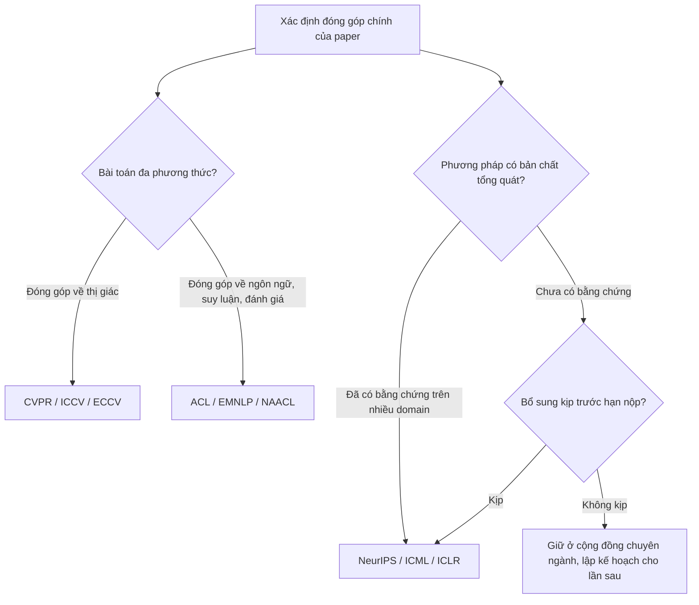

# Chuyển một paper giữa các cộng đồng

!!! abstract "Mục tiêu của bài"
    Sau bài này, người học có thể:

    - Quyết định có cơ sở khi nào nên chuyển một paper sang cộng đồng khác và khi nào không nên.
    - Liệt kê những thành phần của paper phải thay đổi khi chuyển: framing, Introduction, Related Work, thí nghiệm, độ dài, template và các mục bắt buộc.
    - Áp dụng bảng chuyển đổi cho các hướng giữa Computer Vision, NLP và Machine Learning.
    - Lập kế hoạch chuyển template và viết lại trong 3–5 ngày.
    - Nhận diện và tránh rủi ro dual submission khi các chu kỳ review chồng lấn nhau.

Có ba tình huống thường dẫn tới việc chuyển một paper sang cộng đồng khác. Tình huống phổ biến nhất là bài bị reject và hạn nộp gần nhất lại thuộc một cộng đồng khác: một bài bị reject ở ICCV có thể được cân nhắc cho NeurIPS hay AAAI, một bài bị reject ở NeurIPS có thể được cân nhắc cho ICLR hay CVPR. Tình huống thứ hai là đóng góp vốn nằm ở giao điểm của hai cộng đồng, như phần lớn nghiên cứu vision-language. Tình huống thứ ba là review lần trước cho rằng bài "more suitable for" một nơi khác, và nhóm tác giả thấy nhận xét đó có lý.

Trong cả ba tình huống, sai lầm thường gặp nhất là coi việc chuyển đổi như một thao tác kỹ thuật: đổi template, cắt bớt hoặc thêm vài đoạn cho vừa số trang, rồi nộp. Reviewer của cộng đồng mới nhận ra điều này ngay từ trang đầu, vì Introduction vẫn được viết cho người đọc cũ: vẫn mở đầu bằng benchmark mà họ không quan tâm, vẫn trích dẫn những công trình họ không biết, vẫn bỏ qua câu hỏi mà họ coi là trung tâm. Chuyển một paper giữa các cộng đồng thực chất là *lập luận lại* cùng một kết quả cho một nhóm người đọc khác. Bài này đi qua quyết định có nên chuyển hay không, những gì cần thay đổi, một quy trình thực hiện trong vài ngày, và rủi ro dual submission cần tránh.

## Khi nào nên chuyển, khi nào không

Lý do tốt nhất để chuyển là **đóng góp thực sự phù hợp với cộng đồng đích**, và điều đó thường rơi vào một trong ba trường hợp. Trường hợp đầu tiên là nghiên cứu liên ngành, điển hình là vision-language: mô hình thị giác–ngôn ngữ (VLM), sinh mô tả ảnh, hỏi đáp trên ảnh, suy luận đa phương thức. Những paper này có thể nộp vào CVPR hay ACL, và lựa chọn nên dựa trên việc đóng góp chính là *về thị giác* (biểu diễn ảnh, nhận dạng, định vị đối tượng) hay *về ngôn ngữ và suy luận* (cách mô hình hiểu câu hỏi, suy luận nhiều bước, đánh giá hành vi ngôn ngữ). Trường hợp thứ hai là phương pháp có bản chất tổng quát nhưng mới được minh họa ở một domain, chẳng hạn một kỹ thuật tối ưu, một dạng regularization, một cơ chế attention hiệu quả hay một phương pháp chọn dữ liệu huấn luyện; những phương pháp này có thể phù hợp với NeurIPS, ICML, ICLR nếu được bổ sung bằng chứng tương xứng. Trường hợp thứ ba là khi review trước chỉ ra một cách thuyết phục rằng đóng góp được đánh giá đúng hơn ở nơi khác.

Ngược lại, có những lý do *không* nên là động lực chính. Chạy theo hạn nộp gần nhất khi đóng góp không phù hợp với cộng đồng đích thường chỉ dẫn tới một lần reject nữa, kèm lời phê bình "more suitable for". Hy vọng rằng reviewer ở cộng đồng khác "sẽ không biết rõ benchmark" là một tính toán sai: nhiều reviewer tham gia cả hai cộng đồng, và reviewer ngoài chuyên ngành thường *hoài nghi hơn* chứ không dễ dãi hơn với những claim họ không kiểm chứng được. Cuối cùng, chuyển cộng đồng không phải là cách để né những phê bình xác đáng của lần review trước; các phê bình về độ chặt chẽ hay thiếu baseline sẽ được nêu lại ở bất kỳ đâu.

Sơ đồ dưới đây tóm tắt quá trình ra quyết định cho hai tình huống thường gặp.



## Những gì phải thay đổi

Khi đã quyết định chuyển, nhóm tác giả cần rà soát paper theo sáu thành phần. Mức độ thay đổi ở mỗi thành phần khác nhau tùy hướng chuyển, nhưng không thành phần nào được bỏ qua hoàn toàn.

### Framing và Introduction

Framing là câu trả lời cho câu hỏi "paper này về cái gì" ở mức trừu tượng mà cộng đồng đích quan tâm. Cùng một phương pháp có thể được đóng khung là "một cách tốt hơn để giải bài toán X" (phù hợp CV hoặc NLP) hay "một nguyên lý Y, minh họa trên X" (phù hợp ML). Khi framing thay đổi, Introduction gần như phải viết lại: đoạn mở đầu nêu vấn đề ở mức mới, đoạn khoảng trống chỉ ra hạn chế của các hướng tiếp cận mà cộng đồng đích biết, và đoạn contributions diễn đạt lại theo loại đóng góp mà cộng đồng đó coi trọng. Thường thì Abstract và Introduction là phần tốn công nhất, và cũng là phần quyết định nhất, của việc chuyển đổi.

### Related Work

Mỗi cộng đồng có một "văn bản nền" khác nhau. Một paper về hiệu quả tính toán của Vision Transformer, khi chuyển sang ML, cần được đặt trong mạch nghiên cứu về attention hiệu quả và nén mô hình nói chung, không chỉ các biến thể ViT. Một paper VLM chuyển sang ACL cần trích dẫn các công trình về đánh giá và hiện tượng ngôn ngữ liên quan, không chỉ các mô hình thị giác. Việc không trích dẫn những công trình mà reviewer của cộng đồng đích coi là hiển nhiên là một tín hiệu mạnh rằng paper được viết cho nơi khác, và có thể dẫn tới phê bình "missing related work" hay tệ hơn là "unclear novelty".

### Thí nghiệm bổ sung

Mỗi cộng đồng có một loại bằng chứng mà họ coi là tối thiểu. Chuyển sang ML thường cần thêm toy experiment, domain thứ hai, error bars qua nhiều seed, và đôi khi một phân tích lý thuyết. Chuyển sang NLP thường cần thêm dataset, ngôn ngữ hoặc tập kiểm tra ngoài phân phối, kiểm định thống kê, phân tích lỗi bằng ví dụ, và human evaluation có giao thức nếu bài toán là sinh văn bản. Chuyển sang CV thường cần thêm benchmark chuẩn của lĩnh vực với baseline mạnh nhất gần đây, ablation chi tiết, và hình định tính. Đây là thành phần cần lập kế hoạch sớm nhất, vì thí nghiệm lớn không thể hoàn thành trong vài ngày.

### Độ dài, template và quy ước trình bày

Độ dài phần chính khác nhau giữa các hội nghị (chi tiết xem ở các bài hệ sinh thái của Chương 0), và quan trọng hơn, số cột cũng khác: CVPR, ICCV, ICML, ACL dùng hai cột; NeurIPS, ICLR và ECCV (định dạng LNCS) dùng một cột. Chuyển giữa một cột và hai cột đòi hỏi bố trí lại gần như toàn bộ hình và bảng. Quy ước trích dẫn cũng khác: CVPR dùng trích dẫn đánh số; ACL, ICML và ICLR dùng trích dẫn tác giả–năm; NeurIPS cho phép nhiều kiểu miễn là nhất quán. Khác biệt này ảnh hưởng tới cách viết câu: với trích dẫn tác giả–năm, câu "Smith et al. (2020) show that..." đọc tự nhiên, trong khi với trích dẫn đánh số, cách viết tương đương là "Smith et al. [12] show that...". Dùng nhất quán `\citet` và `\citep` của natbib giúp chuyển đổi dễ hơn, nhưng vẫn cần kiểm tra lại sau khi đổi template.

### Checklist và các mục bắt buộc

Mỗi cộng đồng có những mục bắt buộc riêng, và thiếu chúng có thể dẫn tới desk reject: NeurIPS Paper Checklist ở cuối PDF; impact statement ở ICML; mục Limitations và Responsible NLP Checklist ở ARR; các yêu cầu về supplementary và ẩn danh video ở CVPR. Khi chuyển, cần lập danh sách các mục bắt buộc của nơi đích và viết chúng một cách nghiêm túc, không sao chép từ mục tương tự của nơi cũ. Chẳng hạn, phần Limitations của ARR được reviewer NLP đọc kỹ, nên một đoạn limitations ngắn vốn đủ ở CVPR thường cần được mở rộng.

### Từ vựng của cộng đồng

Một chi tiết hay bị bỏ qua là cùng một từ có thể mang nghĩa khác nhau ở các cộng đồng. "Generalization" trong một paper CV thường hiểu là chuyển giữa các dataset; trong ML có thể hiểu là khoảng cách giữa lỗi huấn luyện và lỗi kiểm tra theo nghĩa lý thuyết; trong NLP có thể hiểu là tổng quát hóa ngoài phân phối hoặc tổng quát hóa kết hợp (compositional). Khi chuyển, người viết cần định nghĩa rõ những từ như vậy ở lần đầu sử dụng, và dùng từ vựng mà cộng đồng đích quen thuộc.

## Bảng chuyển đổi

Bảng dưới đây tổng hợp những thay đổi điển hình theo từng hướng chuyển. Bảng chỉ là điểm khởi đầu; các mục sau sẽ giảng giải từng cặp bằng ví dụ.

| Hướng | Framing | Introduction | Related Work | Thí nghiệm bổ sung | Hình thức |
|---|---|---|---|---|---|
| **CV → ML** | Từ "giải tốt hơn bài toán X" sang "nguyên lý Y, minh họa trên X" | Mở bằng câu hỏi khoa học, không bằng ứng dụng | Thêm mạch ML tổng quát, lý thuyết liên quan | Toy experiment, domain thứ hai, error bars, phân tích | Một cột (NeurIPS, ICLR) hoặc hai cột (ICML); appendix dài; checklist |
| **ML → CV** | Từ nguyên lý sang lợi ích cụ thể cho bài toán thị giác | Mở bằng bài toán và hạn chế của phương pháp CV hiện có | Thêm các phương pháp CV mạnh nhất gần đây | Benchmark chuẩn, so với SOTA của lĩnh vực, ablation, hình định tính | Hai cột, 8 trang; supplementary riêng |
| **CV → NLP** | Từ khả năng thị giác sang khả năng ngôn ngữ, suy luận hoặc đánh giá | Nhấn vào hiện tượng ngôn ngữ, hành vi của mô hình | Thêm công trình về đánh giá, hiện tượng ngôn ngữ, đạo đức dữ liệu | Thêm dataset, tập ngoài phân phối, kiểm định, phân tích lỗi, human eval | Hai cột; Limitations; Responsible NLP Checklist |
| **NLP → CV** | Từ hiện tượng ngôn ngữ sang vai trò của thông tin thị giác | Nêu rõ thành phần thị giác giải quyết điều gì | Thêm các mô hình và benchmark thị giác | Benchmark thị giác chuẩn, ablation thành phần thị giác, hình minh họa | Hai cột; supplementary; video nếu cần |
| **NLP → ML** | Từ kết quả trên tác vụ ngôn ngữ sang cơ chế học tổng quát | Mở bằng câu hỏi về cơ chế (ví dụ vì sao một hành vi xuất hiện) | Thêm mạch lý thuyết, tối ưu, các domain khác | Thí nghiệm có kiểm soát trên dữ liệu tổng hợp, domain khác, error bars | Appendix dài; checklist; giảm bảng ví dụ ngôn ngữ |
| **ML → NLP** | Từ nguyên lý sang ý nghĩa cho xử lý ngôn ngữ | Nêu rõ tác vụ và ngôn ngữ cụ thể được cải thiện | Thêm công trình NLP trên các tác vụ đã thử | Nhiều tác vụ, nhiều ngôn ngữ, phân tích lỗi, kiểm định thống kê | Hai cột; Limitations; Responsible NLP Checklist |

### Giữa Computer Vision và Machine Learning

Xét một ví dụ: một phương pháp loại bỏ bớt token trong Vision Transformer để tăng tốc suy luận. Bản CVPR mở đầu bằng nhu cầu chạy mô hình thị giác trên thiết bị biên, chỉ ra rằng các phương pháp cắt tỉa token hiện có làm giảm độ chính xác phát hiện đối tượng nhỏ, và báo cáo kết quả trên ImageNet, COCO, ADE20K với hình minh họa những token bị loại. Khi chuyển sang NeurIPS, câu chuyện có thể được nâng lên thành câu hỏi: những token nào thực sự mang thông tin trong một Transformer, và có tiêu chí nào để nhận biết chúng độc lập với modality? Bản NeurIPS khi đó cần một phân tích (có thể là một kết quả lý thuyết đơn giản về mối liên hệ giữa tiêu chí loại token và sai số đầu ra), một toy experiment cho thấy tiêu chí hoạt động đúng như dự đoán, và quan trọng nhất là bằng chứng trên một modality thứ hai, chẳng hạn Transformer cho văn bản. Hình minh họa token bị loại trên ảnh vẫn có giá trị, nhưng chuyển từ vai trò bằng chứng chính sang vai trò minh họa.

Chiều ngược lại, từ ML sang CV, thường đòi hỏi điều ngược lại: phần lý thuyết được rút gọn và có thể chuyển sang supplementary, trong khi phần thực nghiệm phải đạt chuẩn CV, nghĩa là so sánh trên benchmark chuẩn với các phương pháp CV mạnh nhất gần đây chứ không chỉ với các baseline tổng quát. Reviewer CV sẽ hỏi ngay: phương pháp này so thế nào với cách tiếp cận chuyên biệt tốt nhất cho bài toán?

### Giữa Computer Vision và NLP

Xét một paper về hiện tượng "ảo giác" (hallucination) của VLM, tức mô hình mô tả những đối tượng không có trong ảnh. Bản CVPR có thể tập trung vào nguyên nhân thị giác: bộ mã hóa ảnh bỏ sót đối tượng nhỏ, độ phân giải đầu vào thấp, và đề xuất cải tiến ở phía thị giác, đánh giá trên các benchmark VLM với hình minh họa. Bản ACL của cùng nghiên cứu sẽ đặt trọng tâm vào hành vi ngôn ngữ: ảo giác xảy ra ở loại câu hỏi nào, có liên quan tới tiên nghiệm ngôn ngữ (ví dụ "bàn ăn" thường đi kèm "cái nĩa") hay không, tỉ lệ ảo giác thay đổi thế nào theo độ dài câu trả lời. Bản ACL cần phân tích lỗi bằng ví dụ có phân loại, human evaluation có giao thức khi metric tự động chưa đủ tin cậy, kiểm định thống kê, và phần Limitations bàn về phạm vi ngôn ngữ của các benchmark (phần lớn bằng tiếng Anh). Phần lớn thí nghiệm có thể dùng chung; điều thay đổi là câu hỏi mà paper đặt lên hàng đầu.

### Giữa NLP và Machine Learning

Xét một paper phát hiện rằng hiệu quả của in-context learning phụ thuộc mạnh vào một tính chất cụ thể của các ví dụ minh họa. Bản ACL báo cáo phát hiện trên nhiều tác vụ phân loại và sinh văn bản, nhiều họ mô hình, kèm phân tích lỗi và thảo luận ý nghĩa cho việc thiết kế prompt. Bản NeurIPS hoặc ICLR cần trả lời thêm câu hỏi về cơ chế: hiện tượng có xuất hiện trong một Transformer nhỏ huấn luyện trên dữ liệu tổng hợp hay không, nó phụ thuộc vào yếu tố nào của quá trình huấn luyện, và có mô hình giải thích nào khớp với quan sát hay không. Bảng ví dụ ngôn ngữ, vốn là bằng chứng quý ở ACL, trở thành nội dung phụ trong appendix; thay vào đó là các đồ thị theo yếu tố điều khiển và error bars.

Chiều ngược lại, từ ML sang NLP, thường gặp khi một phương pháp tổng quát (ví dụ một kỹ thuật fine-tuning hiệu quả tham số) được thử chủ yếu trên ảnh hoặc trên các bài toán tổng hợp. Reviewer NLP sẽ yêu cầu bằng chứng trên nhiều tác vụ ngôn ngữ, so sánh với các phương pháp đang được cộng đồng NLP dùng thực tế, và gọi tên rõ những ngôn ngữ đã thử.

## Quy trình chuyển template trong 3–5 ngày

Quy trình dưới đây giả định phần lớn thí nghiệm đã có, và các thí nghiệm bổ sung còn lại là nhỏ. Nếu chuyển cộng đồng đòi hỏi thí nghiệm lớn (một domain mới hoàn toàn, một human evaluation quy mô lớn), cần lên kế hoạch từ vài tuần trước, và tốt nhất là khởi chạy chúng song song ngay khi nhận kết quả review của lần nộp trước.

Ngày đầu tiên dành cho việc **định vị lại**. Nhóm tác giả đọc lại toàn bộ review cũ, đọc ba đến năm paper gần đây cùng chủ đề ở hội nghị đích để nắm cách họ đóng khung vấn đề, rồi viết lại đoạn pitch một đoạn văn của paper cho người đọc mới. Từ đó, lập danh sách thay đổi: framing mới, thí nghiệm bổ sung, các mục bắt buộc, những công trình cần trích dẫn thêm. Cuối ngày, Abstract mới và dàn ý Introduction mới nên được hoàn thành, vì chúng định hướng mọi thay đổi khác.

Ngày thứ hai dành cho **chuyển LaTeX**. Tải template chính thức của năm nộp, chuyển macros và file bibliography, biên dịch thành công, rồi bố trí lại hình và bảng cho số cột mới. Đây là lúc biết chính xác paper đang thừa hay thiếu bao nhiêu trang, thông tin cần thiết để quyết định nội dung nào chuyển vào hoặc ra khỏi appendix.

Ngày thứ ba dành cho **viết lại phần lõi**: Introduction theo dàn ý mới, Related Work với các mạch nghiên cứu của cộng đồng đích, và Method với mức trừu tượng phù hợp (chẳng hạn tách phần công thức hóa tổng quát khỏi chi tiết kiến trúc khi chuyển sang ML). Nội dung không còn phù hợp với phần chính được chuyển sang appendix thay vì xóa bỏ.

Ngày thứ tư dành cho **bằng chứng và mục bắt buộc**: hoàn thiện các thí nghiệm bổ sung nhỏ, đưa kết quả vào bảng và hình mới, viết các mục bắt buộc như Limitations, checklist, impact statement. Ngày thứ năm dành cho **đọc chéo và kiểm tra**: nhờ một người thuộc cộng đồng đích đọc Abstract và Introduction và nói lại thông điệp chính, kiểm tra ẩn danh, giới hạn trang, tài liệu tham khảo, rồi nộp. Nếu thời gian gấp, có thể gộp ngày hai với ngày ba, nhưng không nên cắt ngày đầu: viết lại khi chưa định vị lại xong là cách nhanh nhất để tạo ra một paper "đổi template nhưng không đổi người đọc".

| Ngày | Trọng tâm | Kết quả cuối ngày |
|---|---|---|
| 1 | Định vị lại: đọc review cũ, đọc paper ở venue đích, viết pitch mới | Abstract mới, dàn ý Introduction, danh sách thay đổi |
| 2 | Chuyển LaTeX: template, macros, bibliography, bố trí hình và bảng | Bản biên dịch được trên template mới, biết số trang thừa thiếu |
| 3 | Viết lại Introduction, Related Work, Method | Phần lõi theo framing mới; nội dung dư chuyển sang appendix |
| 4 | Thí nghiệm bổ sung nhỏ, mục bắt buộc | Bảng, hình mới; Limitations, checklist, statement |
| 5 | Đọc chéo, kiểm tra ẩn danh và định dạng | Bản nộp |

Về mặt kỹ thuật, việc chuyển template sẽ nhẹ nhàng hơn rất nhiều nếu dự án LaTeX được tổ chức từ đầu theo cách tách nội dung khỏi định dạng: mỗi section là một file riêng, ký hiệu và tên phương pháp được định nghĩa bằng macro, và mỗi hội nghị có một file `main` riêng chỉ chứa phần khai báo template. Bài [LaTeX & Overleaf](../03-ky-thuat/latex.md) trình bày cách tổ chức này chi tiết hơn.

```latex
% Cấu trúc thư mục gợi ý
%   main_cvpr.tex      (template CVPR, \venuemlfalse)
%   main_neurips.tex   (template NeurIPS, \venuemltrue)
%   macros.tex         (ký hiệu, tên phương pháp, cờ venue)
%   sec/1_intro.tex, sec/2_related.tex, sec/3_method.tex, ...

% Trong macros.tex
\newif\ifvenueml
\newcommand{\method}{\textsc{TokenSift}\xspace}

% Trong sec/3_method.tex: nội dung chỉ dành cho bản ML
\ifvenueml
  \subsection{Theoretical Analysis}\label{sec:theory}
  \input{sec/3b_theory}
\fi
```

Cách dùng cờ như trên tiện cho những khác biệt nhỏ, nhưng không nên lạm dụng: khi framing thay đổi, Introduction của hai bản thường khác nhau đủ nhiều để nên là hai file riêng (`sec/1_intro_cvpr.tex`, `sec/1_intro_neurips.tex`) thay vì một file chằng chịt lệnh điều kiện.

## Rủi ro dual submission khi nộp song song

**Dual submission** là việc nộp cùng một nội dung, hoặc nội dung về cơ bản giống nhau, tới hai nơi có quy trình bình duyệt trong cùng khoảng thời gian. Gần như mọi hội nghị A\* và journal đều cấm điều này, và hậu quả thường là desk reject ở cả hai nơi, đôi khi kèm các biện pháp xử lý bổ sung đối với tác giả. Điều quan trọng cần hiểu là **viết lại framing không biến paper thành một paper khác**. Hai bản CVPR và ACL của cùng một nghiên cứu VLM, dù Introduction khác nhau, vẫn là cùng một đóng góp với cùng thí nghiệm cốt lõi; nộp chúng song song là dual submission. Tương tự, chia một nghiên cứu thành hai paper gần giống nhau để nộp hai nơi cũng bị coi là vi phạm nếu phần trùng lặp đáng kể.

Rủi ro thực tế nằm ở chỗ chu kỳ review của các hội nghị chồng lấn nhau, nên trong nhiều trường hợp, không thể nộp vào hội nghị tiếp theo trước khi biết kết quả của hội nghị hiện tại. Nếu nhóm tác giả muốn chuyển trong lúc bài vẫn đang được review, cách duy nhất hợp lệ là rút bài khỏi nơi thứ nhất một cách chính thức trước khi nộp vào nơi thứ hai. Bảng dưới đây nêu một số cặp chồng lấn điển hình theo lịch những năm gần đây; lịch cụ thể thay đổi theo năm và cần được kiểm tra lại.

| Đang review ở | Muốn nộp tiếp | Vấn đề điển hình | Cách xử lý |
|---|---|---|---|
| CVPR (kết quả khoảng cuối tháng 2) | ICML (hạn khoảng cuối tháng 1) | Hạn ICML đến trước khi có kết quả CVPR | Chọn một nơi; nếu chọn ICML phải rút khỏi CVPR trước |
| ICCV hoặc ECCV (kết quả khoảng tháng 6–7) | NeurIPS (hạn khoảng tháng 5) | Hạn NeurIPS đến trước khi có kết quả | Tương tự: chọn một nơi |
| NeurIPS (kết quả khoảng cuối tháng 9) | AAAI (hạn khoảng tháng 8) | Hạn AAAI đến trước khi có kết quả NeurIPS | Đọc kỹ chính sách của AAAI năm đó; mặc định coi là chồng lấn |
| NeurIPS (kết quả khoảng cuối tháng 9) | ICLR (hạn khoảng cuối tháng 9, đầu tháng 10) | Kết quả thường có ngay trước hạn ICLR, thời gian sửa rất ngắn | Chuẩn bị sẵn kế hoạch sửa trước khi có kết quả |
| Một chu kỳ ARR | Bất kỳ hội nghị nào khác | Bài đang trong ARR không được đồng thời review ở nơi khác | Rút khỏi ARR theo đúng quy trình trước khi nộp nơi khác |

Ngoài các hội nghị, cần lưu ý thêm hai điểm. Thứ nhất, workshop có proceedings chính thức (archival) có thể được coi là đã công bố; với CV, workshop paper dài hơn khoảng bốn trang thường rơi vào trường hợp này, khiến bản đầy đủ sau đó có thể bị coi là trùng lặp. Workshop không lưu trữ (non-archival) thường không gặp vấn đề này. Thứ hai, preprint trên arXiv nhìn chung không bị coi là dual submission, nhưng mỗi hội nghị có chính sách riêng về ẩn danh liên quan tới preprint, đã được trình bày ở bài [Chuẩn bị nộp bài](../04-nop-va-sau-nop/submission.md).

!!! danger "Không đánh cược với dual submission"
    Nhiều reviewer tham gia review ở nhiều cộng đồng cùng lúc, và một số hội nghị phối hợp với nhau để phát hiện bài nộp trùng. Khả năng bị phát hiện cao hơn nhiều so với hình dung, còn hậu quả thì nặng hơn nhiều so với việc chờ thêm một chu kỳ. Khi không chắc chắn, hãy đọc chính sách dual submission của cả hai nơi và hỏi trực tiếp Program Chairs.

## Tóm tắt

Chuyển một paper giữa các cộng đồng là lập luận lại cùng một kết quả cho người đọc mới, không phải đổi template. Lý do chính đáng để chuyển là đóng góp thực sự phù hợp với cộng đồng đích: nghiên cứu liên ngành như vision-language, phương pháp có bản chất tổng quát, hoặc review trước chỉ ra điều đó một cách thuyết phục. Khi chuyển, cần rà soát framing, Introduction, Related Work, thí nghiệm bổ sung, độ dài và template, các mục bắt buộc, cùng từ vựng của cộng đồng; thí nghiệm bổ sung là phần cần lên kế hoạch sớm nhất. Với phần lớn thí nghiệm đã sẵn, việc chuyển đổi có thể hoàn thành trong 3–5 ngày nếu bắt đầu bằng định vị lại và dự án LaTeX được tổ chức tốt. Cuối cùng, vì chu kỳ review của các hội nghị chồng lấn nhau, cần kiểm tra kỹ lịch và chính sách để tránh dual submission.

## Bài tập

1. Với một dự án đang thực hiện, xác định đóng góp chính và dùng sơ đồ quyết định trong bài để chọn cộng đồng phù hợp nhất. Viết một đoạn lập luận cho lựa chọn đó.
2. Chọn một hướng chuyển trong bảng chuyển đổi phù hợp với dự án. Viết lại Abstract theo framing của cộng đồng đích và liệt kê các thí nghiệm bổ sung cần có, ước lượng thời gian cho mỗi thí nghiệm.
3. Tổ chức lại dự án LaTeX hiện có theo cấu trúc tách nội dung khỏi định dạng, với hai file `main` cho hai hội nghị thuộc hai cộng đồng khác nhau, và biên dịch thành công cả hai.
4. Lập lịch nộp bài cho một năm, đánh dấu các khoảng chồng lấn giữa thời gian review của những hội nghị mà dự án có thể nhắm tới, và xác định thứ tự nộp hợp lệ nếu bài bị reject ở lần đầu.
