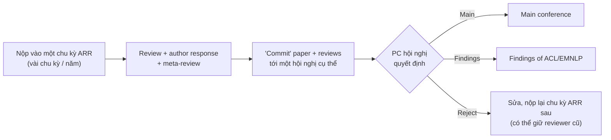

# ACL / EMNLP / NAACL (ACL Rolling Review)

## ACL Rolling Review (ARR) — cơ chế khác hẳn CV

Các hội nghị *ACL lớn (ACL, EMNLP, NAACL, EACL, AACL…) dùng chung hệ thống **ARR**:

- Bạn **tách** việc nhận review khỏi việc chọn hội nghị.
- **Findings** là proceedings đi kèm (được nhiều nơi công nhận, nhưng thường đánh giá thấp hơn main).
- Khi nộp lại, bạn có thể **yêu cầu giữ reviewer cũ** và đính kèm **revision notes** giải thích đã sửa gì.

## Format

- **Long paper: 8 trang**, **short paper: 4 trang** (nội dung), + references không giới hạn, + appendix.
- **Phần "Limitations" bắt buộc**, đặt sau Conclusion, **không tính** vào giới hạn trang. Thiếu → desk reject.
- **Ethics statement** (tùy chọn nhưng khuyến khích), **Responsible NLP checklist** bắt buộc.
- Camera-ready thường được thêm 1 trang.
- Template ACL **2 cột** (LaTeX `acl.sty` chế độ `review`), luôn lấy bản template ARR hiện hành.

## Thang điểm & tiêu chí

Review ARR có các trường như **Soundness**, **Excitement**, **Overall Assessment** (thang ~1–5, với các mức tương ứng main/Findings/resubmit), **Reproducibility**, **Confidence**. Hai trục *Soundness* và *Excitement* tách biệt: một paper có thể rất chắc chắn nhưng ít hào hứng → phù hợp Findings.

## Khác biệt "khẩu vị" so với CV

1. **Đánh giá kỹ lưỡng hơn là SOTA**: nhiều dataset, nhiều ngôn ngữ, phân tích lỗi định tính, kiểm định thống kê, human evaluation có giao thức rõ.
2. **Limitations nghiêm túc** — reviewer NLP đọc kỹ phần này.
3. **Phân tích ngôn ngữ / ví dụ** (tables of examples) thay cho hình ảnh.
4. **Multilingual & low-resource**: điểm cộng; paper chỉ tiếng Anh có thể bị hỏi.
5. **Dữ liệu & đạo đức**: nguồn dữ liệu, license, annotator được trả công thế nào, bias.
6. Với **paper vision-language** (VLM, captioning, VQA): có thể nộp CV hoặc NLP — chọn dựa trên đóng góp chính là *về vision* hay *về language/reasoning*, và **viết lại framing** tương ứng.

!!! tip "Lợi thế cho người Việt"
    Hội nghị NLP rất trân trọng tài nguyên và đánh giá cho **ngôn ngữ ít tài nguyên** như tiếng Việt. Một benchmark/dataset tiếng Việt chất lượng cao, có phân tích sâu, là đóng góp có giá trị (đặc biệt ở track resources/evaluation).
