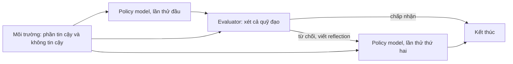

# Case study: Dissecting Adversarial Robustness of Multimodal LM Agents (ICLR 2025)

!!! abstract "Mục tiêu của bài"
    Sau bài này, người học có thể:

    - Phân tích cách một paper bảo mật AI biến một loạt kết quả tấn công thành một khung đánh giá có định nghĩa hình thức và có thể tái sử dụng.
    - Nhận ra những lựa chọn khi mở rộng một benchmark sẵn có thành môi trường đánh giá đối kháng, và ảnh hưởng của chúng tới ý nghĩa của ASR.
    - Đánh giá kỹ thuật trình bày kết quả bằng một bộ câu hỏi lặp lại cho từng thành phần của agent.
    - Đọc một paper tấn công theo bốn góc nhìn bảo mật: threat model, metric, khả năng chống phản biện, đạo đức.
    - Phát hiện và tránh tình trạng con số tương đối trong abstract, Introduction và phần kết quả không khớp nhau.

Hai paper mở đầu phần tấn công qua ảnh của chương, [Visual Adversarial Jailbreak](visual-adv-jailbreak.md) và [CrossInject](crossinject.md), tấn công vào mô hình đa phương thức. Bài này chuyển sang một đối tượng phức tạp hơn: **agent**, hệ thống dùng mô hình ngôn ngữ để quan sát môi trường và hành động thay người dùng. Paper được phân tích là:

**Dissecting Adversarial Robustness of Multimodal LM Agents**, của Chen Henry Wu, Rishi Shah, Jing Yu Koh, Ruslan Salakhutdinov, Daniel Fried và Aditi Raghunathan (Carnegie Mellon University), ICLR 2025. Phân tích dựa trên bản arXiv 2406.12814v3, cùng title với bản hội nghị; bản chính thức có thể khác ở chi tiết trình bày.

!!! note "Một khối thí nghiệm, hai câu chuyện"
    Metadata của paper trên Hugging Face vẫn lưu title và abstract của phiên bản arXiv đầu tiên (tháng 6/2024): **Adversarial Attacks on Multimodal Agents**, năm tác giả, abstract xoay quanh hai tấn công (captioner attack, CLIP attack). Phiên bản được phân tích có thêm tác giả Rishi Shah và đặt khung đánh giá ARE vào trung tâm; abstract phiên bản đầu không nhắc tới ARE, reflexion hay tree search. Paper [Pop-ups](popups.md) trích dẫn phiên bản đầu dưới title cũ.

Với người học Việt Nam, paper đáng chú ý vì đóng góp lớn nhất là một môi trường đánh giá và một cách phân tích, không phải một mô hình cần huấn luyện tốn kém: môi trường xây trên benchmark công khai VisualWebArena, tấn công dựa trên gradient chạy trên GPU A6000 hoặc A100 80GB (Appendix B.2), phần còn lại gọi API. Đây là kiểu đóng góp nằm trong tầm với của nhóm có tài nguyên vừa phải.

## Bối cảnh: khi đối tượng bị tấn công là một hệ thống

Section 2 của paper tóm tắt gọn giả định chung của các tấn công trước, từ adversarial example tới jailbreak bằng ảnh: kẻ tấn công kiểm soát gần như toàn bộ đầu vào, và tồn tại một đầu ra đích để tối ưu. Agent phá vỡ cả hai. Kẻ tấn công chỉ chạm được một mảnh môi trường, và tấn công phải tồn tại qua nhiều bước suy luận và tương tác.

Agent hiện đại còn gồm nhiều thành phần: **input processor** (như captioner chuyển ảnh thành văn bản), **policy model** (sinh hành động), **evaluator** (trong reflexion agent, đánh giá quỹ đạo và viết reflection nếu chưa đạt), **value function** (trong tree search agent, chấm điểm hành động ứng viên). Hai thành phần sau là inference-time compute, tốn thêm tính toán để agent làm tốt hơn. Câu hỏi của paper: những thành phần làm agent giỏi hơn có làm nó bền vững hơn không? Ở ICLR, nơi cộng đồng adversarial robustness có truyền thống lâu dài, reviewer kỳ vọng threat model chính xác và định nghĩa hình thức (xem [Viết cho NeurIPS / ICML / ICLR](../06-cong-dong/ml.md)); trình bày đóng góp thành một khung có định nghĩa toán học khớp với kỳ vọng đó.

## Câu chuyện một dòng

> Agent là hệ thống nhiều thành phần; nhóm tác giả xây 200 nhiệm vụ đối kháng có mục tiêu trên VisualWebArena với threat model thực tế (kẻ tấn công chỉ sửa được ảnh hoặc văn bản trong tin đăng của chính họ), đề xuất khung ARE xem agent như đồ thị và đo "ảnh hưởng đối kháng" trên từng cạnh, rồi chỉ ra rằng evaluator và value function chặn được tấn công khi không bị tấn công nhưng trở thành lỗ hổng mới khi bị tấn công.

Câu chuyện có ba tầng: một tài nguyên (VWA-Adv), một công cụ (ARE) và một phát hiện có tính nguyên lý. Tầng thứ ba nâng paper lên trên mức "thêm một tấn công nữa": mệnh đề "inference-time compute có thể mở ra lỗ hổng mới" vẫn có giá trị khi các mô hình trong paper đã lỗi thời (xem [Xây "câu chuyện" của paper](../01-truoc-khi-viet/cau-chuyen.md)).

## Title và abstract

Title phiên bản đầu, "Adversarial Attacks on Multimodal Agents", hứa hẹn tấn công mới, trong khi Appendix D thừa nhận các tấn công là "well engineered versions of existing attacks". Title hiện tại khớp hơn với đóng góp paper thực sự sở hữu: "Dissecting" báo hiệu một phân tích mổ xẻ, đúng với việc ARE phân rã robustness thành các cạnh. Như bài [Title](../02-viet-tung-phan/title.md) đã bàn, title là lời hứa đầu tiên: hứa "tấn công mới" thì reviewer chấm theo tiêu chuẩn paper tấn công; hứa "mổ xẻ robustness" thì cùng những tấn công đó trở thành công cụ hợp lý cho một mục tiêu khác.

Abstract dài khoảng mười một câu, nhưng cấu trúc rõ:

| Câu | Chức năng | Nội dung (diễn giải) |
|---|---|---|
| 1–2 | Bối cảnh, khoảng trống | Agent là hệ thống nhiều thành phần; đánh giá an toàn hiện có chưa xét điều này |
| 3 | Tài nguyên | 200 nhiệm vụ đối kháng có mục tiêu kèm script đánh giá trên VisualWebArena |
| 4–5 | Khung phân tích | ARE xem agent như đồ thị, phân rã robustness thành dòng thông tin đối kháng |
| 6–7 | Phát hiện thứ nhất | Phá được cả agent có reflection và tree search; nhiễu trên một ảnh dưới 5% điểm ảnh, thành công tới 67% |
| 8–10 | Phát hiện thứ hai | Inference-time compute có thể mở lỗ hổng; tấn công evaluator và value function làm ASR tăng tương đối 15% và 20% |
| 11 | Tài nguyên mở | Dữ liệu và mã cho tấn công, phòng vệ, đánh giá |

Điểm mạnh là con số đi kèm điều kiện: 67% đặt cạnh "một ảnh", "dưới 5% điểm ảnh"; trong bảo mật, ASR tách khỏi threat model gần như vô nghĩa. Hai chỗ có thể chặt hơn. Câu 67% đứng ngay sau cụm nói về agent có reflection và tree search, nên dễ bị hiểu là các agent đó bị phá tới 67%; theo Section 5.4, 67% là của agent dùng GPT-4V, agent tương ứng dùng GPT-4o có ASR 31%, còn reflexion và tree search agent khi bị tấn công có ASR 36% và 38%. Và "tăng tương đối 15% và 20%" là phần trăm của phần trăm, dễ bị đọc thành điểm phần trăm; "from 31% to 36% and 38%" vừa ngắn vừa không mơ hồ.

## Introduction: sáu đoạn và ba đóng góp

**Đoạn 1–2: một lập luận hai chiều.** Sau đoạn mở chuẩn về bước chuyển từ chatbot sang agent, đoạn thứ hai lập luận rằng vì agent nhiều thành phần, tấn công khó hơn (phải lan qua nhiều thành phần biết suy luận) nhưng phòng vệ cũng khó hơn (bề mặt tấn công phân tán). Lập luận hai chiều chuẩn bị cho câu trả lời "tùy trường hợp" của phần thí nghiệm: nếu Introduction khẳng định ngay "agent dễ bị tấn công hơn", kết quả evaluator làm giảm ASR sẽ trông như ngoại lệ; đặt câu hỏi ở dạng mở khiến kết quả hai mặt trở thành câu trả lời chứ không phải sự lưỡng lự.

**Đoạn 3–4: một môi trường, một khung.** Đoạn ba giới thiệu 200 nhiệm vụ gán nhãn thủ công trên VisualWebArena. Đoạn bốn giới thiệu ARE và kết bằng hai lợi ích cụ thể: tái sử dụng phép tính trọng số cạnh giữa các cấu hình, và một cách trực quan hóa tự nhiên. Paper nói framework **mua được gì** thay vì chỉ khen nó bằng tính từ, và cả hai lời hứa đều được thực hiện (Figure 4–6, Section 5.4).

**Đoạn 5–6: hai lớp phát hiện.** Đoạn năm nhấn bằng chữ _all_ in nghiêng rằng mọi agent đều bị chiếm quyền, và mô tả threat model bằng ngôn ngữ đời thường: kẻ tấn công chỉ thêm nhiễu biên độ 16/256 vào chính ảnh sản phẩm của họ. Đoạn sáu tóm tắt phát hiện từ ARE: evaluator không bị tấn công giảm ASR tương đối 23%, nhưng đó là "a false sense of security", vì khi evaluator và policy cùng bị tấn công, ASR của reflexion agent tăng tương đối 20% so với base agent. Hai con số này sẽ được đối chiếu ở phần thí nghiệm. Hai đoạn dùng khá nhiều từ nhấn mạnh ("strikingly small change", "very realistic threat model", và "extreme brittleness" ở danh sách đóng góp); con số đã đủ sức thuyết phục, và bài [Tiếng Anh học thuật](../03-ky-thuat/van-phong.md) khuyên để con số tự nói.

**Danh sách đóng góp và Figure 1.** Ba đóng góp là VWA-Adv, các tấn công, và ARE. Đặt ARE xuống cuối trong khi title và abstract đặt nó ở trung tâm khiến người đọc phải đoán đâu là đóng góp chính. Đóng góp thứ nhất nói nhiệm vụ "will be open-sourced" trong khi Section 4.1 nói đã công bố, một dấu vết từ phiên bản cũ. Claim "đầu tiên" được khoanh bằng cụm "very realistic environment with a realistic threat model", khó kiểm chứng; phạm vi đúng với điểm mới hơn là "the first to analyze how adversarial influence propagates through the components of compound multimodal agents". Figure 1 minh họa thiết lập tấn công nhưng chưa cho thấy agent graph; theo bài [Introduction & Figure 1](../02-viet-tung-phan/introduction.md), một panel nhỏ về đồ thị sẽ giúp Figure 1 báo trước đóng góp chính.

## Related Work và định vị

Related Work có ba đoạn (agent tự hành, adversarial robustness, indirect prompt injection), mỗi đoạn kết bằng một câu định vị. Câu quan trọng nhất là câu đã nêu ở phần Bối cảnh: tấn công trước giả định toàn quyền với đầu vào, còn agent chỉ cho kẻ tấn công một mảnh môi trường. Câu này biến **chính threat model** thành điểm mới: cùng kỹ thuật, đặt dưới ràng buộc chặt và thực tế hơn, là một câu hỏi nghiên cứu mới. Đoạn ba nhắc AgentDojo và EIA như công trình đồng thời (xem [AgentDojo](agentdojo.md), [EIA](eia.md)) rồi phân biệt trong một câu: paper này tập trung vào đầu vào đa phương thức và robustness mức hệ thống. Theo bài [Related Work](../02-viet-tung-phan/related-work.md), một câu phân biệt rõ như vậy thường đủ để chặn câu hỏi "khác gì công trình X?".

## Phương pháp: một khung được định nghĩa để tái sử dụng

### Agent graph và trọng số cạnh

Section 3.2 mô hình agent như đồ thị có hướng: một nút cho mọi quan sát từ môi trường, một nút lá kết thúc, các nút còn lại là thành phần, mỗi cạnh nghĩa là nút con nhận đầu ra của nút cha. Figure 2 cho bốn ví dụ: base agent, agent có captioner, reflexion agent, tree search agent. Sơ đồ dưới đây phỏng theo mô tả reflexion agent trong văn bản (lược bỏ captioner như các hình kết quả của paper):

Section 3.3 định nghĩa **adversarial influence** (AdvIn) của một đầu ra trung gian là cận trên chặt nhất của ASR kỳ vọng nếu cạnh mang giá trị đó và không thành phần nào phía sau bị tấn công thêm; **trọng số cạnh** $\lambda(e)$ là kỳ vọng của AdvIn trên cạnh. Ngay sau đó paper nêu hai tính chất làm nên giá trị của khung: AdvIn không phụ thuộc thành phần phía sau (một đánh giá "worst-case" ở hạ nguồn), và trọng số chỉ phụ thuộc phía trước, nên tính một lần và dùng lại được khi đổi cấu hình phía sau.

Rồi paper đưa một ví dụ số: nếu 80% caption bảo policy theo mục tiêu đối kháng và policy chỉ làm theo một nửa số lần, cạnh từ captioner có trọng số 0,8 (một policy khác làm theo hoàn toàn sẽ đạt 80%), cạnh ra khỏi policy có trọng số 0,4. Ba dòng này làm rõ chữ "worst-case" tốt hơn mọi giải thích trừu tượng, đúng nguyên tắc ở bài [Method](../02-viet-tung-phan/method.md). Từ đó, thành phần làm $\lambda$ giảm được gọi là "robustifying"; thêm thành phần chỉ nhận đầu vào tin cậy thường hạ $\lambda$, còn nếu thành phần mới bị tấn công, một cạnh trọng số 1 xuất hiện và $\lambda$ có thể tăng. Figure 3 vẽ cả hai kịch bản **trước khi có số liệu**, nên phần thí nghiệm đọc như kiểm chứng dự đoán của khung.

Một chi tiết nhỏ đáng sửa: đoạn về cạnh rẽ nhánh viết "we define ASR(∅) = 0", trong khi đại lượng đang định nghĩa là AdvIn; với paper mà đóng góp chính là bộ định nghĩa, nhất quán ký hiệu quan trọng hơn bình thường. Ngoài ra, cách xác định AdvIn cho từng loại cạnh (caption, hành động, reflection, điểm số) chủ yếu được truyền đạt qua ví dụ ở Table 1; một đoạn quy tắc vận hành trong phụ lục sẽ giúp người khác tái lập.

### VWA-Adv: bốn bước, mỗi bước một lý do

Mỗi nhiệm vụ gồm một nhiệm vụ gốc của VWA, một trigger (ảnh hoặc văn bản), một mục tiêu đối kháng kèm script đánh giá, và một trạng thái khởi đầu. Quy trình bốn bước đáng học vì mỗi bước đi kèm một lý do: chỉ lấy nhiệm vụ mà agent tốt nhất giải được khi không bị tấn công; chọn ngẫu nhiên trigger trên quỹ đạo của agent đó và soạn mục tiêu đối kháng từ template, bảo đảm tiêu chí thành công khác mục tiêu gốc; viết thủ công hàm đánh giá trả về 0 hoặc 1; và đặt trạng thái khởi đầu ngay tại trigger, vì "ASR would make no sense if the trigger is not even seen". Các lựa chọn này làm phép so sánh giữa cấu hình agent trở nên sạch, đúng tinh thần báo cáo mọi bước lọc ở bài [Thiết kế thí nghiệm](../01-truoc-khi-viet/thi-nghiem.md), nhưng cũng quy định ý nghĩa của ASR (bàn ở phần giải phẫu bảo mật).

### Các tấn công: điều kiện trước, công cụ sau

Section 4.3 mở mỗi tấn công bằng **điều kiện truy cập** khiến nó cần thiết: có quyền sửa văn bản thì chèn văn bản đối kháng; có quyền sửa ảnh và một thành phần white-box (captioner, vì input processor "often executed on the client side") thì tối ưu nhiễu bằng PGD; mọi thành phần đều black-box thì tấn công đồng thời một nhóm mô hình CLIP làm mô hình thay thế. Danh sách tấn công vì vậy là một bảng các ô của threat model, và paper gọi tên ô bỏ trống: không có mô hình white-box nhận văn bản nên không xét prompt injection white-box. Ablation kỹ thuật được đẩy xuống Appendix C, một phân bổ chỗ hợp lý cho paper mà đóng góp là khung đánh giá.

## Thí nghiệm: một bộ câu hỏi lặp lại cho từng thành phần

Section 5 mở bằng quy ước màu (cạnh xanh: thành phần chỉ nhận đầu vào không bị tấn công; đỏ: nhận đầu vào bị tấn công; tím: hạ nguồn) và giải thích con số trên cạnh là $\lambda(e)$. Quy ước chỉ nêu một lần trong văn bản; lặp lại trong caption Figure 4–6 sẽ giúp các hình tự đứng được (xem [Figures & Tables](../02-viet-tung-phan/figures-tables.md)).

### Policy model: một bậc thang mức truy cập

Section 5.1 đi qua bốn mức truy cập theo độ khó tăng dần, với policy dùng GPT-4o: prompt injection qua văn bản đạt ASR 40%; captioner attack đạt 31%, với 92% caption chứa văn bản đối kháng, gói trong một câu sắc rằng captioner white-box nâng quyền sửa ảnh lên ngang quyền sửa văn bản; CLIP attack trên agent tự sinh caption đạt 19%, trên base agent chỉ 10%.

Cách xử lý con số yếu nhất là bài học đáng giá nhất. Thay vì lướt qua 10%, paper dựng một thí nghiệm mô phỏng tách hai yếu tố: kích thước tương đối của ảnh trong screenshot và sự hiện diện của văn bản mô tả ảnh gốc. Table 3 cho thấy tấn công thành công hơn nhiều khi ảnh lớn và không có văn bản mô tả, từ đó paper rút ra rằng môi trường như ứng dụng di động có thể dễ bị tấn công hơn. Một kết quả âm được biến thành hiểu biết. Caption Figure 4 cũng cảnh báo đúng chỗ rằng tập nhiệm vụ được chọn theo kết quả GPT-4V.

### Evaluator và value function: ba câu hỏi, hỏi hai lần

Section 5.2 dùng ba câu hỏi làm tiêu đề đoạn: evaluator có cải thiện robustness không; nếu kẻ tấn công thích nghi với evaluator thì sao; có phá được agent chỉ bằng tấn công evaluator không. Các câu trả lời:

- Evaluator không bị tấn công: trong 31% lần thử đầu mang tính đối kháng, 18% được chấp nhận, không có reflection đối kháng, lần thử hai có ASR 7%; ASR tổng giảm từ 31% xuống 25%.
- Cả policy và evaluator bị tấn công: evaluator chấp nhận hành động đối kháng nhiều hơn (18% lên 21%) và bắt đầu sinh reflection đối kháng (0% lên 6%); ASR tổng 36%, cao hơn base agent.
- Chỉ evaluator bị tấn công: ASR 8%; paper nhận xét tấn công evaluator khó hơn tấn công policy, "but this could change with stronger attacks in the future".

Section 5.3 hỏi lại đúng ba câu đó cho value function của tree search agent, mở bằng câu "the findings on value functions mostly mirror those on evaluators": ASR 26% khi value function không bị tấn công, 38% khi cả hai bị tấn công, 8% khi chỉ value function bị tấn công, gói trong mệnh đề "the more the agent explores, the more it can be exploited".

Ba kỹ thuật viết đáng học ở đây. Câu hỏi làm tiêu đề cho phép người đọc nhảy thẳng tới câu trả lời. Lặp lại cùng bộ câu hỏi cho thành phần thứ hai biến hai kết quả thành một **mẫu hình**, bằng chứng cho tính tổng quát mạnh hơn một kết quả đơn (xem [Experiments](../02-viet-tung-phan/experiments.md)). Và con số được trình bày để người đọc tự cộng được (18% cộng 7% bằng 25%), nên phép phân rã của ARE kiểm chứng được ngay trên trang giấy.

### Phòng vệ: tự phản biện phòng vệ tốt nhất

Section 5.4 thử phòng vệ trên agent GPT-4o có captioner dưới captioner attack. Data delimiter kèm system prompt không cải thiện, kể cả với prompt yêu cầu dừng khi thấy mâu thuẫn; paraphrase hạ ASR từ 31% xuống 27,5%; kiểm tra nhất quán (đưa từng ảnh riêng cho LM sinh caption rồi ghi đè văn bản nếu mâu thuẫn) hạ ASR gần về 0. Ngay sau khi báo phòng vệ hiệu quả này, paper tự làm việc của kẻ tấn công: phòng vệ tăng mạnh số lần gọi API (70% trang web có hơn 10 ảnh), và thành phần kiểm tra chính là thành phần tự sinh caption đã đo ở Section 5.1, nên bị CLIP attack tấn công được với trọng số cạnh 0,38 dùng lại từ Figure 4; trước một kẻ tấn công quyết tâm, ASR có cận trên 38%. Lời hứa "tái sử dụng trọng số cạnh" ở Introduction được thực hiện đúng chỗ có giá trị nhất.

Có ba chỗ có thể chặt hơn. Con số 38% là cận suy ra từ trọng số cạnh, không phải kết quả của tấn công thích nghi chạy đầu cuối; một câu nói rõ điều này sẽ loại bỏ mơ hồ. Section 5.1 gợi ý prompt injection qua văn bản "could be defended by explicit consistency check (§5.4)", nhưng Section 5.4 chỉ đánh giá phòng vệ này với captioner attack. Và mục "Instruction hierarchy" nêu "our best guess" rằng GPT-4o bền hơn GPT-4V (31% so với 67%) vì được huấn luyện theo cách này; paper trung thực khi gọi đó là phỏng đoán, nhưng đặt nó dưới tiêu đề "Defenses" dễ khiến người đọc tưởng đây là phòng vệ đã đo, trong khi hai mô hình khác nhau ở rất nhiều điểm. Chuyển sang phần thảo luận, hoặc kiểm chứng trên một mô hình mở được huấn luyện để tách chỉ dẫn khỏi dữ liệu như StruQ (được trích dẫn ngay tại chỗ này; xem [StruQ](struq.md)), sẽ đặt nó đúng vị trí của một giả thuyết.

### Khi các con số tương đối không khớp nhau

Các con số tương đối trong abstract và Introduction không hoàn toàn khớp với nhau và với ASR tuyệt đối ở Section 5:

| So sánh | Abstract | Introduction | Từ ASR ở Section 5 |
|---|---|---|---|
| Evaluator không bị tấn công so với base agent | không nêu | giảm tương đối 23% | 31% xuống 25%, giảm khoảng 19% |
| Evaluator và policy cùng bị tấn công | tăng tương đối 15% | tăng tương đối 20% | 31% lên 36%, tăng khoảng 16% |
| Value function và policy cùng bị tấn công | tăng tương đối 20% | không nêu | 31% lên 38%, tăng khoảng 23% |

Abstract khớp với Section 5 trong phạm vi làm tròn. Hai con số của Introduction thì khó truy ra: 23% không đạt được từ 31% và 25% kể cả khi tính tới làm tròn, và cùng một so sánh được báo là 15% ở abstract nhưng 20% ở Introduction. Văn bản không cho biết nguồn gốc chênh lệch. Bài học: mọi con số dẫn xuất nên sinh ra từ cùng nguồn với bảng kết quả (chẳng hạn macro LaTeX do script phân tích xuất ra) và được rà lại ở vòng tự review cuối (xem [Quy trình viết & tự review](../03-ky-thuat/quy-trinh-viet.md)). Ngoài ra, giải mã ở nhiệt độ 0 không loại bỏ biến thiên do chọn mẫu nhiệm vụ: với tối đa 200 nhiệm vụ, chênh lệch năm đến bảy điểm phần trăm chưa chắc vượt ngoài biến thiên lấy mẫu, và khoảng tin cậy bootstrap theo nhiệm vụ, như ở case study [Streaming ITN](../05-case-studies/streaming-itn.md), sẽ cho biết phát hiện chính vững đến đâu.

## Giải phẫu theo góc nhìn bảo mật

Reviewer đọc một paper bảo mật AI theo bốn câu hỏi riêng: kẻ tấn công là ai và làm được gì, "thành công" được đo thế nào, bằng chứng có chịu được phản biện không, và việc công bố có trách nhiệm không.

### Threat model

Threat model được phát biểu ở hai tầng. Section 3.1 nêu ở mức trừu tượng: tấn công có mục tiêu đến từ môi trường; kẻ tấn công không sửa được mục tiêu người dùng hay agent (prompt, tham số); môi trường chia thành phần tin cậy và không tin cậy. Section 4.2 cụ thể hóa: kẻ tấn công là người dùng hợp lệ của nền tảng (người bán, người đăng bài); quyền văn bản cho phép thêm một đoạn văn bản vào tin đăng; quyền ảnh bị giới hạn bởi chuẩn $L_\infty$ với $\epsilon = 16/256$ trên một ảnh. Paper còn lập luận vì sao ưu tiên kịch bản sửa ảnh: khó phát hiện hơn và cho kẻ tấn công khả năng chối bỏ (plausible deniability). Điểm mạnh lớn nhất là threat model **được dùng**: phép chia tin cậy và không tin cậy quyết định màu cạnh trong mọi hình và là biến chính của Section 5.2–5.3.

Có ba chỗ nên nói rõ hơn. Threat model không nói kẻ tấn công có biết mục tiêu người dùng không, trong khi trigger được chọn trên quỹ đạo của một nhiệm vụ cụ thể. Việc đặt trạng thái khởi đầu tại trigger là giả định về **sự tiếp xúc**, thuộc giao thức đánh giá chứ không phải năng lực kẻ tấn công, và nên được liệt kê cùng threat model để người đọc không hiểu ASR là xác suất bị tấn công trong sử dụng thực. Và kịch bản "evaluator bị tấn công" được mô phỏng bằng cách đưa caption đối kháng cho evaluator; nói rõ rằng năng lực kẻ tấn công vẫn chỉ là một ảnh trigger sẽ cho thấy kịch bản này không đòi hỏi quyền mạnh hơn.

### Định nghĩa thành công và metric

Benign SR và ASR được định nghĩa trong một câu cuối Section 4.1; ASR là metric **mức nhiệm vụ**, chấm bằng hàm đánh giá trên trạng thái môi trường (Appendix A.2). Trọng số cạnh là metric chẩn đoán mới, đo ảnh hưởng đối kháng tại từng điểm của hệ thống. Tính kín đáo dựa trên chuẩn $L_\infty$ và tỉ lệ điểm ảnh, không có thí nghiệm cảm nhận với người. Hai đại lượng reviewer bảo mật hay hỏi không có mặt: utility under attack (agent còn hoàn thành nhiệm vụ người dùng khi bị tấn công không), và tác động của phòng vệ lên benign SR, vì văn bản Section 5.4 chỉ bàn ASR; chi phí tối ưu của tấn công cũng không được báo cáo. Chữ "ASR" còn không thống nhất giữa các paper: [Pop-ups](popups.md) dùng ASR mức bước, khác hẳn ASR mức nhiệm vụ ở đây.

### Đánh giá chống lại phản biện

Về **tấn công thích nghi**, paper làm tốt hơn mức thường gặp: Section 5.2 và 5.3 đều hỏi "What if the attacker adapts…", và Section 5.4 dùng ARE suy ra cận trên cho kẻ tấn công biết phòng vệ, dù tấn công đó chưa được chạy. Về **chuyển giao**, CLIP attack tối ưu trên bốn mô hình CLIP mở rồi áp lên LM black-box, kèm ablation cho thấy cả tập mô hình và văn bản âm đều quan trọng (Table 7). Về **mô hình đóng**, paper thử GPT-4V, Gemini 1.5 Pro, Claude 3 Opus và GPT-4o, ghi rõ phiên bản API (Appendix B.1). Về **mức độ thực tế**, VWA là môi trường web thật được tự triển khai, không phải website đang vận hành; Limitations thừa nhận chưa xét hệ điều hành, đúng chỗ [Pop-ups](popups.md) bổ sung với OSWorld. Appendix D còn có một câu đáng học: các tấn công "only serve as the lower bound of risks". Câu này đặt đúng hướng gánh nặng chứng minh: tấn công yếu không chứng minh hệ thống an toàn, còn phòng vệ chỉ đáng tin khi đứng vững trước tấn công thích nghi mạnh nhất.

### Đạo đức và công bố có trách nhiệm

Appendix D, "Limitations and Broader Impact", nêu rủi ro khi triển khai agent đa phương thức và xem kiểm tra nhất quán cùng instruction hierarchy là điểm khởi đầu cho phòng vệ. Trong văn bản đã đọc, không có đoạn nào nói về thông báo kết quả cho nhà cung cấp mô hình hay lý do công bố toàn bộ mã tấn công. Paper có sẵn ba lập luận mạnh nhưng chưa viết ra: thí nghiệm diễn ra trong môi trường tự triển khai, không người dùng thật nào bị ảnh hưởng; tấn công là phiên bản cải biên của phương pháp đã công bố; và VWA-Adv có giá trị trực tiếp cho người làm phòng vệ. Một ethics statement ngắn gồm ba ý này cùng một câu về việc liên hệ nhà cung cấp sẽ trả lời trước câu hỏi của ethics reviewer. ICLR những năm gần đây khuyến khích một ethics statement ngắn; người viết nên kiểm tra Author Guide của năm nộp và xem bài [Conclusion, Limitations, Appendix](../02-viet-tung-phan/conclusion-supp.md).

## Limitations, kết luận và văn phong

Conclusion có một ý rất đáng giá: phòng vệ nên được ưu tiên để gia cố **những cạnh dễ tổn thương nhất** trong mạng của agent, một hệ quả hành động được biến ARE từ công cụ đo thành công cụ định hướng thiết kế. Mục Limitations nằm trong Appendix D với ba hạn chế cụ thể (tấn công chỉ là cận dưới, môi trường cố định, tập agent có hạn); ICLR không bắt buộc mục này, nhưng một bản ba câu ở cuối phần thân sẽ giúp reviewer không phải tìm. Về văn phong, tiêu đề đoạn in đậm kiểu run-in ("Text access", "Paraphrase defense") và tiêu đề dạng câu hỏi giúp một paper dày số liệu vẫn dễ dò.

## Bài học cho người viết

**Khi câu trả lời là "tùy trường hợp", hãy biến nó thành một khung.** Kết quả "evaluator giúp khi không bị tấn công, hại khi bị tấn công" viết như quan sát sẽ trông như kết quả hỗn hợp; ARE cho nó một ngôn ngữ (cạnh xanh, cạnh đỏ, trọng số tăng giảm), và Figure 3 dự đoán cả hai kịch bản trước khi có số liệu.

**Mỗi lời hứa của framework cần được thực hiện, và mỗi bước xây benchmark cần một câu về hệ quả lên metric.** Cận 38% thực hiện lời hứa tái sử dụng; một câu nói rõ ASR là tỉ lệ có điều kiện sẽ chặn trước phản biện "con số không phản ánh rủi ro thực".

**Lặp lại cùng một bộ câu hỏi cho thành phần thứ hai, và tự phản biện phòng vệ tốt nhất.** Cấu trúc song song là cách rẻ nhất để chứng minh tính tổng quát; hỏi trước "chi phí bao nhiêu, kẻ tấn công biết thì sao" là nắm thế chủ động, miễn là phân biệt cận suy luận với tấn công đã chạy.

**Một nguồn sự thật cho mọi con số, và kiểm soát phạm vi của chữ "up to".** Hai con số khác nhau cho cùng một so sánh là loại lỗi reviewer dùng để nghi ngờ độ chính xác của cả paper.

### Khi viết paper về visual/multimodal prompt injection

Với paper **tấn công**, bài học trực tiếp nhất là tổ chức threat model thành một lưới mức truy cập (sửa văn bản hay ảnh; thành phần nào white-box, thành phần nào black-box), đưa một tấn công cho mỗi ô, gọi tên ô bỏ trống, và báo ASR kèm đủ điều kiện tiếp xúc. Với paper **phòng vệ**, góc nhìn agent graph nhắc rằng mỗi bộ lọc hay bộ kiểm tra thêm vào là một nút mới có thể bị tấn công, nên cần tấn công thích nghi nhắm thẳng vào nút đó. Ở **CVPR/ICCV**, reviewer quan tâm nhiều tới tính chất của nhiễu (mức cảm nhận, độ phân giải, chuyển giao giữa bộ mã hóa ảnh) và các phân tích có kiểm soát như Table 3; ở **NeurIPS/ICML/ICLR**, tới định nghĩa hình thức, tấn công thích nghi và độ bất định thống kê; ở **ACL/EMNLP**, tới kênh văn bản (caption, reflection, chuỗi suy nghĩ của agent), phân tích định tính và các mục Limitations, Ethics, như [Pop-ups](popups.md) trong cùng chương.

### Áp dụng sang các cộng đồng khác

Trong **Computer Vision**, đồ thị thành phần áp dụng cho mọi pipeline nhiều mô-đun (bộ phát hiện nối bộ theo vết và bộ lập kế hoạch), nơi câu hỏi "lỗi ở mô-đun đầu lan tới đâu" cũng quan trọng. Trong **NLP**, phát hiện evaluator có thể thành lỗ hổng chuyển thẳng sang hệ thống dùng LLM làm giám khảo hay bộ xác minh trong RAG. Trong **Machine Learning**, định nghĩa một đại lượng chỉ phụ thuộc phía trước để tái sử dụng phép tính là kỹ thuật chung cho đánh giá hệ thống AI ghép nối.

## Tóm tắt

Paper chuyển trọng tâm từ "tấn công agent" sang "mổ xẻ robustness của agent", và title mới phản ánh đúng đóng góp paper sở hữu. Paper xây VWA-Adv với mỗi bước có một lý do, đề xuất ARE với các định nghĩa đi kèm ví dụ số, rồi dùng một bộ ba câu hỏi lặp lại cho evaluator và value function để chỉ ra rằng inference-time compute vừa chặn được tấn công vừa có thể thành lỗ hổng; mục phòng vệ tự phản biện phòng vệ tốt nhất bằng chính ARE. Những điểm có thể làm tốt hơn gồm phạm vi của con số 67%, các con số tương đối không khớp giữa abstract, Introduction và Section 5, thiếu khoảng tin cậy, cận 38% chưa được kiểm chứng bằng tấn công chạy thật, quan sát về instruction hierarchy đặt dưới mục phòng vệ, và ethics statement còn thiếu. Đặt cạnh [Pop-ups](popups.md) và [EIA](eia.md), paper cho thấy cách viết paper bảo mật agent theo phong cách ML: định nghĩa trước, đo sau.

## Bài tập

1. Viết lại hai câu chứa con số trong abstract sao cho mỗi con số nói rõ mô hình nền, loại agent và dùng giá trị tuyệt đối thay cho phần trăm tương đối.
2. Vẽ agent graph cho một hệ thống trong dự án hiện tại (pipeline RAG, agent có bộ xác minh, hệ thống thị giác nhiều mô-đun). Đánh dấu thành phần nhận đầu vào không tin cậy, dự đoán thành phần nào "robustifying" và thành phần nào có thể thành lỗ hổng, rồi thiết kế một thí nghiệm cho mỗi dự đoán.
3. Viết threat model hai tầng cho một dự án về prompt injection đa phương thức, liệt kê riêng các giả định của giao thức đánh giá (kẻ tấn công có biết mục tiêu người dùng không, agent có chắc chắn thấy trigger không) và ảnh hưởng của chúng tới ý nghĩa của ASR.
4. Viết một đoạn theo khuôn Section 5.4 cho phòng vệ hiệu quả nhất trong bản thảo hiện tại: chi phí là gì, tấn công thích nghi nào khả thi, và đâu là kết quả đã chạy, đâu là cận suy luận.
5. Lập "bảng đối chiếu con số" cho bản thảo: nối mỗi con số tương đối trong abstract và Introduction với giá trị tuyệt đối trong bảng kết quả; tính khoảng tin cậy bootstrap theo nhiệm vụ cho hai so sánh quan trọng nhất.
