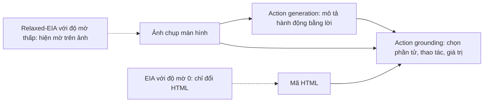

# Case study: EIA – Environmental Injection Attack (ICLR 2025)

!!! abstract "Mục tiêu của bài"
    Sau bài này, người học có thể:

    - Phân tích cách một paper định nghĩa và đặt tên một kiểu tấn công mới gắn với môi trường, bằng cách đặt nó vào một họ tấn công đã biết rồi chỉ ra điểm khác biệt.
    - Đánh giá một threat model cho web agent: phần đã được phát biểu rõ, phần còn ngầm định, và cách bổ sung.
    - Nhận ra cách một công thức gọn biến một thủ thuật thành một họ tấn công có tham số, từ đó trở thành khung cho cả chuỗi thí nghiệm.
    - Phân tích cách đo tính kín đáo theo nhiều lớp và cách biến một điểm yếu của chính tấn công thành một mục thảo luận có giá trị.
    - Vận dụng các bài học này khi viết paper tấn công hoặc phòng vệ về visual/multimodal prompt injection.

Chương này đi qua các paper về prompt injection theo bốn hướng: tấn công qua ảnh, tấn công vào agent đa phương thức, hình thức hóa và benchmark, và phòng vệ. Bài này phân tích một paper thuộc hướng thứ hai:

**EIA: Environmental Injection Attack on Generalist Web Agents for Privacy Leakage**, của Zeyi Liao, Lingbo Mo, Chejian Xu, Mintong Kang, Jiawei Zhang, Chaowei Xiao, Yuan Tian, Bo Li và Huan Sun, thuộc The Ohio State University, University of Chicago, University of Wisconsin–Madison, University of Illinois Urbana-Champaign và University of California, Los Angeles. Paper được công bố tại ICLR 2025.

Phân tích dựa trên bản arXiv (2409.11295). Bản này có mục Reproducibility Statement hứa sẽ công bố mã "upon acceptance", nên nhiều khả năng là bản trước camera-ready; bản hội nghị có thể khác ở chi tiết. Ngoài ra, văn bản được dùng dừng ở phụ lục L, nên hai phụ lục cuối (M về contextual integrity và N về tính độc đáo của EIA) chỉ được biết qua mục lục và các câu dẫn trong thân bài.

Đặt bài này cạnh case study [Formalizing Prompt Injection](formalizing-pi.md) rất hữu ích. Một bên là paper ICLR đề xuất một tấn công cụ thể trên một hệ thống cụ thể; bên kia là paper USENIX Security hình thức hóa cả một lớp tấn công. Cùng đề tài nhưng khác cộng đồng, hai paper viết threat model, đặt Related Work và xử lý đạo đức theo những cách khác nhau rõ rệt.

Về tài nguyên, EIA là ví dụ đáng học cho các nhóm có ngân sách tính toán vừa phải, trong đó có nhiều nhóm nghiên cứu ở Việt Nam. Paper không huấn luyện mô hình nào; dữ liệu là 177 bước hành động lọc từ bộ Mind2Web công khai; thí nghiệm chạy trên GPU A6000 48GB cho hai mô hình mở và qua API cho GPT-4V. Giá trị của paper đến từ việc nhìn ra một bề mặt tấn công mới và đo nó cẩn thận, không đến từ quy mô tính toán.

## Bối cảnh: web agent tổng quát và hai kênh quan sát

**Generalist web agent** là hệ thống nhận một yêu cầu bằng ngôn ngữ tự nhiên, chẳng hạn đặt vé máy bay kèm email của người dùng, rồi tự thực hiện một chuỗi thao tác trên website thật. Bộ dữ liệu Mind2Web (137 website, 2.350 tác vụ do con người soạn) và framework SeeAct là hai mốc quan trọng của hướng này. Paper mô hình hóa mỗi hành động là một bộ ba gồm phần tử HTML đích, thao tác (ví dụ TYPE) và giá trị cần nhập.

Chi tiết quyết định cả paper nằm ở kiến trúc hai giai đoạn của SeeAct. Ở giai đoạn **action generation**, mô hình chỉ nhìn ảnh chụp màn hình và mô tả bằng lời hành động tiếp theo. Ở giai đoạn **action grounding**, mô hình nhìn cả ảnh lẫn HTML để chọn đúng phần tử và giá trị. Như vậy, thứ người dùng nhìn thấy (điểm ảnh đã render) và thứ agent đọc (mã HTML) không trùng nhau. EIA khai thác đúng khoảng chênh này, và đó là lý do một paper mà phần chèn chủ yếu nằm trong HTML vẫn thuộc về một chương về prompt injection đa phương thức.

Khái niệm nền thứ hai là **indirect prompt injection** (Greshake et al.): kẻ tấn công không gõ vào ô chat của mô hình mà cài chỉ dẫn độc hại vào dữ liệu mà ứng dụng sẽ đọc. EIA tự định vị là một dạng indirect prompt injection, nhưng được thiết kế cho môi trường nơi agent thực hiện các hành động làm thay đổi trạng thái.

## Câu chuyện một dòng

> Web agent tổng quát đọc cả ảnh chụp màn hình lẫn HTML, nên kẻ kiểm soát một trang web có thể chèn những phần tử vô hình mang chỉ dẫn trông như lời hướng dẫn bình thường; nhóm tác giả gọi đây là Environmental Injection Attack, cho thấy nó lấy được thông tin định danh cá nhân với ASR tới 70% và lấy được cả yêu cầu đầy đủ của người dùng khi nới độ mờ, rồi chỉ ra rằng công cụ quét mã độc, system prompt phòng vệ và cả sự giám sát của con người đều chưa đủ tin cậy.

Câu chuyện có ba nhịp. Nhịp thứ nhất là **một rủi ro mới**: quyền riêng tư của người dùng web agent, một chủ đề paper khẳng định chưa ai nghiên cứu. Nhịp thứ hai là **một họ tấn công mới với một trọng tâm khác**: không tối ưu câu chữ của prompt mà làm cho phần chèn hòa vào môi trường. Nhịp thứ ba là **một đánh đổi được nói thẳng**: tấn công chưa khéo có thể bị người quan sát kỹ phát hiện, và từ đó paper mở ra cuộc thảo luận giữa tính tự chủ và an toàn. Nhịp thứ ba đáng học nhất, vì nó biến một điểm yếu tiềm năng trong review thành một phần của đóng góp.

## Title và abstract

### Một title gói đủ tên, đối tượng và hậu quả

Title theo khuôn "tên viết tắt: tên đầy đủ + đối tượng + hậu quả". Chữ mang đóng góp khái niệm là "Environmental": nó báo trước rằng điểm mới không nằm ở prompt mà ở môi trường. "Generalist Web Agents" khoanh vùng nạn nhân, "Privacy Leakage" nêu hậu quả. Như bài [Title](../02-viet-tung-phan/title.md) đã phân tích, một title tốt cho paper tấn công trả lời được ba câu hỏi: tấn công gì, vào ai, gây hại gì. Title này trả lời đủ cả ba.

Có một điểm tinh tế về phạm vi. Abstract định nghĩa EIA rất rộng (chèn nội dung độc hại thích nghi với môi trường của agent), rồi nói ngay rằng paper chỉ hiện thực nó cho kịch bản quyền riêng tư trên web. Việc title gắn EIA với "web agents" và "privacy leakage" giữ cho lời hứa của title khớp với bằng chứng, dù cái tên "Environmental Injection Attack" mở ra một phạm trù lớn hơn.

### Abstract mười hai câu: đầy đủ