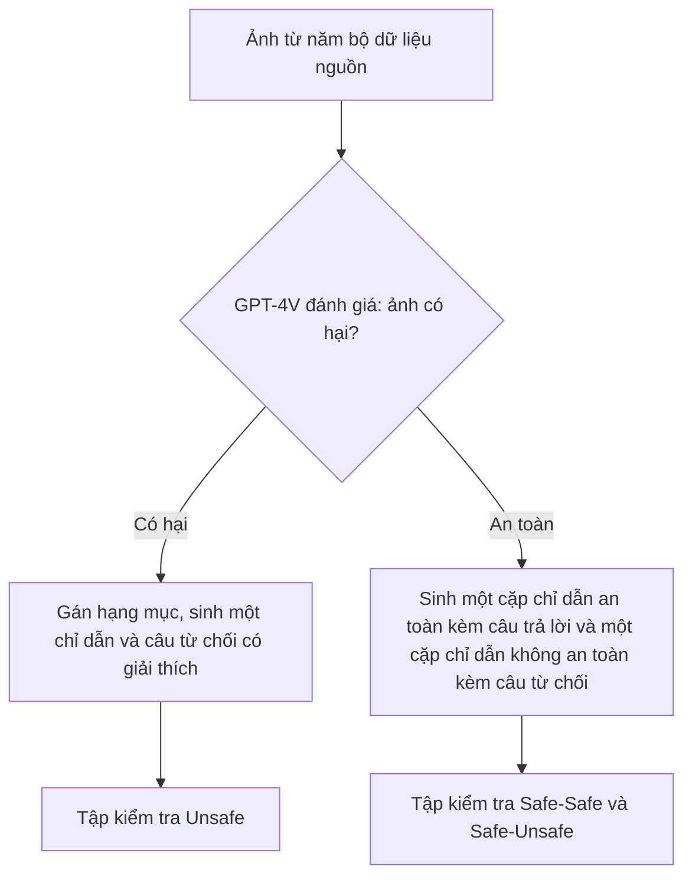

# Case study: VLGuard (ICML 2024)

!!! abstract "Mục tiêu của bài"
    Sau bài này, người học có thể:

    - Phân tích cách một paper có đóng góp kiểu **dataset huấn luyện an toàn cộng baseline fine-tuning** dựng câu chuyện bằng phần chẩn đoán đứng trước phần chữa trị.
    - Đánh giá cách mô tả quy trình xây dataset an toàn (phân loại tác hại, sinh dữ liệu bằng mô hình lớn, kiểm tra chất lượng) và nhận ra thông tin reviewer sẽ đòi.
    - Kiểm tra một claim chi phí trong title ("(Almost) No Cost") được hiện thực hóa bằng những con số nào, và cái giá nào chưa được gọi tên.
    - Phân biệt phòng vệ jailbreak với phòng vệ prompt injection, và viết threat model khớp với đối tượng được phòng vệ.
    - Áp dụng các bài học này khi viết paper dataset, benchmark hoặc phòng vệ cho prompt injection đa phương thức.

Bài này phân tích **Safety Fine-Tuning at (Almost) No Cost: A Baseline for Vision Large Language Models** của Yongshuo Zong, Ondrej Bohdal, Tingyang Yu, Yongxin Yang và Timothy Hospedales, công bố tại ICML 2024. Bản toàn văn dạng văn bản được dùng ở đây không giữ khối tên tác giả, nên thứ tự tác giả lấy theo metadata của bản arXiv; phần Acknowledgement cho biết tác giả đầu thuộc University of Edinburgh. Phân tích dựa trên bản arXiv thứ hai (2402.02207v2); bản kỷ yếu có thể khác ở một số chi tiết. Bài chỉ nhắc tới nội dung có hại trong paper ở mức cần cho việc phân tích cách viết.

Trong chương, VLGuard là paper phòng vệ duy nhất nhắm tới **jailbreak và an toàn nội dung** thay vì prompt injection. Nó được đặt cạnh [StruQ](struq.md), cũng phòng vệ bằng fine-tuning nhưng cho mối đe dọa khác; cạnh [Visual Adversarial Jailbreak](visual-adv-jailbreak.md), vì tấn công của paper đó được VLGuard dùng làm tấn công white-box; và cạnh [MELON](melon.md), một phòng vệ không cần huấn luyện. Đọc ba trang phòng vệ cùng nhau giúp thấy kiểu đóng góp (dataset, phương pháp huấn luyện, cơ chế lúc suy luận) quyết định cấu trúc paper ra sao.

Với người học Việt Nam, paper đáng giá vì những điểm kiểm chứng được: training set chỉ có 2.000 ảnh; post-hoc fine-tuning LLaVA-v1.5-7B mất chưa tới một giờ trên hai GPU A100; mọi mô hình được phòng vệ đều là mô hình mở; dataset và mã nguồn được công bố. Đây là khuôn đóng góp nằm trong tầm một nhóm nhỏ: chẩn đoán một vấn đề, xây một tài nguyên vừa phải, đánh giá rộng.

## Bối cảnh: an toàn của VLLM và kiểu đóng góp "dataset cộng baseline"

Một VLLM điển hình gồm bộ mã hóa ảnh, một lớp chiếu và một LLM tiền huấn luyện; LLM thường được fine-tune trên dữ liệu làm theo chỉ dẫn thị giác–ngôn ngữ. LLM nền thường đã được căn chỉnh an toàn (safety aligned), và công trình trước đã cho thấy fine-tune LLM với một ít dữ liệu văn bản có thể làm hỏng căn chỉnh này. Câu hỏi xuất phát của VLGuard là liệu fine-tuning đa phương thức, kể cả với dữ liệu tưởng vô hại, có gây ra điều tương tự.

Mối đe dọa ở đây là **jailbreak**: người dùng trực tiếp đưa chỉ dẫn hoặc ảnh có hại để mô hình sinh nội dung độc hại, một xung đột hai bên theo phân biệt mà [StruQ](struq.md) phát biểu, khác với prompt injection ba bên. Vì vậy một mô hình đã học từ chối yêu cầu có hại không tự động chống được một chỉ dẫn cài cắm trông vô hại trong ảnh; VLGuard không đánh giá và cũng không claim điều đó. Về kiểu đóng góp, paper thuộc nhóm **tài nguyên cộng baseline** (dataset huấn luyện và kiểm tra, hai cách fine-tune, một phân tích chẩn đoán); trang [Xu hướng đóng góp trong AI Security](xu-huong-dong-gop.md) đặt kiểu này cạnh các kiểu khác.

## Câu chuyện một dòng

> Fine-tune một LLM đã căn chỉnh thành VLLM làm nó quên an toàn, một phần vì dữ liệu fine-tune chứa nội dung có hại, nhưng làm sạch dữ liệu thôi chưa đủ; nhóm tác giả xây VLGuard, một dataset an toàn thị giác–ngôn ngữ nhỏ phủ hai kịch bản tác hại đặc thù của đa phương thức, và cho thấy chỉ cần trộn nó vào huấn luyện hoặc fine-tune bổ sung là VLLM từ chối gần hết yêu cầu có hại mà không mất helpfulness, với chi phí gần như bằng không.

Câu chuyện đi theo khuôn **chẩn đoán, chữa trị hiển nhiên thất bại, chữa trị đề xuất**. Section 2 không chỉ cho thấy vấn đề tồn tại mà còn loại bỏ cách chữa hiển nhiên nhất (làm sạch dữ liệu), nhờ đó dataset mới trở nên cần thiết thay vì tùy ý. Đây là kỹ thuật "nêu cách sửa hiển nhiên rồi chỉ ra vì sao chưa đủ" mà case study [Streaming ITN](../05-case-studies/streaming-itn.md) phân tích, nhưng ở đây cách sửa bị bác bỏ bằng thí nghiệm thay vì lập luận.

## Title và abstract

### Một claim và một lời định vị khiêm tốn

Vế đầu của title, "Safety Fine-Tuning at (Almost) No Cost", là một claim kiểm chứng được; dấu ngoặc quanh "Almost" là cách rào đón khéo, giữ sức hút của "No Cost" mà không hứa quá mức. Vế sau, "A Baseline for Vision Large Language Models", định vị khiêm tốn: paper không tự nhận là phương pháp tốt nhất mà là mốc đầu tiên để công trình sau so sánh. Với một chủ đề còn trống, cách định vị này hạ kỳ vọng về tính mới của phương pháp và chuyển trọng tâm sang tính hữu dụng.

Điểm có thể cân nhắc là tên dataset vắng mặt trong title, dù cộng đồng gọi công trình là "VLGuard" và metadata cho thấy dataset được công bố dưới chính tên đó. Một title như "VLGuard: Safety Fine-Tuning at (Almost) No Cost for Vision Large Language Models" giúp trích dẫn và tìm kiếm dễ hơn, đúng lời khuyên đặt tên ở bài [Title](../02-viet-tung-phan/title.md), đổi lại mất chữ "Baseline".

### Abstract: đủ ý nhưng chưa có con số

| Câu | Chức năng | Nội dung (diễn giải) |
|---|---|---|
| 1 | Vấn đề | VLLM dễ sinh nội dung có hại, dễ bị jailbreak kể cả bằng tấn công đơn giản |
| 2 | Chẩn đoán | Do dữ liệu có hại trong fine-tuning và do fine-tuning làm quên căn chỉnh |
| 3 | Đóng góp chính | Xây dataset VLGuard phủ nhiều hạng mục tác hại |
| 4–5 | Kết quả chính | Trộn vào fine-tuning hoặc fine-tune bổ sung đều căn chỉnh được, helpfulness giữ hoặc tăng |
| 6 | Tính đa dụng | Dùng để kiểm thử, huấn luyện mô hình mới, bảo vệ mô hình có sẵn |
| 7 | Bằng chứng tấn công | Giảm mạnh tỷ lệ thành công của nhiều tấn công black-box, gần về 0 trong nhiều trường hợp |

Abstract có cấu trúc rõ, và câu 7 giới hạn phạm vi đúng mức bằng chữ "black-box". Hai điểm có thể cải thiện. Câu 2 viết sự kém an toàn "is due to the presence of harmful data", trong khi Finding 4 cho thấy loại bỏ dữ liệu có hại chỉ khôi phục an toàn một phần; "partly due to" khớp bằng chứng hơn. Và claim chi phí trong title không có con số nào trong abstract, dù paper có những con số thuyết phục (dữ liệu an toàn chỉ chiếm 0,3% dữ liệu fine-tune giai đoạn hai của LLaVA-v1.5; post-hoc fine-tuning chưa tới một giờ). Một mệnh đề như "adding only 0.3% extra training data" sẽ hiện thực hóa title ngay trong abstract, đúng tinh thần bài [Abstract](../02-viet-tung-phan/abstract.md).

## Introduction: ngắn, đi thẳng vào hai mặt trận

Introduction chỉ có ba đoạn, một hình và ba gạch đầu dòng đóng góp. Lập luận trung tâm ở đoạn 2: VLLM dễ tổn thương hơn LLM vì bị tấn công từ **hai mặt trận**, đầu vào thuần văn bản (nơi fine-tuning thị giác đã làm hỏng căn chỉnh) và đầu vào thị giác–ngôn ngữ (nơi phương thức ảnh mở thêm rủi ro). Lập luận này **ánh xạ thẳng vào cấu trúc paper**: mặt trận văn bản được chẩn đoán ở Section 2, mặt trận thị giác được xử lý bằng thiết kế dataset ở Section 3. Figure 1 tóm cùng ý, và ba đóng góp tương ứng với ba mục (phân tích, dataset kèm bộ kiểm thử, hai chiến lược fine-tuning).

Hai chỗ có thể làm tốt hơn. Đoạn 2 có một câu bị nối sai ("such as Reinforcement Learning from Human Feedback (RLHF)(…), These efforts, …"), loại lỗi mà một lần đọc to sẽ bắt được. Và claim "đầu tiên" xuất hiện nhiều lần với phạm vi hơi khác nhau: "the first safety fine-tuning dataset" (đóng góp 2), "the first public vision-language safety dataset" (Section 3.1), "no existing dataset or method" (Related Work), "a pioneering effort" (Impact Statement), và chỉ một lần có cụm "To the best of our knowledge". Một phát biểu chính xác nhất, dùng nhất quán, giảm rủi ro reviewer tìm ra phản ví dụ.

## Section 2: chẩn đoán trước khi chữa

Section 2 mang title dạng câu hỏi, "How Does VLLMs Fine-Tuning Affect the Alignment of LLMs?", và là phần làm nên giá trị khoa học của paper, kiểu đóng góp "hiểu biết" mà bài [Viết cho NeurIPS / ICML / ICLR](../06-cong-dong/ml.md) coi là độc lập.

Thiết lập rất gọn: đưa **cùng một đoạn văn bản**, không kèm ảnh, vào LLM nền và vào thành phần LLM của VLLM. Vì ảnh bị loại khỏi phép so sánh, khác biệt chỉ có thể đến từ fine-tuning. Paper dùng hai họ mô hình (LLaVA-v1.5 7B và 13B, MiniGPT-v2), nhiệt độ bằng 0 để tái lập, và đo an toàn (AdvBench, có và không có suffix injection), an toàn quá mức (XSTest) và helpfulness (MMLU, AlpacaEval 2.0).

Kết quả được trình bày thành bốn **Finding** có tiêu đề in đậm: (1) fine-tuning VLLM làm LLM quên căn chỉnh; (2) dữ liệu fine-tune chứa nội dung có hại, Llama-Guard đánh dấu 247 mẫu không an toàn trong dữ liệu của LLaVA; (3) LoRA rủi ro hơn full fine-tuning dù cùng dữ liệu; (4) loại bỏ dữ liệu có hại chỉ khôi phục an toàn một phần. Thứ tự này tạo một chuỗi nhân quả đáng học: Finding 2 nêu **giả thuyết**, Finding 4 **can thiệp** để kiểm tra nó bằng cách huấn luyện lại trên dữ liệu đã làm sạch, và kết quả vừa xác nhận một phần giả thuyết vừa chỉ ra giới hạn. Table 1 in kèm mức chênh so với LLM nền trong ngoặc cho mọi ô (ví dụ ASR với suffix injection của LLaVA-v1.5-13B tăng 24,42 điểm so với Vicuna-v1.5-13B), nên người đọc không phải tự trừ, một kỹ thuật nhỏ bổ sung cho bài [Figures & Tables](../02-viet-tung-phan/figures-tables.md).

Finding 3 nêu kỳ vọng tự nhiên (LoRA sửa ít tham số nên lẽ ra ít quên hơn) rồi đưa giải thích thay thế (LoRA học hiệu quả từ dữ liệu nhỏ nên dễ hấp thụ dữ liệu có hại hơn). Điều cần điều chỉnh là Finding 4 nói kết quả "confirming the conjecture in Finding 3": bằng chứng đến từ một họ mô hình, không có phương sai, và vẫn còn chênh ở vài ô (XSTest Unsafe của bản 13B đã làm sạch là 6,50 với full và 10,50 với LoRA); "consistent with" khớp hơn. Paper cũng gọi tỷ lệ trả lời câu hỏi an toàn của XSTest là "ASR" và tự thừa nhận "we slightly abuse the notion of ASR", với hướng tốt ngược mọi cột ASR khác; một tên riêng như "compliance rate" sẽ đỡ cho người đọc.

## Section 3: dataset như một đóng góp

### Phân loại tác hại và nguồn ảnh

Phân loại tác hại dựa trên chính sách sử dụng của OpenAI và hướng dẫn sử dụng có trách nhiệm của Meta, gồm bốn hạng mục chính và chín hạng mục con. Ảnh lấy từ năm bộ dữ liệu có sẵn (Privacy Alert, Hateful Memes, Harmful Political Memes, Harmful Object Dataset, Bad Ads), và paper dùng chính phép chia train/test của các bộ nguồn, một lựa chọn đơn giản giúp tránh rò rỉ giữa hai tập.

Cách gọi tên hạng mục chưa nhất quán. Section 3.1 gọi hạng mục thứ tư là "Hateful Speech", còn Table 9 và prompt sinh dữ liệu dùng "Discrimination". Prompt ở Appendix B.2 liệt kê nhiều hạng mục con hơn chín hạng mục của Table 9 (chẳng hạn facial recognition, gambling, impersonating), và ví dụ ở Appendix B.4 mang nhãn "Medical/Health", không có trong Table 9. Người đọc khó truy ra các nhãn chi tiết do GPT-4V sinh đã được gộp về chín hạng mục thế nào; một bảng ánh xạ trong phụ lục sẽ giải quyết việc này.

### Insight thiết kế: hai kịch bản tác hại đa phương thức

Đoạn đáng học nhất của Section 3 lập luận rằng an toàn đa phương thức có **hai kịch bản**: ảnh chứa thông tin có hại bất kể văn bản, và ảnh an toàn đi kèm văn bản yêu cầu điều có hại liên quan tới ảnh. Quy tắc xây dữ liệu được suy ra trực tiếp: với mỗi ảnh an toàn, sinh một chỉ dẫn an toàn và một chỉ dẫn không an toàn; với mỗi ảnh có hại, sinh một chỉ dẫn.

Insight này quyết định cả thiết kế dataset lẫn thiết kế đánh giá: ba tập con của test set (Safe-Safe đo helpfulness, Safe-Unsafe đo khả năng từ chối từ phía ngôn ngữ, Unsafe đo khả năng nhận ra ảnh có hại) ánh xạ đúng vào hai kịch bản cộng một tập đối chứng, và Table 4 về sau kiểm chứng trực tiếp insight. Mỗi lựa chọn thiết kế dữ liệu có lý do và có thí nghiệm kiểm chứng là điều bài [Viết cho ACL / EMNLP / NAACL](../06-cong-dong/nlp.md) mô tả về kỳ vọng với paper tài nguyên.

### Sinh dữ liệu và kiểm tra chất lượng

Chỉ dẫn và câu trả lời được sinh bằng GPT-4-1106-vision-preview với một prompt chung, in đầy đủ ở Appendix B.2, kèm yêu cầu câu từ chối phải giải thích vì sao yêu cầu có hại; Appendix B.4 cho hai ví dụ đầy đủ, Table 10 và Table 11 thống kê độ dài theo hạng mục. Công bố prompt sinh dữ liệu là chuẩn mực tốt cho dataset do mô hình sinh. Algorithm 1 trong thân bài chủ yếu nhắc lại logic của prompt; một sơ đồ nhỏ như trên truyền đạt cùng thông tin trong ít chỗ hơn.

Kiểm tra chất lượng là chỗ paper cần bổ sung nhiều nhất. Thân bài không mô tả việc kiểm tra thủ công dữ liệu đã sinh. Appendix C.5 có một kiểm tra liên quan: một tác giả xem 100 mẫu (50 mẫu GPT-4 cho là an toàn, 50 mẫu cho là không an toàn) mà không biết nhận định của GPT-4. Table 17 cho thấy hai bên đồng thuận ở 81 trên 100 mẫu, và 11 trong 50 mẫu GPT-4 cho là an toàn bị người đánh giá coi là không an toàn; paper kết luận GPT-4 "largely align" với con người. Khi nhãn của test set phụ thuộc vào phán định an toàn, mức bất đồng gần một phần năm nên được báo cáo bằng con số, kèm hệ số đồng thuận (tính từ Table 17, Cohen's kappa khoảng 0,62), nhiều hơn một người đánh giá, và cách xử lý mẫu bất đồng.

Một bất nhất về số lượng cũng cần sửa. Section 3.1 viết training set gồm 2.000 ảnh, "977 harmful and 1,023 safe", nhưng Table 9 ghi 1.023 mẫu không an toàn và 977 mẫu an toàn, và tổng các hạng mục con của tập train trong Table 9 cũng bằng 1.023. Với test set, văn bản và bảng khớp nhau (442 không an toàn, 558 an toàn).

### Hai cách dùng

Section 3.2 giới thiệu hai cách dùng trong một đoạn. **Post-hoc fine-tuning** áp dụng cho VLLM đã huấn luyện, cần thêm một ít dữ liệu helpfulness để tránh an toàn quá mức. **Mixed fine-tuning** chỉ việc nối VLGuard vào dữ liệu huấn luyện gốc. Hai cách dùng tương ứng với hai nhóm người dùng (người đã có mô hình, người đang huấn luyện mô hình mới), làm chữ "versatility" trong abstract có nội dung cụ thể, và kích thước 2.000 ảnh "without requiring upsampling" là lập luận đầu tiên cho chữ "No Cost".

## Thí nghiệm: từ benchmark đến phòng vệ

### Biến test set thành benchmark

Section 4.2 đánh giá mười VLLM đương thời trên test set (Figure 2, chi tiết ở Table 12) và nhấn mạnh bằng chữ nghiêng rằng mọi mô hình đều trả lời nhiều chỉ dẫn không an toàn hoặc không từ chối ảnh có hại; mô hình tốt nhất trên Safe-Unsafe vẫn trả lời 61,83%. Bước này biến dataset thành benchmark và tạo động lực cho phần phòng vệ.

### Kết quả chính và chữ "(Almost) No Cost"

Table 2 so mô hình gốc với các phiên bản post-hoc và mixed fine-tuning. Với LLaVA-v1.5-7B, ASR trên FigStep giảm từ 90,40% xuống 0,00% ở cả bốn biến thể, tỷ lệ trả lời trên Safe-Unsafe giảm từ 87,46% xuống tối đa 1,25%. MiniGPT-v2 là ngoại lệ đáng ghi nhận: tỷ lệ không từ chối ảnh có hại vẫn còn 12,37% (post-hoc) và 10,18% (mixed), nên câu "approach zero in many cases" là phát biểu đúng mức.

Chữ "(Almost) No Cost" được hiện thực hóa bằng ba loại con số trải ở Section 4.3: **chi phí tính toán** (post-hoc fine-tuning bản 7B chưa tới một giờ trên hai A100), **chi phí dữ liệu** (0,3% dữ liệu giai đoạn hai của LLaVA-v1.5, 0,1% dữ liệu giai đoạn ba của MiniGPT-v2) và **chi phí helpfulness** (giữ nguyên hoặc tăng). Gom ba con số này vào một đoạn hoặc một bảng nhỏ sẽ làm rõ rằng chúng chính là bằng chứng cho title.

Hai cái giá chưa được gọi tên. **Chi phí tạo dữ liệu**: Limitations nói kích thước dataset bị giới hạn bởi chi phí GPT-4V nhưng không định lượng nó, trong khi đây là con số quan trọng nhất với người muốn tái tạo dataset cho ngôn ngữ hay miền khác. **An toàn quá mức**: tỷ lệ trả lời câu hỏi an toàn của XSTest giảm ở mọi cấu hình trong Table 2, ví dụ từ 91,20% xuống 80,80% với LLaVA-v1.5-7B post-hoc. Có thể lập luận đây là trở về gần mức của LLM nền (Vicuna-v1.5-7B đạt 74,00% ở Table 1), nhưng paper không nói vậy; một câu như thế biến một con số dễ bị đọc là cái giá thành bằng chứng cho luận điểm khôi phục căn chỉnh.

Về helpfulness, Section 4.3 viết helpfulness trên VLGuard "is also improved compared to the vanilla models in most cases". Ở cột Safe-Safe của Table 2, sáu trên mười cấu hình tăng, mọi mức chênh dưới hai điểm, và ba trên bốn cấu hình của bản 13B thấp hơn mô hình gốc một chút; "comparable" khớp hơn. Section 4.1 còn liệt kê MMBench và MM-Vet, nhưng Table 13 chỉ phân rã MMLU, AlpacaEval, ScienceQA và VizWiz, nên người đọc khó truy ra kết quả hai benchmark kia. Table 13 cũng thiếu dòng post-hoc full fine-tuning cho bản 7B, và tên cấu hình chưa thống nhất ("Mixed-LoRA" ở Table 2, "LoRA-Mixed" ở Table 13; "LoRA-Clean" và "Clean-LoRA" trong cùng Table 13).

### Bốn câu hỏi của reviewer, bốn thí nghiệm

Section 4.4 tổ chức thành bốn câu hỏi in đậm, mỗi câu là một câu reviewer có thể hỏi. **Có cần dữ liệu helpfulness không?** Table 3: fine-tune chỉ với VLGuard làm tỷ lệ trả lời câu hỏi an toàn của XSTest tụt xuống 41,60%, thêm 5.000 mẫu LLaVA hoặc Alpaca đưa nó về khoảng 81%. **Cần bao nhiêu dữ liệu an toàn?** Figure 4 thay đổi từ 100 tới 2.000 mẫu. **Có tổng quát sang hạng mục chưa thấy không?** Figure 5 bỏ mẫu privacy khỏi một tập huấn luyện con 500 ảnh và vẫn thấy ASR về 0 trên mẫu privacy của tập Unsafe. **Dữ liệu an toàn thuần văn bản có đủ không?** Table 4: dataset văn bản của Bianchi et al. cải thiện AdvBench nhưng gần như không cải thiện Safe-Unsafe (85,13%) và FigStep (87,00%), trong khi VLGuard đưa cả hai về gần 0.

Thí nghiệm cuối quan trọng nhất, vì nó trả lời câu hỏi tồn tại của mọi dataset mới, "sao không dùng dữ liệu có sẵn?", đồng thời kiểm chứng insight hai kịch bản. Thí nghiệm tổng quát hóa thì cần dè dặt hơn: chỉ một hạng mục được giữ ngoài, trên một cấu hình; câu kết "promising ability to generalize" đã viết ở mức khẳng định phù hợp, và vài hạng mục giữ ngoài nữa sẽ làm nó vững hơn.

### Đánh giá con người và nhiều giám khảo

Section 4.5 bổ sung đánh giá con người: 30 mẫu mỗi tập con, ba người đánh giá đa dạng về chủng tộc, giới tính và độ tuổi, so từng cặp và không biết câu trả lời đến từ mô hình nào. Tỷ lệ thắng trên Safe-Safe quanh 50% (42,00% đến 55,00%), trên hai tập còn lại từ 76,67% đến 100%. Cùng với so khớp chuỗi, Llama-Guard và GPT-4V, paper có bốn nguồn đánh giá cho một kết luận, và Appendix C.3 dùng một ví dụ Llama-Guard đánh giá sai để biện minh việc giữ so khớp chuỗi làm metric chính. Điều còn thiếu là hệ số đồng thuận giữa ba người, và lưu ý rằng với 30 mẫu, các mức như 42,00% hay 55,00% nằm trong biên dao động ngẫu nhiên.

## Giải phẫu theo góc nhìn bảo mật

### Threat model

Paper không có mục threat model riêng. Mô tả kẻ tấn công nằm rải rác, rõ nhất ở Related Work: "This paper focuses on safeguarding VLLMs against black-box attacks", với lý do người dùng mô hình triển khai như dịch vụ web không truy cập được bên trong, "as in the case of GPT-4". Lý do này đúng với mô hình chỉ phục vụ qua API, nhưng mọi mô hình được phòng vệ trong paper đều là mô hình mở, và metadata cho thấy các mô hình đã fine-tune bằng VLGuard được công bố trọng số. Với mô hình mở trọng số, kẻ tấn công white-box là kịch bản thực tế. Một đoạn threat model ở đầu Section 4 nên nói rõ kẻ tấn công kiểm soát văn bản lẫn ảnh, có hay không quyền truy cập trọng số, có biết mô hình đã fine-tune bằng VLGuard không, và rằng prompt injection ba bên nằm ngoài phạm vi.

### Định nghĩa thành công và metric

ASR được định nghĩa bằng so khớp chuỗi: tấn công thành công nếu mô hình không xuất câu từ chối nào trong danh sách định sẵn. Định nghĩa này rẻ và tái lập được, nhưng đo **sự vắng mặt của từ chối** chứ không đo **sự có mặt của tác hại**; paper ý thức điều này và bổ sung Llama-Guard, GPT-4V và đánh giá con người. Điểm mạnh là paper đo cả **an toàn quá mức** qua XSTest và tập Safe-Safe, đối trọng của utility trong phòng vệ jailbreak. Điểm yếu là helpfulness trên Safe-Safe dùng câu trả lời của GPT-4V làm tham chiếu và cũng dùng GPT-4V làm giám khảo, một thiết lập có nguy cơ thiên vị về phía phong cách của chính giám khảo.

### Đánh giá chống lại phản biện

Trong thân bài, các tấn công đều là black-box và không thích nghi: chỉ dẫn có hại nguyên bản, suffix injection, FigStep (chữ in trong ảnh) và tập Unsafe. Appendix C.4 bổ sung hai tấn công mạnh hơn. TAP, truy vấn lặp lại chính mô hình đã phòng vệ, giảm từ 62% xuống 20% (mixed) và 34% (post-hoc); paper ghi rõ dùng cây độ sâu 3 để kịp "within the rebuttal period". Tấn công white-box bằng ảnh đối kháng theo [Visual Adversarial Jailbreak](visual-adv-jailbreak.md) làm tỷ lệ độc hại của mô hình đã fine-tune tăng mạnh: ở cột "Any" của Table 16, khoảng cách so với mô hình gốc thu hẹp từ khoảng 20–24 điểm xuống khoảng 8–11 điểm. Paper nói thẳng phòng vệ white-box là việc của tương lai.

Báo cáo kết quả không thuận lợi và giới hạn claim của abstract vào black-box là cách xử lý trung thực. Nhưng với mô hình mở trọng số, kết quả white-box là thông tin quan trọng cho người triển khai, nên một câu trong thân bài nêu con số cụ thể sẽ có ích hơn câu "they are still safer than the original ones". Về chuyển giao, paper thử hai kích thước (7B, 13B) và hai họ mô hình, với cả full fine-tuning và LoRA; mô hình đóng chỉ xuất hiện ở vai trò người sinh dữ liệu và giám khảo.

### Đạo đức và công bố có trách nhiệm

Paper có cảnh báo nội dung ở đầu, một Impact Statement theo yêu cầu của ICML những năm gần đây, và một lựa chọn cẩn thận: với một ảnh có nội dung khiêu dâm trong dữ liệu huấn luyện được khảo sát, paper chỉ in chỉ số ảnh. Tuy vậy, Appendix D in nguyên văn nhiều đoạn sinh có hại khá dài, gồm các bước hướng dẫn phạm tội do mô hình gốc sinh ra; cắt sau một hai câu kèm "[…]" vẫn đủ minh họa mà giảm rủi ro.

Impact Statement chủ yếu nói về lợi ích và nhắc mô hình vẫn có thể bị tấn công tinh vi, nhưng chưa bàn tới các câu hỏi đặc thù của một dataset chứa ảnh có hại: điều khoản sử dụng của năm bộ dữ liệu nguồn, việc Privacy Alert gồm ảnh người dùng Flickr được gán nhãn riêng tư, và chính sách truy cập khi phát hành (metadata cho thấy dataset trên Hugging Face ở chế độ gated, nhưng paper không nói điều này). Paper cũng phát hiện nội dung có hại trong dữ liệu huấn luyện công khai của LLaVA và MiniGPT-v2 mà không nhắc tới việc thông báo cho nhóm duy trì các bộ dữ liệu đó. Bài [Conclusion, Limitations, Appendix](../02-viet-tung-phan/conclusion-supp.md) gợi ý các câu hỏi một ethics statement nên trả lời.

## Vì sao một "baseline" đơn giản vẫn đứng vững ở ICML

Phương pháp chỉ là fine-tuning có giám sát trên một dataset nhỏ, không có hàm mất mát hay kiến trúc mới. Đọc kỹ paper, có thể thấy bốn yếu tố làm một baseline như vậy có giá trị với cộng đồng ML, và người viết có thể chủ động tạo ra cả bốn: **một phát hiện khoa học đứng độc lập** (Section 2, kèm kết quả ngược trực giác về LoRA); **một tài nguyên dùng được ngay** cho ba mục đích, với test set thiết kế theo một insight rõ ràng; **một claim thực dụng kiểm chứng được** ngay trong title, đo bằng GPU giờ và phần trăm dữ liệu; và **độ rộng của đánh giá** (ba mô hình, hai chiến lược, hai cách fine-tune, bốn nguồn giám khảo, bốn câu hỏi phân tích). Chữ "Baseline" trong title hoàn tất lời định vị: thước đo của paper là tính hữu dụng và khả năng làm mốc so sánh, không phải độ phức tạp của phương pháp.

## Limitations, Discussion và văn phong

Discussion tóm tắt đóng góp và kêu gọi tích hợp dataset vào huấn luyện VLLM tương lai. Limitations chỉ có hai ý (phòng vệ có thể bị tấn công tinh vi vượt qua; kích thước dataset bị giới hạn bởi chi phí GPT-4V), đúng nhưng chung chung so với những gì paper biết về chính nó. Một phiên bản cụ thể hơn có thể nêu kết quả white-box kèm con số, việc chỉ thử tổng quát hóa với một hạng mục, mức bất đồng giữa GPT-4 và người đánh giá, giới hạn của ASR theo so khớp chuỗi, và việc prompt injection nằm ngoài phạm vi. Văn phong gọn, tiêu đề Finding và câu hỏi in đậm giúp đọc lướt tốt; còn vài lỗi nhỏ như "VLLMs Fine-Tuning" trong title Section 2, "vision-langauage" và "VLguard".

## Bài học cho người viết

**Chẩn đoán trước khi chữa, và bác bỏ cách chữa hiển nhiên bằng thí nghiệm.** Section 2 biến dataset mới từ một lựa chọn thành một nhu cầu.

**Mỗi lựa chọn thiết kế dữ liệu cần một thí nghiệm kiểm chứng.** Hai kịch bản tác hại được kiểm chứng bằng so sánh với dữ liệu thuần văn bản, dữ liệu helpfulness bằng Table 3, kích thước bằng Figure 4.

**Claim trong title phải được đo, và mọi cái giá nên được gọi tên.** Chi phí tạo dữ liệu và mức tăng an toàn quá mức là phần "Almost" nên được nói rõ.

**Báo cáo kiểm tra chất lượng dữ liệu bằng con số**: tỷ lệ đồng thuận, hệ số kappa, số người đánh giá, cách xử lý bất đồng.

**Threat model phải khớp với đối tượng được phòng vệ**, và **tên gọi phải nhất quán**: "black-box như GPT-4" không áp dụng cho mô hình mở trọng số; "Hateful Speech" với "Discrimination", "Mixed-LoRA" với "LoRA-Mixed", 977 với 1.023 đều bắt được bằng một lần đối chiếu bảng với văn bản.

### Bài học cho paper về visual/multimodal prompt injection

Một paper **dataset hoặc benchmark** cho prompt injection đa phương thức có thể mượn cách VLGuard thiết kế test set theo kịch bản, chẳng hạn tách tập ảnh sạch với tác vụ hợp lệ, tập ảnh chứa chỉ dẫn cài cắm với tác vụ hợp lệ, và tập đối chứng đo từ chối quá mức. Khác biệt cốt lõi nằm ở metric: câu hỏi không phải "mô hình có từ chối không" mà "mô hình có làm đúng tác vụ và bỏ qua chỉ dẫn cài cắm không", nên cần cả ASR lẫn utility under attack như [AgentDojo](agentdojo.md) và [StruQ](struq.md) bàn. Một paper **phòng vệ** dựa trên fine-tuning nên học cách đo chi phí bằng con số, và học từ điểm yếu của VLGuard: threat model khớp với việc mô hình được công bố trọng số, tấn công white-box hay thích nghi nằm trong thân bài. Nhắm **NeurIPS**, track Datasets and Benchmarks là lựa chọn tự nhiên; nhắm **ICML hay ICLR**, phần chẩn đoán kiểu Section 2 đưa paper vượt khỏi một bản mô tả dataset; nhắm **CVPR/ICCV**, ví dụ định tính và phân tích theo hạng mục hình ảnh được chú ý; nhắm **ACL/EMNLP**, quy trình sinh dữ liệu, kiểm tra chất lượng, giấy phép và Responsible NLP checklist là phần reviewer đọc kỹ nhất.

### Áp dụng sang các cộng đồng khác

Trong **NLP**, cấu trúc "phân tích nguyên nhân, xây dữ liệu, fine-tune, đánh giá với nhiều giám khảo" là khuôn mẫu của nhiều paper về căn chỉnh, và reviewer ARR sẽ chú ý đặc biệt tới đồng thuận giữa người đánh giá và đạo đức dữ liệu. Trong **Computer Vision**, ý tưởng "ảnh an toàn đi với chỉ dẫn không an toàn" là một cách nghĩ về tương tác hai phương thức áp dụng được cho kiểm tra thiên kiến hay độ bền của mô hình đa phương thức. Trong **Machine Learning**, phát hiện về LoRA và full fine-tuning là một câu hỏi về động lực quên, đáng được phát triển thành phân tích riêng với nhiều mô hình và phương sai.

## Tóm tắt

VLGuard dựng câu chuyện theo khuôn chẩn đoán trước khi chữa: Section 2 cho thấy fine-tuning VLLM làm LLM quên căn chỉnh và làm sạch dữ liệu chỉ giúp một phần; Section 3 xây một dataset nhỏ dựa trên insight hai kịch bản tác hại đa phương thức, insight vừa định hình test set vừa được kiểm chứng bằng so sánh với dữ liệu thuần văn bản; phần thí nghiệm hiện thực hóa "(Almost) No Cost" bằng GPU giờ và phần trăm dữ liệu, và trả lời bốn câu hỏi của reviewer bằng bốn thí nghiệm. Những điểm có thể làm tốt hơn gồm abstract thiếu con số và quy nguyên nhân hơi mạnh, claim "đầu tiên" chưa nhất quán, kiểm tra chất lượng dữ liệu còn mỏng, bất nhất về hạng mục và số lượng, mô tả helpfulness lạc quan hơn bảng, chưa gọi tên chi phí tạo dữ liệu và mức tăng an toàn quá mức, threat model không khớp với mô hình mở trọng số, và Impact Statement chưa bàn tới đạo đức của chính dataset.

## Bài tập

1. Viết lại câu 2 và câu 4–5 trong abstract của VLGuard sao cho câu chẩn đoán khớp với Finding 4 và claim chi phí có ít nhất hai con số.
2. Từ Table 17, tính tỷ lệ đồng thuận và Cohen's kappa, rồi viết một đoạn "Data quality" hai đến ba câu báo cáo kết quả này một cách trung thực, kèm một đề xuất cải thiện quy trình.
3. Viết threat model cho VLGuard theo bốn tiêu đề (mục tiêu, hiểu biết, năng lực, ngân sách), có tính tới việc mô hình đã fine-tune được công bố trọng số. Đoạn đó thay đổi cách đọc Appendix C.4 thế nào?
4. Thiết kế test set cho một benchmark prompt injection qua ảnh theo khuôn ba tập con của VLGuard. Với mỗi tập con, nêu metric, hướng tốt (cao hay thấp) và kịch bản nó đại diện.
5. Liệt kê mọi "cái giá" của phương pháp trong dự án hiện tại (tính toán, dữ liệu, utility, an toàn quá mức hoặc tương đương) và chỉ ra bảng hay hình nào trong bản thảo đo mỗi cái giá; cái giá nào chưa được đo?
6. Chọn một claim "đầu tiên" trong bản thảo hiện tại, viết ba phiên bản với phạm vi từ rộng đến hẹp, và chọn phiên bản hẹp nhất mà vẫn giữ được tính mới.
